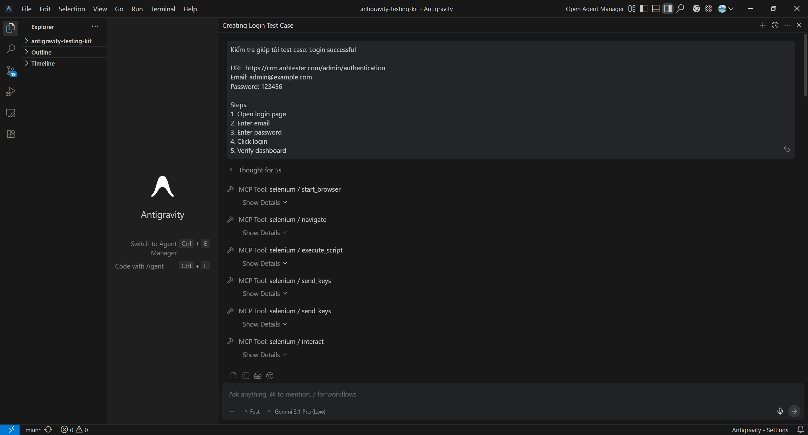
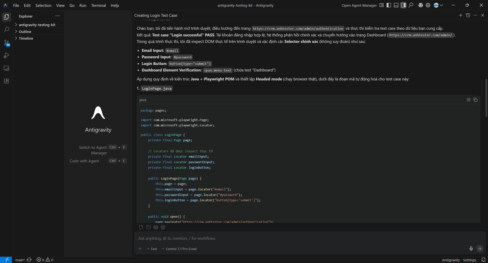
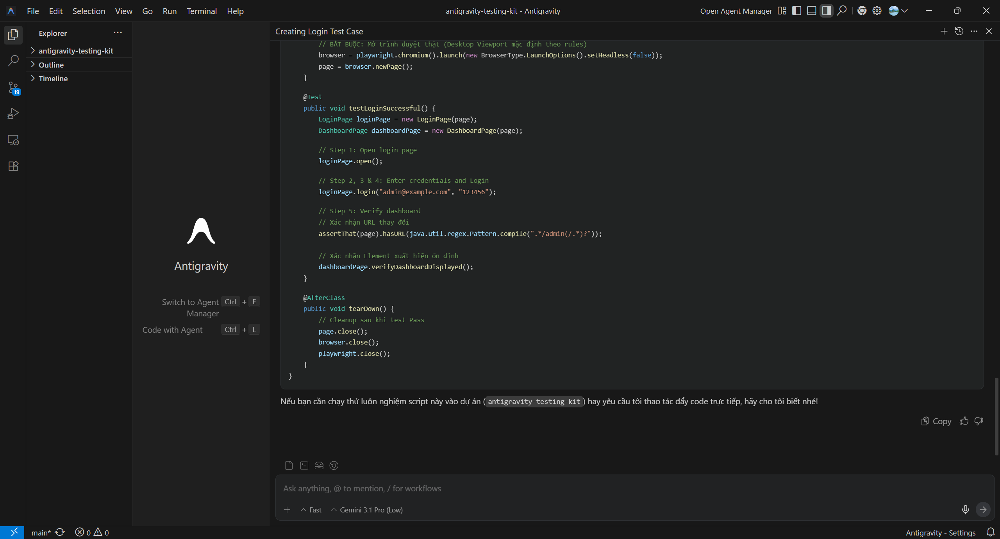
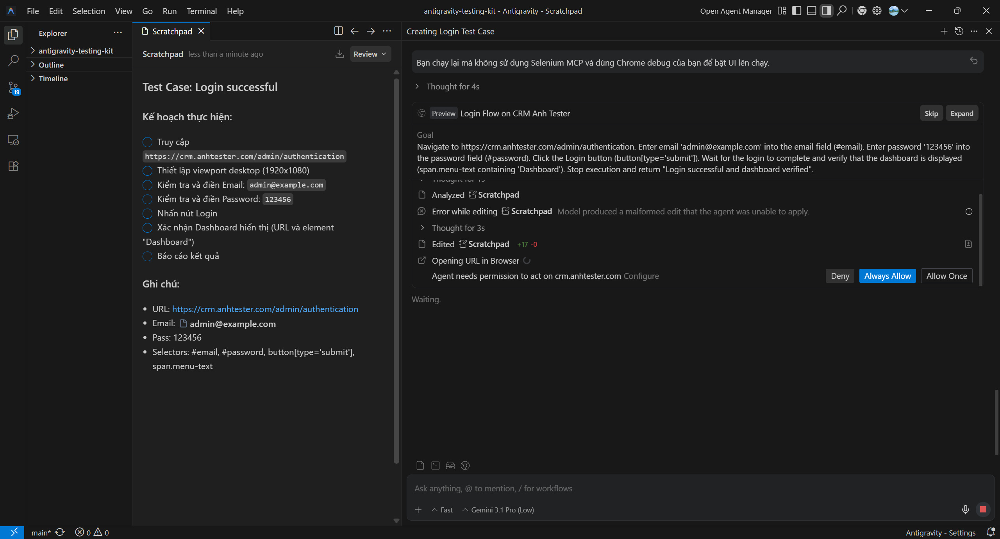
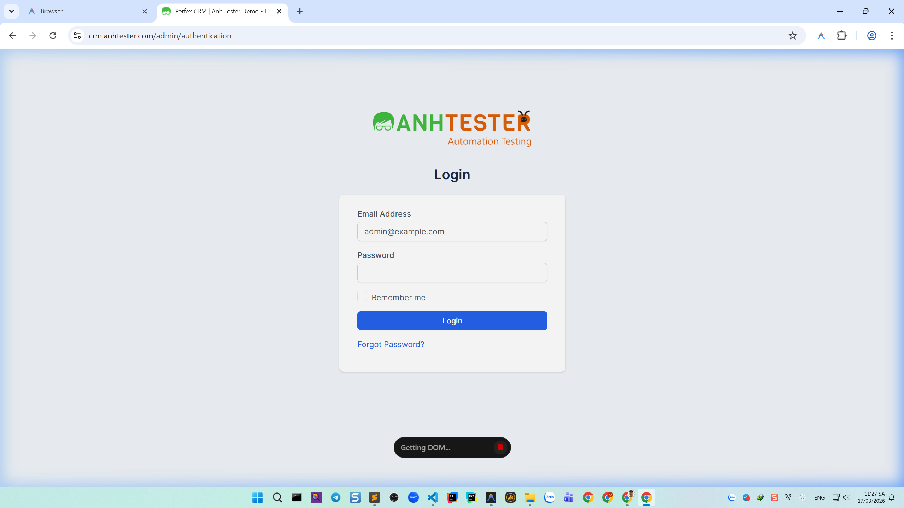
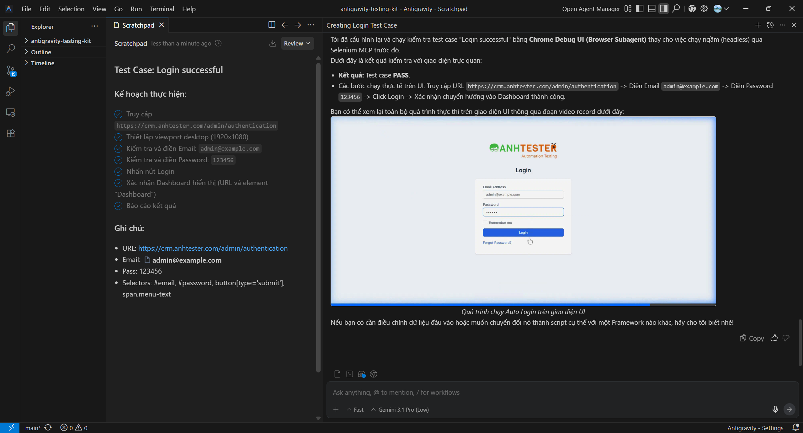
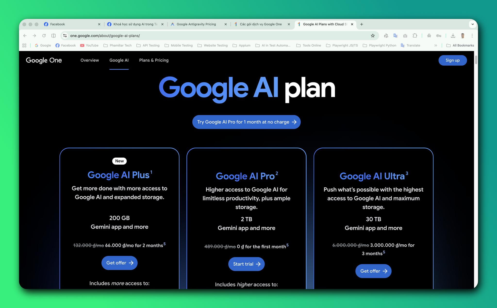

# Bài 2 - [AI Test Automation] Giới thiệu và Cài đặt sử dụng công cụ Google Antigravity

Chương: 1. Nội dung khoá học

Nguồn: [https://anhtester.com/learn/khoa-hoc-su-dung-ai-trong-testing-voi-google-antigravity/284](https://anhtester.com/learn/khoa-hoc-su-dung-ai-trong-testing-voi-google-antigravity/284)

[Video nhúng](https://www.youtube.com/embed/UZ3BsPsbg6g)

3 giờ 12 phút

Trong **Bài 1**, chúng ta đã nói về **con đường ứng dụng AI trong Test Automation từ năm 2026**, nơi Tester không chỉ viết test script mà còn **điều khiển AI Agent để thực hiện testing**.  
  
Ở **Bài 2**, chúng ta sẽ bắt đầu với một công cụ rất đáng chú ý:

🧠 **Google Antigravity** – nền tảng giúp bạn dùng AI để khám phá ứng dụng, viết automation và tạo test case gần như tự động.

### Bài này sẽ tập trung vào:

✨ Google Antigravity là gì

🧠 Nó hoạt động như thế nào

⚙️ Cách đăng ký và cài đặt

🔧 Cấu hình môi trường để dùng cho Test Automation

🚀 Kiểm tra hoạt động đầu tiên với yêu cầu Test Automation thực chiến

## 🧠 1. Google Antigravity là gì?

**Google Antigravity** là một nền tảng AI mới của Google dùng để xây dựng **AI Agents có khả năng thao tác trên ứng dụng giống như con người**.  
  
Điều này mở ra một hướng mới dành cho **Tester** hỗ trợ công việc kiểm thử **Manual** và **Test Automation**.  
  
Thay vì:

`Tester viết test cases → viết script
→ Selenium / Playwright chạy
→ Kiểm tra kết quả`

Thì bây giờ chúng ta có thể làm theo cách mới:

`Tester mô tả hành động
→ AI Agent hiểu ứng dụng
→ AI tự thao tác UI
→ AI sinh test case và Automation script → Xuất báo cáo chi tiết`

### 

### 📌 Antigravity hỗ trợ rất mạnh cho

- Web Testing (mạnh nhất về Debug cấu trúc DOM với Chromium browser)
- API Testing
- Mobile Testing
- UI Exploration
- Test Case Generation
- Automation Script Generation
- Smart Locator Detection

  

---

## ⚡ 2. Vì sao Antigravity cực kỳ phù hợp cho Tester?

Một số khả năng khiến **Antigravity** trở thành **game changer cho Test Automation**:

### 🔍 1. AI tự khám phá ứng dụng

AI có thể:

- Mở trang web
- Click các element
- Phân tích UI structure
- Hiểu flow của application

Giống như một **Junior Tester chạy exploratory testing 24/7**.

### 

### 🧠 2. Hiểu được ngữ nghĩa UI

Thay vì locator kiểu cũ:

`//div[3]/div[2]/button//button[normalize-space()='Login']`

AI sẽ hiểu luôn như một con người dùng mắt quan sát:

`"Login button"  
"Submit order"  
"Add to cart"`

Điều này giúp automation **ổn định hơn rất nhiều**. Nhờ vào công nghệ **UI Vision** quan sát và hiểu UI**,** **Debug DOM** trực tiếp và có thể kết hợp với các **MCP Server** như Selenium MCP, Appium MCP, Playwright MCP để điều khiển và sinh script nhanh đúng chuẩn.

### 

### ⚙️ 3. Sinh Automation Script

Antigravity có thể tạo:

- Playwright scripts
- Selenium scripts
- Test steps
- Test scenarios

Ví dụ yêu cầu bằng ngôn ngữ tự nhiên theo dạng mô tả hoặc từ một test case manual:

`Kiểm tra giúp tôi test case: Login successful  
  
URL: https://crm.anhtester.com/admin/authentication  
Email: admin@example.com  
Password: 123456  
  
Steps:  
1. Open login page  
2. Enter email  
3. Enter password  
4. Click login  
5. Verify dashboard`

Với mô tả trên là Antigravity có thể hiểu được và debug từng bước làm theo yêu cầu đến khi đạt được kết quả cuối cùng và có thể xuất ra script automation luôn để chúng ta chạy lại được.

### 🚀 4. Tích hợp AI Workflow

Bạn có thể xây dựng workflow kiểu:

`Explore Application
→ Generate Test Cases
→ Generate Automation
→ Execute Tests`

Đây chính là nền tảng của **Agentic AI Testing**.

### 🔆 Demo sử dụng Antigravity thực hiện kiểm thử từ mô tả trên

[](https://anhtester.com/storage/photos/shares/lesson/antigravity/bai2_setup_antigravity/2026-03-17_11-24-28.png)  
[](https://anhtester.com/storage/photos/shares/lesson/antigravity/bai2_setup_antigravity/2026-03-17_11-24-36.png)  
[](https://anhtester.com/storage/photos/shares/lesson/antigravity/bai2_setup_antigravity/2026-03-17_11-24-54.png)  
[](https://anhtester.com/storage/photos/shares/lesson/antigravity/bai2_setup_antigravity/2026-03-17_11-27-26.png)  
[](https://anhtester.com/storage/photos/shares/lesson/antigravity/bai2_setup_antigravity/2026-03-17_11-27-54.png)  
[](https://anhtester.com/storage/photos/shares/lesson/antigravity/bai2_setup_antigravity/2026-03-17_11-28-55.png)

## 🧰 3. Yêu cầu trước khi cài Antigravity

Trước khi bắt đầu, bạn nên chuẩn bị:

### 💻 Máy tính

Khuyến nghị:

- RAM: **16GB**
- Cài sẵn Chrome / Edge mới nhất

### 

### 🧠 Tài khoản Google AI

Bạn cần một tài khoản có quyền truy cập **Google AI Plan** như gói **Pro** và **Ultra** để sử dụng thoải mái hơn.  
  
Hoặc bạn cũng có thể mua Credits rời nhưng sẽ hơi tốn kém hơn so với mua dạng gói.  
  
Các bạn cần chuẩn bị account Google AI Pro hoặc Ultra thì mới dùng được Antigravity nhé.  
  
[https://one.google.com/about/google-ai-plans/](https://one.google.com/about/google-ai-plans/?fbclid=IwZXh0bgNhZW0CMTAAYnJpZBExbUVkb1hheEkwUmd0QVhoWHNydGMGYXBwX2lkEDIyMjAzOTE3ODgyMDA4OTIAAR5O1gHOOxnswYgdtdjxNf3Xo4A21SH48od-B4HivHGGj5j87jXjtt1dOteTbQ_aem_ZmFrZWR1bW15MTZieXRlcw)  
[https://antigravity.google/](https://antigravity.google/?fbclid=IwZXh0bgNhZW0CMTAAYnJpZBExbUVkb1hheEkwUmd0QVhoWHNydGMGYXBwX2lkEDIyMjAzOTE3ODgyMDA4OTIAAR4qJSFTS48ezaS1S1QGYhPj3PAKoDJ8HADjf9eFlLHXPODwh-KGUa3T6UzB4Q_aem_vCX0J99aBFAU4cHrm-37bg)  
  
[](https://anhtester.com/storage/photos/shares/lesson/antigravity/bai2_setup_antigravity/651094614_917492037697437_5089030477400325021_n.jpg)  
  
**Góp ý**: Các bạn mới học hoặc đang trong giai đoạn học ngâm cứu Antigravity thì nên mua gói Ultra dạng được add vào Family từ các bên ngoài bán để học cho rẻ, tầm 300k 350k 400k gì đó cho 1 tháng. (nếu cần thì nhắn mình trong nhóm Telegram mình share cho vài chỗ người bán uy tín)  
  
Gói Pro thì cũng được nhưng sợ đang ngâm cứu thì hết token 😂  
(giá thì hiện tại gói Pro mình thấy nhiều người bán 99k 100k)

## ⚙️4. Cài đặt Antigravity

Dưới đây là hướng dẫn chi tiết các bước cài đặt và thiết lập **Google Antigravity:**

#### 🟡 1. Tải xuống và Cài đặt

- Truy cập trang chủ: <https://antigravity.google/download>
- Chọn phiên bản phù hợp với thiết bị của bạn:
  - **Windows:** Tải tệp `.exe`. Khuyến nghị cài đặt trên **ổ C:** để tránh các lỗi phân quyền hoặc lỗi đăng nhập.
  - **macOS:** Tải tệp `.dmg`, kéo biểu tượng vào thư mục **Applications**.
  - **Linux:** Tải gói `.deb` hoặc `.rpm` và cài đặt qua terminal.

#### 🟡 2. Thiết lập Ban đầu (Initial Setup)

Khi khởi chạy ứng dụng lần đầu, hệ thống sẽ dẫn bạn qua các bước cấu hình:

- **Chọn luồng thiết lập (Setup flow):** Chọn **"Start Fresh"** nếu bạn muốn bắt đầu mới, hoặc **"Import from Cursor/VS Code"** để nhập lại các cấu hình và tiện ích cũ.
- **Chọn giao diện (Theme):** Lựa chọn giữa chế độ Tối (Dark), Sáng (Light) hoặc Độ tương phản cao.
- **Cài đặt Tiện ích mở rộng:** Đồng ý cài đặt các **Recommended Extensions** (thường là các plugin ngôn ngữ và hỗ trợ AI) để tối ưu hóa khả năng của tác nhân.
- **Đăng nhập:** Nhấn "Sign in with Google" và hoàn tất đăng nhập trên trình duyệt web, sau đó đồng ý với các **Điều khoản sử dụng**.

#### 🟡 3. Cấu hình Chính sách Thực thi (Agent Policies)

Đây là phần quan trọng nhất để kiểm soát quyền hạn của AI:

- **Terminal Execution Policy (Chạy lệnh Terminal):**
  - **Turbo:** AI tự động chạy mọi lệnh.
  - **Auto (Khuyến nghị):** AI tự chạy lệnh an toàn và xin phép với lệnh nhạy cảm.
  - **Off:** AI phải hỏi ý kiến bạn trước mỗi lệnh.
- **Review Policy (Duyệt kế hoạch và Mã nguồn):**
  - **Always Proceed:** AI tự làm việc không dừng.
  - **Agent Decides:** AI tự quyết khi nào cần bạn duyệt.
  - **Request Review:** Bạn phải duyệt qua mọi kế hoạch và tệp tin AI tạo ra trước khi nó tiếp tục.
- **Gợi ý:** Nếu là người mới, bạn nên chọn cấu hình sẵn là **"Agent-assisted development"** để có sự cân bằng giữa tốc độ và sự kiểm soát.

#### 🟡 4. Thiết lập Tính năng Nâng cao

- **Browser Mode (Chế độ Trình duyệt):** Nhấn vào nút "Browser" ở góc dưới bên trái giao diện. Bạn sẽ được hướng dẫn cài đặt **Chrome extension**. Tính năng này cho phép AI tự động mở trình duyệt để kiểm thử giao diện (UI) và thực hiện các tác vụ web.
- **Rules (Quy tắc dự án):** Bạn có thể tạo tệp **.antigravity/rules.md** trong thư mục dự án. AI sẽ tự động đọc tệp này để tuân thủ các tiêu chuẩn code, cách đặt tên hoặc định dạng tài liệu của riêng bạn.
- **Workflows (Quy trình làm việc):** Định nghĩa các tác vụ lặp lại trong thư mục **.agent/workflows/** và kích hoạt chúng bằng lệnh **/** trong khung chat.

#### 🟡 5. Cách vận hành cơ bản

- **Mở dự án:** Sử dụng **Open Folder** để trỏ đến thư mục mã nguồn trên máy.
- **Agent Manager:** Sử dụng phím tắt **Ctrl + E** (hoặc Cmd + E) để mở bảng quản lý. Tại đây bạn có thể chạy nhiều tác nhân AI song song cho các nhiệm vụ khác nhau.
- **Tương tác:** Nhập yêu cầu bằng ngôn ngữ tự nhiên. AI sẽ xuất ra các **Artifacts** (tạo tác) như bản kế hoạch, danh sách công việc hoặc video quay màn hình kiểm thử để bạn theo dõi và phê duyệt.

## 📗5. Sử dụng Antigravity

### 🎯 Mục tiêu đạt được cơ bản

- 🧠 Thiết lập **Browser Agent**
- ⚙️ Quản lý **Agent Manager**
- 📎 Đính kèm **file / media**
- **🧩** Dùng **Prompt** để giao tiếp với AI Agent

  

**Antigravity** xoay quanh 1 thứ duy nhất:

> 👉 **AI Agent**

Bạn không viết code, bạn chỉ cần **ra lệnh cho AI**.

### 🧩 Flow hoạt động

```markdown
Bạn nhập prompt
↓
AI hiểu yêu cầu
↓
AI mở browser (nếu cần)
↓
AI thao tác UI (nếu cần)
↓
AI trả kết quả (test case / script / report)
```