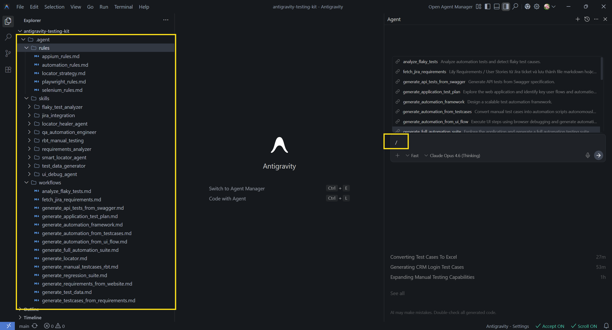
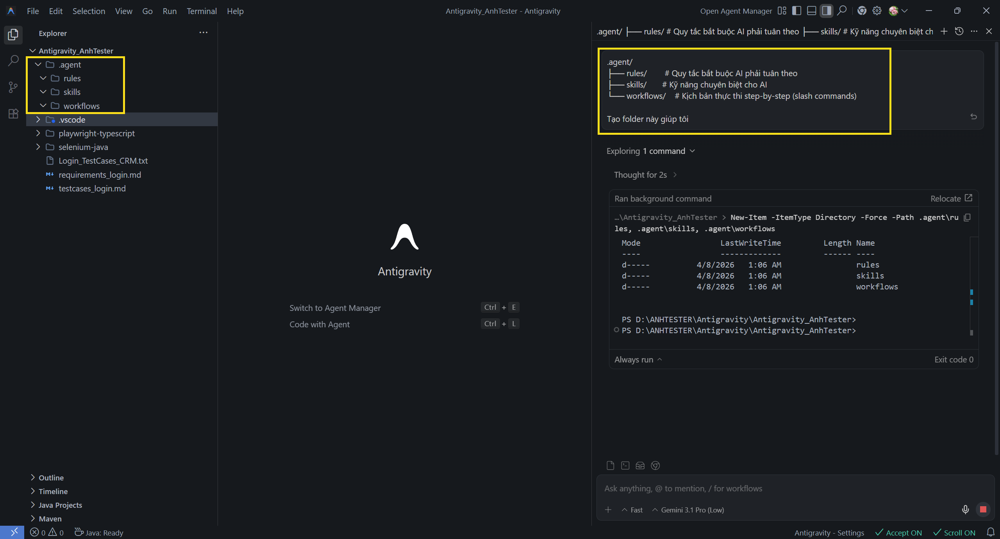
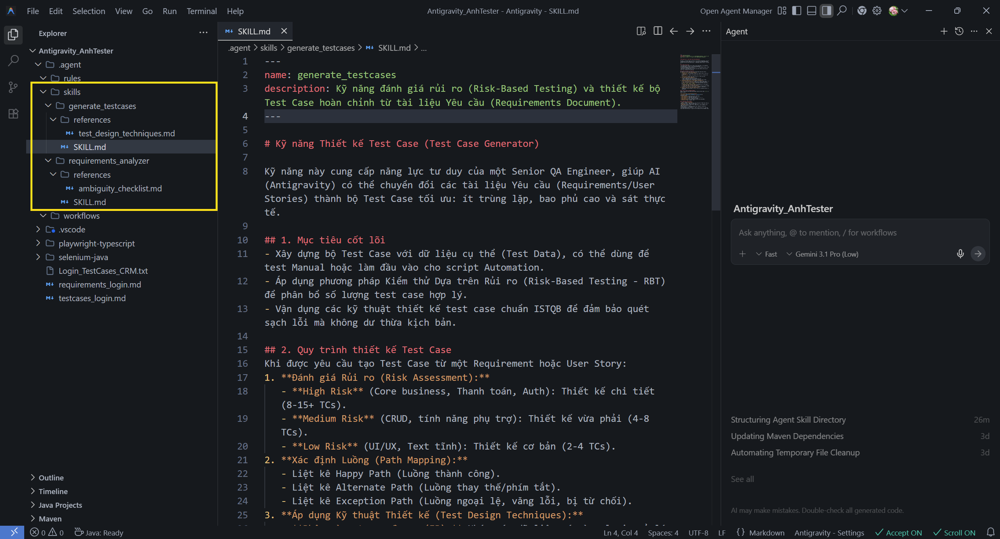
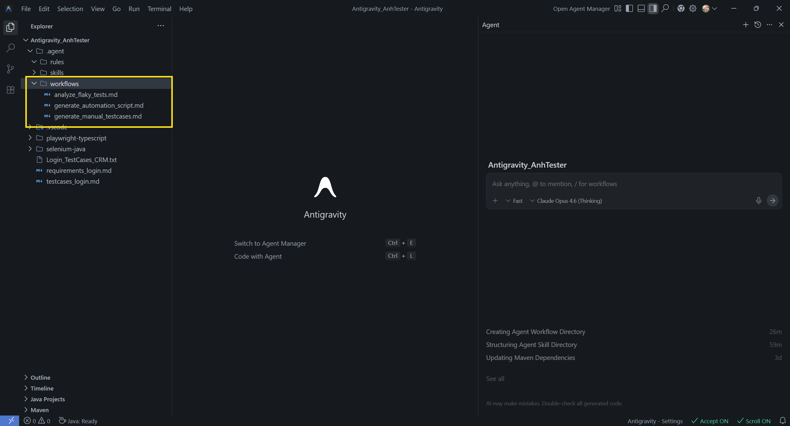
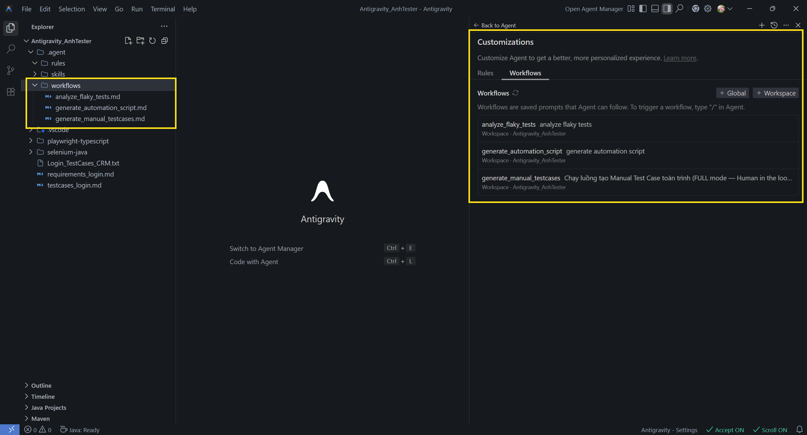
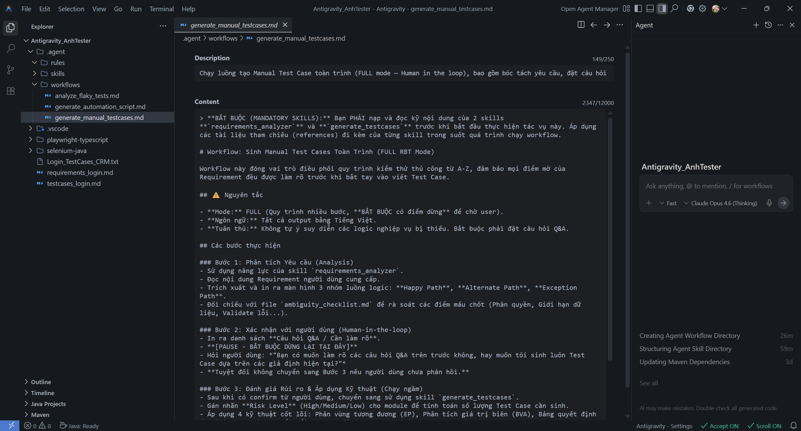
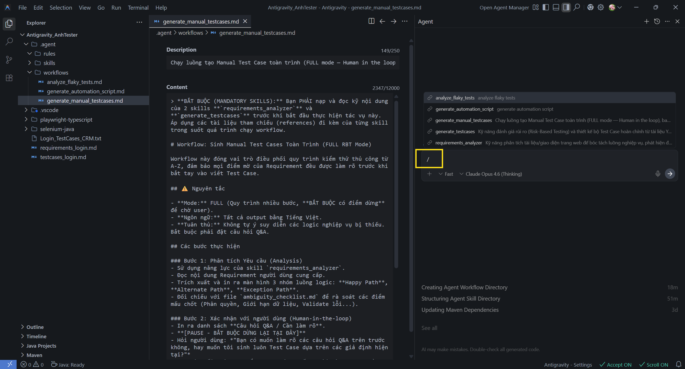
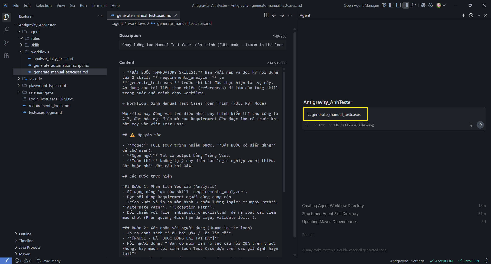
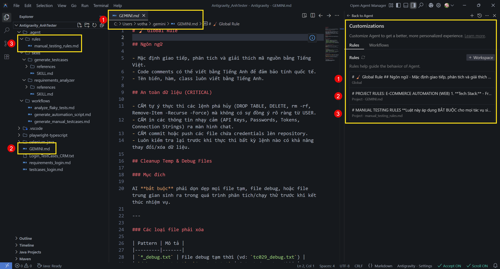

# Bài 4 - [AI Test Automation] Cách thiết lập SKILL WORKFLOW RULE cho AI Agent trên Antigravity

Chương: 1. Nội dung khoá học

Nguồn: [https://anhtester.com/learn/khoa-hoc-su-dung-ai-trong-testing-voi-google-antigravity/286](https://anhtester.com/learn/khoa-hoc-su-dung-ai-trong-testing-voi-google-antigravity/286)

[Video nhúng](https://www.youtube.com/embed/AkI4D2tcWoM)

3 giờ 37 phút

Sau khi đã hiểu cách viết Prompt (Bài 3), bước tiếp theo để nâng cấp từ “AI trả lời tốt” → “AI làm việc như một Automation Engineer” chính là:

⚙️ **Thiết lập SKILL + WORKFLOW + RULE cho AI Agent**

Để vận hành **Antigravity** hiệu quả, cần hiểu rõ mối quan hệ:

> **SKILL (làm gì) → WORKFLOW (làm theo trình tự nào) → RULE (làm theo tiêu chuẩn gì)**

- **WORKFLOW = controller**
- **RULE = policy**
- **SKILL = worker**

Đây là phần **cốt lõi nhất** nếu bạn muốn build **AI Agent** phục vụ **Test Automation** hay Manual một cách bài bản.

  
✳️ SKILL, WORKFLOW và RULE là gì? Tại sao cần?  
✳️ Cách thiết lập SKILL, WORKFLOW và RULE trên Antigravity  
✳️ Sử dụng SKILL, WORKFLOW và RULE vào AI Agent  
✳️ Đặc trưng của SKILL, WORKFLOW và RULE trong Kiểm thử phần mềm  
✳️ Giới thiệu bộ **antigravity-testing-kit** của **Anh Tester** xây dựng dành riêng cho Tester

## ✳️ 1. SKILL, WORKFLOW và RULE là gì? Tại sao cần?

### 🧠 SKILL (Kỹ năng)

**Là** **những khả năng cụ thể mà AI có thể thực hiện**.  
  
SKILL = 1 khả năng nhỏ, rõ ràng, dùng lại được.

**Ví dụ trong Testing:**

- Generate test case
- Convert test case → automation script
- Generate locator từ HTML
- Review code
- Debug flaky test

👉 Hiểu đơn giản:

> SKILL = “**AI biết làm gì**”

### 🔄 WORKFLOW (Luồng xử lý)

**Là** **chuỗi các bước logic mà AI thực hiện để hoàn thành 1 task lớn**.

**Ví dụ:**

1. Phân tích requirement
2. Sinh test case
3. Sinh automation code
4. Review code
5. Generate report

👉 Hiểu đơn giản:

> WORKFLOW = “AI làm theo trình tự nào”

### 📏 RULE (Quy tắc)

Là **các constraint + tiêu chuẩn mà AI bắt buộc phải tuân theo**.

**Ví dụ:**

- Phải dùng Page Object Model
- Locator ưu tiên data-testid
- Code phải chạy được với Java 17 + Selenium 4.x
- Không dùng sleep()

👉 Hiểu đơn giản:

> RULE = “AI phải làm đúng chuẩn gì”

## 

### 🎯 Phân tích Prompt bài trước đang hoàn thiện

```markdown
# ROLE
Bạn là Senior QA Engineer với 10 năm kinh nghiệm trong Software Testing.

# TASK
Phân tích requirement và tạo bộ test case đầy đủ theo phương pháp Risk-Based Testing (RBT).

# CONTEXT
- Requirement: [DÁN NỘI DUNG REQUIREMENT VÀO ĐÂY]
- System type: [Web / Mobile / API]
- Module: [Tên module cần test]
- URL (nếu có): [URL hệ thống]

# CONSTRAINTS
1. Phân tích requirement, xác định các luồng:
   - Happy Path (luồng chính)
   - Alternate Path (luồng rẽ nhánh)
   - Exception Path (luồng ngoại lệ)
2. Phát hiện Ambiguities (điểm mờ, thiếu sót, mâu thuẫn) và đặt câu hỏi Q&A.
3. Đánh giá Risk Level cho từng module/chức năng:
   - High Risk: Test kỹ (8-15+ TCs)
   - Medium Risk: Test vừa phải (4-8 TCs)
   - Low Risk: Test cơ bản (2-4 TCs)
4. Áp dụng kỹ thuật thiết kế test case:
   - Equivalence Partitioning (phân lớp tương đương)
   - Boundary Value Analysis (giá trị biên)
   - Decision Table (bảng quyết định — cho logic nhiều điều kiện)
   - State Transition (chuyển trạng thái — cho workflow)
5. Bao phủ: Happy path, Negative, Boundary, Edge cases, Security/Permission, Validation
6. Test Data phải CỤ THỂ, không dùng mô tả chung:
   - Đúng: "Nhập email: test_user_01@domain.com"
   - Sai: "Nhập email hợp lệ"

# OUTPUT FORMAT
- Xuất kết quả ra file CSV (vd: testcases_module_name.csv) để mở trực tiếp bằng Excel.
- Các cột bắt buộc:
  TC ID, Module, Risk Level, Test Scenario, Pre-Condition, Test Steps, Test Data, Expected Result, Priority
- Quy tắc TC ID: [DỰ_ÁN]_[MODULE]_TC_[SỐ] (Ví dụ: CRM_LOGIN_TC_001)
```

Nếu dùng prompt này để kêu AI tạo test cases thì vẫn được bình thường. Nhưng khi dùng đi dùng lại nhiều lần chúng ta sẽ gặp vấn đề như sau:  
- Chứa nhiều đoạn nội dung trùng nhau lặp lại (tốn token nhiều)  
- Chúng ta sẽ hơi phiền và mất thời gian khi phải copy đoạn dài ngằng này, phải nhớ nhiều thứ hơn.  
  
Chúng ta có thể tách ra thành Skill, Workflow, Rule tương ứng giải quyết vấn đề trên:

#### File Rule: Ràng buộc tạo Manual Test Case

**Đường dẫn: `.agent/rules/manual_testcases_rule.md`  
Mục đích:** Đảm bảo tiêu chuẩn đầu ra, format và data cho mọi Test Case viết tay.

```markdown
# MÔ TẢ
Luật này áp dụng BẮT BUỘC mỗi khi Agent tạo, viết hoặc định dạng Manual Test Cases.

# RÀNG BUỘC DỮ LIỆU (TEST DATA)
- CẤM dùng các mô tả chung chung (Ví dụ: "Nhập email hợp lệ", "Nhập password sai").
- BẮT BUỘC dùng dữ liệu cụ thể, mô phỏng thực tế (Ví dụ: "Nhập email: test_user_01@domain.com", "Nhập password: Abc@12345", "Upload file: avatar_5mb.png").

# QUY TẮC BAO PHỦ (COVERAGE)
Mỗi module phải đảm bảo quét đủ các lớp test sau:
1. Happy path
2. Negative
3. Boundary (Giá trị biên)
4. Edge cases (Trường hợp hiếm)
5. Security/Permission (Phân quyền/Bảo mật)
6. Validation (Kiểm tra format, required fields)

# QUY TẮC ĐỊNH DẠNG & NAMING
- Định dạng xuất: File CSV phân tách bằng dấu phẩy (,).
- Header CSV: TC ID, Module, Risk Level, Test Scenario, Pre-Condition, Test Steps, Test Data, Expected Result, Priority.
- Naming Convention cho TC ID: [TÊN_DỰ_ÁN]_[TÊN_MODULE]_TC_[SỐ_THỨ_TỰ_3_CHỮ_SỐ] (Ví dụ: CRM_LOGIN_TC_001).
```

#### File Skill 1: Năng lực Phân tích Requirement

**Đường dẫn: `.agent/skills/requirements_analyzer/SKILL.md`  
Mục đích:** Nạp tư duy bóc tách luồng, tìm điểm mờ và đánh giá rủi ro (RBT).

```markdown
# ROLE
Bạn là Senior QA Engineer chuyên nghiệp trong việc đọc hiểu và soi các lỗ hổng của Requirement.

# KỸ NĂNG 1: BÓC TÁCH LUỒNG (PATH ANALYSIS)
Khi nhận một Requirement, luôn phân rã thành 3 luồng logic:
- Happy Path: Luồng người dùng đi từ A-Z trơn tru.
- Alternate Path: Các cách khác để đạt được mục đích.
- Exception Path: Các luồng lỗi, bị chặn, hệ thống từ chối.

# KỸ NĂNG 2: PHÁT HIỆN ĐIỂM MỜ (AMBIGUITY DETECTION)
Tìm kiếm các thiếu sót, mâu thuẫn hoặc chưa rõ ràng trong Requirement để đặt câu hỏi Q&A cho team BA/Product.

# KỸ NĂNG 3: RISK-BASED TESTING (RBT) - ĐÁNH GIÁ
Định lượng rủi ro của module để quyết định Resource Test:
- High Risk (Core business, Thanh toán, Phân quyền): Đề xuất test kỹ (8-15+ TCs).
- Medium Risk (Tính năng phụ trợ, CRUD cơ bản): Đề xuất test vừa phải (4-8 TCs).
- Low Risk (UI/UX text, tính năng ít dùng): Đề xuất test cơ bản (2-4 TCs).
```

#### File Skill 2: Năng lực Viết Test Case

**Đường dẫn:** `.agent/skills/generate_testcases/SKILL.md`**Mục đích:** Nạp kỹ thuật thiết kế Test Case từ Requirement đã được làm rõ.

```markdown
# ROLE
Bạn là Senior QA Engineer giỏi việc vận dụng kỹ thuật để thiết kế Test Case tối ưu, ít trùng lặp nhưng bao phủ cao.

# KỸ NĂNG: TEST DESIGN TECHNIQUES
Áp dụng linh hoạt 4 kỹ thuật cốt lõi sau vào việc viết Steps và Expected Results:
1. Equivalence Partitioning (Phân lớp tương đương): Gom nhóm data để giảm số lượng test case thừa.
2. Boundary Value Analysis (Giá trị biên): Sinh test case tại đúng các mốc giới hạn (min, max, min-1, max+1).
3. Decision Table (Bảng quyết định): Dùng để sinh test case cho các business logic có nhiều điều kiện ràng buộc nhau.
4. State Transition (Chuyển trạng thái): Dùng để sinh test case cho các đối tượng có vòng đời hoặc workflow thay đổi trạng thái.
```

#### File Workflow: Cập nhật gọi Skill và Rule mới

**Đường dẫn:** `.agent/workflows/generate_tcs.md`**Mục đích:** Luồng thực thi cập nhật lại tên file để hệ thống gọi đúng tài nguyên.

```markdown
# TRIGGER: /generate_tcs

# INPUT REQURED:
- system_type (Web / Mobile / API)
- module_name
- project_name
- requirement_source 

# WORKFLOW STEPS:

## Step 1: Phân tích luồng (Analysis)
Sử dụng `requirements_analyzer_skill`. Đọc `requirement_source` và bóc tách thành 3 danh sách: Happy Path, Alternate Path, Exception Path.

## Step 2: Tìm điểm mờ & Q&A (PAUSE)
Dùng `requirements_analyzer_skill` để phát hiện Ambiguities.
- In ra danh sách các luồng ở Step 1.
- In ra danh sách câu hỏi Q&A.
- [STOP] Dừng Workflow, yêu cầu người dùng trả lời để làm rõ requirement.

## Step 3: Đánh giá Rủi ro (Risk Assessment)
Dùng `requirements_analyzer_skill`. Dựa trên xác nhận ở Step 2, gán nhãn Risk Level (High/Medium/Low) và số lượng Test Case dự kiến.

## Step 4: Tạo Test Case
Kích hoạt `generate_testcases_skill` và áp dụng NGHIÊM NGẶT rule `manual_testcases_rule`.
Tạo bảng Test Case đầy đủ dựa trên requirement đã chốt.

## Step 5: Xuất File
Tạo file `testcases_[module_name].csv` theo đúng định dạng CSV yêu cầu trong Rule.
Ghi dữ liệu, lưu file và thông báo hoàn tất.
```

#### Prompt sẽ trở thành dạng như này:

```markdown
/generate_tcs

# CONTEXT
- System type: [Web / Mobile / API]
- Module: [Tên module cần test]
- URL (nếu có): [URL hệ thống]
- Requirement: [DÁN NỘI DUNG REQUIREMENT VÀO ĐÂY / UPLOAD FILE]

# OUTPUT FORMAT
# [Chọn 1 trong các format: CSV / Excel (.xlsx) / TXT / Markdown (.md)]
- Xuất kết quả ra file CSV. (vd: testcases_module_name.csv)
- Các cột bắt buộc:
  TC ID, Module, Risk Level, Test Scenario, Pre-Condition, Test Steps, Test Data, Expected Result, Priority
- Quy tắc TC ID: [DỰ_ÁN]_[MODULE]_TC_[SỐ] (Ví dụ: CRM_LOGIN_TC_001)
```

Cái `/generate_tcs` là gọi đến workflow, khi ấy **Workflow** sẽ được **AI** đọc, trong workflow có trỏ đến **Skill** và **Rule** cụ thể thì AI lại load skill và rule để hiểu. Xong sau đó sẽ thực thi prompt đúng như khuôn mẫu đã setup.  
  
Chúng ta sẽ được gì khi làm như vậy?

## 🎯 Vì sao cần SKILL, WORKFLOW và RULE?

## 1. Khi KHÔNG dùng SKILL / WORKFLOW / RULE

### 🧠 Cách AI hoạt động

- AI xử lý **độc lập** **theo từng prompt**
- Mỗi lần hỏi = một lần “reset tư duy”
- Phụ thuộc 100% vào prompt tại thời điểm đó

### ⚠️ Hệ quả thực tế

#### 1. Kết quả không ổn định (Inconsistent Output)

- Cùng 1 task:
  - Lúc thì viết theo Page Object
  - Lúc thì viết Locator cụ thể từng chỗ
  - Lúc thì thiếu Assert  
    ...  
    👉 Không có chuẩn chung

---

#### 2. Prompt ngày càng dài và rối

Bạn sẽ phải viết kiểu:

> "Hãy viết test theo POM, dùng TestNG, có logging, có retry, có wait, code clean..."

👉 Lặp lại **ở mọi prompt**

---

#### 3. Khó scale dự án

- 10 test case → còn kiểm soát được
- 100 test case → bắt đầu loạn
- 500 test case → vỡ trận

---

#### 4. AI KHÔNG “hiểu project”

- Không biết:
  - Cách quy ước đặt tên
  - Cấu trúc project
  - Sử dụng lại hàm
  - ...  
    👉 Code sinh ra **không đồng bộ**

---

#### 5. Tốn quota & thời gian

- Vì phải:
  - Viết prompt dài hơn
  - Sửa sai nhiều hơn  
    👉 Tốn quota/token nhiều thì chi phí tăng (khi hết thì buộc mua thêm để làm tiếp hoặc đợi hồi quota)

# 

## 2. Khi **CÓ dùng SKILL / WORKFLOW / RULE**

### 🧠 Cách AI hoạt động

- Có **memory có cấu trúc** *(đã gọi đến cái nào dùng qua thì nó sẽ nhớ)*
- Có **quy trình chuẩn** *(chuẩn này của Antigravity gợi ý chứ không phải Anh Tester chế)*
- Có **ràng buộc rõ ràng** *(chuẩn chung cho tất cả các prompt khác khi gọi đến)*

### ✅ Lợi ích rõ rệt

#### 1. Output ổn định (Consistency)

- Code luôn:
  - đúng framework
  - đúng style
  - đúng pattern

👉 Giống như có “Senior review tự động”

---

#### 2. Prompt cực ngắn nhưng vẫn chuẩn

Chỉ cần:

> "Generate test case login thất bại"

AI sẽ:

- Tự áp dụng:
  - SKILL (cách viết test)
  - RULE (coding convention)
  - WORKFLOW (quy trình generate test)

---

#### 3. Scale dễ dàng (Rất quan trọng)

- 100 → 1000 test case vẫn giữ chuẩn
- Team nhiều người vẫn đồng bộ

👉 Đây là điểm **then chốt trong công ty làm việc nhóm**

---

#### 4. AI “hiểu hệ thống của bạn”

Ví dụ:

- Biết:
  - Class Page class Test
  - BaseTest chung
  - CommonPage cung
  - Utils
  - ...  
    👉 Code generate ra dùng lại được ngay

---

#### 5. Tối ưu quota + tốc độ

- Ít phải giải thích lại từ đầu
- Ít phải sửa  
  👉 Giảm ~30–60% chi phí prompt (thực tế)

---

#### 6. Tách biệt trách nhiệm rõ ràng

<table class="w-fit min-w-(--thread-content-width) rt-table">
<thead>
<tr>
<th class="">Thành phần</th>
<th class="">Vai trò</th>
</tr>
</thead>
<tbody>
<tr>
<td>SKILL</td>
<td>AI biết làm gì (viết test, debug, refactor)</td>
</tr>
<tr>
<td>WORKFLOW</td>
<td>AI làm theo quy trình nào</td>
</tr>
<tr>
<td>RULE</td>
<td>AI phải tuân theo chuẩn gì</td>
</tr>
</tbody>
</table>

👉 Đây chính là **architecture cho AI tự động hoá**, ứng dụng cho cả Manual và Automation Testing.

### 

### 3. So sánh nhanh

<table class="w-fit min-w-(--thread-content-width) rt-table">
<thead>
<tr>
<th class="">Tiêu chí</th>
<th class="">Không dùng</th>
<th class="">Có dùng</th>
</tr>
</thead>
<tbody>
<tr>
<td>Độ ổn định</td>
<td>❌ Random</td>
<td>✅ Consistent</td>
</tr>
<tr>
<td>Prompt length</td>
<td>❌ Dài</td>
<td>✅ Ngắn</td>
</tr>
<tr>
<td>Scale project</td>
<td>❌ Khó</td>
<td>✅ Dễ</td>
</tr>
<tr>
<td>Reuse code</td>
<td>❌ Kém</td>
<td>✅ Tốt</td>
</tr>
<tr>
<td>Hiểu framework</td>
<td>❌ Không</td>
<td>✅ Có</td>
</tr>
<tr>
<td>Chi phí quota</td>
<td>❌ Cao</td>
<td>✅ Tối ưu</td>
</tr>
<tr>
<td>Maintain lâu dài</td>
<td>❌ Rất khó</td>
<td>✅ Bền vững</td>
</tr>
</tbody>
</table>

### 

### 4. Lưu ý cần hiểu

> AI không thông minh hơn khi bạn Prompt tốt hơn.  
> AI thông minh hơn khi bạn **thiết kế hệ thống cho nó.**

### 

### 5. Ví dụ một góc nhìn dành riêng cho Automation Tester

Cụ thể nếu bạn đang:

- Dùng Appium + TestNG
- Build framework đa platform (Android & iOS)

👉 **KHÔNG dùng SKILL/WORKFLOW/RULE = đang tự làm khó mình**

**Vì:**

- Mobile test có nhiều layer:
  - Driver
  - Locator
  - Wait
  - Retry
  - ...  
    👉 Nếu không chuẩn hóa → AI sẽ phá vỡ cấu trúc code rất nhanh

### 

### 6. Kết luận ngắn gọn

- ❌ Không dùng → AI = “Intern mỗi lần reset trí nhớ”
- ✅ Có dùng → AI = “Senior Engineer có guideline”

## ✳️ Cách thiết lập SKILL, WORKFLOW và RULE trên Antigravity

Trong **Antigravity** thì mặc định AI sẽ đọc thư mục `.agent` trong project để hiểu các thiết lập Skill, Workflow, Rule của người dùng để load lên tool Antigravity gọi dùng luôn.  
  
[](https://anhtester.com/storage/photos/shares/lesson/antigravity/bai4_setup_skill/cau_truc_folder_agent_trong_antigravity.png)

### Tạo cấu trúc thư mục .agent

```markdown
.agent/
├── rules/        # Quy tắc bắt buộc AI phải tuân theo
├── skills/       # Kỹ năng chuyên biệt cho AI
└── workflows/    # Kịch bản thực thi step-by-step (slash commands)
```

Chúng ta tự tạo tay hoặc kêu **Antigravity** tạo luôn với cấu trúc thư mục trên.  
  
  
[](https://anhtester.com/storage/photos/shares/lesson/antigravity/bai4_setup_skill/create_folder_agent.png)

***Lưu ý:** Tất cả file bên trong thư mục .agent trên phải theo định dạng Markdown (.md)*

### 1️⃣ Cách thiết lập SKILL trên Antigravity

Việc thiết lập **SKILL** (Kỹ năng) trong kiến trúc Antigravity (hay bất kỳ hệ thống AI Agentic nào) là bước quan trọng nhất để định hình "bộ não" của hệ thống. Nếu *Rule* là pháp luật, *Workflow* là quy trình, thì *Skill* chính là **Năng lực chuyên môn**.  
  
**Ý nghĩa thiết lập:** Xây dựng Skill là để gọi dùng trong Workflow. Một Workflow có thể gọi đến nhiều skill, và một skill có thể nằm trong nhiều workflow khác nhau.  
Chúng ta không gọi dùng skill trực tiếp mà nên thông qua workflow để có lộ trình các bước rõ ràng hơn.  
  
Mỗi kỹ năng nên nằm trong một thư mục riêng biệt bên trong `.agent/skills/`. Tên thư mục nên dùng `snake_case` mô tả rõ chức năng.  
  
Chúng ta sẽ trở lại phân tích **Prompt** ở trên thì đầu tiên chúng ta **tạo folder với tên tương ứng kỹ năng rõ ràng** và bên trong chứa file **tên cố định** là **SKILL.md**:

```markdown
.agent/
└── skills/
    ├── requirements_analyzer/
    │   ├── SKILL.md
    │   └── references/
    │       └── ambiguity_checklist.md     # Chứa danh sách các điểm mù logic thường gặp
    │
    └── generate_testcases/
        ├── SKILL.md
        └── references/
            └── test_design_techniques.md  # Chứa định nghĩa Phân vùng tương đương (EP), Phân tích giá trị biên (BVA), Bảng quyết định (Decision Table), và Chuyển đổi trạng thái (State Transition)...
```

#### Chi tiết Skill 1: Phân tích Requirement

**Đường dẫn:** `.agent/skills/requirements_analyzer/SKILL.md`

```markdown
---
name: requirements_analyzer
description: Kỹ năng phân tích tài liệu/giao diện trang web để bóc tách luồng nghiệp vụ, phát hiện điểm mờ và sinh ra tài liệu Yêu cầu (Requirements Document/User Stories) chuẩn mực.
---

# Kỹ năng Phân tích Yêu cầu (Requirements Analyzer)

Kỹ năng này cung cấp năng lực tư duy phản biện của một Senior Business Analyst kiêm QA Lead. Nó hướng dẫn AI (Antigravity) cách chuyển đổi thông tin thô (giao diện UI, cấu trúc DOM/HTML, hoặc tài liệu mô tả chữ) thành các tài liệu Yêu cầu rõ ràng, chặt chẽ, phục vụ trực tiếp cho quá trình phát triển và kiểm thử.

## 1. Mục tiêu cốt lõi
- Xây dựng tài liệu yêu cầu bám sát thực tế hệ thống đang chạy hoặc mô tả nghiệp vụ.
- Phát hiện sớm các lỗ hổng logic, mâu thuẫn hoặc thiếu sót (Ambiguities) để đặt câu hỏi làm rõ.
- Bóc tách triệt để các luồng xử lý: Happy Path, Alternate Path, và Exception Path.
- Định dạng xuất ra chuyên nghiệp, dễ đọc cho cả Developer và Automation Tester.

## 2. Năng lực & Quy trình phân tích
Khi được yêu cầu phân tích thông tin để tạo/review Requirements:

1. **Thu thập & Trích xuất thành phần:**
   - Nếu từ giao diện/Web: Phân tích Layout, trích xuất Form, Inputs (type, required, validation rules), Buttons, Links và các Alert/Toast messages.
   - Nếu từ tài liệu chữ: Đọc hiểu mục tiêu nghiệp vụ, đối tượng người dùng (Roles) và các quy tắc nghiệp vụ (Business Rules).

2. **Phân tích Luồng (Path Analysis):** Mọi tính năng phải được bóc tách làm 3 nhóm luồng logic:
   - **Happy Path:** Luồng người dùng đi từ A-Z trơn tru, thành công.
   - **Alternate Path:** Các cách khác, phím tắt để đạt được mục đích.
   - **Exception Path:** Các luồng ngoại lệ, văng lỗi, bị hệ thống từ chối hoặc chặn lại.

3. **Phát hiện Điểm mờ (Ambiguity Detection):**
   - Đóng vai trò là "người bắt lỗi". Tìm kiếm các mâu thuẫn logic, các trường hợp chưa được nhắc đến (VD: Chưa nói rõ giới hạn rate limit, chưa quy định trạng thái sau khi thao tác, quên phân quyền User Role).

## 3. Cấu trúc Tài liệu Yêu cầu Đầu ra (Output Format)
Tài liệu cần được format theo Markdown chuyên nghiệp (có thể xuất file `requirements_spec.md`). Nội dung bắt buộc:

### 3.1. Tổng quan (Overview)
Mô tả tóm tắt tính năng và mục đích của trang web/module.

### 3.2. Yêu cầu Chức năng (Functional Requirements)
Chia thành các **User Stories**:
- Tên tính năng.
- Mô tả: "Là một [Role], tôi muốn... để có thể..."
- Tiêu chí chấp nhận (Acceptance Criteria): Bao gồm cả Happy, Alternate và Exception Path.

### 3.3. Đặc tả Trường Dữ liệu (Field Specifications)
Dùng Markdown Table liệt kê (rất quan trọng cho Automation):
- Tên Trường (Label) | Loại (Type) | Validation Rules (Bắt buộc/Mặc định/Độ dài) | Ghi chú.

### 3.4. Câu hỏi Q&A / Cần làm rõ (Pending Clarifications)
Liệt kê các "điểm mờ" đã phát hiện ở Bước 2.3 cần PO/BA hoặc User chốt lại.

## 4. Bắt buộc (Strict Rules)
- Luôn viết bằng **Tiếng Việt**.
- **KHÔNG TỰ SUY DIỄN:** Nếu một yêu cầu nghiệp vụ phức tạp bị thiếu thông tin hoặc vô lý, tuyệt đối không tự bịa ra logic. Hãy đưa nó vào phần "Câu hỏi Q&A / Cần làm rõ".
- **THAM CHIẾU KIỂM TRA:** Bắt buộc phải đối chiếu với danh sách tại `references/ambiguity_checklist.md` để đảm bảo không bỏ sót việc check Security, Mạng lỗi, Timeout, Trạng thái rỗng, v.v.
- Nếu có Playwright MCP được cung cấp, ưu tiên mở browser thật để screenshot/capture giao diện và trích xuất DOM thực tế.
```

#### Chi tiết Skill 2: Tạo Test Case

**Đường dẫn:** `.agent/skills/generate_testcases/SKILL.md`

```markdown
---
name: generate_testcases
description: Kỹ năng đánh giá rủi ro (Risk-Based Testing) và thiết kế bộ Test Case hoàn chỉnh từ tài liệu Yêu cầu (Requirements Document).
---

# Kỹ năng Thiết kế Test Case (Test Case Generator)

Kỹ năng này cung cấp năng lực tư duy của một Senior QA Engineer, giúp AI (Antigravity) có thể chuyển đổi các tài liệu Yêu cầu (Requirements/User Stories) thành bộ Test Case tối ưu: ít trùng lặp, bao phủ cao và sát thực tế.

## 1. Mục tiêu cốt lõi
- Xây dựng bộ Test Case với dữ liệu cụ thể (Test Data), có thể dùng để test Manual hoặc làm đầu vào cho script Automation.
- Áp dụng phương pháp Kiểm thử Dựa trên Rủi ro (Risk-Based Testing - RBT) để phân bổ số lượng test case hợp lý.
- Vận dụng các kỹ thuật thiết kế test case chuẩn ISTQB để đảm bảo quét sạch lỗi mà không dư thừa kịch bản.

## 2. Quy trình thiết kế Test Case
Khi được yêu cầu tạo Test Case từ một Requirement hoặc User Story:
1. **Đánh giá Rủi ro (Risk Assessment):**
   - **High Risk** (Core business, Thanh toán, Auth): Thiết kế chi tiết (8-15+ TCs).
   - **Medium Risk** (CRUD, tính năng phụ trợ): Thiết kế vừa phải (4-8 TCs).
   - **Low Risk** (UI/UX, Text tĩnh): Thiết kế cơ bản (2-4 TCs).
2. **Xác định Luồng (Path Mapping):**
   - Liệt kê Happy Path (Luồng thành công).
   - Liệt kê Alternate Path (Luồng thay thế/phím tắt).
   - Liệt kê Exception Path (Luồng ngoại lệ, văng lỗi, bị từ chối).
3. **Áp dụng Kỹ thuật Thiết kế (Test Design Techniques):**
   - **Phân vùng tương đương (EP):** Nhóm các dữ liệu có cùng logic xử lý để viết 1 đại diện, tránh viết 10 test case có chung một kết quả.
   - **Phân tích giá trị biên (BVA):** Tập trung sinh test case tại các mốc `min`, `max`, `min-1`, `max+1`.
   - **Bảng quyết định (Decision Table):** Áp dụng cho các tính năng có từ 2 điều kiện logic ràng buộc nhau trở lên.
   - **Chuyển đổi trạng thái (State Transition):** Dành cho các đối tượng có vòng đời (Ví dụ: Đơn hàng từ Draft -> Pending -> Approved).
4. **Sinh Dữ liệu Test (Test Data Generation):**
   - Khởi tạo dữ liệu mô phỏng sát thực tế dựa trên Validation Rules của requirement.

## 3. Cấu trúc Đầu ra (Output Format)
Xuất kết quả dưới định dạng bảng Markdown (hoặc Artifact dạng `.csv` nếu được yêu cầu). 

**Các cột bắt buộc trong bảng Test Case:**
- **TC ID:** [TÊN_DỰ_ÁN]_[TÊN_MODULE]_TC_[SỐ_THỨ_TỰ] (Vd: CRM_LOGIN_TC_001).
- **Test Scenario:** Kịch bản kiểm thử (ngắn gọn).
- **Pre-Condition:** Điều kiện tiền quyết.
- **Test Steps:** Các bước thực hiện (đánh số 1, 2, 3...).
- **Test Data:** Dữ liệu sử dụng cho các bước.
- **Expected Result:** Kết quả mong đợi (phải kiểm chứng được).
- **Priority:** High / Medium / Low.

## 4. Bắt buộc (Strict Rules)
- Luôn viết bằng **Tiếng Việt**.
- **CẤM** sử dụng các mô tả dữ liệu chung chung như: "Nhập email hợp lệ", "Nhập password sai", "Nhập chuỗi quá dài".
- **BẮT BUỘC** dùng dữ liệu cụ thể: "Nhập email: user_test@gmail.com", "Nhập chuỗi 256 ký tự 'A'".
- Đảm bảo bao phủ đủ: Positive (Luồng đúng), Negative (Luồng sai), Boundary (Biên), và UI/Validation.
- Nếu Requirement đầu vào quá sơ sài hoặc có điểm logic vô lý, hãy tạm dừng việc sinh Test Case và liệt kê các "Câu hỏi/Làm rõ với PO/BA" trước.
```

**Skill** phải có **Name** và **Description** (*bắt buộc*), có thể có thêm phần **Trigger** nghĩa là khi nào skill được dùng đến (*chỗ này không bắt buộc*).  
  
Thư mục **references** là để chứa các mô tả kèm theo cho skill được đầy đủ hơn, thông qua các mô hình hoặc ví dụ cụ thể hoặc bất kỳ mô tả nào cần thiết. Mục đích chính là giúp cho AI hiểu một cách đúng và rõ ràng nhất.  
  
Dưới đây là nội dung mẫu cho file `ambiguity_checklist.md`. File này đóng vai trò như một chiếc "kính lúp", cung cấp các góc nhìn thực tế giúp Skill `requirements_analyzer` có thể soi ra mọi điểm mù, lỗ hổng mà BA/Product thường hay bỏ quên khi viết Requirement.

```markdown
# DANH SÁCH KIỂM TRA ĐIỂM MỜ YÊU CẦU (AMBIGUITY CHECKLIST)

Khi phân tích Requirement, hãy đối chiếu với danh sách các "điểm mù" thường gặp dưới đây để đặt câu hỏi Q&A. Nếu Requirement KHÔNG đề cập đến các yếu tố này, đó chính là một điểm mờ (Ambiguity).

## 1. Ràng buộc dữ liệu (Data Validation)
- **Giới hạn độ dài:** Các trường nhập liệu (text box) có quy định rõ số ký tự tối đa (max-length) và tối thiểu (min-length) không?
- **Định dạng & Ký tự:** Có cho phép nhập ký tự đặc biệt, khoảng trắng ở đầu/cuối, hay emoji không? (VD: Tên người dùng có được chứa số không?)
- **Bắt buộc/Tùy chọn:** Đã xác định rõ field nào là bắt buộc (mandatory), field nào là tùy chọn (optional) chưa?
- **Giá trị mặc định:** Khi form vừa mở lên, có trường nào cần điền sẵn giá trị mặc định (default value) không?

## 2. Luồng nghiệp vụ (Business Logic & State)
- **Xung đột điều kiện:** Có quy tắc nào mâu thuẫn với nhau không? (VD: Quy tắc A nói "Giảm 10%", Quy tắc B nói "Không áp dụng cho hàng sale", vậy hàng sale có được giảm không?)
- **Trạng thái trước/sau:** Khi hoàn thành một hành động, trạng thái của đối tượng thay đổi như thế nào? (VD: Đơn hàng thanh toán xong thì trạng thái là Paid hay Processing?)
- **Hành động đồng thời (Concurrency):** Chuyện gì xảy ra nếu 2 người dùng cùng thao tác trên 1 đối tượng cùng một lúc? (VD: 2 người cùng mua món hàng cuối cùng trong kho).
- **Hủy/Quay lại:** Người dùng có thể Hủy (Cancel) thao tác giữa chừng không? Nếu có, dữ liệu có được khôi phục (rollback) về trạng thái cũ không?

## 3. Phân quyền & Bảo mật (Security & Roles)
- **Role-based Access:** Những User Role (vai trò) nào được phép nhìn thấy/thao tác tính năng này? Role nào bị chặn?
- **Trạng thái đăng nhập:** Người dùng chưa đăng nhập (Guest) nhấn vào tính năng này thì hệ thống xử lý thế nào (đẩy ra màn hình Login hay báo lỗi)?
- **Giới hạn thao tác (Rate Limit):** Có giới hạn số lần thao tác không? (VD: Nhập sai mật khẩu bao nhiêu lần thì khóa tài khoản? Nhấn gửi OTP liên tục thì có bị chặn không?)

## 4. Xử lý lỗi & Ngoại lệ (Error Handling & Exceptions)
- **Thông báo lỗi (Error Messages):** Khi người dùng làm sai, hệ thống hiển thị câu thông báo lỗi cụ thể là gì? (Hay chỉ báo chung chung "Đã có lỗi xảy ra"?).
- **Mất kết nối:** Chuyện gì xảy ra nếu mạng rớt (offline) đúng lúc đang submit form/thanh toán?
- **Timeout:** Chờ hệ thống bên thứ 3 (API đối tác, Cổng thanh toán) bao lâu thì bị coi là timeout?

## 5. Giao diện (UI/UX - Dành cho Web/Mobile)
- **Phân trang (Pagination/Load more):** Nếu danh sách trả về có 1000 items, hệ thống hiển thị phân trang hay cuộn tải thêm? Giới hạn mỗi trang là bao nhiêu?
- **Responsive/Độ phân giải:** Tính năng này hiển thị như thế nào trên màn hình nhỏ (mobile) hoặc khi xoay ngang màn hình?
- **Trạng thái rỗng (Empty State):** Lần đầu tiên vào trang khi chưa có dữ liệu nào, màn hình sẽ hiển thị gì?
```

Tiếp theo đây là nội dung mẫu cho file `test_design_techniques.md`. File này đóng vai trò như một "cuốn bí kíp", giúp AI Agent không bị sinh ra hàng chục Test Case rác, trùng lặp logic, mà biết cách chọn lọc dữ liệu cực kỳ thông minh theo chuẩn của ISTQB.

**Đường dẫn:** `.agent/skills/generate_testcases/references/test_design_techniques.md`

```markdown
# HƯỚNG DẪN KỸ THUẬT THIẾT KẾ TEST CASE (TEST DESIGN TECHNIQUES)

Tài liệu này cung cấp định nghĩa và cách vận dụng 4 kỹ thuật thiết kế Test Case cốt lõi. BẮT BUỘC áp dụng các kỹ thuật này khi sinh Test Steps và Test Data để tối ưu hóa số lượng Test Case nhưng vẫn đảm bảo độ bao phủ tối đa.

---

## 1. Phân vùng tương đương (Equivalence Partitioning - EP)
**Mục đích:** Giảm thiểu số lượng Test Case bằng cách loại bỏ các dữ liệu kiểm thử có cùng một luồng logic xử lý.
**Quy tắc:**
- Chia dữ liệu đầu vào thành các nhóm (vùng) tương đương nhau.
- Nguyên lý: Nếu một giá trị đại diện trong vùng này Pass/Fail, thì tất cả các giá trị khác trong vùng đó cũng sẽ Pass/Fail.
- Chỉ chọn **1 giá trị đại diện** cho mỗi vùng Hợp lệ (Valid) và Không hợp lệ (Invalid).

**Ví dụ thực tế:**
Requirement: "Ô nhập số lượng mua hàng cho phép nhập từ 1 đến 10".
- Vùng Invalid 1 (Nhỏ hơn 1): Khuyên dùng `-5` hoặc `0`.
- Vùng Valid (Từ 1 đến 10): Khuyên dùng `5`. (KHÔNG tạo 10 test case nhập từ 1, 2, 3... đến 10).
- Vùng Invalid 2 (Lớn hơn 10): Khuyên dùng `15`.

---

## 2. Phân tích giá trị biên (Boundary Value Analysis - BVA)
**Mục đích:** Bắt các lỗi thường xuyên xảy ra ở ranh giới (giới hạn) của các vùng tương đương (lỗi do dev dùng sai dấu `>`, `<`, `>=`, `<=`).
**Quy tắc:**
- Sinh test data tập trung trực tiếp vào các mốc giới hạn.
- Áp dụng kỹ thuật biên 3 giá trị: Lấy giá trị tại biên, ngay dưới biên và ngay trên biên. (Tức là `min-1`, `min`, `min+1` và `max-1`, `max`, `max+1`).

**Ví dụ thực tế:**
Requirement: "Mật khẩu yêu cầu từ 8 đến 15 ký tự".
- Các giá trị test cần sinh ra: `7` ký tự (min-1), `8` ký tự (min), `9` ký tự (min+1), `14` ký tự (max-1), `15` ký tự (max), `16` ký tự (max+1).

---

## 3. Bảng quyết định (Decision Table)
**Mục đích:** Xử lý các luồng nghiệp vụ phức tạp, nơi mà kết quả cuối cùng phụ thuộc vào sự kết hợp của 2 hoặc nhiều điều kiện (Conditions) khác nhau.
**Quy tắc:**
- Xác định tất cả các Điều kiện (Input) và Hành động (Output/Action).
- Lập bảng kết hợp các giá trị True/False (hoặc Yes/No) của các điều kiện.
- Mỗi cột (Rule) trong bảng sẽ trở thành 1 Test Case.

**Ví dụ thực tế:**
Requirement: "Khách hàng được giảm 20% nếu là thành viên VIP VÀ mua đơn hàng > 500k. Nếu chỉ mua > 500k nhưng không phải VIP thì giảm 10%. Các trường hợp khác không giảm".
- Điều kiện 1: Khách VIP? (T/F)
- Điều kiện 2: Đơn > 500k? (T/F)
*=> Sinh ra 4 Test Cases:*
- TC1: VIP = T, > 500k = T -> Expected: Giảm 20%.
- TC2: VIP = T, > 500k = F -> Expected: Không giảm.
- TC3: VIP = F, > 500k = T -> Expected: Giảm 10%.
- TC4: VIP = F, > 500k = F -> Expected: Không giảm.

---

## 4. Chuyển đổi trạng thái (State Transition)
**Mục đích:** Kiểm tra hành vi của hệ thống có các đối tượng thay đổi trạng thái theo thời gian (Workflow / Lifecycle).
**Quy tắc:**
- Xác định các Trạng thái hợp lệ (States) và Sự kiện (Triggers/Actions) làm thay đổi trạng thái đó.
- Viết Test Case cho luồng chuyển trạng thái hợp lệ (Happy Path).
- **ĐẶC BIỆT CHÚ Ý:** Phải viết các Test Case cố tình thực hiện các chuyển đổi KHÔNG hợp lệ (Negative Path).

**Ví dụ thực tế:**
Requirement: Vòng đời đơn hàng: `Mới đặt (New)` -> `Đã thanh toán (Paid)` -> `Đang giao (Shipping)` -> `Hoàn thành (Done)`. Khách chỉ được Hủy (Cancel) khi ở trạng thái New.
- TC Hợp lệ 1: Thanh toán thành công khi đơn ở trạng thái `New` -> Trạng thái đổi thành `Paid`.
- TC Hợp lệ 2: Bấm nút Hủy khi đơn ở trạng thái `New` -> Trạng thái đổi thành `Canceled`.
- TC Ngoại lệ 1 (Bắt buộc có): Cố gắng gọi API/bấm nút Hủy khi đơn đã ở trạng thái `Paid` hoặc `Shipping` -> Expected: Hệ thống chặn lại, báo lỗi không được phép hủy.
```

[](https://anhtester.com/storage/photos/shares/lesson/antigravity/bai4_setup_skill/setup_skill.png)

### 🔆 Sử dụng SKILLS

Xây dựng Skill là để gọi dùng trong Workflow. Một Workflow có thể gọi đến nhiều skill, và một skill có thể nằm trong nhiều workflow khác nhau.  
  
Chúng ta không gọi dùng skill trực tiếp mà nên thông qua workflow để có lộ trình các bước rõ ràng hơn.

### 2️⃣ Cách thiết lập WORKFLOW trên Antigravity

Việc thiết lập **WORKFLOW sẽ khác với thiết lập SKILL.**Trong kiến trúc Antigravity (và các Agentic framework nói chung), nếu **Rule** là "luật pháp", **Skill** là "năng lực chuyên môn", thì **WORKFLOW** chính là **"Nhạc trưởng điều phối"** (Orchestrator).  
  
Workflow chịu trách nhiệm nhận lệnh từ người dùng, gọi đúng Skill vào đúng thời điểm, áp dụng Rule, và quyết định khi nào cần dừng lại để hỏi ý kiến con người (Human-in-the-loop).

### Cấu trúc thư mục

Các file workflow không cần thư mục con phức tạp như Skill. Mỗi lệnh slash command (VD: `/generate_testcases`) sẽ tương ứng với một file `.md` nằm trực tiếp trong thư mục `workflows/`.  
  
Cần đặt tên rõ ràng để dễ gọi dùng, dễ sử dụng.

```markdown
.agent/
└── workflows/
    ├── generate_manual_testcases.md     # Kích hoạt bằng lệnh /generate_manual_testcases
    ├── analyze_flaky_tests.md           # Kích hoạt bằng lệnh /analyze_flaky_tests
    └── generate_automation_script.md    # Kích hoạt bằng lệnh /generate_automation_script
```

[](https://anhtester.com/storage/photos/shares/lesson/antigravity/bai4_setup_skill/setup_workflow.png)  
  
  
Trên **Antigravity** sẽ hiển thị list workflows này trong phần **Customizations > Workflows.** Có nghĩa là nó đã hiểu cấu trúc **.agent** của chúng ta khai báo 🤓  
  
[](https://anhtester.com/storage/photos/shares/lesson/antigravity/bai4_setup_skill/setup_workflow_3.png)

Dưới đây là thiết kế chi tiết cho file workflow **`generate_manual_testcases.md`** (Chế độ FULL RBT với Human-in-the-loop).  
  
File này sẽ gọi cả 2 skill mà chúng ta đã định nghĩa trước đó và thực hiện quy trình có điểm dừng để chờ người dùng chốt Requirement.

````markdown
---
description: Chạy luồng tạo Manual Test Case toàn trình (FULL mode — Human in the loop), bao gồm bóc tách yêu cầu, đặt câu hỏi Q&A và sinh bộ Test Case chuẩn RBT.
---

> **BẮT BUỘC (MANDATORY SKILLS):** Bạn PHẢI nạp và đọc kỹ nội dung của 2 skills **`requirements_analyzer`** và **`generate_testcases`** trước khi bắt đầu thực hiện tác vụ này. Áp dụng các tài liệu tham chiếu (references) đi kèm của từng skill trong suốt quá trình chạy workflow.

# Workflow: Sinh Manual Test Cases Toàn Trình (FULL RBT Mode)

Workflow này đóng vai trò điều phối quy trình kiểm thử thủ công từ A-Z, đảm bảo mọi điểm mờ của Requirement đều được làm rõ trước khi bắt tay vào viết Test Case.

## ⚠️ Nguyên tắc

- **Mode:** FULL (Quy trình nhiều bước, **BẮT BUỘC có điểm dừng** để chờ user).
- **Ngôn ngữ:** Tất cả output bằng Tiếng Việt.
- **Tuân thủ:** Không tự ý suy diễn các logic nghiệp vụ bị thiếu. Bắt buộc phải đặt câu hỏi Q&A.

## Các bước thực hiện

### Bước 1: Phân tích Yêu cầu (Analysis)
- Sử dụng năng lực của skill `requirements_analyzer`.
- Đọc nội dung Requirement người dùng cung cấp.
- Trích xuất và in ra màn hình 3 nhóm luồng logic: **Happy Path**, **Alternate Path**, **Exception Path**.
- Đối chiếu với file `ambiguity_checklist.md` để rà soát các điểm mấu chốt (Phân quyền, Giới hạn dữ liệu, Validate lỗi...).

### Bước 2: Xác nhận với người dùng (Human-in-the-loop)
- In ra danh sách **Câu hỏi Q&A / Cần làm rõ**.
- **[PAUSE - BẮT BUỘC DỪNG LẠI TẠI ĐÂY]**
- Hỏi người dùng: *"Bạn có muốn làm rõ các câu hỏi Q&A trên trước không, hay muốn tôi sinh luôn Test Case dựa trên các giả định hiện tại?"*
- **Tuyệt đối không chuyển sang Bước 3 nếu người dùng chưa phản hồi.**

### Bước 3: Đánh giá Rủi ro & Áp dụng Kỹ thuật (Chạy ngầm)
- Sau khi có confirm từ người dùng, chuyển sang sử dụng skill `generate_testcases`.
- Gán nhãn **Risk Level** (High/Medium/Low) cho module để tính toán số lượng Test Case cần sinh.
- Áp dụng 4 kỹ thuật cốt lõi: Phân vùng tương đương (EP), Phân tích giá trị biên (BVA), Bảng quyết định (Decision Table), Chuyển đổi trạng thái (State Transition).

### Bước 4: Sinh Test Case & Xuất Bảng
- Tạo bảng Test Case đầy đủ các fields chuẩn ISTQB.
- Đảm bảo **Test Data** cực kỳ cụ thể (VD: `test_user_01@domain.com`, `Abc@12345`).
- Xuất ra màn hình dưới dạng Bảng Markdown. (Nếu user yêu cầu file, hãy đề xuất tạo file `.xlsx`).

## Bảng Output (Markdown Format)

```markdown
| TC ID | Module | Risk Level | Test Scenario | Pre-Condition | Test Steps | Test Data | Expected Result | Priority |

- Định dạng TC ID: `{project_name}_{module_name}_TC_001`.
````

[](https://anhtester.com/storage/photos/shares/lesson/antigravity/bai4_setup_skill/setup_workflow_2.png)  
  
Trên Antigravity hiển thị phân ra 2 vùng **Description** và **Content** thì các bạn điền vào cho phù hợp.  
  
**Chú ý:** còn 2 workflow còn lại là làm mẫu thôi, sau này các bạn tham khảo thêm từ Kit mà An chia sẻ bên dưới để biết thêm nhiều workflow cần thiết cũng như có thể copy dùng luôn nếu nó phù hợp.

### Bốn Quy tắc "Sống còn" khi viết Workflow

1. **Rule of Delegation (Giao việc, không làm thay):** Trong file Workflow, **TUYỆT ĐỐI KHÔNG** giải thích các khái niệm như "BVA là gì" hay "Cách tìm điểm mờ như thế nào". Những kiến thức đó đã nằm ở `Skill` và `References`. Workflow chỉ dùng các động từ chỉ đạo: *"Sử dụng kỹ năng X"*, *"Kích hoạt tính năng Y"*. Nhờ vậy, file workflow rất ngắn gọn và dễ maintain.
2. **Quy tắc Human-in-the-loop (Chốt chặn con người):** Đừng bao giờ để Agent chạy một mạch từ đầu đến cuối đối với các task phức tạp. Hãy sử dụng các từ khóa như `[PAUSE]`, `[STOP]`, hoặc *"Đợi người dùng phản hồi"*. Việc dừng lại ở Bước 2 (hỏi Q&A) giúp Agent nhận được confirm chính xác từ bạn trước khi nó tốn thời gian (và token) sinh ra hàng chục test case sai lệch.
3. **Luôn định nghĩa rõ Tham số đầu vào (Parameters):** Khai báo YAML frontmatter ở đầu file giúp Antigravity tự động bắt lỗi người dùng nếu họ gõ thiếu lệnh. Ví dụ, nếu bạn gõ `/generate_manual_testcases project_name="CRM"`, hệ thống sẽ tự hỏi lại: *"Bạn còn thiếu module\_name và requirement\_source"*.
4. **Quản lý trạng thái (State Management):** Luôn nhắc Agent chuyển kết quả từ Bước trước làm đầu vào cho Bước sau. (VD: *"Dựa vào requirement đã được chốt ở Bước 2..."*). Điều này tránh việc Agent quên mất ngữ cảnh (context) khi bạn ngắt lời nó ở giữa luồng.

  

### 🔆 Sử dụng WORKFLOWS

khi bạn sử dụng **Antigravity**, bạn chỉ cần gõ: `/generate_manual_testcases`  Agent sẽ hiển thị workflow đó lên để chọn

[](https://anhtester.com/storage/photos/shares/lesson/antigravity/bai4_setup_skill/call_workflow_1.png)  
[](https://anhtester.com/storage/photos/shares/lesson/antigravity/bai4_setup_skill/call_workflow_2.png)  
  
Sau khi chọn xong **Agent sẽ tự động gọi Skill liên quan** để phân tích, soi ra lỗi (VD: *"Sản phẩm giống nhau hay khác nhau? Có giới hạn tổng khối lượng không?"*), dừng lại đợi bạn trả lời, rồi mới xuất ra file CSV Test Case hoàn hảo!  
  
Bạn cần kết hợp **Workflow** này vào **Prompt** đã điều chỉnh phù hợp với việc thiết kế Skill, Workflow, Rule.  
  
Prompt:  
  

```markdown
/generate_manual_testcases

# CONTEXT
- System type: Web CRM
- Module: Login
- URL: https://crm.anhtester.com/admin/authentication
- Requirement: [DÁN NỘI DUNG REQUIREMENT VÀO ĐÂY / UPLOAD FILE]
```

### 3️⃣ Cách thiết lập RULE trên Antigravity

Việc thiết lập **RULE (Luật lệ/Ràng buộc)** trong hệ thống Antigravity là cách bạn thiết lập "vòng kim cô" cho AI Agent. Nếu Skill dạy AI *cách làm*, Workflow chỉ AI *thứ tự làm*, thì Rule sẽ ép AI phải tuân thủ *chuẩn mực đầu ra* và những ranh giới *tuyệt đối không được vi phạm*.  
  
Việc thiết lập **RULE** cũng sẽ khác với thiết lập **SKILL và WORKFLOW** **😂**Trong kiến trúc Antigravity phân **Rule** ra làm **3 loại**:

- **Rule Global**: được setup trực tiếp trên tool Antigravity, nằm trong file **C*****:\Users\[username]\.gemini\GEMINI.md***
- **Rule Workspace**: setup thông qua file có tên cố định ***GEMINI.md*** đặt trong thư mục chính của project hiện tại.
- **Rule cho SKILL/WORKFLOW**: là các file **Markdown** được đặt trong thư mục `.agent/rules`

  
  

<table class="min-w-full border-separate border-spacing-0 rt-table">
<thead>
<tr>
<th class="bg-gray-500/20 px-3 py-2 text-left font-medium leading-snug border border-gray-500/20">#</th>
<th class="bg-gray-500/20 px-3 py-2 text-left font-medium leading-snug border border-gray-500/20">Loại Rule</th>
<th class="bg-gray-500/20 px-3 py-2 text-left font-medium leading-snug border border-gray-500/20">Đường dẫn</th>
<th class="bg-gray-500/20 px-3 py-2 text-left font-medium leading-snug border border-gray-500/20">Phạm vi áp dụng</th>
</tr>
</thead>
<tbody>
<tr>
<td class="px-3 py-2 leading-snug border border-gray-500/20">1</td>
<td class="px-3 py-2 leading-snug border border-gray-500/20"><strong>Rule Global</strong></td>
<td class="px-3 py-2 leading-snug border border-gray-500/20"><code class="whitespace-pre-wrap">C:\Users\[username]\.gemini\GEMINI.md</code></td>
<td class="px-3 py-2 leading-snug border border-gray-500/20">Áp dụng cho <strong>tất cả</strong> workspace/project mà bạn mở với Antigravity</td>
</tr>
<tr>
<td class="px-3 py-2 leading-snug border border-gray-500/20">2</td>
<td class="px-3 py-2 leading-snug border border-gray-500/20"><strong>Rule Workspace</strong></td>
<td class="px-3 py-2 leading-snug border border-gray-500/20"><code class="whitespace-pre-wrap">D:\ANHTESTER\...\Antigravity_AnhTester\GEMINI.md</code></td>
<td class="px-3 py-2 leading-snug border border-gray-500/20">Chỉ áp dụng cho <strong>project cụ thể</strong> chứa file này</td>
</tr>
<tr>
<td class="px-3 py-2 leading-snug border border-gray-500/20">3</td>
<td class="px-3 py-2 leading-snug border border-gray-500/20"><strong>Rule SKILL/WORKFLOW</strong></td>
<td class="px-3 py-2 leading-snug border border-gray-500/20"><code class="whitespace-pre-wrap">D:\ANHTESTER\...\Antigravity_AnhTester\.agent\rules\</code></td>
<td class="px-3 py-2 leading-snug border border-gray-500/20">Rule bổ sung cho các <strong>skill &amp; workflow</strong> trong thư mục <code class="whitespace-pre-wrap">.agent/</code></td>
</tr>
</tbody>
</table>

  
  
[](https://anhtester.com/storage/photos/shares/lesson/antigravity/bai4_setup_skill/setup_rule.png)  
  

### 🎯 Cấu trúc chuẩn của một file RULE

Một file Rule không cần YAML frontmatter phức tạp như Skill hay Workflow. Nó nên được viết bằng Markdown với ngôn ngữ mang tính **Mệnh lệnh, Cấm đoán và Ràng buộc**.  
  
**Format tiêu chuẩn của file Rule nên gồm 3 phần:**

1. **Mô tả (Context):** Rule này dùng để làm gì?
2. **Cấm (Negative Constraints):** Những điều tuyệt đối AI không được làm (LLM thường rất dễ sai nếu không có phần cấm này).
3. **Bắt buộc (Positive Constraints):** Những tiêu chuẩn AI phải tuân theo (Format, Naming, Language).

### 

### 🎯 Thiết lập RULE ở 3 Cấp độ

#### Cấp độ 1: Global Rule (Luật toàn cục của User)

- **Vị trí:** `C:\Users\[username]\.gemini\GEMINI.md`
- **Mục đích:** Khai báo cá tính của bạn và các biện pháp an toàn hệ thống khi sử dụng AI. Được thiết lập chung trên tool Antigravity. Áp dụng cho tất cả các dự án được mở trên Antigravity. ***TỰ ĐỘNG LOAD KHÔNG CẦN CHỈ ĐỊNH.***
- **Nội dung mẫu:**

  ````markdown
  # 🧹 Global Rule

  ## Ngôn ngữ

  - Mặc định giao tiếp, phân tích và giải thích mã nguồn bằng Tiếng Việt.
  - Code comments có thể viết bằng Tiếng Anh để đảm bảo tính quốc tế.
  - Tên biến, hàm, class luôn viết bằng Tiếng Anh.

  ## An toàn dữ liệu (CRITICAL)

  - CẤM tự ý thực thi các lệnh phá hủy (DROP TABLE, DELETE, rm -rf, Remove-Item -Recurse -Force) mà không có sự đồng ý rõ ràng từ USER.
  - CẤM in các thông tin nhạy cảm (API Keys, Passwords, Tokens, Connection Strings) ra màn hình chat.
  - CẤM commit hoặc push các file chứa credentials lên repository.
  - Luôn kiểm tra lại trước khi thực thi bất kỳ lệnh nào có khả năng thay đổi/xóa dữ liệu.

  ## Cleanup Temp & Debug Files

  ### Mục đích

  AI **bắt buộc** phải dọn dẹp mọi file tạm, file debug, hoặc file trung gian sinh ra trong quá trình phân tích/chạy thử trước khi kết thúc nhiệm vụ.

  ---

  ### Các loại file phải xóa

  | Pattern | Mô tả |
  |---------|-------|
  | `*_debug.txt` | File debug tạm thời (vd: `tc029_debug.txt`) |
  | `debug_output.txt`, `*_output.txt` | Output dump tạm thời |
  | `*.tmp`, `*.temp` | File temp hệ thống |
  | `page_snapshot.md`, `snapshot_*.md` | Snapshot trang web tạm |
  | `dom_dump.txt`, `html_dump.html` | DOM dump tạm |
  | `network_requests.txt`, `console_log.txt` | Log mạng/console tạm |
  | `scratch_*.py`, `scratch_*.js`, `scratch_*.ts` | Script tạm thời |
  | File `.py/.js/.ts` nằm ngoài `src/`, `tests/`, `scripts/` | Script lạc chỗ |

  ---

  ### Quy trình bắt buộc (cuối mỗi nhiệm vụ)

  1. **Scan** thư mục gốc workspace và các thư mục con cấp 1 tìm file thuộc danh sách trên.
  2. **Xóa** tất cả file xác nhận là tạm thời và không phải deliverable.
  3. **Báo cáo** danh sách file đã xóa trong phần tóm tắt cuối cùng.

  ---

  ### KHÔNG được xóa

  - `playwright-report/**`, `test-results/**` — báo cáo test chính thức do Playwright sinh ra
  - `logs/` — thư mục log có chủ ý của dự án
  - `artifacts/` — deliverable đã được xác nhận
  - `node_modules/`, `.git/`, `target/`, `build/` — thư mục hệ thống
  - `*.config.ts`, `*.config.js`, `package.json`, `.gitignore` — cấu hình dự án
  - Bất kỳ file nào USER yêu cầu giữ lại (ưu tiên cao nhất)

  ---

  ### Quy tắc quan trọng

  1. **File sinh ra trong quá trình debug** (snapshot, output, script tạm) phải được lưu vào `/tmp/`, **không** để tràn vào thư mục gốc dự án.
  2. **Nếu không chắc** file có phải tạm thời không, hỏi USER trước khi xóa.
  3. **Không được xóa** file nằm trong các thư mục hệ thống.
  4. **Cuối mỗi nhiệm vụ**, phải thông báo kết quả cleanup rõ ràng.

  ---

  ### Ví dụ báo cáo cleanup cuối nhiệm vụ

  ```
  🧹 Cleanup Summary:
  - Đã xóa: playwright-typescript/tc029_debug.txt
  - Đã xóa: playwright-typescript/debug_output.txt
  ✅ Workspace sạch. Sẵn sàng commit.
  ```
  ````

  

#### Cấp độ 2: Workspace Rule (Luật của riêng từng Dự án)

- **Vị trí:** Tạo file `GEMINI.md` nằm ở thư mục gốc (root) của dự án hiện tại (VD: `D:\Projects\Ecommerce_Automation\GEMINI.md`).
- **Mục đích:** Nạp bối cảnh công nghệ (Tech-stack) và quy ước chung của team. Gọi dùng trong từng dự án cụ thể. ***TỰ ĐỘNG LOAD KHÔNG CẦN CHỈ ĐỊNH.***
- **Nội dung mẫu:**

  ```markdown
  # PROJECT RULES: ECOMMERCE AUTOMATION (WEB)

  1. **Tech Stack:**
     - Framework: Playwright (Node.js/TypeScript).
     - Test Runner: Playwright Test.
     - Pattern: BẮT BUỘC sử dụng Page Object Model (POM).

  2. **Quy tắc Naming Convention:**
     - Tên file test: `[feature].spec.ts` (VD: `login.spec.ts`).
     - Tên biến/hàm: `camelCase`.
     - Tên class POM: `PascalCase` (VD: `LoginPage`).

  3. **Locator Strategy (Chiến lược bắt element):**
     - Ưu tiên 1: `getByRole`, `getByText`.
     - Ưu tiên 2: `getByTestId` (data-testid).
     - CẤM: Tuyệt đối không dùng XPath tuyệt đối (như `/html/body/div[1]/...`) hoặc CSS Selector dính dáng đến class sinh tự động của Tailwind.
  ```

  

#### Cấp độ 3: Skill/Workflow Rule (Luật của Tác vụ)

- **Vị trí:** `.agent/rules/manual_testing_rules.md`
- **Mục đích:** Ràng buộc chặt chẽ đầu ra của một tác vụ cụ thể (như tạo Test Case). Được gọi dùng vào Skill hoặc Workflow cụ thể. ***KHÔNG TỰ LOAD - CẦN CHỈ ĐỊNH.***
- **Nội dung mẫu:**

  ```markdown
  # MANUAL TESTING RULES

  **Luật này áp dụng BẮT BUỘC cho mọi tác vụ sinh Test Case thủ công.**

  1. **Ràng buộc Dữ liệu (Test Data):**
     - CẤM: "Nhập tài khoản đúng", "Nhập sai mật khẩu", "Mã giảm giá hết hạn".
     - BẮT BUỘC: `user01@test.com`, `Abc@12345`, `EXPIRED_COUPON_2023`.

  2. **Cấu trúc Bước test (Test Steps):**
     - Phải là các hành động nguyên tử (Atomic actions).
     - Ví dụ chuẩn: "1. Nhập email: abc@test.com -> 2. Nhập password: 123 -> 3. Click nút Đăng nhập".

  3. **Format Đầu ra:**
     - Bắt buộc xuất bảng CSV, phân cách bằng dấu phẩy (`,`).
     - Các cột: `TC ID`, `Module`, `Test Scenario`, `Test Steps`, `Expected Result`.
  ```

  

### 🚀 Bí kíp viết Rule "Thần thánh" giúp AI thông minh hơn

1. **Dùng "Từ khóa Mạnh":** AI chú ý rất nhiều vào các từ in hoa như `BẮT BUỘC` (MUST), `CẤM` (NEVER/DO NOT), `LUÔN LUÔN` (ALWAYS). Hãy lạm dụng chúng ở những chỗ cần thiết.
2. **Quy tắc "Cho Ví Dụ":** LLM (đặc biệt là khi parse Rule) học qua ví dụ (few-shot prompting) tốt hơn là đọc lý thuyết. Khi cấm cái gì, hãy đưa ra một ví dụ Sai và một ví dụ Đúng ngay bên cạnh.
3. **Đừng nhét Workflow vào Rule:** File Rule không nên chứa các câu như *"Bước 1 làm cái này, bước 2 làm cái kia"*. Trình tự thời gian là việc của Workflow. Rule chỉ quan tâm đến **Chất lượng** và **Khuôn mẫu**.
4. **Nhúng Rule vào Workflow (Explicit Call):** Mặc dù các file trong `.agent/rules/` có thể được hệ thống tự động quét, nhưng để chắc chắn 100% Agent không "quên", bạn nên gọi thẳng tên file Rule trong phần mô tả của Skill hoặc Workflow (VD: *"Áp dụng nghiêm ngặt các quy tắc tại `.agent/rules/manual_testing_rules.md`"*).

#### Dùng Prompt sau khi xây dựng Skill, Workflow, Rule:

```markdown
/generate_manual_testcases

# CONTEXT
- System type: Web CRM
- Module: Login
- URL: https://crm.anhtester.com/admin/authentication
- Requirement: [DÁN NỘI DUNG REQUIREMENT VÀO ĐÂY / UPLOAD FILE]
```

Chỗ **Upload File** nếu mà chọn chức năng trên tool Antigravity bị giới hạn loại file không cho upload thì bạn nắm kéo thả vào luôn 😄

  
  

## ✳️ Giới thiệu bộ antigravity-testing-kit của Anh Tester xây dựng dành riêng cho Tester

**GitHub**: <https://github.com/anhtester/antigravity-testing-kit>

Đây là bộ Kit được xây dựng và phát triển bởi **Anh Tester**, dành riêng cho **Cộng đồng Tester Việt Nam**. Mục tiêu của repo này là cung cấp sẵn các thiết lập, quy tắc hành vi (Rules), kỹ năng (Skills), và quy trình (Workflows) chuẩn theo docs của Antigravity để hỗ trợ sử dụng AI Agent trên phần mềm **Antigravity**.  
  
Bộ Kit này **không chỉ dành riêng cho Automation** — mà được thiết kế toàn diện cho cả **Manual Testing** lẫn **Automation Testing**. Bao phủ toàn bộ vòng đời kiểm thử phần mềm từ phân tích yêu cầu, thiết kế test cases cho đến thực thi và báo cáo kết quả.  
  
Đặc biệt, mọi công đoạn đều được **tích hợp AI một cách có hệ thống**, tạo thành một **quy trình ứng dụng AI hoàn thiện (End-to-End AI Testing Workflow)** — giúp Tester làm việc thông minh hơn, nhanh hơn và hiệu quả hơn trong kỷ nguyên AI.