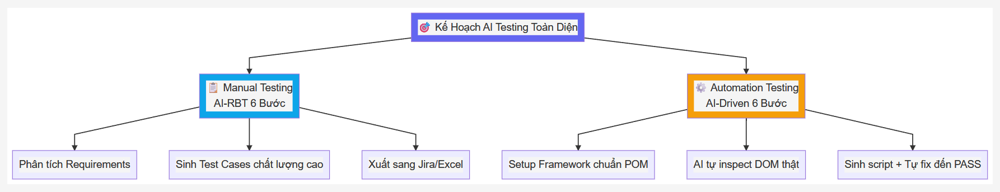
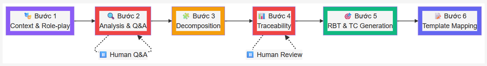
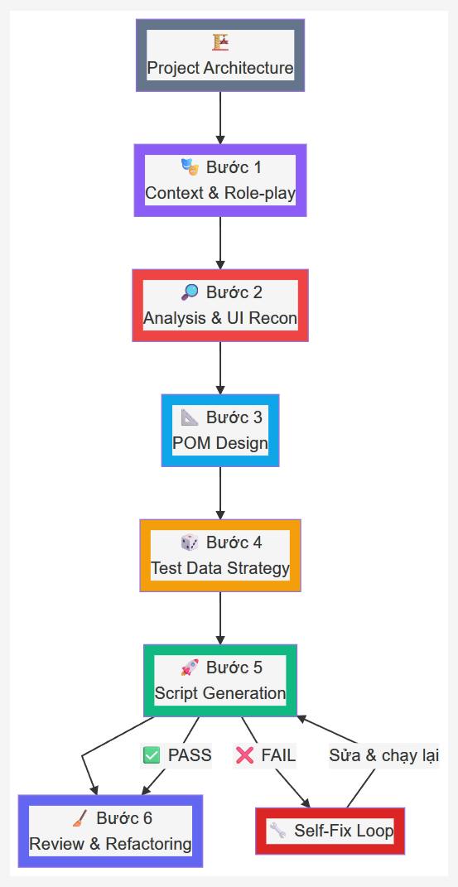

# Bài 5 - [AI Test Automation] Xây dựng kế hoạch ứng dụng AI toàn diện (Plans)

Chương: 1. Nội dung khoá học

Nguồn: [https://anhtester.com/learn/khoa-hoc-su-dung-ai-trong-testing-voi-google-antigravity/287](https://anhtester.com/learn/khoa-hoc-su-dung-ai-trong-testing-voi-google-antigravity/287)

[Video nhúng](https://www.youtube.com/embed/n7kNsbVEOEw)

5 giờ 27 phút (2 phần)

#### **🎥 Video Record phần 1: <https://www.youtube.com/watch?v=n7kNsbVEOEw>**

#### **🎥 Video Record phần 2: <https://www.youtube.com/watch?v=aAk0APkv2LI>**

Xây dựng một kế hoạch ứng dụng AI có hệ thống — **biến AI từ "công cụ phụ trợ" thành đồng đội trong quy trình**, có đầu vào rõ ràng, checkpoint kiểm soát, và đầu ra đo lường được. **Plans (Kế hoạch)** là xây dựng quy trình, tổ chức cho AI làm việc cả một quy trình hoàn thiện trong việc Kiểm thử phần mềm.  
  
Nếu bạn đã có:

- **SKILL** → AI biết *làm gì*
- **WORKFLOW** → AI biết *làm theo trình tự*
- **RULE** → AI biết *giới hạn & tiêu chuẩn*

👉 Thì **PLAN** sẽ trả lời:

> “Áp dụng AI vào toàn bộ quy trình Testing như thế nào?”

## ✳️ Vai trò của Plans

**Plans giúp bạn:**

- Chuẩn hóa cách sử dụng AI trong dự án
- Đồng bộ giữa các QA Manual / Automation Engineer
- Tối ưu hiệu suất (tránh dùng AI lung tung)
- Đảm bảo output có chất lượng ổn định, đồng nhất
- Giảm phụ thuộc vào kinh nghiệm cá nhân

👉 Nói ngắn gọn:

> **PLAN = Quy trình hoàn chỉnh để AI làm việc end-to-end**

An sẽ chia sẻ toàn bộ chiến lược mà An (Anh Tester) đã xây dựng trong bộ **[Antigravity Testing Kit](https://github.com/anhtester/antigravity-testing-kit)** — một framework quy trình AI Testing hoàn chỉnh, thiết kế cho cả **Manual Tester** lẫn **Automation Engineer**.  
  
**Repo:** <https://github.com/anhtester/antigravity-testing-kit>

## ✳️ Kiến Trúc Tổng Thể

Kế hoạch **AI Testing** toàn diện cần bao phủ cả hai mảng kiểm thử **Manual và Automation.**  
  
[](https://anhtester.com/storage/photos/shares/lesson/antigravity/bai5_plans/plan_manual_va_automation_anhtester.png)  
  
**Nguyên tắc vàng:** Manual Testing đi trước Automation Testing. Không bao giờ automate một tính năng mà chưa có test case rõ ràng.

## 

## 📋 Trụ Cột 1: **AI-Driven RBT** Manual — Quy Trình 6 Bước

### Triết lý: "Human Strategy + AI Execution"

Đây là framework **AI-Driven Risk-Based Testing** (AI-RBT) — tận dụng tốc độ xử lý của AI để phân tích chi tiết, kết hợp với **tư duy chiến lược RBT** của con người để tối ưu hóa nguồn lực kiểm thử.

```markdown
📐 CON NGƯỜI quyết định chiến lược
🤖 AI thực thi chi tiết
📐 CON NGƯỜI kiểm tra kết quả
```

### Mô hình 6 Bước

[](https://anhtester.com/storage/photos/shares/lesson/antigravity/bai5_plans/manual_plan_6_steps.png)  
  
**[!WARNING]**  
**Bước 2** và **Bước 4** có checkpoint bắt buộc — nếu bỏ qua, AI sẽ "ảo giác" (hallucinate) và sinh test case sai nghiêm trọng.

### 🎯 Quy trình vận hành Plan Manual

**Xem tại Repo**: <https://github.com/anhtester/antigravity-testing-kit/tree/main/plans/manual>

## ⚙️ Trụ Cột 2: AI-Driven Automation — Quy Trình 6 Bước

### Triết lý: "DOM Recon First + Self-Fix Loop"

Khác với Manual Testing (cần nhiều Human Checkpoint), **Automation Testing** cho phép **tự động hóa mạnh mẽ hơn** — nhưng với điều kiện AI phải inspect DOM thật, không bao giờ đoán bừa.

### 5 Nguyên Tắc Cốt Lõi

<table class="rt-table">
<thead>
<tr>
<th>#</th>
<th>Nguyên tắc</th>
<th>Chi tiết</th>
</tr>
</thead>
<tbody>
<tr>
<td>1</td>
<td><strong>DOM Recon First</strong></td>
<td>AI tự mở browser, inspect DOM thật. TUYỆT ĐỐI không đoán locator</td>
</tr>
<tr>
<td>2</td>
<td><strong>POM Architecture</strong></td>
<td>Mọi script tuân thủ Page Object Model — phân tách Pages &amp; Tests</td>
</tr>
<tr>
<td>3</td>
<td><strong>Smart Waits</strong></td>
<td>Không <code>Thread.sleep</code>, không <code>waitForTimeout</code>. Chỉ auto-waiting</td>
</tr>
<tr>
<td>4</td>
<td><strong>Deterministic Data</strong></td>
<td>Test data unique + traceable, không hardcode</td>
</tr>
<tr>
<td>5</td>
<td><strong>Self-fix Loop</strong></td>
<td>AI tự chạy → fail → đọc log → sửa → chạy lại → đến khi PASS</td>
</tr>
</tbody>
</table>

### 

### Mô hình 6 Bước

[](https://anhtester.com/storage/photos/shares/lesson/antigravity/bai5_plans/automation_plan_6_steps.png)

### 🎯 Quy trình vận hành Plan Automation

**Xem tại Repo**: <https://github.com/anhtester/antigravity-testing-kit/tree/main/plans/automation>

## 🔄 So Sánh Hai Trụ Cột

<table class="rt-table">
<thead>
<tr>
<th>Tiêu chí</th>
<th>Manual (AI-RBT)</th>
<th>Automation (AI-Driven)</th>
</tr>
</thead>
<tbody>
<tr>
<td><strong>Mục tiêu</strong></td>
<td>Sinh Test Cases chất lượng cao</td>
<td>Sinh Test Scripts chạy được</td>
</tr>
<tr>
<td><strong>Mức tự động</strong></td>
<td>Tuần tự, nhiều Human Checkpoint</td>
<td>Có thể One-Click tự động 100%</td>
</tr>
<tr>
<td><strong>Vai trò AI</strong></td>
<td>Phân tích + Sinh nội dung</td>
<td>Inspect DOM + Viết code + Tự sửa</td>
</tr>
<tr>
<td><strong>Vai trò Human</strong></td>
<td>Chiến lược, quyết định, review</td>
<td>Review kiến trúc POM, nhận code final</td>
</tr>
<tr>
<td><strong>Điểm nghẽn</strong></td>
<td>Bước 2 (Q&amp;A) &amp; Bước 4 (RBT)</td>
<td>Bước 2 (UI Recon) — cần browser thật</td>
</tr>
<tr>
<td><strong>Đầu ra</strong></td>
<td>Bảng Markdown → Jira/Excel</td>
<td>Source code chạy PASS → Git commit</td>
</tr>
<tr>
<td><strong>Số bước</strong></td>
<td>6 bước</td>
<td>6 bước (+ bước setup Project)</td>
</tr>
<tr>
<td><strong>Anti-hallucination</strong></td>
<td>Chia nhỏ module, Q&amp;A từng bước</td>
<td>DOM Recon thật, Self-fix loop</td>
</tr>
</tbody>
</table>

## 🧠 Triết Lý Thiết Kế: Human-AI Collaboration

### Tại sao Manual Testing PHẢI chạy tuần tự?

**Có 3 lý do cốt lõi:**

1. **Điểm nghẽn ở Bước 2 (Analysis & Q&A):**  
   AI cần thời gian phân tích và đưa ra câu hỏi. Nếu chạy 1 lèo → AI tự đoán mò logic → Test Case sai trầm trọng.
2. **Điểm chốt chặn nhân sự (Human in the Loop):**  
   Ở Bước 4 và 5, Tester phải tự đánh giá rủi ro trước khi cho AI sinh kịch bản chi tiết.
3. **Chống Ảo giác (Anti-Hallucination):**  
   Nạp 1 tài liệu dài + bắt AI nhả ra hàng trăm kịch bản cùng lúc → AI mất tập trung, bỏ sót luồng. **Xé nhỏ ra từng prompt** mang lại chất lượng tuyệt đối.

### Tại sao Automation Testing CÓ THỂ chạy One-Click?

Vì AI có thể **tự kiểm chứng** kết quả:

- Locator sai? → DOM Recon phát hiện ngay
- Code lỗi? → Chạy test → đọc log → sửa → chạy lại
- Không cần human judgment để verify code chạy đúng hay sai

## 

## 💡 10 Mẹo Tối Ưu Khi Áp Dụng

1. **Luôn chạy trong cùng 1 conversation** — AI giữ context xuyên suốt
2. **Bước 2 là quan trọng nhất** cho Manual — đừng vội, trả lời kỹ
3. **Chia module khi >5** — tránh AI bị quá tải thông tin
4. **Review trước khi format** — kiểm test cases ở Bước 5 trước khi sang Bước 6
5. **Cung cấp tài khoản test** — Automation cần login thật để inspect DOM
6. **Không hardcode data** — luôn dùng format traceable
7. **Không hard sleep** — chỉ smart waits / auto-waiting
8. **Clean code trước commit** — Bước 6 là bắt buộc, không bỏ qua
9. **Kết hợp hai trụ cột** — Sinh manual TC trước → chuyển sang automation
10. **Đo lường kết quả** — So sánh coverage trước/sau khi dùng AI

## 

## 🗺️ Lộ Trình Triển Khai Thực Tế

### Tuần 1-2: Thiết lập nền tảng

- Clone [Antigravity Testing Kit](https://github.com/anhtester/antigravity-testing-kit)
- Copy thư mục `.agent/` vào project của bạn
- Đọc hiểu Plans (Manual + Automation)
- Chạy thử 1 flow Manual Testing đơn giản

### Tuần 3-4: Áp dụng Manual AI-RBT

- Chọn 1 tính năng thực tế trong dự án
- Chạy đủ 6 bước AI-RBT tuần tự
- So sánh kết quả với test cases viết tay trước đó
- Đánh giá: Coverage mới vs. Coverage cũ

### Tuần 5-6: Áp dụng Automation AI-Driven

- Setup kiến trúc project (Bước chuẩn bị)
- Chạy One-Click cho 1 flow đơn giản (Login)
- Mở rộng sang flow phức tạp hơn
- Tích hợp CI/CD pipeline

### Tuần 7+: Scale & Optimize

- Training team sử dụng Plans
- Tùy chỉnh Rules/Skills cho dự án cụ thể (cái này cần thiết)
- Tích hợp Jira/Xray để đồng bộ test management
- Xuất Test Cases sang Excel/Google Sheets tự động