# Bài 6 - [AI Test Automation] Thiết lập cho AI sử dụng MCP Server trên Antigravity

Chương: 1. Nội dung khoá học

Nguồn: [https://anhtester.com/learn/khoa-hoc-su-dung-ai-trong-testing-voi-google-antigravity/288](https://anhtester.com/learn/khoa-hoc-su-dung-ai-trong-testing-voi-google-antigravity/288)

[Video nhúng](https://www.youtube.com/embed/3uktD7ud5ec)

3 giờ 22 phút

**MCP (Model Context Protocol)** là một chuẩn giao tiếp giúp AI có thể **kết nối với các nguồn dữ liệu hoặc công cụ bên ngoài**.

Hiểu đơn giản:

- Nếu **Antigravity là bộ não AI**
- Thì **MCP Server là “cánh tay” giúp AI thao tác với hệ thống thật**

👉 MCP cho phép AI:

- Đọc file (local, repo)
- Gọi API
- Truy cập database
- Tương tác hệ thống test automation
- Kết nối tool như Jira, Git, CI/CD

## 📌 Vì Sao AI Cần "Đôi Tay" Để Làm Việc?

Bạn đã từng yêu cầu AI viết test script, nhận về code đẹp đẽ... nhưng chạy thì **fail toàn bộ**? Locator sai, selector không tồn tại, flow nghiệp vụ lệch hướng?

**Nguyên nhân gốc rễ:** AI chỉ "tưởng tượng" giao diện — nó không thể thấy, chạm, hay tương tác với ứng dụng thật.

<table class="rt-table">
<thead>
<tr>
<th>Trước MCP</th>
<th>Sau MCP</th>
</tr>
</thead>
<tbody>
<tr>
<td>AI đoán locator dựa trên mô tả</td>
<td>AI tự mở browser, đọc DOM thật</td>
</tr>
<tr>
<td>AI viết script rồi... cầu nguyện 🙏</td>
<td>AI viết → chạy → fail → tự sửa → PASS ✅</td>
</tr>
<tr>
<td>Mỗi lần UI thay đổi, phải paste lại HTML</td>
<td>AI tự navigate, tự cập nhật locator</td>
</tr>
<tr>
<td>Chỉ hỗ trợ Web</td>
<td>Web + Mobile (Android &amp; iOS)</td>
</tr>
</tbody>
</table>

**Giải pháp:** **MCP (Model Context Protocol)** — chuẩn giao tiếp mở giúp AI kết nối trực tiếp với các công cụ bên ngoài như browser, mobile device, database... mà không cần can thiệp thủ công.

## 

## 🧠 MCP Là Gì?

**MCP (Model Context Protocol)** là một chuẩn giao thức do **Anthropic** khởi xướng nhằm chuẩn hóa cách các hệ thống bên ngoài (tools, APIs, databases, file systems…) cung cấp **context** cho các mô hình AI.  
  
**Trang chủ**: <https://modelcontextprotocol.io/docs/getting-started/intro>

### Hiện tại ai quản lý MCP?

👉 **Không còn do riêng Anthropic quản lý nữa**

### ✔️ MCP hiện được quản lý bởi:

- **Linux Foundation**
- Thông qua một tổ chức con:
  - **Agentic AI Foundation (AAIF)**

**📌 Lý do:**

- Anthropic đã **donate MCP vào Linux Foundation (cuối 2025)**
- Mục tiêu: biến MCP thành **open standard trung lập, không thuộc vendor nào**

Ví von đơn giản:

- **Không có MCP:** AI giống như kỹ sư ngồi trong phòng kín, chỉ đọc bản vẽ và "tưởng tượng" ra sản phẩm.
- **Có MCP:** AI được ra công trường, cầm búa, đo đạc, và xây dựng trên hiện trường thực tế.

### ✳️ Kiến trúc MCP

[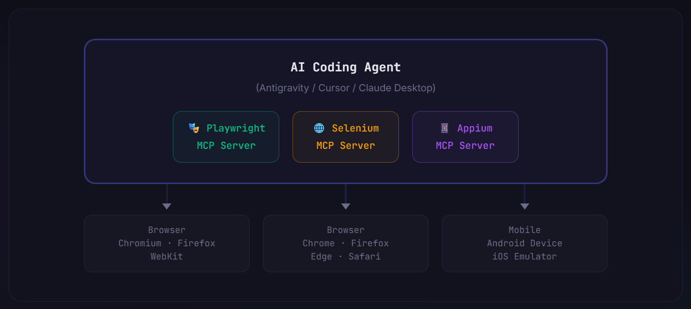](https://anhtester.com/storage/photos/shares/lesson/antigravity/bai6_mcp/kien_truc_mcp.png)

### ✳️ Các thành phần chính

<table class="rt-table">
<thead>
<tr>
<th>Thành phần</th>
<th>Vai trò</th>
</tr>
</thead>
<tbody>
<tr>
<td><strong>MCP Client</strong></td>
<td>AI Agent (Antigravity, Cursor, Claude Desktop...) — bên gửi yêu cầu</td>
</tr>
<tr>
<td><strong>MCP Server</strong></td>
<td>Dịch vụ trung gian, cung cấp <strong>Tools</strong> (hành động) và <strong>Resources</strong> (dữ liệu)</td>
</tr>
<tr>
<td><strong>Transport</strong></td>
<td>Giao thức truyền tải: <code>stdio</code> (local) hoặc <code>HTTP/SSE</code> (remote)</td>
</tr>
</tbody>
</table>

  
  
  

## 🖥️ Antigravity Đã Có Sẵn Gì? — Built-in Browser Agent

Trước khi nói về MCP Server, cần hiểu rõ: **Antigravity đã tích hợp sẵn khả năng browser** mà không cần cài thêm bất kỳ MCP Server nào.

### 🔆 Built-in Browser Agent (`browser_subagent`)

Antigravity có sẵn một **Browser Agent** tích hợp có thể:

- ✅ Mở browser (Chromium), navigate đến URL bất kỳ
- ✅ Đọc DOM thông qua **Accessibility Snapshot**
- ✅ Click, type, scroll, drag & drop
- ✅ Chụp screenshot
- ✅ Quản lý tabs (mở/đóng/chuyển)
- ✅ Upload file
- ✅ Resize viewport

Ngoài ra, Antigravity còn có `read_url_content` — đọc nội dung trang web và **convert HTML → Markdown** mà không cần mở browser (hữu ích khi chỉ cần lấy text content).

### 

### 🔆 Vậy tại sao còn cần MCP Server?

Built-in Browser Agent đã đủ cho nhiều tình huống cơ bản. Tuy nhiên, **MCP Server mở rộng khả năng** vượt xa hơn nữa:

<table class="rt-table">
<thead>
<tr>
<th>Khả năng</th>
<th>Built-in (có sẵn)</th>
<th>Thêm MCP Server</th>
</tr>
</thead>
<tbody>
<tr>
<td>Mở browser, navigate, click, type</td>
<td>✅</td>
<td>✅</td>
</tr>
<tr>
<td>Accessibility Snapshot (đọc DOM)</td>
<td>✅</td>
<td>✅</td>
</tr>
<tr>
<td>Screenshot</td>
<td>✅</td>
<td>✅</td>
</tr>
<tr>
<td>Tab management, file upload</td>
<td>✅</td>
<td>✅</td>
</tr>
<tr>
<td><strong>Network request monitoring</strong></td>
<td>❌</td>
<td>✅ (Playwright/Selenium)</td>
</tr>
<tr>
<td><strong>Console log filtering</strong> (error/warning/info)</td>
<td>❌</td>
<td>✅ (Playwright/Selenium)</td>
</tr>
<tr>
<td><strong>Fill nhiều field cùng lúc</strong></td>
<td>❌ (từng field)</td>
<td>✅ <code>browser_fill_form</code></td>
</tr>
<tr>
<td><strong>Multi-browser</strong> (Firefox, WebKit, Safari)</td>
<td>❌ (chỉ Chromium)</td>
<td>✅</td>
</tr>
<tr>
<td><strong>Headless mode</strong> cấu hình linh hoạt</td>
<td>❌</td>
<td>✅</td>
</tr>
<tr>
<td><strong>Storage State</strong> (lưu/load session login)</td>
<td>❌</td>
<td>✅</td>
</tr>
<tr>
<td><strong>Docker deployment</strong></td>
<td>❌</td>
<td>✅</td>
</tr>
<tr>
<td><strong>Selenium Grid</strong> (parallel testing)</td>
<td>❌</td>
<td>✅ (Selenium MCP)</td>
</tr>
<tr>
<td><strong>Mobile Testing</strong> (Android/iOS)</td>
<td>❌</td>
<td>✅ (Appium MCP)</td>
</tr>
<tr>
<td><strong>AI Vision</strong> (tìm element bằng ngôn ngữ tự nhiên)</td>
<td>❌</td>
<td>✅ (Appium MCP)</td>
</tr>
</tbody>
</table>

### 

### 💡 Tóm lại

**- Chỉ cần debug DOM nhanh, test thủ công đơn giản?** → Built-in Browser Agent là đủ.

**- Cần network monitoring, multi-browser, CI/CD, hoặc mobile testing?** → Cài thêm **MCP Server**.

- MCP Server **không thay thế** built-in — chúng **bổ sung thêm** sức mạnh cho AI nói chung và trên Antigravity nói riêng.

## 🎯 3 MCP Server Cho Test Automation

**🎭 Playwright MCP**: Web Testing — Accessibility Tree, LLM-friendly, nhanh nhất  

**🌐 Selenium MCP**: Web Testing — Multi-browser, WebDriver BiDi, Selenium Grid  

**📱 Appium MCP**: Mobile Testing — Android (UiAutomator2) & iOS (XCUITest)

[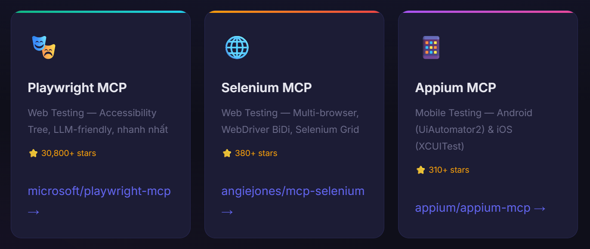](https://anhtester.com/storage/photos/shares/lesson/antigravity/bai6_mcp/3_mcp_for_test_automation.png)

### 

### 💡 Khi nào chọn cái nào?

**🎭 Playwright MCP:** Mặc định cho Web. Nhanh nhất, dùng Accessibility Snapshot thay vì screenshot → AI hiểu DOM ngay lập tức.

**🌐 Selenium MCP:** Khi đã có hạ tầng Selenium, cần Safari thật, hoặc Selenium Grid.

**📱 Appium MCP:** Testing ứng dụng mobile (native, hybrid, flutter). Hỗ trợ AI Vision tìm element bằng ngôn ngữ tự nhiên.

## ⚙️ Cách thiết lập MCP Server trên Antigravity

Các bạn **mở khung Chat** ra sẽ thấy có **dấu 3 chấm** gốc trên bên phải. Làm theo hướng dẫn của An bên dưới:  
  
**1. Chọn MCP Servers**  
  
[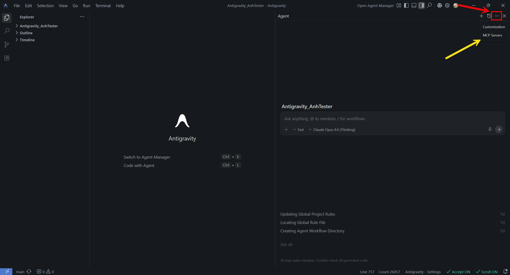](https://anhtester.com/storage/photos/shares/lesson/antigravity/bai6_mcp/open_mcp_on_antigravity_1.png)  
  
**2. Chọn Manage MCP Servers**  
  
[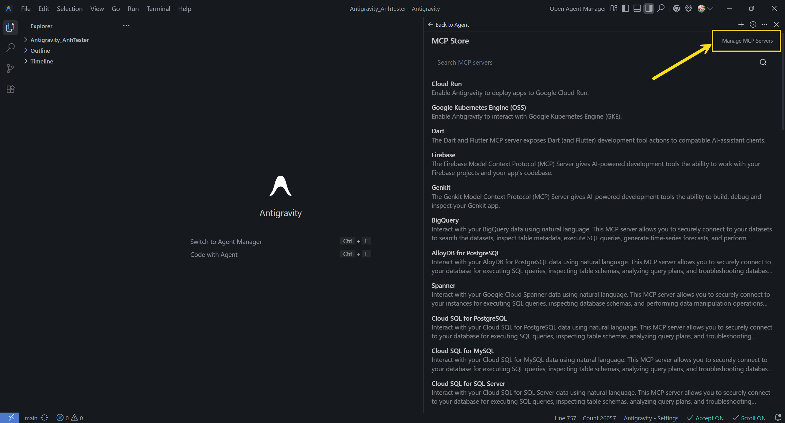](https://anhtester.com/storage/photos/shares/lesson/antigravity/bai6_mcp/open_mcp_on_antigravity_2.png)  
  
**3. Chọn View raw config**  
  
[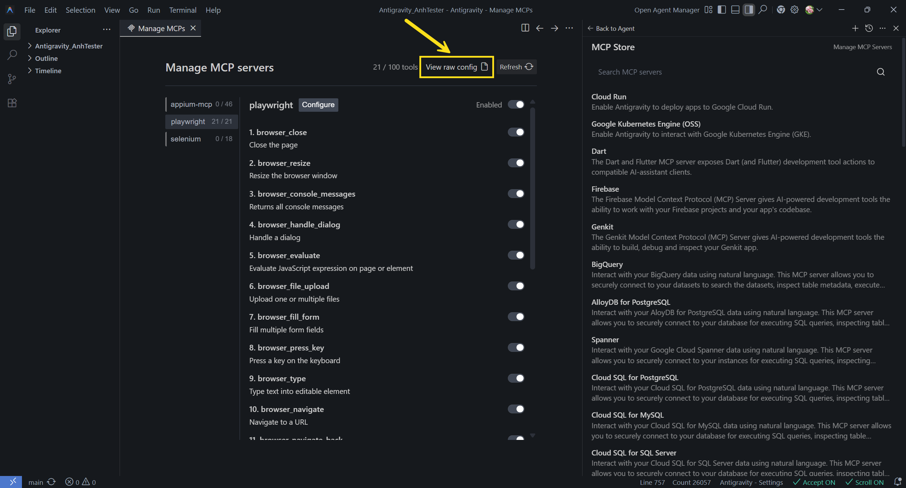](https://anhtester.com/storage/photos/shares/lesson/antigravity/bai6_mcp/open_mcp_on_antigravity_3.png)  
  
4. Điền chuỗi JSON của từng nhà cung cấp MCP vào cấu trúc JSON tổng "**mcpSerrvers**"  
  
[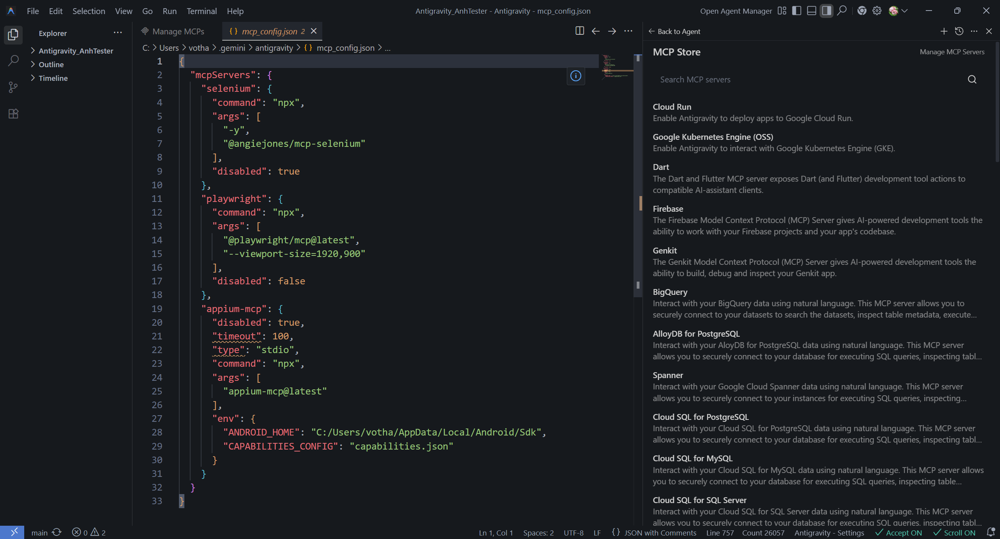](https://anhtester.com/storage/photos/shares/lesson/antigravity/bai6_mcp/open_mcp_on_antigravity_4.png)

## 🎭 Phần 1: Playwright MCP Server

### ✳️ Tổng quan

**Playwright MCP** của **Microsoft** là MCP Server phổ biến nhất cho Web Testing với **30,800+ GitHub stars (15/04/2026)**. Đặc điểm vượt trội:

- **Nhanh và nhẹ:** Dùng Accessibility Tree, không cần screenshot hay vision model
- **LLM-friendly:** Trả về dữ liệu có cấu trúc, AI xử lý chính xác
- **Deterministic:** Mỗi tool có input/output rõ ràng, tránh mơ hồ

### ✳️ Yêu cầu

- **Node.js 18+**
- AI IDE: Antigravity, Cursor, VS Code, Claude Desktop...

### ✳️ Cài đặt trên Antigravity

Copy chuỗi **JSON** này dán vào file **`mcp_config.json`** trên **Antigravity**, copy từ đoạn "**playwright**" thôi.

```json
{
  "mcpServers": {
    "playwright": {
      "command": "npx",
      "args": [
        "@playwright/mcp@latest"
      ]
    }
  }
}
```

```none

```

### 🔆 Cấu hình nâng cao

```json
{
  "mcpServers": {
    "playwright": {
      "command": "npx",
      "args": [
        "@playwright/mcp@latest",
        "--browser", "chromium",
        "--headless",
        "--viewport-size", "1920,1080"
      ]
    }
  }
}
```

<table class="rt-table">
<thead>
<tr>
<th>Tùy chọn</th>
<th>Mô tả</th>
</tr>
</thead>
<tbody>
<tr>
<td><code>--browser</code></td>
<td>Chọn browser: <code>chromium</code>, <code>firefox</code>, <code>webkit</code></td>
</tr>
<tr>
<td><code>--headless</code></td>
<td>Chạy không hiện UI (dùng cho CI/CD)</td>
</tr>
<tr>
<td><code>--viewport-size</code></td>
<td>Kích thước viewport: <code>1920,1080</code></td>
</tr>
<tr>
<td><code>--isolated</code></td>
<td>Mỗi session là context độc lập (xóa state sau khi đóng)</td>
</tr>
<tr>
<td><code>--storage-state</code></td>
<td>Load cookies/localStorage từ file JSON</td>
</tr>
<tr>
<td><code>--user-data-dir</code></td>
<td>Dùng profile browser cố định (lưu session đăng nhập)</td>
</tr>
</tbody>
</table>

### 🔆 Danh sách Tools quan trọng

#### 📸 Snapshot & Navigation

<table class="rt-table">
<thead>
<tr>
<th>Tool</th>
<th>Mô tả</th>
</tr>
</thead>
<tbody>
<tr>
<td><code>browser_snapshot</code></td>
<td><strong>Tool quan trọng nhất</strong> — chụp Accessibility Snapshot, trả về cấu trúc DOM cho AI phân tích</td>
</tr>
<tr>
<td><code>browser_navigate</code></td>
<td>Điều hướng đến URL</td>
</tr>
<tr>
<td><code>browser_navigate_back</code></td>
<td>Quay lại trang trước</td>
</tr>
<tr>
<td><code>browser_wait_for</code></td>
<td>Đợi text xuất hiện/biến mất trên trang</td>
</tr>
</tbody>
</table>

#### 🖱️ Tương tác phần tử

<table class="rt-table">
<thead>
<tr>
<th>Tool</th>
<th>Mô tả</th>
</tr>
</thead>
<tbody>
<tr>
<td><code>browser_click</code></td>
<td>Click element theo <code>ref</code> từ snapshot</td>
</tr>
<tr>
<td><code>browser_type</code></td>
<td>Gõ text vào input/textarea</td>
</tr>
<tr>
<td><code>browser_fill_form</code></td>
<td>Điền nhiều field cùng lúc</td>
</tr>
<tr>
<td><code>browser_select_option</code></td>
<td>Chọn option trong dropdown</td>
</tr>
<tr>
<td><code>browser_hover</code></td>
<td>Hover để hiện tooltip/menu</td>
</tr>
<tr>
<td><code>browser_drag</code></td>
<td>Kéo thả giữa 2 elements</td>
</tr>
<tr>
<td><code>browser_press_key</code></td>
<td>Nhấn phím (Enter, Tab, Escape...)</td>
</tr>
<tr>
<td><code>browser_handle_dialog</code></td>
<td>Xử lý alert/confirm/prompt dialog</td>
</tr>
</tbody>
</table>

#### 📊 Thu thập dữ liệu

<table class="rt-table">
<thead>
<tr>
<th>Tool</th>
<th>Mô tả</th>
</tr>
</thead>
<tbody>
<tr>
<td><code>browser_take_screenshot</code></td>
<td>Chụp ảnh trang hiện tại</td>
</tr>
<tr>
<td><code>browser_console_messages</code></td>
<td>Đọc console log (errors, warnings)</td>
</tr>
<tr>
<td><code>browser_network_requests</code></td>
<td>Theo dõi network requests</td>
</tr>
<tr>
<td><code>browser_evaluate</code></td>
<td>Chạy JavaScript tùy ý trên trang</td>
</tr>
</tbody>
</table>

#### 🗂️ Quản lý tabs & file

<table class="rt-table">
<thead>
<tr>
<th>Tool</th>
<th>Mô tả</th>
</tr>
</thead>
<tbody>
<tr>
<td><code>browser_tabs</code></td>
<td>List / create / close / select tab</td>
</tr>
<tr>
<td><code>browser_file_upload</code></td>
<td>Upload file vào <code>input[type=file]</code></td>
</tr>
<tr>
<td><code>browser_resize</code></td>
<td>Resize viewport browser</td>
</tr>
<tr>
<td><code>browser_close</code></td>
<td>Đóng browser</td>
</tr>
</tbody>
</table>

### ♻️ Workflow thực tế: AI tự test trang Login

[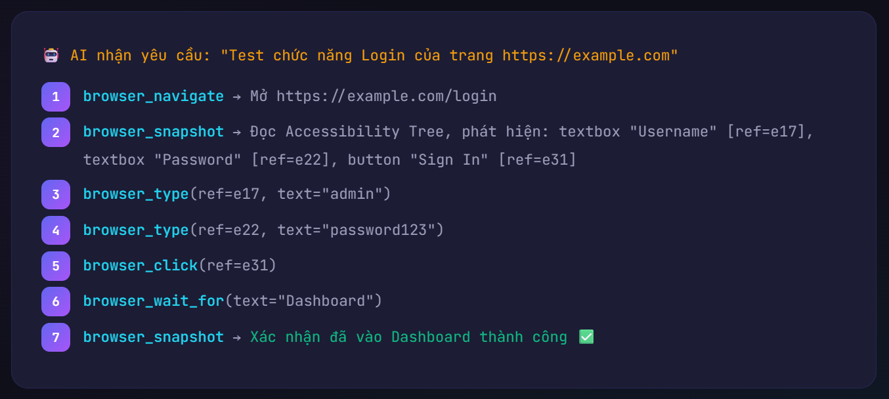](https://anhtester.com/storage/photos/shares/lesson/antigravity/bai6_mcp/playwright_mcp_demo.png)

### 📌 Lưu ý quan trọng

**Playwright MCP dùng `ref`** (reference ID từ snapshot) để xác định chính xác element — không cần CSS selector hay XPath. Đây là lý do nó chính xác hơn các phương pháp truyền thống.

## 

## 🌐 Phần 2: Selenium MCP Server

### ✳️ Tổng quan

Selenium MCP do **Angie Jones** (Java Champion, Director of Engineering tại Block) phát triển. Phù hợp khi:

- Team đã có hạ tầng Selenium sẵn
- Cần test trên **Safari** (macOS)
- Cần tích hợp với **Selenium Grid** cho parallel testing
- Cần **WebDriver BiDi** diagnostics

### 🔆 Yêu cầu

- **Chrome/Firefox/Edge** đã cài đặt trên máy
- ChromeDriver/GeckoDriver trên PATH (tự động nếu dùng Selenium Manager)

### ✳️ Cài đặt trên Antigravity

```json
{
  "mcpServers": {
    "selenium": {
      "command": "npx",
      "args": [
        "-y",
        "@angiejones/mcp-selenium@latest"
      ]
    }
  }
}
```

### ✳️ Danh sách Tools

<table class="rt-table">
<thead>
<tr>
<th>Tool</th>
<th>Mô tả</th>
<th>Parameters chính</th>
</tr>
</thead>
<tbody>
<tr>
<td><code>start_browser</code></td>
<td>Khởi tạo browser session</td>
<td>browser, options {headless, arguments}</td>
</tr>
<tr>
<td><code>navigate</code></td>
<td>Điều hướng đến URL</td>
<td>url</td>
</tr>
<tr>
<td><code>interact</code></td>
<td>Click/hover/doubleclick</td>
<td>action, locator, value</td>
</tr>
<tr>
<td><code>send_keys</code></td>
<td>Gõ text vào field</td>
<td>locator, value, text</td>
</tr>
<tr>
<td><code>get_element_text</code></td>
<td>Lấy text của element</td>
<td>locator, value</td>
</tr>
<tr>
<td><code>get_element_attribute</code></td>
<td>Lấy attribute (href, value...)</td>
<td>locator, value, attribute</td>
</tr>
<tr>
<td><code>press_key</code></td>
<td>Nhấn phím (Enter, Tab...)</td>
<td>key</td>
</tr>
<tr>
<td><code>upload_file</code></td>
<td>Upload file</td>
<td>locator, value, filePath</td>
</tr>
<tr>
<td><code>take_screenshot</code></td>
<td>Chụp ảnh trang</td>
<td>—</td>
</tr>
<tr>
<td><code>execute_script</code></td>
<td>Chạy JavaScript</td>
<td>script, args</td>
</tr>
<tr>
<td><code>window</code></td>
<td>Quản lý windows/tabs</td>
<td>action: list/switch/close</td>
</tr>
<tr>
<td><code>frame</code></td>
<td>Chuyển đổi iframe</td>
<td>action: switch/default</td>
</tr>
<tr>
<td><code>alert</code></td>
<td>Xử lý dialog</td>
<td>action: accept/dismiss/get_text</td>
</tr>
<tr>
<td><code>add_cookie</code></td>
<td>Thêm cookie</td>
<td>name, value, domain</td>
</tr>
<tr>
<td><code>get_cookies</code></td>
<td>Lấy cookies</td>
<td>name (optional)</td>
</tr>
<tr>
<td><code>delete_cookie</code></td>
<td>Xóa cookies</td>
<td>name (optional)</td>
</tr>
<tr>
<td><code>diagnostics</code></td>
<td>Console/Network logs (BiDi)</td>
<td>type: console/errors/network</td>
</tr>
<tr>
<td><code>close_session</code></td>
<td>Đóng browser session</td>
<td>—</td>
</tr>
</tbody>
</table>

### ✳️ Resources (dữ liệu read-only)

<table class="rt-table">
<thead>
<tr>
<th>Resource URI</th>
<th>Mô tả</th>
</tr>
</thead>
<tbody>
<tr>
<td><code>browser-status://current</code></td>
<td>Trạng thái session hiện tại</td>
</tr>
<tr>
<td><code>accessibility://current</code></td>
<td>Accessibility tree — cấu trúc JSON compact, hữu ích cho AI</td>
</tr>
</tbody>
</table>

### ♻️ Workflow thực tế: AI kiểm tra form Contact

[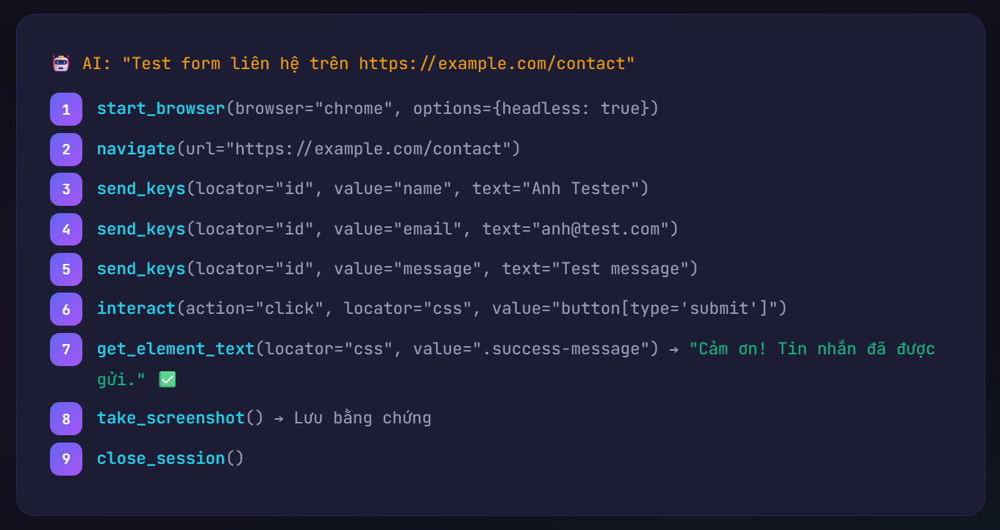](https://anhtester.com/storage/photos/shares/lesson/antigravity/bai6_mcp/selenium_mcp_demo.png)

## 📱 Phần 3: Appium MCP Server

### ✳️ Tổng quan

Appium MCP là MCP Server chính thức từ **Appium team** cho Mobile Testing. Lựa chọn duy nhất khi cần test ứng dụng **Android native** (UiAutomator2), **iOS native** (XCUITest), **Hybrid** hoặc **Flutter**.

### 🔆 Tính năng nổi bật

- 🔍 **AI-Powered Element Finding:** Tìm element bằng ngôn ngữ tự nhiên (VD: "nút Đăng nhập màu xanh")
- 🌐 **Multilingual Support:** AI hiểu mọi ngôn ngữ (Tiếng Việt, English, 日本語...)
- 📱 **Cross-Platform:** Android + iOS từ cùng một cấu hình
- 🎬 **Screen Recording:** Quay video test session
- 📝 **Test Code Generation:** Sinh code Java/TestNG + Page Object Model

### 🔆 Yêu cầu hệ thống

<table class="rt-table">
<thead>
<tr>
<th>Loại</th>
<th>Yêu cầu</th>
</tr>
</thead>
<tbody>
<tr>
<td><strong>Bắt buộc</strong></td>
<td>Node.js v22+, JDK 8+, Appium Server</td>
</tr>
<tr>
<td><strong>Android</strong></td>
<td>Android SDK, ANDROID_HOME, USB Debugging, UiAutomator2 driver</td>
</tr>
<tr>
<td><strong>iOS</strong></td>
<td>Xcode, Command Line Tools, XCUITest driver (macOS only)</td>
</tr>
</tbody>
</table>

### ✳️ Cài đặt trên Antigravity

```json
{
  "mcpServers": {
    "appium-mcp": {
      "disabled": false,
      "timeout": 100,
      "type": "stdio",
      "command": "npx",
      "args": ["appium-mcp@latest"],
      "env": {
        "ANDROID_HOME": "C:\\Users\\<your-user>\\AppData\\Local\\Android\\Sdk",
        "CAPABILITIES_CONFIG": "./capabilities.json"
      }
    }
  }
}
```

### ✳️ Cấu hình Capabilities

Tạo file `capabilities.json`:

```json
{
  "android": {
    "appium:app": "/path/to/your/app.apk",
    "appium:deviceName": "Android Emulator",
    "appium:platformVersion": "14.0",
    "appium:automationName": "UiAutomator2",
    "appium:udid": "emulator-5554"
  },
  "ios": {
    "appium:app": "/path/to/your/app.ipa",
    "appium:deviceName": "iPhone 15 Pro",
    "appium:platformVersion": "17.0",
    "appium:automationName": "XCUITest"
  }
}
```

### ✳️ Danh sách Tools theo danh mục

#### 📱 Platform & Session

<table class="rt-table">
<thead>
<tr>
<th>Tool</th>
<th>Mô tả</th>
</tr>
</thead>
<tbody>
<tr>
<td><code>select_device</code></td>
<td>Liệt kê và chọn device/emulator đang kết nối</td>
</tr>
<tr>
<td><code>prepare_ios_simulator</code></td>
<td>Khởi động iOS Simulator</td>
</tr>
<tr>
<td><code>create_session</code></td>
<td>Tạo Appium session mới (android/ios/general)</td>
</tr>
<tr>
<td><code>delete_session</code></td>
<td>Đóng session hiện tại</td>
</tr>
</tbody>
</table>

#### 🔍 Element Discovery & Interaction

<table class="rt-table">
<thead>
<tr>
<th>Tool</th>
<th>Mô tả</th>
</tr>
</thead>
<tbody>
<tr>
<td><code>appium_find_element</code></td>
<td>Tìm element bằng strategy (id, xpath, accessibility id...)</td>
</tr>
<tr>
<td><code>appium_find_by_ai</code></td>
<td>🌟 Tìm element bằng ngôn ngữ tự nhiên (cần Vision API)</td>
</tr>
<tr>
<td><code>appium_click</code></td>
<td>Tap vào element</td>
</tr>
<tr>
<td><code>appium_double_tap</code></td>
<td>Double tap</td>
</tr>
<tr>
<td><code>appium_long_press</code></td>
<td>Long press</td>
</tr>
<tr>
<td><code>appium_set_value</code></td>
<td>Nhập text vào field</td>
</tr>
<tr>
<td><code>appium_get_text</code></td>
<td>Lấy text của element</td>
</tr>
<tr>
<td><code>appium_tap_by_coordinates</code></td>
<td>Tap vào tọa độ x, y</td>
</tr>
<tr>
<td><code>appium_drag_and_drop</code></td>
<td>Kéo thả element</td>
</tr>
<tr>
<td><code>appium_pinch</code></td>
<td>Pinch (zoom in/out)</td>
</tr>
</tbody>
</table>

#### 📸 Screen & Navigation

<table class="rt-table">
<thead>
<tr>
<th>Tool</th>
<th>Mô tả</th>
</tr>
</thead>
<tbody>
<tr>
<td><code>appium_screenshot</code></td>
<td>Chụp screenshot thiết bị</td>
</tr>
<tr>
<td><code>appium_screen_recording</code></td>
<td>Quay video (start/stop)</td>
</tr>
<tr>
<td><code>appium_get_page_source</code></td>
<td>Lấy XML page source</td>
</tr>
<tr>
<td><code>appium_navigate</code></td>
<td>Back / Home / App Switch</td>
</tr>
<tr>
<td><code>appium_swipe</code></td>
<td>Vuốt theo hướng (up/down/left/right)</td>
</tr>
</tbody>
</table>

#### 🛠️ AI-Powered Features

<table class="rt-table">
<thead>
<tr>
<th>Tool</th>
<th>Mô tả</th>
</tr>
</thead>
<tbody>
<tr>
<td><code>generate_locators</code></td>
<td>AI sinh locators cho tất cả elements trên màn hình</td>
</tr>
<tr>
<td><code>generate_test_code</code></td>
<td>AI sinh test code Java/TestNG từ mô tả</td>
</tr>
<tr>
<td><code>appium_app</code></td>
<td>Install / uninstall / launch / close / list ứng dụng</td>
</tr>
<tr>
<td><code>appium_context</code></td>
<td>Chuyển đổi NATIVE/WEBVIEW context</td>
</tr>
</tbody>
</table>

### 🤖 AI Vision — Tìm element bằng ngôn ngữ tự nhiên

```json
{
  "mcpServers": {
    "appium-mcp": {
      "command": "npx",
      "args": ["appium-mcp@latest"],
      "env": {
        "ANDROID_HOME": "/path/to/android/sdk",
        "AI_VISION_API_BASE_URL": "https://generativelanguage.googleapis.com/v1beta",
        "AI_VISION_API_TOKEN": "your_api_key",
        "AI_VISION_MODEL": "gemini-3-flash-preview"
      }
    }
  }
}
```

<table class="rt-table">
<thead>
<tr>
<th>Model</th>
<th>Provider</th>
<th>Accuracy</th>
<th>Speed</th>
</tr>
</thead>
<tbody>
<tr>
<td><strong>Qwen3-VL-235B</strong></td>
<td>Alibaba DashScope</td>
<td>100%</td>
<td>~12.6s</td>
</tr>
<tr>
<td><strong>gemini-3-flash-preview</strong></td>
<td>Google AI</td>
<td>100%</td>
<td>~17.3s</td>
</tr>
</tbody>
</table>

### ♻️ Workflow thực tế: AI test app Android

[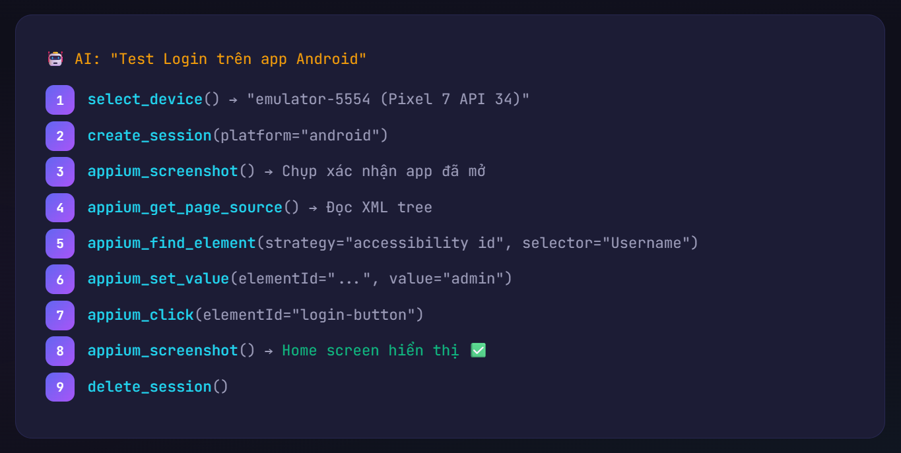](https://anhtester.com/storage/photos/shares/lesson/antigravity/bai6_mcp/appium_mcp_demo.png)

### ✳️ Hướng dẫn đăng ký API Key

#### 🔵 Google AI (Gemini) — Miễn phí, không cần thẻ tín dụng

1. Truy cập **[Google AI Studio](https://aistudio.google.com/)**
2. Đăng nhập bằng tài khoản Google
3. Click **"Get API key"** ở sidebar trái
4. Click **"Create API key"** → chọn Google Cloud project (tạo mới nếu chưa có)
5. Copy API key → dán vào `AI_VISION_API_TOKEN`

  

```json
{
  "env": {
    "AI_VISION_API_BASE_URL": "https://generativelanguage.googleapis.com/v1beta",
    "AI_VISION_API_TOKEN": "AIzaSy...(key của bạn)",
    "AI_VISION_MODEL": "gemini-3-flash-preview"
  }
}​
```

**⚠️ Lưu ý Free Tier**

Free tier có giới hạn rate limit (requests/phút). Dữ liệu ở free tier có thể được Google sử dụng để cải thiện model. Nếu cần bảo mật dữ liệu, nên nâng lên paid tier.

  

#### 🟠 Alibaba Cloud DashScope (Qwen) — Có free trial

1. Đăng ký tài khoản tại **[Alibaba Cloud](https://www.alibabacloud.com/)**
2. Truy cập **[DashScope Console](https://dashscope.console.aliyun.com/)**
3. Kích hoạt dịch vụ **Model Studio / DashScope** theo hướng dẫn
4. Vào mục **"API-KEY"** → Click **"Create API Key"**
5. Copy key ngay lập tức (sẽ không hiển thị lại)

```json
{
  "env": {
    "AI_VISION_API_BASE_URL": "https://dashscope.aliyuncs.com/compatible-mode/v1",
    "AI_VISION_API_TOKEN": "sk-...(key của bạn)",
    "AI_VISION_MODEL": "qwen-vl-max"
  }
}​
```

**💡 Base URL theo Region**

- **Trung Quốc:** `https://dashscope.aliyuncs.com/compatible-mode/v1`
- **Singapore:** `https://dashscope-intl.aliyuncs.com/compatible-mode/v1`
- **US (Virginia):** `https://dashscope-us.aliyuncs.com/compatible-mode/v1`

### 

### ♻️ Workflow thực tế: AI test app Android

[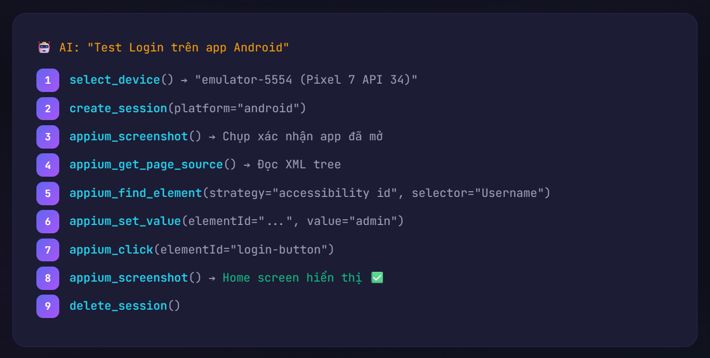](https://anhtester.com/storage/photos/shares/lesson/antigravity/bai6_mcp/appium_ai_testing_demo.png)

  

## ⚙️ Cấu Hình Tổng Hợp: Kích Hoạt Cả 3 Server

Để có **full coverage** (Web + Mobile):

```json
{
  "mcpServers": {
    "playwright": {
      "command": "npx",
      "args": ["@playwright/mcp@latest"]
    },
    "selenium": {
      "command": "npx",
      "args": ["-y", "@angiejones/mcp-selenium@latest"]
    },
    "appium-mcp": {
      "disabled": false,
      "timeout": 100,
      "type": "stdio",
      "command": "npx",
      "args": ["appium-mcp@latest"],
      "env": {
        "ANDROID_HOME": "C:\\Users\\<user>\\AppData\\Local\\Android\\Sdk",
        "CAPABILITIES_CONFIG": "./capabilities.json"
      }
    }
  }
}
```

### **💡 Tips**

Không nhất thiết phải bật cả 3 cùng lúc. Chọn theo nhu cầu:

- **Web only** → Playwright MCP (khuyến nghị) hoặc Selenium MCP
- **Mobile only** → Appium MCP
- **Full stack** → Cả 3

## 🔄 Quy Trình AI Sử Dụng MCP

### Mô hình "DOM Recon First + Self-Fix Loop"

[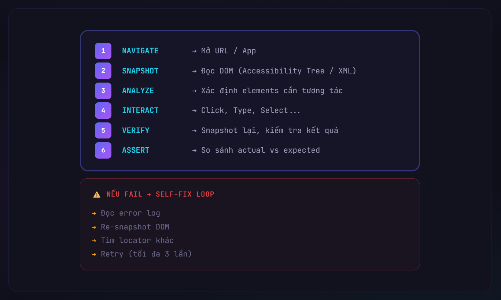](https://anhtester.com/storage/photos/shares/lesson/antigravity/bai6_mcp/quy_trinh_mcp_run.png)

### 🎯 Ví dụ prompt cho AI trên Antigravity dùng Playwright MCP

```markdown
Sử dụng Playwright MCP, hãy:
1. Mở trang https://crm.anhtester.com/admin/authentication
2. Đăng nhập với username "admin@example.com" và password "123456"
3. Sau khi đăng nhập, navigate đến Customers
4. Verify bảng danh sách hiển thị ít nhất 1 dòng dữ liệu
5. Chụp screenshot làm bằng chứng

Yêu cầu:
- Dùng browser_snapshot trước mỗi thao tác
- Không hardcode locator — lấy ref từ snapshot
- Nếu fail, retry tối đa 3 lần với log chi tiết
```

### 🎯 Ví dụ prompt cho AI trên Antigravity dùng Selenium MCP

```markdown
Sử dụng Selenium MCP, hãy:
1. Mở trang https://crm.anhtester.com/admin/authentication
2. Đăng nhập với username "admin@example.com" và password "123456"
3. Sau khi đăng nhập, navigate đến Customers
4. Verify bảng danh sách hiển thị ít nhất 1 dòng dữ liệu
5. Chụp screenshot làm bằng chứng

Yêu cầu:
- Dùng browser_snapshot trước mỗi thao tác
- Không hardcode locator — lấy locator từ snapshot
- Nếu fail, retry tối đa 3 lần với log chi tiết
```

### ✅ So sánh Playwright MCP vs Selenium MCP trên cùng test case

#### 🔬 So sánh thực tế: Playwright MCP vs Selenium MCP trên cùng test case

Kết quả chạy thực tế trên **crm.anhtester.com** — cùng kịch bản: Login → Navigate Customers → Verify dữ liệu → Screenshot

<table class="compare-table rt-table">
<thead>
<tr>
<th>Tiêu chí</th>
<th>🎭 Playwright MCP</th>
<th>🌐 Selenium MCP</th>
</tr>
</thead>
<tbody>
<tr>
<td>Cách tìm element</td>
<td><code>ref</code> từ Accessibility Snapshot<br/><em>(AI tự đọc DOM → lấy ref ID)</em></td>
<td>CSS / XPath / ID locator<br/><em>(AI dùng <code>accessibility://current</code> resource)</em></td>
</tr>
<tr>
<td>Quy trình Login</td>
<td><code>browser_snapshot</code> → ref=e11, ref=e14, ref=e20 → <code>browser_type</code> + <code>browser_click</code></td>
<td><code>start_browser</code> → <code>navigate</code> → <code>send_keys</code> + <code>interact</code></td>
</tr>
<tr>
<td>Browser Engine</td>
<td>Chromium built-in (tự cài)</td>
<td>Chrome thật trên máy (cần WebDriver)</td>
</tr>
<tr>
<td>Viewport Config</td>
<td><code>--viewport-size 1920,1080</code> trong MCP settings</td>
<td>Dùng kích thước cửa sổ browser thật</td>
</tr>
<tr>
<td>Network Monitoring</td>
<td>✅ <code>browser_network_requests</code></td>
<td>✅ <code>diagnostics</code> (WebDriver BiDi)</td>
</tr>
<tr>
<td>Console Logs</td>
<td>✅ <code>browser_console_messages</code></td>
<td>✅ <code>diagnostics</code> (type: console)</td>
</tr>
<tr>
<td>Fill nhiều field</td>
<td>✅ <code>browser_fill_form</code> (batch)</td>
<td>❌ Từng field (<code>send_keys</code>)</td>
</tr>
<tr>
<td>Multi-browser</td>
<td>Chromium, Firefox, WebKit</td>
<td>Chrome, Firefox, Edge, <strong>Safari</strong></td>
</tr>
<tr>
<td>Screenshot</td>
<td>Viewport (CSS pixels)</td>
<td>Full page (browser native)</td>
</tr>
<tr>
<td>Kết quả test</td>
<td>✅ PASS — 246 customers</td>
<td>✅ PASS — 246 customers</td>
</tr>
</tbody>
</table>

### 💡 Khi nào chọn cái nào?

- **Chọn Playwright MCP** khi: cần tốc độ nhanh, AI tự tìm element qua Accessibility Tree, ưu tiên CI/CD headless, không cần Safari.
- **Chọn Selenium MCP** khi: team đã có hạ tầng Selenium, cần test trên Safari thật, cần Selenium Grid cho parallel testing, hoặc cần WebDriver BiDi diagnostics.

## ⚠️ Best Practices & Lưu Ý

### 1. Bảo mật

**- KHÔNG** paste credentials trực tiếp vào file cấu hình MCP. Sử dụng **biến môi trường** hoặc **storage state** cho thông tin đăng nhập.

- Playwright MCP hỗ trợ `--secrets` để che thông tin nhạy cảm trong response.

### 2. Performance

<table class="rt-table">
<thead>
<tr>
<th>Situation</th>
<th>Giải pháp</th>
</tr>
</thead>
<tbody>
<tr>
<td>AI chạy chậm trên CI/CD</td>
<td>Bật <code>--headless</code> (Playwright) hoặc <code>headless: true</code> (Selenium)</td>
</tr>
<tr>
<td>Token quá nhiều</td>
<td>Bật <code>NO_UI</code> (Appium) hoặc <code>snapshot mode: none</code> (Playwright)</td>
</tr>
<tr>
<td>Browser crash</td>
<td>Dùng <code>--isolated</code> hoặc <code>--no-sandbox</code> (Docker)</td>
</tr>
</tbody>
</table>

### 3. Debugging

- **Playwright:** `browser_console_messages` + `browser_network_requests`
- **Selenium:** `diagnostics` tool (console/errors/network)
- **Appium:** `appium_get_page_source` để xem XML tree

### 4. Playwright MCP vs CLI

<table class="rt-table">
<thead>
<tr>
<th> </th>
<th>MCP</th>
<th>CLI + SKILLS</th>
</tr>
</thead>
<tbody>
<tr>
<td><strong>Dùng khi</strong></td>
<td>Exploratory testing, self-healing, autonomous</td>
<td>High-throughput coding, large codebases</td>
</tr>
<tr>
<td><strong>Token</strong></td>
<td>Nhiều hơn (schema + accessibility tree)</td>
<td>Ít hơn (concise commands)</td>
</tr>
<tr>
<td><strong>State</strong></td>
<td>Persistent browser context</td>
<td>Stateless per invocation</td>
</tr>
</tbody>
</table>

## 📊 So Sánh Tổng Hợp 3 MCP Server

<table class="compare-table rt-table">
<thead>
<tr>
<th>Tiêu chí</th>
<th>Playwright MCP</th>
<th>Selenium MCP</th>
<th>Appium MCP</th>
</tr>
</thead>
<tbody>
<tr>
<td>Platform</td>
<td>Web</td>
<td>Web</td>
<td>Mobile (Android/iOS)</td>
</tr>
<tr>
<td>Element Finding</td>
<td>Accessibility Snapshot</td>
<td>CSS/XPath/ID</td>
<td>XPath/ID/AI Vision</td>
</tr>
<tr>
<td>Speed</td>
<td>⚡⚡⚡</td>
<td>⚡⚡</td>
<td>⚡</td>
</tr>
<tr>
<td>Setup</td>
<td>Dễ (1 npm)</td>
<td>Dễ (browser + driver)</td>
<td>Phức tạp (SDK + Appium + Device)</td>
</tr>
<tr>
<td>Token Efficiency</td>
<td>Cao</td>
<td>Trung bình</td>
<td>Trung bình (NO_UI: Cao)</td>
</tr>
<tr>
<td>Docker</td>
<td>✅ Official</td>
<td>✅</td>
<td>❌</td>
</tr>
<tr>
<td>AI Vision</td>
<td>❌</td>
<td>❌</td>
<td>✅</td>
</tr>
<tr>
<td>Screen Recording</td>
<td>❌</td>
<td>❌</td>
<td>✅</td>
</tr>
<tr>
<td>Test Generation</td>
<td>❌</td>
<td>❌</td>
<td>✅ (Java/TestNG + POM)</td>
</tr>
<tr>
<td>License</td>
<td>Apache-2.0</td>
<td>MIT</td>
<td>Apache-2.0</td>
</tr>
</tbody>
</table>

## 

## 🏁 Kết Luận

MCP Server là **bước nhảy vọt** trong AI Test Automation — biến AI từ "chatbot gợi ý code" thành **đồng đội thực sự** có thể:

- ✅ **Tự mở browser/app** và tương tác với UI thật
- ✅ **Tự lấy locator** từ DOM thật, không đoán bừa
- ✅ **Tự chạy test** và xác minh kết quả
- ✅ **Tự sửa lỗi** khi test fail (Self-Fix Loop)
- ✅ **Phủ toàn bộ phổ** kiểm thử: Web + Mobile