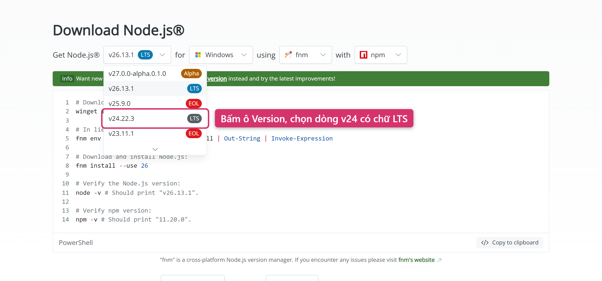
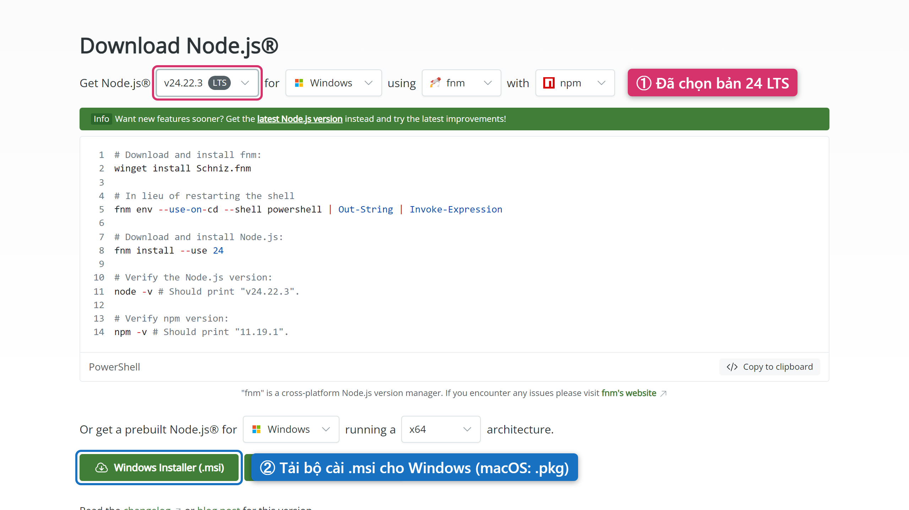

# Bài 1 - [Javascript Typescript] Cài đặt môi trường Node.js và VS Code để code

Chương: 1. JavaScript TypeScript for Tester + Git

Nguồn: [https://anhtester.com/learn/website-and-api-testing-automation-with-playwright-javascript-typescript-day-code-js-ts-tu-dau/399](https://anhtester.com/learn/website-and-api-testing-automation-with-playwright-javascript-typescript-day-code-js-ts-tu-dau/399)

✅ Node.js, npm và quy tắc luôn chọn bản LTS  
✅ Cài đặt Node.js 24 LTS trên Windows và macOS, xử lý lỗi sau khi cài  
✅ Cài đặt VS Code, Terminal tích hợp và các extension cần thiết  
✅ Thực hành: tạo project, đọc package.json, cài package và chạy file JavaScript đầu tiên  
✅ Dùng Claude Code, ChatGPT, Gemini để hỏi đào sâu và làm quen bộ kit claude-testing-skills  
✅ Kiểm tra lệnh cài đặt do AI đưa ra

## ⭐ Mục tiêu bài học

Đây là bài mở đầu của chương **JavaScript TypeScript for Tester + Git**. Chương gồm 10 bài và chỉ có một mục đích: dạy JavaScript, TypeScript **vừa đủ để bạn đọc và duyệt được code automation do AI sinh ra**. Bạn không phải học thuộc cú pháp, cũng không phải trở thành lập trình viên.

Muốn chạy được dòng code nào thì máy phải có chỗ chạy và chỗ viết. Bài này dựng hai thứ đó, và tạo luôn project dùng chung cho cả chương. Học xong bạn sẽ:

- Hiểu Node.js và npm là gì, vì sao Playwright cần chúng.
- Cài được **Node.js 24 LTS** trên Windows hoặc macOS và tự kiểm bằng `node -v`, `npm -v`.
- Cài VS Code, mở thư mục project, dùng Terminal tích hợp và cài đúng các extension cần cho khoá học.
- Tạo project `js-ts-for-tester` bằng `npm init -y`, đọc hiểu file `package.json`, cài thử một package và chạy file JavaScript đầu tiên.
- Nhờ Claude Code giải thích lỗi cài đặt, và biết kiểm lại các lệnh AI đưa ra trước khi chạy.

> 📌 Mọi lệnh và kết quả trong bài được chạy thật ngày 15/11/2026 trên Windows 11, Node.js v24.17.0, npm 11.2.0. Máy bạn ra số phiên bản lớn hơn một chút là bình thường.

## ✅ Phần 1: Node.js, npm và quy tắc chọn bản LTS

### 🔆 1. Node.js là gì?

JavaScript sinh ra để chạy **bên trong trình duyệt**. **Node.js** là chương trình giúp chạy JavaScript **ngay trên máy tính**, không cần mở trình duyệt nào. Bạn gõ `node ten-file.js`, Node.js đọc file và thực thi từng dòng.

Điều này liên quan trực tiếp tới khoá học: **Playwright chạy trên Node.js**. Code test của bạn là code JavaScript hoặc TypeScript, Node.js chạy code đó, và code đó điều khiển trình duyệt. Không có Node.js thì không có Playwright.

### 🔆 2. npm là gì?

**npm** là công cụ quản lý thư viện, được cài sẵn cùng Node.js. Mỗi thư viện trên npm gọi là một **package**. npm làm ba việc bạn sẽ dùng suốt khoá:

<table class="rt-table">
<thead>
<tr>
<th>Việc</th>
<th>Lệnh</th>
<th>Ghi chú</th>
</tr>
</thead>
<tbody>
<tr>
<td>Tạo project</td>
<td><code>npm init -y</code></td>
<td>Sinh file <code>package.json</code>, là "hồ sơ" của project</td>
</tr>
<tr>
<td>Cài package</td>
<td><code>npm install ten-package</code></td>
<td>Tải package về thư mục <code>node_modules</code> của project</td>
</tr>
<tr>
<td>Chạy lệnh đặt sẵn</td>
<td><code>npm run ten-lenh</code></td>
<td>Chạy lệnh khai báo trong mục <code>scripts</code> của <code>package.json</code></td>
</tr>
</tbody>
</table>

Về sau **Playwright cũng chỉ là một package** tên `@playwright/test`, cài bằng npm y như package bạn sẽ cài thử ở Phần 4. Hiểu npm ở bài này thì tới chương Playwright bạn đọc được ngay AI vừa cài gì vào project.

### 🔆 3. Khoá học dùng Node.js 24 LTS

Node.js ra nhiều bản cùng lúc. Cả khoá học thống nhất dùng **Node.js 24 LTS**: mọi ảnh, lệnh và kết quả trong bài đều theo bản này, nên `node -v` trên máy bạn phải ra `v24.x.x`.

> 📌 **Quy tắc: luôn chọn bản LTS.** Sau này cài mới hay nâng cấp Node.js, bạn chỉ chọn bản có chữ **LTS** (Long Term Support, hỗ trợ dài hạn). Không chọn bản mới nhất đang ở trạng thái Current hoặc Alpha.
>
> Vì sao: bản LTS đã qua giai đoạn thử nghiệm nên ổn định, và được sửa lỗi nghiêm trọng trong thời gian dài (nodejs.org ghi tổng cộng khoảng 30 tháng). Playwright và các thư viện test cũng kiểm trên các bản LTS: theo tài liệu Playwright 1.65, yêu cầu là Node.js **22, 24 hoặc 26**, và **Node.js 20 không còn được hỗ trợ**.
>
> Cách nhận biết: trên [nodejs.org/en/download](https://nodejs.org/en/download), cạnh số phiên bản có nhãn `LTS`. Nhãn `Alpha`, `Current` hoặc `EOL` (hết hỗ trợ) thì bỏ qua.
>
> 🔗 Nguồn: [Node.js Releases](https://nodejs.org/en/about/previous-releases) và [System requirements của Playwright](https://playwright.dev/docs/intro#system-requirements).

## ✅ Phần 2: Cài đặt Node.js 24 LTS

### 🔆 1. Tải bộ cài từ trang chính thức

Chỉ tải Node.js từ <https://nodejs.org/en/download>. Không tải từ trang chia sẻ phần mềm, vì bạn không biết file đã bị sửa gì.

Ngày chụp ảnh, ô **Version** mặc định hiện `v26.13.1 LTS`. Bạn bấm vào ô đó và chọn dòng bắt đầu bằng `v24` có nhãn `LTS`:

[](https://anhtester.com/storage/photos/shares/lesson/js_ts_playwright/v2/bai_01_cai_dat_nodejs_vscode/01_nodejs_org_chon_ban_24_lts.png)

*Trang tải nodejs.org: bấm ô Version và chọn dòng v24 có nhãn LTS*

Chọn xong, kéo xuống dòng "Or get a prebuilt Node.js" và bấm nút tải bộ cài:

[](https://anhtester.com/storage/photos/shares/lesson/js_ts_playwright/v2/bai_01_cai_dat_nodejs_vscode/02_nodejs_org_tai_bo_cai_24_lts.png)

*Đã chọn bản 24 LTS, bấm Windows Installer (.msi) để tải bộ cài*

> 💡 Nửa trên của trang là cách cài bằng dòng lệnh qua công cụ quản lý phiên bản (`fnm`, `nvm`). Người mới chưa cần: dùng bộ cài có sẵn ở nửa dưới là đủ.

### 🔆 2. Cài trên Windows và macOS

<table class="rt-table">
<thead>
<tr>
<th>Hệ điều hành</th>
<th>File tải về</th>
<th>Cách cài</th>
</tr>
</thead>
<tbody>
<tr>
<td>Windows</td>
<td>Windows Installer (<code>.msi</code>)</td>
<td>Mở file, bấm Next tới hết và giữ nguyên các lựa chọn mặc định. Bộ cài tự thêm Node.js vào biến môi trường <code>PATH</code>. Nếu có ô hỏi cài thêm công cụ biên dịch (Chocolatey, Python...) thì để trống, khoá học không dùng.</td>
</tr>
<tr>
<td>macOS</td>
<td>macOS Installer (<code>.pkg</code>)</td>
<td>Mở file, bấm Continue tới hết, nhập mật khẩu máy khi được hỏi. Chọn đúng kiến trúc chip ở ô bên cạnh nút tải (<code>arm64</code> cho máy Apple Silicon, <code>x64</code> cho máy Intel).</td>
</tr>
</tbody>
</table>

### 🔆 3. Kiểm tra sau khi cài

**Mở một cửa sổ terminal mới** (Windows: PowerShell, macOS: Terminal) rồi gõ lần lượt:

```bash
node -v
npm -v
```

Kết quả chạy thật trên máy soạn bài:

```bash
PS C:\> node -v
v24.17.0
PS C:\> npm -v
11.2.0
```

Bạn cài hôm nay sẽ thấy số mới hơn (nodejs.org đang phát hành `v24.22.3` kèm npm `11.19.1`). Chỉ cần dòng đầu bắt đầu bằng `v24` là đạt.

### 🔆 4. Hai lỗi hay gặp ngay sau khi cài

**Lỗi 1: máy không nhận lệnh `node`.** Thông báo thật trên PowerShell:

```bash
node : The term 'node' is not recognized as the name of a cmdlet, function, script file, or operable program.
Check the spelling of the name, or if a path was included, verify that the path is correct and try again.
```

Trên Command Prompt câu báo là `'node' is not recognized as an internal or external command`, trên macOS thường là `command not found: node`. Cả ba cùng một nghĩa: terminal không tìm thấy chương trình `node` trong danh sách thư mục `PATH`. Xử lý theo thứ tự:

1. **Đóng hết terminal (và cả VS Code) rồi mở lại.** Terminal mở từ trước khi cài vẫn giữ `PATH` cũ. Đây là nguyên nhân của phần lớn trường hợp.
2. Vẫn lỗi thì khởi động lại máy.
3. Vẫn lỗi nữa thì chạy lại bộ cài và giữ nguyên lựa chọn mặc định. Đừng tự sửa `PATH` bằng tay khi chưa hiểu, sửa sai có thể làm hỏng các lệnh khác.

**Lỗi 2: PowerShell chặn lệnh `npm`** (chỉ có trên Windows). `node -v` chạy được nhưng `npm -v` báo:

```bash
npm : File C:\Program Files\nodejs\npm.ps1 cannot be loaded because running scripts is disabled on this system.
For more information, see about_Execution_Policies at https:/go.microsoft.com/fwlink/?LinkID=135170.
    + CategoryInfo          : SecurityError: (:) [], PSSecurityException
    + FullyQualifiedErrorId : UnauthorizedAccess
```

Node.js không hỏng. Trên Windows bản thường, PowerShell mặc định ở chế độ `Restricted`, tức là **không cho chạy file script**, mà lệnh `npm` trong PowerShell lại là một file script (`npm.ps1`). Có hai cách:

<table class="rt-table">
<thead>
<tr>
<th>Cách</th>
<th>Lệnh</th>
<th>Khi nào dùng</th>
</tr>
</thead>
<tbody>
<tr>
<td>Sửa một lần</td>
<td><code><span>Set-ExecutionPolicy</span> <span>-ExecutionPolicy</span> <span>RemoteSigned</span> <span>-Scope</span> <span>CurrentUser</span></code></td>
<td>Máy cá nhân. Chỉ đổi cho <strong>tài khoản của bạn</strong>, không cần quyền Administrator</td>
</tr>
<tr>
<td>Không đổi cài đặt</td>
<td>Gõ <code>npm.cmd</code> thay cho <code>npm</code>, ví dụ <code>npm.cmd -v</code></td>
<td>Máy công ty không cho đổi chính sách</td>
</tr>
</tbody>
</table>

> ⚠️ Không dùng `Set-ExecutionPolicy Unrestricted`, và không bỏ phần `-Scope CurrentUser`. Thiếu `-Scope` là lệnh đổi cho **toàn bộ máy** và đòi quyền Administrator. `Unrestricted` cho chạy mọi script, kể cả script tải từ internet. `RemoteSigned` vừa đủ: script trên máy chạy được, script tải về phải có chữ ký.
>
> 🔗 Tài liệu Microsoft: [about\_Execution\_Policies](https://learn.microsoft.com/en-us/powershell/module/microsoft.powershell.core/about/about_execution_policies).

## ✅ Phần 3: Cài đặt VS Code và các extension cần thiết

### 🔆 1. Tải và cài VS Code

**Visual Studio Code** (VS Code) là trình soạn code miễn phí của Microsoft, cũng là nơi bạn viết test, chạy test và làm việc với AI trong cả khoá. Tải tại <https://code.visualstudio.com/>. Trang tự nhận hệ điều hành: trên Windows nút ghi `Download for Windows`, trên macOS là `Download for Mac`.

- **Windows:** mở file `.exe`, bấm Next tới hết. Ở bước chọn tác vụ bổ sung, nên tick hai ô "Open with Code" để sau này bấm chuột phải vào thư mục là mở được bằng VS Code.
- **macOS:** giải nén file tải về rồi kéo `Visual Studio Code` vào thư mục Applications.

### 🔆 2. Mở thư mục project và Terminal tích hợp

Cả chương JavaScript TypeScript dùng chung **một project**, mỗi bài một thư mục con. Bạn tạo project này ngay bây giờ và dùng tiếp ở các bài sau:

<table class="rt-table">
<thead>
<tr>
<th>Hệ điều hành</th>
<th>Thư mục project</th>
<th>Thư mục của bài này</th>
</tr>
</thead>
<tbody>
<tr>
<td>Windows</td>
<td><code>D:\AnhTester\js-ts-for-tester</code></td>
<td><code>bai-01-cai-dat</code> nằm bên trong project</td>
</tr>
<tr>
<td>macOS</td>
<td><code>~/AnhTester/js-ts-for-tester</code></td>
<td><code>bai-01-cai-dat</code> nằm bên trong project</td>
</tr>
</tbody>
</table>

Máy không có ổ `D:` thì đặt ở ổ khác, miễn là đường dẫn **không dấu, không khoảng trắng**: tên thư mục sẽ thành tên project, và nhiều công cụ dòng lệnh xử lý khoảng trắng không tốt.

Tạo thư mục `D:\AnhTester\js-ts-for-tester` bằng File Explorer (macOS: Finder), rồi trong VS Code:

1. Chọn **File > Open Folder...** và chọn thư mục `js-ts-for-tester`. Luôn mở **cả thư mục project**, đừng mở từng file lẻ hay mở thư mục con: VS Code, Playwright và Claude Code đều làm việc theo thư mục project.
2. Mở Terminal tích hợp bằng **Terminal > New Terminal** hoặc phím tắt `` Ctrl + ` `` (phím nằm dưới phím Esc).

Terminal này tự đứng sẵn trong thư mục project. Trên Windows dấu nhắc có dạng `PS D:\AnhTester\js-ts-for-tester>`: chữ `PS` cho biết đây là PowerShell, phần sau là thư mục hiện tại. Trước khi gõ lệnh nào, nhìn dấu nhắc để chắc mình đang đứng đúng thư mục. Chạy `npm install` nhầm thư mục là lỗi rất hay gặp của người mới.

### 🔆 3. Extension nên cài cho khoá học

Mở khung Extensions bằng `Ctrl + Shift + X` (macOS: `Cmd + Shift + X`), gõ tên vào ô tìm kiếm rồi bấm Install. Khoá học chỉ cần ba extension:

<table class="rt-table">
<thead>
<tr>
<th>Tên chính xác</th>
<th>Nhà phát hành</th>
<th>Dùng để làm gì</th>
</tr>
</thead>
<tbody>
<tr>
<td><a href="https://marketplace.visualstudio.com/items?itemName=ms-playwright.playwright">Playwright Test for VSCode</a></td>
<td>Microsoft</td>
<td>Chạy và debug test Playwright ngay trong VS Code. Cài sẵn bây giờ, dùng từ chương Playwright</td>
</tr>
<tr>
<td><a href="https://marketplace.visualstudio.com/items?itemName=esbenp.prettier-vscode">Prettier - Code formatter</a></td>
<td>Prettier</td>
<td>Tự căn chỉnh code cho đều. Code AI sinh ra và code bạn sửa sẽ cùng một kiểu trình bày, dễ so sánh</td>
</tr>
<tr>
<td><a href="https://marketplace.visualstudio.com/items?itemName=anthropic.claude-code">Claude Code for VS Code</a></td>
<td>Anthropic</td>
<td>Dùng Claude Code trong VS Code, xem Phần 5</td>
</tr>
</tbody>
</table>

Trên Marketplace có nhiều extension tên gần giống nhau. Trước khi bấm Install, kiểm **cả tên lẫn nhà phát hành** đúng như bảng trên. Ba link trong bảng dẫn thẳng tới trang chính thức của từng extension.

> ⚠️ Đừng cài thêm cả loạt extension theo các bài "top extension" trên mạng. Extension chạy với quyền của bạn trên máy, cài càng nhiều càng chậm và càng rủi ro. Thiếu gì thì cài sau.

## ✅ Phần 4: Thực hành - project Node.js đầu tiên

Tình huống: bạn vừa vào dự án, việc đầu tiên trưởng nhóm giao là "dựng project, chạy thử một file in ra môi trường test và địa chỉ trang cần kiểm". Phần này làm đúng việc đó. Mọi lệnh gõ ở Terminal tích hợp của VS Code, tại thư mục project `D:\AnhTester\js-ts-for-tester`. Làm xong, project có cấu trúc:

```bash
D:\AnhTester\js-ts-for-tester
├── bai-01-cai-dat
│   ├── hello.js
│   ├── hello-env.js
│   └── loi.js
├── node_modules          (npm tự tạo khi cài package)
├── .env
├── package.json
└── package-lock.json     (npm tự tạo khi cài package)
```

### 🔆 1. Tạo project và đọc file package.json

```bash
npm init -y
```

Lệnh tạo file `D:\AnhTester\js-ts-for-tester\package.json`. Tham số `-y` nghĩa là nhận hết giá trị mặc định, không hỏi từng câu. Kết quả chạy thật:

```bash
PS D:\AnhTester\js-ts-for-tester> npm init -y
Wrote to D:\AnhTester\js-ts-for-tester\package.json:

{
  "name": "js-ts-for-tester",
  "version": "1.0.0",
  "description": "",
  "main": "index.js",
  "scripts": {
    "test": "echo \"Error: no test specified\" && exit 1"
  },
  "keywords": [],
  "author": "",
  "license": "ISC",
  "type": "commonjs"
}
```

`package.json` là file bạn sẽ gặp trong **mọi** project automation. Đọc được nó là biết project tên gì, dùng thư viện nào, chạy bằng lệnh nào:

<table class="rt-table">
<thead>
<tr>
<th>Trường</th>
<th>Ý nghĩa</th>
</tr>
</thead>
<tbody>
<tr>
<td><code>name</code>, <code>version</code></td>
<td>Tên và phiên bản project. Tên lấy theo tên thư mục</td>
</tr>
<tr>
<td><code>scripts</code></td>
<td>Các lệnh đặt sẵn, chạy bằng <code>npm run ten-lenh</code>. Đây là chỗ cần đọc đầu tiên khi nhận một project lạ</td>
</tr>
<tr>
<td><code>dependencies</code></td>
<td>Package mà code <strong>cần để chạy</strong>. Chưa có lúc mới tạo, xuất hiện khi bạn cài package</td>
</tr>
<tr>
<td><code>devDependencies</code></td>
<td>Package chỉ dùng <strong>khi phát triển và kiểm thử</strong>. Sau này <code>@playwright/test</code> nằm ở đây</td>
</tr>
<tr>
<td><code>type</code></td>
<td>Kiểu module của project. Giữ nguyên <code>commonjs</code>, phần Modules sẽ học sau trong chương</td>
</tr>
<tr>
<td><code>main</code>, <code>description</code>, <code>keywords</code>, <code>author</code>, <code>license</code></td>
<td>Thông tin mô tả, chỉ quan trọng khi phát hành package lên npm. Project test bỏ qua được</td>
</tr>
</tbody>
</table>

### 🔆 2. Viết và chạy file hello.js

Ở khung Explorer của VS Code, bấm New Folder và tạo thư mục `bai-01-cai-dat`. Bấm vào thư mục đó, chọn New File và tạo file `D:\AnhTester\js-ts-for-tester\bai-01-cai-dat\hello.js`:

```javascript
// bai-01-cai-dat/hello.js - file JavaScript đầu tiên, chạy bằng Node.js
const baseUrl = 'https://crm.anhtester.com/admin/authentication';
const testEnv = 'staging';

console.log('Xin chào Anh Tester!');
console.log('Môi trường test:', testEnv);
console.log('Trang sẽ kiểm thử:', baseUrl);
console.log('Phiên bản Node.js:', process.version);
```

Chưa cần hiểu từng dòng, bài kế tiếp sẽ học kỹ. Lúc này chỉ cần biết: `const` đặt tên cho một giá trị, `console.log(...)` in ra terminal, và dòng bắt đầu bằng `//` là ghi chú, Node.js bỏ qua. `baseUrl` là địa chỉ trang đăng nhập của CRM demo, hệ thống bạn sẽ viết test trong suốt khoá.

Lưu file bằng `Ctrl + S` rồi chạy. Vì terminal đang đứng ở thư mục project, lệnh phải ghi cả tên thư mục con:

```bash
node bai-01-cai-dat/hello.js
```

Kết quả chạy thật:

```bash
PS D:\AnhTester\js-ts-for-tester> node bai-01-cai-dat/hello.js
Xin chào Anh Tester!
Môi trường test: staging
Trang sẽ kiểm thử: https://crm.anhtester.com/admin/authentication
Phiên bản Node.js: v24.17.0
```

> ⚠️ Chưa lưu thì Node.js chạy bản cũ của file. Thấy chấm tròn cạnh tên file trên thẻ của VS Code nghĩa là file **chưa lưu**.

### 🔆 3. Đặt lệnh tắt trong scripts

Lệnh chạy test thật thường dài và nhiều tham số, không ai muốn gõ lại mỗi ngày. Cách làm chung của mọi project là đặt tên cho lệnh trong mục `scripts`. Mở `D:\AnhTester\js-ts-for-tester\package.json`, thay mục `scripts` thành:

```json
"scripts": {
  "hello": "node bai-01-cai-dat/hello.js"
},
```

Lưu file rồi chạy `npm run hello`. Kết quả chạy thật:

```bash
PS D:\AnhTester\js-ts-for-tester> npm run hello

> js-ts-for-tester@1.0.0 hello
> node bai-01-cai-dat/hello.js

Xin chào Anh Tester!
Môi trường test: staging
Trang sẽ kiểm thử: https://crm.anhtester.com/admin/authentication
Phiên bản Node.js: v24.17.0
```

Hai dòng bắt đầu bằng `>` là npm báo nó đang chạy script nào và lệnh thật phía sau là gì. Nhờ `scripts`, cả nhóm và cả AI cùng gọi một lệnh giống nhau.

### 🔆 4. Cài thử một package: dotenv

Ở `hello.js`, URL và tên môi trường đang viết thẳng trong code. Khi dự án có thêm môi trường khác, bạn phải mở code ra sửa. Project thật để các giá trị này trong file `.env` và đọc ra bằng package **dotenv**. Bạn sẽ dùng lại đúng package này ở bài đọc config từ file `.env`, nên lấy nó làm ví dụ cài package đầu tiên:

```bash
npm install dotenv
```

Kết quả chạy thật:

```bash
PS D:\AnhTester\js-ts-for-tester> npm install dotenv

added 1 package, and audited 2 packages in 1s

1 package is looking for funding
  run `npm fund` for details

found 0 vulnerabilities
```

Tạo file `D:\AnhTester\js-ts-for-tester\.env` (nằm ở **gốc project**, cùng cấp với `package.json`):

```bash
TEST_ENV=staging
BASE_URL=https://crm.anhtester.com/admin/authentication
```

Tạo file `D:\AnhTester\js-ts-for-tester\bai-01-cai-dat\hello-env.js`:

```javascript
// bai-01-cai-dat/hello-env.js - đọc cấu hình từ file .env bằng package dotenv
require('dotenv').config();

console.log('Môi trường test:', process.env.TEST_ENV);
console.log('Trang sẽ kiểm thử:', process.env.BASE_URL);
```

Chạy file, rồi chạy `npm ls` để xem project đang có package nào. Kết quả chạy thật:

```bash
PS D:\AnhTester\js-ts-for-tester> node bai-01-cai-dat/hello-env.js
◇ injected env (2) from .env
Môi trường test: staging
Trang sẽ kiểm thử: https://crm.anhtester.com/admin/authentication
PS D:\AnhTester\js-ts-for-tester> npm ls
js-ts-for-tester@1.0.0 D:\AnhTester\js-ts-for-tester
`-- dotenv@18.0.10
```

Dòng `injected env (2) from .env` do dotenv in ra, báo nó đã nạp 2 biến. dotenv tìm file `.env` ở **thư mục bạn đang đứng khi gõ lệnh**, vì vậy phải đứng ở gốc project. Sau lệnh cài, project có thêm ba thay đổi:

<table class="rt-table">
<thead>
<tr>
<th>Thứ mới</th>
<th>Là gì</th>
<th>Đưa lên Git?</th>
</tr>
</thead>
<tbody>
<tr>
<td><code>"dependencies"</code> trong <code>package.json</code></td>
<td>Dòng <code>"dotenv": "^18.0.10"</code>: project cần dotenv, bản 18.0.10 trở lên trong nhánh 18</td>
<td>Có</td>
</tr>
<tr>
<td><code>package-lock.json</code></td>
<td>Ghi <strong>chính xác</strong> phiên bản đã cài của từng package. Nhờ nó máy khác cài ra đúng bản bạn đang dùng. Không sửa tay file này</td>
<td>Có</td>
</tr>
<tr>
<td><code>node_modules/</code></td>
<td>Thư mục chứa code của các package đã tải về</td>
<td><strong>Không</strong></td>
</tr>
</tbody>
</table>

**Vì sao không đưa `node_modules` lên Git?** Thư mục này rất nặng (project Playwright thật có hàng nghìn file) và **tạo lại được bất cứ lúc nào** từ `package.json` và `package-lock.json`. Tình huống bạn sẽ gặp thường xuyên: tải project của đồng nghiệp về, chạy thử là lỗi ngay. Anh Tester dựng lại tình huống đó bằng cách xoá thư mục `node_modules` rồi chạy lại file (đã lược các dòng `at ...`):

```bash
PS D:\AnhTester\js-ts-for-tester> node bai-01-cai-dat/hello-env.js
node:internal/modules/cjs/loader:1503
  throw err;
  ^

Error: Cannot find module 'dotenv'
Require stack:
- D:\AnhTester\js-ts-for-tester\bai-01-cai-dat\hello-env.js
  code: 'MODULE_NOT_FOUND',

Node.js v24.17.0
PS D:\AnhTester\js-ts-for-tester> npm install

added 1 package, and audited 2 packages in 1s

found 0 vulnerabilities
PS D:\AnhTester\js-ts-for-tester> node bai-01-cai-dat/hello-env.js
◇ injected env (2) from .env
Môi trường test: staging
Trang sẽ kiểm thử: https://crm.anhtester.com/admin/authentication
```

Lệnh `npm install` không kèm tên package nghĩa là "cài đủ mọi thứ ghi trong `package.json`". Đây là lệnh đầu tiên phải chạy khi nhận một project.

File `.env` cũng không đưa lên Git, vì sau này nó chứa tài khoản test (`ADMIN_EMAIL`, `ADMIN_PASSWORD`). Hai thứ này được khai báo trong file `.gitignore` ở gốc project, học ở bài về Git trong chương này:

```bash
node_modules/
.env
```

### 🔆 5. Tập đọc thông báo lỗi

Lỗi là chuyện hằng ngày của người làm automation. Việc cần tập ngay từ bài đầu là **đọc lỗi trước khi hỏi**. Ví dụ thứ nhất, gõ sai tên file (`helo.js` thay vì `hello.js`). Kết quả chạy thật, đã lược các dòng `at ...`:

```bash
PS D:\AnhTester\js-ts-for-tester> node bai-01-cai-dat/helo.js
node:internal/modules/cjs/loader:1503
  throw err;
  ^

Error: Cannot find module 'D:\AnhTester\js-ts-for-tester\bai-01-cai-dat\helo.js'
  code: 'MODULE_NOT_FOUND',

Node.js v24.17.0
```

Ví dụ thứ hai, lỗi nằm trong code. Tạo file `D:\AnhTester\js-ts-for-tester\bai-01-cai-dat\loi.js`, khai báo `baseUrl` nhưng lại in ra `baseURL`:

```javascript
// bai-01-cai-dat/loi.js - file cố ý viết sai để tập đọc lỗi
const baseUrl = 'https://crm.anhtester.com/admin/authentication';
console.log('Trang sẽ kiểm thử:', baseURL);
```

Kết quả chạy thật:

```bash
PS D:\AnhTester\js-ts-for-tester> node bai-01-cai-dat/loi.js
D:\AnhTester\js-ts-for-tester\bai-01-cai-dat\loi.js:3
console.log('Trang sẽ kiểm thử:', baseURL);
                                  ^

ReferenceError: baseURL is not defined
    at Object.<anonymous> (D:\AnhTester\js-ts-for-tester\bai-01-cai-dat\loi.js:3:35)

Node.js v24.17.0
```

Cách đọc giống nhau cho mọi lỗi của Node.js:

- **Tìm dòng có chữ `Error`**. Đó là câu trả lời: `Cannot find module` là không tìm thấy file hoặc package, `is not defined` là dùng một tên chưa khai báo (JavaScript phân biệt hoa thường, `baseUrl` khác `baseURL`).
- **Tìm vị trí**: `loi.js:3:35` nghĩa là file `loi.js`, dòng 3, cột 35. Dấu `^` chỉ đúng chỗ đó.
- Các dòng bắt đầu bằng `at` là đường đi bên trong Node.js. Dòng nào không trỏ tới file của bạn thì bỏ qua.

## ✅ Phần 5: Dùng AI hỗ trợ - Claude Code và bộ kit claude-testing-skills

### 🔆 1. Dùng công cụ AI nào?

<table class="rt-table">
<thead>
<tr>
<th>Công cụ</th>
<th>Chi phí</th>
<th>Dùng trong khoá học</th>
</tr>
</thead>
<tbody>
<tr>
<td><a href="https://claude.ai/">Claude</a> và Claude Code</td>
<td>Có phí</td>
<td>Công cụ chính Anh Tester dùng trong khoá, đi cùng bộ kit claude-testing-skills. Claude Code làm việc ngay trong thư mục project</td>
</tr>
<tr>
<td><a href="https://chatgpt.com/">ChatGPT</a></td>
<td>Có bản miễn phí</td>
<td>Dùng để hỏi kiến thức, giải thích code và lỗi khi bạn chưa đăng ký Claude</td>
</tr>
<tr>
<td><a href="https://gemini.google.com/">Gemini</a></td>
<td>Có bản miễn phí</td>
<td>Tương tự ChatGPT</td>
</tr>
</tbody>
</table>

Các prompt hỏi kiến thức ở mục 4 bên dưới dùng được cho cả ba công cụ. Riêng những việc cần AI **đọc file và chạy lệnh trong project** thì cần Claude Code. Với ChatGPT và Gemini bản chat, bạn tự dán nội dung file và thông báo lỗi vào.

### 🔆 2. Claude Code là gì và cài thế nào?

**Claude Code** là trợ lý lập trình AI của Anthropic. Khác với chat AI trên web, nó **làm việc ngay trong thư mục project**: đọc được file, sửa file và chạy lệnh trong terminal (có hỏi bạn trước tuỳ chế độ quyền). Vì nó thấy đúng `package.json` và đúng thông báo lỗi của bạn, câu trả lời sát thực tế hơn. Claude Code cần tài khoản Claude trả phí (Pro, Max, Team, Enterprise) hoặc tài khoản Claude Console, gói miễn phí của claude.ai không dùng được.

Cách cài khuyên dùng theo tài liệu chính thức là bộ cài native, chạy một lệnh trong terminal:

```bash
# Windows - chạy trong PowerShell
irm https://claude.ai/install.ps1 | iex

# macOS - chạy trong Terminal
curl -fsSL https://claude.ai/install.sh | bash
```

Cài xong, **mở terminal mới** và kiểm. Kết quả chạy thật trên máy soạn bài:

```bash
PS D:\AnhTester\js-ts-for-tester> claude --version
2.1.323 (Claude Code)
```

Báo không nhận lệnh `claude` thì nguyên nhân giống hệt lỗi `node` ở Phần 2: terminal chưa có `PATH` mới. Có hai cách dùng, chọn cách nào cũng được:

- **Trong terminal:** đứng ở thư mục project `D:\AnhTester\js-ts-for-tester`, gõ `claude`. Lần đầu nó mở trình duyệt để bạn đăng nhập.
- **Trong VS Code:** cài extension **Claude Code for VS Code** ở Phần 3 (cần VS Code 1.94 trở lên), rồi bấm biểu tượng Claude ở thanh bên trái.

> 🔗 Tài liệu: [Quickstart](https://code.claude.com/docs/en/quickstart), [Advanced setup](https://code.claude.com/docs/en/setup), [Claude Code trong VS Code](https://code.claude.com/docs/en/vs-code). Lệnh cài có thể đổi theo thời gian, luôn lấy lệnh ở trang chính thức.
>
> 💡 Trên Windows, tài liệu khuyên cài thêm [Git for Windows](https://git-scm.com/) để Claude Code chạy được lệnh Bash. Bạn cũng cần Git cho bài về Git trong chương này.

### 🔆 3. Prompt cho Claude Code: làm việc trên project thật

Mở Claude Code tại thư mục project rồi thử ba việc sau.

**Giải thích file `package.json`:**

```markdown
Đọc file package.json của project này và giải thích từng trường bằng tiếng Việt cho người mới học. Trường nào tôi cần quan tâm khi làm automation test, trường nào bỏ qua được? Chỉ giải thích, không sửa file.
```

**Tìm nguyên nhân máy không nhận lệnh `node`:**

```markdown
Tôi vừa cài Node.js 24 LTS trên Windows 11 bằng file .msi tải từ nodejs.org. Gõ `node -v` trong PowerShell thì báo "The term 'node' is not recognized". Hãy kiểm tra giúp tôi Node.js đã được cài chưa và có nằm trong PATH không. Giải thích nguyên nhân trước, CHƯA chạy lệnh nào làm thay đổi cài đặt của máy khi tôi chưa đồng ý.
```

**Chạy thử và giải thích lỗi:**

```markdown
Chạy lệnh `node bai-01-cai-dat/loi.js` trong project này. Giải thích thông báo lỗi theo 3 ý: lỗi gì, nằm ở file nào dòng nào, vì sao xảy ra. Đề xuất cách sửa nhưng CHƯA sửa file, để tôi tự sửa.
```

### 🔆 4. Prompt hỏi đào sâu kiến thức (Claude, ChatGPT, Gemini đều dùng được)

**Hiểu vai trò của Node.js với Playwright:**

```markdown
Tôi là tester mới học automation với Playwright TypeScript. Giải thích ngắn gọn bằng tiếng Việt: Node.js là gì, npm là gì, và khi tôi chạy một test Playwright thì Node.js, npm, Playwright và trình duyệt phối hợp với nhau thế nào? Dùng ví dụ đời thường, không quá 200 chữ.
```

**Phân biệt dependencies và devDependencies:**

```markdown
Trong package.json, dependencies và devDependencies khác nhau thế nào? Lệnh `npm install dotenv` và `npm install -D dotenv` cho kết quả khác nhau ở đâu? Với project chỉ chứa test automation thì chọn sai có hậu quả gì không? Trả lời dạng bảng.
```

**Hiểu dấu `^` và file package-lock.json:**

```markdown
package.json của tôi có dòng "dotenv": "^18.0.10". Dấu ^ nghĩa là gì? Nếu đồng nghiệp chạy `npm install` sau 3 tháng thì có thể nhận bản dotenv nào? File package-lock.json thay đổi kết quả đó ra sao? `npm install` và `npm ci` khác nhau thế nào? Giải thích cho người mới, có ví dụ số phiên bản cụ thể.
```

**Giải thích một thông báo lỗi (dán nguyên văn lỗi của bạn vào):**

```markdown
Tôi dùng Windows 11, Node.js v24. Trong thư mục project tôi chạy `node bai-01-cai-dat/hello-env.js` và gặp lỗi:

Error: Cannot find module 'dotenv'
Require stack:
- D:\AnhTester\js-ts-for-tester\bai-01-cai-dat\hello-env.js

Lỗi này nghĩa là gì, 3 nguyên nhân hay gặp nhất là gì, và tôi nên kiểm tra theo thứ tự nào? Giải thích ngắn gọn cho người mới.
```

**Tự kiểm tra kiến thức:**

```markdown
Tôi vừa học xong bài cài đặt Node.js 24 LTS, npm, package.json, node_modules, package-lock.json và VS Code. Hãy hỏi tôi 5 câu trắc nghiệm, từng câu một. Sau mỗi câu trả lời của tôi, cho biết đúng hay sai và giải thích ngắn rồi mới hỏi câu tiếp.
```

Các prompt trên có chung một cách viết, bạn nên giữ cho cả khoá: nêu rõ **bối cảnh** (bạn là ai, hệ điều hành, bản Node.js, đã làm gì), dán **nguyên văn** thông báo lỗi, nói rõ **dạng câu trả lời** mong muốn và đặt **giới hạn** (chỉ giải thích, chưa sửa, chưa đổi cài đặt máy).

> 🔒 Không dán mật khẩu, token hay nội dung file `.env` thật vào khung chat với AI.
>
> ⚠️ AI bản miễn phí hay bản có phí đều có thể trả lời sai hoặc dùng thông tin cũ. Câu trả lời về phiên bản và lệnh cài đặt phải đối chiếu với trang chính thức, xem Phần 6.

### 🔆 5. Làm quen bộ kit claude-testing-skills

Từ chương Playwright trở đi, bạn không gõ prompt dài mỗi lần mà dùng bộ kit [claude-testing-skills](https://github.com/anhtester/claude-testing-skills) do Anh Tester soạn cho học viên. Bộ kit là một thư mục `.claude` đặt vào gốc project, gồm:

<table class="rt-table">
<thead>
<tr>
<th>Thành phần</th>
<th>Số lượng</th>
<th>Vai trò</th>
</tr>
</thead>
<tbody>
<tr>
<td>Rules</td>
<td>7</td>
<td>Quy tắc AI phải theo khi viết code test, ví dụ <code>playwright_rules.md</code>, <code>locator_strategy.md</code></td>
</tr>
<tr>
<td>Skills</td>
<td>23</td>
<td>Kỹ năng chuyên biệt: sinh locator, review code automation, phân tích flaky test...</td>
</tr>
<tr>
<td>Commands</td>
<td>43</td>
<td>Lệnh gõ bằng dấu <code>/</code>, ví dụ <code>/generate-locator</code>, <code>/generate-automation-web</code>, <code>/review-automation-code</code>, <code>/run-and-fix-tests</code></td>
</tr>
</tbody>
</table>

Bài này bạn **chưa cần cài bộ kit**. Chỉ cần mở link GitHub, đọc lướt `README.md` để biết nó có gì. Từng lệnh sẽ được giới thiệu đúng lúc cần dùng.

## ✅ Phần 6: Kiểm tra lệnh do AI đưa ra

AI học từ dữ liệu cũ, nên lời khuyên về cài đặt **dễ lỗi thời**: bản Node.js đã hết hỗ trợ, lệnh cài đã đổi. Lệnh cài đặt lại tác động lên cả máy chứ không riêng một file. Trước khi chạy bất kỳ lệnh nào AI đưa, rà theo bảng:

<table class="rt-table">
<thead>
<tr>
<th>Dấu hiệu</th>
<th>Vì sao là vấn đề</th>
<th>Cách xử lý</th>
</tr>
</thead>
<tbody>
<tr>
<td>Khuyên cài "bản mới nhất", bản Current hoặc Alpha</td>
<td>Chưa ổn định, thư viện test có thể chưa hỗ trợ</td>
<td>Chọn bản LTS. Khoá học dùng 24 LTS</td>
</tr>
<tr>
<td>Khuyên cài Node.js 16, 18 hoặc 20</td>
<td>Đã hết hỗ trợ (EOL). Playwright 1.65 yêu cầu Node.js 22, 24 hoặc 26</td>
<td>Mở nodejs.org xem bản nào đang có nhãn LTS</td>
</tr>
<tr>
<td><code>sudo npm install -g ...</code> trên macOS</td>
<td>Cài bằng quyền quản trị gây lỗi phân quyền về sau, và script cài đặt của package được chạy với quyền cao nhất</td>
<td>Không dùng <code>sudo</code> với npm. Package của project cài <strong>không</strong> có <code>-g</code></td>
</tr>
<tr>
<td><code>npm install -g</code> cho thư viện của project</td>
<td>Cài toàn máy thì không ghi vào <code>package.json</code>, máy khác tải project về sẽ thiếu</td>
<td>Bỏ <code>-g</code>, cài trong thư mục project</td>
</tr>
<tr>
<td><code>Set-ExecutionPolicy Unrestricted</code> hoặc thiếu <code>-Scope CurrentUser</code></td>
<td>Mở cho mọi script, hoặc đổi chính sách của cả máy</td>
<td>Dùng <code>RemoteSigned</code> kèm <code>-Scope CurrentUser</code>, hoặc gõ <code>npm.cmd</code></td>
</tr>
<tr>
<td><code>git add node_modules</code>, hoặc không có <code>.gitignore</code></td>
<td>Repo phình to, khác hệ điều hành dễ lỗi</td>
<td>Thêm <code>node_modules/</code> và <code>.env</code> vào <code>.gitignore</code></td>
</tr>
<tr>
<td>Bảo xoá <code>package-lock.json</code> để "hết lỗi"</td>
<td>Mất thông tin phiên bản chính xác, lần cài sau có thể ra bản khác</td>
<td>Hỏi lại nguyên nhân thật. Thường chỉ cần xoá <code>node_modules</code> rồi <code>npm install</code></td>
</tr>
<tr>
<td>Lệnh tải file cài đặt từ một địa chỉ lạ</td>
<td>Không rõ nguồn, có thể là mã độc</td>
<td>Chỉ tải từ nodejs.org, code.visualstudio.com, code.claude.com</td>
</tr>
<tr>
<td>Bảo sửa biến <code>PATH</code> hoặc Registry bằng tay</td>
<td>Sửa sai làm hỏng các chương trình khác</td>
<td>Thử mở lại terminal, khởi động lại máy, cài lại bằng bộ cài trước</td>
</tr>
</tbody>
</table>

Nguyên tắc chung: **lệnh nào chưa hiểu thì chưa chạy**. Hỏi lại AI "lệnh này thay đổi gì trên máy, có hoàn tác được không", rồi đối chiếu với trang chính thức. Kiểm một lệnh mất một phút, sửa một máy hỏng môi trường mất cả buổi.

## ✅ Phần 7: Bài tập thực hành

**Bài tập 1 - Kiểm môi trường.** Cài Node.js 24 LTS và VS Code. Mở Terminal tích hợp, chạy `node -v`, `npm -v` và chụp lại kết quả. Dòng đầu phải bắt đầu bằng `v24`. Cài ba extension ở Phần 3 và kiểm đúng nhà phát hành của từng cái.

**Bài tập 2 - File của riêng bạn.** Trong project `D:\AnhTester\js-ts-for-tester`, tạo file `bai-01-cai-dat\info.js` in ra ba dòng: tên của bạn, URL trang đăng nhập khách hàng của CRM demo `https://crm.anhtester.com/authentication/login`, và phiên bản Node.js. Thêm script `info` vào `package.json` (giữ nguyên script `hello`) rồi chạy bằng `npm run info`.

**Bài tập 3 - Xoá và dựng lại.** Trong project ở Phần 4, xoá thư mục `node_modules`, chạy `node bai-01-cai-dat/hello-env.js` và đọc lỗi: dòng nào cho biết nguyên nhân? Sau đó chạy `npm install` và chạy lại. Dán thông báo lỗi vào Claude, ChatGPT hoặc Gemini theo prompt mẫu ở Phần 5 và so lời giải thích với cách bạn tự đọc.

**Bài tập 4 - Duyệt hướng dẫn của AI.** Một bạn hỏi AI cách chuẩn bị máy để học Playwright và nhận được các bước dưới đây. Có 5 chỗ cần sửa. Tìm đủ, nêu lý do theo bảng ở Phần 6 và viết lại cho đúng.

```bash
# Bước 1: vào nodejs.org, tải bản mới nhất v27 để có nhiều tính năng nhất

# Bước 2 (Windows): mở PowerShell bằng quyền Administrator rồi chạy
Set-ExecutionPolicy Unrestricted

# Bước 3 (macOS): cài package dotenv
sudo npm install -g dotenv

# Bước 4: nếu npm báo lỗi thì xoá file khoá rồi cài lại
del package-lock.json
npm install

# Bước 5: lưu code lên Git
git add node_modules package.json bai-01-cai-dat .env
```

## ✅ Phần 8: Ghi nhớ nhanh

- Node.js chạy JavaScript ngoài trình duyệt. Playwright chạy trên Node.js và là một package cài bằng npm.
- Khoá học dùng **Node.js 24 LTS**. Về sau cài mới hay nâng cấp, luôn chọn bản có nhãn **LTS** trên nodejs.org. Playwright 1.65 hỗ trợ Node.js 22, 24, 26, không còn Node.js 20.
- Cài xong phải **mở terminal mới** rồi mới kiểm `node -v`, `npm -v`.
- PowerShell chặn `npm`: dùng `Set-ExecutionPolicy -ExecutionPolicy RemoteSigned -Scope CurrentUser` hoặc gõ `npm.cmd`. Không dùng `Unrestricted`.
- Cả chương dùng một project `D:\AnhTester\js-ts-for-tester`, mỗi bài một thư mục con. VS Code luôn mở cả thư mục project, gõ lệnh ở Terminal tích hợp, nhìn dấu nhắc để biết đang đứng ở đâu.
- `package.json` là hồ sơ project: đọc `scripts` để biết chạy bằng lệnh nào, `dependencies` và `devDependencies` để biết dùng thư viện gì.
- `package-lock.json` đưa lên Git. `node_modules` và `.env` thì không. Thiếu `node_modules` thì chạy `npm install`.
- Đọc lỗi: tìm dòng có chữ `Error`, rồi tìm tên file kèm số dòng.
- Lệnh cài đặt do AI đưa ra có thể đã cũ. Đối chiếu trang chính thức trước khi chạy, lệnh nào chưa hiểu thì chưa chạy.

✅ **Kết luận:** Máy của bạn đã có Node.js 24 LTS để chạy code, VS Code để viết code, và bạn đã chạy được file JavaScript đầu tiên. Từ đây mới bắt đầu học ngôn ngữ. Bài kế tiếp, **Biến, kiểu dữ liệu và toán tử trong JavaScript**, dùng tiếp chính project `js-ts-for-tester` này: bạn chỉ cần tạo thêm thư mục `bai-02-bien-kieu-du-lieu` bên cạnh `bai-01-cai-dat`.

---

## Bài tập riêng — Cài đặt Node.js 24 LTS, VS Code và chạy project đầu tiên

Nguồn bài tập: [https://anhtester.com/student-assignments?course=website-and-api-testing-automation-with-playwright-javascript-typescript-day-code-js-ts-tu-dau#assignment-91](https://anhtester.com/student-assignments?course=website-and-api-testing-automation-with-playwright-javascript-typescript-day-code-js-ts-tu-dau#assignment-91)

**Mục tiêu:** cài đúng môi trường, tự chạy được file JavaScript và đọc được thông báo lỗi đầu tiên.

**Thư mục làm bài:** `D:\AnhTester\js-ts-for-tester\bai-01-cai-dat`

### 📝 Đề bài

#### Bài tập 1 - Kiểm môi trường

Mở Terminal tích hợp của VS Code, chạy 2 lệnh dưới đây. Dòng đầu phải bắt đầu bằng `v24`. Cài 3 extension ở Phần 3 của bài học và kiểm đúng nhà phát hành của từng cái.

```bash
node -v
npm -v
```

#### Bài tập 2 - File của riêng bạn

Tạo file `bai-01-cai-dat/info.js` in ra 3 dòng: tên của bạn, URL trang đăng nhập khách hàng của CRM demo `https://crm.anhtester.com/authentication/login` và phiên bản Node.js đang chạy (lấy bằng code, không gõ tay). Thêm script `info` vào `package.json` (giữ nguyên script `hello`) rồi chạy:

```bash
npm run info
```

#### Bài tập 3 - Xoá và dựng lại

Xoá thư mục `node_modules`, chạy `node bai-01-cai-dat/hello-env.js` và đọc lỗi: **dòng nào** cho biết nguyên nhân? Chạy `npm install` rồi chạy lại. Dán thông báo lỗi vào Claude, ChatGPT hoặc Gemini theo prompt mẫu ở Phần 5 và so lời giải thích của AI với cách bạn tự đọc.

#### Bài tập 4 - Duyệt hướng dẫn của AI

Một bạn hỏi AI cách chuẩn bị máy để học Playwright và nhận được các bước dưới đây. Có **5 chỗ cần sửa**. Tìm đủ, nêu lý do theo bảng ở Phần 6 và viết lại cho đúng.

```bash
# Bước 1: vào nodejs.org, tải bản mới nhất v27 để có nhiều tính năng nhất
# Bước 2 (Windows): mở PowerShell bằng quyền Administrator rồi chạy
Set-ExecutionPolicy Unrestricted
# Bước 3 (macOS): cài package dotenv
sudo npm install -g dotenv
# Bước 4: nếu npm báo lỗi thì xoá file khoá rồi cài lại
del package-lock.json
npm install
# Bước 5: lưu code lên Git
git add node_modules package.json bai-01-cai-dat .env
```

### 📦 Cách nộp bài

1. Mở ô **Nội dung bài làm (Editor)**. Với mỗi file: bấm **Đoạn code mẫu**, chọn ngôn ngữ, dán **toàn bộ** code. Dòng đầu là comment đường dẫn file, ví dụ `// bai-01-cai-dat/bt1-....js`.
2. Ngay dưới mỗi file, chèn thêm một **Đoạn code mẫu** chọn **Text / Log** và dán **kết quả chạy thật** copy từ Terminal (không gõ lại bằng tay).
3. Với bài **Duyệt code AI**: liệt kê từng chỗ sai theo mẫu *Dòng – Lỗi – Lý do – Cách sửa*, sau đó dán file đã sửa và kết quả chạy.
4. Đã đưa project lên GitHub (học ở Bài 7) thì dán thêm link thư mục bài vào ô **Link GitHub**.
5. Bài tập 1: dán kết quả `node -v` và `npm -v`. Muốn gửi ảnh chụp màn hình thì để trong Google Drive và dán link vào ô **Link Google Drive** (nhớ mở quyền xem).

### ✅ Tiêu chí Đạt

- `node -v` ra `v24.x.x`; có kết quả `npm -v`.
- `info.js` in đúng 3 dòng, phiên bản Node lấy bằng `process.version` chứ không gõ cứng; `package.json` còn cả script `hello` lẫn `info`; có kết quả `npm run info`.
- Bài tập 3 chỉ ra đúng dòng `Error: Cannot find module 'dotenv'` là nguyên nhân (thiếu package vì đã xoá node\_modules), có kết quả chạy lại thành công sau `npm install`, và có vài dòng so sánh với lời giải thích của AI.
- Bài tập 4 tìm đủ 5 chỗ: không dùng bản LTS; mở quyền thực thi quá rộng; cài global bằng sudo cho package của project; xoá file khoá; đưa node\_modules và .env lên Git. Mỗi chỗ có lý do và bản viết lại.

### 🤖 Dùng AI thế nào cho đúng

Được dùng Claude, ChatGPT hoặc Gemini để **hỏi giải thích** lỗi và khái niệm (prompt mẫu ở phần AI của bài học). Không nhờ AI làm hộ rồi dán vào: bài **Duyệt code AI** chấm chính phần *lý do* do bạn tự viết. Bài nào nộp lại vì **Cần sửa** thì sửa đúng chỗ giảng viên ghi trong feedback rồi bấm **Nộp lại**.