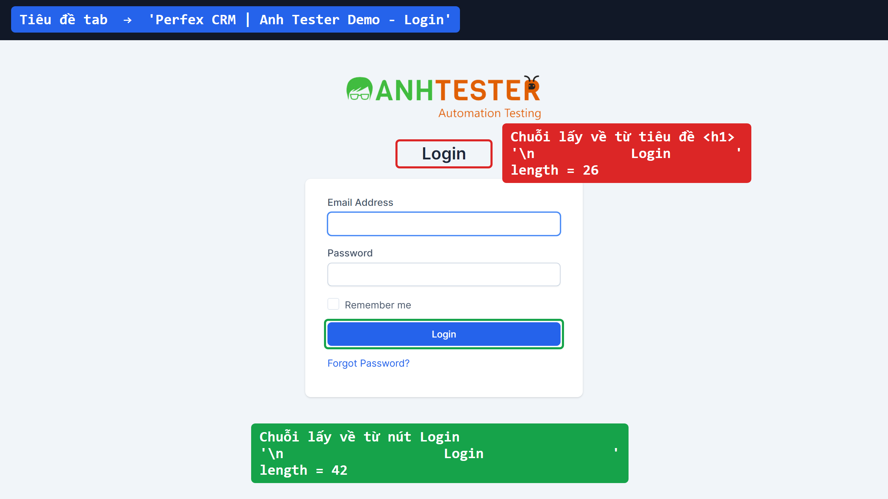

# Bài 2 - [Javascript Typescript] Biến, kiểu dữ liệu và toán tử trong JavaScript

Chương: 1. JavaScript TypeScript for Tester + Git

Nguồn: [https://anhtester.com/learn/website-and-api-testing-automation-with-playwright-javascript-typescript-day-code-js-ts-tu-dau/400](https://anhtester.com/learn/website-and-api-testing-automation-with-playwright-javascript-typescript-day-code-js-ts-tu-dau/400)

✅ Vì sao học JavaScript trước TypeScript  
✅ Biến với const, let và quy tắc đặt tên  
✅ Kiểu dữ liệu, typeof và template literal  
✅ Làm sạch chuỗi lấy từ trang web, đổi chuỗi tiền ra số  
✅ Toán tử số học, so sánh (== và ===) và logic  
✅ Dùng AI để hỏi sâu kiến thức và kiểm tra code do AI sinh ra

## ⭐ Mục tiêu bài học

Ở bài trước bạn đã cài Node.js bản LTS, cài VS Code, tạo project `js-ts-for-tester` bằng `npm init -y` và chạy được file đầu tiên bằng lệnh `node`. Máy đã sẵn sàng, bài này bắt đầu viết những dòng JavaScript đầu tiên có ý nghĩa: **lưu dữ liệu vào biến, biết dữ liệu đó thuộc kiểu gì, và tính toán, so sánh trên dữ liệu đó**.

Sau này phần lớn code automation sẽ do AI sinh ra. Vì vậy bài này không bắt bạn học thuộc cú pháp, mà dạy bạn đủ để **đọc một đoạn code là biết nó lưu gì, so sánh gì, và sai ở đâu**. Học xong bạn sẽ:

- Hiểu vì sao khoá học dạy JavaScript trước rồi mới tới TypeScript.
- Khai báo biến bằng `const` và `let`, đặt tên biến đúng quy ước.
- Nhận ra 5 kiểu dữ liệu cơ bản: `string`, `number`, `boolean`, `undefined`, `null`, và kiểm tra bằng `typeof`.
- Ghép chuỗi bằng template literal, làm sạch chuỗi lấy từ trang web và đổi chuỗi tiền ra số.
- Dùng toán tử số học, so sánh, logic, và hiểu vì sao luôn dùng `===` thay cho `==`.
- Dùng AI để hỏi sâu kiến thức, và tự kiểm lại code AI viết bằng một bảng dấu hiệu.

> 📌 Cả bài làm tiếp trong project của bài trước: `D:\AnhTester\js-ts-for-tester` (macOS: `~/AnhTester/js-ts-for-tester`). Mọi đoạn code trong bài đều có **tên file** và **kết quả chạy thật** ngay bên dưới (Node.js v24.17.0). Bạn gõ lại từng file, chạy, rồi so với kết quả trong bài.

## ✅ Phần 1: Vì sao học JavaScript trước TypeScript

### 🔆 1. Chuẩn bị thư mục cho bài học

Mở VS Code, chọn **File > Open Folder** và mở thư mục project `js-ts-for-tester`. Tạo thư mục mới `bai-02-bien-kieu-du-lieu` nằm cạnh thư mục `bai-01-cai-dat` của bài trước. Mỗi ví dụ trong bài là một file trong thư mục này:

```bash
js-ts-for-tester/
├── package.json
├── bai-01-cai-dat/
│   └── hello.js
└── bai-02-bien-kieu-du-lieu/
    ├── retry.js
    ├── retry.ts
    ├── 00-thong-tin-nguoi.js
    ├── 01-bien.js
    ├── 02-loi-const.js
    ├── 03-loi-chua-khai-bao.js
    ├── 04-kieu-du-lieu.js
    ├── 05-template-literal.js
    ├── 06-ghep-url.js
    ├── 07-bien-moi-truong.js
    ├── 08-lam-sach-chuoi.js
    ├── 09-ham-chuoi.js
    ├── 10-replace.js
    ├── 11-doi-ra-so.js
    ├── 12-number-parsefloat.js
    ├── 13-toan-tu-doi-thuong.js
    ├── 14-tinh-tien-don-hang.js
    ├── 15-cong-chuoi-so.js
    ├── 16-so-sanh-doi-thuong.js
    ├── 17-so-sanh.js
    ├── 18-so-sanh-chuoi-so.js
    ├── 19-logic-doi-thuong.js
    ├── 20-logic-kiem-tra-trang.js
    └── crm-login-data.js
```

Mở Terminal trong VS Code (menu **Terminal > New Terminal**). Terminal đứng sẵn ở thư mục project, nên lệnh chạy một file luôn có dạng:

```bash
node bai-02-bien-kieu-du-lieu/01-bien.js
```

### 🔆 2. TypeScript là JavaScript cộng thêm phần khai báo kiểu

Khoá học này viết test bằng TypeScript. Vậy sao không học thẳng TypeScript? Hãy nhìn hai file sau. File thứ nhất là JavaScript, tạo tại `bai-02-bien-kieu-du-lieu/retry.js`:

```javascript
let retryCount = 0;
retryCount = '1';
console.log(retryCount + 1);
```

File thứ hai là TypeScript, tạo tại `bai-02-bien-kieu-du-lieu/retry.ts`:

```typescript
let retryCount: number = 0;
retryCount = '1';
console.log(retryCount + 1);
```

Hai file chỉ khác nhau đúng một chỗ: `: number` ở dòng 1. Đó là phần **khai báo kiểu**, nghĩa là "biến này chỉ được chứa số". Toàn bộ phần còn lại (`let`, dấu `=`, `console.log`, dấu `+`) là JavaScript. Nói gọn: **TypeScript = JavaScript + kiểu**.

Chạy file JavaScript:

```bash
node bai-02-bien-kieu-du-lieu/retry.js
```

```bash
11
```

Số lần thử lại đang là 1, cộng thêm 1 lẽ ra phải là 2, nhưng kết quả lại là `11`. Lý do: dòng 2 gán nhầm **chuỗi** `'1'` thay vì **số** `1`, và JavaScript nối chuỗi thay vì cộng số (Phần 5 giải thích kỹ). JavaScript không báo lỗi gì, nó cứ chạy và cho kết quả sai.

Với file `retry.ts`, bạn chưa cần chạy: mở file trong VS Code là dòng 2 đã bị **gạch đỏ**. Rê chuột vào sẽ thấy thông báo (Anh Tester đã kiểm bằng trình biên dịch TypeScript 7.0.2):

```bash
retry.ts(2,1): error TS2322: Type 'string' is not assignable to type 'number'.
```

TypeScript bắt lỗi **ngay lúc bạn viết**, trước khi chạy. Đó là lý do các dự án automation chọn TypeScript, và chương này kết thúc bằng một bài riêng về kiểu dữ liệu trong TypeScript.

### 🔆 3. Code TypeScript luôn chạy dưới dạng JavaScript

Phần kiểu chỉ có tác dụng lúc viết code. Đến lúc chạy, phần kiểu bị bỏ đi và thứ thật sự chạy là JavaScript. Bạn kiểm được ngay, vì Node.js 24 chạy thẳng được file `.ts` đơn giản:

```bash
node bai-02-bien-kieu-du-lieu/retry.ts
```

```bash
11
```

Vẫn ra `11`, y như file JavaScript. Node.js chỉ xoá phần kiểu rồi chạy, **không kiểm tra kiểu** (theo [tài liệu Node.js về TypeScript](https://nodejs.org/docs/latest-v24.x/api/typescript.html)). Playwright cũng làm đúng như vậy: tài liệu [playwright.dev/docs/test-typescript](https://playwright.dev/docs/test-typescript) ghi rõ Playwright đọc file TypeScript, chuyển thành JavaScript rồi chạy, và không kiểm tra kiểu.

### 🔆 4. Bốn lý do học JavaScript trước

<table class="rt-table">
<thead>
<tr>
<th>Lý do</th>
<th>Ý nghĩa với bạn</th>
</tr>
</thead>
<tbody>
<tr>
<td>TypeScript = JavaScript + kiểu</td>
<td>Biến, chuỗi, toán tử, điều kiện, vòng lặp, hàm, class của TypeScript đều là của JavaScript. Học JavaScript là đã học phần lớn TypeScript</td>
</tr>
<tr>
<td>Mọi code TypeScript chạy ra JavaScript</td>
<td>Kết quả lúc chạy do JavaScript quyết định. Không hiểu JavaScript thì không giải thích được vì sao test ra <code>11</code> thay vì <code>2</code></td>
</tr>
<tr>
<td>Lỗi lúc chạy là lỗi JavaScript</td>
<td><code>TypeError</code>, <code>ReferenceError</code> bạn gặp khi chạy test là thông báo của JavaScript. Bài này dạy đọc hai lỗi đó</td>
</tr>
<tr>
<td>Đọc và duyệt code AI cần nền JavaScript</td>
<td>AI viết rất nhanh nhưng vẫn mắc các lỗi cơ bản: so sánh bằng <code>==</code>, cộng nhầm chuỗi với số. Người phát hiện là bạn</td>
</tr>
</tbody>
</table>

> 📌 Bạn sẽ gặp cả hai ngôn ngữ khi làm việc: lúc cài, Playwright hỏi bạn chọn TypeScript hay JavaScript (mặc định là TypeScript), còn ví dụ trên mạng và code AI sinh ra thì có cả hai dạng. Nắm JavaScript trước thì đọc dạng nào cũng được.

## ✅ Phần 2: Biến - khai báo bằng const và let

### 🔆 1. Biến là gì?

Trong cuộc sống, để quản lý một người, bạn phải ghi lại các thông tin của người đó: tên, tuổi, địa chỉ. Trong ngôn ngữ lập trình có khái niệm **biến** (variable) dùng để lưu trữ những dữ liệu ấy. Đã lưu vào biến thì các bước xử lý, tính toán phía sau chỉ cần gọi **tên biến** là lấy lại được dữ liệu, tiện hơn và chính xác hơn so với gõ lại giá trị ở nhiều nơi.

Tạo file `bai-02-bien-kieu-du-lieu/00-thong-tin-nguoi.js`:

```javascript
// Lưu thông tin của một người vào biến
const ten = 'An';
let tuoi = 25;
const diaChi = 'Hà Nội';

console.log(ten);
console.log(tuoi);
console.log(diaChi);

// Dùng lại dữ liệu đã lưu để tính toán
const tuoiNamSau = tuoi + 1;
console.log(`Năm sau ${ten} ${tuoiNamSau} tuổi`);

// Sinh nhật: tuổi thay đổi nên gán lại được (vì khai báo bằng let)
tuoi = 26;
console.log(tuoi);
```

```bash
node bai-02-bien-kieu-du-lieu/00-thong-tin-nguoi.js
```

Kết quả:

```bash
An
25
Hà Nội
Năm sau An 26 tuổi
26
```

Một dòng khai báo biến có 4 phần: **từ khoá** (`const` hoặc `let`), **tên biến** (`ten`), dấu `=` nghĩa là **gán** (không phải "bằng nhau"), và **giá trị** (`'An'`). Dấu `;` kết thúc câu lệnh. Dòng có dấu backtick và `${...}` là cách ghép chuỗi, Phần 3 sẽ học.

### 🔆 2. Từ đời thường sang công việc của tester

Tester cũng có những "thông tin cần ghi lại" y như vậy: địa chỉ môi trường test, đường dẫn trang đăng nhập, số lần thử lại khi mạng chậm. Tạo file `bai-02-bien-kieu-du-lieu/01-bien.js`, dùng dữ liệu của CRM demo:

```javascript
// const: giá trị không gán lại
const baseUrl = 'https://crm.anhtester.com';
const loginPath = '/admin/authentication';

// let: giá trị sẽ thay đổi trong lúc chạy
let retryCount = 0;
retryCount = retryCount + 1;

console.log(baseUrl);
console.log(loginPath);
console.log(retryCount);
```

```bash
node bai-02-bien-kieu-du-lieu/01-bien.js
```

Kết quả:

```bash
https://crm.anhtester.com
/admin/authentication
1
```

Lợi ích thấy ngay: URL môi trường chỉ viết **một lần** trong `baseUrl`. Mai đổi sang môi trường khác, bạn sửa đúng một dòng, không phải dò khắp các file test.

### 🔆 3. Dùng const hay let?

<table class="rt-table">
<thead>
<tr>
<th>Từ khoá</th>
<th>Ý nghĩa</th>
<th>Ví dụ trong automation</th>
</tr>
</thead>
<tbody>
<tr>
<td><code>const</code></td>
<td>Gán một lần, <strong>không gán lại được</strong>. Phải gán giá trị ngay lúc khai báo</td>
<td>URL môi trường, đường dẫn trang, tiêu đề mong đợi, dữ liệu test</td>
</tr>
<tr>
<td><code>let</code></td>
<td>Gán lại được nhiều lần</td>
<td>Số lần thử lại, bộ đếm, tổng tiền cộng dồn</td>
</tr>
</tbody>
</table>

**Quy tắc của khoá học: mặc định dùng `const`, chỉ đổi sang `let` khi biến thật sự cần gán lại.** Vì sao? Thấy `const` là người đọc biết chắc giá trị này không đổi từ đầu tới cuối file, khỏi phải dò xem có chỗ nào sửa nó không. Nếu chỗ nào cũng dùng `let`, một dòng gán nhầm ở giữa file sẽ làm test chạy sai mà không báo gì.

> ⚠️ Trong code cũ và ví dụ cũ trên mạng bạn sẽ gặp từ khoá `var`. Đó là cách khai báo đời đầu, có vài hành vi dễ gây lỗi. Gặp thì hiểu nó là khai báo biến, còn code mới thì **đừng dùng**. Thấy AI sinh ra `var` là yêu cầu đổi sang `const` hoặc `let`.

### 🔆 4. Hai lỗi về biến gặp nhiều nhất

**Lỗi thứ nhất: gán lại biến `const`.** Tạo file `bai-02-bien-kieu-du-lieu/02-loi-const.js`:

```javascript
const baseUrl = 'https://crm.anhtester.com';
console.log('Trước khi gán lại:', baseUrl);

baseUrl = 'https://google.com';
console.log('Dòng này không bao giờ chạy tới');
```

```bash
node bai-02-bien-kieu-du-lieu/02-loi-const.js
```

Kết quả:

```bash
Trước khi gán lại: https://crm.anhtester.com
D:\AnhTester\js-ts-for-tester\bai-02-bien-kieu-du-lieu\02-loi-const.js:4
baseUrl = 'https://google.com';
        ^

TypeError: Assignment to constant variable.
    at Object.<anonymous> (D:\AnhTester\js-ts-for-tester\bai-02-bien-kieu-du-lieu\02-loi-const.js:4:9)
```

Cách đọc một thông báo lỗi của Node.js, áp dụng cho mọi lỗi về sau:

- **Dòng đường dẫn** kết thúc bằng `:4`: lỗi nằm ở dòng 4 của file `02-loi-const.js`.
- **Dòng code và dấu `^`**: chỉ đúng vị trí gây lỗi, ở đây là phép gán `=`.
- **Dòng tên lỗi**: `TypeError: Assignment to constant variable.` nghĩa là "gán vào một hằng". Đây là dòng quan trọng nhất.
- Các dòng `at ...` phía dưới là đường đi nội bộ của Node.js, lúc này bạn bỏ qua được.

Để ý dòng `Trước khi gán lại...` vẫn in ra, còn dòng cuối thì không: JavaScript chạy **từ trên xuống**, gặp lỗi là dừng tại đó.

**Lỗi thứ hai: dùng biến chưa khai báo**, thường do gõ sai tên. Tạo file `bai-02-bien-kieu-du-lieu/03-loi-chua-khai-bao.js`:

```javascript
const loginPath = '/admin/authentication';

console.log(loginpath);
```

```bash
node bai-02-bien-kieu-du-lieu/03-loi-chua-khai-bao.js
```

Kết quả:

```bash
D:\AnhTester\js-ts-for-tester\bai-02-bien-kieu-du-lieu\03-loi-chua-khai-bao.js:3
console.log(loginpath);
            ^

ReferenceError: loginpath is not defined
    at Object.<anonymous> (D:\AnhTester\js-ts-for-tester\bai-02-bien-kieu-du-lieu\03-loi-chua-khai-bao.js:3:13)
```

Biến khai báo là `loginPath` (chữ P hoa), dòng 3 lại gọi `loginpath`. JavaScript **phân biệt hoa thường**, nên với nó đây là hai tên khác nhau, và tên thứ hai chưa từng được khai báo. Bảng tra nhanh các lỗi về biến (thông báo lấy từ chạy thật):

<table class="rt-table">
<thead>
<tr>
<th>Thông báo lỗi</th>
<th>Nguyên nhân</th>
<th>Cách sửa</th>
</tr>
</thead>
<tbody>
<tr>
<td><code><span>TypeError:</span> <span>Assignment</span> <span>to</span> <span>constant</span> <span>variable.</span></code></td>
<td>Gán lại biến <code>const</code></td>
<td>Biến cần đổi giá trị thì khai báo bằng <code>let</code></td>
</tr>
<tr>
<td><code><span>ReferenceError:</span> <span>loginpath</span> <span>is</span> <span>not</span> <span>defined</span></code></td>
<td>Dùng tên chưa khai báo, thường do gõ sai hoa thường</td>
<td>So lại từng ký tự với dòng khai báo</td>
</tr>
<tr>
<td><code><span>SyntaxError:</span> <span>Identifier</span> <span>'retryCount'</span> <span>has</span> <span>already</span> <span>been</span> <span>declared</span></code></td>
<td>Khai báo cùng một tên hai lần</td>
<td>Bỏ từ khoá <code>let</code> ở lần sau, hoặc đặt tên khác</td>
</tr>
<tr>
<td><code><span>SyntaxError:</span> <span>Missing</span> <span>initializer</span> <span>in</span> <span>const</span> <span>declaration</span></code></td>
<td>Viết <code>const timeout;</code> mà không gán giá trị</td>
<td>Gán ngay lúc khai báo, hoặc đổi sang <code>let</code></td>
</tr>
</tbody>
</table>

### 🔆 5. Quy tắc đặt tên biến

Ví dụ đầu bài dùng tên tiếng Việt (`ten`, `tuoi`) cho dễ hình dung. Từ đây trở đi, code trong khoá học đặt tên **bằng tiếng Anh**, vì toàn bộ Playwright, tài liệu và code AI sinh ra đều dùng tiếng Anh.

<table class="rt-table">
<thead>
<tr>
<th>Quy tắc</th>
<th>Nên viết</th>
<th>Không nên viết</th>
</tr>
</thead>
<tbody>
<tr>
<td>Kiểu <code>camelCase</code>: từ đầu viết thường, các từ sau viết hoa chữ cái đầu</td>
<td><code>loginUrl</code>, <code>retryCount</code></td>
<td><code>login_url</code>, <code>LoginUrl</code>, <code>loginurl</code></td>
</tr>
<tr>
<td>Tên nói rõ biến chứa gì</td>
<td><code>expectedTitle</code>, <code>totalAmount</code></td>
<td><code>x</code>, <code>data1</code>, <code>temp</code></td>
</tr>
<tr>
<td>Biến đúng/sai bắt đầu bằng <code>is</code>, <code>has</code></td>
<td><code>isTitleCorrect</code>, <code>hasError</code></td>
<td><code>flag</code>, <code>check</code></td>
</tr>
<tr>
<td>Không bắt đầu bằng số, không có khoảng trắng hay dấu gạch ngang</td>
<td><code>step2Result</code></td>
<td><code>2ndStep</code>, <code>login-url</code>, <code>login url</code></td>
</tr>
<tr>
<td>Không dùng từ khoá của JavaScript làm tên</td>
<td><code>className</code>, <code>caseName</code></td>
<td><code>class</code>, <code>const</code>, <code>case</code></td>
</tr>
</tbody>
</table>

Bạn cũng sẽ gặp hằng cấu hình viết hoa toàn bộ kiểu `DEFAULT_TIMEOUT`. Đó là thói quen phổ biến cho các giá trị cố định dùng chung, đọc là hiểu, không cần sửa.

## ✅ Phần 3: Kiểu dữ liệu, typeof và template literal

### 🔆 1. Năm kiểu dữ liệu cơ bản

Nhìn lại tờ thông tin của một người: tên là **chữ**, tuổi là **số**, "đã kết hôn chưa" là **có hoặc không**, ô "số điện thoại bàn" có thể **để trống**. Mỗi loại thông tin được xử lý một cách khác nhau: số thì cộng trừ được, chữ thì không. JavaScript cũng chia dữ liệu thành các **kiểu** (type) như vậy:

<table class="rt-table">
<thead>
<tr>
<th>Kiểu</th>
<th>Chứa gì</th>
<th>Gặp ở đâu trong automation</th>
</tr>
</thead>
<tbody>
<tr>
<td><code>string</code></td>
<td>Chuỗi ký tự, đặt trong dấu nháy</td>
<td>URL, email, tiêu đề trang, thông báo lỗi. <strong>Mọi text lấy từ trang web đều là string</strong></td>
</tr>
<tr>
<td><code>number</code></td>
<td>Số nguyên và số thập phân</td>
<td>Timeout, số lượng, đơn giá, số dòng trong bảng</td>
</tr>
<tr>
<td><code>boolean</code></td>
<td>Chỉ có <code>true</code> hoặc <code>false</code></td>
<td>Checkbox đã tick chưa, phần tử có hiển thị không, kết quả một phép so sánh</td>
</tr>
<tr>
<td><code>undefined</code></td>
<td>Chưa có giá trị</td>
<td>Biến khai báo mà chưa gán, biến môi trường chưa được đặt</td>
</tr>
<tr>
<td><code>null</code></td>
<td>Cố ý để trống</td>
<td>Dữ liệu API trả về ô trống, "chưa chọn khách hàng nào"</td>
</tr>
</tbody>
</table>

Phân biệt nhanh hai kiểu cuối: `undefined` là **chưa ai điền**, còn `null` là **có người chủ động ghi "không có"**.

### 🔆 2. Kiểm tra kiểu bằng typeof

Khi không chắc một giá trị là chuỗi hay số, đặt `typeof` trước nó. Tạo file `bai-02-bien-kieu-du-lieu/04-kieu-du-lieu.js`:

```javascript
const pageTitle = 'Perfex CRM | Anh Tester Demo - Login'; // string
const timeout = 30000;             // number
const price = 1250.5;              // number (số thập phân cũng là number)
const isRememberChecked = false;   // boolean
let errorMessage;                  // undefined: khai báo nhưng chưa gán
const selectedCustomer = null;     // null: cố ý để trống

console.log(typeof pageTitle);
console.log(typeof timeout);
console.log(typeof price);
console.log(typeof isRememberChecked);
console.log(typeof errorMessage);
console.log(typeof selectedCustomer);
console.log(typeof '30000');
```

```bash
node bai-02-bien-kieu-du-lieu/04-kieu-du-lieu.js
```

Kết quả:

```bash
string
number
number
boolean
undefined
object
string
```

Hai dòng cần để ý:

- Dòng 6 in ra `object` chứ không phải `null`. Đây là một đặc điểm có từ đời đầu của JavaScript và được giữ nguyên tới nay. Bạn chỉ cần biết để không ngạc nhiên.
- Dòng cuối: `'30000'` có dấu nháy nên là `string`, dù nhìn giống hệt số `30000`. **Có dấu nháy là chuỗi.** Đây là nguồn gốc của phần lớn lỗi trong bài này.

### 🔆 3. Chuỗi và template literal

Chuỗi viết được bằng ba loại dấu nháy: nháy đơn `'...'`, nháy kép `"..."` và backtick `` `...` `` (phím bên trái phím số 1). Nháy đơn và nháy kép giống nhau; khoá học dùng **nháy đơn** cho thống nhất. Backtick thì khác: nó tạo ra **template literal**, cho phép chèn giá trị của biến vào giữa chuỗi bằng `${...}`.

Tình huống thật: bạn có địa chỉ môi trường và đường dẫn trang đăng nhập ở hai biến riêng, cần ghép lại thành URL đầy đủ để mở trang. Tạo file `bai-02-bien-kieu-du-lieu/05-template-literal.js`:

```javascript
const baseUrl = 'https://crm.anhtester.com';
const loginPath = '/admin/authentication';
const retryCount = 2;

// Cách cũ: nối chuỗi bằng dấu +
const loginUrlOld = baseUrl + loginPath;

// Cách nên dùng: template literal với dấu backtick và ${...}
const loginUrl = `${baseUrl}${loginPath}`;

console.log(loginUrlOld);
console.log(loginUrl);
console.log(`Mở trang ${loginUrl} - lần thử thứ ${retryCount + 1}`);

// Dấu nháy đơn KHÔNG thay biến
console.log('Mở trang ${loginUrl}');
```

```bash
node bai-02-bien-kieu-du-lieu/05-template-literal.js
```

Kết quả:

```bash
https://crm.anhtester.com/admin/authentication
https://crm.anhtester.com/admin/authentication
Mở trang https://crm.anhtester.com/admin/authentication - lần thử thứ 3
Mở trang ${loginUrl}
```

- Bên trong `${...}` đặt được cả phép tính: `${retryCount + 1}` ra `3`.
- Dòng cuối dùng **nháy đơn** nên `${loginUrl}` bị in nguyên văn. Đây là lỗi rất hay gặp và không có thông báo lỗi nào: test mở một URL có chữ `${...}` trong đó rồi báo không tìm thấy trang.

Lỗi thứ hai khi ghép URL là **thừa hoặc thiếu dấu `/`**. Tạo file `bai-02-bien-kieu-du-lieu/06-ghep-url.js`:

```javascript
const loginPath = '/admin/authentication';

const baseUrlA = 'https://crm.anhtester.com';
const baseUrlB = 'https://crm.anhtester.com/';

console.log(`${baseUrlA}${loginPath}`);
console.log(`${baseUrlB}${loginPath}`);
console.log(`${baseUrlA}admin/authentication`);
```

```bash
node bai-02-bien-kieu-du-lieu/06-ghep-url.js
```

Kết quả:

```bash
https://crm.anhtester.com/admin/authentication
https://crm.anhtester.com//admin/authentication
https://crm.anhtester.comadmin/authentication
```

Dòng 2 thừa một dấu `/`, dòng 3 thiếu hẳn dấu `/` nên tên miền dính vào đường dẫn. **Quy ước của khoá học:** `baseUrl` **không** kết thúc bằng `/`, mọi đường dẫn **bắt đầu** bằng `/`.

### 🔆 4. undefined trong thực tế: biến môi trường

Email và mật khẩu đăng nhập **không viết thẳng vào code**, vì code sẽ được đưa lên Git cho cả nhóm xem. Chúng được đặt ở **biến môi trường** (environment variable) của máy, và code chỉ ghi **tên biến**. Trong Node.js, bạn đọc biến môi trường qua `process.env.TÊN_BIẾN`. Tạo file `bai-02-bien-kieu-du-lieu/07-bien-moi-truong.js`:

```javascript
const adminEmail = process.env.ADMIN_EMAIL;

console.log(adminEmail);
console.log(typeof adminEmail);
```

```bash
node bai-02-bien-kieu-du-lieu/07-bien-moi-truong.js
```

Kết quả khi máy chưa đặt biến `ADMIN_EMAIL`:

```bash
undefined
undefined
```

Không có lỗi nào, chỉ có `undefined`. Nếu test dùng tiếp giá trị này, nó sẽ gõ chữ "undefined" vào ô Email. Giờ đặt biến cho phiên Terminal hiện tại rồi chạy lại:

```bash
# Windows PowerShell (Terminal mặc định của VS Code trên Windows)
$env:ADMIN_EMAIL = 'admin@example.com'
node bai-02-bien-kieu-du-lieu/07-bien-moi-truong.js

# macOS / Linux / Git Bash
ADMIN_EMAIL=admin@example.com node bai-02-bien-kieu-du-lieu/07-bien-moi-truong.js
```

Kết quả:

```bash
admin@example.com
string
```

> 🔒 Bài này chỉ dùng `ADMIN_EMAIL` với một email ví dụ. Mật khẩu nằm ở biến `ADMIN_PASSWORD` và cả hai sẽ được đặt trong file `.env`, học ở bài đọc config từ file `.env`. Từ giờ, thấy mật khẩu viết thẳng trong code là một lỗi cần sửa.

## ✅ Phần 4: Làm sạch chuỗi lấy từ trang web

### 🔆 1. Chữ trên màn hình và chuỗi trong code không giống nhau

Khi chép số điện thoại từ một tin nhắn, bạn hay chép thừa một dấu cách ở cuối. Mắt không thấy, nhưng dán vào ô tìm kiếm thì không ra kết quả. Text lấy từ trang web gặp đúng chuyện này. Trên trang đăng nhập Admin của CRM demo, tiêu đề chỉ có một chữ `Login`. Đây là giá trị thật lấy về từ trang ngày 15/11/2026:

[](https://anhtester.com/storage/photos/shares/lesson/js_ts_playwright/v2/bai_02_bien_kieu_du_lieu_toan_tu/01_trang_login_admin_gia_tri_lay_ra.png)

*Trang đăng nhập Admin CRM và chuỗi thật lấy về từ tiêu đề, nút Login*

Chữ `Login` dài 5 ký tự, nhưng chuỗi lấy về từ thẻ tiêu đề dài tới **26 ký tự**. Lý do nằm trong HTML thật của trang: lập trình viên xuống dòng và thụt lề cho dễ đọc code.

```markup
<h1 class="tw-text-2xl tw-text-neutral-800 text-center tw-font-semibold tw-mb-5">
            Login        </h1>
```

Trình duyệt không vẽ dấu xuống dòng và khoảng trắng thừa ra màn hình, nhưng chúng vẫn nằm trong chuỗi: 1 ký tự xuống dòng (viết trong code là `\n`), 12 khoảng trắng, chữ `Login`, rồi 8 khoảng trắng. Ở bài locator sau này, bạn sẽ gặp lại chính chỗ xuống dòng này dưới ký hiệu `↵` trong thông báo lỗi của Playwright.

Chép nguyên chuỗi đó vào file `bai-02-bien-kieu-du-lieu/08-lam-sach-chuoi.js`:

```javascript
// Chuỗi thật lấy từ thẻ <h1> của trang đăng nhập Admin CRM (\n là ký tự xuống dòng)
const rawHeading = '\n            Login        ';

console.log(rawHeading.length);
console.log(rawHeading === 'Login');

const heading = rawHeading.trim();

console.log(heading);
console.log(heading.length);
console.log(heading === 'Login');
```

```bash
node bai-02-bien-kieu-du-lieu/08-lam-sach-chuoi.js
```

Kết quả:

```bash
26
false
Login
5
true
```

So sánh chuỗi thô với `'Login'` ra `false`, dù trên màn hình hai chữ giống hệt nhau. Sau `trim()` (cắt khoảng trắng và dấu xuống dòng ở **hai đầu**) thì ra `true`. Quy tắc: **text lấy từ trang về phải làm sạch rồi mới so sánh**.

> 📌 Các câu kiểm tra có sẵn của Playwright như `toHaveText` tự chuẩn hoá khoảng trắng giúp bạn ([tài liệu](https://playwright.dev/docs/api/class-locatorassertions#locator-assertions-to-have-text)), học ở chương Assertion. Nhưng khi tự lấy text về biến để xử lý tiếp (tách số, tính tổng, ghi log) thì bạn phải tự làm sạch.

### 🔆 2. Các hàm xử lý chuỗi hay dùng

<table class="rt-table">
<thead>
<tr>
<th>Hàm</th>
<th>Tác dụng</th>
<th>Dùng khi</th>
</tr>
</thead>
<tbody>
<tr>
<td><code>trim()</code></td>
<td>Cắt khoảng trắng, dấu xuống dòng ở hai đầu</td>
<td>Luôn gọi đầu tiên với text lấy từ trang</td>
</tr>
<tr>
<td><code>toLowerCase()</code>, <code>toUpperCase()</code></td>
<td>Đổi hết về chữ thường / chữ hoa</td>
<td>So sánh không phân biệt hoa thường</td>
</tr>
<tr>
<td><code>includes('...')</code></td>
<td>Có chứa đoạn chữ này không, trả về <code>true</code>/<code>false</code></td>
<td>Kiểm tra tiêu đề, thông báo có chứa từ khoá</td>
</tr>
<tr>
<td><code>startsWith()</code>, <code>endsWith()</code></td>
<td>Bắt đầu / kết thúc bằng đoạn chữ này không</td>
<td>Kiểm tra URL, tiền tố mã đơn hàng</td>
</tr>
<tr>
<td><code>replace(a, b)</code></td>
<td>Thay <strong>lần xuất hiện đầu tiên</strong> của <code>a</code> bằng <code>b</code></td>
<td>Bỏ ký hiệu tiền tệ</td>
</tr>
<tr>
<td><code>replaceAll(a, b)</code></td>
<td>Thay <strong>tất cả</strong> <code>a</code> bằng <code>b</code></td>
<td>Bỏ dấu phân cách hàng nghìn</td>
</tr>
<tr>
<td><code>split('...')</code></td>
<td>Cắt chuỗi thành nhiều phần theo dấu phân cách</td>
<td>Tách một phần của tiêu đề, của dòng thông tin</td>
</tr>
<tr>
<td><code>length</code></td>
<td>Số ký tự của chuỗi (không có dấu ngoặc)</td>
<td>Soi xem chuỗi có ký tự thừa không</td>
</tr>
</tbody>
</table>

Thử cả nhóm trên tiêu đề tab thật của trang đăng nhập Admin, `Perfex CRM | Anh Tester Demo - Login`. Tạo file `bai-02-bien-kieu-du-lieu/09-ham-chuoi.js`:

```javascript
const pageTitle = 'Perfex CRM | Anh Tester Demo - Login';

console.log(pageTitle.length);
console.log(pageTitle.toLowerCase());
console.log(pageTitle.toUpperCase());
console.log(pageTitle.includes('Login'));
console.log(pageTitle.includes('login'));
console.log(pageTitle.toLowerCase().includes('login'));
console.log(pageTitle.startsWith('Perfex CRM'));
console.log(pageTitle.endsWith('Login'));
console.log(pageTitle.replace('Login', 'Dashboard'));
console.log(pageTitle.split(' - '));
console.log(pageTitle.split(' - ')[1]);
console.log(pageTitle);
```

```bash
node bai-02-bien-kieu-du-lieu/09-ham-chuoi.js
```

Kết quả:

```bash
36
perfex crm | anh tester demo - login
PERFEX CRM | ANH TESTER DEMO - LOGIN
true
false
true
true
true
Perfex CRM | Anh Tester Demo - Dashboard
[ 'Perfex CRM | Anh Tester Demo', 'Login' ]
Login
Perfex CRM | Anh Tester Demo - Login
```

- `includes('login')` ra `false` vì các hàm chuỗi **phân biệt hoa thường**. Muốn bỏ qua hoa thường thì đổi về chữ thường trước: `toLowerCase().includes('login')`.
- `split(' - ')` trả về một danh sách hai phần; `[1]` lấy phần thứ hai (đếm từ 0). Danh sách này gọi là mảng, bài vòng lặp và mảng sẽ học kỹ.
- Dòng cuối in lại `pageTitle`: vẫn nguyên như cũ. **Các hàm chuỗi không sửa chuỗi gốc**, chúng trả về một chuỗi mới. Muốn giữ kết quả thì phải gán vào biến. Viết `title.trim();` đứng một mình trên một dòng là không có tác dụng gì.

Khác biệt giữa `replace` và `replaceAll` rất dễ bị bỏ sót. Tạo file `bai-02-bien-kieu-du-lieu/10-replace.js`:

```javascript
const amountText = '1.250.000 ₫';

console.log(amountText.replace('.', ''));
console.log(amountText.replaceAll('.', ''));
```

```bash
node bai-02-bien-kieu-du-lieu/10-replace.js
```

Kết quả:

```bash
1250.000 ₫
1250000 ₫
```

`replace` chỉ bỏ dấu chấm **đầu tiên**, còn sót một dấu. Với số tiền dưới một triệu (chỉ có một dấu chấm) thì test vẫn đạt, tới số tiền hàng triệu mới sai. Lỗi kiểu này chạy đúng với dữ liệu nhỏ và sai với dữ liệu lớn, nên rất khó phát hiện.

### 🔆 3. Đổi chuỗi tiền ra số

Tình huống quen thuộc của tester: kiểm tra tổng tiền hoá đơn bằng đơn giá nhân số lượng. Số tiền trên trang hiển thị cho người đọc, dạng `1.250.000 ₫` hoặc `$1,250.00`, và lấy về luôn là **string**. Muốn tính toán thì làm hai bước: **làm sạch chuỗi**, rồi **đổi sang số** bằng `Number()`. Tạo file `bai-02-bien-kieu-du-lieu/11-doi-ra-so.js`:

```javascript
const vndText = '  1.250.000 ₫ ';
const usdText = '$1,250.00';

// Bước 1: làm sạch chuỗi. Bước 2: đổi sang số bằng Number()
const vndAmount = Number(vndText.replaceAll('.', '').replace('₫', '').trim());
const usdAmount = Number(usdText.replace('$', '').replaceAll(',', ''));

console.log(vndAmount, typeof vndAmount);
console.log(usdAmount, typeof usdAmount);
console.log(vndAmount + 50000);
```

```bash
node bai-02-bien-kieu-du-lieu/11-doi-ra-so.js
```

Kết quả:

```bash
1250000 number
1250 number
1300000
```

Các hàm chuỗi **nối liền nhau** được, đọc từ trái sang phải: bỏ hết dấu chấm, bỏ ký hiệu `₫`, cắt khoảng trắng, cuối cùng `Number(...)` đổi chuỗi `'1250000'` thành số `1250000`. Chú ý hai kiểu viết tiền dùng dấu ngược nhau: kiểu Việt Nam dùng dấu chấm ngăn hàng nghìn, kiểu Mỹ dùng dấu phẩy ngăn hàng nghìn và dấu chấm cho phần thập phân. Phải nhìn dữ liệu thật trên trang rồi mới quyết định bỏ dấu nào.

Ngoài `Number()` còn có `parseFloat()`, và AI hay dùng lẫn hai hàm này. Chúng xử lý chuỗi "bẩn" rất khác nhau. Tạo file `bai-02-bien-kieu-du-lieu/12-number-parsefloat.js`:

```javascript
console.log(Number('1250.50'));
console.log(Number(' 42 '));
console.log(Number('$1,250.00'));
console.log(Number('15px'));
console.log(Number(''));

console.log(parseFloat('1250.50'));
console.log(parseFloat('15px'));
console.log(parseFloat('1,250.00'));
console.log(parseFloat('$1,250.00'));

const amount = Number('$1,250.00');
console.log(Number.isNaN(amount));
console.log(typeof amount);
```

```bash
node bai-02-bien-kieu-du-lieu/12-number-parsefloat.js
```

Kết quả:

```bash
1250.5
42
NaN
NaN
0
1250.5
15
1
NaN
true
number
```

<table class="rt-table">
<thead>
<tr>
<th>Chuỗi đầu vào</th>
<th><code>Number()</code></th>
<th><code>parseFloat()</code></th>
<th>Nhận xét</th>
</tr>
</thead>
<tbody>
<tr>
<td><code>'1250.50'</code></td>
<td><code>1250.5</code></td>
<td><code>1250.5</code></td>
<td>Chuỗi sạch: hai hàm như nhau</td>
</tr>
<tr>
<td><code>'15px'</code></td>
<td><code>NaN</code></td>
<td><code>15</code></td>
<td><code>parseFloat</code> đọc tới ký tự lạ thì dừng và trả về phần đã đọc</td>
</tr>
<tr>
<td><code>'1,250.00'</code></td>
<td><code>NaN</code></td>
<td><code>1</code></td>
<td>⚠️ <code>parseFloat</code> dừng ở dấu phẩy và trả về <code>1</code>: sai mà không báo gì</td>
</tr>
<tr>
<td><code>'$1,250.00'</code></td>
<td><code>NaN</code></td>
<td><code>NaN</code></td>
<td>Ký tự lạ ngay đầu chuỗi: cả hai chịu</td>
</tr>
<tr>
<td><code>''</code> (chuỗi rỗng)</td>
<td><code>0</code></td>
<td>(không thử)</td>
<td>⚠️ <code>Number('')</code> ra <code>0</code>: ô trống bị hiểu thành số 0</td>
</tr>
</tbody>
</table>

`NaN` (Not a Number) là giá trị báo "không đổi ra số được". Nó vẫn có kiểu `number`, và kiểm tra nó bằng `Number.isNaN(...)`. Anh Tester khuyên dùng `Number()` sau khi đã làm sạch: chuỗi còn bẩn thì nó trả về `NaN`, bạn thấy ngay là có vấn đề. `parseFloat('1,250.00')` trả về `1` thì nguy hiểm hơn nhiều, vì đó là một con số trông hợp lệ.

## ✅ Phần 5: Toán tử số học, so sánh và logic

### 🔆 1. Toán tử số học và toán tử gán

Đi chợ mua 3 kg cam và một túi gạo, được giảm 20.000, rồi 4 người chia đều hoá đơn: bạn nhân, cộng, trừ, chia. Mỗi tháng bỏ ống 2.000.000 thì số tiết kiệm cộng dồn lên. Code dùng đúng các phép tính đó. Tạo file `bai-02-bien-kieu-du-lieu/13-toan-tu-doi-thuong.js`:

```javascript
// Đi chợ: 3 kg cam giá 40.000/kg, 1 túi gạo 150.000, được giảm 20.000
const tienCam = 3 * 40000;
const tongTien = tienCam + 150000 - 20000;
console.log(tienCam);
console.log(tongTien);

// 4 người chia đều hoá đơn
console.log(tongTien / 4);
console.log(tongTien % 4); // phần dư bằng 0 nghĩa là chia hết

// Tiết kiệm cộng dồn mỗi tháng 2.000.000
let tietKiem = 0;
tietKiem += 2000000;
tietKiem += 2000000;
console.log(tietKiem);
```

```bash
node bai-02-bien-kieu-du-lieu/13-toan-tu-doi-thuong.js
```

Kết quả:

```bash
120000
250000
62500
0
4000000
```

Dấu `%` là **chia lấy phần dư**: `250000 % 4` ra `0` nghĩa là chia hết, không ai phải trả lẻ. `tietKiem += 2000000` là cách viết gọn của `tietKiem = tietKiem + 2000000`: lấy giá trị cũ, cộng thêm, rồi gán lại. Vì phải gán lại nên `tietKiem` khai báo bằng `let`.

Sang việc của tester: kiểm tra dòng "Tổng cộng" của một đơn hàng. Đơn giá, số lượng và tổng tiền lấy từ bảng trên trang đều là chuỗi. Bạn làm sạch, đổi ra số, **tự tính lại** rồi so với con số trang hiển thị. Tạo file `bai-02-bien-kieu-du-lieu/14-tinh-tien-don-hang.js`:

```javascript
// Ba giá trị lấy từ một dòng của bảng đơn hàng: đều là chuỗi
const unitPriceText = '250.000 ₫';
const quantityText = '3';
const totalText = '700.000 ₫';
const discount = 50000;

// Làm sạch và đổi ra số
const unitPrice = Number(unitPriceText.replaceAll('.', '').replace('₫', '').trim());
const quantity = Number(quantityText);
const actualTotal = Number(totalText.replaceAll('.', '').replace('₫', '').trim());

// Tự tính lại rồi so với con số trên trang
const expectedTotal = unitPrice * quantity - discount;
console.log(expectedTotal);
console.log(actualTotal === expectedTotal);

// Số lần thử lại và thời gian chờ thay đổi trong lúc chạy
let retryCount = 0;
retryCount += 1;
retryCount++;
console.log(retryCount);

let timeout = 5000;
timeout *= 2;
console.log(timeout);

console.log(2 ** 3);
console.log(0.1 + 0.2);
```

```bash
node bai-02-bien-kieu-du-lieu/14-tinh-tien-don-hang.js
```

Kết quả:

```bash
700000
true
2
10000
8
0.30000000000000004
```

<table class="rt-table">
<thead>
<tr>
<th>Toán tử</th>
<th>Ý nghĩa</th>
<th>Ví dụ</th>
</tr>
</thead>
<tbody>
<tr>
<td><code>+</code> <code>-</code> <code>*</code> <code>/</code></td>
<td>Cộng, trừ, nhân, chia</td>
<td><code>unitPrice * quantity</code></td>
</tr>
<tr>
<td><code>%</code></td>
<td>Chia lấy phần dư</td>
<td><code>250000 % 4</code> ra <code>0</code>. Hay dùng để biết chia hết không, số chẵn hay lẻ</td>
</tr>
<tr>
<td><code>**</code></td>
<td>Luỹ thừa</td>
<td><code>2 ** 3</code> ra <code>8</code></td>
</tr>
<tr>
<td><code>=</code></td>
<td>Gán giá trị bên phải vào biến bên trái</td>
<td><code>let retryCount = 0</code></td>
</tr>
<tr>
<td><code>+=</code> <code>-=</code> <code>*=</code> <code>/=</code></td>
<td>Tính với chính nó rồi gán lại</td>
<td><code>timeout *= 2</code> là viết gọn của <code>timeout = timeout * 2</code></td>
</tr>
<tr>
<td><code>++</code> <code>--</code></td>
<td>Tăng / giảm 1 đơn vị</td>
<td><code>retryCount++</code></td>
</tr>
</tbody>
</table>

Dòng cuối của kết quả đáng chú ý: `0.1 + 0.2` ra `0.30000000000000004`. Máy tính lưu số thập phân ở dạng gần đúng, nên phép tính tiền có phần lẻ có thể lệch một chút ở cuối. Hệ quả cho tester: **đừng so sánh hai số tiền có phần thập phân bằng `===` ngay sau khi tính**. Chương Assertion có cách so sánh gần đúng dành cho trường hợp này.

### 🔆 2. Dấu + với chuỗi: lỗi âm thầm số một

Dấu `+` có hai nghĩa: **cộng** hai số, hoặc **nối** hai chuỗi. Chỉ cần một bên là chuỗi, JavaScript chọn nối. Tình huống thật: số lượng lấy từ ô nhập trên trang là chuỗi `'10'`, bạn cộng thêm 5. Tạo file `bai-02-bien-kieu-du-lieu/15-cong-chuoi-so.js`:

```javascript
const quantityText = '10';

console.log(quantityText + 5);
console.log(quantityText - 5);
console.log(Number(quantityText) + 5);
```

```bash
node bai-02-bien-kieu-du-lieu/15-cong-chuoi-so.js
```

Kết quả:

```bash
105
5
15
```

`'10' + 5` ra chuỗi `'105'`, trong khi `'10' - 5` lại ra số `5` vì dấu trừ không có nghĩa nối chuỗi nên JavaScript tự đổi chuỗi sang số. Một toán tử tự đổi, một toán tử không: đừng trông vào sự tự đổi đó. **Đổi sang số bằng `Number()` trước, rồi mới tính.** Đây cũng chính là lỗi của file `retry.js` ở Phần 1.

### 🔆 3. Toán tử so sánh, == và ===

Hằng ngày bạn so sánh liên tục: người này đủ 18 tuổi chưa, cam với táo món nào rẻ hơn, số quả đếm được có khớp với phiếu giao hàng không. Mỗi câu hỏi đó có đúng hai câu trả lời, đúng hoặc sai, nên mọi phép so sánh trả về một `boolean`. Tạo file `bai-02-bien-kieu-du-lieu/16-so-sanh-doi-thuong.js`:

```javascript
const tuoi = 25;
const giaCam = 40000;
const giaTao = 65000;

console.log(tuoi >= 18);        // đủ 18 tuổi chưa?
console.log(giaCam < giaTao);   // cam rẻ hơn táo?
console.log(giaCam > giaTao);   // cam đắt hơn táo?
console.log(giaCam === giaTao); // hai món bằng giá?
console.log(giaCam !== giaTao); // hai món khác giá?

// Phiếu giao hàng ghi chữ '5', còn bạn đếm được số 5
const soQuaTrenPhieu = '5';
const soQuaDemDuoc = 5;
console.log(soQuaTrenPhieu == soQuaDemDuoc);
console.log(soQuaTrenPhieu === soQuaDemDuoc);
```

```bash
node bai-02-bien-kieu-du-lieu/16-so-sanh-doi-thuong.js
```

Kết quả:

```bash
true
true
false
false
true
true
false
```

Năm dòng đầu dễ hiểu: `>=` là lớn hơn hoặc bằng, `<` nhỏ hơn, `>` lớn hơn, `===` bằng nhau, `!==` khác nhau (còn `<=` là nhỏ hơn hoặc bằng). Hai dòng cuối mới là chỗ cần dừng lại. Phiếu giao hàng ghi **chữ** `'5'`, bạn đếm được **số** `5`. Hỏi bằng `==` thì JavaScript trả lời "bằng nhau", hỏi bằng `===` thì trả lời "không". Với tester, đây chính là câu hỏi: kết quả thực tế có **đúng hẳn** như mong đợi không, hay chỉ "trông giống"? Tạo file `bai-02-bien-kieu-du-lieu/17-so-sanh.js` để thấy `==` dễ dãi tới mức nào:

```javascript
console.log('5' == 5);
console.log('5' === 5);
console.log(0 == false);
console.log(0 === false);
console.log('' == 0);
console.log('' === 0);
console.log(null == undefined);
console.log(null === undefined);

console.log('5' != 5);
console.log('5' !== 5);
```

```bash
node bai-02-bien-kieu-du-lieu/17-so-sanh.js
```

Kết quả:

```bash
true
false
true
false
true
false
true
false
false
true
```

Xếp kết quả thành bảng cho dễ nhìn:

<table class="rt-table">
<thead>
<tr>
<th>Phép so sánh</th>
<th>Với <code>==</code></th>
<th>Với <code>===</code></th>
<th>Giải thích</th>
</tr>
</thead>
<tbody>
<tr>
<td><code>'5'</code> và <code>5</code></td>
<td><code>true</code></td>
<td><code>false</code></td>
<td><code>==</code> tự đổi chuỗi <code>'5'</code> thành số rồi mới so</td>
</tr>
<tr>
<td><code>0</code> và <code>false</code></td>
<td><code>true</code></td>
<td><code>false</code></td>
<td><code>==</code> coi số 0 và <code>false</code> là một</td>
</tr>
<tr>
<td><code>''</code> và <code>0</code></td>
<td><code>true</code></td>
<td><code>false</code></td>
<td>Ô trống "bằng" số 0: bug bị che mất</td>
</tr>
<tr>
<td><code>null</code> và <code>undefined</code></td>
<td><code>true</code></td>
<td><code>false</code></td>
<td>Hai kiểu "không có giá trị" bị coi như nhau</td>
</tr>
</tbody>
</table>

- `==` so sánh **giá trị sau khi tự đổi kiểu**.
- `===` so sánh **cả giá trị lẫn kiểu**, không tự đổi gì.
- Tương tự cho "khác": `!=` và `!==`.

> ⚠️ **Quy tắc của khoá học: luôn dùng `===` và `!==`, không dùng `==` và `!=`.** Với tester, `==` đặc biệt nguy hiểm: API lẽ ra trả về số `5` nhưng lại trả về chuỗi `'5'` là một bug. So sánh bằng `==` thì test vẫn đạt và bug lọt qua. Cần so chuỗi với số thì đổi kiểu rõ ràng bằng `Number()` trước, rồi so bằng `===`.

Còn một bẫy nữa với `>` và `<`: so sánh hai **chuỗi** chứa số. Tình huống: kiểm tra cột số tiền của bảng đã sắp xếp tăng dần chưa. Tạo file `bai-02-bien-kieu-du-lieu/18-so-sanh-chuoi-so.js`:

```javascript
const invoiceA = '900';
const invoiceB = '1250';

console.log(invoiceA > invoiceB);
console.log(Number(invoiceA) > Number(invoiceB));
```

```bash
node bai-02-bien-kieu-du-lieu/18-so-sanh-chuoi-so.js
```

Kết quả:

```bash
true
false
```

Chuỗi được so **theo từng ký tự từ trái sang**, như xếp từ điển: `'9'` đứng sau `'1'` nên `'900'` bị coi là lớn hơn `'1250'`. Đổi sang số thì kết quả mới đúng.

### 🔆 4. Toán tử logic: &&, || và !

Ba câu nói quen thuộc: "có vé **VÀ** đến đúng giờ thì được vào rạp", "thẻ ATM **HOẶC** tiền mặt đều trả được", "**KHÔNG** mưa thì đi". "Và", "hoặc", "không" là ba toán tử logic, dùng để ghép nhiều câu đúng/sai thành một kết luận. Tạo file `bai-02-bien-kieu-du-lieu/19-logic-doi-thuong.js`:

```javascript
const coVe = true;
const dungGio = false;
const coTheATM = false;
const coTienMat = true;
const troiMua = false;

console.log(coVe && dungGio);       // VÀ: có vé VÀ đúng giờ thì được vào
console.log(coTheATM || coTienMat); // HOẶC: thẻ ATM HOẶC tiền mặt đều trả được
console.log(!troiMua);              // PHỦ ĐỊNH: KHÔNG mưa thì đi
```

```bash
node bai-02-bien-kieu-du-lieu/19-logic-doi-thuong.js
```

Kết quả:

```bash
false
true
true
```

<table class="rt-table">
<thead>
<tr>
<th>Toán tử</th>
<th>Đọc là</th>
<th>Kết quả</th>
</tr>
</thead>
<tbody>
<tr>
<td><code>a &amp;&amp; b</code></td>
<td>VÀ</td>
<td><code>true</code> khi <strong>cả hai</strong> cùng <code>true</code></td>
</tr>
<tr>
<td><code>a || b</code></td>
<td>HOẶC</td>
<td><code>true</code> khi <strong>ít nhất một</strong> bên <code>true</code></td>
</tr>
<tr>
<td><code>!a</code></td>
<td>PHỦ ĐỊNH</td>
<td>Đảo ngược: <code>true</code> thành <code>false</code>, <code>false</code> thành <code>true</code></td>
</tr>
</tbody>
</table>

Sang việc của tester: một trang được coi là "đúng trang đăng nhập" khi tiêu đề tab đúng **và** tiêu đề trên trang đúng **và** không có thông báo lỗi nào. Tạo file `bai-02-bien-kieu-du-lieu/20-logic-kiem-tra-trang.js`:

```javascript
const pageTitle = 'Perfex CRM | Anh Tester Demo - Login';
const heading = 'Login';
const errorCount = 0;

const isTitleCorrect = pageTitle.includes('Login');
const isHeadingCorrect = heading === 'Login';
const hasError = errorCount > 0;

console.log(isTitleCorrect && isHeadingCorrect);
console.log(isTitleCorrect && hasError);
console.log(isTitleCorrect || hasError);
console.log(!hasError);
console.log(isTitleCorrect && isHeadingCorrect && !hasError);

// Trộn && với || thì thêm ngoặc cho rõ
console.log(hasError || (isTitleCorrect && isHeadingCorrect));
```

```bash
node bai-02-bien-kieu-du-lieu/20-logic-kiem-tra-trang.js
```

Kết quả:

```bash
true
false
true
true
true
true
```

Cách viết nên học theo: **tách từng điều kiện ra một biến `boolean` có tên rõ nghĩa** (`isTitleCorrect`, `hasError`), rồi mới ghép bằng toán tử logic. Dòng `isTitleCorrect && isHeadingCorrect && !hasError` đọc lên gần như một câu tiếng Anh. Khi trộn `&&` với `||` trong cùng một dòng, luôn thêm dấu ngoặc để người đọc không phải đoán phần nào được tính trước.

> 📌 `&&` và `||` còn dùng được với giá trị không phải `boolean`, cùng với toán tử `??` để đặt giá trị mặc định. Phần đó gắn với câu lệnh điều kiện nên để dành cho bài kế tiếp.

## ✅ Phần 6: Thực hành - chuẩn bị và kiểm tra dữ liệu trang đăng nhập CRM

### 🔆 1. Đề bài

Gom mọi thứ đã học vào một file. Bạn đóng vai một tester chuẩn bị kiểm tra trang đăng nhập Admin của CRM demo <https://crm.anhtester.com/admin/authentication>:

1. Khai báo dữ liệu test: URL môi trường, đường dẫn trang, tiêu đề mong đợi, email lấy từ biến môi trường.
2. Nhận các giá trị thực tế của trang. Bài này chưa có Playwright nên bạn **chép sẵn** các chuỗi thật vào code; tới chương Playwright, đúng các chuỗi này sẽ do Playwright lấy về.
3. Làm sạch chuỗi thô, so sánh với giá trị mong đợi, rồi kết luận bằng toán tử logic.

### 🔆 2. Code và kết quả

Tạo file `bai-02-bien-kieu-du-lieu/crm-login-data.js`:

```javascript
// ===== 1. Dữ liệu test: không đổi nên dùng const =====
const baseUrl = 'https://crm.anhtester.com';
const loginPath = '/admin/authentication';
const loginUrl = `${baseUrl}${loginPath}`;
const expectedTitle = 'Perfex CRM | Anh Tester Demo - Login';
const expectedHeading = 'Login';
const adminEmail = process.env.ADMIN_EMAIL; // chỉ ghi tên biến, không viết giá trị vào code

// ===== 2. Giá trị lấy từ trang đăng nhập Admin (chép nguyên từ trang thật) =====
const actualTitle = 'Perfex CRM | Anh Tester Demo - Login';
const rawHeading = '\n            Login        ';
const rawButton = '\n                    Login                ';

// ===== 3. Làm sạch chuỗi thô trước khi so sánh =====
const actualHeading = rawHeading.trim();
const actualButton = rawButton.trim();

// ===== 4. So sánh bằng === và includes =====
const isTitleCorrect = actualTitle === expectedTitle;
const isHeadingCorrect = actualHeading === expectedHeading;
const isButtonCorrect = actualButton.toLowerCase() === 'login';
const isLoginPage = actualTitle.includes('Login') && loginUrl.endsWith(loginPath);

// ===== 5. Kết luận chung bằng toán tử logic =====
const isAllPassed = isTitleCorrect && isHeadingCorrect && isButtonCorrect && isLoginPage;

console.log(`URL cần mở          : ${loginUrl}`);
console.log(`Email đăng nhập     : ${adminEmail} (${typeof adminEmail})`);
console.log(`Tiêu đề tab         : "${actualTitle}" -> ${isTitleCorrect}`);
console.log(`Tiêu đề h1          : "${actualHeading}" -> ${isHeadingCorrect}`);
console.log(`Chữ trên nút        : "${actualButton}" -> ${isButtonCorrect}`);
console.log(`Đúng trang đăng nhập: ${isLoginPage}`);
console.log(`Tất cả đều đạt      : ${isAllPassed}`);
```

```bash
node bai-02-bien-kieu-du-lieu/crm-login-data.js
```

Kết quả khi chưa đặt biến môi trường:

```bash
URL cần mở          : https://crm.anhtester.com/admin/authentication
Email đăng nhập     : undefined (undefined)
Tiêu đề tab         : "Perfex CRM | Anh Tester Demo - Login" -> true
Tiêu đề h1          : "Login" -> true
Chữ trên nút        : "Login" -> true
Đúng trang đăng nhập: true
Tất cả đều đạt      : true
```

Kết quả sau khi đặt `ADMIN_EMAIL` như ở Phần 3 rồi chạy lại:

```bash
URL cần mở          : https://crm.anhtester.com/admin/authentication
Email đăng nhập     : admin@example.com (string)
Tiêu đề tab         : "Perfex CRM | Anh Tester Demo - Login" -> true
Tiêu đề h1          : "Login" -> true
Chữ trên nút        : "Login" -> true
Đúng trang đăng nhập: true
Tất cả đều đạt      : true
```

Đọc lại file theo những gì đã học:

- Cả file **không có biến `let` nào**, vì không giá trị nào cần gán lại. Đây là hình dạng thường thấy của code test: chủ yếu là `const`.
- `loginUrl` ghép bằng template literal, đúng quy ước `baseUrl` không có `/` cuối và đường dẫn có `/` đầu.
- Tiêu đề tab lấy về đã sạch sẵn. Chuỗi của thẻ tiêu đề và của nút thì còn dấu xuống dòng và khoảng trắng, nên phải `trim()`.
- Chữ trên nút được đổi về chữ thường rồi mới so, để lỡ giao diện đổi thành `LOGIN` thì phép so vẫn đúng ý.
- Lần chạy đầu, dòng Email in ra `undefined (undefined)`. Thấy chữ `undefined` trong log của một test là dấu hiệu thiếu biến môi trường, không phải lỗi của trang web.

Thử tự phá để hiểu: bỏ `.trim()` ở dòng `actualHeading` rồi chạy lại, bạn sẽ thấy dòng "Tiêu đề h1" và dòng "Tất cả đều đạt" chuyển thành `false`.

## ✅ Phần 7: Dùng Claude Code và bộ kit claude-testing-skills để học và hỏi sâu

### 🔆 1. Dùng công cụ AI nào?

<table class="rt-table">
<thead>
<tr>
<th>Công cụ</th>
<th>Vai trò trong khoá học</th>
<th>Ghi chú</th>
</tr>
</thead>
<tbody>
<tr>
<td><a href="https://claude.ai/">Claude</a> và Claude Code</td>
<td>Công cụ chính Anh Tester dùng xuyên khoá, đi cùng bộ kit <a href="https://github.com/anhtester/claude-testing-skills">claude-testing-skills</a></td>
<td>Bản có phí. Claude Code chạy trong Terminal của project nên <strong>đọc được file</strong> và <strong>chạy được lệnh</strong> <code>node</code> để kiểm chứng</td>
</tr>
<tr>
<td><a href="https://chatgpt.com/">ChatGPT</a></td>
<td>Gợi ý cho học viên muốn dùng bản miễn phí</td>
<td>Chat trên web: bạn tự dán code và thông báo lỗi vào khung chat</td>
</tr>
<tr>
<td><a href="https://gemini.google.com/">Gemini</a></td>
<td>Gợi ý cho học viên muốn dùng bản miễn phí</td>
<td>Tương tự ChatGPT</td>
</tr>
</tbody>
</table>

Các prompt bên dưới dùng được cho cả ba. Khác biệt duy nhất: với Claude Code bạn gõ `@` kèm đường dẫn để đưa file vào câu hỏi (xem mục "Reference files and directories" trong [tài liệu Claude Code](https://code.claude.com/docs/en/common-workflows)); với ChatGPT và Gemini bạn dán nội dung file vào thay cho phần `@...`.

> 🔒 Dùng công cụ nào cũng vậy: **không dán mật khẩu, token hay dữ liệu thật của khách hàng vào khung chat**.

### 🔆 2. Prompt nhờ AI giải thích code

Mở Terminal tại thư mục project, gõ `claude` để vào Claude Code rồi nhập:

```markdown
Giải thích từng dòng file @bai-02-bien-kieu-du-lieu/crm-login-data.js cho người mới học JavaScript.
Với mỗi biến, nói rõ: kiểu dữ liệu là gì, vì sao dùng const mà không dùng let.
Chỉ giải thích, KHÔNG sửa file.
```

Câu "KHÔNG sửa file" quan trọng: Claude Code có quyền sửa file trong project, mà lúc này bạn cần hiểu code chứ không cần code mới. Prompt đào sâu một dòng cụ thể:

```markdown
Trong file @bai-02-bien-kieu-du-lieu/crm-login-data.js, nếu tôi bỏ .trim() ở dòng khai báo actualHeading
thì những dòng nào của kết quả sẽ đổi từ true sang false? Giải thích từng bước,
sau đó chạy thử bằng node trên một bản sao của file để kiểm chứng, không sửa file gốc.
```

### 🔆 3. Prompt nhờ AI giải thích lỗi

Chạy file bị lỗi thì chép **nguyên văn** thông báo lỗi, đừng tả lại bằng lời:

```markdown
Tôi chạy lệnh: node bai-02-bien-kieu-du-lieu/02-loi-const.js
và gặp lỗi:

TypeError: Assignment to constant variable.
    at Object.<anonymous> (D:\AnhTester\js-ts-for-tester\bai-02-bien-kieu-du-lieu\02-loi-const.js:4:9)

Tôi mới học JavaScript. Hãy giải thích:
1. Lỗi này nghĩa là gì, bằng tiếng Việt đơn giản.
2. Số 4:9 ở cuối đường dẫn nghĩa là gì.
3. Có những cách sửa nào, và khi nào nên chọn cách nào.
Chưa sửa file vội, để tôi tự sửa.
```

```markdown
Phân biệt giúp tôi TypeError, ReferenceError và SyntaxError trong JavaScript.
Mỗi loại cho 1 ví dụ dài tối đa 3 dòng liên quan tới biến const/let,
kèm đúng thông báo lỗi mà Node.js in ra. Trình bày dạng bảng.
```

### 🔆 4. Prompt hỏi sâu kiến thức của bài

```markdown
Giải thích vì sao trong JavaScript '10' + 5 ra '105' còn '10' - 5 lại ra 5.
Cho thêm 5 biểu thức cùng dạng để tôi tự đoán kết quả trước, đáp án để ở cuối câu trả lời.
```

```markdown
Tôi là tester đang học JavaScript để viết automation test.
Hãy nêu 3 tình huống kiểm thử thực tế mà dùng == thay cho === làm test ĐẠT trong khi phần mềm đang có bug.
Mỗi tình huống kèm đoạn code tối đa 5 dòng chạy được bằng node và kết quả in ra.
```

```markdown
So sánh Number(), parseFloat() và parseInt() khi đổi các chuỗi sau ra số:
'1.250.000 ₫', '$1,250.00', ' 42 ', '15px', '', 'abc'.
Trình bày dạng bảng, mỗi ô là kết quả thật. Sau đó khuyên tôi nên dùng hàm nào
khi đổi số tiền lấy từ trang web, và vì sao.
```

```markdown
Khi nào một biến có giá trị undefined, khi nào là null?
Cho ví dụ gắn với automation test: biến môi trường chưa đặt, dữ liệu API trả về ô trống.
Giải thích luôn vì sao typeof null lại ra 'object'.
```

Câu trả lời nào có kết quả cụ thể thì bạn **chép code ra file và chạy bằng `node`** để đối chiếu. AI có thể ghi sai kết quả của một biểu thức; Node.js thì không.

### 🔆 5. Prompt nhờ AI ra bài tập

```markdown
Tạo 5 bài tập JavaScript từ dễ đến khó về: const/let, kiểu dữ liệu và typeof, template literal,
trim/includes/replaceAll/split, Number(), toán tử so sánh === và toán tử logic.
Bối cảnh: tester chuẩn bị dữ liệu test cho trang https://crm.anhtester.com/admin/authentication.
Ràng buộc: KHÔNG dùng if, vòng lặp, hàm tự viết, mảng, object vì tôi chưa học.
Ghi đề bài vào file bai-02-bien-kieu-du-lieu/bai-tap-them.md, chưa đưa đáp án.
```

Dòng "Ràng buộc" là phần đáng học nhất của prompt này. Không có nó, AI sẽ dùng luôn `if`, vòng lặp, hàm, là những thứ các bài sau mới dạy. Làm xong thì nhờ chấm:

```markdown
Đây là bài làm của tôi cho bài tập số 3: @bai-02-bien-kieu-du-lieu/bai-tap-3.js
Hãy chạy file, chỉ ra chỗ sai hoặc chưa tốt theo từng dòng và giải thích vì sao.
Đừng viết lại toàn bộ lời giải, chỉ gợi ý để tôi tự sửa.
```

### 🔆 6. Bộ kit quy định gì về biến và đặt tên?

Khi bạn chép thư mục `.claude` của bộ kit vào project, Claude Code nạp các file trong `.claude/rules/` mỗi lần mở phiên làm việc (cơ chế này mô tả ở [code.claude.com/docs/en/memory](https://code.claude.com/docs/en/memory)). Trong đó, file [automation\_rules.md](https://github.com/anhtester/claude-testing-skills/blob/main/.claude/rules/automation_rules.md) có ba mục liên quan thẳng tới bài hôm nay:

<table class="rt-table">
<thead>
<tr>
<th>Mục trong rule</th>
<th>Quy định</th>
<th>Liên hệ với bài này</th>
</tr>
</thead>
<tbody>
<tr>
<td>Mục 5 - Quy tắc đặt tên (TypeScript / Playwright)</td>
<td>Biến locator viết kiểu lowerCamelCase, ví dụ <code>loginButton</code>; class của trang viết PascalCase; file test đặt tên kebab-case kèm <code>.spec.ts</code></td>
<td>Chính là <code>camelCase</code> ở Phần 2. Code AI sinh ra theo kit sẽ đặt tên biến đúng kiểu bạn đã học</td>
</tr>
<tr>
<td>Mục 2 - Sinh dữ liệu test</td>
<td>Trường cần giá trị duy nhất (email, username, mã khách hàng) phải sinh động, không viết cứng</td>
<td>Lý do dữ liệu test nằm trong biến và được ghép bằng template literal thay vì gõ thẳng một giá trị</td>
</tr>
<tr>
<td>Mục 3 - Chất lượng code</td>
<td>Trước khi bàn giao phải xoá <code>console.log</code> dùng để debug, code bị comment và biến không dùng</td>
<td>Trong bài này <code>console.log</code> là công cụ học. Trong file test thật, nó phải được dọn đi</td>
</tr>
</tbody>
</table>

Kit **không có** quy định về `const`/`let` hay `===`. Hai quy tắc đó là quy ước của khoá học, và bạn tự kiểm bằng bảng ở phần kế tiếp. Các lệnh của kit như `/review-automation-code` làm việc trên code Playwright nên sẽ dùng từ chương Playwright trở đi.

## ✅ Phần 8: Kiểm tra code do AI sinh ra

Code AI viết chạy được không có nghĩa là đúng. Với kiến thức của bài này, bạn đã bắt được các lỗi sau. Mỗi lần nhận code, rà theo bảng:

<table class="rt-table">
<thead>
<tr>
<th>Dấu hiệu trong code</th>
<th>Vì sao là vấn đề</th>
<th>Cách xử lý</th>
</tr>
</thead>
<tbody>
<tr>
<td><code>var baseUrl = ...</code></td>
<td>Cách khai báo đời cũ, có hành vi dễ gây lỗi</td>
<td>Đổi sang <code>const</code>, hoặc <code>let</code> nếu cần gán lại</td>
</tr>
<tr>
<td><code>let</code> cho giá trị không bao giờ đổi</td>
<td>Người đọc phải dò cả file xem có chỗ nào gán lại không; lỡ gán nhầm cũng không báo lỗi</td>
<td>Đổi sang <code>const</code></td>
</tr>
<tr>
<td><code>const</code> cho biến rồi lại <code>++</code> hoặc gán lại</td>
<td>Chạy tới dòng đó là dừng với <code><span>TypeError:</span> <span>Assignment</span> <span>to</span> <span>constant</span> <span>variable.</span></code></td>
<td>Đổi biến đó sang <code>let</code></td>
</tr>
<tr>
<td><code>if (actual == expected)</code>, <code>!=</code></td>
<td><code>'5' == 5</code> ra <code>true</code>: sai kiểu dữ liệu vẫn đạt, bug lọt qua</td>
<td>Đổi sang <code>===</code>, <code>!==</code>; cần thì <code>Number()</code> trước</td>
</tr>
<tr>
<td><code>quantityText + 5</code> với giá trị lấy từ trang</td>
<td>Chuỗi cộng số là nối chuỗi: <code>'10' + 5</code> ra <code>'105'</code></td>
<td><code>Number(quantityText) + 5</code></td>
</tr>
<tr>
<td>So sánh <code>&gt;</code>, <code>&lt;</code> giữa hai chuỗi số tiền</td>
<td>So theo ký tự: <code>'900' &gt; '1250'</code> ra <code>true</code></td>
<td>Làm sạch, <code>Number()</code> cả hai vế rồi mới so</td>
</tr>
<tr>
<td><code>parseFloat('1,250.00')</code>, hoặc <code>replace('.', '')</code> cho số tiền</td>
<td>Ra <code>1</code>; hoặc chỉ bỏ dấu chấm đầu tiên. Sai mà không báo lỗi</td>
<td>Bỏ hết dấu phân cách bằng <code>replaceAll</code>, rồi <code>Number()</code></td>
</tr>
<tr>
<td>So sánh text lấy từ trang mà không <code>trim()</code></td>
<td>Chuỗi thật có dấu xuống dòng và khoảng trắng: <code>'\n   Login   ' === 'Login'</code> ra <code>false</code></td>
<td>Thêm <code>.trim()</code> trước khi so sánh</td>
</tr>
<tr>
<td><code>'${baseUrl}/admin'</code> trong nháy đơn</td>
<td>Không phải template literal, biến không được thay</td>
<td>Đổi dấu nháy thành backtick</td>
</tr>
<tr>
<td><code>baseUrl</code> có <code>/</code> cuối ghép với đường dẫn có <code>/</code> đầu, hoặc cả hai đều thiếu</td>
<td>URL thành <code>...com//admin</code> hoặc <code>...comadmin</code></td>
<td>Theo quy ước: <code>baseUrl</code> không có <code>/</code> cuối, đường dẫn có <code>/</code> đầu</td>
</tr>
<tr>
<td>Email, mật khẩu viết thẳng trong code</td>
<td>Lộ thông tin đăng nhập khi đưa code lên Git</td>
<td>Đọc từ <code>process.env.ADMIN_EMAIL</code>, <code>process.env.ADMIN_PASSWORD</code></td>
</tr>
</tbody>
</table>

Đọc xong thì **chạy thật**, và với mọi giá trị còn nghi ngờ, thêm tạm một dòng `console.log(giaTri, typeof giaTri)` để nhìn tận mắt giá trị và kiểu của nó. Kiểm xong nhớ xoá dòng đó đi.

## ✅ Phần 9: Bài tập thực hành

Đặt các file bài tập trong thư mục `bai-02-bien-kieu-du-lieu/` và chạy bằng `node` như các ví dụ.

**Bài tập 1 - Dữ liệu cho trang quên mật khẩu.** Tạo file `bt1-forgot-password.js`. Trang quên mật khẩu của CRM demo có đường dẫn `/admin/authentication/forgot_password`. Các giá trị thật lấy từ trang: tiêu đề tab là `'Perfex CRM | Anh Tester Demo - Login'`, chuỗi thô của tiêu đề trên trang là `'\n Forgot Password '`, chuỗi thô của nút là `'\n Confirm '`. Hãy: ghép URL đầy đủ từ `baseUrl`; làm sạch hai chuỗi thô và in ra kèm `length` trước và sau; kiểm tra tiêu đề trên trang bằng `===`; kiểm tra tiêu đề tab có chứa chữ `Forgot` không. Kết quả cuối cùng cho bạn biết điều gì về việc chỉ dùng tiêu đề tab để nhận ra trang?

**Bài tập 2 - Làm sạch và đổi ra số.** Tạo file `bt2-doi-ra-so.js` với ba chuỗi: `' $2,400.00 '`, `'3.600.000 ₫'` và `'Showing 1 to 25 of 137 entries'` (dạng dòng thông tin thường gặp ở chân bảng dữ liệu). Đổi hai chuỗi tiền ra số, lấy ra con số `137` bằng `split`, in từng kết quả kèm `typeof`. Kết quả đúng là `2400`, `3600000`, `137`, cả ba đều là `number`.

**Bài tập 3 - Đoán trước, chạy sau.** Ghi ra giấy kết quả bạn đoán cho từng biểu thức, rồi tạo file `bt3-doan-ket-qua.js` in tất cả ra để đối chiếu. Biểu thức nào đoán sai thì dùng một prompt ở Phần 7 để hỏi lý do.

```javascript
1 + 2 + '3'
'1' + 2 + 3
'5' * '2'
'a' === 'A'
'Login' !== 'login'
0.1 + 0.2 === 0.3
'a-b-c'.replace('-', '')
'Remember me'.split(' ').length
typeof Number('abc')
true && false || true
```

**Bài tập 4 - Duyệt code AI.** Đoạn code dưới đây do AI viết để chuẩn bị dữ liệu cho trang đăng nhập Admin. Tạo file `bt4-duyet-code.js`, chép vào và chạy.

```javascript
var baseUrl = 'https://crm.anhtester.com/';
const loginUrl = '${baseUrl}/admin/authentication';
const rawHeading = '\n            Login        ';
const quantityText = '10';
const retryCount = 0;

console.log(loginUrl);
console.log(rawHeading == 'Login');
console.log(quantityText + 5);
console.log('900' > '1250');
retryCount++;
console.log(retryCount);
```

Kết quả chạy thật:

```bash
${baseUrl}/admin/authentication
false
105
true
D:\AnhTester\js-ts-for-tester\bai-02-bien-kieu-du-lieu\bt4-duyet-code.js:11
retryCount++;
          ^

TypeError: Assignment to constant variable.
```

Có 6 dòng cần sửa (có dòng mắc hai lỗi). Tìm đủ, nêu lý do theo bảng ở Phần 8 và sửa lại. Sau khi sửa đúng, file phải in ra lần lượt: `https://crm.anhtester.com/admin/authentication`, `true`, `15`, `false`, `1`.

## ✅ Phần 10: Ghi nhớ nhanh

- TypeScript = JavaScript + kiểu. Code TypeScript luôn chạy dưới dạng JavaScript, nên lỗi lúc chạy là lỗi JavaScript.
- Mặc định dùng `const`, cần gán lại mới dùng `let`, không dùng `var`. Tên biến viết `camelCase`, tiếng Anh, nói rõ nó chứa gì.
- Đọc lỗi Node.js: xem số dòng ở cuối đường dẫn, rồi dòng tên lỗi. `TypeError: Assignment to constant variable.` là gán lại `const`; `ReferenceError: ... is not defined` là dùng tên chưa khai báo.
- Năm kiểu cơ bản: `string`, `number`, `boolean`, `undefined`, `null`. Có dấu nháy là chuỗi. Nghi ngờ thì dùng `typeof`.
- Ghép chuỗi bằng template literal: backtick và `${...}`. `baseUrl` không có `/` cuối, đường dẫn có `/` đầu.
- Text lấy từ trang luôn là chuỗi và thường dính khoảng trắng: `trim()` trước khi so sánh. Số tiền: bỏ ký hiệu và dấu phân cách bằng `replaceAll`, rồi `Number()`.
- Dấu `+` gặp chuỗi là nối chuỗi. So sánh luôn dùng `===` và `!==`. So sánh lớn bé thì hai vế phải là số.
- `&&` là VÀ, `||` là HOẶC, `!` là PHỦ ĐỊNH. Tách điều kiện ra biến `boolean` có tên rõ nghĩa rồi mới ghép.
- Mật khẩu không nằm trong code, chỉ có tên biến môi trường. Code AI viết phải chạy thật và rà theo bảng ở Phần 8.

✅ **Kết luận:** Bạn đã lưu được dữ liệu, làm sạch nó và tạo ra các biến `true`/`false` như `isTitleCorrect`, `isAllPassed`. Nhưng chương trình mới chỉ **in** các giá trị đó ra, chưa **làm gì khác nhau** theo từng kết quả. Bài kế tiếp, **Câu lệnh điều kiện if...else và switch...case trong JavaScript**, dùng tiếp chính các biến của file `crm-login-data.js` để chương trình tự rẽ nhánh: đúng thì báo đạt, sai thì báo lỗi kèm lý do.

---

## Bài tập riêng — Biến, kiểu dữ liệu, làm sạch chuỗi và toán tử

Nguồn bài tập: [https://anhtester.com/student-assignments?course=website-and-api-testing-automation-with-playwright-javascript-typescript-day-code-js-ts-tu-dau#assignment-92](https://anhtester.com/student-assignments?course=website-and-api-testing-automation-with-playwright-javascript-typescript-day-code-js-ts-tu-dau#assignment-92)

**Mục tiêu:** khai báo biến đúng (const/let), làm sạch chuỗi lấy từ trang web, đổi chuỗi ra số và tránh các lỗi so sánh, cộng chuỗi.

**Thư mục làm bài:** `D:\AnhTester\js-ts-for-tester\bai-02-bien-kieu-du-lieu`

Chạy từng file bằng `node <tên file>` như các ví dụ trong bài.

### 📝 Đề bài

#### Bài tập 1 - Dữ liệu cho trang quên mật khẩu

Tạo file `bt1-forgot-password.js`. Trang quên mật khẩu của CRM demo có đường dẫn `/admin/authentication/forgot_password`. Giá trị thật lấy từ trang:

- Tiêu đề tab: `Perfex CRM | Anh Tester Demo - Login`
- Chuỗi thô của tiêu đề trên trang: `'\n Forgot Password '`
- Chuỗi thô của nút: `'\n Confirm '`

Hãy: ghép URL đầy đủ từ `baseUrl`; làm sạch hai chuỗi thô và in ra kèm `length` trước và sau; kiểm tra tiêu đề trên trang bằng `===`; kiểm tra tiêu đề tab có chứa chữ `Forgot` không. **Trả lời:** kết quả cuối cho bạn biết điều gì về việc chỉ dùng tiêu đề tab để nhận ra trang?

#### Bài tập 2 - Làm sạch và đổi ra số

Tạo file `bt2-doi-ra-so.js` với 3 chuỗi: `' $2,400.00 '`, `'3.600.000 ₫'` và `'Showing 1 to 25 of 137 entries'`. Đổi hai chuỗi tiền ra số, lấy con số 137 bằng `split`, in từng kết quả kèm `typeof`.

#### Bài tập 3 - Đoán trước, chạy sau

Ghi kết quả bạn **đoán** cho từng biểu thức, rồi tạo file `bt3-doan-ket-qua.js` in tất cả ra để đối chiếu. Biểu thức nào đoán sai thì dùng một prompt ở Phần 7 để hỏi lý do và ghi lại lý do bằng lời của bạn.

```javascript
1 + 2 + '3'
'1' + 2 + 3
'5' * '2'
'a' === 'A'
'Login' !== 'login'
0.1 + 0.2 === 0.3
'a-b-c'.replace('-', '')
'Remember me'.split(' ').length
typeof Number('abc')
true && false || true
```

#### Bài tập 4 - Duyệt code AI

Đoạn code dưới đây do AI viết để chuẩn bị dữ liệu cho trang đăng nhập Admin. Tạo file `bt4-duyet-code.js`, chép vào và chạy. Có **6 dòng cần sửa** (có dòng mắc hai lỗi). Tìm đủ và nêu lý do theo bảng ở Phần 8.

```javascript
var baseUrl = 'https://crm.anhtester.com/';
const loginUrl = '${baseUrl}/admin/authentication';
const rawHeading = '\n            Login        ';
const quantityText = '10';
const retryCount = 0;
console.log(loginUrl);
console.log(rawHeading == 'Login');
console.log(quantityText + 5);
console.log('900' > '1250');
retryCount++;
console.log(retryCount);
```

### 📦 Cách nộp bài

1. Mở ô **Nội dung bài làm (Editor)**. Với mỗi file: bấm **Đoạn code mẫu**, chọn ngôn ngữ, dán **toàn bộ** code. Dòng đầu là comment đường dẫn file, ví dụ `// bai-02-bien-kieu-du-lieu/bt1-....js`.
2. Ngay dưới mỗi file, chèn thêm một **Đoạn code mẫu** chọn **Text / Log** và dán **kết quả chạy thật** copy từ Terminal (không gõ lại bằng tay).
3. Với bài **Duyệt code AI**: liệt kê từng chỗ sai theo mẫu *Dòng – Lỗi – Lý do – Cách sửa*, sau đó dán file đã sửa và kết quả chạy.
4. Đã đưa project lên GitHub (học ở Bài 7) thì dán thêm link thư mục bài vào ô **Link GitHub**.
5. Bài tập 3: dán bảng 2 cột *Đoán* – *Kết quả thật* cho cả 10 biểu thức.

### ✅ Tiêu chí Đạt

- Bài tập 1: URL in ra đúng `https://crm.anhtester.com/admin/authentication/forgot_password` (không có `//` thừa); chuỗi sạch là `Forgot Password` và `Confirm`; phép so sánh dùng `===` ra `true`; có câu trả lời: tiêu đề tab giống hệt trang Login nên **không đủ** để nhận ra trang.
- Bài tập 2 in ra `2400`, `3600000`, `137`, cả ba có `typeof` là `number`.
- Bài tập 3 có đủ 10 dòng đoán và kết quả thật; câu đoán sai có lý do.
- Bài tập 4 sau khi sửa in lần lượt: `https://crm.anhtester.com/admin/authentication`, `true`, `15`, `false`, `1`. Không còn `var`, không còn `==`.

### 🤖 Dùng AI thế nào cho đúng

Được dùng Claude, ChatGPT hoặc Gemini để **hỏi giải thích** lỗi và khái niệm (prompt mẫu ở phần AI của bài học). Không nhờ AI làm hộ rồi dán vào: bài **Duyệt code AI** chấm chính phần *lý do* do bạn tự viết. Bài nào nộp lại vì **Cần sửa** thì sửa đúng chỗ giảng viên ghi trong feedback rồi bấm **Nộp lại**.