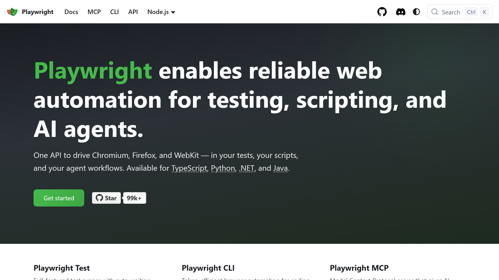
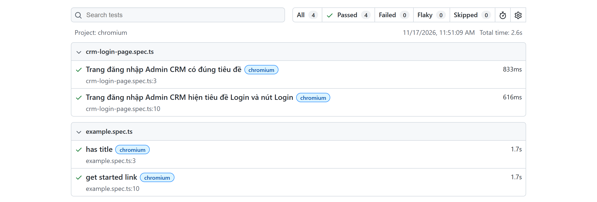
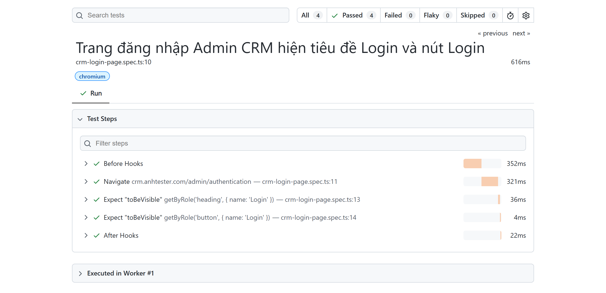
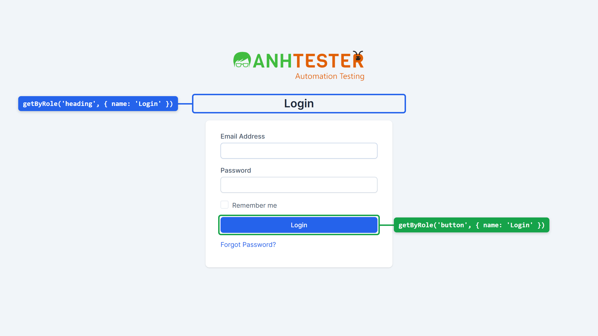
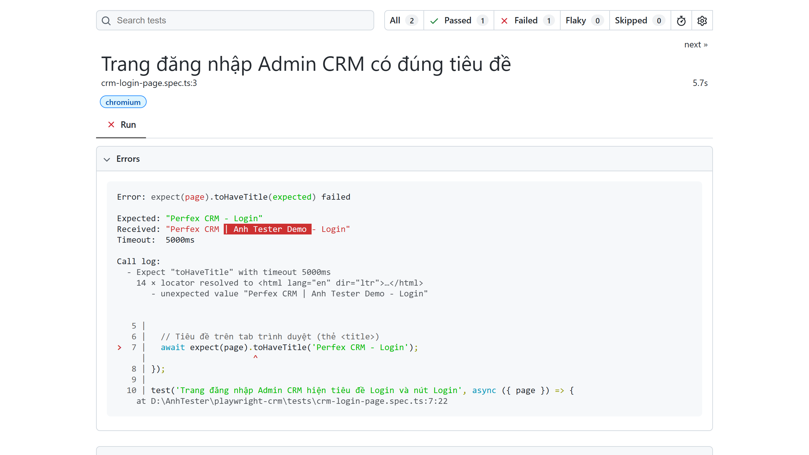

# Bài 11 - [Playwright Typescript] Cài đặt Playwright TypeScript và chạy thử test mẫu

Chương: 2. Playwright TypeScript + Locator

Nguồn: [https://anhtester.com/learn/website-and-api-testing-automation-with-playwright-javascript-typescript-day-code-js-ts-tu-dau/368](https://anhtester.com/learn/website-and-api-testing-automation-with-playwright-javascript-typescript-day-code-js-ts-tu-dau/368)

✅ Playwright là gì và vì sao chọn Playwright TypeScript  
✅ Tạo project Playwright bằng npm init playwright@latest  
✅ Cấu trúc thư mục project, file test mẫu và playwright.config.ts  
✅ Chạy test, đọc kết quả trên Terminal và HTML Report, đọc lỗi khi test sai  
✅ Viết file test đầu tiên trên CRM demo  
✅ Dùng Claude Code, ChatGPT, Gemini để hỏi sâu và kiểm tra lệnh cài đặt do AI đưa ra

## ⭐ Mục tiêu bài học

Ở bài trước bạn đã chuyển `BasePage`, `LoginPage` sang TypeScript và chạy chúng trên một **trang giả**. Bài này thay trang giả bằng **trình duyệt thật**: bạn tạo project Playwright đầu tiên, đọc file test mẫu, chạy test và xem kết quả. Học xong bạn sẽ:

- Biết Playwright gồm những gì và vì sao khoá học chọn Playwright với TypeScript.
- Tạo project `playwright-crm` bằng lệnh `npm init playwright@latest` và trả lời đúng các câu hỏi của trình cài đặt.
- Đọc được cấu trúc thư mục, file test mẫu và vài dòng chính của `playwright.config.ts`.
- Chạy test, đọc kết quả trên Terminal và trên HTML Report, kể cả khi test bị lỗi.
- Viết file test nhỏ đầu tiên trên CRM demo và kiểm lại lệnh cài đặt do AI đưa ra.

> 📌 Project của các chương Playwright nằm ở `D:\AnhTester\playwright-crm` (macOS: `~/AnhTester/playwright-crm`) và sẽ lớn dần qua từng bài. Kết quả trong bài là kết quả chạy thật với Node.js v24.20.0 và Playwright 1.65.1, ngày 17/11/2026.

## ✅ Phần 1: Playwright là gì và vì sao chọn Playwright TypeScript

### 🔆 1. Từ việc kiểm tra bằng tay tới Playwright

Mỗi sáng trước giờ release, một tester mở trình duyệt, vào trang đăng nhập CRM, nhìn tiêu đề trang, nhìn nút Login, bấm thử vài chỗ. Mười lần như một, việc này đúng là thứ nên giao cho máy làm.

**Playwright** là thư viện do Microsoft phát triển, cho phép code của bạn **điều khiển trình duyệt thật**: mở trang, gõ chữ, bấm nút, đọc nội dung, rồi so với kết quả mong đợi. Ở chương trước, `FakePage` chỉ in ra dòng chữ "đã bấm". Từ bài này, `page` là một tab trình duyệt thật.

Trang chủ chính thức của Playwright: [https://playwright.dev](https://playwright.dev/). Đây là nơi tra tài liệu, hướng dẫn cài đặt và ghi chú thay đổi của từng phiên bản ([Release notes](https://playwright.dev/docs/release-notes)). Khi AI đưa ra một hàm hay một option lạ, bạn kiểm lại ở đây.

[](https://anhtester.com/storage/photos/shares/lesson/js_ts_playwright/v2/bai_11_cai_dat_playwright/01_trang_chu_playwright_dev.png)

*Trang chủ chính thức của Playwright tại playwright.dev*

### 🔆 2. Bộ Playwright gồm những gì?

Khi cài Playwright cho việc test, bạn nhận về cả một bộ công cụ, không chỉ một thư viện:

<table class="rt-table">
<thead>
<tr>
<th>Thành phần</th>
<th>Vai trò</th>
</tr>
</thead>
<tbody>
<tr>
<td><code>@playwright/test</code></td>
<td>Gói chính, gồm cả thư viện điều khiển trình duyệt và <strong>test runner</strong>: tìm file test, chạy, đếm đạt/lỗi, xuất báo cáo</td>
</tr>
<tr>
<td>Trình duyệt</td>
<td>Chromium (nhân của Chrome, Edge), Firefox, WebKit (nhân của Safari). Playwright tải bản đi kèm riêng, không đụng tới trình duyệt bạn đang dùng hằng ngày</td>
</tr>
<tr>
<td>Lệnh <code>npx playwright</code></td>
<td>Chạy test, cài trình duyệt, mở báo cáo, ghi lại thao tác thành code (Codegen)</td>
</tr>
<tr>
<td>HTML Report</td>
<td>Trang báo cáo kết quả: test nào đạt, test nào lỗi, lỗi ở dòng nào, từng bước đã chạy</td>
</tr>
</tbody>
</table>

Khoá học dùng TypeScript vì Playwright viết sẵn kiểu cho mọi hàm của nó: gõ `page.` là VS Code gợi ý danh sách hàm, gõ sai tên hàm hay sai option là bị gạch đỏ ngay. Với người duyệt code AI sinh ra, đây là lớp kiểm tra miễn phí.

## ✅ Phần 2: Tạo project Playwright bằng npm init playwright@latest

### 🔆 1. Kiểm tra Node.js và npm

Playwright chạy trên Node.js, bạn đã cài ở bài đầu tiên của chương JavaScript. Mở Terminal (trên Windows dùng PowerShell hoặc Terminal trong VS Code) và kiểm lại:

```bash
node -v
npm -v
```

```bash
v24.20.0
12.0.1
```

Số phiên bản trên máy bạn có thể khác, miễn `node -v` ra **v24** (bản LTS khoá học dùng) hoặc mới hơn.

> ⚠️ Playwright 1.65 từ chối chạy trên Node.js 18 trở xuống và báo `Playwright requires Node.js 20 or higher`. Gặp lỗi này thì cài lại Node.js bản LTS mới nhất từ [nodejs.org](https://nodejs.org/), đừng hạ phiên bản Playwright xuống cho vừa.

### 🔆 2. Tạo thư mục project và chạy lệnh cài

Mỗi project Playwright là một thư mục riêng. Tạo thư mục `playwright-crm` trong `D:\AnhTester` (cạnh project `js-ts-for-tester` của chương trước), đi vào đó rồi chạy lệnh khởi tạo:

```bash
# Windows (PowerShell)
mkdir D:\AnhTester\playwright-crm
cd D:\AnhTester\playwright-crm

# macOS
mkdir -p ~/AnhTester/playwright-crm
cd ~/AnhTester/playwright-crm

# Cả hai hệ điều hành
npm init playwright@latest
```

Chữ `@latest` bảo npm lấy **bản mới nhất** của trình cài đặt. Bỏ đi thì npm có thể dùng bản cũ còn lưu trong máy, và project sinh ra theo mẫu cũ.

### 🔆 3. Trả lời các câu hỏi của trình cài đặt

Trình cài đặt hỏi lần lượt từng câu. Dùng phím mũi tên để chọn, `Enter` để xác nhận:

```bash
Getting started with writing end-to-end tests with Playwright:
Initializing project in '.'
? Do you want to use TypeScript or JavaScript? ...
> TypeScript
  JavaScript
```

<table class="rt-table">
<thead>
<tr>
<th>Câu hỏi</th>
<th>Chọn</th>
<th>Vì sao</th>
</tr>
</thead>
<tbody>
<tr>
<td>Do you want to use TypeScript or JavaScript?</td>
<td><strong>TypeScript</strong></td>
<td>Ngôn ngữ của cả khoá học</td>
</tr>
<tr>
<td>Where to put your end-to-end tests?</td>
<td><strong>tests</strong> (Enter)</td>
<td>Giữ tên mặc định, các bài sau đều dùng thư mục này</td>
</tr>
<tr>
<td>Add a GitHub Actions workflow? (Y/n)</td>
<td><strong>n</strong></td>
<td>Mặc định là Yes. Chạy test trên GitHub học ở chương CI/CD, giờ thêm vào chỉ làm rối project</td>
</tr>
<tr>
<td>Install Playwright browsers? (Y/n)</td>
<td><strong>Y</strong> (Enter)</td>
<td>Tải Chromium, Firefox, WebKit. Không tải thì test không có trình duyệt để chạy</td>
</tr>
</tbody>
</table>

Sau 4 câu trả lời, màn hình ghi lại lựa chọn của bạn:

```bash
√ Do you want to use TypeScript or JavaScript? · TypeScript
√ Where to put your end-to-end tests? · tests
√ Add a GitHub Actions workflow? (Y/n) · false
√ Install Playwright browsers (can be done manually via 'npx playwright install')? (Y/n) · true
```

### 🔆 4. Trình cài đặt đã làm gì?

Kết quả chạy thật, đã lược phần thanh tiến trình tải trình duyệt:

```bash
Initializing NPM project (npm init -y)…
Installing Playwright Test (npm install --save-dev @playwright/test)…
Installing Types (npm install --save-dev @types/node)…
Writing playwright.config.ts.
Writing tests\example.spec.ts.
Writing package.json.
Downloading browsers (npx playwright install)…
Chrome for Testing 159.0.8154.6 (playwright chromium v1255) downloaded to ...
Chrome Headless Shell 159.0.8154.6 (playwright chromium-headless-shell v1255) downloaded to ...
Firefox 159.0 (playwright firefox v1572) downloaded to ...
WebKit 27.2 (playwright webkit v2388) downloaded to ...
✔ Success! Created a Playwright Test project at D:\AnhTester\playwright-crm

Inside that directory, you can run several commands:

  npx playwright test
    Runs the end-to-end tests.

  npx playwright test --ui
    Starts the interactive UI mode.

  npx playwright test --project=chromium
    Runs the tests only on Desktop Chrome.

  npx playwright test example
    Runs the tests in a specific file.

  npx playwright test --debug
    Runs the tests in debug mode.

  npx playwright codegen
    Auto generate tests with Codegen.
```

Đọc từ trên xuống là thấy trình tự: tạo `package.json`, cài gói `@playwright/test`, cài kiểu cho Node.js, viết file cấu hình và file test mẫu, rồi tải trình duyệt. Trình duyệt được lưu **dùng chung cho cả máy** (Windows: `%LOCALAPPDATA%\ms-playwright`, macOS: `~/Library/Caches/ms-playwright`), nên project thứ hai cùng phiên bản Playwright sẽ không phải tải lại.

Kiểm tra phiên bản vừa cài:

```bash
npx playwright --version
```

```bash
Version 1.65.1
```

> 💡 Clone một project Playwright có sẵn về máy (của đồng nghiệp, hoặc do AI sinh ra) thì không chạy `npm init playwright` nữa. Chạy `npm install` để cài các gói ghi trong `package.json`, rồi `npx playwright install` để tải trình duyệt khớp với phiên bản đó.

## ✅ Phần 3: Cấu trúc thư mục project và file test mẫu

### 🔆 1. Cây thư mục

Mở thư mục `D:\AnhTester\playwright-crm` bằng VS Code (`File > Open Folder...`):

```bash
playwright-crm/
├── node_modules/          # Các gói đã cài, không sửa tay, không đưa lên Git
├── tests/
│   └── example.spec.ts    # File test mẫu
├── .gitignore
├── package.json
├── package-lock.json
└── playwright.config.ts   # File cấu hình của Playwright
```

<table class="rt-table">
<thead>
<tr>
<th>File / thư mục</th>
<th>Ý nghĩa</th>
</tr>
</thead>
<tbody>
<tr>
<td><code>tests/</code></td>
<td>Nơi đặt file test. Playwright chỉ tìm file có đuôi <code>.spec.ts</code> hoặc <code>.test.ts</code> trong thư mục này</td>
</tr>
<tr>
<td><code>package.json</code></td>
<td>Thông tin project và danh sách gói. Mục <code>devDependencies</code> có <code>@playwright/test</code> và <code>@types/node</code></td>
</tr>
<tr>
<td><code>package-lock.json</code></td>
<td>Khoá đúng phiên bản từng gói, để máy khác cài ra giống hệt máy bạn. Có đưa lên Git</td>
</tr>
<tr>
<td><code>playwright.config.ts</code></td>
<td>Cấu hình chung: thư mục test, chạy trên trình duyệt nào, xuất báo cáo kiểu gì</td>
</tr>
<tr>
<td><code>.gitignore</code></td>
<td>Danh sách thứ <strong>không</strong> đưa lên Git: <code>node_modules/</code>, <code>test-results/</code>, <code>playwright-report/</code>...</td>
</tr>
</tbody>
</table>

Nội dung `package.json` sau khi cài:

```json
{
  "name": "playwright-crm",
  "version": "1.0.0",
  "description": "",
  "main": "index.js",
  "scripts": {},
  "keywords": [],
  "type": "commonjs",
  "devDependencies": {
    "@playwright/test": "^1.65.1",
    "@types/node": "^26.6.6"
  }
}
```

### 🔆 2. Đọc file test mẫu example.spec.ts

Mở `tests/example.spec.ts`. File có 2 test, chạy trên trang chủ của Playwright:

```typescript
import { test, expect } from '@playwright/test';

test('has title', async ({ page }) => {
  await page.goto('https://playwright.dev/');

  // Expect a title "to contain" a substring.
  await expect(page).toHaveTitle(/Playwright/);
});

test('get started link', async ({ page }) => {
  await page.goto('https://playwright.dev/');

  // Click the get started link.
  await page.getByRole('link', { name: 'Get started' }).click();

  // Expects page to have a heading with the name of Installation.
  await expect(page.getByRole('heading', { name: 'Installation' })).toBeVisible();
});
```

Mọi thứ trong file này bạn đã gặp ở chương JavaScript, chỉ là giờ chúng có việc thật để làm:

<table class="rt-table">
<thead>
<tr>
<th>Dòng code</th>
<th>Ý nghĩa</th>
</tr>
</thead>
<tbody>
<tr>
<td><code><span>import</span> <span>{</span> <span>test,</span> <span>expect</span> <span>}</span> <span>from</span> <span>'@playwright/test'</span></code></td>
<td>Lấy 2 hàm từ gói <code>@playwright/test</code>: <code>test</code> để khai báo một test, <code>expect</code> để kiểm tra kết quả</td>
</tr>
<tr>
<td><code>test('has title', async ...)</code></td>
<td>Một test case: tham số đầu là <strong>tên test</strong> (hiện trong báo cáo), tham số sau là hàm chứa các bước</td>
</tr>
<tr>
<td><code>async ({ page }) =&gt; { ... }</code></td>
<td>Arrow function <code>async</code>. Phần <code>{ page }</code> lấy ra tab trình duyệt mà Playwright chuẩn bị sẵn</td>
</tr>
<tr>
<td><code>await page.goto(...)</code></td>
<td>Mở trang. Có <code>await</code> để chờ trang tải xong mới làm bước kế</td>
</tr>
<tr>
<td><code>page.getByRole('link', ...)</code></td>
<td>Tìm link có chữ <code>Get started</code> (cách tìm phần tử học kỹ ở bài Locators)</td>
</tr>
<tr>
<td><code>await expect(page).toHaveTitle(/Playwright/)</code></td>
<td>Kiểm tra tiêu đề tab trình duyệt chứa chữ <code>Playwright</code>. Sai thì test lỗi</td>
</tr>
</tbody>
</table>

### 🔆 3. { page } là gì?

Giống như mỗi lần thi, giám thị phát cho bạn một tờ giấy trắng mới, chứ không dùng lại tờ của người thi trước.

Trước mỗi test, Playwright mở một **tab trình duyệt mới tinh** (không cookie, không lịch sử, chưa đăng nhập) và đưa vào test qua `{ page }`. Test xong, tab bị đóng. Nhờ vậy test sau không bị ảnh hưởng bởi test trước, đây là nguyên tắc **cô lập** (isolation) của Playwright.

Cú pháp `({ page })` chính là phép **tách thuộc tính của Object** bạn đã học ở bài Object và JSON: Playwright truyền vào một Object chứa nhiều thứ dựng sẵn, bạn chỉ lấy `page`. Những thứ dựng sẵn đó gọi là **fixture**, học kỹ ở chương Page Object Model và Fixture.

### 🔆 4. Vài dòng cần biết trong playwright.config.ts

File cấu hình sinh ra khá dài vì có nhiều dòng chú thích. Ở bài này bạn chỉ cần đọc được mấy dòng sau (đã lược chú thích):

```typescript
import { defineConfig, devices } from '@playwright/test';

export default defineConfig({
  testDir: './tests',          // tìm file test trong thư mục tests
  fullyParallel: true,         // các test chạy song song
  reporter: 'html',            // xuất HTML Report
  use: {
    trace: 'on-first-retry',
  },
  projects: [
    { name: 'chromium', use: { ...devices['Desktop Chrome'] } },
    { name: 'firefox',  use: { ...devices['Desktop Firefox'] } },
    { name: 'webkit',   use: { ...devices['Desktop Safari'] } },
  ],
});
```

Dòng quan trọng nhất lúc này là `projects`: mỗi project là **một trình duyệt**. Có 3 project nên mỗi test chạy 3 lần. Các option còn lại học ở chương File Config.

## ✅ Phần 4: Chạy test, xem kết quả trên Terminal và HTML Report

### 🔆 1. Lệnh chạy và các tuỳ chọn hay dùng

Mọi lệnh đều chạy từ **thư mục gốc của project** (`D:\AnhTester\playwright-crm`). Đứng sai thư mục, Playwright không tìm thấy file cấu hình.

<table class="rt-table">
<thead>
<tr>
<th>Lệnh</th>
<th>Làm gì</th>
</tr>
</thead>
<tbody>
<tr>
<td><code>npx playwright test</code></td>
<td>Chạy mọi test trên cả 3 trình duyệt</td>
</tr>
<tr>
<td><code>npx playwright test --project=chromium</code></td>
<td>Chỉ chạy trên Chromium</td>
</tr>
<tr>
<td><code>npx playwright test example</code></td>
<td>Chỉ chạy file có tên chứa chữ <code>example</code></td>
</tr>
<tr>
<td><code>npx playwright test --headed</code></td>
<td>Mở cửa sổ trình duyệt để bạn nhìn test chạy. Mặc định là <strong>headless</strong> (chạy ngầm, không hiện cửa sổ)</td>
</tr>
<tr>
<td><code>npx playwright test --list</code></td>
<td>Liệt kê các test sẽ chạy, nhưng không chạy</td>
</tr>
<tr>
<td><code>npx playwright show-report</code></td>
<td>Mở HTML Report của lần chạy gần nhất</td>
</tr>
</tbody>
</table>

Các tuỳ chọn ghép được với nhau, ví dụ `npx playwright test example --project=chromium --headed`. Hai chế độ `--ui` và `--debug` mà trình cài đặt gợi ý sẽ học ở bài Debug.

### 🔆 2. Đọc kết quả trên Terminal

Trước khi chạy, xem Playwright định chạy những gì:

```bash
npx playwright test --list
```

```bash
Listing tests:
  [chromium] › example.spec.ts:3:1 › has title
  [chromium] › example.spec.ts:10:1 › get started link
  [firefox] › example.spec.ts:3:1 › has title
  [firefox] › example.spec.ts:10:1 › get started link
  [webkit] › example.spec.ts:3:1 › has title
  [webkit] › example.spec.ts:10:1 › get started link
Total: 6 tests in 1 file
```

2 test nhân 3 trình duyệt ra **6 lượt chạy**. Mỗi dòng đọc là: `[trình duyệt] › file:dòng:cột › tên test`. Lúc mới học, chạy trên một trình duyệt là đủ và nhanh hơn:

```bash
npx playwright test --project=chromium
```

```bash
Running 2 tests using 2 workers

[1/2] [chromium] › tests\example.spec.ts:10:1 › get started link
[2/2] [chromium] › tests\example.spec.ts:3:1 › has title
  2 passed (3.1s)
```

- `using 2 workers`: Playwright mở 2 tiến trình chạy song song, nên test thứ hai có thể xong trước test thứ nhất. Thứ tự in ra không cố định là bình thường.
- `2 passed (3.1s)`: cả 2 test đạt, tổng thời gian 3,1 giây.

> 💡 Một trình duyệt báo `browserType.launch` lỗi ngay từ đầu (chưa tải xong, hoặc bị phần mềm diệt virus chặn) thì cài lại riêng trình duyệt đó, ví dụ `npx playwright install --force firefox`. Trong lúc chờ, vẫn học tiếp được với `--project=chromium`.

### 🔆 3. Mở HTML Report

Terminal chỉ in tóm tắt. Muốn xem chi tiết từng bước thì mở báo cáo:

```bash
npx playwright show-report
```

Lệnh mở trình duyệt tại `http://localhost:9323`. Báo cáo được lưu trong thư mục `playwright-report/`, mỗi lần chạy test sẽ ghi đè báo cáo cũ. Bấm `Ctrl + C` trong Terminal để tắt. Danh sách test chia theo file, có trình duyệt và thời gian chạy của từng test:

[](https://anhtester.com/storage/photos/shares/lesson/js_ts_playwright/v2/bai_11_cai_dat_playwright/02_html_report_4_test_dat.png)

*HTML Report: danh sách test chia theo file, cả 4 test đạt trên Chromium*

Bấm vào tên một test để xem các bước Playwright **tự ghi lại**: mở trang nào, kiểm tra gì, mỗi bước mất bao lâu, nằm ở dòng nào trong file:

[](https://anhtester.com/storage/photos/shares/lesson/js_ts_playwright/v2/bai_11_cai_dat_playwright/03_html_report_chi_tiet_test_dat.png)

*Chi tiết một test trong HTML Report: Playwright tự ghi từng bước*

Hai dòng `Before Hooks` và `After Hooks` là phần Playwright mở và đóng tab trình duyệt cho test. Bài Hooks và Tags sẽ chỉ cách bạn tự thêm việc vào hai chỗ này.

## ✅ Phần 5: Thực hành - file test đầu tiên trên CRM demo

### 🔆 1. Tạo file tests/crm-login-page.spec.ts

Test mẫu chạy trên trang của Playwright. Giờ bạn viết một file tương tự cho CRM demo của khoá học. Trang đăng nhập Admin là trang công khai, chưa cần tài khoản.

Tạo file `tests/crm-login-page.spec.ts`:

```bash
playwright-crm/
├── tests/
│   ├── example.spec.ts
│   └── crm-login-page.spec.ts   ← file mới
└── playwright.config.ts
```

```typescript
import { test, expect } from '@playwright/test';

test('Trang đăng nhập Admin CRM có đúng tiêu đề', async ({ page }) => {
  await page.goto('https://crm.anhtester.com/admin/authentication');

  // Tiêu đề trên tab trình duyệt (thẻ <title>)
  await expect(page).toHaveTitle('Perfex CRM | Anh Tester Demo - Login');
});

test('Trang đăng nhập Admin CRM hiện tiêu đề Login và nút Login', async ({ page }) => {
  await page.goto('https://crm.anhtester.com/admin/authentication');

  await expect(page.getByRole('heading', { name: 'Login' })).toBeVisible();
  await expect(page.getByRole('button', { name: 'Login' })).toBeVisible();
});
```

Test thứ hai kiểm 2 phần tử trên trang. Khung trong ảnh là vị trí mà chính 2 locator đó tìm ra khi chạy thật:

[](https://anhtester.com/storage/photos/shares/lesson/js_ts_playwright/v2/bai_11_cai_dat_playwright/05_trang_login_admin_crm_test_kiem_tra.png)

*Trang đăng nhập Admin CRM và 2 phần tử test kiểm tra*

Chạy riêng file này trên Chromium:

```bash
npx playwright test crm-login-page --project=chromium
```

```bash
Running 2 tests using 2 workers

[1/2] [chromium] › tests\crm-login-page.spec.ts:3:1 › Trang đăng nhập Admin CRM có đúng tiêu đề
[2/2] [chromium] › tests\crm-login-page.spec.ts:10:1 › Trang đăng nhập Admin CRM hiện tiêu đề Login và nút Login
  2 passed (1.4s)
```

Tên test viết tiếng Việt có dấu vẫn chạy bình thường. Đặt tên test là **một câu mô tả điều được kiểm tra**, đọc báo cáo là biết test hỏng nghĩa là gì.

Hai test đang lặp lại dòng `page.goto(...)`. Bài cấu trúc file test sẽ gom chúng vào một nhóm, và bài Hooks và Tags sẽ bỏ phần lặp này.

### 🔆 2. Cố ý làm test lỗi và đọc lỗi

Test đạt chưa nói lên nhiều. Phải thấy nó **báo lỗi đúng chỗ** khi kết quả sai thì mới tin được. Sửa tạm dòng kiểm tra tiêu đề thành một tiêu đề sai:

```typescript
await expect(page).toHaveTitle('Perfex CRM - Login');
```

Chạy lại, kết quả thật:

```bash
  1) [chromium] › tests\crm-login-page.spec.ts:3:1 › Trang đăng nhập Admin CRM có đúng tiêu đề ─────

    Error: expect(page).toHaveTitle(expected) failed

    Expected: "Perfex CRM - Login"
    Received: "Perfex CRM | Anh Tester Demo - Login"
    Timeout:  5000ms

    Call log:
      - Expect "toHaveTitle" with timeout 5000ms
        14 × locator resolved to <html lang="en" dir="ltr">…</html>
           - unexpected value "Perfex CRM | Anh Tester Demo - Login"


       5 |
       6 |   // Tiêu đề trên tab trình duyệt (thẻ <title>)
    >  7 |   await expect(page).toHaveTitle('Perfex CRM - Login');
         |                      ^
       8 | });

  1 failed
    [chromium] › tests\crm-login-page.spec.ts:3:1 › Trang đăng nhập Admin CRM có đúng tiêu đề ──────
  1 passed (6.4s)
```

Đọc lỗi theo thứ tự này, lần nào cũng vậy:

1. **Test nào lỗi:** dòng `1) [chromium] › ...` cho biết trình duyệt, file, dòng và tên test.
2. **Kiểm tra gì:** `expect(page).toHaveTitle(expected) failed`.
3. **Mong đợi và thực tế:** `Expected` là giá trị bạn viết, `Received` là giá trị thật trên trang. Đặt hai dòng cạnh nhau là thấy chỗ khác.
4. **Dòng code:** dấu `>` và `^` chỉ đúng chỗ.

Dòng `Timeout: 5000ms` và `14 ×` cho thấy Playwright **không kết luận ngay**: nó kiểm lại nhiều lần trong 5 giây rồi mới báo lỗi. Vì vậy test lỗi chạy lâu hơn test đạt (6,4 giây so với 1,4 giây). Cơ chế tự chờ này học kỹ ở chương Assertion và Auto-Waiting.

HTML Report hiện cùng lỗi đó, có tô màu phần khác nhau giữa Expected và Received:

[](https://anhtester.com/storage/photos/shares/lesson/js_ts_playwright/v2/bai_11_cai_dat_playwright/04_html_report_test_sai_tieu_de.png)

*HTML Report của test sai tiêu đề: Expected, Received và dòng code lỗi*

Đọc xong thì **trả dòng kiểm tra về tiêu đề đúng** và chạy lại cho xanh.

> ⚠️ Test lỗi thì đọc `Received` trước khi sửa. Có hai khả năng: code test viết sai (như ví dụ trên), hoặc **trang web sai**, tức là bạn vừa tìm ra bug. Sửa giá trị mong đợi cho khớp trang mà không hỏi lại yêu cầu là đang che bug đi.

## ✅ Phần 6: Dùng Claude Code và bộ kit claude-testing-skills để học và hỏi sâu

### 🔆 1. Prompt hỏi sâu kiến thức của bài

Anh Tester dùng [Claude](https://claude.ai/) và Claude Code (bản có phí) cùng bộ kit [claude-testing-skills](https://github.com/anhtester/claude-testing-skills). Bản miễn phí [ChatGPT](https://chatgpt.com/) hoặc [Gemini](https://gemini.google.com/) vẫn dùng được các prompt dưới đây: chỗ có `@đường-dẫn` (cách đưa file vào câu hỏi của Claude Code, xem [tài liệu](https://code.claude.com/docs/en/common-workflows)) thì dán nội dung file vào thay. Không dán mật khẩu hay file `.env` vào khung chat.

```markdown
Tôi mới tạo project Playwright TypeScript bằng npm init playwright@latest (Playwright 1.65.1).
Giải thích cho người mới học từng dòng KHÔNG phải chú thích trong file @playwright.config.ts:
- dòng đó làm gì,
- nếu xoá dòng đó thì khi chạy npx playwright test có gì khác.
Trình bày thành bảng. Chỗ nào chưa chắc chắn thì dẫn link playwright.dev để tôi tự kiểm.
```

```markdown
Test Playwright của tôi lỗi như sau:

Error: expect(page).toHaveTitle(expected) failed
Expected: "Perfex CRM - Login"
Received: "Perfex CRM | Anh Tester Demo - Login"
Timeout:  5000ms
Call log:
  - Expect "toHaveTitle" with timeout 5000ms
    14 × locator resolved to <html lang="en" dir="ltr">…</html>

Giải thích từng dòng của lỗi: Expected, Received, Timeout, "14 ×" nghĩa là gì.
Đây là lỗi do code test hay do trang web? Tôi cần hỏi thêm thông tin gì để biết chắc?
Chưa sửa code, chỉ giải thích.
```

```markdown
Tôi dùng Windows, Node.js 24 LTS. Hãy liệt kê các lệnh để:
1) tạo một project Playwright TypeScript mới,
2) chạy một project Playwright do đồng nghiệp đưa lên GitHub mà tôi vừa clone về.
Với từng lệnh: giải thích nó làm gì và vì sao trường hợp 1 và trường hợp 2 khác nhau.
Không dùng sudo, không ghim phiên bản Playwright cũ.
```

### 🔆 2. Bộ kit liên quan gì tới việc cài đặt và chạy test?

Muốn Claude Code dùng bộ kit trong project này, bạn chép thư mục `.claude` của bộ kit vào gốc `playwright-crm`, cạnh `playwright.config.ts`. Cách cài đầy đủ (kèm Playwright MCP để Claude mở được trình duyệt) xem ở [SETUP\_CLAUDE.md](https://github.com/anhtester/claude-testing-skills/blob/main/SETUP_CLAUDE.md). Những chỗ trong kit gắn với bài này:

<table class="rt-table">
<thead>
<tr>
<th>Chỗ trong bộ kit</th>
<th>Quy định</th>
<th>Liên hệ với bài này</th>
</tr>
</thead>
<tbody>
<tr>
<td>Rule <a href="https://github.com/anhtester/claude-testing-skills/blob/main/.claude/rules/playwright_rules.md">playwright_rules.md</a>, mục 1</td>
<td>Khi thiết lập và debug thì chạy <strong>headed</strong>; headless chỉ dùng khi test đã đạt hoặc chạy trên CI</td>
<td>Tuỳ chọn <code>--headed</code> ở Phần 4</td>
</tr>
<tr>
<td>Lệnh<br/><a href="https://github.com/anhtester/claude-testing-skills/blob/main/.claude/commands/generate-automation-framework.md">/generate-automation-framework</a></td>
<td>Dựng xong framework thì kiểm bằng <code>npm install</code>, <code>npx playwright install</code>, <code>npx playwright test --list</code></td>
<td>Đúng 3 lệnh của Phần 2 và Phần 4</td>
</tr>
</tbody>
</table>

Ở giai đoạn này, chưa nên để AI dựng cả framework. Bạn tự tạo project bằng lệnh chính thức như trong bài, rồi dùng AI để **hỏi** và để **đọc lỗi cùng bạn**. Khi đã hiểu từng file, giao việc lớn cho AI mới duyệt lại được.

## ✅ Phần 7: Kiểm tra lệnh cài đặt và code do AI đưa ra

Hỏi AI "cài Playwright thế nào" rất dễ nhận về hướng dẫn của bản cũ. Rà theo bảng này trước khi chạy:

<table class="rt-table">
<thead>
<tr>
<th>Dấu hiệu</th>
<th>Vì sao là vấn đề</th>
<th>Cách xử lý</th>
</tr>
</thead>
<tbody>
<tr>
<td><code>npm install playwright</code> để viết test</td>
<td>Gói <code>playwright</code> chỉ là thư viện, không có test runner và HTML Report</td>
<td>Tạo project bằng <code>npm init playwright@latest</code> (cài <code>@playwright/test</code>)</td>
</tr>
<tr>
<td><code><span>import</span> <span>{</span> <span>test</span> <span>}</span> <span>from</span> <span>'playwright'</span></code></td>
<td>Chạy thật báo <code>TypeError: (0 , _playwright.test) is not a function</code></td>
<td>Import từ <code>'@playwright/test'</code></td>
</tr>
<tr>
<td>Bảo cài Node.js 16, 18 hoặc 20</td>
<td>Thông tin cũ. Playwright 1.65 từ chối chạy trên Node 18 trở xuống, Node 20 đã hết hạn hỗ trợ từ 30/04/2026. Khoá học dùng Node 24 LTS</td>
<td>Kiểm bằng <code>node -v</code>, cài bản LTS từ nodejs.org</td>
</tr>
<tr>
<td>Ghim bản cũ: <code>@playwright/test@1.40.0</code></td>
<td>Thiếu tính năng mới, lệch với tài liệu và bài học</td>
<td>Dùng <code>@latest</code>, trừ khi dự án quy định phiên bản</td>
</tr>
<tr>
<td><code>npx playwright test --headless</code></td>
<td>Không có tuỳ chọn này. Chạy thật báo <code>error: unknown option '--headless'</code></td>
<td>Mặc định đã là headless; muốn thấy cửa sổ thì dùng <code>--headed</code></td>
</tr>
<tr>
<td>Thiếu <code>await</code> trước <code>page.goto</code> hoặc <code>expect(...)</code></td>
<td>Test đi tiếp khi lệnh chưa xong, lúc đạt lúc lỗi</td>
<td>Thêm <code>await</code> cho mọi thao tác và mọi <code>expect</code> trên trang</td>
</tr>
<tr>
<td><code>await page.waitForTimeout(3000)</code> "cho chắc"</td>
<td>Chờ cứng làm test chậm mà vẫn có thể lỗi; rule của bộ kit cũng cấm</td>
<td>Bỏ đi, để <code>expect</code> tự chờ</td>
</tr>
</tbody>
</table>

## ✅ Phần 8: Bài tập thực hành

Làm trong project `D:\AnhTester\playwright-crm`.

**Bài tập 1 - Chạy trên từng trình duyệt.** Chạy `npx playwright test --list` và đếm số lượt chạy. Sau đó chạy lần lượt với `--project=chromium`, `--project=firefox`, `--project=webkit`. Ghi lại thời gian của từng lần, mở HTML Report sau lần chạy cuối và cho biết báo cáo đang hiện kết quả của trình duyệt nào.

**Bài tập 2 - Thêm test cho trang quên mật khẩu.** Trong `tests/crm-login-page.spec.ts`, thêm một test mở `https://crm.anhtester.com/admin/authentication/forgot_password` và kiểm tra tiêu đề tab trình duyệt. Tiêu đề đúng là gì thì bạn tự tìm: cố ý viết sai một lần, đọc dòng `Received`, rồi sửa lại.

**Bài tập 3 - Đọc lỗi khi không tìm thấy phần tử.** Đổi locator của nút thành `page.getByRole('button', { name: 'Đăng nhập' })`, chạy lại và chép phần lỗi vào một file ghi chú. Trả lời: lỗi này khác gì lỗi sai tiêu đề ở Phần 5? Vì sao test chạy mất khoảng 5 giây mới báo lỗi?

**Bài tập 4 - Duyệt hướng dẫn của AI.** Một AI đưa ra hướng dẫn sau để tạo test cho trang đăng nhập CRM. Tìm đủ **7 lỗi nằm trên 6 dòng** (có dòng mắc hai lỗi), nêu lý do theo bảng ở Phần 7 và viết lại cho đúng.

```bash
npm install playwright@1.40.0
npx playwright test --headless
```

```typescript
import { test, expect } from 'playwright';

test('CRM login page', async ({ page }) => {
  page.goto('https://crm.anhtester.com/admin/authentication');
  await page.waitForTimeout(3000);
  expect(page).toHaveTitle('Perfex CRM | Anh Tester Demo - Login');
});
```

## ✅ Phần 9: Ghi nhớ nhanh

- Playwright điều khiển trình duyệt thật. Gói `@playwright/test` có cả thư viện và test runner; trình duyệt tải riêng bằng `npx playwright install`.
- Tạo project mới bằng `npm init playwright@latest`: chọn TypeScript, thư mục `tests`, chưa thêm GitHub Actions, có tải trình duyệt. Project clone về thì dùng `npm install` rồi `npx playwright install`.
- File test nằm trong `tests/`, đuôi `.spec.ts`. Mỗi `test()` có tên mô tả và các bước có `await`, kết thúc bằng `expect`.
- `{ page }` là tab trình duyệt mới tinh Playwright mở riêng cho từng test.
- `projects` trong `playwright.config.ts` là danh sách trình duyệt; 2 test với 3 project ra 6 lượt chạy.
- Chạy lệnh từ thư mục gốc project. Hay dùng: `--project=chromium`, tên file, `--headed`, `--list`, rồi `npx playwright show-report`.
- Đọc lỗi theo thứ tự: test nào, kiểm gì, Expected so với Received, dòng code. Đọc `Received` trước khi sửa vì có thể đó là bug thật.

✅ **Kết luận:** Bạn đã có project `playwright-crm` chạy được trên trình duyệt thật và biết đọc kết quả. File test hiện mới là vài `test()` đứng rời nhau. Bài kế tiếp, **Cấu trúc một file test - test, describe, test.step và Annotations**, chỉ cách gom test thành nhóm, chia bước rõ ràng và đánh dấu test cần bỏ qua.

---

## Bài tập riêng — Bài tập - Cài đặt Playwright TypeScript, chạy test mẫu và đọc lỗi

Nguồn bài tập: [https://anhtester.com/student-assignments?course=website-and-api-testing-automation-with-playwright-javascript-typescript-day-code-js-ts-tu-dau#assignment-101](https://anhtester.com/student-assignments?course=website-and-api-testing-automation-with-playwright-javascript-typescript-day-code-js-ts-tu-dau#assignment-101)

**Mục tiêu:** tự tạo được project Playwright bằng lệnh chính thức, chạy test trên từng trình duyệt, đọc được lỗi trên Terminal và HTML Report, và nhận ra hướng dẫn cài đặt sai do AI đưa ra.

**Thư mục làm bài:** `D:\AnhTester\playwright-crm` (macOS: `~/AnhTester/playwright-crm`). Chỉ làm việc trên trang công khai của CRM demo, **không đăng nhập**.

### 📝 Đề bài

#### Bài tập 1 - Tạo project và đưa lên GitHub

Tạo project `playwright-crm` bằng `npm init playwright@latest` (TypeScript, thư mục `tests`, không thêm GitHub Actions, có tải trình duyệt). Chạy `git init`, commit lần đầu và push lên một repo GitHub mới tên `playwright-crm`. Kiểm trên GitHub: **không** có thư mục `node_modules/`, `test-results/`, `playwright-report/`.

#### Bài tập 2 - Chạy trên từng trình duyệt

Chạy `npx playwright test --list` và cho biết có bao nhiêu lượt chạy, vì sao. Sau đó chạy lần lượt với `--project=chromium`, `--project=firefox`, `--project=webkit`. Ghi lại thời gian của từng lần. Mở HTML Report sau lần chạy cuối và cho biết báo cáo đang hiện kết quả của trình duyệt nào.

#### Bài tập 3 - Test đầu tiên trên CRM và đọc lỗi

Tạo file `tests/crm-login-page.spec.ts` như bài học, rồi thêm 1 test mở `https://crm.anhtester.com/admin/authentication/forgot_password` và kiểm tiêu đề tab trình duyệt bằng `toHaveTitle`. Tiêu đề đúng là gì thì bạn tự tìm: cố ý viết sai một lần, đọc dòng `Received`, rồi sửa lại cho đạt.

Tiếp theo, đổi locator của nút trong test thứ hai thành `page.getByRole('button', { name: 'Đăng nhập' })`, chạy lại và trả lời: lỗi này khác gì lỗi sai tiêu đề? Vì sao test chạy mất khoảng 5 giây mới báo lỗi? Xong thì trả locator về `Login`.

#### Bài tập 4 - Duyệt hướng dẫn của AI

Một AI đưa ra hướng dẫn sau để tạo test cho trang đăng nhập CRM. Tìm đủ **7 lỗi nằm trên 6 dòng** (có dòng mắc hai lỗi), nêu lý do theo bảng "Kiểm tra lệnh cài đặt và code do AI đưa ra" của bài học và viết lại cho đúng.

```bash
npm install playwright@1.40.0
npx playwright test --headless
```

```typescript
import { test, expect } from 'playwright';

test('CRM login page', async ({ page }) => {
  page.goto('https://crm.anhtester.com/admin/authentication');
  await page.waitForTimeout(3000);
  expect(page).toHaveTitle('Perfex CRM | Anh Tester Demo - Login');
});
```

### 📦 Cách nộp bài

1. Làm bài trong project `playwright-crm`, commit và push lên nhánh `main` của repo GitHub `playwright-crm` của bạn.
2. Dán link repo vào ô **Link GitHub**, dạng `https://github.com/<ten-ban>/playwright-crm`. Repo Private thì vào **Settings → Collaborators** thêm tài khoản GitHub của giảng viên, nếu không giảng viên không mở được.
3. Trong ô **Nội dung bài làm (Editor)**, dán **kết quả chạy thật** trên Terminal của từng lệnh (mỗi lệnh một **Đoạn code mẫu** chọn Text / Log) và phần trả lời các câu hỏi.
4. Với bài **Duyệt code AI**: liệt kê từng chỗ sai theo mẫu *Dòng – Lỗi – Lý do – Cách sửa*, rồi dán file đã sửa.
5. Dán thêm kết quả `node -v` và `npx playwright --version` ở đầu bài làm.

### ✅ Tiêu chí Đạt

- `node -v` ra v24 trở lên; `package.json` có `@playwright/test` trong `devDependencies`.
- Repo GitHub có `tests/`, `playwright.config.ts`, `package.json`, `package-lock.json`, `.gitignore`; không có `node_modules/` hay thư mục kết quả chạy.
- Bài tập 2 trả lời đúng: 2 test × 3 trình duyệt = 6 lượt; HTML Report chỉ giữ kết quả của lần chạy cuối (WebKit).
- Bài tập 3: file có 3 test, chạy `--project=chromium` đạt cả 3; giải thích được Expected/Received và cơ chế tự chờ 5 giây của `expect`.
- Bài tập 4 đủ 7 lỗi: gói `playwright` thay vì `@playwright/test`; ghim bản cũ `1.40.0`; không có tuỳ chọn `--headless`; import từ `'playwright'`; thiếu `await` trước `page.goto`; `waitForTimeout(3000)` chờ cứng; thiếu `await` trước `expect`.

### 🤖 Dùng AI thế nào cho đúng

Được dùng Claude, ChatGPT hoặc Gemini để **hỏi giải thích** lỗi và khái niệm (prompt mẫu ở phần AI của bài học). Không nhờ AI làm hộ rồi dán vào: bài **Duyệt code AI** chấm chính phần *lý do* do bạn tự viết. Không dán mật khẩu hay file `.env` vào khung chat. Bài nào nộp lại vì **Cần sửa** thì sửa đúng chỗ giảng viên ghi trong feedback rồi bấm **Nộp lại**.