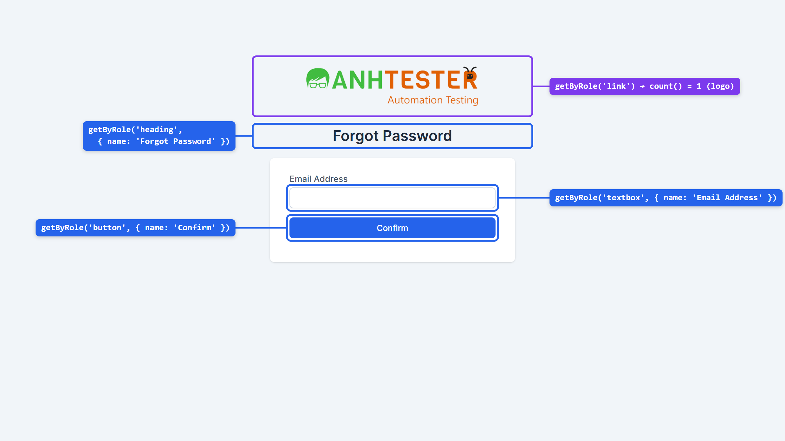
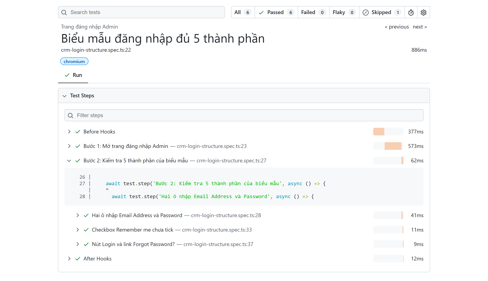
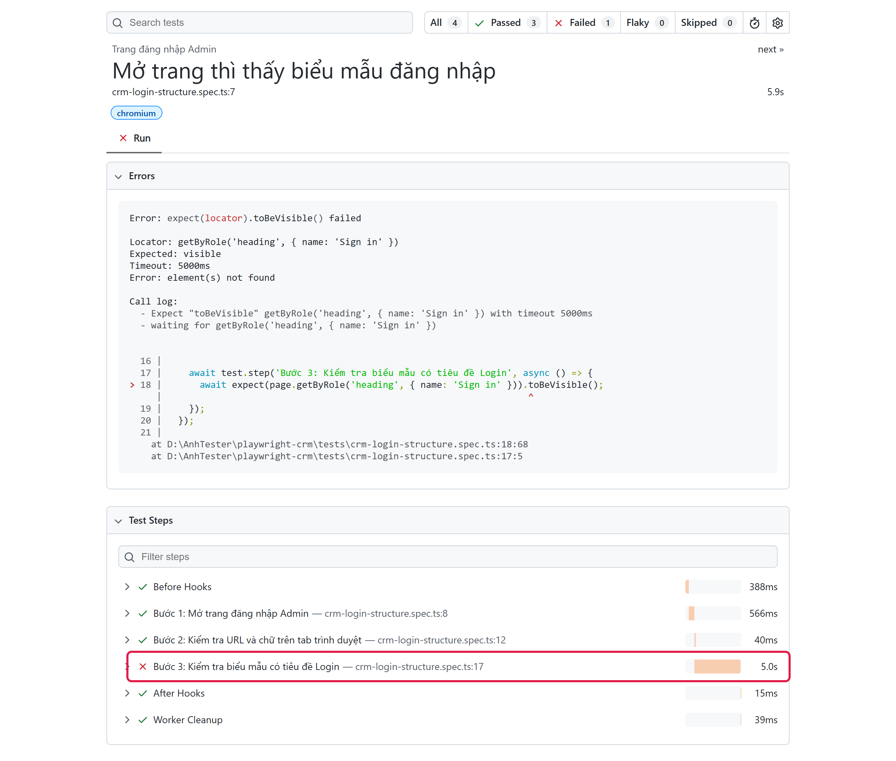
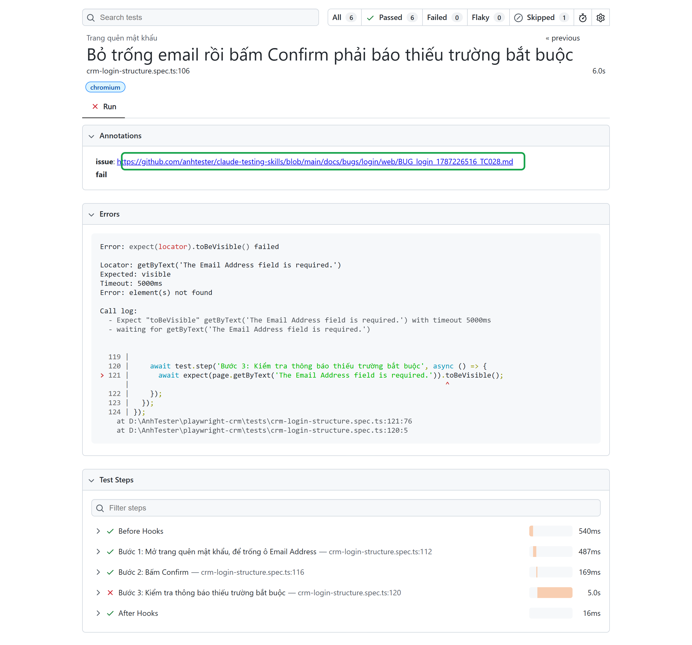
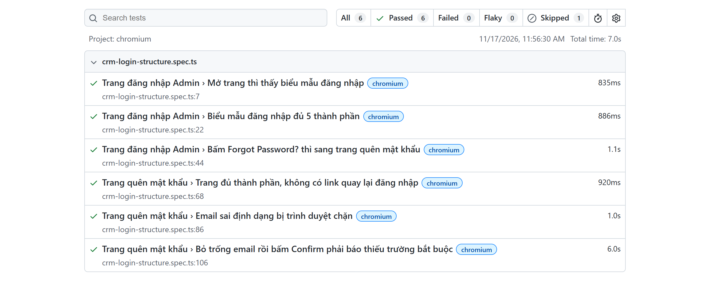
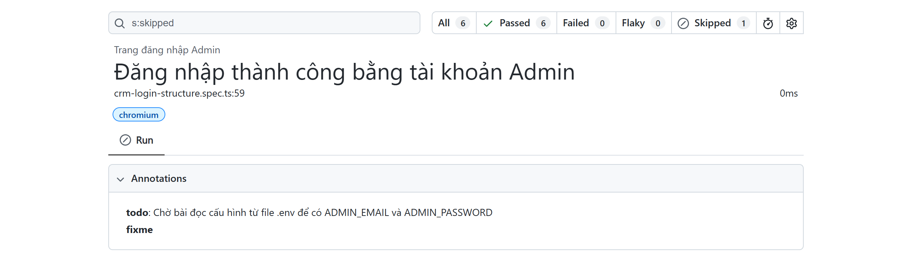

# Bài 12 - [Playwright Typescript] Cấu trúc một file test - test, describe, test.step và Annotations

Chương: 2. Playwright TypeScript + Locator

Nguồn: [https://anhtester.com/learn/website-and-api-testing-automation-with-playwright-javascript-typescript-day-code-js-ts-tu-dau/369](https://anhtester.com/learn/website-and-api-testing-automation-with-playwright-javascript-typescript-day-code-js-ts-tu-dau/369)

✅ Giải phẫu một file test: import, test và expect  
✅ Gom nhóm test với test.describe  
✅ Chia bước rõ ràng với test.step  
✅ Annotations: skip, fixme, fail, slow và only  
✅ Thực hành: hoàn thiện file test trên trang đăng nhập và quên mật khẩu của CRM  
✅ Dùng Claude Code và bộ kit claude-testing-skills để sinh khung file test, kiểm tra code do AI sinh ra

## ⭐ Mục tiêu bài học

Ở bài trước bạn đã cài project `playwright-crm`, chạy test mẫu `example.spec.ts` và viết file `tests/crm-login-page.spec.ts` mở trang đăng nhập CRM. Bài này trả lời câu hỏi còn lại: **một file test gồm những phần nào và sắp xếp ra sao để người khác đọc được**.

Sau này AI viết phần lớn code test. Việc của bạn là nhìn vào file và biết nó có đủ nhóm, đủ bước, có test nào đang bị bỏ qua hay không. Học xong bạn sẽ:

- Đọc được từng thành phần của một file test: `import`, `test`, `{ page }`, `await`, `expect`.
- Gom test thành nhóm bằng `test.describe` và chia một test thành các bước bằng `test.step`.
- Dùng đúng 5 annotation `skip`, `fixme`, `fail`, `slow`, `only` và đọc được chúng trong HTML Report.
- Nhờ AI sinh khung file test từ một test case, rồi tự kiểm lại cấu trúc.

> 📌 Ví dụ chạy trên hai trang công khai của CRM demo: trang đăng nhập Admin `https://crm.anhtester.com/admin/authentication` và trang quên mật khẩu. Bài này **chưa đăng nhập**, bạn chưa cần tài khoản.

## ✅ Phần 1: Giải phẫu một file test - import, test và expect

### 🔆 1. Từ test case trong Excel tới hàm test()

Khi test thủ công, mỗi test case là một dòng trong file Excel: có tiêu đề, các bước thực hiện và kết quả mong đợi. Một test tự động có đúng ba thứ ấy, chỉ khác chỗ viết. Lấy test case `CRM_LOGIN_TC_001` trong [bộ test case đăng nhập CRM của bộ kit](https://github.com/anhtester/claude-testing-skills/blob/main/docs/testcases/login/web/test_cases_login_web.md) làm ví dụ:

<table class="rt-table">
<thead>
<tr>
<th>Cột trong Excel</th>
<th>Nội dung test case</th>
<th>Trong file test Playwright</th>
</tr>
</thead>
<tbody>
<tr>
<td>Test Scenario</td>
<td>Mở trang đăng nhập khi chưa có phiên thì thấy biểu mẫu đăng nhập</td>
<td>Tham số đầu của <code>test('...')</code></td>
</tr>
<tr>
<td>Test Steps</td>
<td>Mở trang, đọc chữ trên tab trình duyệt, nhìn tiêu đề biểu mẫu</td>
<td>Các lệnh <code>await page...</code>, gom thành <code>test.step</code></td>
</tr>
<tr>
<td>Expected Result</td>
<td>Tab ghi <code><span>Perfex</span> <span>CRM</span> <span>|</span> <span>Anh</span> <span>Tester</span> <span>Demo</span> <span>-</span> <span>Login</span></code>, biểu mẫu có tiêu đề <code>Login</code></td>
<td>Các lệnh <code>await expect(...)</code></td>
</tr>
<tr>
<td>Nhóm (sheet, module)</td>
<td>Nhóm A: Giao diện trang đăng nhập</td>
<td><code>test.describe('...')</code></td>
</tr>
</tbody>
</table>

### 🔆 2. Bốn thành phần của một test

Tạo file `tests/crm-login-structure.spec.ts` trong project `D:\AnhTester\playwright-crm` (macOS: `~/AnhTester/playwright-crm`).

```typescript
import { test, expect } from '@playwright/test';

test('Mở trang đăng nhập Admin thì thấy biểu mẫu đăng nhập', async ({ page }) => {
  await page.goto('https://crm.anhtester.com/admin/authentication');

  await expect(page).toHaveTitle('Perfex CRM | Anh Tester Demo - Login');
  await expect(page.getByRole('heading', { name: 'Login' })).toBeVisible();
});
```

<table class="rt-table">
<thead>
<tr>
<th>Thành phần</th>
<th>Ý nghĩa</th>
</tr>
</thead>
<tbody>
<tr>
<td><code>import { test, expect }</code></td>
<td>Lấy hai hàm từ thư viện <code>@playwright/test</code>: <code>test</code> để khai báo test, <code>expect</code> để kiểm tra kết quả</td>
</tr>
<tr>
<td>Tiêu đề test</td>
<td>Hiện nguyên văn trong báo cáo, nên viết như tiêu đề test case, không viết kiểu <code>test1</code></td>
</tr>
<tr>
<td><code>async ({ page }) =&gt; { }</code></td>
<td>Thân test. <code>page</code> là một tab trình duyệt mới mà Playwright chuẩn bị riêng cho test này, chạy xong tự đóng</td>
</tr>
<tr>
<td><code>await</code></td>
<td>Chờ lệnh chạy xong rồi mới sang dòng kế. Mọi thao tác trên <code>page</code> và mọi <code>expect</code> trên trang đều cần</td>
</tr>
</tbody>
</table>

Chạy riêng file này. Thêm `--reporter=list` để terminal in mỗi test một dòng:

```bash
npx playwright test crm-login-structure.spec.ts --project=chromium --reporter=list
```

```bash
Running 1 test using 1 worker

  ok 1 [chromium] › tests\crm-login-structure.spec.ts:3:1 › Mở trang đăng nhập Admin thì thấy biểu mẫu đăng nhập (726ms)

  1 passed (1.7s)
```

Đọc một dòng từ trái sang: `ok` là đạt (có terminal hiện `✓`), `[chromium]` là trình duyệt, kế đó là `tên file:dòng:cột` nơi khai báo test, cuối cùng là tiêu đề test.

### 🔆 3. Tên file và thư mục

Playwright không chạy mọi file trong project. Nó chỉ tìm trong thư mục khai báo ở `testDir` của `playwright.config.ts` (đang là `./tests`), và chỉ nhận file có đuôi `.spec.ts` hoặc `.test.ts` (cả bản `.js`). Đặt tên `crm-login.ts` thì file bị bỏ qua mà **không có cảnh báo nào**.

Khoá học dùng một kiểu: `tên-chức-năng.spec.ts`. Tài liệu: [testMatch trên playwright.dev](https://playwright.dev/docs/api/class-testconfig#test-config-test-match).

## ✅ Phần 2: Gom nhóm test với test.describe

### 🔆 1. Danh sách phẳng các test()

Cách đơn giản nhất là viết các `test()` nối tiếp nhau. Sửa file `tests/crm-login-structure.spec.ts` thành ba test cho hai trang:

```typescript
import { test, expect } from '@playwright/test';

test('Trang đăng nhập: mở trang thì thấy biểu mẫu đăng nhập', async ({ page }) => {
  await page.goto('https://crm.anhtester.com/admin/authentication');

  await expect(page).toHaveTitle('Perfex CRM | Anh Tester Demo - Login');
  await expect(page.getByRole('heading', { name: 'Login' })).toBeVisible();
});

test('Trang đăng nhập: bấm Forgot Password? thì sang trang quên mật khẩu', async ({ page }) => {
  await page.goto('https://crm.anhtester.com/admin/authentication');

  await page.getByRole('link', { name: 'Forgot Password?' }).click();
  await expect(page).toHaveURL('https://crm.anhtester.com/admin/authentication/forgot_password');
});

test('Trang quên mật khẩu: trang đủ thành phần', async ({ page }) => {
  await page.goto('https://crm.anhtester.com/admin/authentication/forgot_password');

  await expect(page.getByRole('heading', { name: 'Forgot Password' })).toBeVisible();
  await expect(page.getByRole('textbox', { name: 'Email Address' })).toBeVisible();
  await expect(page.getByRole('button', { name: 'Confirm' })).toBeVisible();
});
```

```bash
Running 3 tests using 3 workers

  ok 1 [chromium] › tests\crm-login-structure.spec.ts:3:1 › Trang đăng nhập: mở trang thì thấy biểu mẫu đăng nhập (774ms)
  ok 2 [chromium] › tests\crm-login-structure.spec.ts:17:1 › Trang quên mật khẩu: trang đủ thành phần (763ms)
  ok 3 [chromium] › tests\crm-login-structure.spec.ts:10:1 › Trang đăng nhập: bấm Forgot Password? thì sang trang quên mật khẩu (906ms)

  3 passed (1.7s)
```

Test thứ ba kiểm tra trang quên mật khẩu. Mỗi khung trong ảnh là vị trí mà chính locator bên cạnh tìm ra khi chạy thật:

[](https://anhtester.com/storage/photos/shares/lesson/js_ts_playwright/v2/bai_12_cau_truc_file_test/01_trang_quen_mat_khau_cac_phan_test_kiem_tra.png)

*Trang quên mật khẩu của CRM và các phần tử mà test kiểm tra*

File chạy được, nhưng có ba chỗ chưa ổn:

- **Tên nhóm phải gõ lại trong từng tiêu đề** ("Trang đăng nhập: ...").
- **Thứ tự in ra không theo thứ tự viết**: ba test chạy song song trên 3 worker, test nào xong trước in trước. Vì vậy mỗi test phải tự chạy được một mình.
- **Lệnh `page.goto(...)` lặp lại ở mọi test.** Bài kế tiếp dùng Hooks để viết nó một lần.

### 🔆 2. Gom nhóm bằng test.describe()

`test.describe('tên nhóm', () => { ... })` gom các test liên quan vào một nhóm, giống một sheet trong file Excel. Viết lại file:

```typescript
import { test, expect } from '@playwright/test';

const LOGIN_URL = 'https://crm.anhtester.com/admin/authentication';
const FORGOT_URL = 'https://crm.anhtester.com/admin/authentication/forgot_password';

test.describe('Trang đăng nhập Admin', () => {
  test('Mở trang thì thấy biểu mẫu đăng nhập', async ({ page }) => {
    await page.goto(LOGIN_URL);

    await expect(page).toHaveTitle('Perfex CRM | Anh Tester Demo - Login');
    await expect(page.getByRole('heading', { name: 'Login' })).toBeVisible();
  });

  test('Bấm Forgot Password? thì sang trang quên mật khẩu', async ({ page }) => {
    await page.goto(LOGIN_URL);

    await page.getByRole('link', { name: 'Forgot Password?' }).click();
    await expect(page).toHaveURL(FORGOT_URL);
  });
});

test.describe('Trang quên mật khẩu', () => {
  test('Trang đủ thành phần', async ({ page }) => {
    await page.goto(FORGOT_URL);

    await expect(page.getByRole('heading', { name: 'Forgot Password' })).toBeVisible();
    await expect(page.getByRole('textbox', { name: 'Email Address' })).toBeVisible();
    await expect(page.getByRole('button', { name: 'Confirm' })).toBeVisible();
  });
});
```

```bash
Running 3 tests using 3 workers

  ok 2 [chromium] › tests\crm-login-structure.spec.ts:7:3 › Trang đăng nhập Admin › Mở trang thì thấy biểu mẫu đăng nhập (723ms)
  ok 3 [chromium] › tests\crm-login-structure.spec.ts:23:3 › Trang quên mật khẩu › Trang đủ thành phần (770ms)
  ok 1 [chromium] › tests\crm-login-structure.spec.ts:14:3 › Trang đăng nhập Admin › Bấm Forgot Password? thì sang trang quên mật khẩu (853ms)

  3 passed (1.6s)
```

- Tên đầy đủ của test giờ là **`tên nhóm › tên test`**. Playwright tự nối, HTML Report cũng hiện đúng như vậy.
- Hàm truyền cho `describe` **không có `async`** và không nhận `{ page }`. Nó chỉ là khung chứa test.
- Hai URL được đưa lên thành hằng số ở đầu file, sửa một chỗ là đủ.

### 🔆 3. Lồng nhóm và tách file

`describe` lồng được trong `describe`, tên test khi đó thành `Trang đăng nhập Admin › Giao diện › Có tiêu đề Login`. Anh Tester khuyên **tối đa 2 cấp**: từ cấp thứ ba, tên test dài quá một dòng báo cáo và code thụt lề sâu, khó dò dấu ngoặc đóng.

Nhóm chỉ có 1 test thì bỏ `describe`. Cần tới cấp thứ ba, hoặc file dài quá 300 dòng, thì tách file: mỗi trang hoặc mỗi chức năng lớn một file. Tài liệu: [test.describe trên playwright.dev](https://playwright.dev/docs/api/class-test#test-describe).

## ✅ Phần 3: Chia bước rõ ràng với test.step

### 🔆 1. Vì sao cần step?

Một test case thủ công có Bước 1, Bước 2, Bước 3. Còn thân test hiện tại là một dãy lệnh liền nhau: khi test lỗi, báo cáo chỉ đưa ra một dòng code, người khác phải đọc ngược lên mới hiểu test đang làm tới đâu.

`test.step('tên bước', async () => { ... })` bọc một cụm lệnh thành một bước có tên. Tên đó hiện trong HTML Report, nên báo cáo đọc lên giống các bước của test case. Sửa test đầu tiên trong nhóm "Trang đăng nhập Admin":

```typescript
test('Mở trang thì thấy biểu mẫu đăng nhập', async ({ page }) => {
  await test.step('Bước 1: Mở trang đăng nhập Admin', async () => {
    await page.goto(LOGIN_URL);
  });

  await test.step('Bước 2: Kiểm tra URL và chữ trên tab trình duyệt', async () => {
    await expect(page).toHaveURL(LOGIN_URL);
    await expect(page).toHaveTitle('Perfex CRM | Anh Tester Demo - Login');
  });

  await test.step('Bước 3: Kiểm tra biểu mẫu có tiêu đề Login', async () => {
    await expect(page.getByRole('heading', { name: 'Login' })).toBeVisible();
  });
});
```

- **Luôn có `await` trước `test.step`.** Thiếu nó, test chạy tuột xuống cuối trong khi các bước chưa xong. Chạy thử, Playwright báo `page.goto: net::ERR_ABORTED` vì tab đã bị đóng giữa chừng.
- **Tên bước nói về nghiệp vụ** ("Kiểm tra biểu mẫu có tiêu đề Login"), không phải "expect heading" hay "Step 1".

### 🔆 2. Step lồng nhau và step trả về giá trị

Một bước lớn chia tiếp được thành các bước nhỏ bên trong. Thêm test thứ hai vào nhóm "Trang đăng nhập Admin":

```typescript
test('Biểu mẫu đăng nhập đủ 5 thành phần', async ({ page }) => {
  await test.step('Bước 1: Mở trang đăng nhập Admin', async () => {
    await page.goto(LOGIN_URL);
  });

  await test.step('Bước 2: Kiểm tra 5 thành phần của biểu mẫu', async () => {
    await test.step('Hai ô nhập Email Address và Password', async () => {
      await expect(page.getByLabel('Email Address')).toBeVisible();
      await expect(page.getByLabel('Password')).toBeVisible();
    });

    await test.step('Checkbox Remember me chưa tick', async () => {
      await expect(page.getByRole('checkbox', { name: 'Remember me' })).not.toBeChecked();
    });

    await test.step('Nút Login và link Forgot Password?', async () => {
      await expect(page.getByRole('button', { name: 'Login' })).toBeEnabled();
      await expect(page.getByRole('link', { name: 'Forgot Password?' })).toBeVisible();
    });
  });
});
```

Chạy lại rồi mở báo cáo bằng `npx playwright show-report`, bấm vào test này. Mục **Test Steps** là cây bước, mỗi bước có thời gian chạy và số dòng trong file:

[](https://anhtester.com/storage/photos/shares/lesson/js_ts_playwright/v2/bai_12_cau_truc_file_test/02_html_report_cay_step_long_nhau.png)

*HTML Report: cây step của một test, Bước 2 có ba bước con*

`test.step` trả về đúng giá trị mà hàm bên trong `return`. Sửa test của nhóm "Trang quên mật khẩu":

```typescript
test('Trang đủ thành phần, không có link quay lại đăng nhập', async ({ page }) => {
  await test.step('Bước 1: Mở trang quên mật khẩu', async () => {
    await page.goto(FORGOT_URL);
  });

  await test.step('Bước 2: Kiểm tra tiêu đề, ô Email Address và nút Confirm', async () => {
    await expect(page.getByRole('heading', { name: 'Forgot Password' })).toBeVisible();
    await expect(page.getByRole('textbox', { name: 'Email Address' })).toBeVisible();
    await expect(page.getByRole('button', { name: 'Confirm' })).toBeVisible();
  });

  const linkCount = await test.step('Bước 3: Đếm số link trên trang', async () => {
    return await page.getByRole('link').count();
  });

  expect(linkCount, 'Chỉ có 1 link là logo, không có link quay lại đăng nhập').toBe(1);
});
```

Chuỗi thứ hai trong `expect(linkCount, '...')` là lời nhắn hiện ra khi kiểm tra này sai. Chạy cả file, 4 test đều đạt:

```bash
Running 4 tests using 4 workers

  ok 1 [chromium] › tests\crm-login-structure.spec.ts:22:3 › Trang đăng nhập Admin › Biểu mẫu đăng nhập đủ 5 thành phần (830ms)
  ok 2 [chromium] › tests\crm-login-structure.spec.ts:61:3 › Trang quên mật khẩu › Trang đủ thành phần, không có link quay lại đăng nhập (871ms)
  ok 3 [chromium] › tests\crm-login-structure.spec.ts:7:3 › Trang đăng nhập Admin › Mở trang thì thấy biểu mẫu đăng nhập (867ms)
  ok 4 [chromium] › tests\crm-login-structure.spec.ts:44:3 › Trang đăng nhập Admin › Bấm Forgot Password? thì sang trang quên mật khẩu (907ms)

  4 passed (2.3s)
```

### 🔆 3. Khi một step lỗi

Trong Bước 3 của test đầu tiên, đổi `name: 'Login'` thành `name: 'Sign in'` rồi chạy lại.

```bash
  1) [chromium] › tests\crm-login-structure.spec.ts:7:3 › Trang đăng nhập Admin › Mở trang thì thấy biểu mẫu đăng nhập › Bước 3: Kiểm tra biểu mẫu có tiêu đề Login

    Error: expect(locator).toBeVisible() failed

    Locator: getByRole('heading', { name: 'Sign in' })
    Expected: visible
    Timeout: 5000ms
    Error: element(s) not found

      16 |
      17 |     await test.step('Bước 3: Kiểm tra biểu mẫu có tiêu đề Login', async () => {
    > 18 |       await expect(page.getByRole('heading', { name: 'Sign in' })).toBeVisible();
         |                                                                    ^
      19 |     });
      20 |   });
        at D:\AnhTester\playwright-crm\tests\crm-login-structure.spec.ts:18:68

  1 failed
    [chromium] › tests\crm-login-structure.spec.ts:7:3 › Trang đăng nhập Admin › Mở trang thì thấy biểu mẫu đăng nhập
  3 passed (7.3s)
```

Dòng đầu của lỗi giờ có đủ ba tầng: **nhóm › test › bước**. Chưa mở code bạn đã biết hỏng ở bước kiểm tra tiêu đề. Trong HTML Report, bước lỗi mang dấu ✘ đỏ, các bước trước nó vẫn xanh:

[](https://anhtester.com/storage/photos/shares/lesson/js_ts_playwright/v2/bai_12_cau_truc_file_test/03_html_report_step_loi.png)

*HTML Report: test lỗi ở Bước 3, hai bước trước vẫn đạt*

Xem xong nhớ sửa lại thành `'Login'`. Tài liệu: [test.step trên playwright.dev](https://playwright.dev/docs/api/class-test#test-step).

## ✅ Phần 4: Annotations - skip, fixme, fail, slow và only

### 🔆 1. Năm annotation có sẵn

Trong file Excel, bạn hay ghi chú cạnh test case: "tạm bỏ qua", "đang có bug". **Annotation** là ghi chú kiểu đó cho test tự động, và Playwright **đổi cách chạy** test theo ghi chú.

<table class="rt-table">
<thead>
<tr>
<th>Annotation</th>
<th>Playwright làm gì</th>
<th>Dùng khi</th>
<th>Rủi ro</th>
</tr>
</thead>
<tbody>
<tr>
<td><code>test.skip</code></td>
<td>Không chạy test, báo cáo ghi Skipped</td>
<td>Test không áp dụng cho môi trường, trình duyệt đang chạy</td>
<td>Không ghi lý do thì về sau không ai biết vì sao bỏ qua</td>
</tr>
<tr>
<td><code>test.fixme</code></td>
<td>Không chạy test, báo cáo ghi Skipped kèm nhãn <code>fixme</code></td>
<td>Test đang hỏng hoặc chưa viết xong, <strong>có ý định sửa</strong></td>
<td>Không ai quay lại sửa</td>
</tr>
<tr>
<td><code>test.fail</code></td>
<td><strong>Vẫn chạy</strong> test và mong nó lỗi. Lỗi thì tính là đạt, đạt thì báo lỗi</td>
<td>Hệ thống đang có bug đã biết</td>
<td>Bị dùng để che một test viết sai</td>
</tr>
<tr>
<td><code>test.slow</code></td>
<td>Nhân 3 timeout của test</td>
<td>Test vốn chạy lâu: tải file lớn</td>
<td>Che mất việc trang đang chậm bất thường</td>
</tr>
<tr>
<td><code>test.only</code></td>
<td>Chỉ chạy những test có <code>only</code>, bỏ hết phần còn lại</td>
<td>Đang sửa một test, muốn chạy riêng nó</td>
<td>Quên xoá: cả bộ test chỉ còn chạy 1 test</td>
</tr>
</tbody>
</table>

### 🔆 2. skip, fixme và slow

Tạo file nháp `tests/annotations-demo.spec.ts` để thử:

```typescript
import { test, expect } from '@playwright/test';

const LOGIN_URL = 'https://crm.anhtester.com/admin/authentication';

// 1. Khai báo test bị bỏ qua: Playwright không chạy phần thân
test.skip('Đổi ngôn ngữ trang đăng nhập sang tiếng Việt', async ({ page }) => {
  await page.goto(LOGIN_URL);
});

// 2. Bỏ qua khi đang chạy, kèm lý do (từ bản 1.65 chỉ cần truyền mô tả)
test('Đăng nhập bằng tài khoản Google', async ({ page }) => {
  test.skip('CRM demo không bật đăng nhập bằng Google');
  await page.goto(LOGIN_URL);
});

// 3. Bỏ qua theo điều kiện
test('Kiểm tra giao diện trang đăng nhập trên WebKit', async ({ page, browserName }) => {
  test.skip(browserName !== 'webkit', 'Test này chỉ dành cho WebKit');
  await page.goto(LOGIN_URL);
});

// 4. Test chậm: timeout được nhân 3
test('Trang đăng nhập vẫn mở được khi mạng chậm', async ({ page }) => {
  console.log('Timeout mặc định:', test.info().timeout);
  test.slow();
  console.log('Sau test.slow():', test.info().timeout);

  await page.goto(LOGIN_URL);
  await expect(page.getByRole('heading', { name: 'Login' })).toBeVisible();
});
```

```bash
npx playwright test annotations-demo.spec.ts --project=chromium --reporter=list
```

```bash
Running 4 tests using 2 workers

  -  1 [chromium] › tests\annotations-demo.spec.ts:6:6 › Đổi ngôn ngữ trang đăng nhập sang tiếng Việt
  -  2 [chromium] › tests\annotations-demo.spec.ts:11:1 › Đăng nhập bằng tài khoản Google
  -  3 [chromium] › tests\annotations-demo.spec.ts:17:1 › Kiểm tra giao diện trang đăng nhập trên WebKit
Timeout mặc định: 30000
Sau test.slow(): 90000
  ok 4 [chromium] › tests\annotations-demo.spec.ts:23:1 › Trang đăng nhập vẫn mở được khi mạng chậm (611ms)

  3 skipped
  1 passed (1.4s)
```

- Dấu `-` đầu dòng là test bị bỏ qua. Có hai chỗ đặt: **thay cho chữ `test`** khi khai báo (kiểu 1), hoặc **gọi trong thân test** (kiểu 2 và 3), test dừng ngay tại dòng đó.
- Kiểu 3 có điều kiện: tham số đầu là `true` thì bỏ qua, tham số sau là lý do. `browserName` lấy cùng chỗ với `page`.
- Từ bản **1.65**, `test.skip()`, `test.fixme()`, `test.fail()`, `test.slow()` gọi trong thân test nhận được **chỉ một chuỗi mô tả** như kiểu 2.
- `test.fixme` viết y như `test.skip` ở cả ba kiểu. Khác ở ý nghĩa: `skip` là "không dành cho trường hợp này", `fixme` là "cần sửa".

### 🔆 3. test.fail và annotation ghi kèm link bug

Trang quên mật khẩu của CRM demo có một bug đã ghi nhận: bỏ trống email rồi bấm `Confirm`, hệ thống báo `Email not found` thay vì `The Email Address field is required.`. Test cho trường hợp này phải viết theo **kết quả đúng**, nên hiện giờ chắc chắn lỗi. Đánh dấu nó bằng `test.fail` và ghi link bug vào tham số thứ hai:

```typescript
test.fail('Bỏ trống email rồi bấm Confirm phải báo thiếu trường bắt buộc', {
  annotation: {
    type: 'issue',
    description: 'https://github.com/anhtester/claude-testing-skills/blob/main/docs/bugs/login/web/BUG_login_1787226516_TC028.md',
  },
}, async ({ page }) => {
  await test.step('Bước 1: Mở trang quên mật khẩu, để trống ô Email Address', async () => {
    await page.goto(FORGOT_URL);
  });

  await test.step('Bước 2: Bấm Confirm', async () => {
    await page.getByRole('button', { name: 'Confirm' }).click();
  });

  await test.step('Bước 3: Kiểm tra thông báo thiếu trường bắt buộc', async () => {
    await expect(page.getByText('The Email Address field is required.')).toBeVisible();
  });
});
```

`{ annotation: { type, description } }` là ghi chú tự do của bạn: `type` là loại (`issue`, `todo`...), `description` là nội dung, thường là link bug. HTML Report hiện nó ở mục **Annotations**, link bấm được:

[](https://anhtester.com/storage/photos/shares/lesson/js_ts_playwright/v2/bai_12_cau_truc_file_test/04_html_report_annotation_issue_fail.png)

*HTML Report: annotation issue kèm link bug và nhãn fail của test*

Test vẫn chạy, Bước 3 lỗi, nhưng kết quả chung tính là **đạt** vì lỗi đúng như dự báo. Ngày bug được sửa, Playwright báo `Expected to fail, but passed.`: đó là lúc bạn xoá chữ `.fail`.

> ⚠️ **Không dùng `test.fail` hay `test.skip` để làm báo cáo xanh.** Test lỗi vì locator sai thì phải sửa test. `test.fail` chỉ dành cho bug **của hệ thống** và luôn đi kèm link bug.

### 🔆 4. test.only và forbidOnly

Khi sửa một test, đổi `test(` thành `test.only(` để chỉ chạy riêng nó. Tạo file nháp `tests/only-demo.spec.ts`:

```typescript
import { test, expect } from '@playwright/test';

const LOGIN_URL = 'https://crm.anhtester.com/admin/authentication';

test('Trang đăng nhập có tiêu đề Login', async ({ page }) => {
  await page.goto(LOGIN_URL);
  await expect(page.getByRole('heading', { name: 'Login' })).toBeVisible();
});

test.only('Trang đăng nhập có nút Login', async ({ page }) => {
  await page.goto(LOGIN_URL);
  await expect(page.getByRole('button', { name: 'Login' })).toBeVisible();
});

test('Trang đăng nhập có link Forgot Password?', async ({ page }) => {
  await page.goto(LOGIN_URL);
  await expect(page.getByRole('link', { name: 'Forgot Password?' })).toBeVisible();
});
```

```bash
Running 1 test using 1 worker

  ok 1 [chromium] › tests\only-demo.spec.ts:10:6 › Trang đăng nhập có nút Login (642ms)

  1 passed (1.3s)
```

File có 3 test nhưng chỉ 1 test chạy, và kết quả vẫn xanh. Nếu dòng này lọt lên hệ thống chạy test tự động (CI), cả đội tưởng mọi thứ ổn trong khi gần hết test không chạy. File `playwright.config.ts` đã có sẵn một dòng chặn việc đó:

```typescript
  /* Fail the build on CI if you accidentally left test.only in the source code. */
  forbidOnly: !!process.env.CI,
```

Các hệ thống CI phổ biến như GitHub Actions đều đặt sẵn biến môi trường `CI`. Khi biến này có giá trị, Playwright từ chối chạy nếu còn `.only`. Thử trên máy bằng cách tự đặt biến `CI`:

```bash
# Windows PowerShell
$env:CI = '1'; npx playwright test only-demo.spec.ts --project=chromium; Remove-Item Env:CI

# macOS / Linux
CI=1 npx playwright test only-demo.spec.ts --project=chromium
```

```bash
Error: item focused with '.only' is not allowed due to the 'forbidOnly' option in '..\playwright.config.ts': "only-demo.spec.ts Trang đăng nhập có nút Login"

   at only-demo.spec.ts:10

   8 | });
   9 |
> 10 | test.only('Trang đăng nhập có nút Login', async ({ page }) => {
     |      ^
  11 |   await page.goto(LOGIN_URL);
```

Thử xong thì **xoá hai file nháp**. Tài liệu: [Annotations trên playwright.dev](https://playwright.dev/docs/test-annotations).

> 📌 Annotation còn một anh em là **Tags** (`@smoke`, `@regression`) dùng để chọn test khi chạy. Tags học ở bài kế tiếp.

## ✅ Phần 5: Thực hành - hoàn thiện file crm-login-structure.spec.ts

### 🔆 1. File hoàn chỉnh

Ghép mọi thứ đã học vào một file: 2 nhóm, 7 test, có một `test.fixme`, một `test.skip` theo điều kiện và một `test.fail` kèm link bug.

```bash
D:\AnhTester\playwright-crm
├── tests
│   ├── crm-login-page.spec.ts        (bài trước)
│   ├── crm-login-structure.spec.ts   (bài này)
│   └── example.spec.ts
├── package.json
└── playwright.config.ts
```

```typescript
import { test, expect } from '@playwright/test';

const LOGIN_URL = 'https://crm.anhtester.com/admin/authentication';
const FORGOT_URL = 'https://crm.anhtester.com/admin/authentication/forgot_password';

test.describe('Trang đăng nhập Admin', () => {
  test('Mở trang thì thấy biểu mẫu đăng nhập', async ({ page }) => {
    await test.step('Bước 1: Mở trang đăng nhập Admin', async () => {
      await page.goto(LOGIN_URL);
    });

    await test.step('Bước 2: Kiểm tra URL và chữ trên tab trình duyệt', async () => {
      await expect(page).toHaveURL(LOGIN_URL);
      await expect(page).toHaveTitle('Perfex CRM | Anh Tester Demo - Login');
    });

    await test.step('Bước 3: Kiểm tra biểu mẫu có tiêu đề Login', async () => {
      await expect(page.getByRole('heading', { name: 'Login' })).toBeVisible();
    });
  });

  test('Biểu mẫu đăng nhập đủ 5 thành phần', async ({ page }) => {
    await test.step('Bước 1: Mở trang đăng nhập Admin', async () => {
      await page.goto(LOGIN_URL);
    });

    await test.step('Bước 2: Kiểm tra 5 thành phần của biểu mẫu', async () => {
      await test.step('Hai ô nhập Email Address và Password', async () => {
        await expect(page.getByLabel('Email Address')).toBeVisible();
        await expect(page.getByLabel('Password')).toBeVisible();
      });

      await test.step('Checkbox Remember me chưa tick', async () => {
        await expect(page.getByRole('checkbox', { name: 'Remember me' })).not.toBeChecked();
      });

      await test.step('Nút Login và link Forgot Password?', async () => {
        await expect(page.getByRole('button', { name: 'Login' })).toBeEnabled();
        await expect(page.getByRole('link', { name: 'Forgot Password?' })).toBeVisible();
      });
    });
  });

  test('Bấm Forgot Password? thì sang trang quên mật khẩu', async ({ page }) => {
    await test.step('Bước 1: Mở trang đăng nhập Admin', async () => {
      await page.goto(LOGIN_URL);
    });

    await test.step('Bước 2: Bấm link Forgot Password?', async () => {
      await page.getByRole('link', { name: 'Forgot Password?' }).click();
    });

    await test.step('Bước 3: Kiểm tra đã sang trang quên mật khẩu', async () => {
      await expect(page).toHaveURL(FORGOT_URL);
      await expect(page.getByRole('heading', { name: 'Forgot Password' })).toBeVisible();
    });
  });

  test.fixme('Đăng nhập thành công bằng tài khoản Admin', {
    annotation: { type: 'todo', description: 'Chờ bài đọc cấu hình từ file .env để có ADMIN_EMAIL và ADMIN_PASSWORD' },
  }, async ({ page }) => {
    await page.goto(LOGIN_URL);
    // Chưa viết tiếp: mật khẩu không được ghi thẳng vào code.
  });
});

test.describe('Trang quên mật khẩu', () => {
  test('Trang đủ thành phần, không có link quay lại đăng nhập', async ({ page }) => {
    await test.step('Bước 1: Mở trang quên mật khẩu', async () => {
      await page.goto(FORGOT_URL);
    });

    await test.step('Bước 2: Kiểm tra tiêu đề, ô Email Address và nút Confirm', async () => {
      await expect(page.getByRole('heading', { name: 'Forgot Password' })).toBeVisible();
      await expect(page.getByRole('textbox', { name: 'Email Address' })).toBeVisible();
      await expect(page.getByRole('button', { name: 'Confirm' })).toBeVisible();
    });

    const linkCount = await test.step('Bước 3: Đếm số link trên trang', async () => {
      return await page.getByRole('link').count();
    });

    expect(linkCount, 'Chỉ có 1 link là logo, không có link quay lại đăng nhập').toBe(1);
  });

  test('Email sai định dạng bị trình duyệt chặn', async ({ page, browserName }) => {
    test.skip(browserName !== 'chromium', 'Câu cảnh báo do từng trình duyệt tự sinh, test này so với câu của Chromium');

    const email = page.getByLabel('Email Address');

    await test.step('Bước 1: Mở trang quên mật khẩu, nhập email sai định dạng', async () => {
      await page.goto(FORGOT_URL);
      await email.fill('abc');
    });

    await test.step('Bước 2: Bấm Confirm', async () => {
      await page.getByRole('button', { name: 'Confirm' }).click();
    });

    await test.step('Bước 3: Kiểm tra trình duyệt chặn lại, chữ abc còn nguyên', async () => {
      await expect(email).toHaveJSProperty('validationMessage', "Please include an '@' in the email address. 'abc' is missing an '@'.");
      await expect(email).toHaveValue('abc');
    });
  });

  test.fail('Bỏ trống email rồi bấm Confirm phải báo thiếu trường bắt buộc', {
    annotation: {
      type: 'issue',
      description: 'https://github.com/anhtester/claude-testing-skills/blob/main/docs/bugs/login/web/BUG_login_1787226516_TC028.md',
    },
  }, async ({ page }) => {
    await test.step('Bước 1: Mở trang quên mật khẩu, để trống ô Email Address', async () => {
      await page.goto(FORGOT_URL);
    });

    await test.step('Bước 2: Bấm Confirm', async () => {
      await page.getByRole('button', { name: 'Confirm' }).click();
    });

    await test.step('Bước 3: Kiểm tra thông báo thiếu trường bắt buộc', async () => {
      await expect(page.getByText('The Email Address field is required.')).toBeVisible();
    });
  });
});
```

Ba test mới so với các phần trước:

- **"Đăng nhập thành công bằng tài khoản Admin"** để `test.fixme` vì chưa viết được: mật khẩu phải nằm trong file `.env` dưới tên biến `ADMIN_EMAIL`, `ADMIN_PASSWORD`, học ở bài đọc cấu hình từ file `.env`.
- **"Email sai định dạng bị trình duyệt chặn"** so câu cảnh báo do trình duyệt tự sinh. Mỗi trình duyệt viết một câu khác nhau, nên test chỉ chạy trên Chromium, trình duyệt khác thì `skip` kèm lý do. `toHaveJSProperty` đọc một thuộc tính của ô nhập, chương Assertion sẽ học kỹ.
- **"Bỏ trống email..."** là test `test.fail` ở Phần 4.

### 🔆 2. Chạy và đọc kết quả

```bash
npx playwright test crm-login-structure.spec.ts --project=chromium --reporter=list
```

```bash
Running 7 tests using 6 workers

  -  1 [chromium] › tests\crm-login-structure.spec.ts:59:8 › Trang đăng nhập Admin › Đăng nhập thành công bằng tài khoản Admin
  ok 2 [chromium] › tests\crm-login-structure.spec.ts:22:3 › Trang đăng nhập Admin › Biểu mẫu đăng nhập đủ 5 thành phần (978ms)
  ok 4 [chromium] › tests\crm-login-structure.spec.ts:68:3 › Trang quên mật khẩu › Trang đủ thành phần, không có link quay lại đăng nhập (896ms)
  ok 7 [chromium] › tests\crm-login-structure.spec.ts:7:3 › Trang đăng nhập Admin › Mở trang thì thấy biểu mẫu đăng nhập (835ms)
  ok 6 [chromium] › tests\crm-login-structure.spec.ts:86:3 › Trang quên mật khẩu › Email sai định dạng bị trình duyệt chặn (996ms)
  ok 5 [chromium] › tests\crm-login-structure.spec.ts:44:3 › Trang đăng nhập Admin › Bấm Forgot Password? thì sang trang quên mật khẩu (1.1s)
  x  3 [chromium] › tests\crm-login-structure.spec.ts:106:8 › Trang quên mật khẩu › Bỏ trống email rồi bấm Confirm phải báo thiếu trường bắt buộc (6.2s)

  1 skipped
  6 passed (7.2s)
```

Dòng có dấu `x` là test `test.fail`: nó lỗi thật, nhưng tổng kết vẫn tính vào **6 passed**. Test `fixme` nằm trong **1 skipped**. Đổi sang `--project=webkit` thì thêm test "Email sai định dạng" bị bỏ qua:

```bash
  -  4 [webkit] › tests\crm-login-structure.spec.ts:59:8 › Trang đăng nhập Admin › Đăng nhập thành công bằng tài khoản Admin
  -  6 [webkit] › tests\crm-login-structure.spec.ts:86:3 › Trang quên mật khẩu › Email sai định dạng bị trình duyệt chặn
  ...
  2 skipped
  5 passed (7.9s)
```

Chạy lại bằng Chromium rồi mở `npx playwright show-report`. Mỗi dòng là một test với tên `nhóm › test`:

[](https://anhtester.com/storage/photos/shares/lesson/js_ts_playwright/v2/bai_12_cau_truc_file_test/05_html_report_bai_thuc_hanh.png)

*HTML Report của file crm-login-structure.spec.ts: 6 test đạt, 1 test bị bỏ qua*

Danh sách mặc định **không hiện test bị bỏ qua**. Bấm nút **Skipped** ở góc phải mới thấy test `fixme`, mở ra là đọc được lý do:

[](https://anhtester.com/storage/photos/shares/lesson/js_ts_playwright/v2/bai_12_cau_truc_file_test/06_html_report_test_fixme_annotation.png)

*HTML Report: test fixme trong nhóm Skipped, kèm lý do ở mục Annotations*

> ⚠️ Mỗi lần đọc báo cáo, nhìn con số cạnh nút **Skipped** trước. Số này tăng dần mà không ai hỏi là dấu hiệu bộ test đang rỗng dần.

## ✅ Phần 6: Dùng Claude Code và bộ kit claude-testing-skills để sinh khung file test

### 🔆 1. Prompt mẫu

Anh Tester dùng [Claude](https://claude.ai/) và Claude Code (bản có phí) cùng bộ kit [claude-testing-skills](https://github.com/anhtester/claude-testing-skills). Bản miễn phí [ChatGPT](https://chatgpt.com/) hoặc [Gemini](https://gemini.google.com/) dùng được cả bốn prompt dưới đây: chỗ có `@đường-dẫn` (cách đưa file vào câu hỏi của Claude Code, xem [tài liệu](https://code.claude.com/docs/en/common-workflows)) thì dán nội dung file vào thay.

**Sinh khung file test từ test case:**

```markdown
Viết file tests/crm-forgot-password.spec.ts (Playwright TypeScript) cho test case sau.

Title: Nhập email không tồn tại ở trang Quên mật khẩu thì báo không tìm thấy
Steps:
1. Mở https://crm.anhtester.com/admin/authentication/forgot_password
2. Nhập ô Email Address: notexist_20260820@auto.test
3. Bấm nút Confirm
Expected: Hiện đúng 1 thông báo "Email not found", vẫn ở trang quên mật khẩu.

Yêu cầu cấu trúc:
- 1 test.describe tên "Trang quên mật khẩu", tiêu đề test bằng tiếng Việt.
- Mỗi Step của test case là 1 test.step có await, tên bước bằng tiếng Việt, nói về nghiệp vụ.
- Mỗi Expected là 1 lệnh await expect(...).
- Locator chỉ dùng getByRole, getByLabel, getByText. KHÔNG dùng CSS Selector.
- KHÔNG dùng test.only, test.skip, test.fail, beforeEach.
Sau khi viết, liệt kê từng test.step ứng với Step nào của test case.
```

**Giải thích annotation trong một file có sẵn:**

```markdown
Đọc file @tests/crm-login-structure.spec.ts và lập bảng mọi annotation trong file:
test.skip, test.fixme, test.fail, test.slow, test.only và tham số { annotation: ... }.
Mỗi dòng gồm: dòng số mấy, tên test, loại annotation, test đó CÓ chạy hay KHÔNG chạy,
báo cáo sẽ ghi gì, lý do ghi trong code (ghi "không có lý do" nếu thiếu).
Chỉ lập bảng, không sửa file.
```

**Rà cấu trúc file test:**

```markdown
Rà cấu trúc file @tests/crm-login-structure.spec.ts theo các tiêu chí:
1. Tiêu đề describe và test có mô tả hành vi không, có trùng nhau không.
2. describe có lồng quá 2 cấp không, có nhóm nào chỉ chứa 1 test không.
3. Mọi test.step đã có await chưa, tên bước có nói về nghiệp vụ không.
4. Test nào không có lệnh expect nào.
5. Có test nào phụ thuộc vào test khác (dùng chung biến, cần chạy đúng thứ tự) không.
6. Còn sót test.only không. Mỗi skip, fixme, fail đã có lý do hoặc link bug chưa.
Trả về bảng: dòng, vấn đề, mức độ, cách sửa. CHƯA sửa file, tôi duyệt xong mới sửa.
```

**Hỏi sâu để hiểu:**

```markdown
Tôi mới học Playwright. So sánh test.skip, test.fixme và test.fail bằng một bảng:
test có được chạy không, kết quả tính là gì trong báo cáo, khi nào nên dùng.
Sau đó cho 3 tình huống thực tế của một tester và hỏi tôi chọn annotation nào,
đợi tôi trả lời rồi mới chấm. Dẫn link tài liệu playwright.dev cho từng ý.
```

### 🔆 2. Bộ kit quy định gì về cấu trúc test?

Chép thư mục `.claude` của bộ kit vào gốc project là Claude Code áp dụng các rule sau khi sinh test. Theo [tài liệu Claude Code](https://code.claude.com/docs/en/memory), file `.md` trong `.claude/rules/` không khai báo `paths` được nạp khi mở phiên làm việc.

<table class="rt-table">
<thead>
<tr>
<th>Chỗ trong bộ kit</th>
<th>Quy định</th>
<th>Liên hệ với bài này</th>
</tr>
</thead>
<tbody>
<tr>
<td>Rule <a href="https://github.com/anhtester/claude-testing-skills/blob/main/.claude/rules/playwright_rules.md">playwright_rules.md</a>, mục 5</td>
<td>Dùng <code>test.describe</code> để nhóm test theo module; mỗi test phải có assertion rõ ràng</td>
<td>Phần 2</td>
</tr>
<tr>
<td>Rule <a href="https://github.com/anhtester/claude-testing-skills/blob/main/.claude/rules/reporting_rules.md">reporting_rules.md</a>, mục 1 và 2</td>
<td>Tên test bằng tiếng Việt, mô tả hành vi; thân test bọc trong các step có tên tiếng Việt; tên kiểu <code>step 1</code> là sai</td>
<td>Phần 3. Kit đặt tiền tố <code>Arrange:</code> / <code>Act:</code> / <code>Assert:</code> thay vì "Bước 1"</td>
</tr>
<tr>
<td>Lệnh<br/><a href="https://github.com/anhtester/claude-testing-skills/blob/main/.claude/commands/review-automation-code.md">/review-automation-code</a></td>
<td>Chấm chất lượng code test có sẵn; thân test phẳng thì bọc lại thành step</td>
<td><code>REVIEW</code> chỉ báo cáo, <code>FIX</code> sửa sau khi bạn duyệt</td>
</tr>
</tbody>
</table>

Lệnh [/generate-automation-web](https://github.com/anhtester/claude-testing-skills/blob/main/.claude/commands/generate-automation-web.md) sinh test từ file test case, mỗi Step thành một step trong báo cáo. Lệnh sinh kèm Page Object nên bạn dùng từ chương Page Object Model. Bài này đặt tên step "Bước n" cho giống test case viết tay; dùng bộ kit thì AI sẽ đặt theo `Arrange:` / `Act:` / `Assert:`. Chọn một kiểu cho cả project. Muốn giữ "Bước n" thì ghi quy ước đó vào một file rule riêng của project; cách tạo rule riêng có trong bài Locators với các hàm `getBy...` ở cuối chương này.

> ⚠️ Các rule của bộ kit **không nhắc tới `test.only`, `test.fixme` hay `test.fail`**. Phần này bạn tự rà theo bảng ở Phần 7.

## ✅ Phần 7: Kiểm tra code do AI sinh ra

AI viết khung file test rất nhanh, và sai theo vài kiểu lặp lại:

<table class="rt-table">
<thead>
<tr>
<th>Dấu hiệu trong code</th>
<th>Vì sao là vấn đề</th>
<th>Cách xử lý</th>
</tr>
</thead>
<tbody>
<tr>
<td>Còn <code>test.only</code> hoặc <code>test.describe.only</code></td>
<td>Các test khác không chạy mà báo cáo vẫn xanh</td>
<td>Tìm chữ <code>.only</code> trong thư mục <code>tests</code> trước khi commit</td>
</tr>
<tr>
<td><code>test.step(...)</code> không có <code>await</code></td>
<td>Test kết thúc khi các bước chưa chạy xong, lúc đạt lúc lỗi</td>
<td>Thêm <code>await</code> trước mọi <code>test.step</code></td>
</tr>
<tr>
<td><code>test.skip()</code>, <code>test.fixme()</code> không có lý do</td>
<td>Không ai biết khi nào được bật lại</td>
<td>Thêm chuỗi mô tả hoặc <code>annotation</code> kèm link</td>
</tr>
<tr>
<td><code>test.fail()</code> hoặc <code>test.skip()</code> xuất hiện sau khi nhờ AI "sửa cho test pass"</td>
<td>AI che lỗi thay vì sửa lỗi</td>
<td>Chỉ giữ khi có bug thật của hệ thống</td>
</tr>
<tr>
<td>Tên bước kiểu <code>Step 1</code>, <code>click button</code></td>
<td>Báo cáo không đọc được như test case</td>
<td>Đổi thành tên nghiệp vụ</td>
</tr>
<tr>
<td><code>describe</code> lồng 3, 4 cấp, hoặc nhóm chỉ có 1 test</td>
<td>Tên test quá dài, code khó dò</td>
<td>Rút còn tối đa 2 cấp, tách file</td>
</tr>
<tr>
<td><code>expect(...)</code> hoặc <code>page.goto(...)</code> nằm ngoài <code>test()</code>, ngay trong <code>describe</code></td>
<td>Thân <code>describe</code> chạy lúc Playwright đọc file, chưa có <code>page</code></td>
<td>Đưa vào trong một <code>test()</code></td>
</tr>
<tr>
<td>Biến <code>let</code> khai báo ngoài test, test trước gán, test sau dùng</td>
<td>Test phụ thuộc nhau, chạy song song là hỏng</td>
<td>Mỗi test tự chuẩn bị dữ liệu của mình</td>
</tr>
</tbody>
</table>

Đọc code xong thì chạy thật với `--reporter=list`, đếm số test chạy so với số test trong file, rồi mở HTML Report xem nút **Skipped** và cây step.

## ✅ Phần 8: Bài tập thực hành

**Bài tập 1 - Thêm nhóm thứ ba.** Mở trang đăng nhập của khách hàng `https://crm.anhtester.com/authentication/login`. Thêm vào file `crm-login-structure.spec.ts` một nhóm "Trang đăng nhập khách hàng" gồm 2 test, mỗi test có ít nhất 2 step. Chạy và xem cây step trong HTML Report.

**Bài tập 2 - Nhờ AI sinh khung.** Dùng prompt đầu tiên ở Phần 6 để sinh file `tests/crm-forgot-password.spec.ts`. Trước khi chạy, rà file theo bảng ở Phần 7 và ghi lại những chỗ bạn phải sửa. Đây là bài quan trọng nhất: giao việc cho AI rồi duyệt kết quả là việc hằng ngày của bạn sau này.

**Bài tập 3 - Duyệt code.** Đoạn code dưới đây do AI viết cho trang quên mật khẩu và có ít nhất 7 chỗ cần sửa. Tìm đủ, nêu lý do theo bảng ở Phần 7 và viết lại.

```typescript
import { test, expect } from '@playwright/test';

const FORGOT_URL = 'https://crm.anhtester.com/admin/authentication/forgot_password';
let pageTitle = '';

test.describe('Trang quên mật khẩu', () => {
  test.only('test 1', async ({ page }) => {
    test.step('Step 1', async () => {
      await page.goto(FORGOT_URL);
      pageTitle = await page.title();
    });
  });

  test('Tiêu đề tab đúng', async ({ page }) => {
    expect(pageTitle).toBe('Perfex CRM | Anh Tester Demo - Login');
  });

  test('Bấm Confirm khi để trống email', async ({ page }) => {
    test.skip();
    await page.goto(FORGOT_URL);
    await page.getByRole('button', { name: 'Confirm' }).click();
  });
});
```

## ✅ Phần 9: Ghi nhớ nhanh

- File test nằm trong `tests/` và có đuôi `.spec.ts`. Sai đuôi là Playwright bỏ qua, không cảnh báo.
- `test.describe` gom test theo trang hoặc chức năng, tối đa 2 cấp. Tên trong báo cáo là `nhóm › test`.
- Test chạy song song, mỗi test phải tự chạy được một mình.
- `await test.step('tên nghiệp vụ', async () => { ... })`: báo cáo đọc như test case và chỉ đúng bước lỗi.
- `skip` và `fixme` không chạy test; `fail` vẫn chạy và mong test lỗi; `slow` nhân 3 timeout; `only` chỉ chạy test được đánh dấu.
- Skip, fixme, fail luôn kèm lý do hoặc link bug. Không commit `test.only`, giữ `forbidOnly` trong config.
- Nhận code AI: đếm số test thật sự chạy, xem nút Skipped.

✅ **Kết luận:** Bạn đã biết sắp xếp một file test thành nhóm, bước và ghi chú. File vẫn còn một chỗ lặp: test nào cũng mở đầu bằng `page.goto(...)`, và bạn chưa có cách chạy riêng nhóm test quan trọng. Hai việc đó là nội dung bài kế tiếp: **Hooks và Tags - chuẩn bị trước/sau test và chọn test để chạy**.

---

## Bài tập riêng — Bài tập - Sắp xếp file test với describe, test.step và Annotations

Nguồn bài tập: [https://anhtester.com/student-assignments?course=website-and-api-testing-automation-with-playwright-javascript-typescript-day-code-js-ts-tu-dau#assignment-102](https://anhtester.com/student-assignments?course=website-and-api-testing-automation-with-playwright-javascript-typescript-day-code-js-ts-tu-dau#assignment-102)

**Mục tiêu:** sắp xếp một file test thành nhóm và bước đọc như test case, dùng đúng các annotation, và rà được cấu trúc file test do AI sinh ra.

**Thư mục làm bài:** `D:\AnhTester\playwright-crm` (macOS: `~/AnhTester/playwright-crm`). Chỉ làm việc trên trang công khai của CRM demo, **không đăng nhập**.

### 📝 Đề bài

#### Bài tập 1 - Thêm nhóm thứ ba

Mở trang đăng nhập của khách hàng `https://crm.anhtester.com/authentication/login`. Thêm vào file `tests/crm-login-structure.spec.ts` một nhóm `test.describe('Trang đăng nhập khách hàng', ...)` gồm 2 test, mỗi test có ít nhất 2 `test.step` đặt tên theo nghiệp vụ. Chạy và xem cây step trong HTML Report.

#### Bài tập 2 - Nhờ AI sinh khung rồi duyệt

Dùng prompt mẫu đầu tiên ở phần AI của bài học để sinh file `tests/crm-forgot-password.spec.ts`. **Trước khi chạy**, rà file theo bảng "Kiểm tra code do AI sinh ra" và ghi lại những chỗ bạn phải sửa (nếu AI viết đúng hết thì ghi rõ bạn đã kiểm những gì). Sửa xong mới chạy.

#### Bài tập 3 - Duyệt code AI

Đoạn code dưới đây do AI viết cho trang quên mật khẩu và có **ít nhất 7 chỗ cần sửa**. Tìm đủ, nêu lý do và viết lại thành file `tests/bt3-duyet-code.spec.ts` chạy đạt.

```typescript
import { test, expect } from '@playwright/test';

const FORGOT_URL = 'https://crm.anhtester.com/admin/authentication/forgot_password';
let pageTitle = '';

test.describe('Trang quên mật khẩu', () => {
  test.only('test 1', async ({ page }) => {
    test.step('Step 1', async () => {
      await page.goto(FORGOT_URL);
      pageTitle = await page.title();
    });
  });

  test('Tiêu đề tab đúng', async ({ page }) => {
    expect(pageTitle).toBe('Perfex CRM | Anh Tester Demo - Login');
  });

  test('Bấm Confirm khi để trống email', async ({ page }) => {
    test.skip();
    await page.goto(FORGOT_URL);
    await page.getByRole('button', { name: 'Confirm' }).click();
  });
});
```

### 📦 Cách nộp bài

1. Làm bài trong project `playwright-crm`, commit và push lên nhánh `main` của repo GitHub `playwright-crm` của bạn.
2. Dán link repo vào ô **Link GitHub**, dạng `https://github.com/<ten-ban>/playwright-crm`. Repo Private thì vào **Settings → Collaborators** thêm tài khoản GitHub của giảng viên, nếu không giảng viên không mở được.
3. Trong ô **Nội dung bài làm (Editor)**, dán **kết quả chạy thật** trên Terminal của từng lệnh (mỗi lệnh một **Đoạn code mẫu** chọn Text / Log) và phần trả lời các câu hỏi.
4. Với bài **Duyệt code AI**: liệt kê từng chỗ sai theo mẫu *Dòng – Lỗi – Lý do – Cách sửa*, rồi dán file đã sửa.
5. Dán thêm kết quả `npx playwright test --list` của cả project để giảng viên thấy số test và có test nào đang bị bỏ qua.

### ✅ Tiêu chí Đạt

- Nhóm mới có đúng 2 test, mỗi test ≥ 2 step có `await` và tên step nói được việc đang làm; mỗi test có ít nhất 1 `expect`.
- `describe` lồng tối đa 2 cấp; mỗi test tự chạy được một mình (không dùng biến chung giữa các test).
- Không còn `test.only` trong code đã push; mọi `skip`, `fixme`, `fail` đều có lý do hoặc link bug.
- Bài tập 2 có danh sách chỗ đã sửa trong file AI sinh ra (hoặc danh sách điểm đã kiểm).
- Bài tập 3 nêu được ít nhất 7 lỗi: `test.only` bị bỏ lại; tên test và tên step vô nghĩa (`test 1`, `Step 1`); `test.step` thiếu `await`; dùng biến `pageTitle` chung khiến test sau phụ thuộc test trước; test kiểm tiêu đề không tự mở trang; giá trị Expected chép của trang khác, chưa kiểm trên trang thật; `test.skip()` không ghi lý do; test không có `expect` nào. File viết lại chạy đạt với `--project=chromium`.

### 🤖 Dùng AI thế nào cho đúng

Được dùng Claude, ChatGPT hoặc Gemini để **hỏi giải thích** lỗi và khái niệm (prompt mẫu ở phần AI của bài học). Không nhờ AI làm hộ rồi dán vào: bài **Duyệt code AI** chấm chính phần *lý do* do bạn tự viết. Không dán mật khẩu hay file `.env` vào khung chat. Bài nào nộp lại vì **Cần sửa** thì sửa đúng chỗ giảng viên ghi trong feedback rồi bấm **Nộp lại**.