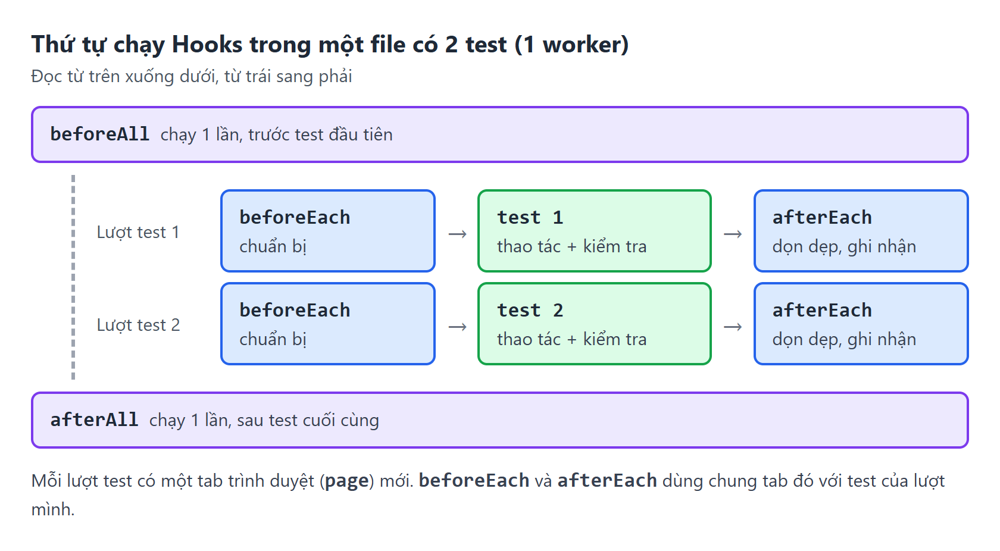
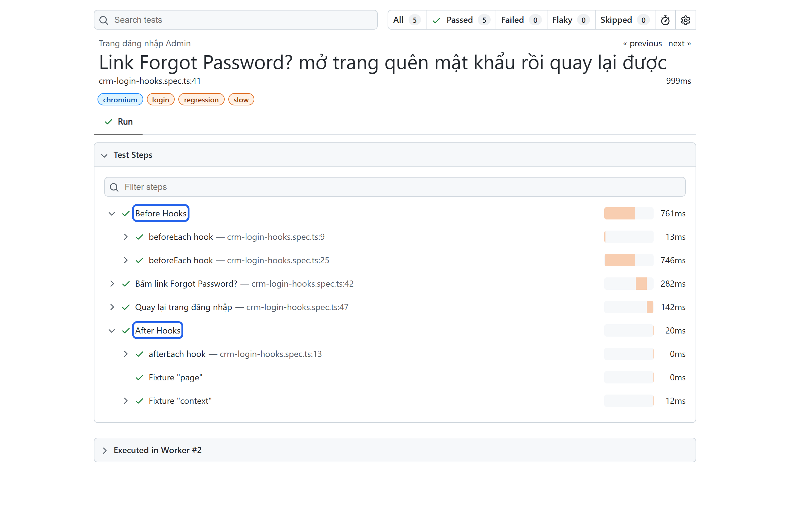
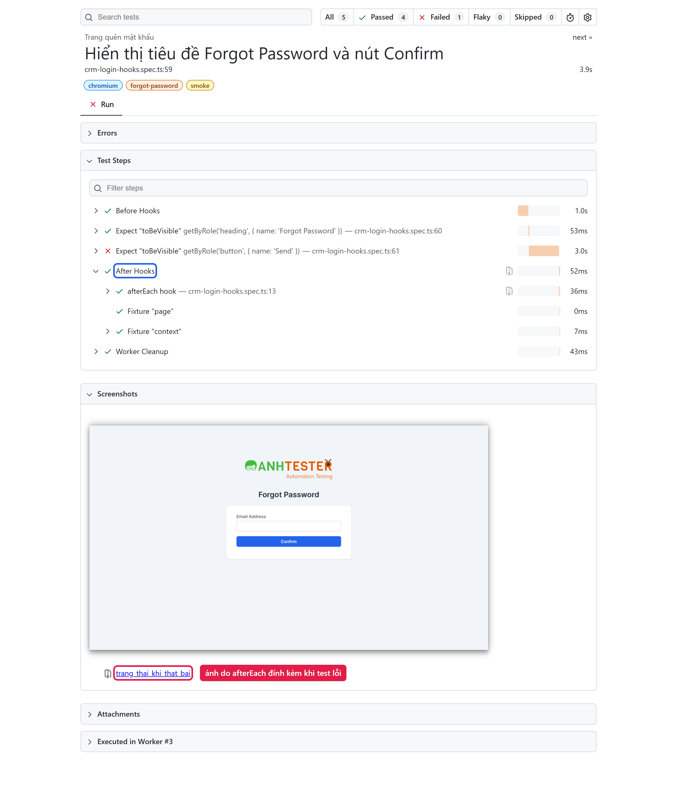
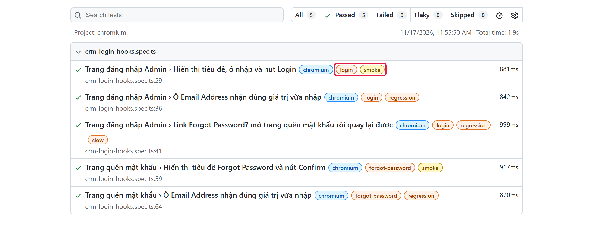
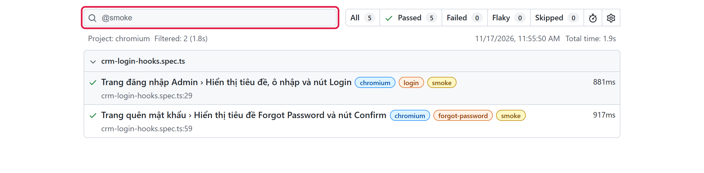

# Bài 13 - [Playwright Typescript] Hooks và Tags - chuẩn bị trước/sau test và chọn test để chạy

Chương: 2. Playwright TypeScript + Locator

Nguồn: [https://anhtester.com/learn/website-and-api-testing-automation-with-playwright-javascript-typescript-day-code-js-ts-tu-dau/370](https://anhtester.com/learn/website-and-api-testing-automation-with-playwright-javascript-typescript-day-code-js-ts-tu-dau/370)

✅ Hooks beforeEach, afterEach, beforeAll, afterAll và thứ tự chạy  
✅ Thực hành Hooks trên trang đăng nhập CRM: gom page.goto, ghi nhận khi test lỗi  
✅ beforeAll chạy theo từng worker và vì sao không dùng chung page  
✅ Gắn Tags cho test, xem và lọc tag trong HTML Report  
✅ Chọn test để chạy với --grep, --grep-invert, --list và npm scripts  
✅ Dùng Claude Code và bộ kit claude-testing-skills cho Hooks, Tags và kiểm tra code do AI sinh ra

## ⭐ Mục tiêu bài học

Ở bài trước bạn đã dựng file `tests/crm-login-structure.spec.ts` với `test.describe`, `test.step` và các Annotations. Còn hai chỗ chưa gọn: test nào cũng lặp lại dòng `page.goto(...)`, và chưa có cách chạy riêng vài test quan trọng. Bài này xử lý cả hai bằng **Hooks** và **Tags**. Học xong bạn sẽ:

- Dùng được `beforeEach`, `afterEach`, `beforeAll`, `afterAll` và biết thứ tự chạy của chúng.
- Gắn tag cho test, chọn test để chạy bằng `--grep` và gói lệnh vào `package.json`.
- Nhận ra chỗ sai trong code Hooks và Tags do AI sinh ra.

> 📌 Bài làm tiếp trong project `D:\AnhTester\playwright-crm` (macOS: `~/AnhTester/playwright-crm`), trên trang công khai của CRM demo, **chưa đăng nhập**.

## ✅ Phần 1: Hooks - việc chạy trước và sau test

### 🔆 1. Từ quán ăn tới Hooks

Quán ăn mỗi sáng mở cửa, bật bếp **một lần**. Với **mỗi lượt khách**, nhân viên bày bàn trước khi khách ngồi và dọn bàn sau khi khách về. Cuối ngày đóng cửa **một lần**.

Trong lập trình test, phần "bày bàn, dọn bàn" gọi là **Hook**: đoạn code Playwright **tự chạy** trước hoặc sau test. Automation dùng hook để mở trang, tạo dữ liệu, chụp ảnh khi test lỗi. Thân test chỉ còn thao tác và kiểm tra.

<table class="rt-table">
<thead>
<tr>
<th>Hook</th>
<th>Chạy khi nào</th>
<th>Thường dùng để</th>
</tr>
</thead>
<tbody>
<tr>
<td><code>test.beforeEach</code></td>
<td>Trước <strong>mỗi</strong> test</td>
<td>Mở trang, tạo dữ liệu cho test</td>
</tr>
<tr>
<td><code>test.afterEach</code></td>
<td>Sau <strong>mỗi</strong> test, kể cả khi test lỗi</td>
<td>Chụp ảnh khi test lỗi, xoá dữ liệu test vừa tạo</td>
</tr>
<tr>
<td><code>test.beforeAll</code></td>
<td>Một lần, trước test đầu tiên</td>
<td>Chuẩn bị thứ dùng chung mà test <strong>không làm thay đổi</strong></td>
</tr>
<tr>
<td><code>test.afterAll</code></td>
<td>Một lần, sau test cuối cùng</td>
<td>Dọn thứ đã tạo ở <code>beforeAll</code></td>
</tr>
</tbody>
</table>

[](https://anhtester.com/storage/photos/shares/lesson/js_ts_playwright/v2/bai_13_hooks_tags/01_so_do_thu_tu_chay_hooks.png)

*Sơ đồ thứ tự chạy của bốn loại Hooks trong một file có 2 test*

### 🔆 2. Thứ tự chạy thật và phạm vi của hook

Hook đặt ở ngoài cùng của file thì áp dụng cho mọi test trong file. Đặt trong một `test.describe` thì chỉ áp dụng cho nhóm đó. Tạo file `tests/hooks-order.spec.ts` để tự kiểm:

```typescript
import { test } from '@playwright/test';

test.beforeAll(async () => {
  console.log('[beforeAll]  chạy 1 lần, trước test đầu tiên của file');
});

test.beforeEach(async () => {
  console.log('  [beforeEach] của file: chạy trước MỖI test');
});

test.afterEach(async () => {
  console.log('  [afterEach]  của file: chạy sau MỖI test');
});

test.afterAll(async () => {
  console.log('[afterAll]   chạy 1 lần, sau test cuối cùng của file');
});

test('Test A nằm ngoài nhóm', async () => {
  console.log('      >>> Test A');
});

test.describe('Nhóm đăng nhập', () => {
  test.beforeEach(async () => {
    console.log('    [beforeEach] của nhóm: chỉ chạy cho test trong nhóm');
  });

  test.afterEach(async () => {
    console.log('    [afterEach]  của nhóm: chỉ chạy cho test trong nhóm');
  });

  test('Test B trong nhóm', async () => {
    console.log('      >>> Test B');
  });

  test('Test C trong nhóm', async () => {
    console.log('      >>> Test C');
  });
});
```

```bash
npx playwright test hooks-order.spec.ts --project=chromium --workers=1 --reporter=list
```

`--workers=1` cho các test chạy lần lượt, `--reporter=list` in mỗi test một dòng. Kết quả chạy thật:

```bash
Running 3 tests using 1 worker

[beforeAll]  chạy 1 lần, trước test đầu tiên của file
  [beforeEach] của file: chạy trước MỖI test
      >>> Test A
  [afterEach]  của file: chạy sau MỖI test
  ✓  1 [chromium] › tests\hooks-order.spec.ts:19:1 › Test A nằm ngoài nhóm (1ms)
  [beforeEach] của file: chạy trước MỖI test
    [beforeEach] của nhóm: chỉ chạy cho test trong nhóm
      >>> Test B
    [afterEach]  của nhóm: chỉ chạy cho test trong nhóm
  [afterEach]  của file: chạy sau MỖI test
  ✓  2 [chromium] › tests\hooks-order.spec.ts:32:3 › Nhóm đăng nhập › Test B trong nhóm (0ms)
  [beforeEach] của file: chạy trước MỖI test
    [beforeEach] của nhóm: chỉ chạy cho test trong nhóm
      >>> Test C
    [afterEach]  của nhóm: chỉ chạy cho test trong nhóm
  [afterEach]  của file: chạy sau MỖI test
[afterAll]   chạy 1 lần, sau test cuối cùng của file
  ✓  3 [chromium] › tests\hooks-order.spec.ts:36:3 › Nhóm đăng nhập › Test C trong nhóm (1ms)

  3 passed (498ms)
```

- Test A nằm ngoài nhóm nên chỉ có hook của file. Test B và C có thêm hook của nhóm: trước test thì hook của file chạy trước, sau test thì ngược lại.
- `beforeAll`, `afterAll` chỉ chạy một lần.

### 🔆 3. Khi hook bị lỗi

Thử cho `beforeEach` chờ một tiêu đề không có trên trang (`Đăng nhập` thay vì `Login`). Kết quả thật, đã rút gọn:

```bash
Running 2 tests using 1 worker

  [beforeEach] mở trang đăng nhập
  [afterEach]  vẫn chạy dù beforeEach lỗi
  ✘  1 [chromium] › tests\exp-fail-before-each.spec.ts:13:1 › Test A (3.6s)
  [beforeEach] mở trang đăng nhập
  [afterEach]  vẫn chạy dù beforeEach lỗi
  ✘  2 [chromium] › tests\exp-fail-before-each.spec.ts:17:1 › Test B (3.7s)

  1) [chromium] › tests\exp-fail-before-each.spec.ts:13:1 › Test A ─────────────────────────────────

    Error: expect(locator).toBeVisible() failed

    Locator: getByRole('heading', { name: 'Đăng nhập' })
    Expected: visible
    Timeout: 3000ms
    Error: element(s) not found
    ...
  2 failed
```

`beforeEach` lỗi thì **thân test không chạy**, test bị tính là failed, còn `afterEach` vẫn chạy. Một hook sai làm đỏ **toàn bộ** test dùng nó, nên hook phải ngắn và chắc.

## ✅ Phần 2: Thực hành Hooks trên trang đăng nhập CRM

### 🔆 1. Gom page.goto vào beforeEach

Trước khi có hook, mỗi test tự mở trang:

```typescript
test('Hiển thị tiêu đề, ô nhập và nút Login', async ({ page }) => {
  await page.goto('https://crm.anhtester.com/admin/authentication');   // lặp lại
  // ...
});

test('Ô Email Address nhận đúng giá trị vừa nhập', async ({ page }) => {
  await page.goto('https://crm.anhtester.com/admin/authentication');   // lặp lại
  // ...
});
```

Đổi URL là phải sửa ở mọi test, sót một chỗ là một test chạy nhầm trang. Tạo file mới `tests/crm-login-hooks.spec.ts` và đưa phần lặp vào hook:

```bash
D:\AnhTester\playwright-crm
├── tests
│   ├── crm-login-structure.spec.ts   (bài trước)
│   ├── crm-login-hooks.spec.ts       (file thực hành của bài này)
│   └── hooks-order.spec.ts           (file thử thứ tự chạy ở Phần 1)
├── package.json
└── playwright.config.ts
```

```typescript
import { test, expect } from '@playwright/test';

const LOGIN_URL = 'https://crm.anhtester.com/admin/authentication';
const FORGOT_URL = 'https://crm.anhtester.com/admin/authentication/forgot_password';

// Dữ liệu test: được tạo MỚI trước mỗi test, không test nào dùng lại của test nào
let email: string;

test.beforeEach(async () => {
  email = `auto_${Date.now()}@example.com`;
});

test.afterEach(async ({ page }, testInfo) => {
  // Chỉ làm việc khi test KHÔNG đạt như mong đợi
  if (testInfo.status !== testInfo.expectedStatus) {
    console.log(`[afterEach] Test lỗi: ${testInfo.title} | URL: ${page.url()} | email: ${email}`);
    await testInfo.attach('trang_thai_khi_that_bai', {
      body: await page.screenshot(),
      contentType: 'image/png',
    });
  }
});

test.describe('Trang đăng nhập Admin', () => {
  test.beforeEach(async ({ page }) => {
    await page.goto(LOGIN_URL);
  });

  test('Hiển thị tiêu đề, ô nhập và nút Login', async ({ page }) => {
    await expect(page.getByRole('heading', { name: 'Login' })).toBeVisible();
    await expect(page.getByLabel('Email Address')).toBeVisible();
    await expect(page.getByLabel('Password')).toBeVisible();
    await expect(page.getByRole('button', { name: 'Login' })).toBeVisible();
  });

  test('Ô Email Address nhận đúng giá trị vừa nhập', async ({ page }) => {
    await page.getByLabel('Email Address').fill(email);
    await expect(page.getByLabel('Email Address')).toHaveValue(email);
  });

  test('Link Forgot Password? mở trang quên mật khẩu rồi quay lại được', async ({ page }) => {
    await test.step('Bấm link Forgot Password?', async () => {
      await page.getByRole('link', { name: 'Forgot Password?' }).click();
      await expect(page).toHaveURL(FORGOT_URL);
    });

    await test.step('Quay lại trang đăng nhập', async () => {
      await page.goBack();
      await expect(page.getByRole('heading', { name: 'Login' })).toBeVisible();
    });
  });
});

test.describe('Trang quên mật khẩu', () => {
  test.beforeEach(async ({ page }) => {
    await page.goto(FORGOT_URL);
  });

  test('Hiển thị tiêu đề Forgot Password và nút Confirm', async ({ page }) => {
    await expect(page.getByRole('heading', { name: 'Forgot Password' })).toBeVisible();
    await expect(page.getByRole('button', { name: 'Confirm' })).toBeVisible();
  });

  test('Ô Email Address nhận đúng giá trị vừa nhập', async ({ page }) => {
    await page.getByLabel('Email Address').fill(email);
    await expect(page.getByLabel('Email Address')).toHaveValue(email);
  });
});
```

```bash
npx playwright test crm-login-hooks.spec.ts --project=chromium --reporter=list
```

```bash
Running 5 tests using 5 workers

  ✓  1 [chromium] › tests\crm-login-hooks.spec.ts:29:3 › Trang đăng nhập Admin › Hiển thị tiêu đề, ô nhập và nút Login (642ms)
  ✓  4 [chromium] › tests\crm-login-hooks.spec.ts:59:3 › Trang quên mật khẩu › Hiển thị tiêu đề Forgot Password và nút Confirm (715ms)
  ✓  2 [chromium] › tests\crm-login-hooks.spec.ts:36:3 › Trang đăng nhập Admin › Ô Email Address nhận đúng giá trị vừa nhập (877ms)
  ✓  3 [chromium] › tests\crm-login-hooks.spec.ts:64:3 › Trang quên mật khẩu › Ô Email Address nhận đúng giá trị vừa nhập (864ms)
  ✓  5 [chromium] › tests\crm-login-hooks.spec.ts:41:3 › Trang đăng nhập Admin › Link Forgot Password? mở trang quên mật khẩu rồi quay lại được (978ms)

  5 passed (1.9s)
```

- **Hai tầng hook.** Hook của file dùng cho cả 5 test. Hook của từng nhóm chỉ mở trang của nhóm đó.
- **Hook nhận `{ page }`**, chính là tab của test sắp chạy.
- **Dữ liệu tạo mới trước mỗi test.** `email` được gán lại trong `beforeEach`, không test nào dùng lại giá trị của test khác. Dữ liệu tạo trên server thì xoá ở `afterEach` qua API, học ở chương API Testing.

Mở báo cáo bằng `npx playwright show-report` rồi bấm vào một test. Hook nằm trong hai mục **Before Hooks** và **After Hooks**:

[](https://anhtester.com/storage/photos/shares/lesson/js_ts_playwright/v2/bai_13_hooks_tags/02_html_report_before_after_hooks.png)

*HTML Report: Before Hooks và After Hooks bao quanh các step của test*

### 🔆 2. afterEach ghi nhận khi test lỗi

Tham số thứ hai của hook là `testInfo`, chứa thông tin về test vừa chạy. `testInfo.status !== testInfo.expectedStatus` nghĩa là kết quả thật khác kết quả mong đợi, tức test lỗi. Khi đó hook in một dòng log và đính ảnh màn hình vào báo cáo bằng `testInfo.attach()`. Thử sửa tên nút `Confirm` thành `Send` cho một test lỗi:

```bash
[afterEach] Test lỗi: Hiển thị tiêu đề Forgot Password và nút Confirm | URL: https://crm.anhtester.com/admin/authentication/forgot_password | email: auto_1794891331847@example.com
  ✘  1 [chromium] › tests\crm-login-hooks.spec.ts:59:3 › Trang quên mật khẩu › Hiển thị tiêu đề Forgot Password và nút Confirm (3.8s)
```

[](https://anhtester.com/storage/photos/shares/lesson/js_ts_playwright/v2/bai_13_hooks_tags/03_html_report_aftereach_dinh_kem_anh.png)

*HTML Report của test lỗi: ảnh do afterEach đính kèm*

Nhớ sửa lại `Confirm` sau khi thử.

## ✅ Phần 3: beforeAll và afterAll - ba điều phải biết

### 🔆 1. Chạy một lần cho mỗi worker

**Worker** là một tiến trình chạy test. File config đang bật `fullyParallel: true` nên test trong cùng một file được chia cho nhiều worker chạy song song, và mỗi worker tự chạy `beforeAll` của nó. Tạo file `tests/hooks-worker.spec.ts`:

```typescript
import { test } from '@playwright/test';

test.beforeAll(async ({}, testInfo) => {
  console.log(`[beforeAll] chạy ở worker số ${testInfo.workerIndex}`);
});

test.afterAll(async ({}, testInfo) => {
  console.log(`[afterAll]  chạy ở worker số ${testInfo.workerIndex}`);
});

test('Test A', async ({}, testInfo) => {
  console.log(`    >>> Test A chạy ở worker số ${testInfo.workerIndex}`);
});

test('Test B', async ({}, testInfo) => {
  console.log(`    >>> Test B chạy ở worker số ${testInfo.workerIndex}`);
});

test('Test C', async ({}, testInfo) => {
  console.log(`    >>> Test C chạy ở worker số ${testInfo.workerIndex}`);
});

test('Test D', async ({}, testInfo) => {
  console.log(`    >>> Test D chạy ở worker số ${testInfo.workerIndex}`);
});
```

```bash
npx playwright test hooks-worker.spec.ts --project=chromium --workers=2 --reporter=list
```

```bash
Running 4 tests using 2 workers

[beforeAll] chạy ở worker số 1
[beforeAll] chạy ở worker số 0
    >>> Test C chạy ở worker số 1
  ✓  1 [chromium] › tests\hooks-worker.spec.ts:19:1 › Test C (1ms)
    >>> Test D chạy ở worker số 1
    >>> Test A chạy ở worker số 0
  ✓  2 [chromium] › tests\hooks-worker.spec.ts:11:1 › Test A (1ms)
[afterAll]  chạy ở worker số 1
  ✓  3 [chromium] › tests\hooks-worker.spec.ts:23:1 › Test D (0ms)
    >>> Test B chạy ở worker số 0
[afterAll]  chạy ở worker số 0
  ✓  4 [chromium] › tests\hooks-worker.spec.ts:15:1 › Test B (0ms)

  4 passed (506ms)
```

Hai worker, `beforeAll` chạy **hai lần** (với `--workers=1` chỉ còn một lần). Khi một test lỗi, Playwright còn mở worker mới và `beforeAll` chạy thêm lần nữa. Vì vậy đừng tạo dữ liệu trong `beforeAll` với suy nghĩ nó chỉ chạy đúng một lần: dữ liệu sẽ bị tạo trùng.

### 🔆 2. Không nhận được page

Viết `test.beforeAll(async ({ page }) => { ... })`, test đầu tiên lỗi ngay, các test sau không chạy:

```bash
Running 2 tests using 1 worker

  ✘  1 [chromium] › tests\exp-beforeall-page.spec.ts:7:1 › Test A (0ms)
  -  2 [chromium] › tests\exp-beforeall-page.spec.ts:11:1 › Test B


  1) [chromium] › tests\exp-beforeall-page.spec.ts:7:1 › Test A ────────────────────────────────────

    Error: "context" and "page" fixtures are not supported in "beforeAll" since they are created on a per-test basis.
    If you would like to reuse a single page between tests, create context manually with browser.newContext(). See https://aka.ms/playwright/reuse-page for details.
    If you would like to configure your page before each test, do that in beforeEach hook instead.

    Error Context: test-results\exp-beforeall-page-Test-A-chromium\error-context.md

  1 failed
    [chromium] › tests\exp-beforeall-page.spec.ts:7:1 › Test A ─────────────────────────────────────
  1 did not run
```

`page` được tạo **riêng cho từng test**. Muốn mở trang trước mỗi test thì dùng `beforeEach`.

### 🔆 3. Không dùng chung một page cho nhiều test

Code cũ và code AI sinh ra hay tự tạo một tab dùng chung:

```typescript
import { test, expect, Page } from '@playwright/test';

// ❌ Không nên: mọi test dùng chung một tab
let page: Page;

test.beforeAll(async ({ browser }) => {
  page = await browser.newPage();
  await page.goto('https://crm.anhtester.com/admin/authentication');
});
```

Code này chạy được, nhưng test 1 bấm sang trang quên mật khẩu thì test 2 bắt đầu ở trang đó và lỗi dù tính năng không hỏng. Trong khoá học này, mỗi test dùng `page` riêng do Playwright cấp. Việc chuẩn bị nặng như đăng nhập sẵn sẽ làm bằng **Fixture**, học ở chương Page Object Model và Fixture.

> ⚠️ Biến `let email` ở Phần 2 thì khác: nó được **gán lại trước mỗi test** nên không mang gì từ test trước sang.

## ✅ Phần 4: Tags - dán nhãn cho test

### 🔆 1. Vì sao cần tag và cách gắn

Hàng trong kho được dán nhãn "dễ vỡ", "giao nhanh" để lấy đúng nhóm mà không phải mở từng thùng. Project có vài trăm test cũng vậy: sau mỗi lần deploy bạn chỉ chạy nhóm quan trọng nhất. **Tag** là nhãn gắn vào test để chọn theo nhóm: một chuỗi **bắt đầu bằng `@`**, khai báo ở tham số thứ hai của `test()` hoặc `test.describe()`:

```typescript
// Một tag
test('Hiển thị tiêu đề, ô nhập và nút Login', { tag: '@smoke' }, async ({ page }) => { /* ... */ });

// Nhiều tag
test('Link Forgot Password? mở trang quên mật khẩu rồi quay lại được', { tag: ['@regression', '@slow'] }, async ({ page }) => { /* ... */ });

// Tag cho cả nhóm: mọi test bên trong đều nhận tag này
test.describe('Trang đăng nhập Admin', { tag: '@login' }, () => { /* ... */ });
```

Quy ước tag dùng trong project của khoá học:

<table class="rt-table">
<thead>
<tr>
<th>Tag</th>
<th>Gắn ở</th>
<th>Ý nghĩa</th>
</tr>
</thead>
<tbody>
<tr>
<td><code>@smoke</code></td>
<td>Từng test</td>
<td>Ít test, kiểm chức năng sống còn. Chạy sau mỗi lần deploy</td>
</tr>
<tr>
<td><code>@regression</code></td>
<td>Từng test</td>
<td>Các test còn lại. Chạy cùng nhóm smoke trước khi release</td>
</tr>
<tr>
<td><code>@slow</code></td>
<td>Từng test</td>
<td>Test chạy lâu, bỏ qua khi cần kết quả nhanh</td>
</tr>
<tr>
<td><code>@login</code>, <code>@forgot-password</code></td>
<td><code>describe</code></td>
<td>Tên module, để chạy riêng một module</td>
</tr>
</tbody>
</table>

Sửa `tests/crm-login-hooks.spec.ts`: thêm `{ tag: ... }` vào 7 dòng khai báo, phần còn lại giữ nguyên.

```typescript
// Trích 7 dòng khai báo đã sửa, phần thân giữ nguyên
test.describe('Trang đăng nhập Admin', { tag: '@login' }, () => {
  test('Hiển thị tiêu đề, ô nhập và nút Login', { tag: '@smoke' }, async ({ page }) => {
  test('Ô Email Address nhận đúng giá trị vừa nhập', { tag: '@regression' }, async ({ page }) => {
  test('Link Forgot Password? mở trang quên mật khẩu rồi quay lại được', { tag: ['@regression', '@slow'] }, async ({ page }) => {

test.describe('Trang quên mật khẩu', { tag: '@forgot-password' }, () => {
  test('Hiển thị tiêu đề Forgot Password và nút Confirm', { tag: '@smoke' }, async ({ page }) => {
  test('Ô Email Address nhận đúng giá trị vừa nhập', { tag: '@regression' }, async ({ page }) => {
```

> ⚠️ Viết thiếu dấu `@` như `{ tag: 'smoke' }`, Playwright dừng với lỗi `Error: Tag must start with '@'`.

### 🔆 2. Tag trong HTML Report

Chạy lại file rồi mở báo cáo. Nhãn tag (không kèm `@`) hiện ngay sau tên test, gồm cả tag của `describe` lẫn tag của riêng test:

[](https://anhtester.com/storage/photos/shares/lesson/js_ts_playwright/v2/bai_13_hooks_tags/04_html_report_nhan_tag.png)

*HTML Report: nhãn tag hiện sau tên từng test*

Bấm vào nhãn `smoke`, ô tìm kiếm tự điền `@smoke` và chỉ còn 2 test:

[](https://anhtester.com/storage/photos/shares/lesson/js_ts_playwright/v2/bai_13_hooks_tags/05_html_report_loc_theo_tag_smoke.png)

*HTML Report sau khi lọc theo tag @smoke*

> 📌 Code cũ hay viết tag thẳng vào tên test, ví dụ `test('Trang đăng nhập có đúng title @smoke', ...)`. Chạy thử thì báo cáo và `--grep` vẫn nhận ra, nhưng tên test bị lẫn nhãn. Code mới hãy dùng `{ tag: ... }`. Tài liệu: [Tag tests trên playwright.dev](https://playwright.dev/docs/test-annotations#tag-tests).

## ✅ Phần 5: Chọn test để chạy từ dòng lệnh

### 🔆 1. --grep, --grep-invert và --list

`--grep` nhận một biểu thức chính quy và chỉ chạy test khớp với nó. Biểu thức được so với **tên file, tên test và các tag**, không phân biệt hoa thường. Thêm `--list` để chỉ **liệt kê** test được chọn mà chưa chạy:

```bash
npx playwright test crm-login-hooks --project=chromium --grep "@smoke" --list
```

```bash
Listing tests:
  [chromium] › crm-login-hooks.spec.ts:29:3 › Trang đăng nhập Admin › Hiển thị tiêu đề, ô nhập và nút Login
  [chromium] › crm-login-hooks.spec.ts:59:3 › Trang quên mật khẩu › Hiển thị tiêu đề Forgot Password và nút Confirm
Total: 2 tests in 1 file
```

Các cách lọc dưới đây đều đã chạy thật trên file này:

<table class="rt-table">
<thead>
<tr>
<th>Tham số</th>
<th>Ý nghĩa</th>
<th>Số test được chọn</th>
</tr>
</thead>
<tbody>
<tr>
<td><code>--grep "@smoke"</code></td>
<td>Có tag <code>@smoke</code></td>
<td>2</td>
</tr>
<tr>
<td><code>--grep-invert "@slow"</code></td>
<td>Mọi test <strong>trừ</strong> test có <code>@slow</code></td>
<td>4</td>
</tr>
<tr>
<td><code>--grep "@smoke|@forgot-password"</code></td>
<td>HOẶC: có một trong hai tag</td>
<td>3</td>
</tr>
<tr>
<td><code>--grep "(?=.*@smoke)(?=.*@login)"</code></td>
<td>VÀ: có đủ cả hai tag</td>
<td>1</td>
</tr>
</tbody>
</table>

Bỏ `--list` là chạy thật, reporter `list` in luôn tag sau tên test:

```bash
npx playwright test crm-login-hooks --project=chromium --grep "@smoke" --reporter=list
```

```bash
Running 2 tests using 2 workers

  ✓  2 [chromium] › tests\crm-login-hooks.spec.ts:29:3 › Trang đăng nhập Admin › Hiển thị tiêu đề, ô nhập và nút Login @login @smoke (700ms)
  ✓  1 [chromium] › tests\crm-login-hooks.spec.ts:59:3 › Trang quên mật khẩu › Hiển thị tiêu đề Forgot Password và nút Confirm @forgot-password @smoke (731ms)

  2 passed (1.4s)
```

> ⚠️ **Luôn viết đủ dấu `@`.** Anh Tester thử thêm một test không gắn tag, tên là "Kiểm tra smoke test cho trang quên mật khẩu": `--grep smoke` chọn cả test này, `--grep "@smoke"` thì không.
>
> 📌 Chạy `--list` trước khi dùng một lệnh lọc mới: lọc sai thì thiếu test mà kết quả vẫn xanh.

### 🔆 2. Dấu nháy trên PowerShell, CMD và macOS

Ký tự `@` và `|` có nghĩa riêng với từng terminal. Kết quả chạy thật trên Windows:

<table class="rt-table">
<thead>
<tr>
<th>Cách viết</th>
<th>PowerShell</th>
<th>CMD</th>
<th>Git Bash</th>
</tr>
</thead>
<tbody>
<tr>
<td><code>--grep @smoke</code></td>
<td>❌ Lỗi <code><span>The</span> <span>variable</span> <span>'$smoke'</span> <span>cannot</span> <span>be</span> <span>retrieved</span></code></td>
<td>Chạy được</td>
<td>Chạy được</td>
</tr>
<tr>
<td><code>--grep "@smoke|@login"</code></td>
<td>Chạy được</td>
<td>Chạy được</td>
<td>Chạy được</td>
</tr>
<tr>
<td><code>--grep '@smoke|@login'</code></td>
<td>Chạy được</td>
<td>❌ Lỗi <code><span>is</span> <span>not</span> <span>recognized</span> <span>as</span> <span>an</span> <span>internal</span> <span>or</span> <span>external</span> <span>command</span></code></td>
<td>Chạy được</td>
</tr>
</tbody>
</table>

PowerShell hiểu `@smoke` là một biến, CMD không coi nháy đơn là dấu bọc chuỗi. Chỉ cần nhớ: **luôn bọc biểu thức trong nháy kép**, terminal trên macOS và Linux cũng nhận cách viết này.

### 🔆 3. Gói lệnh vào package.json

Lệnh dài dễ gõ sai. Mở `package.json` ở gốc project, sửa mục `scripts`:

```json
"scripts": {
  "test:smoke": "playwright test --grep @smoke",
  "test:regression": "playwright test --grep \"@smoke|@regression\"",
  "test:fast": "playwright test --grep-invert @slow"
},
```

Trong JSON, nháy kép nằm trong chuỗi phải viết thành `\"`. Chạy bằng `npm run <tên script>`, tham số bổ sung đặt sau dấu `--`:

```bash
npm run test:smoke -- --project=chromium --reporter=list
```

```bash
> playwright-crm@1.0.0 test:smoke
> playwright test --grep @smoke --project=chromium --reporter=list


Running 2 tests using 2 workers

  ✓  2 [chromium] › tests\crm-login-hooks.spec.ts:59:3 › Trang quên mật khẩu › Hiển thị tiêu đề Forgot Password và nút Confirm @forgot-password @smoke (623ms)
  ✓  1 [chromium] › tests\crm-login-hooks.spec.ts:29:3 › Trang đăng nhập Admin › Hiển thị tiêu đề, ô nhập và nút Login @login @smoke (740ms)

  2 passed (1.4s)
```

Hai dòng đầu bắt đầu bằng `>` là npm in lại lệnh thật sự được chạy: tham số sau `--` đã được nối vào cuối lệnh trong `package.json`.

Lệnh `npm run` viết giống nhau trên mọi terminal nên cả nhóm và CI/CD dùng chung được. Bộ lọc cũng đặt được trong `playwright.config.ts` bằng option `grep` và `grepInvert`, học ở bài cấu hình.

## ✅ Phần 6: Dùng Claude Code và bộ kit claude-testing-skills cho Hooks và Tags

### 🔆 1. Prompt mẫu

Anh Tester dùng [Claude](https://claude.ai/) và Claude Code (bản có phí) cùng bộ kit [claude-testing-skills](https://github.com/anhtester/claude-testing-skills). Với bản miễn phí [ChatGPT](https://chatgpt.com/) hoặc [Gemini](https://gemini.google.com/), chỗ có `@đường-dẫn` (cách đưa file vào câu hỏi của Claude Code, xem [tài liệu](https://code.claude.com/docs/en/common-workflows)) thì dán nội dung file vào thay.

```markdown
Đọc file @tests/crm-login-structure.spec.ts (Playwright TypeScript).
Tìm các dòng lặp lại ở đầu mỗi test và đưa vào test.beforeEach, đặt hook ở đúng phạm vi (file hoặc từng describe).
Ràng buộc:
- KHÔNG dùng beforeAll, KHÔNG khai báo biến page dùng chung. Mỗi test vẫn nhận { page } của riêng nó.
- KHÔNG đưa expect của test vào hook. Hook chỉ chuẩn bị.
- Không đổi tên test, không đổi locator.
Trả về: bảng "dòng nào chuyển vào hook nào, vì sao", sau đó mới là file hoàn chỉnh.
```

```markdown
Gắn tag cho các test trong @tests/crm-login-hooks.spec.ts theo quy ước của project:
- @smoke: test kiểm chức năng sống còn, tối đa 1 đến 2 test cho mỗi describe.
- @regression: các test còn lại. Mỗi test có đúng MỘT trong hai tag @smoke hoặc @regression.
- @slow: thêm cho test có từ 2 lần chuyển trang trở lên.
- Tag module (@login, @forgot-password) gắn ở test.describe, không lặp lại ở từng test.
Dùng cú pháp { tag: '...' }, tag viết thường, bắt đầu bằng @, không viết tag vào tên test.
Chỉ lập bảng đề xuất: tên test | tag | lý do. CHƯA sửa file, tôi duyệt xong mới sửa.
```

```markdown
Tôi mới học Playwright. Với file dưới đây, hãy viết ra thứ tự chạy của từng hook và từng test khi chạy với --workers=1, mỗi dòng một bước, thụt lề theo tầng (file, describe).
Sau đó trả lời: nếu chạy với 2 worker thì beforeAll chạy mấy lần, vì sao? Dẫn link tài liệu playwright.dev.
Tôi sẽ tự chạy lại để đối chiếu, nên đừng đoán: chỗ nào không chắc thì nói rõ.

[dán nội dung file tests/hooks-order.spec.ts]
```

```markdown
Tôi cần chạy các test Playwright có tag @smoke HOẶC @login, nhưng bỏ test có tag @slow.
Viết lệnh npx playwright test cho 3 terminal: Windows PowerShell, CMD và macOS zsh.
Giải thích vì sao phải có dấu nháy ở từng terminal, và thêm --list để tôi kiểm danh sách test trước khi chạy thật.
```

### 🔆 2. Bộ kit quy định gì về Hooks và Tags?

<table class="rt-table">
<thead>
<tr>
<th>Chỗ trong bộ kit</th>
<th>Quy định</th>
<th>Liên hệ với bài này</th>
</tr>
</thead>
<tbody>
<tr>
<td>Rule <a href="https://github.com/anhtester/claude-testing-skills/blob/main/.claude/rules/playwright_rules.md">playwright_rules.md</a>, mục 5</td>
<td>Dùng <code>beforeEach</code> / <code>afterEach</code> để setup và teardown</td>
<td>Đúng khung file ở Phần 2</td>
</tr>
<tr>
<td>Rule <a href="https://github.com/anhtester/claude-testing-skills/blob/main/.claude/rules/automation_rules.md">automation_rules.md</a>, mục 8</td>
<td>Mỗi test độc lập, không chia sẻ state giữa các test</td>
<td>Không dùng chung <code>page</code> (Phần 3)</td>
</tr>
<tr>
<td>Rule <a href="https://github.com/anhtester/claude-testing-skills/blob/main/.claude/rules/reporting_rules.md">reporting_rules.md</a>, mục 1, 3 và 4</td>
<td>Tags gồm nhóm chạy (smoke, regression) và tên module. Chụp ảnh trong teardown cho <strong>mọi</strong> test, khi lỗi đặt tên <code>trang_thai_khi_that_bai</code>. Không dùng <code>console.log</code></td>
<td>Quy ước tag ở Phần 4, tên ảnh ở Phần 2. Script do kit sinh không có dòng log</td>
</tr>
<tr>
<td>Lệnh<br/><a href="https://github.com/anhtester/claude-testing-skills/blob/main/.claude/commands/run-and-fix-tests.md">/run-and-fix-tests</a></td>
<td>Nhận phạm vi chạy theo tag, module hoặc file, dùng <code>--grep @smoke</code></td>
<td>Chính là <code>--grep</code> ở Phần 5</td>
</tr>
</tbody>
</table>

Ví dụ chạy nhóm smoke, chỉ báo cáo chứ chưa sửa code:

```markdown
/run-and-fix-tests RUN @smoke
```

Lệnh [/review-automation-code](https://github.com/anhtester/claude-testing-skills/blob/main/.claude/commands/review-automation-code.md) chấm chất lượng script đã viết, trong đó có việc thiếu Tags và thiếu ảnh ở teardown.

## ✅ Phần 7: Kiểm tra code do AI sinh ra

Code AI viết thường chạy xanh ngay, lỗi nằm ở cách tổ chức. Rà theo bảng sau:

<table class="rt-table">
<thead>
<tr>
<th>Dấu hiệu</th>
<th>Vì sao là vấn đề</th>
<th>Cách xử lý</th>
</tr>
</thead>
<tbody>
<tr>
<td><code>let page: Page</code> gán trong <code>beforeAll</code>, hoặc <code>beforeAll</code> nhận <code>{ page }</code></td>
<td>Dùng chung một tab thì test sau phụ thuộc test trước. Nhận <code>{ page }</code> thì lỗi ngay khi chạy</td>
<td>Dùng <code>{ page }</code> của từng test và <code>beforeEach</code></td>
</tr>
<tr>
<td><code>afterAll</code> gọi <code>browser.close()</code> hoặc <code>afterEach</code> gọi <code>page.close()</code></td>
<td>Playwright tự đóng tab và trình duyệt. Tự đóng dễ làm lỗi test khác trong cùng worker</td>
<td>Xoá. Chỉ dọn thứ <strong>chính bạn</strong> tạo ra</td>
</tr>
<tr>
<td>Hook dài, chứa cả bước chính và <code>expect</code> của kịch bản</td>
<td>Đọc test không còn thấy test làm gì. Hook lỗi thì mọi test đỏ theo</td>
<td>Hook chỉ chuẩn bị. Bước và <code>expect</code> của kịch bản đưa về test</td>
</tr>
<tr>
<td><code>waitForTimeout</code> hoặc <code>test.only</code> trong hook hay test</td>
<td>Chờ cứng làm mọi test chậm theo. <code>test.only</code> làm test khác không chạy</td>
<td>Xoá cả hai</td>
</tr>
<tr>
<td>Tag lộn xộn: <code>'smoke'</code>, <code>@Smoke</code>, <code>@smoke test</code></td>
<td>Thiếu <code>@</code> thì file báo lỗi. Lẫn hoa thường, có dấu cách thì nhãn không thống nhất và khó lọc đúng</td>
<td>Luôn có <code>@</code>, viết thường, nối từ bằng dấu <code>-</code>. Lệnh lọc cũng viết đủ <code>@</code></td>
</tr>
</tbody>
</table>

## ✅ Phần 8: Bài tập thực hành

**Bài tập 1 - Gom lặp vào hook.** Mở `tests/crm-login-structure.spec.ts` của bài trước, đưa các dòng `page.goto(...)` lặp lại vào `beforeEach` của từng nhóm. Chạy lại, số test đạt phải giữ nguyên.

**Bài tập 2 - Gắn tag và lọc.** Gắn tag cho file ở bài tập 1 theo quy ước ở Phần 4. Viết lệnh chạy: chỉ nhóm smoke; mọi test trừ `@slow`; test vừa `@smoke` vừa `@login`. Chạy từng lệnh với `--list` trước.

**Bài tập 3 - Duyệt code.** Đoạn code dưới đây do AI viết cho trang đăng nhập Admin và có 7 chỗ cần sửa. Tìm đủ, nêu lý do theo bảng ở Phần 7 và viết lại.

```typescript
import { test, expect, Page } from '@playwright/test';

let page: Page;

test.beforeAll(async ({ browser }) => {
  page = await browser.newPage();
  await page.goto('https://crm.anhtester.com/admin/authentication');
  await page.waitForTimeout(3000);
  await expect(page.getByRole('heading', { name: 'Login' })).toBeVisible();
});

test.afterAll(async ({ browser }) => {
  await browser.close();
});

test.only('Form có nút Login', { tag: 'smoke' }, async () => {
  await expect(page.getByRole('button', { name: 'Login' })).toBeVisible();
});

test('Mở trang quên mật khẩu', { tag: '@Smoke' }, async () => {
  await page.getByRole('link', { name: 'Forgot Password?' }).click();
  await expect(page.getByRole('heading', { name: 'Forgot Password' })).toBeVisible();
});
```

## ✅ Phần 9: Ghi nhớ nhanh

- `beforeEach` / `afterEach` chạy quanh **mỗi** test, nhận được `{ page }`. Đặt ở file thì áp dụng cho cả file, đặt trong `describe` thì chỉ cho nhóm.
- `beforeEach` lỗi thì test không chạy và bị tính failed. Hook chỉ chuẩn bị và dọn dẹp, `expect` của kịch bản nằm trong test.
- `beforeAll` / `afterAll` chạy một lần **cho mỗi worker** và không nhận `page`. Không dùng chung một `page` cho nhiều test.
- Tag bắt đầu bằng `@`, khai báo bằng `{ tag: ... }` ở `test` hoặc `describe`, viết thường.
- Chọn test bằng `--grep`, loại bằng `--grep-invert`, kiểm trước bằng `--list`. Biểu thức luôn bọc trong nháy kép. Lệnh hay dùng thì đưa vào `scripts` của `package.json`.

✅ **Kết luận:** Với `describe`, `step`, Annotations, Hooks và Tags, khung của một file test đã đủ. Phần còn thiếu là chỉ cho Playwright biết phải thao tác vào phần tử nào, và đó là bài kế tiếp: **Cách xác định Locators với các hàm có sẵn của Playwright (getByRole, getByLabel, getByText, getByTestId...)**.

---

## Bài tập riêng — Bài tập - Gom việc lặp vào Hooks, gắn Tags và chọn test để chạy

Nguồn bài tập: [https://anhtester.com/student-assignments?course=website-and-api-testing-automation-with-playwright-javascript-typescript-day-code-js-ts-tu-dau#assignment-103](https://anhtester.com/student-assignments?course=website-and-api-testing-automation-with-playwright-javascript-typescript-day-code-js-ts-tu-dau#assignment-103)

**Mục tiêu:** bỏ code lặp bằng Hooks đúng phạm vi, gắn tag theo một quy ước thống nhất, chọn đúng nhóm test để chạy từ dòng lệnh, và nhận ra cách dùng Hooks sai trong code AI.

**Thư mục làm bài:** `D:\AnhTester\playwright-crm` (macOS: `~/AnhTester/playwright-crm`). Chỉ làm việc trên trang công khai của CRM demo, **không đăng nhập**.

### 📝 Đề bài

#### Bài tập 1 - Gom việc lặp vào hook

Mở `tests/crm-login-structure.spec.ts` của bài trước, đưa các dòng `page.goto(...)` lặp lại vào `test.beforeEach` của từng nhóm `describe`. Chạy lại: số test đạt phải giữ nguyên như trước khi sửa.

#### Bài tập 2 - Gắn tag và lọc từ dòng lệnh

Gắn tag cho file ở Bài tập 1 theo quy ước trong bài học (`@smoke`, `@regression`, tag tên trang như `@login`, `@forgot-password`; viết thường, bắt đầu bằng `@`). Viết lệnh và chạy với `--list` trước, rồi chạy thật:

1. Chỉ các test `@smoke`.
2. Mọi test trừ `@slow`.
3. Test vừa `@smoke` vừa `@login`.

Thêm 2 script `test:smoke` và `test:regression` vào `package.json` và chạy bằng `npm run`. Ghi rõ bạn dùng terminal nào (PowerShell, CMD, Git Bash hay macOS) và cách bạn bọc dấu nháy.

#### Bài tập 3 - Duyệt code AI

Đoạn code dưới đây do AI viết cho trang đăng nhập Admin và có **7 chỗ cần sửa**. Tìm đủ, nêu lý do và viết lại thành file `tests/bt3-hooks-tags.spec.ts` chạy đạt.

```typescript
import { test, expect, Page } from '@playwright/test';

let page: Page;

test.beforeAll(async ({ browser }) => {
  page = await browser.newPage();
  await page.goto('https://crm.anhtester.com/admin/authentication');
  await page.waitForTimeout(3000);
  await expect(page.getByRole('heading', { name: 'Login' })).toBeVisible();
});

test.afterAll(async ({ browser }) => {
  await browser.close();
});

test.only('Form có nút Login', { tag: 'smoke' }, async () => {
  await expect(page.getByRole('button', { name: 'Login' })).toBeVisible();
});

test('Mở trang quên mật khẩu', { tag: '@Smoke' }, async () => {
  await page.getByRole('link', { name: 'Forgot Password?' }).click();
  await expect(page.getByRole('heading', { name: 'Forgot Password' })).toBeVisible();
});
```

### 📦 Cách nộp bài

1. Làm bài trong project `playwright-crm`, commit và push lên nhánh `main` của repo GitHub `playwright-crm` của bạn.
2. Dán link repo vào ô **Link GitHub**, dạng `https://github.com/<ten-ban>/playwright-crm`. Repo Private thì vào **Settings → Collaborators** thêm tài khoản GitHub của giảng viên, nếu không giảng viên không mở được.
3. Trong ô **Nội dung bài làm (Editor)**, dán **kết quả chạy thật** trên Terminal của từng lệnh (mỗi lệnh một **Đoạn code mẫu** chọn Text / Log) và phần trả lời các câu hỏi.
4. Với bài **Duyệt code AI**: liệt kê từng chỗ sai theo mẫu *Dòng – Lỗi – Lý do – Cách sửa*, rồi dán file đã sửa.
5. Dán thêm kết quả `--list` của 3 lệnh lọc ở Bài tập 2 và kết quả `npm run test:smoke`.

### ✅ Tiêu chí Đạt

- Bài tập 1: không còn `page.goto` lặp trong thân test; hook đặt đúng phạm vi từng `describe`; số test đạt không đổi.
- Hook chỉ chuẩn bị và dọn dẹp: không có `expect` của kịch bản trong hook, không dùng biến `page` chung.
- Mọi tag bắt đầu bằng `@`, viết thường, thống nhất trong cả file.
- 3 lệnh lọc ra đúng tập test (đối chiếu kết quả `--list`); lệnh có ký tự `@` hoặc `|` được bọc nháy kép; 2 npm script chạy được.
- Bài tập 3 nêu đủ 7 lỗi: dùng chung một `page` tạo trong `beforeAll` cho nhiều test; `waitForTimeout(3000)` chờ cứng; `expect` nằm trong hook; `afterAll` tự đóng `browser` do Playwright quản lý; `test.only` bị bỏ lại; tag `smoke` thiếu `@` (Playwright báo lỗi); tag `@Smoke` viết hoa không thống nhất. File viết lại mỗi test nhận `{ page }` riêng và chạy đạt với `--project=chromium`.

### 🤖 Dùng AI thế nào cho đúng

Được dùng Claude, ChatGPT hoặc Gemini để **hỏi giải thích** lỗi và khái niệm (prompt mẫu ở phần AI của bài học). Không nhờ AI làm hộ rồi dán vào: bài **Duyệt code AI** chấm chính phần *lý do* do bạn tự viết. Không dán mật khẩu hay file `.env` vào khung chat. Bài nào nộp lại vì **Cần sửa** thì sửa đúng chỗ giảng viên ghi trong feedback rồi bấm **Nộp lại**.