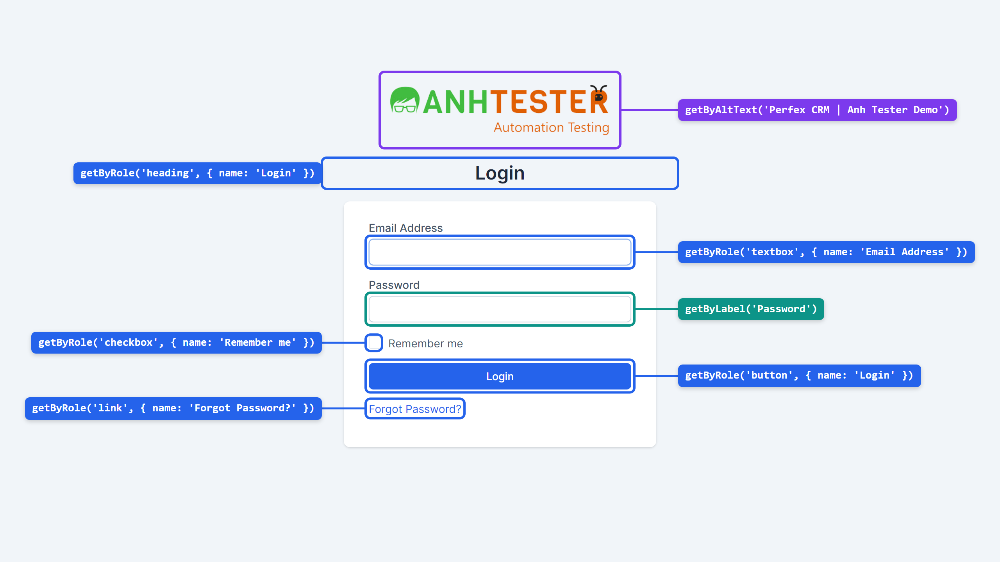
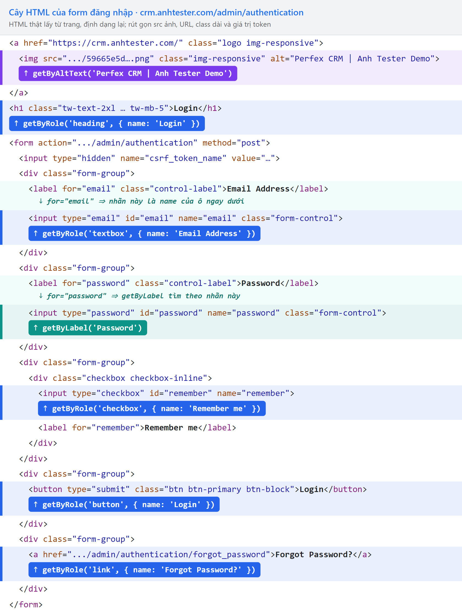
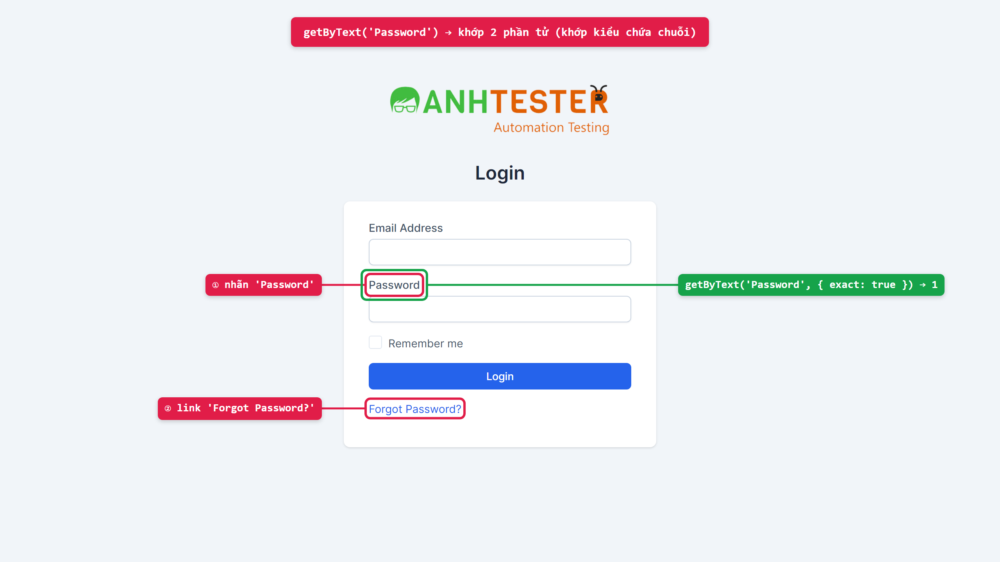
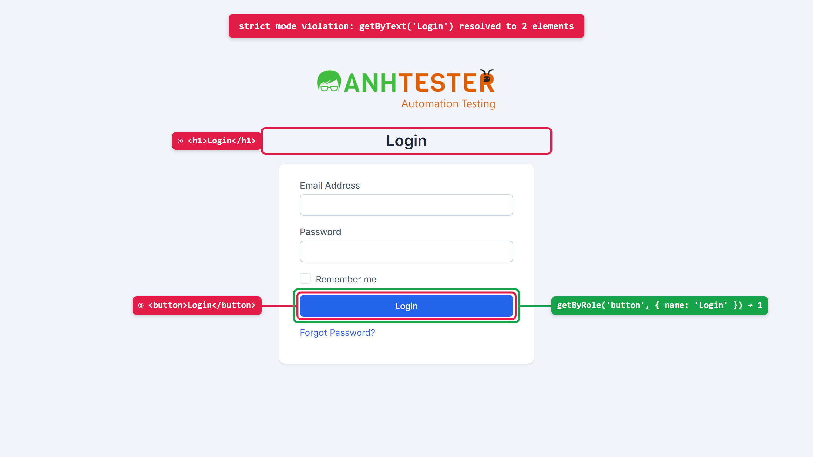
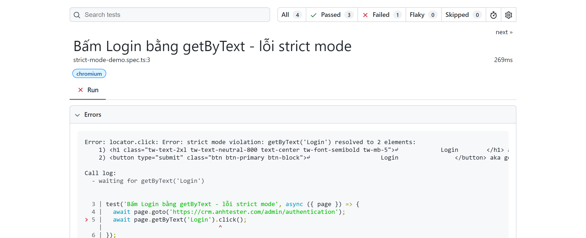
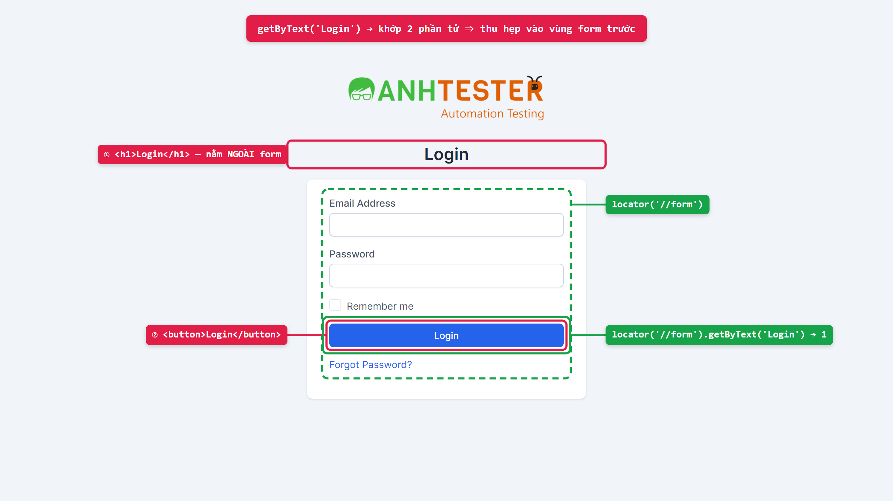
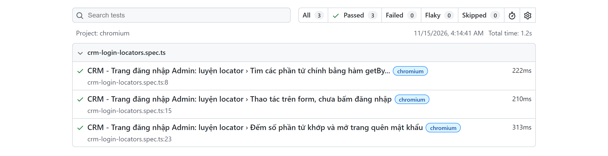

# Bài 14 - [Playwright Typescript] Cách xác định Locators với các hàm có sẵn của Playwright (getByRole, getByLabel, getByText, getByTestId...)

Chương: 2. Playwright TypeScript + Locator

Nguồn: [https://anhtester.com/learn/website-and-api-testing-automation-with-playwright-javascript-typescript-day-code-js-ts-tu-dau/371](https://anhtester.com/learn/website-and-api-testing-automation-with-playwright-javascript-typescript-day-code-js-ts-tu-dau/371)

✅ Locator và thứ tự ưu tiên khi chọn locator  
✅ getByRole - tìm phần tử theo vai trò và tên  
✅ getByLabel, getByPlaceholder, getByText, getByAltText, getByTitle và getByTestId  
✅ Lỗi strict mode và thực hành trên CRM demo  
✅ Dùng Claude Code và bộ kit claude-testing-skills để sinh locator  
✅ Kiểm tra locator do AI sinh ra

## ⭐ Mục tiêu bài học

Ở bài trước bạn đã biết dùng Hooks và Tags, khung của một file test coi như đã đủ. Thứ còn thiếu là phần ruột: **chỉ cho Playwright biết phải thao tác vào phần tử nào trên trang**, tức là xác định Locator.

Sau này phần lớn locator sẽ do AI sinh ra. Vì vậy bài này không bắt bạn học thuộc cú pháp, mà dạy bạn đủ để **đọc một dòng locator là biết nó tốt hay dở**. Học xong bạn sẽ:

- Nắm thứ tự ưu tiên locator của cả khoá học: các hàm `getBy...` có sẵn của Playwright trước, XPath sau, **không dùng CSS Selector**.
- Dùng được `getByRole`, `getByLabel`, `getByPlaceholder`, `getByText`, `getByAltText`, `getByTitle`, `getByTestId`.
- Đọc hiểu lỗi `strict mode violation` và sửa đúng cách.
- Thêm một rule riêng vào project để Claude Code sinh locator đúng thứ tự này, rồi tự kiểm lại bằng checklist.

> 📌 Ví dụ trong bài chạy trên trang đăng nhập của CRM demo `https://crm.anhtester.com/admin/authentication`. Bài này **chưa đăng nhập**, chỉ làm việc với trang công khai nên bạn chưa cần tài khoản.

## ✅ Phần 1: Locator và thứ tự ưu tiên khi chọn locator

### 🔆 1. Locator là gì?

**Locator** là lời mô tả để Playwright tìm ra một phần tử: "cái nút tên Login", "ô nhập có nhãn Email Address". Có locator rồi mới gọi được `click()`, `fill()`, `check()`.

```typescript
// Tạo locator: chưa tìm gì trên trang, nên không cần await
const loginButton = page.getByRole('button', { name: 'Login' });

// Gọi thao tác: lúc này Playwright mới đi tìm phần tử, nên phải có await
await loginButton.click();
```

- **Locator chỉ là lời mô tả.** Mỗi lần gọi thao tác, Playwright tìm lại phần tử từ đầu, nên trang có vẽ lại thì locator vẫn dùng được.
- **Thao tác tự chờ.** `click()` tự chờ phần tử sẵn sàng rồi mới bấm (học kỹ ở chương Assertion và Auto-Waiting).
- **Locator nghiêm ngặt (strict).** Thao tác chỉ chạy khi locator khớp **đúng một** phần tử. Phần 4 sẽ làm rõ.

### 🔆 2. Thứ tự ưu tiên dùng trong khoá học

Locator bám vào thứ **người dùng nhìn thấy** (tên nút, nhãn ô nhập) thì sống lâu, vì đổi màu hay đổi bố cục thì tên nút vẫn thế. Locator bám vào **cấu trúc bên trong** (class tạo kiểu, vị trí thẻ) thì hỏng ngay khi giao diện được sửa. Thứ tự dưới đây đi từ bền nhất xuống:

<table class="rt-table">
<thead>
<tr>
<th>Bậc</th>
<th>Cách tìm</th>
<th>Dùng khi</th>
</tr>
</thead>
<tbody>
<tr>
<td>1</td>
<td><code>getByRole()</code></td>
<td>Nút, link, ô nhập, checkbox, dropdown, tiêu đề. <strong>Luôn thử trước.</strong></td>
</tr>
<tr>
<td>2</td>
<td><code>getByLabel()</code></td>
<td>Ô nhập trong form có nhãn (label) đi kèm</td>
</tr>
<tr>
<td>3</td>
<td><code>getByPlaceholder()</code></td>
<td>Ô nhập không có nhãn, chỉ có chữ gợi ý mờ bên trong</td>
</tr>
<tr>
<td>4</td>
<td><code>getByText()</code>, <code>getByAltText()</code>, <code>getByTitle()</code></td>
<td>Phần tử không tương tác: thông báo, dòng chữ, hình ảnh, biểu tượng có tooltip</td>
</tr>
<tr>
<td>5</td>
<td><code>getByTestId()</code></td>
<td>Lập trình viên có gắn sẵn thuộc tính test id cho phần tử</td>
</tr>
<tr>
<td>6</td>
<td>XPath</td>
<td>Lựa chọn cuối cùng khi không hàm <code>getBy...</code> nào dùng được. Học ở bài kế tiếp (XPath và filter())</td>
</tr>
</tbody>
</table>

> ⚠️ **Khoá học này không dùng CSS Selector** (kiểu `page.locator('#email')`, `page.locator('.btn-primary')`). Các hàm `getBy...` lo được phần lớn trường hợp, phần còn lại XPath làm được hết. Học một thứ cho chắc tốt hơn học hai thứ nửa vời. Bạn vẫn sẽ gặp CSS trong code AI sinh ra, và Phần 5 chỉ cách bắt AI viết theo đúng thứ tự trên.
>
> 🔗 Thứ tự bậc 1 đến 5 bám theo tài liệu chính thức: [playwright.dev/docs/locators](https://playwright.dev/docs/locators).

## ✅ Phần 2: getByRole - tìm phần tử theo vai trò và tên

### 🔆 1. Role và name là gì?

Trình duyệt gán cho mỗi phần tử một **role** (vai trò: nút, link, ô nhập...) và một **name** (tên mà người dùng nhận ra nó). Phần mềm đọc màn hình cho người khiếm thị dùng hai thông tin này, và `getByRole` cũng vậy. Bạn tìm phần tử đúng như cách người dùng mô tả: "bấm *nút* *Login*".

Phần lớn thẻ HTML **có sẵn role**, lập trình viên không phải khai báo gì thêm:

<table class="rt-table">
<thead>
<tr>
<th>Thẻ HTML</th>
<th>Role</th>
<th>Name lấy từ đâu</th>
</tr>
</thead>
<tbody>
<tr>
<td><code>&lt;button&gt;</code></td>
<td><code>button</code></td>
<td>Chữ trên nút</td>
</tr>
<tr>
<td><code>&lt;a href="..."&gt;</code></td>
<td><code>link</code></td>
<td>Chữ của link, hoặc <code>alt</code> của ảnh trong link</td>
</tr>
<tr>
<td><code>&lt;input type="text"&gt;</code>, <code>type="email"</code>, <code>&lt;textarea&gt;</code></td>
<td><code>textbox</code></td>
<td>Nhãn gắn với ô nhập</td>
</tr>
<tr>
<td><code>&lt;input type="checkbox"&gt;</code>, <code>type="radio"</code></td>
<td><code>checkbox</code>, <code>radio</code></td>
<td>Nhãn gắn với ô chọn</td>
</tr>
<tr>
<td><code>&lt;select&gt;</code></td>
<td><code>combobox</code></td>
<td>Nhãn gắn với dropdown</td>
</tr>
<tr>
<td><code>&lt;h1&gt;</code> đến <code>&lt;h6&gt;</code></td>
<td><code>heading</code></td>
<td>Chữ của tiêu đề</td>
</tr>
<tr>
<td><code>&lt;img alt="..."&gt;</code></td>
<td><code>img</code></td>
<td>Thuộc tính <code>alt</code></td>
</tr>
</tbody>
</table>

Lập trình viên cũng có thể tự gán bằng thuộc tính `role="..."` và `aria-label="..."`, ví dụ `<div role="dialog">` cho hộp thoại. Cách dùng không đổi: `getByRole('dialog')`.

> 💡 **Xem role và name ở đâu?** Trong Chrome, bấm chuột phải vào phần tử, chọn Inspect, rồi mở thẻ **Accessibility** cạnh thẻ Styles. Đây cũng là chỗ kiểm lại khi AI đưa cho bạn một dòng `getByRole`.

Còn một cách nhanh hơn: nhờ chính Playwright in ra cây **role + name** của trang bằng `ariaSnapshot()`:

```typescript
await page.goto('https://crm.anhtester.com/admin/authentication');
console.log(await page.locator('body').ariaSnapshot());
```

Kết quả chạy thật trên trang đăng nhập Admin CRM:

```yaml
- link "Perfex CRM | Anh Tester Demo":
  - /url: https://crm.anhtester.com/
  - img "Perfex CRM | Anh Tester Demo"
- heading "Login" [level=1]
- text: Email Address
- textbox "Email Address"
- text: Password
- textbox "Password"
- checkbox "Remember me"
- text: Remember me
- button "Login"
- link "Forgot Password?":
  - /url: https://crm.anhtester.com/admin/authentication/forgot_password
```

Mỗi dòng có dạng `role "name"` và đổi thẳng được thành locator: dòng `button "Login"` chính là `getByRole('button', { name: 'Login' })`, dòng `heading "Login" [level=1]` là `getByRole('heading', { name: 'Login', level: 1 })`. Dòng `text: ...` là chữ thường, không có role, nên tìm bằng `getByText`.

### 🔆 2. Cách khớp name và các option hay gặp

Mặc định `name` khớp kiểu **chứa chuỗi, không phân biệt hoa thường**: `{ name: 'login' }` tìm ra nút `Login`, và cũng tìm ra cả nút `Login with Google` nếu trang có. Muốn chặt hơn thì thêm `exact: true`.

<table class="rt-table">
<thead>
<tr>
<th>Option</th>
<th>Ý nghĩa</th>
<th>Ví dụ</th>
</tr>
</thead>
<tbody>
<tr>
<td><code>name</code></td>
<td>Tên phần tử, nhận chuỗi hoặc biểu thức chính quy</td>
<td><code>{ name: 'Login' }</code>, <code>{ name: /^login$/i }</code></td>
</tr>
<tr>
<td><code>exact</code></td>
<td>Khớp chính xác cả chuỗi, có phân biệt hoa thường</td>
<td><code>{ name: 'Login', exact: true }</code></td>
</tr>
<tr>
<td><code>checked</code></td>
<td>Lọc theo trạng thái đã tick hay chưa</td>
<td><code><span>getByRole('checkbox',</span> <span>{</span> <span>checked:</span> <span>true</span> <span>})</span></code></td>
</tr>
<tr>
<td><code>level</code></td>
<td>Cấp của tiêu đề, từ 1 đến 6</td>
<td><code>getByRole('heading', { level: 1 })</code></td>
</tr>
</tbody>
</table>

Ngoài ra còn `disabled`, `expanded`, `selected`, `pressed`, `includeHidden`. Bạn không cần thuộc, gặp trong code AI sinh ra thì tra ở [page.getByRole trong tài liệu Playwright](https://playwright.dev/docs/api/class-page#page-get-by-role).

### 🔆 3. Áp vào trang đăng nhập CRM

Mở trang <https://crm.anhtester.com/admin/authentication>. Mỗi khung trong ảnh là vị trí mà **chính locator bên cạnh** tìm ra khi chạy thật:

[](https://anhtester.com/storage/photos/shares/lesson/js_ts_playwright/v2/bai_14_locators_getby/01_trang_login_admin_getbyrole.png)

*Trang đăng nhập Admin CRM và locator của từng phần tử chính*

Đối chiếu với HTML của đúng chỗ đó. Dòng tô màu là phần tử mà locator cùng màu tìm ra. Dòng xanh nhạt là nhãn `<label for="...">`: nó cung cấp **name** cho ô nhập ngay bên dưới, nhờ vậy `getByRole('textbox', { name: 'Email Address' })` và `getByLabel('Password')` mới tìm ra được ô.

[](https://anhtester.com/storage/photos/shares/lesson/js_ts_playwright/v2/bai_14_locators_getby/02_cay_html_form_login.png)

*Cây HTML thật của form đăng nhập Admin, tô màu theo locator*

Cùng đoạn HTML ở dạng code để bạn tự dò (bỏ bớt các thẻ `div` bọc ngoài):

```markup
<a href="https://crm.anhtester.com/" class="logo img-responsive">
  
</a>
<h1 class="tw-text-2xl tw-text-neutral-800 text-center tw-font-semibold tw-mb-5">Login</h1>
<form action="https://crm.anhtester.com/admin/authentication" method="post" accept-charset="utf-8">
  <label for="email" class="control-label">Email Address</label>
  <input type="email" id="email" name="email" class="form-control" autofocus="1">

  <label for="password" class="control-label">Password</label>
  <input type="password" id="password" name="password" class="form-control">

  <input type="checkbox" value="estimate" id="remember" name="remember">
  <label for="remember">Remember me</label>

  <button type="submit" class="btn btn-primary btn-block">Login</button>
  <a href="https://crm.anhtester.com/admin/authentication/forgot_password">Forgot Password?</a>
</form>
```

Để ý nút `Login`: nó **không có `id`**, chỉ có class tạo kiểu. Bám vào class đó thì hôm nào đổi giao diện là hỏng. Với `getByRole` thì đây lại là trường hợp dễ nhất:

```typescript
page.getByRole('heading', { name: 'Login' });           // tiêu đề <h1>
page.getByRole('textbox', { name: 'Email Address' });   // ô Email
page.getByRole('checkbox', { name: 'Remember me' });    // checkbox
page.getByRole('button', { name: 'Login' });            // nút Login
page.getByRole('link', { name: 'Forgot Password?' });   // link quên mật khẩu
```

Riêng ô mật khẩu (`type="password"`), Anh Tester khuyên dùng `getByLabel('Password')` ở phần kế tiếp.

## ✅ Phần 3: getByLabel, getByPlaceholder, getByText, getByAltText, getByTitle và getByTestId

### 🔆 1. Năm hàm tìm theo thứ người dùng nhìn thấy

<table class="rt-table">
<thead>
<tr>
<th>Hàm</th>
<th>Tìm theo</th>
<th>Ví dụ</th>
</tr>
</thead>
<tbody>
<tr>
<td><code>getByLabel()</code></td>
<td>Chữ của nhãn gắn với ô nhập</td>
<td><code>getByLabel('Email Address')</code>, <code>getByLabel('Password')</code></td>
</tr>
<tr>
<td><code>getByPlaceholder()</code></td>
<td>Thuộc tính <code>placeholder</code> của ô nhập</td>
<td><code>getByPlaceholder('Search...')</code>. Form đăng nhập CRM không có placeholder</td>
</tr>
<tr>
<td><code>getByText()</code></td>
<td>Chữ hiển thị bên trong phần tử</td>
<td><code>getByText('Remember me')</code></td>
</tr>
<tr>
<td><code>getByAltText()</code></td>
<td>Thuộc tính <code>alt</code> của ảnh</td>
<td><code><span>getByAltText('Perfex</span> <span>CRM</span> <span>|</span> <span>Anh</span> <span>Tester</span> <span>Demo')</span></code> là logo đầu trang</td>
</tr>
<tr>
<td><code>getByTitle()</code></td>
<td>Thuộc tính <code>title</code> (chữ hiện khi rê chuột)</td>
<td><code>getByTitle('Delete')</code>. Hay gặp ở nút chỉ có biểu tượng</td>
</tr>
</tbody>
</table>

```typescript
await page.getByLabel('Email Address').fill('admin@example.com');
await page.getByLabel('Remember me').check();
```

Cả năm hàm khớp giống `name` của `getByRole`: mặc định chứa chuỗi và không phân biệt hoa thường, thêm `{ exact: true }` để khớp chính xác, hoặc truyền biểu thức chính quy. Khoảng trắng thừa và dấu xuống dòng trong HTML được tự bỏ qua.

### 🔆 2. getByText: dễ dùng nhất và cũng dễ sai nhất

Vì khớp kiểu chứa chuỗi, `getByText` rất hay bắt nhiều phần tử cùng lúc. Kết quả thật trên trang đăng nhập CRM:

<table class="rt-table">
<thead>
<tr>
<th>Locator</th>
<th>Số khớp</th>
<th>Giải thích</th>
</tr>
</thead>
<tbody>
<tr>
<td><code>getByText('Password')</code></td>
<td>2</td>
<td>Nhãn <code>Password</code> và link <code>Forgot Password?</code> đều chứa chữ này</td>
</tr>
<tr>
<td><code><span>getByText('Password',</span> <span>{</span> <span>exact:</span> <span>true</span> <span>})</span></code></td>
<td>1</td>
<td>Chỉ còn nhãn <code>Password</code></td>
</tr>
<tr>
<td><code><span>getByText('Login',</span> <span>{</span> <span>exact:</span> <span>true</span> <span>})</span></code></td>
<td>2</td>
<td>Tiêu đề <code>&lt;h1&gt;</code> và nút có chữ giống hệt nhau, <code>exact</code> không cứu được</td>
</tr>
<tr>
<td><code><span>getByRole('button',</span> <span>{</span> <span>name:</span> <span>'Login'</span> <span>})</span></code></td>
<td>1</td>
<td>Role phân biệt được nút với tiêu đề</td>
</tr>
</tbody>
</table>

Trên trang thật: hai phần tử bị `getByText('Password')` bắt trúng (khung đỏ), và phần tử duy nhất còn lại khi thêm `exact: true` (khung xanh):

[](https://anhtester.com/storage/photos/shares/lesson/js_ts_playwright/v2/bai_14_locators_getby/03_getbytext_password_khop_2.png)

*getByText('Password') khớp 2 phần tử trên trang đăng nhập Admin*

HTML của hai phần tử đó. Phần tử thứ hai bị bắt chỉ vì chữ của nó **có chứa** `Password`:

```markup
<!-- ① chữ đúng bằng "Password" -->
<label for="password" class="control-label">Password</label>

<!-- ② chữ CHỨA "Password" -->
<a href="https://crm.anhtester.com/admin/authentication/forgot_password">Forgot Password?</a>
```

> ⚠️ **Quy tắc rút ra:** nút, link, ô nhập thì dùng `getByRole` hoặc `getByLabel`. `getByText` để dành cho phần tử không tương tác như thông báo, đoạn mô tả, số liệu. Thấy AI viết `getByText('Login').click()` là nên nghi ngay.

### 🔆 3. getByTestId và cấu hình testIdAttribute

Nhiều đội dự án thoả thuận với lập trình viên gắn thêm một thuộc tính riêng cho automation, thường là `data-testid`. Thuộc tính này không đổi khi đổi chữ hay đổi ngôn ngữ hiển thị nên rất bền.

```typescript
// HTML: <button data-testid="login-submit">Login</button>
await page.getByTestId('login-submit').click();
```

Nếu dự án đặt tên khác (`data-test`, `data-qa`...) thì khai báo một lần trong `playwright.config.ts`, mục `use`:

```typescript
import { defineConfig } from '@playwright/test';

export default defineConfig({
  use: {
    testIdAttribute: 'data-qa', // getByTestId('...') sẽ tìm theo data-qa
  },
});
```

> 📌 Trang đăng nhập CRM demo **không có** thuộc tính test id nào. `getByTestId` chỉ dùng khi thuộc tính **có thật** trong HTML, mà AI lại hay tự nghĩ ra một test id nghe hợp lý, nên bạn phải mở DevTools kiểm lại. Tài liệu: [testIdAttribute trong file config](https://playwright.dev/docs/test-use-options#other-options).

## ✅ Phần 4: Lỗi strict mode và thực hành trên CRM demo

### 🔆 1. Đọc lỗi strict mode violation

Viết `await page.getByText('Login').click()` trên trang đăng nhập CRM, test dừng với lỗi:

```bash
Error: locator.click: Error: strict mode violation: getByText('Login') resolved to 2 elements:
    1) <h1 class="tw-text-2xl tw-text-neutral-800 text-center tw-font-semibold tw-mb-5">↵            Login        </h1> aka getByRole('heading', { name: 'Login' })
    2) <button type="submit" class="btn btn-primary btn-block">↵                    Login                </button> aka getByRole('button', { name: 'Login' })
```

Hai phần tử đó trên trang thật: tiêu đề `<h1>` và nút đều có đúng chữ `Login`. Khung xanh là locator Playwright gợi ý sau chữ `aka`:

[](https://anhtester.com/storage/photos/shares/lesson/js_ts_playwright/v2/bai_14_locators_getby/04_strict_mode_getbytext_login.png)

*getByText('Login') khớp tiêu đề và nút: lỗi strict mode*

Lỗi này hiện trong HTML Report đúng như vậy (chạy thật ngày 15/11/2026, Playwright 1.65.1). Ký hiệu `↵` là chỗ xuống dòng trong HTML gốc:

[](https://anhtester.com/storage/photos/shares/lesson/js_ts_playwright/v2/bai_14_locators_getby/05_html_report_loi_strict_mode.png)

*HTML Report của test bấm Login bằng getByText, báo strict mode violation*

Playwright đang bảo vệ bạn: có hai phần tử khớp, nó không đoán bừa mà dừng lại. Sau chữ `aka` nó còn **gợi ý luôn locator tốt hơn**. Cách sửa, theo thứ tự nên thử:

1. Đổi sang hàm cụ thể hơn: `getByRole('button', { name: 'Login' })`.
2. Thêm `exact: true` khi chữ bị chứa trong chữ khác.
3. **Nối locator** để thu hẹp phạm vi: tìm vùng chứa trước, rồi tìm bên trong vùng đó. Mọi hàm `getBy...` đều gọi được trên một locator khác.

```typescript
// Trang đăng nhập Admin: tiêu đề <h1>Login</h1> nằm NGOÀI form, nút Login nằm TRONG form.
// Thu hẹp vào vùng form trước, rồi mới tìm chữ Login bên trong:
const loginInForm = page.locator('//form').getByText('Login');   // khớp đúng 1: nút Login
```

[](https://anhtester.com/storage/photos/shares/lesson/js_ts_playwright/v2/bai_14_locators_getby/06_noi_locator_trong_form.png)

*Nối locator: chỉ tìm chữ Login bên trong vùng form*

```markup
<!-- ① NGOÀI form: bị loại -->
<h1 class="tw-text-2xl ... tw-mb-5">Login</h1>

<form action="https://crm.anhtester.com/admin/authentication" method="post">
  ...
  <!-- ② TRONG form: còn lại -->
  <button type="submit" class="btn btn-primary btn-block">Login</button>
  ...
</form>
```

`//form` là XPath, sẽ học kỹ ở bài kế tiếp. Với nút Login thì cách 1 (`getByRole`) vẫn gọn nhất; ví dụ này để bạn thấy cách nối locator, dùng khi trang có nhiều vùng giống nhau như nhiều form hay nhiều hộp thoại.

Từ bản **1.64**, Playwright có thêm hàm `within()` làm đúng việc này nhưng đọc tự nhiên hơn: viết phần tử cần tìm trước, vùng chứa sau. Hai cách cho cùng kết quả (đã chạy thật trên trang Admin CRM với Playwright 1.65.1, khớp đúng 1 phần tử là nút `Login`):

```typescript
// Từ Playwright 1.64: within() — viết theo thứ tự đọc tự nhiên "chữ Login, bên trong form"
const loginInForm2 = page.getByText('Login').within(page.locator('//form'));   // cũng khớp đúng 1: nút Login
```

Bạn sẽ gặp `within()` trong code AI sinh ra với Playwright mới. Thấy nó thì hiểu là "tìm phần tử bên trái, chỉ trong vùng bên phải". Tài liệu: [locator.within() trên playwright.dev](https://playwright.dev/docs/api/class-locator#locator-within).

> ⚠️ **Không dùng `first()`, `last()`, `nth()` để dập lỗi strict mode.** Tuần sau trang thêm một nút phía trên là test bấm nhầm chỗ mà **vẫn không báo lỗi**. Đây là kiểu sai nguy hiểm nhất, và cũng là cách AI hay chọn để "sửa cho xong".
>
> 📌 Lọc một dòng trong danh sách hay trong bảng thì dùng `filter()`, học ở bài kế tiếp.

### 🔆 2. File test thực hành

Tạo file `tests/crm-login-locators.spec.ts` trong project đã cài ở bài cài đặt Playwright, dùng lại `test.describe` của bài cấu trúc file test và `beforeEach` của bài Hooks và Tags:

```typescript
import { test, expect } from '@playwright/test';

test.describe('CRM - Trang đăng nhập Admin: luyện locator', () => {
  test.beforeEach(async ({ page }) => {
    await page.goto('https://crm.anhtester.com/admin/authentication');
  });

  test('Tìm các phần tử chính bằng hàm getBy...', async ({ page }) => {
    await expect(page.getByRole('heading', { name: 'Login' })).toBeVisible();
    await expect(page.getByLabel('Password')).toBeVisible();
    await expect(page.getByRole('button', { name: 'Login' })).toBeVisible();
    await expect(page.getByAltText('Perfex CRM | Anh Tester Demo')).toBeVisible();
  });

  test('Thao tác trên form, chưa bấm đăng nhập', async ({ page }) => {
    await page.getByLabel('Email Address').fill('admin@example.com');
    await page.getByRole('checkbox', { name: 'Remember me' }).check();

    await expect(page.getByLabel('Email Address')).toHaveValue('admin@example.com');
    await expect(page.getByRole('checkbox', { name: 'Remember me' })).toBeChecked();
  });

  test('Đếm số phần tử khớp và mở trang quên mật khẩu', async ({ page }) => {
    await expect(page.getByText('Login')).toHaveCount(2);
    await expect(page.getByText('Password', { exact: true })).toHaveCount(1);

    await page.getByRole('link', { name: 'Forgot Password?' }).click();
    await expect(page.getByRole('heading', { name: 'Forgot Password' })).toBeVisible();
  });
});
```

```bash
npx playwright test crm-login-locators.spec.ts --project=chromium --headed
```

Kết quả chạy thật (Playwright 1.65.1, ngày 15/11/2026): cả 3 test đều đạt. Xem báo cáo bằng lệnh `npx playwright show-report`:

[](https://anhtester.com/storage/photos/shares/lesson/js_ts_playwright/v2/bai_14_locators_getby/07_html_report_bai_thuc_hanh_pass.png)

*HTML Report của file crm-login-locators.spec.ts: 3 test đạt*

Các hàm `expect(...)` là câu kiểm tra kết quả, chương Assertion sẽ học kỹ. Ở đây chỉ cần nhớ `toHaveCount(1)` là cách nhanh nhất để tự kiểm một locator: **khớp đúng một phần tử** thì mới yên tâm dùng.

> 🔒 Bài này cố ý dừng trước bước đăng nhập. Mật khẩu **không bao giờ viết thẳng vào code**: nó nằm trong file `.env` dưới tên biến `ADMIN_EMAIL`, `ADMIN_PASSWORD`, học ở bài đọc config từ file `.env`.

## ✅ Phần 5: Dùng Claude Code và bộ kit claude-testing-skills để sinh locator

### 🔆 1. Bộ kit có sẵn gì cho locator?

Chép thư mục `.claude` của bộ kit [claude-testing-skills](https://github.com/anhtester/claude-testing-skills) vào gốc project là Claude Code dùng được ngay các thứ sau:

<table class="rt-table">
<thead>
<tr>
<th>Loại</th>
<th>Tên</th>
<th>Vai trò</th>
</tr>
</thead>
<tbody>
<tr>
<td>Rule</td>
<td><a href="https://github.com/anhtester/claude-testing-skills/blob/main/.claude/rules/locator_strategy.md">locator_strategy.md</a></td>
<td>Bản đồ ưu tiên locator chung cho mọi framework và các điều cấm (class động, XPath tuyệt đối, ID tự sinh)</td>
</tr>
<tr>
<td>Rule</td>
<td><a href="https://github.com/anhtester/claude-testing-skills/blob/main/.claude/rules/playwright_rules.md">playwright_rules.md</a></td>
<td>Quy tắc riêng cho Playwright, mục 3 là thứ tự ưu tiên locator</td>
</tr>
<tr>
<td>Command</td>
<td><a href="https://github.com/anhtester/claude-testing-skills/blob/main/.claude/commands/generate-locator.md">/generate-locator</a></td>
<td>Mở trang thật, đọc DOM, sinh locator cho <strong>một</strong> phần tử</td>
</tr>
<tr>
<td>Command</td>
<td><a href="https://github.com/anhtester/claude-testing-skills/blob/main/.claude/commands/heal-locators.md">/heal-locators</a></td>
<td>Rà cả loạt locator trong code so với trang thật, báo cái nào gãy hoặc sắp gãy, sửa khi bạn cho phép</td>
</tr>
</tbody>
</table>

Hai lệnh này gọi tới hai skill [skills-smart-locator-agent](https://github.com/anhtester/claude-testing-skills/blob/main/.claude/skills/skills-smart-locator-agent/SKILL.md) và [skills-locator-healer-agent](https://github.com/anhtester/claude-testing-skills/blob/main/.claude/skills/skills-locator-healer-agent/SKILL.md). Cả hai cần Claude Code **mở được trình duyệt thật** qua Playwright MCP, vì nguyên tắc số một của kit là *không bao giờ đoán locator*. Cách cài xem ở [SETUP\_CLAUDE.md](https://github.com/anhtester/claude-testing-skills/blob/main/SETUP_CLAUDE.md).

### 🔆 2. Vì sao phải thêm rule riêng cho project?

Bộ kit viết cho nhiều framework và nhiều đội, nên rộng hơn khoá học này một chỗ: `playwright_rules.md` lấy `locator("css")` làm phương án dự phòng, còn `locator_strategy.md` xếp CSS Selector bậc 5, XPath bậc 6. Để nguyên thì khi không dùng được `getBy...`, AI sẽ sinh CSS, thứ bạn không học và không duyệt được.

Cách xử lý **không phải là sửa file của kit**, vì lần sau cập nhật kit là thay đổi của bạn bị ghi đè. Bạn thêm **một file rule của riêng project** đặt cạnh các rule của kit. Theo tài liệu Claude Code, mọi file `.md` trong `.claude/rules/` không khai báo `paths` đều được nạp khi mở phiên làm việc, ngang hàng với `CLAUDE.md` của project. Bạn chỉ cần tạo file, không phải đăng ký ở đâu.

> 🔗 Tài liệu: [code.claude.com/docs/en/memory](https://code.claude.com/docs/en/memory), mục "Organize rules with .claude/rules/".
>
> ⚠️ Cũng theo tài liệu này, khi hai chỉ dẫn mâu thuẫn thì Claude **có thể chọn một trong hai một cách tuỳ ý**. Vì vậy rule riêng phải ghi rõ nó thay cho mục nào của kit.

### 🔆 3. Tạo file rule riêng

Tạo file `.claude/rules/project_locator_rules.md` với nội dung:

```markdown
# Quy tắc Locator riêng của project (Playwright TypeScript)

> File này THAY CHO thứ tự ưu tiên locator ở mục 1 của `locator_strategy.md`
> và mục 3 của `playwright_rules.md`. Chỗ nào khác nhau thì LÀM THEO FILE NÀY.
> Các quy tắc còn lại của bộ kit giữ nguyên.

## Thứ tự ưu tiên (cao xuống thấp)

1. `getByRole()` kèm `name`
2. `getByLabel()`
3. `getByPlaceholder()`
4. `getByText()` cho phần tử không tương tác, `getByAltText()`, `getByTitle()`
5. `getByTestId()` - chỉ khi DOM thật có thuộc tính test id
6. XPath tương đối qua `page.locator('//...')` - lựa chọn cuối cùng

## Không dùng trong code

- KHÔNG dùng CSS Selector: `locator('#id')`, `locator('.class')`,
  `locator('tag[attr="..."]')`, `:has()`, `:has-text()`, `:nth-child()`.
- KHÔNG dùng XPath tuyệt đối hoặc theo vị trí (`//div[3]/button[2]`).
- KHÔNG dùng `first()`, `last()`, `nth()` để né lỗi strict mode.

## Khi trả kết quả locator

- Primary: một hàm getBy... theo thứ tự trên. Fallback: XPath tương đối, không phải CSS.
- Ghi rõ locator đã được kiểm khớp đúng 1 element trên DOM thật.
```

Lưu file, **mở phiên Claude Code mới** rồi kiểm bằng một câu hỏi:

```markdown
Trong project này, thứ tự ưu tiên khi chọn locator Playwright là gì? Có được dùng CSS Selector không? Trả lời dựa trên rule nào?
```

Claude phải trả lời đúng 6 bậc, nói không dùng CSS và nhắc tới `project_locator_rules.md`.

> 💡 Rule là chỉ dẫn để AI làm theo, không phải ổ khoá. Claude tuân thủ khá ổn định khi rule ngắn và cụ thể, nhưng không bảo đảm tuyệt đối. Vì thế mới cần Phần 6: người duyệt cuối cùng vẫn là bạn.

### 🔆 4. Sinh locator với /generate-locator

Lệnh nhận ba thông tin: mô tả phần tử, URL của trang, framework.

```markdown
/generate-locator "nút Login" https://crm.anhtester.com/admin/authentication playwright
```

Claude mở trang, đọc DOM, chọn locator theo thứ tự ưu tiên, kiểm khớp đúng một phần tử rồi trả về ba phần: **Primary Locator**, **Fallback Locator** và **Reasoning** (vì sao chọn). Với nút Login, kết quả đúng có dạng:

```typescript
// Primary
page.getByRole('button', { name: 'Login' });

// Fallback (XPath tương đối, theo rule riêng của project)
page.locator('//button[@type="submit"]');
```

Nếu Fallback vẫn ra CSS kiểu `page.locator('button[type="submit"]')` thì rule riêng chưa được áp dụng: kiểm lại tên và vị trí file, mở phiên mới, hoặc nhắc thẳng trong câu lệnh "làm theo `.claude/rules/project_locator_rules.md`".

> 🔒 Với trang phải đăng nhập mới vào được, lệnh yêu cầu bạn nói rõ cách đăng nhập. AI không tự đoán tài khoản, và bạn **không dán mật khẩu vào khung chat**.

### 🔆 5. Rà lại locator cũ với /heal-locators

Khi giao diện đổi và locator gãy hàng loạt, lệnh này rà giúp bạn theo hai chế độ. `SCAN` (mặc định) chỉ rà và xuất báo cáo `reports/locator_scan_report.md`: locator nào ổn, mong manh, gãy, khớp nhiều phần tử hay khớp sai phần tử. `HEAL` làm như SCAN, rồi dừng lại chờ bạn duyệt mới sửa code và chạy lại test.

```markdown
/heal-locators SCAN pages/LoginPage.ts
```

Lệnh làm việc trên các file Page Object nên bạn sẽ dùng nhiều từ chương Page Object Model. Ở bài này chỉ cần nhớ: chạy `SCAN` trước, `HEAL` sau.

## ✅ Phần 6: Kiểm tra locator do AI sinh ra

AI viết locator rất nhanh, và sai theo vài kiểu lặp đi lặp lại. Mỗi lần nhận code, rà theo bảng này:

<table class="rt-table">
<thead>
<tr>
<th>Dấu hiệu trong code</th>
<th>Vì sao là vấn đề</th>
<th>Cách xử lý</th>
</tr>
</thead>
<tbody>
<tr>
<td><code>page.locator('#email')</code>, <code>page.locator('.btn-primary')</code></td>
<td>CSS Selector, trái quy ước của project</td>
<td>Yêu cầu đổi sang <code>getBy...</code>, kiểm rule riêng đã được nạp chưa</td>
</tr>
<tr>
<td><code>getByText('Login').click()</code></td>
<td>Dùng <code>getByText</code> cho nút hoặc link, dễ khớp nhiều phần tử</td>
<td>Đổi sang <code>getByRole</code> kèm <code>name</code></td>
</tr>
<tr>
<td><code>{ name: 'Đăng nhập' }</code> trong khi nút ghi <code>Login</code></td>
<td>AI đoán hoặc tự dịch thay vì đọc trang thật</td>
<td>Mở trang, so từng chữ, kể cả dấu <code>?</code></td>
</tr>
<tr>
<td><code>.first()</code>, <code>.nth(1)</code> ngay sau locator</td>
<td>Dập lỗi strict mode, sau này bấm nhầm mà không báo lỗi</td>
<td>Thu hẹp bằng role kèm name, <code>exact</code> hoặc nối locator</td>
</tr>
<tr>
<td><code>getByTestId('login-button')</code></td>
<td>Test id có thể do AI tự nghĩ ra</td>
<td>Tìm chuỗi đó trong DevTools, không có thì bỏ</td>
</tr>
<tr>
<td><code>getByRole('textbox')</code> không kèm <code>name</code></td>
<td>Trang có hai ô nhập là khớp nhiều phần tử</td>
<td>Thêm <code>name</code> hoặc đổi sang <code>getByLabel</code></td>
</tr>
<tr>
<td>XPath bắt đầu từ <code>/html/body/...</code> hoặc có <code>div[3]</code></td>
<td>Bám vào vị trí thẻ, đổi bố cục là gãy</td>
<td>Yêu cầu viết lại (XPath đúng cách học ở bài kế tiếp)</td>
</tr>
<tr>
<td>Thiếu <code>await</code> trước <code>click()</code>, <code>fill()</code>, <code>expect()</code></td>
<td>Test đi tiếp khi lệnh chưa chạy xong, lúc đúng lúc sai</td>
<td>Thêm <code>await</code> cho mọi thao tác và mọi <code>expect</code> trên locator</td>
</tr>
</tbody>
</table>

Đọc code xong thì kiểm bằng cách chạy thật, đừng chỉ tin câu "đã verify" của AI: thêm tạm `await expect(locator).toHaveCount(1);` cho locator còn nghi ngờ, rồi chạy với `--headed` để nhìn Playwright có thao tác **đúng phần tử** không. Khớp một phần tử nhưng sai phần tử còn tệ hơn không khớp.

## ✅ Phần 7: Bài tập thực hành

**Bài tập 1 - Trang quên mật khẩu.** Mở `https://crm.anhtester.com/admin/authentication/forgot_password`. Viết test tìm tiêu đề trang, ô nhập email và nút gửi bằng các hàm `getBy...`, mỗi locator kèm một dòng `toHaveCount(1)`.

**Bài tập 2 - Xử lý strict mode.** Mở trang đăng nhập của khách hàng `https://crm.anhtester.com/authentication/login`. Viết `await expect(page.getByText('Login')).toHaveCount(1);`, chạy và đọc lỗi xem có bao nhiêu phần tử khớp. Sau đó viết locator khớp đúng một phần tử cho: tiêu đề trang, link `Login` trên menu, nút `Login` trong form, link `Knowledge Base`. Không dùng `first()` hay `nth()`.

**Bài tập 3 - So sánh với AI.** Tạo file rule riêng như Phần 5, rồi chạy `/generate-locator` cho checkbox `Remember me` và link `Forgot Password?` của trang đăng nhập Admin. Đặt kết quả cạnh locator bạn tự viết: giống hay khác, Fallback là XPath hay CSS, Reasoning có thuyết phục không? Đây là bài quan trọng nhất, vì nó đúng là công việc hằng ngày của bạn sau này: giao việc cho AI rồi duyệt kết quả.

**Bài tập 4 - Duyệt code.** Đoạn code dưới đây viết cho trang đăng nhập Admin của CRM và có 5 dòng cần sửa (có dòng mắc hai lỗi). Tìm đủ, nêu lý do theo bảng ở Phần 6 và viết lại.

```typescript
test('Đăng nhập CRM', async ({ page }) => {
  await page.goto('https://crm.anhtester.com/admin/authentication');
  await page.locator('#email').fill('admin@example.com');
  await page.getByRole('textbox').first().click();
  page.getByTestId('remember-checkbox').check();
  await page.getByText('Login').click();
  await expect(page.getByRole('link', { name: 'Quên mật khẩu?' })).toBeVisible();
});
```

## ✅ Phần 8: Ghi nhớ nhanh

- Thứ tự ưu tiên: `getByRole`, `getByLabel`, `getByPlaceholder`, `getByText` / `getByAltText` / `getByTitle`, `getByTestId`, cuối cùng là XPath. Không dùng CSS Selector.
- `getByRole` nên luôn kèm `name`. Xem role và name trong thẻ Accessibility của DevTools.
- Các hàm tìm theo chữ mặc định khớp kiểu chứa chuỗi, không phân biệt hoa thường. Thêm `exact: true` để khớp chính xác.
- Nút, link, ô nhập dùng `getByRole` hoặc `getByLabel`. `getByText` dành cho phần tử không tương tác.
- `getByTestId` chỉ dùng khi thuộc tính có thật trong HTML. Đổi tên thuộc tính bằng `testIdAttribute`.
- Gặp `strict mode violation` thì làm locator cụ thể hơn, không dập bằng `first()` hay `nth()`.
- Bộ kit giữ nguyên, quy ước riêng nằm ở `.claude/rules/project_locator_rules.md`. Locator AI sinh ra phải kiểm trên trang thật: đúng chữ, khớp một phần tử, đúng phần tử.

✅ **Kết luận:** Với các hàm `getBy...` bạn đã tìm được phần lớn phần tử trên một trang web thông thường. Những phần tử không có role rõ ràng, không có nhãn, hoặc lặp lại trong bảng và danh sách là việc của bài kế tiếp: **Cách xác định Locators với XPath và lọc phần tử bằng filter()**.

---

## Bài tập riêng — Bài tập - Xác định Locators bằng các hàm getBy và xử lý strict mode

Nguồn bài tập: [https://anhtester.com/student-assignments?course=website-and-api-testing-automation-with-playwright-javascript-typescript-day-code-js-ts-tu-dau#assignment-104](https://anhtester.com/student-assignments?course=website-and-api-testing-automation-with-playwright-javascript-typescript-day-code-js-ts-tu-dau#assignment-104)

**Mục tiêu:** tự viết locator bằng các hàm `getBy...` đúng thứ tự ưu tiên, đọc và xử lý lỗi strict mode mà không dập bằng `first()`/`nth()`, so sánh locator mình viết với locator AI sinh ra và nhận ra locator sai trong code AI.

**Thư mục làm bài:** `D:\AnhTester\playwright-crm` (macOS: `~/AnhTester/playwright-crm`), file mới trong `tests/`. Chỉ làm việc trên trang công khai của CRM demo, **không đăng nhập**, không bấm nút gửi form.

### 📝 Đề bài

#### Bài tập 1 - Trang quên mật khẩu

Tạo `tests/bt1-forgot-password-locators.spec.ts`. Mở `https://crm.anhtester.com/admin/authentication/forgot_password`, viết locator bằng các hàm `getBy...` cho: tiêu đề trang, ô nhập email và nút gửi `Confirm` (chỉ tìm, không bấm). Mỗi locator kèm một dòng `await expect(locator).toHaveCount(1);`. Không dùng CSS Selector, không dùng `first()`/`nth()`.

#### Bài tập 2 - Xử lý strict mode

Tạo `tests/bt2-strict-mode.spec.ts`. Mở trang đăng nhập của khách hàng `https://crm.anhtester.com/authentication/login`, viết `await expect(page.getByText('Login')).toHaveCount(1);`, chạy và đọc lỗi: có bao nhiêu phần tử khớp, là những phần tử nào. Sau đó viết locator khớp đúng một phần tử cho: tiêu đề trang, link `Login` trên menu, nút `Login` trong form, link `Knowledge Base`. Không dùng `first()` hay `nth()`.

#### Bài tập 3 - So sánh với AI

Tạo file rule riêng `.claude/rules/project_locator_rules.md` như trong bài học (ưu tiên `getBy...`, rồi XPath, không CSS). Dùng Claude Code chạy `/generate-locator` (hoặc prompt mẫu trong bài với ChatGPT/Gemini) cho checkbox `Remember me` và link `Forgot Password?` của trang đăng nhập Admin `https://crm.anhtester.com/admin/authentication`. Đặt kết quả cạnh locator bạn tự viết và trả lời: giống hay khác, locator dự phòng (Fallback) là XPath hay CSS, phần giải thích (Reasoning) có thuyết phục không, locator AI có chạy đạt `toHaveCount(1)` không.

#### Bài tập 4 - Duyệt code AI

Đoạn code dưới đây viết cho trang đăng nhập Admin của CRM và có **5 dòng cần sửa** (có dòng mắc hai lỗi). Tìm đủ, nêu lý do theo bảng "Kiểm tra locator do AI sinh ra" của bài học và viết lại thành file `tests/bt4-duyet-locator.spec.ts` chạy đạt. Bản sửa **không bấm nút Login** (không đăng nhập CRM bằng dữ liệu giả), chỉ kiểm nút đó hiện và khớp đúng một phần tử.

```typescript
test('Đăng nhập CRM', async ({ page }) => {
  await page.goto('https://crm.anhtester.com/admin/authentication');
  await page.locator('#email').fill('admin@example.com');
  await page.getByRole('textbox').first().click();
  page.getByTestId('remember-checkbox').check();
  await page.getByText('Login').click();
  await expect(page.getByRole('link', { name: 'Quên mật khẩu?' })).toBeVisible();
});
```

### 📦 Cách nộp bài

1. Làm bài trong project `playwright-crm`, commit và push lên nhánh `main` của repo GitHub `playwright-crm` của bạn.
2. Dán link repo vào ô **Link GitHub**, dạng `https://github.com/<ten-ban>/playwright-crm`. Repo Private thì vào **Settings → Collaborators** thêm tài khoản GitHub của giảng viên, nếu không giảng viên không mở được.
3. Trong ô **Nội dung bài làm (Editor)**, dán **kết quả chạy thật** trên Terminal của từng file (mỗi lệnh một **Đoạn code mẫu** chọn Text / Log), lệnh chạy dạng `npx playwright test tests/bt1-forgot-password-locators.spec.ts --project=chromium`.
4. Bài tập 2: dán thêm nguyên văn đoạn lỗi `strict mode violation` lần chạy đầu.
5. Bài tập 3: dán bảng so sánh locator tự viết và locator AI sinh ra, kèm câu trả lời.
6. Bài tập 4: liệt kê từng chỗ sai theo mẫu *Dòng – Lỗi – Lý do – Cách sửa*, rồi dán file đã sửa.

### ✅ Tiêu chí Đạt

- Bài tập 1: 3 locator đều dùng `getBy...` (ưu tiên `getByRole` kèm `name`, `getByLabel`), mỗi locator đạt `toHaveCount(1)`; không CSS, không `first()`/`nth()`.
- Bài tập 2: nêu đúng số phần tử `getByText('Login')` khớp theo lỗi thật; 4 locator mới khớp đúng một phần tử và đúng phần tử (link menu khác nút trong form: phân biệt bằng role `link`/`button`, `exact` hoặc nối locator trong vùng chứa).
- Bài tập 3: có bảng so sánh, chỉ ra được chỗ AI dùng CSS hoặc XPath (nếu có) và đối chiếu với rule riêng; locator AI được chạy thật, không chỉ tin câu "đã verify".
- Bài tập 4 nêu đủ 5 dòng: (1) `page.locator('#email')` là CSS Selector, sửa thành `getByLabel('Email Address')`; (2) `getByRole('textbox')` không kèm `name` khớp 2 ô nhập **và** `.first()` dập lỗi strict mode, sửa thành `getByLabel('Password')`; (3) thiếu `await` trước `check()` **và** test id `remember-checkbox` không có trên trang (đếm được 0), sửa thành `await page.getByRole('checkbox', { name: 'Remember me' }).check()`; (4) `getByText('Login')` dùng cho nút và khớp 2 phần tử (tiêu đề + nút), sửa thành `getByRole('button', { name: 'Login' })`, trong bài chỉ kiểm hiện, không bấm; (5) `name: 'Quên mật khẩu?'` là chữ AI tự dịch, trang thật ghi `Forgot Password?`. File sửa chạy đạt với `--project=chromium`.

### 🤖 Dùng AI thế nào cho đúng

Được dùng Claude, ChatGPT hoặc Gemini để **hỏi giải thích** lỗi strict mode và lý do một locator yếu (prompt mẫu ở phần AI của bài học). Bài tập 3 bắt buộc dùng AI, nhưng phần so sánh và kết luận phải do bạn tự viết sau khi chạy thật. Không nhờ AI làm hộ Bài tập 4 rồi dán vào: bài **Duyệt code AI** chấm chính phần *lý do* do bạn tự viết. Không dán mật khẩu hay file `.env` vào khung chat. Bài nào nộp lại vì **Cần sửa** thì sửa đúng chỗ giảng viên ghi trong feedback rồi bấm **Nộp lại**.