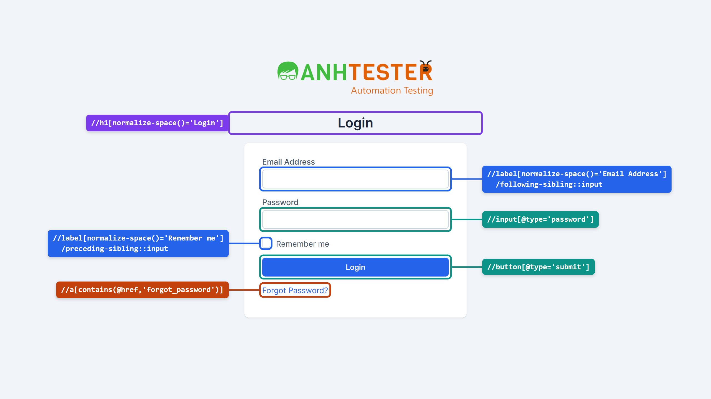
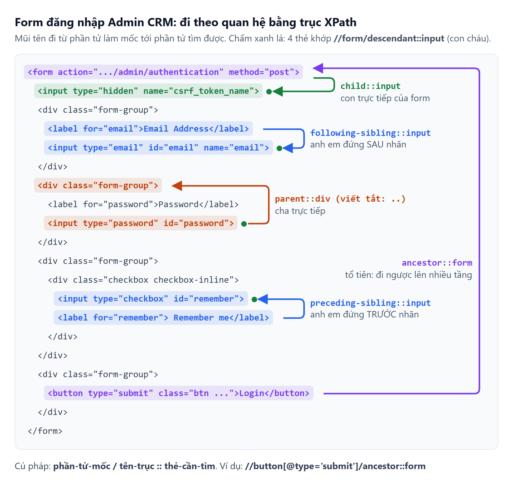
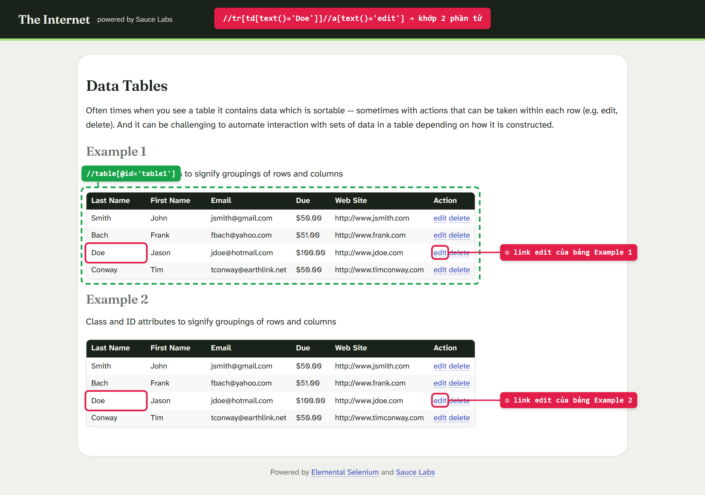
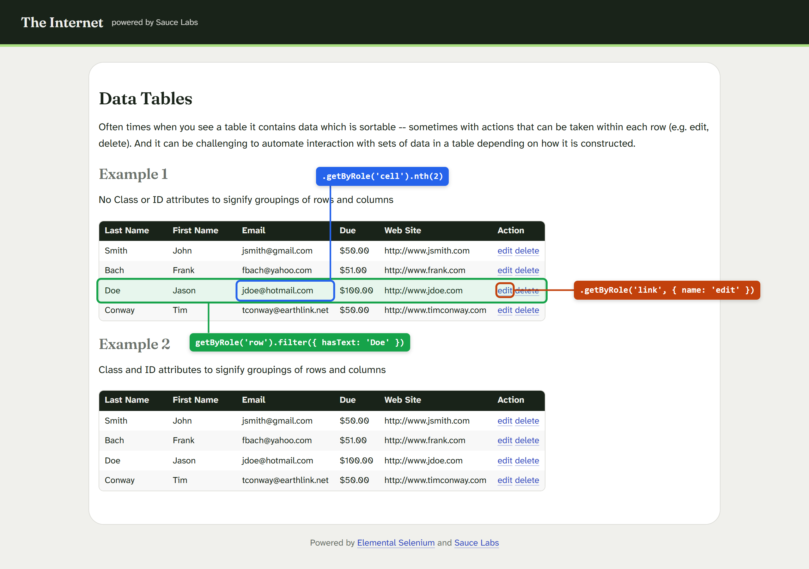
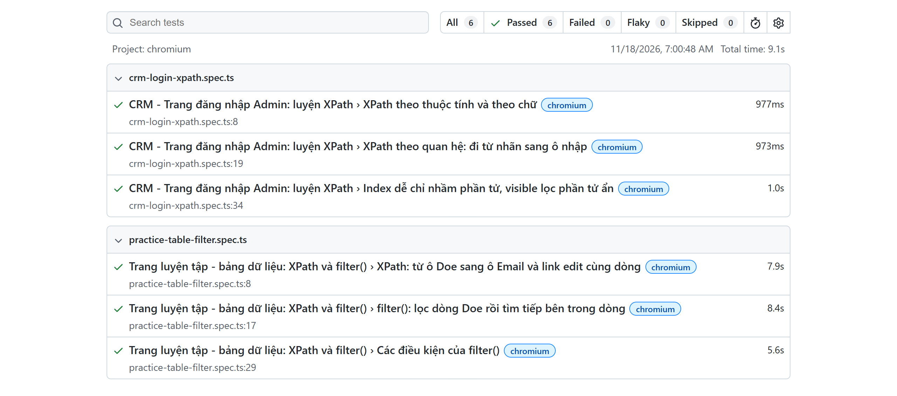

# Bài 15 - [Playwright Typescript] Cách xác định Locators với XPath và lọc phần tử bằng filter()

Chương: 2. Playwright TypeScript + Locator

Nguồn: [https://anhtester.com/learn/website-and-api-testing-automation-with-playwright-javascript-typescript-day-code-js-ts-tu-dau/372](https://anhtester.com/learn/website-and-api-testing-automation-with-playwright-javascript-typescript-day-code-js-ts-tu-dau/372)

✅ XPath là gì và khi nào dùng XPath thay cho các hàm getBy  
✅ XPath theo thẻ, thuộc tính, text(), contains() và starts-with()  
✅ Kết hợp điều kiện với and, or và index  
✅ Đi theo quan hệ: cha, con, anh em, tổ tiên và con cháu  
✅ Lọc phần tử bằng filter() với hasText, has và hasNot  
✅ Dùng Claude Code và bộ kit claude-testing-skills để sinh XPath, kiểm tra XPath do AI sinh ra

## ⭐ Mục tiêu bài học

Ở bài trước bạn đã tìm phần tử bằng các hàm `getBy...`, biết thứ tự ưu tiên locator của khoá học và đọc được lỗi `strict mode violation`. Bài đó để lại hai việc: bậc cuối cùng trong thứ tự ưu tiên là **XPath**, và cách chọn đúng **một dòng trong bảng hay danh sách**.

AI viết XPath rất nhanh và cũng hay viết ẩu, nên mục tiêu là đọc một dòng XPath biết ngay nó bám vào đâu, có dễ gãy không. Học xong bạn sẽ:

- Biết khi nào phải dùng XPath, và vì sao nó vẫn xếp sau các hàm `getBy...`.
- Đọc và viết được XPath theo thẻ, thuộc tính, chữ, và theo quan hệ cha, con, anh em.
- Lọc phần tử bằng `filter()` và biết lúc nào `filter()` tốt hơn XPath.
- Bổ sung quy tắc XPath vào rule riêng của project và duyệt XPath do AI sinh ra.

> 📌 Bài dùng tiếp project `D:\AnhTester\playwright-crm` và trang đăng nhập Admin của CRM demo `https://crm.anhtester.com/admin/authentication`, vẫn **chưa đăng nhập**. Phần bảng dữ liệu dùng trang luyện tập `https://the-internet.herokuapp.com/tables`.

## ✅ Phần 1: XPath là gì và khi nào dùng XPath thay cho các hàm getBy

### 🔆 1. XPath là gì?

Khi chỉ đường về nhà, bạn nói: "vào hẻm 12, tìm nhà có cổng màu xanh". Bạn tả **đường đi và đặc điểm** để khách tìm ra nó.

Trang web là một cây các thẻ HTML lồng nhau (cây DOM). **XPath** là cách viết đường đi trong cây đó: tìm thẻ nào, có thuộc tính gì, nằm cạnh thẻ nào. Trong automation, nó là locator dùng khi các hàm `getBy...` không có gì để bám.

```typescript
//   //input          [@id='email']
//   tìm thẻ input    có thuộc tính id bằng 'email'
const emailInput = page.locator("//input[@id='email']");
```

### 🔆 2. Khi nào dùng XPath?

<table class="rt-table">
<thead>
<tr>
<th>Tình huống</th>
<th>Ví dụ</th>
</tr>
</thead>
<tbody>
<tr>
<td>Phần tử không có role rõ ràng, không có nhãn, không có chữ</td>
<td>Ô ẩn chứa mã bảo vệ form, một bảng không có tên</td>
</tr>
<tr>
<td>Chỉ nhận ra phần tử nhờ <strong>phần tử bên cạnh</strong></td>
<td>Ô nhập đứng sau một dòng chữ, link <code>edit</code> của đúng một dòng trong bảng</td>
</tr>
</tbody>
</table>

XPath tìm được gần như mọi thứ nhưng vẫn xếp **cuối** thứ tự ưu tiên, vì `getByRole('button', { name: 'Login' })` bám vào thứ người dùng nhìn thấy, còn XPath bám vào **cấu trúc HTML**. Lập trình viên bọc thêm một thẻ `div` hay đổi thứ tự hai thẻ là XPath gãy, dù màn hình trông y như cũ.

### 🔆 3. XPath tuyệt đối, XPath tương đối và cách gọi trong Playwright

<table class="rt-table">
<thead>
<tr>
<th>Loại</th>
<th>Ví dụ</th>
<th>Nhận xét</th>
</tr>
</thead>
<tbody>
<tr>
<td>Tuyệt đối</td>
<td><code><span>/html/body/div/div[2]/form/div[1]/input</span></code></td>
<td>Đi từ gốc trang qua từng tầng, thêm một thẻ là gãy. <strong>Không dùng</strong></td>
</tr>
<tr>
<td>Tương đối</td>
<td><code>//input[@id='email']</code></td>
<td>Bắt đầu bằng <code>//</code>: tìm ở bất kỳ đâu trong trang theo đặc điểm</td>
</tr>
</tbody>
</table>

Trong Playwright, XPath truyền vào `page.locator()`. Chuỗi bắt đầu bằng `//` hoặc `..` được tự hiểu là XPath, viết rõ tiền tố `xpath=` cũng được:

```typescript
page.locator("//input[@id='email']");         // khớp 1 phần tử
page.locator("xpath=//input[@id='email']");   // cùng kết quả, viết rõ tiền tố
```

Chuỗi bắt đầu bằng một dấu `/` thì Playwright coi là CSS và báo lỗi (kết quả chạy thật):

```bash
locator.count: Unexpected token "/" while parsing css selector "/html/body/div/div[2]/form/div[1]/input". Did you mean to CSS.escape it?
```

> 🔗 Tài liệu: [XPath locator trên playwright.dev](https://playwright.dev/docs/other-locators#xpath-locator).

### 🔆 4. Thử XPath ngay trong trình duyệt

Trước khi đưa XPath vào code, thử nó trong DevTools của Chrome (phím `F12`):

- Thẻ **Elements**, bấm `Ctrl + F` (macOS: `Cmd + F`), dán XPath vào ô tìm kiếm. Hiện `1 of 1` là khớp đúng một phần tử.
- Thẻ **Console**, gõ `$x("//input[@id='email']")`. Kết quả là mảng các phần tử khớp.

> ⚠️ `$x()` chỉ có trong Console của trình duyệt. Playwright không có `page.$x()`.

## ✅ Phần 2: XPath theo thẻ, thuộc tính, text(), contains() và starts-with()

### 🔆 1. HTML thật của form đăng nhập

Mọi ví dụ trong phần này chạy trên đoạn HTML dưới đây, lấy từ trang đăng nhập Admin CRM. Lần này giữ nguyên các thẻ `div` bọc ngoài, ô ẩn đầu form và **khoảng trắng quanh chữ**, vì XPath nhìn thấy tất cả:

```markup
<h1 class="tw-text-2xl tw-text-neutral-800 text-center tw-font-semibold tw-mb-5">
    Login        </h1>
<form action="https://crm.anhtester.com/admin/authentication" method="post" accept-charset="utf-8">
  <input type="hidden" name="csrf_token_name" value="d43f2c68...">
  <div class="form-group">
    <label for="email" class="control-label">
        Email Address    </label>
    <input type="email" id="email" name="email" class="form-control" autofocus="1">
  </div>
  <div class="form-group">
    <label for="password" class="control-label">
        Password    </label>
    <input type="password" id="password" name="password" class="form-control">
  </div>
  <div class="form-group">
    <div class="checkbox checkbox-inline">
      <input type="checkbox" value="estimate" id="remember" name="remember">
      <label for="remember"> Remember me</label>
    </div>
  </div>
  <div class="form-group">
    <button type="submit" class="btn btn-primary btn-block">
        Login    </button>
  </div>
  <div class="form-group">
    <a href="https://crm.anhtester.com/admin/authentication/forgot_password">
        Forgot Password?    </a>
  </div>
</form>
```

### 🔆 2. Theo thẻ và thuộc tính

Cú pháp gốc: `//tên-thẻ[@thuộc-tính='giá trị']`. Dấu `*` thay cho "thẻ nào cũng được". Cột "Số khớp" là kết quả đo thật bằng `count()`:

<table class="rt-table">
<thead>
<tr>
<th>XPath</th>
<th>Số khớp</th>
<th>Đọc là</th>
</tr>
</thead>
<tbody>
<tr>
<td><code>//input</code></td>
<td>4</td>
<td>Mọi thẻ <code>input</code>: ô ẩn, Email, Password, checkbox</td>
</tr>
<tr>
<td><code>//input[@id='email']</code></td>
<td>1</td>
<td>Thẻ <code>input</code> có <code>id</code> bằng <code>email</code></td>
</tr>
<tr>
<td><code>//button[@type='submit']</code></td>
<td>1</td>
<td>Nút gửi form. Nút này không có <code>id</code> nên bám vào <code>type</code></td>
</tr>
<tr>
<td><code>//input[@class='form-control']</code></td>
<td>2</td>
<td>Class tạo kiểu dùng chung cho cả ô Email và Password, không dùng làm locator được</td>
</tr>
</tbody>
</table>

Các khung trong ảnh là vị trí mà **chính XPath bên cạnh** tìm ra khi chạy thật. Hai nhãn màu xanh dương đi theo quan hệ, sẽ học ở Phần 4:

[](https://anhtester.com/storage/photos/shares/lesson/js_ts_playwright/v2/bai_15_xpath_filter/01_trang_login_admin_xpath.png)

*Trang đăng nhập Admin CRM và XPath của từng phần tử*

### 🔆 3. Theo chữ: text(), contains() và normalize-space()

`getByText` tự bỏ khoảng trắng thừa, còn XPath so **từng ký tự**, kể cả dấu cách và dấu xuống dòng. Trong HTML ở trên, chữ `Login` của nút có khoảng trắng hai đầu. Kết quả đo thật:

<table class="rt-table">
<thead>
<tr>
<th>XPath</th>
<th>Số khớp</th>
<th>Giải thích</th>
</tr>
</thead>
<tbody>
<tr>
<td><code>//button[text()='Login']</code></td>
<td>0</td>
<td><code>text()=</code> đòi chữ <strong>bằng đúng</strong> <code>Login</code>, trong khi chữ thật còn khoảng trắng hai đầu</td>
</tr>
<tr>
<td><code>//button[contains(text(),'Login')]</code></td>
<td>1</td>
<td>Chữ của nút <strong>có chứa</strong> <code>Login</code></td>
</tr>
<tr>
<td><code>//*[contains(text(),'Login')]</code></td>
<td>3</td>
<td>Thẻ <code>title</code> của trang, tiêu đề <code>h1</code> và nút</td>
</tr>
<tr>
<td><code><span>//button[normalize-space()='Login']</span></code></td>
<td>1</td>
<td>Bỏ khoảng trắng hai đầu rồi mới so. <strong>Cách nên dùng</strong></td>
</tr>
<tr>
<td><code>//*[contains(.,'Login')]</code></td>
<td>10</td>
<td>Dấu <code>.</code> là toàn bộ chữ bên trong, tính cả thẻ con, nên mọi thẻ bọc ngoài đều khớp</td>
</tr>
</tbody>
</table>

- `text()` chỉ lấy chữ nằm **trực tiếp** trong thẻ. Chữ nằm trong thẻ con như `<button><span>Login</span></button>` thì nó không thấy.
- `normalize-space()` lấy toàn bộ chữ bên trong và bỏ khoảng trắng thừa. Luôn ghi **tên thẻ cụ thể** thay cho `*`, nếu không các thẻ bọc ngoài cũng khớp.
- XPath **phân biệt hoa thường**: `'login'` khác `'Login'`.

### 🔆 4. contains() và starts-with() với thuộc tính

Dùng khi giá trị thuộc tính dài, hoặc chỉ một phần của nó ổn định:

```typescript
// href dài, chỉ cần đoạn cuối đủ nhận ra link quên mật khẩu → khớp 1
page.locator("//a[contains(@href,'forgot_password')]");

// name bắt đầu bằng 'csrf' → khớp 1: ô ẩn chứa mã bảo vệ form
page.locator("//input[starts-with(@name,'csrf')]");
```

> ⚠️ `contains(@class,'btn')` là kiểu AI rất hay viết. Form này chỉ có một nút nên nó khớp 1, sang trang có năm nút cùng class `btn` là khớp cả năm.

## ✅ Phần 3: Kết hợp điều kiện với and, or và index

### 🔆 1. and và or

<table class="rt-table">
<thead>
<tr>
<th>XPath</th>
<th>Số khớp</th>
<th>Ý nghĩa</th>
</tr>
</thead>
<tbody>
<tr>
<td><code><span>//input[@type='email'</span> <span>and</span> <span>@name='email']</span></code></td>
<td>1</td>
<td><code>and</code>: phải đúng <strong>cả hai</strong> điều kiện</td>
</tr>
<tr>
<td><code><span>//input[@id='email'</span> <span>or</span> <span>@id='password']</span></code></td>
<td>2</td>
<td><code>or</code>: đúng <strong>một trong hai</strong> là khớp</td>
</tr>
</tbody>
</table>

`and` làm locator chặt hơn, dùng khi một thuộc tính chưa đủ để ra đúng một phần tử. `or` làm locator rộng ra nên ít khi hợp với `click()` hay `fill()`.

### 🔆 2. Index: chọn theo vị trí và vì sao dễ gãy

Bọc XPath trong ngoặc tròn rồi thêm `[n]` để lấy phần tử thứ n, **đếm từ 1**.

<table class="rt-table">
<thead>
<tr>
<th>XPath</th>
<th>Số khớp</th>
<th>Phần tử tìm được</th>
</tr>
</thead>
<tbody>
<tr>
<td><code>(//input)[1]</code></td>
<td>1</td>
<td>Ô <strong>ẩn</strong> <code>csrf_token_name</code>, không phải ô Email</td>
</tr>
<tr>
<td><code>//input[1]</code></td>
<td>4</td>
<td>Không có ngoặc tròn thì nghĩa khác hẳn: mọi <code>input</code> đứng đầu <strong>trong thẻ cha của nó</strong></td>
</tr>
</tbody>
</table>

Người dùng không thấy ô ẩn nên ai cũng nghĩ ô đầu tiên là Email, và test viết `(//input)[1]` sẽ thao tác nhầm ô. Hôm nào form thêm một ô phía trên thì mọi số thứ tự lệch đi mà **không có lỗi nào báo**. Chỉ dùng index khi thứ tự chính là ý nghĩa, ví dụ "cột thứ ba của bảng".

## ✅ Phần 4: Đi theo quan hệ: cha, con, anh em, tổ tiên và con cháu

### 🔆 1. Các trục (axes) của XPath

Trong gia đình, bạn tả được một người qua người khác: "anh trai của Lan", "ông nội của Minh". Cây HTML cũng có quan hệ như vậy, và XPath đi theo bằng các **trục**. Cú pháp: `phần-tử-mốc/tên-trục::thẻ-cần-tìm`. Phần tử mốc là thứ dễ tìm và ổn định, ví dụ một dòng chữ.

[](https://anhtester.com/storage/photos/shares/lesson/js_ts_playwright/v2/bai_15_xpath_filter/02_cay_html_form_login_truc_xpath.png)

*Cây HTML của form đăng nhập Admin và các trục XPath*

<table class="rt-table">
<thead>
<tr>
<th>Trục</th>
<th>Đi tới</th>
<th>Ví dụ trên form đăng nhập (đều khớp 1)</th>
</tr>
</thead>
<tbody>
<tr>
<td><code>parent::</code> hoặc <code>..</code></td>
<td>Cha trực tiếp</td>
<td><code><span>//input[@id='password']/parent::div</span></code></td>
</tr>
<tr>
<td><code>child::</code> hoặc <code>/</code></td>
<td>Con trực tiếp</td>
<td><code>//form/child::input</code> là ô ẩn, vì ba ô còn lại nằm sâu hơn một tầng</td>
</tr>
<tr>
<td><code>ancestor::</code></td>
<td>Tổ tiên: cha, ông, cụ...</td>
<td><code><span>//button[@type='submit']/ancestor::form</span></code></td>
</tr>
<tr>
<td><code>descendant::</code> hoặc <code>//</code></td>
<td>Con cháu mọi tầng</td>
<td><code>//form/descendant::input</code> khớp cả 4 ô, viết gọn là <code>//form//input</code></td>
</tr>
<tr>
<td><code>following-sibling::</code></td>
<td>Anh em đứng <strong>sau</strong>, cùng cha</td>
<td><code><span>//label[normalize-space()='Email</span> <span>Address']/following-sibling::input</span></code></td>
</tr>
<tr>
<td><code>preceding-sibling::</code></td>
<td>Anh em đứng <strong>trước</strong>, cùng cha</td>
<td><code><span>//label[normalize-space()='Remember</span> <span>me']/preceding-sibling::input</span></code></td>
</tr>
</tbody>
</table>

Hai dòng cuối là kiểu dùng nhiều nhất: **đi từ dòng chữ sang ô nhập bên cạnh**. Ô Email đứng *sau* nhãn của nó, còn checkbox đứng *trước* nhãn `Remember me`, nên hai bên dùng hai trục khác nhau.

> 📌 Trên form này `getByLabel('Email Address')` vẫn là lựa chọn đúng, vì nhãn có gắn `for="email"`. XPath theo trục dành cho lúc nhãn chỉ là dòng chữ đứng cạnh, không gắn với ô nhập, khi đó `getByLabel` không tìm ra.

### 🔆 2. Áp vào bảng dữ liệu

Mở <https://the-internet.herokuapp.com/tables>. Trang có hai bảng dữ liệu giống hệt nhau. Bảng đầu có `id="table1"`, các ô bên trong không có thuộc tính nào:

```markup
<table id="table1" class="tablesorter">
  <thead>...</thead>
  <tbody>
    ...
    <tr>
      <td>Doe</td>
      <td>Jason</td>
      <td>jdoe@hotmail.com</td>
      <td>$100.00</td>
      <td>http://www.jdoe.com</td>
      <td>
        <a href="#edit">edit</a>
        <a href="#delete">delete</a>
      </td>
    </tr>
    ...
  </tbody>
</table>
```

Yêu cầu: lấy Email và bấm link `edit` của người có Last Name là `Doe`. Mốc là ô chứa chữ `Doe`:

```typescript
// Từ ô Doe, sang ô anh em thứ 2 đứng sau nó: ô Email
page.locator("//td[text()='Doe']/following-sibling::td[2]");

// Dòng tr CÓ CHỨA ô Doe, rồi tìm link edit bên trong dòng đó
page.locator("//tr[td[text()='Doe']]//a[text()='edit']");
```

Dạng `//tr[td[...]]` đọc là "thẻ `tr` **có** một thẻ con `td` thoả điều kiện". Bấm thử link `edit` bằng XPath thứ hai, test dừng với lỗi quen thuộc (kết quả chạy thật):

```bash
Error: locator.click: Error: strict mode violation: locator('//tr[td[text()=\'Doe\']]//a[text()=\'edit\']') resolved to 2 elements:
    1) <a href="#edit">edit</a> aka getByRole('link', { name: 'edit' }).nth(2)
    2) <a href="#edit">edit</a> aka locator('tr:nth-child(3) > .action > a').first()
```

[](https://anhtester.com/storage/photos/shares/lesson/js_ts_playwright/v2/bai_15_xpath_filter/03_strict_mode_xpath_khop_2_bang.png)

*XPath khớp link edit của dòng Doe ở cả hai bảng: lỗi strict mode*

Trang có hai bảng nên có hai dòng `Doe`. Gợi ý sau chữ `aka` lần này cũng không dùng được: một cái bám vào `nth(2)`, một cái là CSS. Cách sửa đúng là **thu hẹp vào bảng cần làm việc** (khung nét đứt trong ảnh):

```typescript
page.locator("//table[@id='table1']//td[text()='Doe']/following-sibling::td[2]");   // khớp 1: jdoe@hotmail.com
page.locator("//table[@id='table1']//tr[td[text()='Doe']]//a[text()='edit']");      // khớp 1
```

Hai dòng này chạy được nhưng dài, khó đọc, và `td[2]` sẽ sai nếu bảng thêm một cột ở giữa. Playwright có cách viết dễ đọc hơn.

## ✅ Phần 5: Lọc phần tử bằng filter() với hasText, has và hasNot

### 🔆 1. filter() là gì?

Tìm một nhân viên trong bảng chấm công, bạn không đếm "người thứ 17" mà **lọc** theo tên. `filter()` làm đúng như vậy với locator: lấy một nhóm phần tử, rồi giữ lại những phần tử thoả điều kiện.

```typescript
// Mọi dòng của bảng thứ nhất: 1 dòng tiêu đề + 4 dòng dữ liệu
const rows = page.locator("//table[@id='table1']").getByRole('row');

// Chỉ giữ dòng có chứa chữ Doe
const doeRow = rows.filter({ hasText: 'Doe' });
```

Hai bảng không có tên nên `getByRole('table')` không phân biệt được. Vì thế Anh Tester dùng XPath để khoanh vùng bảng, bên trong thì quay lại `getByRole`. Các điều kiện của `filter()`, số khớp đo thật trên biến `rows` ở trên:

<table class="rt-table">
<thead>
<tr>
<th>Option</th>
<th>Giữ lại phần tử</th>
<th>Ví dụ và số khớp</th>
</tr>
</thead>
<tbody>
<tr>
<td><code>hasText</code></td>
<td>Có chứa chữ này ở bất kỳ đâu bên trong. Chuỗi thì không phân biệt hoa thường, hoặc truyền biểu thức chính quy</td>
<td><code>{ hasText: '$50.00' }</code> khớp 2 dòng: Smith và Conway</td>
</tr>
<tr>
<td><code>hasNotText</code></td>
<td><strong>Không</strong> chứa chữ này</td>
<td><code>{ hasNotText: '$50.00' }</code> khớp 3: dòng tiêu đề, Bach, Doe</td>
</tr>
<tr>
<td><code>has</code></td>
<td>Có chứa một phần tử con khớp locator truyền vào</td>
<td><code><span>{</span> <span>has:</span> <span>page.getByRole('link',</span> <span>{</span> <span>name:</span> <span>'delete'</span> <span>})</span> <span>}</span></code> khớp 4 dòng dữ liệu</td>
</tr>
<tr>
<td><code>hasNot</code></td>
<td><strong>Không</strong> chứa phần tử con đó</td>
<td><code>{ hasNot: page.getByRole('link') }</code> khớp 1: dòng tiêu đề</td>
</tr>
<tr>
<td><code>visible</code></td>
<td>Đang hiển thị (<code>true</code>) hoặc đang ẩn (<code>false</code>)</td>
<td>Trên CRM: <code>page.locator('//form//input')</code> khớp 4, thêm <code>.filter({ visible: true })</code> còn 3</td>
</tr>
</tbody>
</table>

- Locator truyền vào `has`, `hasNot` được tìm **bên trong từng phần tử đang lọc**.
- `filter()` nối được nhiều lần, mỗi lần lọc hẹp thêm: `rows.filter({ hasText: '$50.00' }).filter({ hasText: 'Conway' })` khớp 1.
- `hasText` khớp kiểu chứa chuỗi nên `'doe'` khớp cả dòng nào có email `jdoe@...`. Cần đúng ô thì dùng `has`: `{ has: page.getByRole('cell', { name: 'Doe', exact: true }) }`.

### 🔆 2. Lọc ra dòng rồi tìm tiếp bên trong dòng

Có `doeRow` rồi, gọi tiếp các hàm `getBy...` trên nó để tìm bên trong dòng:

```typescript
const rows = page.locator("//table[@id='table1']").getByRole('row');
const doeRow = rows.filter({ hasText: 'Doe' });

doeRow.getByRole('cell').nth(2);               // ô thứ ba của dòng: jdoe@hotmail.com
doeRow.getByRole('link', { name: 'edit' });    // link edit của đúng dòng Doe
```

[](https://anhtester.com/storage/photos/shares/lesson/js_ts_playwright/v2/bai_15_xpath_filter/04_filter_dong_doe_trong_bang.png)

*filter() chọn dòng Doe, rồi tìm ô Email và link edit bên trong dòng*

Bài trước dặn không dùng `nth()` để dập lỗi strict mode. Ở đây `nth(2)` hợp lệ vì Email **là** cột thứ ba: thứ tự chính là ý nghĩa. `first()`, `last()`, `nth()` (đếm từ 0) chỉ nên dùng ở những chỗ như vậy.

### 🔆 3. Chọn XPath theo trục hay filter()?

<table class="rt-table">
<thead>
<tr>
<th>Tiêu chí</th>
<th>XPath theo trục</th>
<th>filter() + getBy...</th>
</tr>
</thead>
<tbody>
<tr>
<td>Dễ đọc</td>
<td>Phải dò từng dấu ngoặc</td>
<td>Đọc như lời tả: dòng có chữ Doe, link tên edit</td>
</tr>
<tr>
<td>Khi HTML đổi</td>
<td>Thêm thẻ bọc, đổi <code>td</code> thành <code>div</code>, thêm cột là gãy</td>
<td>Còn role và chữ là còn chạy</td>
</tr>
<tr>
<td>Nên dùng khi</td>
<td>Phần tử không có role hay chữ để bám, phải đi từ phần tử bên cạnh</td>
<td>Bảng, danh sách, thẻ sản phẩm: mọi chỗ có nhiều khối giống nhau</td>
</tr>
</tbody>
</table>

**Gặp bảng hay danh sách thì nghĩ tới `filter()` trước.** XPath dùng để khoanh vùng như `//table[@id='table1']` hoặc tìm phần tử không có role.

### 🔆 4. within(), and() và or()

Ba hàm bạn sẽ gặp trong code AI sinh ra (số khớp là số đo thật):

```typescript
// within() (từ bản 1.64): "link edit, bên trong dòng Doe" → khớp 1
page.getByRole('link', { name: 'edit' }).within(doeRow);

// and(): phần tử phải khớp CẢ HAI locator. Trang đăng nhập CRM có 2 textbox, chỉ 1 ô kiểu email → khớp 1
page.getByRole('textbox').and(page.locator("//input[@type='email']"));

// or(): khớp MỘT TRONG HAI. Dùng khi màn hình có thể hiện một trong hai trạng thái
page.getByRole('heading', { name: 'Login' }).or(page.getByRole('heading', { name: 'Forgot Password' }));
```

Với `or()`, nếu cả hai phần tử cùng hiện thì locator khớp 2 và lại vướng strict mode. Tài liệu: [Filtering Locators trên playwright.dev](https://playwright.dev/docs/locators#filtering-locators).

## ✅ Phần 6: Thực hành với XPath và filter()

### 🔆 1. File crm-login-xpath.spec.ts

Thêm hai file mới vào thư mục `tests` của project:

```bash
D:\AnhTester\playwright-crm
├── tests
│   ├── crm-login-locators.spec.ts     (bài trước)
│   ├── crm-login-xpath.spec.ts        (XPath trên trang đăng nhập CRM)
│   └── practice-table-filter.spec.ts  (XPath và filter() trên bảng dữ liệu)
├── package.json
└── playwright.config.ts
```

File `tests/crm-login-xpath.spec.ts`. Test chỉ điền email mẫu và tick checkbox, **không bấm Login**:

```typescript
import { test, expect } from '@playwright/test';

test.describe('CRM - Trang đăng nhập Admin: luyện XPath', () => {
  test.beforeEach(async ({ page }) => {
    await page.goto('https://crm.anhtester.com/admin/authentication');
  });

  test('XPath theo thuộc tính và theo chữ', async ({ page }) => {
    await expect(page.locator("//input[@id='email']")).toHaveCount(1);
    await expect(page.locator("//button[@type='submit']")).toHaveCount(1);
    await expect(page.locator("//a[contains(@href,'forgot_password')]")).toBeVisible();
    await expect(page.locator("//input[starts-with(@name,'csrf')]")).toHaveCount(1);

    // Chữ trong HTML có khoảng trắng hai đầu: text()= không khớp, normalize-space() thì khớp
    await expect(page.locator("//button[text()='Login']")).toHaveCount(0);
    await expect(page.locator("//button[normalize-space()='Login']")).toHaveCount(1);
  });

  test('XPath theo quan hệ: đi từ nhãn sang ô nhập', async ({ page }) => {
    const email = page.locator("//label[normalize-space()='Email Address']/following-sibling::input");
    const password = page.locator("//label[normalize-space()='Password']/following-sibling::input");
    const remember = page.locator("//label[normalize-space()='Remember me']/preceding-sibling::input");
    const form = page.locator("//button[@type='submit']/ancestor::form");

    await email.fill('tester@example.com');
    await remember.check();

    await expect(email).toHaveValue('tester@example.com');
    await expect(password).toHaveAttribute('type', 'password');
    await expect(remember).toBeChecked();
    await expect(form).toHaveCount(1);
  });

  test('Index dễ chỉ nhầm phần tử, visible lọc phần tử ẩn', async ({ page }) => {
    // Ô input ĐẦU TIÊN của trang là ô ẩn chứa mã bảo vệ form, không phải ô Email
    await expect(page.locator('(//input)[1]')).toHaveAttribute('type', 'hidden');

    const inputs = page.locator('//form//input');
    await expect(inputs).toHaveCount(4);
    await expect(inputs.filter({ visible: true })).toHaveCount(3);
  });
});
```

### 🔆 2. File practice-table-filter.spec.ts

File `tests/practice-table-filter.spec.ts` làm cùng một việc bằng hai cách để bạn so sánh:

```typescript
import { test, expect } from '@playwright/test';

test.describe('Trang luyện tập - bảng dữ liệu: XPath và filter()', () => {
  test.beforeEach(async ({ page }) => {
    await page.goto('https://the-internet.herokuapp.com/tables');
  });

  test('XPath: từ ô Doe sang ô Email và link edit cùng dòng', async ({ page }) => {
    const email = page.locator("//table[@id='table1']//td[text()='Doe']/following-sibling::td[2]");
    const edit = page.locator("//table[@id='table1']//tr[td[text()='Doe']]//a[text()='edit']");

    await expect(email).toHaveText('jdoe@hotmail.com');
    await edit.click();
    await expect(page).toHaveURL(/#edit$/);
  });

  test('filter(): lọc dòng Doe rồi tìm tiếp bên trong dòng', async ({ page }) => {
    const rows = page.locator("//table[@id='table1']").getByRole('row');
    const doeRow = rows.filter({ hasText: 'Doe' });

    await expect(doeRow).toHaveCount(1);
    // Cột thứ ba là Email: ở đây thứ tự cột chính là ý nghĩa, nên dùng nth(2) là hợp lý
    console.log('Email của Doe:', await doeRow.getByRole('cell').nth(2).innerText());

    await doeRow.getByRole('link', { name: 'edit' }).click();
    await expect(page).toHaveURL(/#edit$/);
  });

  test('Các điều kiện của filter()', async ({ page }) => {
    const rows = page.locator("//table[@id='table1']").getByRole('row');

    await expect(rows).toHaveCount(5); // 1 dòng tiêu đề + 4 dòng dữ liệu
    await expect(rows.filter({ hasText: '$50.00' })).toHaveCount(2);
    await expect(rows.filter({ hasText: '$50.00' }).filter({ hasText: 'Conway' })).toHaveCount(1);
    await expect(rows.filter({ hasNotText: '$50.00' })).toHaveCount(3);
    await expect(rows.filter({ has: page.getByRole('link', { name: 'delete' }) })).toHaveCount(4);
    await expect(rows.filter({ hasNot: page.getByRole('link') })).toHaveCount(1); // dòng tiêu đề
  });
});
```

```bash
npx playwright test crm-login-xpath.spec.ts practice-table-filter.spec.ts --project=chromium --reporter=list
```

Kết quả chạy thật (Playwright 1.65.1, ngày 18/11/2026):

```bash
Running 6 tests using 6 workers

  ✓  1 [chromium] › tests\crm-login-xpath.spec.ts:8:3 › CRM - Trang đăng nhập Admin: luyện XPath › XPath theo thuộc tính và theo chữ (694ms)
  ✓  4 [chromium] › tests\crm-login-xpath.spec.ts:34:3 › CRM - Trang đăng nhập Admin: luyện XPath › Index dễ chỉ nhầm phần tử, visible lọc phần tử ẩn (893ms)
  ✓  2 [chromium] › tests\crm-login-xpath.spec.ts:19:3 › CRM - Trang đăng nhập Admin: luyện XPath › XPath theo quan hệ: đi từ nhãn sang ô nhập (953ms)
Email của Doe: jdoe@hotmail.com
  ✓  5 [chromium] › tests\practice-table-filter.spec.ts:17:3 › Trang luyện tập - bảng dữ liệu: XPath và filter() › filter(): lọc dòng Doe rồi tìm tiếp bên trong dòng (3.0s)
  ✓  3 [chromium] › tests\practice-table-filter.spec.ts:8:3 › Trang luyện tập - bảng dữ liệu: XPath và filter() › XPath: từ ô Doe sang ô Email và link edit cùng dòng (7.8s)
  ✓  6 [chromium] › tests\practice-table-filter.spec.ts:29:3 › Trang luyện tập - bảng dữ liệu: XPath và filter() › Các điều kiện của filter() (8.0s)

  6 passed (8.9s)
```

Chạy lại không kèm `--reporter=list` rồi mở báo cáo bằng `npx playwright show-report`:

[](https://anhtester.com/storage/photos/shares/lesson/js_ts_playwright/v2/bai_15_xpath_filter/05_html_report_6_test_dat.png)

*HTML Report của hai file thực hành: 6 test đạt*

Dòng `innerText()` lấy chữ của ô để in ra, bài kế tiếp sẽ học kỹ các hàm lấy dữ liệu. Thử sửa `'Doe'` thành `'doe'` ở hai test đầu rồi chạy lại: test XPath lỗi vì XPath phân biệt hoa thường, test `filter()` vẫn đạt.

## ✅ Phần 7: Dùng Claude Code và bộ kit claude-testing-skills để sinh XPath

### 🔆 1. Bổ sung quy tắc XPath vào rule riêng của project

Ở bài trước bạn đã tạo `.claude/rules/project_locator_rules.md` để Claude Code chọn locator theo thứ tự của khoá học, vì hai rule [locator\_strategy.md](https://github.com/anhtester/claude-testing-skills/blob/main/.claude/rules/locator_strategy.md) và [playwright\_rules.md](https://github.com/anhtester/claude-testing-skills/blob/main/.claude/rules/playwright_rules.md) của bộ kit xếp CSS Selector trên XPath. Về XPath, kit mới chỉ cấm XPath tuyệt đối theo vị trí. Thêm mục sau vào cuối file rule riêng:

```markdown
## Quy tắc viết XPath (chỉ khi không hàm getBy... nào dùng được)

- Chỉ dùng XPath tương đối, bắt đầu bằng `//`. KHÔNG dùng `/html/body/...`.
- Bám vào thuộc tính ổn định (`id`, `name`, `type`, `href`) hoặc chữ hiển thị.
  KHÔNG bám vào class tạo kiểu, id tự sinh (`ember123`, `:r1:`), class có mã băm (`css-1x2y`).
- So chữ bằng `normalize-space()`. Luôn ghi tên thẻ cụ thể, không dùng `//*`.
- KHÔNG dùng index `(...)[n]`, `div[3]`, trừ khi thứ tự chính là ý nghĩa (cột thứ n của bảng).
- Dòng trong bảng hoặc danh sách: dùng `getByRole('row').filter({ hasText / has })`
  rồi tìm tiếp bên trong dòng, trước khi nghĩ tới trục XPath.
- KHÔNG dùng hàm của công cụ khác: `page.$x()`, `page.waitForXPath()`.
- Mỗi XPath phải kèm số phần tử khớp đã đo trên DOM thật (phải bằng 1).
```

Lưu file và **mở phiên Claude Code mới** để rule được nạp lại. Cơ chế nạp rule: [code.claude.com/docs/en/memory](https://code.claude.com/docs/en/memory).

### 🔆 2. Sinh locator với /generate-locator

Lệnh [/generate-locator](https://github.com/anhtester/claude-testing-skills/blob/main/.claude/commands/generate-locator.md) mở trang thật, đọc DOM rồi trả về Primary Locator, Fallback Locator và Reasoning. Với phần tử nằm trong bảng, tả rõ **dòng nào, bảng nào**:

```markdown
/generate-locator "link edit của dòng có Last Name là Doe, trong bảng Example 1" https://the-internet.herokuapp.com/tables playwright

Làm theo .claude/rules/project_locator_rules.md: ưu tiên getBy... và filter(), chỉ dùng XPath khi không còn cách nào khác, không dùng CSS. Ghi số phần tử khớp của từng locator.
```

Kết quả đúng có dạng như Phần 5: khoanh vùng bảng, `filter()` ra dòng, rồi tìm link. Nếu Claude trả về `.nth(2)` hoặc CSS, yêu cầu làm lại và nhắc tên file rule.

### 🔆 3. Prompt mẫu dùng được với Claude, ChatGPT và Gemini

Trong khoá học Anh Tester dùng Claude bản có phí ([Claude Code](https://code.claude.com/docs/en/overview) kèm bộ kit). Bạn có thể dùng bản miễn phí của [ChatGPT](https://chatgpt.com/) hoặc [Gemini](https://gemini.google.com/), nhưng phải **dán HTML thật** vào vì chúng không mở được trang của bạn (trong DevTools: chuột phải vào phần tử, Copy, Copy outerHTML).

**Prompt 1 - Nhờ viết XPath khi getBy không dùng được:**

```markdown
Tôi viết test bằng Playwright TypeScript. Đây là HTML thật của vùng tôi đang làm việc:

[dán HTML vào đây]

Hãy viết locator cho: [mô tả phần tử].
Quy tắc: ưu tiên getByRole, getByLabel, getByText và filter(). Chỉ dùng XPath khi các hàm đó không dùng được, và phải là XPath tương đối, so chữ bằng normalize-space(), không dùng index, không dùng class tạo kiểu. Không dùng CSS Selector.
Với mỗi locator, nói rõ nó khớp bao nhiêu phần tử trong đoạn HTML trên và vì sao.
```

**Prompt 2 - Nhờ giải thích một XPath từng bước:**

```markdown
Giải thích XPath sau từng bước, từ trái sang phải, mỗi bước một dòng: bước đó chọn những thẻ nào.
Sau đó cho biết XPath này bám vào thứ gì của trang (thuộc tính, chữ, vị trí) và thay đổi nào của HTML sẽ làm nó gãy.

//table[@id='table1']//tr[td[text()='Doe']]//a[text()='edit']
```

**Prompt 3 - Đổi CSS mà AI đưa sang getBy hoặc XPath:**

```markdown
Project của tôi không dùng CSS Selector. Hãy đổi các locator Playwright dưới đây sang getBy... (ưu tiên) hoặc XPath tương đối, giữ nguyên phần tử được chọn. Locator nào không đổi được chắc chắn vì thiếu HTML thì nói rõ cần tôi cung cấp thêm gì, đừng đoán.

page.locator('#email')
page.locator('button.btn-primary')
page.locator('#table1 tbody tr:nth-child(3) td:nth-child(3)')
```

> 🔒 Chỉ dán HTML của trang công khai hoặc trang demo. Không dán HTML có dữ liệu khách hàng thật, không dán mật khẩu hay nội dung file `.env` vào khung chat.

## ✅ Phần 8: Kiểm tra XPath do AI sinh ra

Các kiểu sai dưới đây lặp lại rất đều trong XPath do AI viết:

<table class="rt-table">
<thead>
<tr>
<th>Dấu hiệu trong code</th>
<th>Vì sao là vấn đề</th>
<th>Cách xử lý</th>
</tr>
</thead>
<tbody>
<tr>
<td><code>/html/body/div[2]/...</code></td>
<td>XPath tuyệt đối, chép từ "Copy full XPath" của DevTools. Thêm một thẻ là gãy</td>
<td>Viết lại XPath tương đối theo thuộc tính hoặc chữ</td>
</tr>
<tr>
<td><code>(//input)[1]</code>, <code>//div[3]/button[2]</code></td>
<td>Bám vào số thứ tự, có thể đang chỉ nhầm phần tử ẩn</td>
<td>Đổi sang thuộc tính, chữ, hoặc <code>filter()</code></td>
</tr>
<tr>
<td><code>@id='ember123'</code>, <code>@class='css-1x2y'</code></td>
<td>Id và class do thư viện tự sinh, mỗi lần build một khác</td>
<td>Tải lại trang xem giá trị có đổi không, tìm thuộc tính khác</td>
</tr>
<tr>
<td><code>//*[contains(@class,'btn')]</code></td>
<td><code>//*</code> quá rộng, class tạo kiểu dùng chung cho nhiều phần tử</td>
<td>Ghi tên thẻ, bám vào <code>type</code>, <code>name</code> hoặc chữ</td>
</tr>
<tr>
<td><code>//button[text()='Login']</code></td>
<td>Không khớp khi chữ có khoảng trắng thừa hoặc nằm trong thẻ con</td>
<td>Dùng <code>normalize-space()='Login'</code></td>
</tr>
<tr>
<td><code>page.$x(...)</code>, <code>page.waitForXPath(...)</code></td>
<td>Hàm của Puppeteer. Playwright báo <code>is not a function</code></td>
<td>Dùng <code>page.locator('//...')</code></td>
</tr>
<tr>
<td><code>.first()</code> sau một XPath</td>
<td>Dập lỗi strict mode thay vì thu hẹp phạm vi</td>
<td>Khoanh vùng trước, như <code>//table[@id='table1']</code></td>
</tr>
<tr>
<td><code>locator('td.email')</code>, <code>tr:nth-child(3)</code></td>
<td>CSS Selector lẫn vào, trái quy ước project</td>
<td>Đổi bằng Prompt 3, kiểm rule riêng đã được nạp chưa</td>
</tr>
</tbody>
</table>

Đọc xong thì kiểm trên trang thật: dán XPath vào ô tìm kiếm của thẻ Elements xem có `1 of 1` không, rồi thêm tạm `await expect(locator).toHaveCount(1);` và chạy. Khớp một phần tử chưa đủ, còn phải là **đúng phần tử**: `(//input)[1]` ở Phần 3 khớp đúng một, và là ô sai.

## ✅ Phần 9: Bài tập thực hành

**Bài tập 1 - XPath trên trang quên mật khẩu.** Mở `https://crm.anhtester.com/admin/authentication/forgot_password`. Tạo file `tests/bt1-forgot-password-xpath.spec.ts`, viết XPath tương đối cho: tiêu đề trang, ô Email (đi từ nhãn `Email Address` bằng trục), nút `Confirm`, và form (đi từ nút lên bằng `ancestor`). Mỗi locator kèm `toHaveCount(1)`. Không bấm nút `Confirm`.

**Bài tập 2 - Một việc, hai cách.** Trên `https://the-internet.herokuapp.com/tables`, làm với bảng **Example 2** (`id="table2"`). Tạo file `tests/bt2-table2-filter.spec.ts`: kiểm ô Due của người có Last Name `Bach` là `$51.00` và bấm link `delete` của dòng đó. Viết hai test, một dùng XPath theo trục, một dùng `filter()`. Thêm một dòng đếm số dòng có Due là `$50.00`.

**Bài tập 3 - Giao việc cho AI rồi duyệt.** Bổ sung mục XPath vào rule riêng như Phần 7. Dùng `/generate-locator` (hoặc Prompt 1 với ChatGPT, Gemini) xin locator cho ô Web Site của dòng `Conway` trong bảng Example 1. Đối chiếu với bảng ở Phần 8 và ghi lại những chỗ phải sửa.

**Bài tập 4 - Duyệt code AI.** Đoạn code dưới đây do AI viết cho trang bảng dữ liệu và có **6 dòng cần sửa**. Tìm đủ, nêu lý do theo bảng ở Phần 8 và viết lại thành file `tests/bt4-review-xpath.spec.ts` chạy đạt.

```typescript
import { test, expect } from '@playwright/test';

test('Xoá dòng Bach ở bảng Example 1', async ({ page }) => {
  await page.goto('https://the-internet.herokuapp.com/tables');
  await page.waitForXPath('//table');
  const table = page.locator('xpath=/html/body/div[2]/div/div/table[1]');
  const row = page.locator("//tr[contains(.,'bach')]").first();

  await expect(table).toBeVisible();
  await expect(row.locator('td.dues')).toHaveText('$51.00');
  await expect(page.locator("//*[contains(@class,'header')]")).toBeVisible();
  await page.locator('(//a)[7]').click();
  await expect(page).toHaveURL(/#delete$/);
});
```

## ✅ Phần 10: Ghi nhớ nhanh

- XPath là bậc cuối trong thứ tự ưu tiên. Chỉ dùng XPath tương đối bắt đầu bằng `//`, gọi qua `page.locator("//...")`.
- So chữ bằng `normalize-space()`. `text()='...'` so từng ký tự, kể cả khoảng trắng, và XPath phân biệt hoa thường.
- Index `(...)[n]` đếm từ 1 và dễ chỉ nhầm phần tử.
- Trục XPath đi từ phần tử mốc ổn định sang phần tử khó bám: `following-sibling`, `preceding-sibling`, `ancestor`...
- Bảng và danh sách: `getByRole('row').filter({ hasText })` hoặc `{ has }`, rồi tìm tiếp bên trong dòng.
- `first()`, `last()`, `nth()` chỉ dùng khi thứ tự chính là ý nghĩa.
- XPath do AI sinh ra phải thử trên trang thật: khớp một phần tử và đúng phần tử.

✅ **Kết luận:** Với `getBy...`, XPath và `filter()`, bạn đã chỉ được cho Playwright gần như mọi phần tử trên trang. Tìm ra rồi thì bấm, rê chuột, gõ phím và đọc dữ liệu của nó thế nào là nội dung của bài kế tiếp: **Thao tác chuột, bàn phím và lấy dữ liệu từ element**.

---

## Bài tập riêng — Bài tập - Viết XPath theo thuộc tính, theo trục và lọc dòng trong bảng bằng filter()

Nguồn bài tập: [https://anhtester.com/student-assignments?course=website-and-api-testing-automation-with-playwright-javascript-typescript-day-code-js-ts-tu-dau#assignment-105](https://anhtester.com/student-assignments?course=website-and-api-testing-automation-with-playwright-javascript-typescript-day-code-js-ts-tu-dau#assignment-105)

**Mục tiêu:** viết được XPath tương đối theo thuộc tính, theo chữ và theo trục quan hệ; chọn đúng một dòng trong bảng bằng `filter()`; biết lúc nào dùng `filter()` thay cho XPath; và nhận ra XPath viết ẩu trong code AI.

**Thư mục làm bài:** `D:\AnhTester\playwright-crm` (macOS: `~/AnhTester/playwright-crm`). Chỉ làm việc trên trang công khai của CRM demo và trang luyện tập `https://the-internet.herokuapp.com/tables`, **không đăng nhập**, không bấm nút gửi form của CRM. Locator chỉ dùng `getBy...`, `filter()` và XPath, **không dùng CSS Selector**.

### 📝 Đề bài

#### Bài tập 1 - XPath trên trang quên mật khẩu

Mở `https://crm.anhtester.com/admin/authentication/forgot_password`, xem HTML thật bằng DevTools. Tạo file `tests/bt1-forgot-password-xpath.spec.ts`, viết XPath tương đối cho 4 phần tử:

1. Tiêu đề trang `Forgot Password` (so chữ bằng `normalize-space()`).
2. Ô Email, đi từ nhãn `Email Address` bằng trục `following-sibling`.
3. Nút `Confirm`.
4. Thẻ `form`, đi từ nút `Confirm` lên bằng trục `ancestor`.

Mỗi locator kèm một dòng `await expect(locator).toHaveCount(1);`. Được điền email mẫu `tester@example.com` vào ô Email, **không bấm** nút `Confirm`. Trả lời thêm: trên trang này `//h1[text()='Forgot Password']` khớp bao nhiêu phần tử, vì sao?

#### Bài tập 2 - Một việc, hai cách

Trên `https://the-internet.herokuapp.com/tables`, làm với bảng **Example 2** (`id="table2"`). Tạo file `tests/bt2-table2-filter.spec.ts` gồm 2 test làm cùng một việc: kiểm ô Due của người có Last Name `Bach` là `$51.00`, bấm link `delete` của đúng dòng đó và kiểm URL kết thúc bằng `#delete`.

1. Test 1 chỉ dùng XPath theo trục.
2. Test 2 dùng `getByRole('row').filter(...)` rồi tìm tiếp bên trong dòng.

Trong test 2 thêm một dòng kiểm số dòng của bảng Example 2 có Due là `$50.00`. Viết 2 đến 3 câu so sánh: cách nào dễ đọc hơn, cách nào gãy nếu bảng thêm một cột ở giữa?

#### Bài tập 3 - Giao việc cho AI rồi duyệt

Bổ sung mục "Quy tắc viết XPath" vào `.claude/rules/project_locator_rules.md` như trong bài học. Dùng `/generate-locator` (Claude Code) hoặc Prompt 1 của bài học (ChatGPT, Gemini, có dán HTML thật) để xin locator cho ô Web Site của dòng `Conway` trong bảng Example 1. Dán nguyên câu trả lời của AI, rồi ghi: locator có đúng quy ước không, khớp mấy phần tử khi bạn chạy thật, bạn phải sửa gì.

#### Bài tập 4 - Duyệt code AI

Đoạn code dưới đây do AI viết cho trang bảng dữ liệu và có **6 dòng cần sửa**. Tìm đủ, nêu lý do và viết lại thành file `tests/bt4-review-xpath.spec.ts` chạy đạt.

```typescript
import { test, expect } from '@playwright/test';

test('Xoá dòng Bach ở bảng Example 1', async ({ page }) => {
  await page.goto('https://the-internet.herokuapp.com/tables');
  await page.waitForXPath('//table');
  const table = page.locator('xpath=/html/body/div[2]/div/div/table[1]');
  const row = page.locator("//tr[contains(.,'bach')]").first();

  await expect(table).toBeVisible();
  await expect(row.locator('td.dues')).toHaveText('$51.00');
  await expect(page.locator("//*[contains(@class,'header')]")).toBeVisible();
  await page.locator('(//a)[7]').click();
  await expect(page).toHaveURL(/#delete$/);
});
```

### 📦 Cách nộp bài

1. Làm bài trong project `playwright-crm`, commit và push lên nhánh `main` của repo GitHub `playwright-crm` của bạn.
2. Dán link repo vào ô **Link GitHub**, dạng `https://github.com/<ten-ban>/playwright-crm`. Repo Private thì vào **Settings → Collaborators** thêm tài khoản GitHub của giảng viên, nếu không giảng viên không mở được.
3. Trong ô **Nội dung bài làm (Editor)**, dán **kết quả chạy thật** trên Terminal của lệnh `npx playwright test bt1 bt2 bt4 --project=chromium --reporter=list` (một **Đoạn code mẫu** chọn Text / Log) và phần trả lời các câu hỏi của Bài tập 1, 2, 3.
4. Với bài **Duyệt code AI**: liệt kê từng chỗ sai theo mẫu *Dòng – Lỗi – Lý do – Cách sửa*, rồi dán file đã sửa.

### ✅ Tiêu chí Đạt

- Không có CSS Selector, không có XPath tuyệt đối, không có `first()` / `nth()` dùng để né lỗi strict mode trong cả 3 file. Mọi XPath gọi qua `page.locator('//...')`.
- Bài tập 1: đủ 4 locator, mỗi cái khớp đúng 1 phần tử; ô Email đi từ nhãn bằng `following-sibling`, form đi từ nút bằng `ancestor`; không bấm `Confirm`. Câu hỏi thêm: `//h1[text()='Forgot Password']` khớp **0** phần tử vì chữ trong thẻ `h1` có khoảng trắng và dấu xuống dòng hai đầu, `text()=` so từng ký tự; phải dùng `normalize-space()`. Đáp án tham khảo: `//h1[normalize-space()='Forgot Password']`, `//label[normalize-space()='Email Address']/following-sibling::input`, `//button[normalize-space()='Confirm']`, `//button[normalize-space()='Confirm']/ancestor::form` (chấp nhận `//button[@type='submit']` làm mốc).
- Bài tập 2: cả hai test đạt và đều thu hẹp vào `//table[@id='table2']` (không thu hẹp thì khớp 2 phần tử vì trang có 2 bảng giống nhau). Đáp án tham khảo cho XPath: `//table[@id='table2']//td[text()='Bach']/following-sibling::td[3]` và `//table[@id='table2']//tr[td[text()='Bach']]//a[text()='delete']`. Với `filter()`: `rows.filter({ hasText: 'Bach' })`, ô Due là `getByRole('cell').nth(3)`, link là `getByRole('link', { name: 'delete' })`. Số dòng có Due `$50.00` trong bảng Example 2 là **2** (Smith và Conway). Phần so sánh nêu được: `filter()` dễ đọc hơn; XPath `following-sibling::td[3]` gãy khi thêm cột (`nth(3)` cũng lệch khi thêm cột phía trước, học viên nêu được điều này là điểm cộng).
- Bài tập 3: có dán câu trả lời gốc của AI và có nhận xét dựa trên kết quả chạy thật (số phần tử khớp), không chỉ chép lại lời AI. Locator cuối cùng khớp đúng 1 phần tử là ô `http://www.timconway.com` của bảng Example 1.
- Bài tập 4 nêu đủ 6 dòng: (1) `page.waitForXPath()` là hàm của Puppeteer, Playwright báo `page.waitForXPath is not a function`, và cũng không cần chờ tay vì locator tự chờ; (2) XPath tuyệt đối `/html/body/div[2]/...`, phải đổi thành `//table[@id='table1']`; (3) `//tr[contains(.,'bach')]` khớp 2 dòng (hai bảng) rồi dùng `.first()` để dập strict mode, lại viết `'bach'` chữ thường nên chỉ khớp nhờ email `fbach@yahoo.com` chứ không phải ô Last Name; (4) `row.locator('td.dues')` là CSS Selector, và bảng Example 1 không có class `dues` nên không tìm ra phần tử nào; (5) `//*[contains(@class,'header')]` quá rộng, bám vào class tạo kiểu, khớp 12 phần tử nên `toBeVisible()` báo strict mode violation; (6) `(//a)[7]` bám vào số thứ tự của link trên cả trang, thêm một link ở đầu trang là bấm nhầm. File viết lại khoanh vùng `//table[@id='table1']`, lọc dòng bằng `getByRole('row').filter({ has: page.getByRole('cell', { name: 'Bach', exact: true }) })` (hoặc `hasText: 'Bach'`), kiểm Due bằng ô thứ tư của dòng, bấm `getByRole('link', { name: 'delete' })` trong dòng, và chạy đạt với `--project=chromium`.

### 🤖 Dùng AI thế nào cho đúng

Được dùng Claude, ChatGPT hoặc Gemini để **hỏi giải thích** một XPath hoặc một lỗi (prompt mẫu ở phần AI của bài học), và Bài tập 3 yêu cầu bạn dùng AI. Không nhờ AI làm hộ Bài tập 1, 2, 4 rồi dán vào: bài **Duyệt code AI** chấm chính phần *lý do* do bạn tự viết. Chỉ dán HTML của trang công khai, không dán mật khẩu hay file `.env` vào khung chat. Bài nào nộp lại vì **Cần sửa** thì sửa đúng chỗ giảng viên ghi trong feedback rồi bấm **Nộp lại**.