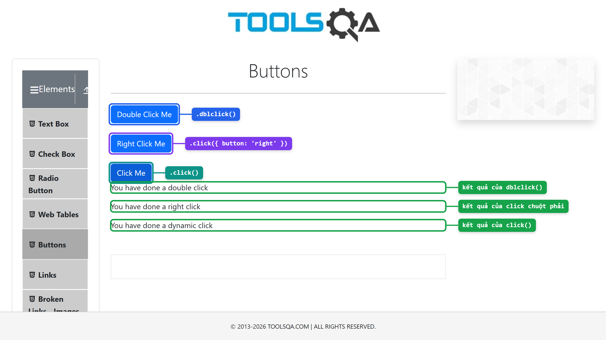
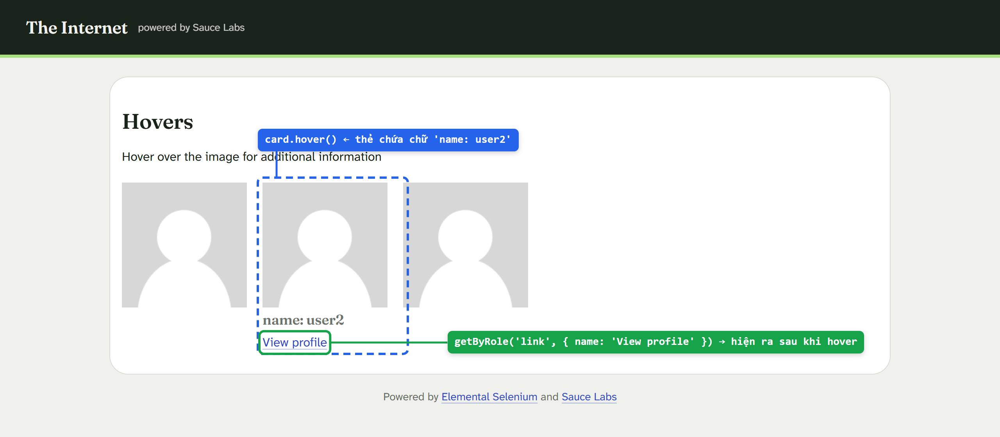
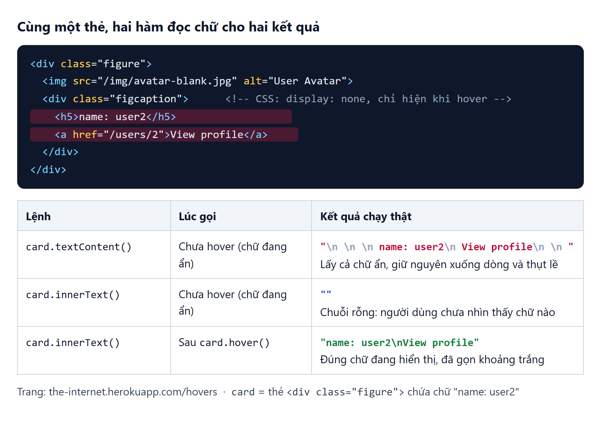
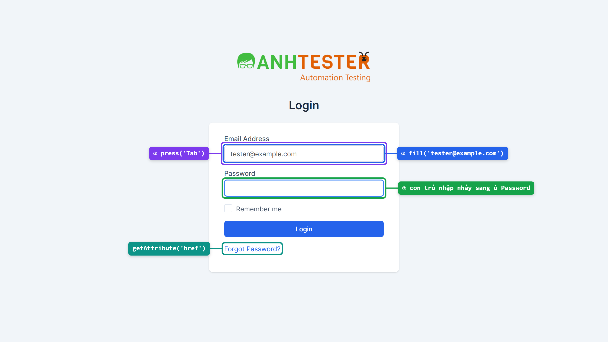
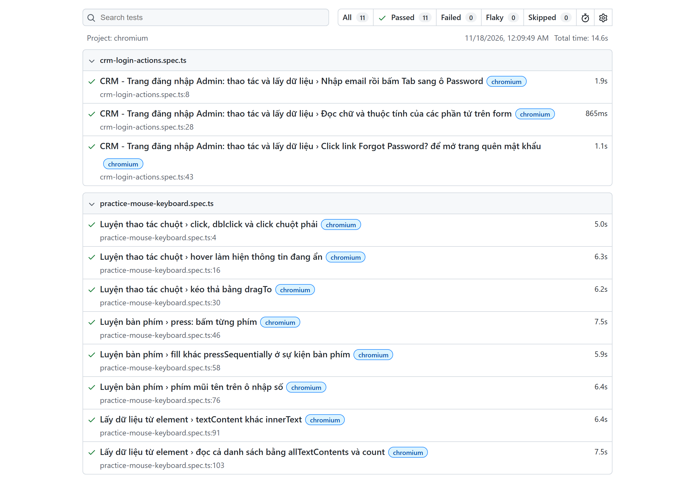

# Bài 16 - [Playwright Typescript] Thao tác chuột, bàn phím và lấy dữ liệu từ element

Chương: 2. Playwright TypeScript + Locator

Nguồn: [https://anhtester.com/learn/website-and-api-testing-automation-with-playwright-javascript-typescript-day-code-js-ts-tu-dau/373](https://anhtester.com/learn/website-and-api-testing-automation-with-playwright-javascript-typescript-day-code-js-ts-tu-dau/373)

✅ Thao tác chuột: click, dblclick, chuột phải, hover và kéo thả  
✅ Nhập liệu và bàn phím: fill, pressSequentially và press  
✅ Lấy dữ liệu từ element: textContent, innerText, inputValue, getAttribute  
✅ Thực hành trên trang đăng nhập CRM demo  
✅ Dùng Claude Code và bộ kit claude-testing-skills để sinh thao tác  
✅ Kiểm tra code do AI sinh ra

## ⭐ Mục tiêu bài học

Ở bài trước bạn đã tìm được những phần tử khó bằng XPath và `filter({ hasText, has })`, qua hai file `tests/crm-login-xpath.spec.ts` và `tests/practice-table-filter.spec.ts`. Bài này học nửa còn lại: **làm gì với phần tử đã tìm được** (bấm, rê chuột, kéo thả, gõ chữ, bấm phím) và **đọc dữ liệu** trang trả về.

Đây là chỗ AI hay chọn nhầm hàm: code vẫn chạy nhưng dễ hỏng hoặc che mất lỗi thật. Học xong bạn sẽ:

- Dùng được `click`, `dblclick`, click chuột phải, `hover` và `dragTo`.
- Phân biệt `fill` với `pressSequentially`, dùng `press` cho phím đơn và tổ hợp phím.
- Lấy dữ liệu bằng `textContent`, `innerText`, `inputValue`, `getAttribute`, `allTextContents`, `count`.
- Nhận ra thao tác chọn sai trong code AI sinh ra.

> 📌 Bài làm tiếp trong project `D:\AnhTester\playwright-crm` (macOS: `~/AnhTester/playwright-crm`). Trang đăng nhập CRM demo không có nút bấm đúp hay vùng kéo thả, nên kỹ thuật lẻ dùng hai trang luyện tập `demoqa.com` và `the-internet.herokuapp.com`. Trên CRM bài này **vẫn chưa đăng nhập**.

## ✅ Phần 1: Thao tác chuột - click, dblclick, chuột phải, hover và kéo thả

### 🔆 1. Từ bàn tay tới thao tác

Nhìn thấy công tắc chưa làm đèn sáng: bạn phải đưa tay ra bấm. Trong lập trình test, locator là "nhìn thấy", còn **thao tác** (action) là "đưa tay ra bấm". Mọi thao tác là hàm gọi trên locator và phải có `await`.

Trước khi bấm, Playwright tự kiểm phần tử đã hiển thị, đã đứng yên, không bị phần tử khác che và không bị vô hiệu hoá. Chưa đạt thì nó chờ, hết thời gian mới báo lỗi (học kỹ ở bài Auto-Waiting). Vì vậy **không tự viết lệnh chờ trước mỗi lần click**.

<table class="rt-table">
<thead>
<tr>
<th>Thao tác</th>
<th>Người dùng làm gì, thường gặp ở đâu</th>
</tr>
</thead>
<tbody>
<tr>
<td><code>click()</code></td>
<td>Bấm chuột trái một lần: nút, link, tab</td>
</tr>
<tr>
<td><code>dblclick()</code></td>
<td>Bấm đúp: ô trong bảng cho sửa trực tiếp</td>
</tr>
<tr>
<td><code>click({ button: 'right' })</code></td>
<td>Bấm chuột phải: menu ngữ cảnh do trang tự vẽ</td>
</tr>
<tr>
<td><code>hover()</code></td>
<td>Rê chuột lên, không bấm: menu xổ xuống, tooltip</td>
</tr>
<tr>
<td><code>dragTo(target)</code></td>
<td>Giữ chuột, kéo rồi thả: bảng Kanban, sắp xếp thứ tự</td>
</tr>
</tbody>
</table>

### 🔆 2. click, dblclick và click chuột phải

Tạo file `tests/practice-mouse-keyboard.spec.ts`. Trang <https://demoqa.com/buttons> có ba nút, mỗi nút chỉ phản hồi đúng một kiểu bấm:

```typescript
import { test, expect } from '@playwright/test';

test.describe('Luyện thao tác chuột', () => {
  test('click, dblclick và click chuột phải', async ({ page }) => {
    await page.goto('https://demoqa.com/buttons');

    await page.getByRole('button', { name: 'Double Click Me' }).dblclick();
    await page.getByRole('button', { name: 'Right Click Me' }).click({ button: 'right' });
    await page.getByRole('button', { name: 'Click Me', exact: true }).click();

    // Mỗi nút được bấm đúng kiểu thì trang hiện một dòng thông báo
    await expect(page.getByText('You have done')).toHaveCount(3);
    console.log(await page.getByText('You have done').allTextContents());
  });
});
```

```bash
[
  'You have done a double click',
  'You have done a right click',
  'You have done a dynamic click'
]
  ok 4 [chromium] › tests\practice-mouse-keyboard.spec.ts:4:3 › Luyện thao tác chuột › click, dblclick và click chuột phải (5.8s)
```

[](https://anhtester.com/storage/photos/shares/lesson/js_ts_playwright/v2/bai_16_chuot_ban_phim_lay_du_lieu/01_demoqa_buttons_ba_kieu_click.png)

*Ba kiểu bấm chuột trên trang demoqa.com/buttons và thông báo tương ứng*

Hai điều rút ra:

- Nút thứ ba phải có `exact: true`, vì cả ba nút đều chứa chữ `Click Me`.
- **Hai lần `click()` không bằng một lần `dblclick()`.** Anh Tester đã thử gọi `click()` hai lần liền trên nút `Double Click Me`: không thông báo nào hiện ra.

`click()` còn vài option bạn sẽ gặp trong code AI: `modifiers: ['ControlOrMeta']` giữ phím trong lúc bấm (chọn nhiều dòng), `position: { x, y }` bấm vào một điểm tính từ góc trên bên trái phần tử, và `force: true` bỏ qua các bước kiểm tra trước khi bấm. Riêng `force` **gần như không nên dùng**, lý do ở Phần 6.

### 🔆 3. hover - rê chuột để hiện thông tin ẩn

Trang <https://the-internet.herokuapp.com/hovers> có ba thẻ người dùng. Tên và link `View profile` của mỗi thẻ chỉ hiện khi rê chuột lên. Ba thẻ giống hệt nhau, nên dùng `filter()` của bài trước để lấy thẻ chứa chữ `name: user2`. Thêm test vào nhóm `Luyện thao tác chuột`:

```typescript
  test('hover làm hiện thông tin đang ẩn', async ({ page }) => {
    await page.goto('https://the-internet.herokuapp.com/hovers');

    // Trang có 3 thẻ người dùng giống nhau: lọc ra thẻ chứa chữ "name: user2"
    const card = page.locator("//div[@class='figure']").filter({ hasText: 'name: user2' });
    const profileLink = card.getByRole('link', { name: 'View profile' });

    console.log('Trước khi hover, link hiển thị?', await profileLink.isVisible());
    await card.hover();
    console.log('Sau khi hover, link hiển thị? ', await profileLink.isVisible());

    await expect(profileLink).toBeVisible();
  });
```

```bash
Trước khi hover, link hiển thị? false
Sau khi hover, link hiển thị?  true
```

[](https://anhtester.com/storage/photos/shares/lesson/js_ts_playwright/v2/bai_16_chuot_ban_phim_lay_du_lieu/02_hover_hien_thong_tin_user2.png)

*Sau card.hover(), tên và link View profile của user2 hiện ra*

> ⚠️ Phần tử chỉ hiện khi rê chuột thì **phải `hover()` trước rồi mới `click()`**. Bấm thẳng vào phần tử đang ẩn, Playwright chờ tới hết thời gian rồi báo lỗi. Đừng "chữa" bằng `force: true`.

### 🔆 4. dragTo - kéo thả

`source.dragTo(target)` rê tới phần tử nguồn, nhấn giữ chuột, rê sang phần tử đích rồi thả. Trang <https://the-internet.herokuapp.com/drag_and_drop> có hai ô A và B đổi chỗ được cho nhau. Hai ô không có role hay nhãn, nên locator là XPath:

```typescript
  test('kéo thả bằng dragTo', async ({ page }) => {
    await page.goto('https://the-internet.herokuapp.com/drag_and_drop');

    const columnA = page.locator("//div[@id='column-a']");
    const columnB = page.locator("//div[@id='column-b']");
    const headers = page.locator("//div[@id='columns']//header");

    console.log('Trước khi kéo:', await headers.allTextContents());
    await columnA.dragTo(columnB);
    console.log('Sau khi kéo:  ', await headers.allTextContents());

    await expect(headers).toHaveText(['B', 'A']);
  });
```

```bash
Trước khi kéo: [ 'A', 'B' ]
Sau khi kéo:   [ 'B', 'A' ]
```

Playwright còn bộ lệnh cấp thấp `page.mouse.move()`, `down()`, `up()` làm việc theo toạ độ. Chỉ dùng khi `dragTo` không đáp ứng được, vì toạ độ đổi theo kích thước màn hình.

## ✅ Phần 2: Nhập liệu và bàn phím - fill, pressSequentially và press

### 🔆 1. fill và clear

Điền tờ khai có hai cách: dán nguyên dòng chữ chuẩn bị sẵn, hoặc gõ từng chữ. Playwright có cả hai, và cách "dán" là mặc định:

- `fill('giá trị')`: đưa con trỏ vào ô, **xoá nội dung cũ**, đặt giá trị mới trong một lần rồi phát sự kiện `input`.
- `clear()`: xoá trắng ô. `fill('')` cho kết quả tương tự.

`fill` chỉ dùng cho ô nhập. Gọi trên một tiêu đề hay thẻ `div` thường, bạn nhận lỗi `Element is not an <input>, <textarea>, <select> or [contenteditable]`.

### 🔆 2. pressSequentially - gõ từng phím, khi nào mới cần?

`fill` không phát sự kiện bàn phím (`keydown`, `keyup`) cho từng ký tự. Phần lớn form không cần. Nhưng ô tìm kiếm gợi ý theo từng chữ hay ô mã OTP tự nhảy ô thì cần. Lúc đó dùng `pressSequentially(text, { delay })`, với `delay` là số mili giây nghỉ giữa hai phím.

Trang <https://the-internet.herokuapp.com/key_presses> in ra phím vừa bấm, nên cho thấy rõ khác biệt. Thêm nhóm test mới vào cuối file:

```typescript
test.describe('Luyện bàn phím', () => {
  test('fill khác pressSequentially ở sự kiện bàn phím', async ({ page }) => {
    await page.goto('https://the-internet.herokuapp.com/key_presses');

    const input = page.getByRole('textbox');
    const result = page.locator("//p[@id='result']");

    await input.fill('abc');
    console.log('fill              :', await input.inputValue(), '|', JSON.stringify(await result.textContent()));

    await input.clear();
    await input.pressSequentially('abc', { delay: 100 });
    console.log('pressSequentially :', await input.inputValue(), '|', JSON.stringify(await result.textContent()));

    await input.press('ControlOrMeta+A');
    await input.press('Backspace');
    console.log('Sau ControlOrMeta+A rồi Backspace:', JSON.stringify(await input.inputValue()));
  });
});
```

```bash
fill              : abc | ""
pressSequentially : abc | "You entered: C"
Sau ControlOrMeta+A rồi Backspace: ""
```

Cả hai đều đưa được `abc` vào ô. Nhưng sau `fill` dòng kết quả vẫn rỗng, còn sau `pressSequentially` trang báo phím cuối là `C`.

> ⚠️ **Mặc định dùng `fill`.** Chỉ đổi sang `pressSequentially` khi ô nhập có xử lý riêng theo từng phím, và ghi lý do vào comment. Hàm cũ `type()` đã bị đánh dấu `@deprecated`: thấy `.type(` trong code AI là biết nó học từ ví dụ cũ.
>
> 🔗 Tài liệu: [playwright.dev/docs/input](https://playwright.dev/docs/input).

### 🔆 3. press - phím đơn và tổ hợp phím

`locator.press(key)` đưa con trỏ vào phần tử rồi bấm **một** phím hoặc một tổ hợp. Tên phím: `Enter`, `Tab`, `Escape`, `Backspace`, `ArrowUp`, `F1`... Tổ hợp nối bằng dấu cộng: `Shift+Tab`, `ControlOrMeta+A`. Thêm hai test sau vào nhóm `Luyện bàn phím`:

```typescript
  test('press: bấm từng phím', async ({ page }) => {
    await page.goto('https://the-internet.herokuapp.com/key_presses');

    const input = page.getByRole('textbox');
    const result = page.locator("//p[@id='result']");

    for (const key of ['Tab', 'Escape', 'ArrowUp', 'Shift', 'Backspace']) {
      await input.press(key);
      console.log(`press('${key}')`.padEnd(18), '=>', await result.textContent());
    }
  });

  test('phím mũi tên trên ô nhập số', async ({ page }) => {
    await page.goto('https://the-internet.herokuapp.com/inputs');

    const numberInput = page.getByRole('spinbutton');
    await numberInput.fill('10');
    await numberInput.press('ArrowUp');
    await numberInput.press('ArrowUp');
    await numberInput.press('ArrowDown');

    console.log('Giá trị ô số:', await numberInput.inputValue());
    await expect(numberInput).toHaveValue('11');
  });
```

```bash
press('Tab')       => You entered: TAB
press('Escape')    => You entered: ESCAPE
press('ArrowUp')   => You entered: UP
press('Shift')     => You entered: SHIFT
press('Backspace') => You entered: BACK_SPACE
Giá trị ô số: 11
```

Ô `<input type="number">` có role là `spinbutton`. Ba điều cần nhớ về phím:

- **`ControlOrMeta` thay cho `Control`.** Windows chọn tất cả bằng Ctrl+A, macOS bằng Cmd+A. Viết `Control+A` thì test đúng trên Windows nhưng sai trên máy Mac của đồng nghiệp. `ControlOrMeta` tự đổi theo hệ điều hành.
- **`Enter` trong form là gửi form.** Trên chính trang `key_presses`, `press('Enter')` làm trang tải lại vì ô nhập nằm trong `<form>`. Trên trang đăng nhập, Enter ở ô Email tương đương bấm nút Login.
- `page.keyboard.press()`, `page.keyboard.down()`, `page.keyboard.up()` gửi phím tới **phần tử đang giữ con trỏ**. Ưu tiên `locator.press()`, vì đọc code là biết phím đi vào đâu.

## ✅ Phần 3: Lấy dữ liệu từ element

### 🔆 1. Các hàm đọc dữ liệu

Tester còn phải nhìn: ô này đang chứa gì, link trỏ đi đâu, bảng có mấy dòng. Trong code, "nhìn" là các hàm **trả về giá trị** để bạn in ra hoặc dùng cho bước sau (ví dụ đọc mã đơn hàng vừa tạo rồi đem đi tìm kiếm).

<table class="rt-table">
<thead>
<tr>
<th>Hàm</th>
<th>Trả về</th>
<th>Dùng để đọc</th>
</tr>
</thead>
<tbody>
<tr>
<td><code>textContent()</code></td>
<td>Chuỗi hoặc <code>null</code></td>
<td>Toàn bộ chữ trong HTML của phần tử, kể cả chữ đang ẩn</td>
</tr>
<tr>
<td><code>innerText()</code></td>
<td>Chuỗi</td>
<td>Chữ <strong>đang hiển thị</strong>, đã gọn khoảng trắng</td>
</tr>
<tr>
<td><code>inputValue()</code></td>
<td>Chuỗi</td>
<td>Giá trị đang nằm trong <code>&lt;input&gt;</code>, <code>&lt;textarea&gt;</code>, <code>&lt;select&gt;</code></td>
</tr>
<tr>
<td><code>getAttribute('tên')</code></td>
<td>Chuỗi hoặc <code>null</code></td>
<td>Một thuộc tính HTML: <code>href</code>, <code>type</code>, <code>placeholder</code>, <code>class</code>...</td>
</tr>
<tr>
<td><code>allTextContents()</code>, <code>allInnerTexts()</code></td>
<td>Mảng chuỗi</td>
<td>Chữ của <strong>mọi</strong> phần tử mà locator khớp</td>
</tr>
<tr>
<td><code>count()</code></td>
<td>Số</td>
<td>Số phần tử mà locator khớp</td>
</tr>
<tr>
<td><code>isVisible()</code>, <code>isEnabled()</code>, <code>isChecked()</code></td>
<td><code>true</code> / <code>false</code></td>
<td>Trạng thái của phần tử ngay tại lúc gọi</td>
</tr>
</tbody>
</table>

> 📌 Chữ người dùng gõ vào ô nhập **không** nằm trong `textContent`. Muốn đọc ô nhập thì dùng `inputValue()`. Nhầm chỗ này là nhận về chuỗi rỗng.

### 🔆 2. textContent khác innerText ở đâu?

Đọc chữ của thẻ `user2` trên trang `hovers` bằng cả hai hàm. Thêm nhóm test thứ ba vào cuối file:

```typescript
test.describe('Lấy dữ liệu từ element', () => {
  test('textContent khác innerText', async ({ page }) => {
    await page.goto('https://the-internet.herokuapp.com/hovers');

    const card = page.locator("//div[@class='figure']").filter({ hasText: 'name: user2' });

    console.log('textContent            :', JSON.stringify(await card.textContent()));
    console.log('innerText              :', JSON.stringify(await card.innerText()));

    await card.hover();
    console.log('innerText sau khi hover:', JSON.stringify(await card.innerText()));
  });
});
```

```bash
textContent            : "\n    \n    \n      name: user2\n      View profile\n    \n  "
innerText              : ""
innerText sau khi hover: "name: user2\nView profile"
```

`JSON.stringify` giúp nhìn thấy cả dấu xuống dòng `\n` và khoảng trắng. Đặt kết quả cạnh HTML thật của thẻ:

[](https://anhtester.com/storage/photos/shares/lesson/js_ts_playwright/v2/bai_16_chuot_ban_phim_lay_du_lieu/04_so_do_textcontent_innertext.png)

*Cùng một thẻ: textContent lấy cả chữ ẩn, innerText chỉ lấy chữ đang hiển thị*

- `textContent()` đọc **mã HTML**: có gì lấy nấy, kể cả chữ bị CSS ẩn, kèm nguyên thụt lề của lập trình viên.
- `innerText()` đọc **thứ người dùng thấy**: chưa hover thì trả về chuỗi rỗng.

### 🔆 3. Đọc cả danh sách

Locator khớp nhiều phần tử thì `textContent()` báo lỗi strict mode. Đọc cả loạt dùng `allTextContents()` hoặc `allInnerTexts()`. Ví dụ đọc cột `Last Name` và cột `Action` của bảng trên trang <https://the-internet.herokuapp.com/tables>:

```typescript
  test('đọc cả danh sách bằng allTextContents và count', async ({ page }) => {
    await page.goto('https://the-internet.herokuapp.com/tables');

    // Cột đầu tiên (Last Name) của bảng thứ nhất
    const lastNames = page.locator("//table[@id='table1']/tbody/tr/td[1]");
    console.log('Số dòng  :', await lastNames.count());
    console.log('Last Name:', await lastNames.allTextContents());

    // Cột Action: mỗi ô chứa 2 link, HTML có xuống dòng và thụt lề
    const actions = page.locator("//table[@id='table1']/tbody/tr/td[6]");
    console.log('allTextContents:', JSON.stringify(await actions.allTextContents()));
    console.log('allInnerTexts  :', JSON.stringify(await actions.allInnerTexts()));
  });
```

```bash
Số dòng  : 4
Last Name: [ 'Smith', 'Bach', 'Doe', 'Conway' ]
allTextContents: ["\n          edit\n          delete\n        ","\n          edit\n          delete\n        ","\n          edit\n          delete\n        ","\n          edit\n          delete\n        "]
allInnerTexts  : ["edit delete","edit delete","edit delete","edit delete"]
```

> ⚠️ `count()`, `allTextContents()`, `allInnerTexts()` và `isVisible()` **trả lời ngay, không chờ**. Gọi lúc bảng chưa tải xong, bạn nhận `0` hoặc mảng rỗng mà không có lỗi nào.

### 🔆 4. Đọc để dùng, không phải để kiểm tra

Kiểu viết "đọc ra rồi so sánh" dưới đây là nguồn gốc quen thuộc của test lúc đạt lúc lỗi:

```typescript
// ❌ Đọc một lần rồi so: trang chậm nửa giây là sai, khoảng trắng thừa cũng sai
const text = await page.getByRole('button', { name: 'Login' }).textContent();
expect(text).toBe('Login');

// ✅ Để expect tự đọc lại nhiều lần cho tới khi đúng hoặc hết thời gian chờ
await expect(page.getByRole('button', { name: 'Login' })).toHaveText('Login');
```

Tài liệu của `textContent()` và `isVisible()` cũng ghi chú như vậy. Ranh giới cần nhớ: hàm đọc dùng khi **cần giá trị**, còn **kiểm tra** là việc của `expect(locator)`, học kỹ ở chương Assertion.

## ✅ Phần 4: Thực hành trên trang đăng nhập CRM demo

### 🔆 1. File crm-login-actions.spec.ts

Gom các thao tác vừa học lên trang đăng nhập Admin, dùng email giả, **không gõ gì vào ô Password và không bấm Login**. Sau bài này project có thêm hai file:

```bash
playwright-crm/
├── tests/
│   ├── crm-login-actions.spec.ts        ← mới
│   ├── practice-mouse-keyboard.spec.ts  ← mới
│   └── ... (các file của những bài trước)
└── playwright.config.ts
```

Nội dung file `tests/crm-login-actions.spec.ts`:

```typescript
import { test, expect } from '@playwright/test';

test.describe('CRM - Trang đăng nhập Admin: thao tác và lấy dữ liệu', () => {
  test.beforeEach(async ({ page }) => {
    await page.goto('https://crm.anhtester.com/admin/authentication');
  });

  test('Nhập email rồi bấm Tab sang ô Password', async ({ page }) => {
    const email = page.getByLabel('Email Address');
    const password = page.getByLabel('Password');

    await page.getByRole('button', { name: 'Login' }).hover();
    await email.fill('tester@example.com');
    await email.press('Tab');

    console.log('Giá trị ô Email:', await email.inputValue());
    await expect(password).toBeFocused(); // con trỏ nhập đã nằm ở ô Password

    // Xoá bằng phím tắt rồi gõ lại từng ký tự. Không gõ gì vào ô Password, không bấm Login.
    await email.press('ControlOrMeta+A');
    await email.press('Backspace');
    console.log('Sau khi xoá    :', JSON.stringify(await email.inputValue()));

    await email.pressSequentially('qa@example.com', { delay: 50 });
    console.log('Sau khi gõ lại :', await email.inputValue());
  });

  test('Đọc chữ và thuộc tính của các phần tử trên form', async ({ page }) => {
    const loginButton = page.getByRole('button', { name: 'Login' });
    const forgotLink = page.getByRole('link', { name: 'Forgot Password?' });

    console.log('textContent nút Login:', JSON.stringify(await loginButton.textContent()));
    console.log('innerText nút Login  :', JSON.stringify(await loginButton.innerText()));
    console.log('type của ô Email     :', await page.getByLabel('Email Address').getAttribute('type'));
    console.log('type của ô Password  :', await page.getByLabel('Password').getAttribute('type'));
    console.log('placeholder ô Email  :', await page.getByLabel('Email Address').getAttribute('placeholder'));
    console.log('href của link        :', await forgotLink.getAttribute('href'));
    console.log('Số link trên trang   :', await page.getByRole('link').count());
    console.log('Nút Login bấm được?  :', await loginButton.isEnabled());
    console.log('Remember me đã tick? :', await page.getByRole('checkbox', { name: 'Remember me' }).isChecked());
  });

  test('Click link Forgot Password? để mở trang quên mật khẩu', async ({ page }) => {
    await page.getByRole('link', { name: 'Forgot Password?' }).click();

    await expect(page).toHaveURL(/forgot_password/);
    await expect(page.getByRole('heading', { name: 'Forgot Password' })).toBeVisible();
    console.log('URL sau khi click:', page.url());
  });
});
```

```bash
npx playwright test crm-login-actions.spec.ts --project=chromium --reporter=list --workers=1
```

`--reporter=list` in từng test ra Terminal, `--workers=1` chạy lần lượt để các dòng `console.log` không xen vào nhau. Kết quả chạy thật (Playwright 1.65.1, ngày 18/11/2026):

```bash
Running 3 tests using 1 worker

Giá trị ô Email: tester@example.com
Sau khi xoá    : ""
Sau khi gõ lại : qa@example.com
  ok 1 [chromium] › tests\crm-login-actions.spec.ts:8:3 › CRM - Trang đăng nhập Admin: thao tác và lấy dữ liệu › Nhập email rồi bấm Tab sang ô Password (1.6s)
textContent nút Login: "\n                    Login                "
innerText nút Login  : "Login"
type của ô Email     : email
type của ô Password  : password
placeholder ô Email  : null
href của link        : https://crm.anhtester.com/admin/authentication/forgot_password
Số link trên trang   : 2
Nút Login bấm được?  : true
Remember me đã tick? : false
  ok 2 [chromium] › tests\crm-login-actions.spec.ts:28:3 › CRM - Trang đăng nhập Admin: thao tác và lấy dữ liệu › Đọc chữ và thuộc tính của các phần tử trên form (653ms)
URL sau khi click: https://crm.anhtester.com/admin/authentication/forgot_password
  ok 3 [chromium] › tests\crm-login-actions.spec.ts:43:3 › CRM - Trang đăng nhập Admin: thao tác và lấy dữ liệu › Click link Forgot Password? để mở trang quên mật khẩu (751ms)

  3 passed (3.7s)
```

[](https://anhtester.com/storage/photos/shares/lesson/js_ts_playwright/v2/bai_16_chuot_ban_phim_lay_du_lieu/03_crm_login_fill_email_bam_tab.png)

*Trang đăng nhập Admin CRM sau fill và press Tab: con trỏ nhập nằm ở ô Password*

### 🔆 2. Đọc kết quả

- `getAttribute('placeholder')` trả về `null`: ô Email **không có thuộc tính** này, khác với chuỗi rỗng.
- Ô Password có `type="password"`: cách kiểm tra "mật khẩu được che" mà không cần gõ mật khẩu.

Chạy cả hai file rồi mở báo cáo bằng `npx playwright show-report`:

```bash
npx playwright test crm-login-actions.spec.ts practice-mouse-keyboard.spec.ts --project=chromium
```

[](https://anhtester.com/storage/photos/shares/lesson/js_ts_playwright/v2/bai_16_chuot_ban_phim_lay_du_lieu/05_html_report_11_test_dat.png)

*HTML Report của hai file thực hành: 11 test đạt*

> 🔒 Đăng nhập thật cần mật khẩu, và mật khẩu chỉ nằm trong file `.env` dưới tên biến `ADMIN_EMAIL`, `ADMIN_PASSWORD`. Thao tác khi đó vẫn là `fill`, chỉ khác giá trị lấy từ biến môi trường.

## ✅ Phần 5: Dùng Claude Code và bộ kit claude-testing-skills để sinh thao tác

### 🔆 1. Bộ kit quy định gì về thao tác?

Anh Tester dùng **Claude Code** (có phí) cùng bộ kit [claude-testing-skills](https://github.com/anhtester/claude-testing-skills). Chưa có Claude thì dùng bản miễn phí của [ChatGPT](https://chatgpt.com/) hoặc [Gemini](https://gemini.google.com/), prompt ở mục 3 dùng được cho cả ba.

<table class="rt-table">
<thead>
<tr>
<th>Loại</th>
<th>Tên</th>
<th>Liên quan tới bài này</th>
</tr>
</thead>
<tbody>
<tr>
<td>Rule</td>
<td><a href="https://github.com/anhtester/claude-testing-skills/blob/main/.claude/rules/playwright_rules.md">playwright_rules.md</a></td>
<td>Mục 4 <strong>nghiêm cấm</strong> <code>page.waitForTimeout()</code> và mọi kiểu chờ cố định, yêu cầu dùng <span>auto-waiting</span> và Web-First Assertions</td>
</tr>
<tr>
<td>Rule</td>
<td><code>project_locator_rules.md</code></td>
<td>Rule riêng bạn tạo ở bài Locator <code>getBy...</code>: <code>getBy...</code> rồi XPath, không CSS</td>
</tr>
<tr>
<td>Command</td>
<td><a href="https://github.com/anhtester/claude-testing-skills/blob/main/.claude/commands/generate-automation-web.md">/generate-automation-web</a></td>
<td>Chế độ <code>FLOW</code> nhận URL kèm mô tả thao tác bằng lời, chạy từng bước trên trình duyệt thật rồi mới sinh code</td>
</tr>
<tr>
<td>Command</td>
<td><a href="https://github.com/anhtester/claude-testing-skills/blob/main/.claude/commands/review-automation-code.md">/review-automation-code</a></td>
<td>Chấm code đã viết theo 6 nhóm, có Wait strategy và Assertion. <code>REVIEW</code> chỉ báo cáo, <code>FIX</code> báo cáo rồi sửa</td>
</tr>
</tbody>
</table>

### 🔆 2. Giao việc bằng lệnh của kit

```markdown
/generate-automation-web FLOW https://crm.anhtester.com/admin/authentication
Flow: rê chuột lên nút Login, nhập email giả tester@example.com vào ô Email Address, bấm Tab sang ô Password,
đọc lại giá trị ô Email, rồi click link "Forgot Password?" và kiểm tra tiêu đề trang quên mật khẩu.
KHÔNG nhập mật khẩu, KHÔNG bấm nút Login. Locator theo .claude/rules/project_locator_rules.md.
```

Lệnh sinh cả Page Object lẫn file test (Page Object Model học ở chương sau). Lúc này bạn chỉ cần đọc phần thao tác và đối chiếu với bảng ở Phần 6, rồi cho AI tự rà lại:

```markdown
/review-automation-code REVIEW tests/crm-login-actions.spec.ts
```

> 🔗 Mỗi file trong `.claude/commands/` được Claude Code nạp thành một lệnh gạch chéo cùng tên. Tài liệu (gộp chung với Skills): [code.claude.com/docs/en/skills](https://code.claude.com/docs/en/skills).

### 🔆 3. Prompt dùng được cho Claude, ChatGPT và Gemini

**Chuyển các bước của một test case thủ công thành thao tác Playwright:**

```markdown
Bạn là kỹ sư automation dùng Playwright TypeScript (bản 1.65).
Chuyển các bước test case dưới đây thành MỘT test trong file tests/crm-forgot-password.spec.ts.

Quy tắc bắt buộc:
- Locator chỉ dùng getByRole / getByLabel / getByPlaceholder / getByText, không được thì XPath tương đối. KHÔNG dùng CSS Selector.
- Nhập liệu dùng fill(). Chỉ dùng pressSequentially() khi ô có xử lý theo từng phím và phải ghi lý do trong comment.
- KHÔNG dùng type(), waitForTimeout(), click({ force: true }), evaluate() để click.
- Tổ hợp phím dùng ControlOrMeta thay cho Control.
- Kiểm tra kết quả bằng await expect(locator)..., không đọc textContent() rồi so sánh.
- Không gửi form, không dùng mật khẩu thật.

Test case:
1. Mở https://crm.anhtester.com/admin/authentication/forgot_password
2. Nhập "tester@example.com" vào ô Email Address
3. Chọn toàn bộ nội dung ô bằng phím tắt rồi xoá
4. Kiểm tra ô Email Address rỗng và nút Confirm đang hiển thị

Sau code, liệt kê từng thao tác đã dùng và lý do chọn nó.
```

**Hỏi đào sâu khi chưa hiểu:**

```markdown
Giải thích cho người mới học Playwright: fill() và pressSequentially() khác nhau ở những sự kiện nào mà trang web nhận được?
Cho 3 ví dụ ô nhập trong thực tế mà fill() không đủ và phải dùng pressSequentially().
Vì sao locator.type() bị đánh dấu deprecated? Dẫn link tài liệu playwright.dev cho từng ý.
```

```markdown
Trong Playwright, textContent(), innerText() và inputValue() khác nhau thế nào?
Với đoạn HTML tôi dán bên dưới, mỗi hàm trả về chính xác chuỗi gì (viết cả ký tự \n và khoảng trắng)?
Nếu tôi cần KIỂM TRA chữ hiển thị thì nên dùng hàm nào thay cho việc đọc ra rồi so sánh?

[dán HTML của phần tử vào đây]
```

**Nhờ AI duyệt một file test về cách chọn thao tác:**

```markdown
Duyệt file test Playwright TypeScript bên dưới, CHỈ xét việc chọn thao tác và cách lấy dữ liệu.
Với mỗi dòng có vấn đề, trả về bảng: Dòng | Vấn đề | Hậu quả khi chạy thật | Cách sửa.
Cần soi: type(), click({ force: true }), waitForTimeout(), page.click('selector'), evaluate() để click,
hai lần click() thay cho dblclick(), 'Control+A' không chạy trên macOS, fill() lên phần tử không phải ô nhập,
đọc textContent()/inputValue() rồi expect(...).toBe(...).
Không viết lại cả file, chỉ sửa các dòng có vấn đề.

[dán nội dung file vào đây]
```

> 🔒 Dán code và HTML thì được. **Không dán mật khẩu hay nội dung file `.env`** vào bất kỳ khung chat nào.

## ✅ Phần 6: Kiểm tra code do AI sinh ra

AI học từ rất nhiều code Playwright cũ và code chuyển từ Selenium sang, nên hay mang thói quen cũ vào. Rà theo bảng này:

<table class="rt-table">
<thead>
<tr>
<th>Dấu hiệu trong code</th>
<th>Vì sao là vấn đề</th>
<th>Cách sửa</th>
</tr>
</thead>
<tbody>
<tr>
<td><code>.type('abc')</code></td>
<td>Đã <code>@deprecated</code>, không tự xoá nội dung cũ của ô</td>
<td><code>fill()</code>, cần gõ từng phím thì <code>pressSequentially()</code></td>
</tr>
<tr>
<td><code>click({ force: true })</code></td>
<td>Bỏ qua bước kiểm tra phần tử bị che hay bị ẩn. Popup che mất nút là <strong>lỗi thật</strong> của sản phẩm mà test vẫn đạt</td>
<td>Bỏ <code>force</code>, tìm lý do: cần <code>hover</code> trước, cần đóng popup, hay locator sai</td>
</tr>
<tr>
<td><code>page.waitForTimeout(2000)</code></td>
<td>Chờ cứng: máy nhanh thì phí thời gian, máy chậm vẫn lỗi. Rule của kit cấm</td>
<td>Xoá. Thao tác đã tự chờ, kết quả kiểm bằng <code>expect</code></td>
</tr>
<tr>
<td><code>page.click('#login')</code></td>
<td>Kiểu cũ truyền thẳng selector, tài liệu Playwright không khuyến khích. Lại còn là CSS</td>
<td><code>page.getByRole(...).click()</code></td>
</tr>
<tr>
<td><code>.evaluate(el =&gt; el.click())</code></td>
<td>Bấm bằng JavaScript, không qua chuột: nút bị che hay bị khoá vẫn "bấm được"</td>
<td><code>locator.click()</code></td>
</tr>
<tr>
<td>Hai dòng <code>click()</code> liền nhau trên một nút</td>
<td>Không tạo ra sự kiện bấm đúp</td>
<td><code>dblclick()</code></td>
</tr>
<tr>
<td><code>press('Control+A')</code></td>
<td>Sai trên macOS (dùng phím Cmd)</td>
<td><code>press('ControlOrMeta+A')</code></td>
</tr>
<tr>
<td><code>fill()</code> lên tiêu đề, thẻ <code>div</code></td>
<td>Báo lỗi <code>Element is not an &lt;input&gt;...</code></td>
<td>Tìm đúng ô nhập bên trong</td>
</tr>
<tr>
<td><code><span>expect(await</span> <span>x.textContent()).toBe('...')</span></code></td>
<td>Đọc một lần rồi so: không chờ, dính khoảng trắng thừa</td>
<td><code>await expect(x).toHaveText('...')</code></td>
</tr>
</tbody>
</table>

Rà xong thì chạy thật với `--headed` để nhìn chuột và phím có vào đúng chỗ không.

## ✅ Phần 7: Bài tập thực hành

**Bài tập 1 - Chuột.** Tạo file `tests/bt1-mouse.spec.ts`. Trên trang `hovers`, rê chuột lên thẻ `user3` và in ra `href` của link `View profile` trong thẻ đó. Trên trang `drag_and_drop`, kéo ô A sang ô B **hai lần**, in thứ tự hai ô sau mỗi lần.

**Bài tập 2 - Bàn phím và đọc dữ liệu trên CRM.** Tạo file `tests/bt2-crm-forgot-password.spec.ts` cho trang `https://crm.anhtester.com/admin/authentication/forgot_password`: nhập email giả bằng `fill`, chọn hết bằng phím tắt và xoá, gõ lại email giả khác bằng `pressSequentially`, rồi in ra `inputValue()` và `getAttribute('type')` của ô Email, `innerText()` của nút `Confirm`, số link trên trang. **Không bấm nút Confirm.**

**Bài tập 3 - Duyệt code.** Đoạn code dưới đây do AI viết cho trang đăng nhập Admin và có 6 chỗ cần sửa. Tìm đủ, nêu lý do theo bảng ở Phần 6 và viết lại thành file `tests/bt3-actions-review.spec.ts` chạy đạt. Gợi ý: chạy thử bản gốc trước, có một chỗ làm test lỗi thật.

```typescript
import { test, expect } from '@playwright/test';

test('Nhập email và mở trang quên mật khẩu', async ({ page }) => {
  await page.goto('https://crm.anhtester.com/admin/authentication');
  await page.click('#email');
  await page.getByLabel('Email Address').type('tester@example.com');
  await page.waitForTimeout(2000);
  await page.getByLabel('Email Address').press('Control+A');
  await page.getByLabel('Email Address').press('Backspace');
  await page.getByLabel('Email Address').fill('qa@example.com');
  await page.getByRole('link', { name: 'Forgot Password?' }).click({ force: true });
  const title = await page.getByRole('heading', { name: 'Forgot Password' }).textContent();
  expect(title).toBe('Forgot Password');
});
```

## ✅ Phần 8: Ghi nhớ nhanh

- Thao tác gọi trên locator, luôn có `await`, và tự chờ phần tử sẵn sàng.
- `dblclick()` cho bấm đúp, `click({ button: 'right' })` cho chuột phải, `hover()` trước khi bấm vào thứ chỉ hiện khi rê chuột, `dragTo()` cho kéo thả. Hai lần `click()` không phải bấm đúp.
- Nhập liệu mặc định dùng `fill()`. `pressSequentially()` chỉ khi ô có xử lý theo từng phím. Không dùng `type()`.
- `press()` cho phím đơn và tổ hợp phím, dùng `ControlOrMeta` thay cho `Control`. Enter trong form là gửi form.
- `textContent()` đọc mã HTML (cả chữ ẩn, cả khoảng trắng), `innerText()` đọc chữ đang hiển thị, `inputValue()` đọc ô nhập, `getAttribute()` đọc thuộc tính.
- `count()`, `allTextContents()`, `isVisible()` trả lời ngay, không chờ. Kiểm tra thì dùng `expect(locator)`.

✅ **Kết luận:** Bạn đã điều khiển được chuột, bàn phím và đọc được dữ liệu từ trang. Form thật còn ô tick, nút chọn một, danh sách xổ xuống và ô chọn file với cách thao tác riêng. Đó là bài kế tiếp: **Cách xử lý Checkbox, Radio, Dropdown và Upload, Download File**.

---

## Bài tập riêng — Bài tập - Thao tác chuột, bàn phím và lấy dữ liệu từ element

Nguồn bài tập: [https://anhtester.com/student-assignments?course=website-and-api-testing-automation-with-playwright-javascript-typescript-day-code-js-ts-tu-dau#assignment-106](https://anhtester.com/student-assignments?course=website-and-api-testing-automation-with-playwright-javascript-typescript-day-code-js-ts-tu-dau#assignment-106)

**Mục tiêu:** chọn đúng thao tác chuột và bàn phím cho từng tình huống, lấy được dữ liệu từ element bằng đúng hàm, và nhận ra thao tác chọn sai trong code AI.

**Thư mục làm bài:** `D:\AnhTester\playwright-crm` (macOS: `~/AnhTester/playwright-crm`). Trên CRM demo chỉ làm việc với trang công khai, **không đăng nhập, không gửi form**. Locator chỉ dùng `getBy...` và XPath, không dùng CSS Selector.

### 📝 Đề bài

#### Bài tập 1 - Thao tác chuột

Tạo file `tests/bt1-mouse.spec.ts` gồm 2 test:

1. Mở `https://the-internet.herokuapp.com/hovers`, rê chuột lên thẻ của `user3` (lọc thẻ bằng `filter({ hasText })`), in ra `href` của link `View profile` trong thẻ đó.
2. Mở `https://the-internet.herokuapp.com/drag_and_drop`, kéo ô A sang ô B **hai lần** bằng `dragTo`, sau mỗi lần in thứ tự hai ô bằng `allTextContents()`.

#### Bài tập 2 - Bàn phím và đọc dữ liệu trên CRM

Tạo file `tests/bt2-crm-forgot-password.spec.ts` cho trang `https://crm.anhtester.com/admin/authentication/forgot_password`:

1. Nhập một email giả (ví dụ `tester@example.com`) vào ô `Email Address` bằng `fill`.
2. Chọn toàn bộ nội dung ô bằng phím tắt chạy được trên cả Windows lẫn macOS, rồi xoá bằng `Backspace`.
3. Gõ lại một email giả khác bằng `pressSequentially` có `delay`.
4. In ra bằng `console.log`: `inputValue()` của ô Email, `getAttribute('type')` của ô Email, `innerText()` của nút `Confirm`, số link trên trang (`count()`).

**Không bấm nút Confirm** và không bấm `Enter` trong ô Email (Enter trong form là gửi form).

#### Bài tập 3 - Duyệt code AI

Đoạn code dưới đây do AI viết cho trang đăng nhập Admin và có **6 chỗ cần sửa**. Tìm đủ, nêu lý do và viết lại thành file `tests/bt3-actions-review.spec.ts` chạy đạt. Gợi ý: chạy thử bản gốc trước, có một chỗ làm test lỗi thật.

```typescript
import { test, expect } from '@playwright/test';

test('Nhập email và mở trang quên mật khẩu', async ({ page }) => {
  await page.goto('https://crm.anhtester.com/admin/authentication');
  await page.click('#email');
  await page.getByLabel('Email Address').type('tester@example.com');
  await page.waitForTimeout(2000);
  await page.getByLabel('Email Address').press('Control+A');
  await page.getByLabel('Email Address').press('Backspace');
  await page.getByLabel('Email Address').fill('qa@example.com');
  await page.getByRole('link', { name: 'Forgot Password?' }).click({ force: true });
  const title = await page.getByRole('heading', { name: 'Forgot Password' }).textContent();
  expect(title).toBe('Forgot Password');
});
```

### 📦 Cách nộp bài

1. Làm bài trong project `playwright-crm`, commit và push lên nhánh `main` của repo GitHub `playwright-crm` của bạn.
2. Dán link repo vào ô **Link GitHub**, dạng `https://github.com/<ten-ban>/playwright-crm`. Repo Private thì vào **Settings → Collaborators** thêm tài khoản GitHub của giảng viên, nếu không giảng viên không mở được.
3. Trong ô **Nội dung bài làm (Editor)**, dán **kết quả chạy thật** trên Terminal của lệnh `npx playwright test bt1-mouse.spec.ts bt2-crm-forgot-password.spec.ts bt3-actions-review.spec.ts --project=chromium --reporter=list --workers=1` (dùng **Đoạn code mẫu**, chọn Text / Log), có đủ các dòng `console.log`.
4. Với bài **Duyệt code AI**: liệt kê từng chỗ sai theo mẫu *Dòng – Lỗi – Lý do – Cách sửa*, dán thông báo lỗi khi chạy bản gốc, rồi dán file đã sửa.

### ✅ Tiêu chí Đạt

- Bài tập 1: dùng `hover()` trước khi đọc link; kết quả in ra `/users/3`; thứ tự hai ô sau lần kéo thứ nhất là `[ 'B', 'A' ]`, sau lần thứ hai là `[ 'A', 'B' ]`. Không dùng `force: true`, không dùng `waitForTimeout`.
- Bài tập 2: dùng `ControlOrMeta+A` (không phải `Control+A`); không dùng `type()`; kết quả in ra đúng email đã gõ lại, `email`, `Confirm` và `1` (trang chỉ có link logo). Không có thao tác bấm `Confirm` hay `Enter`.
- Cả ba file không có CSS Selector, không có mật khẩu, mọi thao tác đều có `await`, chạy đạt với `--project=chromium`.
- Bài tập 3 nêu đủ 6 chỗ: (1) `page.click('#email')` dùng CSS Selector và kiểu cũ truyền thẳng selector, lại thừa vì `fill` tự đưa con trỏ vào ô; (2) `type()` đã deprecated, đổi sang `fill()`; (3) `waitForTimeout(2000)` là chờ cứng, xoá; (4) `press('Control+A')` không chạy đúng trên macOS, đổi sang `ControlOrMeta+A`; (5) `click({ force: true })` bỏ qua bước kiểm tra phần tử, che lỗi thật, bỏ `force`; (6) đọc `textContent()` rồi `expect(title).toBe(...)`: không tự chờ và làm test **lỗi thật** vì `textContent` của tiêu đề có xuống dòng và khoảng trắng thừa, đổi sang `await expect(page.getByRole('heading', { name: 'Forgot Password' })).toHaveText('Forgot Password')`. Hai dòng `press('Backspace')` và `fill('qa@example.com')` là đúng, không tính lỗi; học viên gộp bớt cặp chọn hết rồi xoá vì `fill` đã tự xoá nội dung cũ thì vẫn chấp nhận.

### 🤖 Dùng AI thế nào cho đúng

Được dùng Claude, ChatGPT hoặc Gemini để **hỏi giải thích** lỗi và khái niệm (prompt mẫu ở phần AI của bài học). Không nhờ AI làm hộ rồi dán vào: bài **Duyệt code AI** chấm chính phần *lý do* do bạn tự viết. Không dán mật khẩu hay file `.env` vào khung chat. Bài nào nộp lại vì **Cần sửa** thì sửa đúng chỗ giảng viên ghi trong feedback rồi bấm **Nộp lại**.