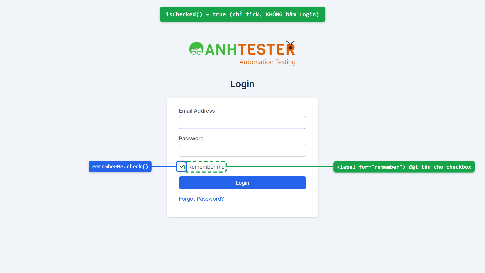
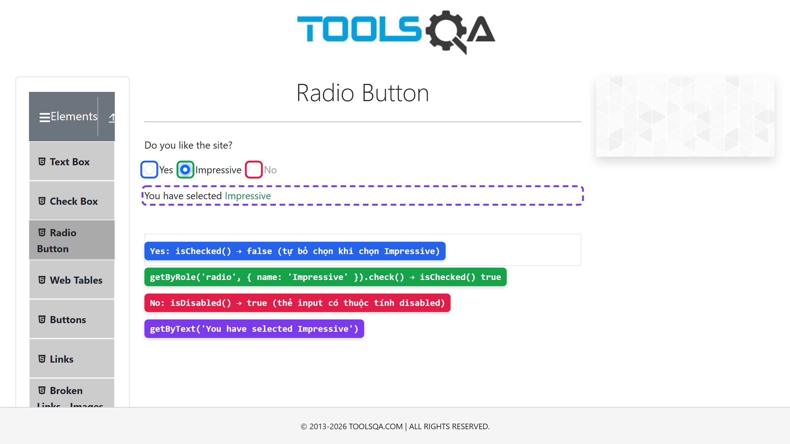
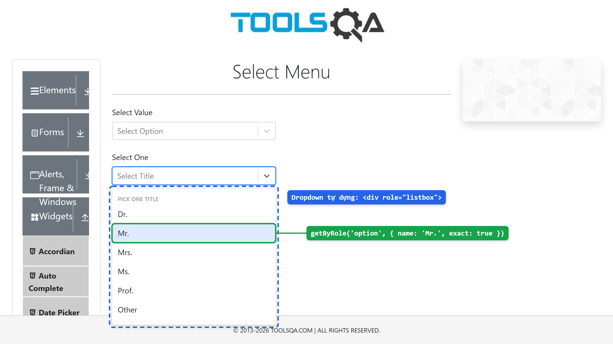
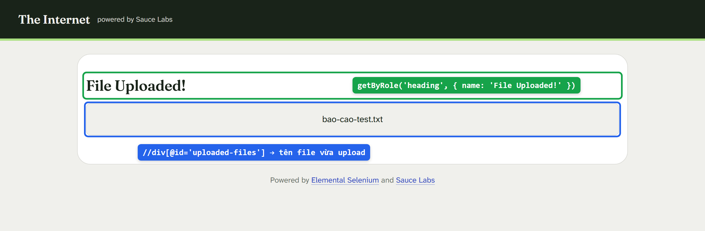
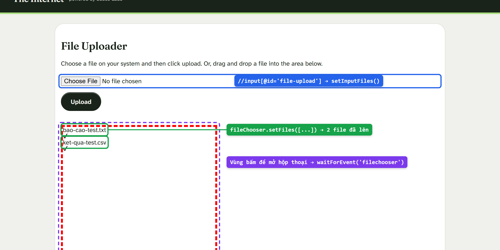
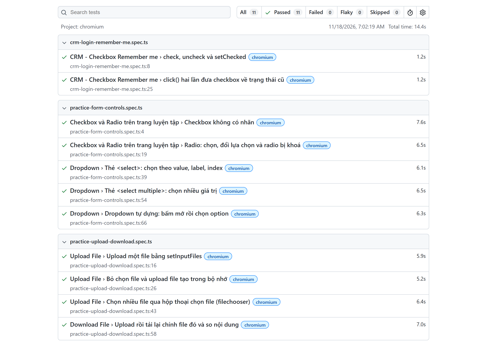

# Bài 17 - [Playwright Typescript] Cách xử lý Checkbox, Radio, Dropdown và Upload, Download File

Chương: 2. Playwright TypeScript + Locator

Nguồn: [https://anhtester.com/learn/website-and-api-testing-automation-with-playwright-javascript-typescript-day-code-js-ts-tu-dau/374](https://anhtester.com/learn/website-and-api-testing-automation-with-playwright-javascript-typescript-day-code-js-ts-tu-dau/374)

✅ Checkbox và Radio Button  
✅ Dropdown - thẻ select và dropdown tự dựng  
✅ Upload File với setInputFiles  
✅ Download File và kiểm tra file tải về  
✅ Dùng Claude Code và bộ kit claude-testing-skills để sinh code xử lý form và file  
✅ Kiểm tra code do AI sinh ra

## ⭐ Mục tiêu bài học

Ở bài trước bạn đã thao tác chuột, bàn phím (`click`, `hover`, `fill`, `press`) và đọc dữ liệu từ phần tử (`textContent`, `inputValue`, `getAttribute`) trong hai file `crm-login-actions.spec.ts` và `practice-mouse-keyboard.spec.ts`. Form thật còn ô tick, nút chọn, danh sách thả xuống, ô chọn file và nút tải file. Học xong bài này bạn sẽ:

- Tick và bỏ tick Checkbox, Radio bằng `check()`, `uncheck()`, `setChecked()` thay cho `click()`.
- Phân biệt thẻ `<select>` với dropdown tự dựng và chọn đúng cách cho từng loại.
- Upload file bằng `setInputFiles()`, tải file về và kiểm tra nội dung file.
- Nhận ra lỗi quen thuộc trong code form và file do AI sinh ra.

> 📌 Bài làm tiếp trong project `D:\AnhTester\playwright-crm` (macOS: `~/AnhTester/playwright-crm`). Dropdown và file được luyện trên hai trang công khai `the-internet.herokuapp.com` và `demoqa.com`. Trên CRM demo **chỉ tick checkbox, không đăng nhập**.

## ✅ Phần 1: Checkbox và Radio Button

### 🔆 1. Bấm công tắc khác với bật đèn

Nhờ ai đó "bấm công tắc" thì đèn đang tắt sẽ sáng, đèn đang sáng lại tắt. Nhờ "bật đèn" thì kết quả luôn là đèn sáng. Checkbox cũng là một cái công tắc với hai trạng thái **đã tick** và **chưa tick**.

Trong automation, `click()` là "bấm công tắc": nó đảo trạng thái mà không biết trạng thái cũ. Ô được tick sẵn là test làm ngược ý bạn mà **không báo lỗi**. Playwright có các hàm kiểu "bật đèn":

<table class="rt-table">
<thead>
<tr>
<th>Hàm</th>
<th>Việc làm</th>
</tr>
</thead>
<tbody>
<tr>
<td><code>check()</code></td>
<td>Bảo đảm ô <strong>được tick</strong>. Đã tick sẵn thì không bấm. Bấm xong mà vẫn chưa tick thì báo lỗi</td>
</tr>
<tr>
<td><code>uncheck()</code></td>
<td>Bảo đảm ô <strong>không tick</strong>, cách làm tương tự</td>
</tr>
<tr>
<td><code>setChecked(true)</code>, <code>setChecked(false)</code></td>
<td>Gộp hai hàm trên, tiện khi trạng thái mong muốn nằm trong biến</td>
</tr>
<tr>
<td><code>isChecked()</code></td>
<td>Đọc trạng thái hiện tại, trả về <code>true</code> hoặc <code>false</code></td>
</tr>
</tbody>
</table>

Kiểm tra trạng thái bằng `toBeChecked()` và `not.toBeChecked()`. Các hàm `expect` được học kỹ ở chương Assertion ngay sau bài này.

### 🔆 2. Checkbox Remember me trên trang đăng nhập CRM

HTML thật của checkbox trên trang `https://crm.anhtester.com/admin/authentication`:

```markup
<div class="checkbox checkbox-inline">
  <input type="checkbox" value="estimate" id="remember" name="remember">
  <label for="remember"> Remember me</label>
</div>
```

Thẻ `<label for="remember">` đặt tên cho checkbox, nên `getByRole('checkbox', { name: 'Remember me' })` và `getByLabel('Remember me')` đều khớp đúng 1 phần tử. Tạo file `tests/crm-login-remember-me.spec.ts`:

```typescript
import { test, expect } from '@playwright/test';

test.describe('CRM - Checkbox Remember me', () => {
  test.beforeEach(async ({ page }) => {
    await page.goto('https://crm.anhtester.com/admin/authentication');
  });

  test('check, uncheck và setChecked', async ({ page }) => {
    const rememberMe = page.getByRole('checkbox', { name: 'Remember me' });
    console.log('Ban đầu:', await rememberMe.isChecked());

    await rememberMe.check();
    await rememberMe.check(); // gọi lần 2: ô đã tick rồi nên Playwright không bấm nữa
    console.log('Sau 2 lần check():', await rememberMe.isChecked());
    await expect(rememberMe).toBeChecked();

    await rememberMe.uncheck();
    await expect(rememberMe).not.toBeChecked();

    const ghiNhoDangNhap = true; // sau này giá trị này lấy từ dữ liệu test
    await rememberMe.setChecked(ghiNhoDangNhap);
    await expect(rememberMe).toBeChecked();
  });

  test('click() hai lần đưa checkbox về trạng thái cũ', async ({ page }) => {
    const rememberMe = page.getByRole('checkbox', { name: 'Remember me' });

    await rememberMe.click();
    await rememberMe.click();
    console.log('Sau 2 lần click():', await rememberMe.isChecked());
    await expect(rememberMe).not.toBeChecked();
  });
});
```

```bash
npx playwright test crm-login-remember-me --project=chromium --workers=1
```

Kết quả chạy thật (Playwright 1.65.1, ngày 18/11/2026; đã lược các dòng tên test):

```bash
Running 2 tests using 1 worker

Ban đầu: false
Sau 2 lần check(): true
Sau 2 lần click(): false

  2 passed (2.3s)
```

Gọi `check()` hai lần, ô vẫn được tick. Gọi `click()` hai lần, ô quay về chưa tick.

[](https://anhtester.com/storage/photos/shares/lesson/js_ts_playwright/v2/bai_17_checkbox_dropdown_upload_download/01_crm_remember_me_da_tick.png)

*Checkbox Remember me trên trang đăng nhập Admin CRM sau khi gọi check()*

> 💡 Ô vuông bạn thấy trên CRM là hình vẽ bằng CSS của thẻ `<label>`. Thẻ `<input>` thật trong suốt (`opacity: 0`) và nằm đè lên đúng chỗ đó, nên `check()` vẫn chạy bình thường.
>
> ⚠️ Nếu `check()` báo lỗi vì thẻ `<input>` bị ẩn hẳn hoặc bị che, hãy bấm vào nhãn của nó rồi kiểm lại bằng `toBeChecked()`. **Đừng thêm `{ force: true }`**: nó bỏ qua bước kiểm tra phần tử có bấm được không, che luôn lỗi người dùng thật sẽ gặp.

### 🔆 3. Checkbox không có nhãn và Radio Button

Trang `https://the-internet.herokuapp.com/checkboxes` có hai checkbox, chữ bên cạnh không nằm trong thẻ `<label>`:

```markup
<form id="checkboxes">
  <input type="checkbox"> checkbox 1<br>
  <input type="checkbox" checked=""> checkbox 2
</form>
```

Không nhãn, không `id`, không `name`: chỉ còn thứ tự để phân biệt. Đây là trường hợp hiếm hoi được dùng `nth()`, và phải ghi lý do trong code. XPath tương đương: `//form[@id='checkboxes']/input[1]`.

Trang `https://demoqa.com/radio-button` có một nhóm radio, trong đó `No` bị khoá:

```markup
<input id="yesRadio" class="form-check-input" type="radio" name="like">
<label class="form-check-label" for="yesRadio">Yes</label>

<input id="impressiveRadio" class="form-check-input" type="radio" name="like">
<label class="form-check-label" for="impressiveRadio">Impressive</label>

<input id="noRadio" disabled="" class="form-check-input disabled" type="radio" name="like">
<label class="form-check-label disabled" for="noRadio">No</label>
```

Tạo file `tests/practice-form-controls.spec.ts` với nhóm test đầu tiên:

```typescript
import { test, expect } from '@playwright/test';

test.describe('Checkbox và Radio trên trang luyện tập', () => {
  test('Checkbox không có nhãn', async ({ page }) => {
    await page.goto('https://the-internet.herokuapp.com/checkboxes');
    // Hai checkbox không có nhãn, không có id hay name: chỉ còn thứ tự để phân biệt
    const checkbox1 = page.getByRole('checkbox').nth(0);
    const checkbox2 = page.getByRole('checkbox').nth(1);
    console.log('Ban đầu:', await checkbox1.isChecked(), await checkbox2.isChecked());

    await checkbox1.check();
    await checkbox2.uncheck();
    console.log('Sau thao tác:', await checkbox1.isChecked(), await checkbox2.isChecked());

    await expect(checkbox1).toBeChecked();
    await expect(checkbox2).not.toBeChecked();
  });

  test('Radio: chọn, đổi lựa chọn và radio bị khoá', async ({ page }) => {
    await page.goto('https://demoqa.com/radio-button');
    const yes = page.getByRole('radio', { name: 'Yes' });
    const impressive = page.getByRole('radio', { name: 'Impressive' });
    const no = page.getByRole('radio', { name: 'No' });

    await yes.check();
    await expect(page.getByText('You have selected Yes')).toBeVisible();

    await impressive.check(); // chọn radio khác trong nhóm: Yes tự bỏ chọn
    await expect(impressive).toBeChecked();
    await expect(yes).not.toBeChecked();
    await expect(page.getByText('You have selected Impressive')).toBeVisible();

    console.log('Radio No bị khoá:', await no.isDisabled());
    await expect(no).toBeDisabled();
  });
});
```

```bash
npx playwright test practice-form-controls --project=chromium --workers=1 -g "Checkbox"
```

```bash
Running 2 tests using 1 worker

Ban đầu: false true
Sau thao tác: true false
Radio No bị khoá: true

  2 passed (13.1s)
```

[](https://anhtester.com/storage/photos/shares/lesson/js_ts_playwright/v2/bai_17_checkbox_dropdown_upload_download/02_demoqa_radio_impressive_va_no_bi_khoa.png)

*Nhóm radio trên demoqa: Impressive đang được chọn, No bị khoá*

Radio khác checkbox ở ba điểm, cả ba đều đã chạy thật:

- **Một nhóm chỉ chọn được một.** Chọn `Impressive`, `Yes` tự bỏ chọn.
- **Không `uncheck()` được radio.** Playwright báo `Cannot uncheck radio button. Radio buttons can only be unchecked by selecting another radio button in the same group.`
- **Radio bị khoá thì không chọn được.** `no.check()` chờ tới hết giờ, log lặp lại `element is not enabled`. Thêm `{ force: true }` vẫn lỗi: `Clicking the checkbox did not change its state`. Test đúng là kiểm tra nó **đang bị khoá** bằng `toBeDisabled()`.

## ✅ Phần 2: Dropdown - thẻ select và dropdown tự dựng

### 🔆 1. Nhìn HTML để biết đang gặp loại nào

Dropdown giống thực đơn của quán: bạn chọn một dòng có sẵn chứ không tự viết tên món. Web có hai cách dựng thực đơn đó, nhìn gần giống nhau nhưng code thao tác **khác hẳn**. Bấm chuột phải vào dropdown, chọn Inspect và xem thẻ:

<table class="rt-table">
<thead>
<tr>
<th>Loại</th>
<th>HTML</th>
<th>Cách thao tác</th>
</tr>
</thead>
<tbody>
<tr>
<td>Thẻ <code>&lt;select&gt;</code> của trình duyệt</td>
<td>Thẻ <code>&lt;select&gt;</code>, bên trong là các thẻ <code>&lt;option&gt;</code></td>
<td><code>selectOption()</code>, không cần bấm mở</td>
</tr>
<tr>
<td>Dropdown tự dựng</td>
<td>Các thẻ <code>&lt;div&gt;</code>, <code>&lt;li&gt;</code>. Option chỉ có trong HTML <strong>sau khi bấm mở</strong></td>
<td>Bấm mở rồi bấm option, hoặc gõ chữ rồi nhấn <code>Enter</code></td>
</tr>
</tbody>
</table>

Trang `https://demoqa.com/select-menu` có cả hai loại. HTML thật (đã lược các thuộc tính tạo kiểu):

```markup
<!-- Loại 1: thẻ select -->
<select id="oldSelectMenu">
  <option value="red">Red</option>
  <option value="1">Blue</option>
  <option value="2">Green</option>
  ...
</select>

<!-- Loại 2: dropdown tự dựng, SAU KHI bấm mở -->
<div id="selectOne" class="css-b62m3t-container">
  <div class="css-1jqq78o-placeholder">Select Title</div>
  <input role="combobox" aria-expanded="true" type="text" value="">
  <div role="listbox">
    <div role="option" aria-selected="false">Dr.</div>
    <div role="option" aria-selected="false">Mr.</div>
    ...
  </div>
</div>
```

Class kiểu `css-b62m3t-container` do thư viện tự sinh, không bám locator vào chúng.

### 🔆 2. selectOption cho thẻ select

<table class="rt-table">
<thead>
<tr>
<th>Cách gọi</th>
<th>Chọn theo</th>
</tr>
</thead>
<tbody>
<tr>
<td><code>selectOption('1')</code></td>
<td>Chuỗi: khớp thuộc tính <code>value</code> <strong>hoặc</strong> chữ hiển thị</td>
</tr>
<tr>
<td><code><span>selectOption({</span> <span>label:</span> <span>'Option</span> <span>2'</span> <span>})</span></code></td>
<td>Chỉ chữ hiển thị. Rõ ý nhất</td>
</tr>
<tr>
<td><code>selectOption({ index: 1 })</code></td>
<td>Vị trí, đếm từ 0. Dễ sai khi danh sách thêm bớt</td>
</tr>
<tr>
<td><code>selectOption(['volvo', 'audi'])</code></td>
<td>Mảng: chọn nhiều giá trị, cho <code>&lt;select multiple&gt;</code></td>
</tr>
</tbody>
</table>

Hàm trả về **mảng các value đã chọn**. Đọc giá trị đang chọn bằng `inputValue()`, kiểm tra bằng `toHaveValue()` hoặc `toHaveValues()` (nhiều giá trị). Thêm nhóm test thứ hai vào cuối file `tests/practice-form-controls.spec.ts`:

```typescript
test.describe('Dropdown', () => {
  test('Thẻ <select>: chọn theo value, label, index', async ({ page }) => {
    await page.goto('https://the-internet.herokuapp.com/dropdown');
    const dropdown = page.getByRole('combobox');

    const ketQua = await dropdown.selectOption('1'); // chuỗi: khớp value hoặc label
    console.log('selectOption trả về:', ketQua);

    await dropdown.selectOption({ label: 'Option 2' }); // chỉ khớp chữ hiển thị
    console.log('Sau khi chọn theo label:', await dropdown.inputValue());

    await dropdown.selectOption({ index: 1 }); // vị trí, đếm từ 0
    await expect(dropdown).toHaveValue('1');
    await expect(dropdown.getByRole('option', { selected: true })).toHaveText('Option 1');
  });

  test('Thẻ <select multiple>: chọn nhiều giá trị', async ({ page }) => {
    await page.goto('https://demoqa.com/select-menu');
    const cars = page.locator("//select[@id='cars']");

    const ketQua = await cars.selectOption(['volvo', 'audi']);
    console.log('Đã chọn:', ketQua);
    await expect(cars).toHaveValues(['volvo', 'audi']);

    await cars.selectOption([{ label: 'Saab' }, { label: 'Opel' }]); // chọn lại: bộ cũ bị thay
    await expect(cars).toHaveValues(['saab', 'opel']);
  });

  test('Dropdown tự dựng: bấm mở rồi chọn option', async ({ page }) => {
    await page.goto('https://demoqa.com/select-menu');

    // Cách 1: bấm mở, rồi bấm option theo role và tên
    const selectOne = page.locator("//div[@id='selectOne']");
    await selectOne.click();
    await selectOne.getByRole('option', { name: 'Mr.', exact: true }).click();
    await expect(selectOne.getByRole('listbox')).toBeHidden();
    await expect(selectOne.getByText('Mr.', { exact: true })).toBeVisible();

    // Cách 2: gõ chữ để lọc, rồi nhấn Enter
    const selectValue = page.locator("//div[@id='withOptGroup']");
    await selectValue.getByRole('combobox').fill('Group 2, option 1');
    await selectValue.getByRole('combobox').press('Enter');
    await expect(selectValue.getByText('Group 2, option 1', { exact: true })).toBeVisible();
  });
});
```

```bash
npx playwright test practice-form-controls --project=chromium --workers=1 -g "Dropdown"
```

```bash
Running 3 tests using 1 worker

selectOption trả về: [ '1' ]
Sau khi chọn theo label: 2
Đã chọn: [ 'volvo', 'audi' ]

  3 passed (18.8s)
```

- Trang the-internet chỉ có một thẻ `<select>` nên `getByRole('combobox')` là đủ. Trang demoqa có nhiều dropdown không nhãn, nên dùng XPath theo `id`.
- `inputValue()` trả về `value` (`2`), không phải chữ hiển thị. Muốn lấy chữ thì tìm option đang chọn: `dropdown.getByRole('option', { selected: true })`.

### 🔆 3. Dropdown tự dựng

Gọi `selectOption()` lên dropdown tự dựng là lỗi AI mắc nhiều nhất ở phần này. Kết quả chạy thật với `page.locator("//div[@id='selectOne']").selectOption('Mr.')`:

```bash
Error: locator.selectOption: Error: Element is not a <select> element
Call log:
  - waiting for locator('//div[@id=\'selectOne\']')
    - locator resolved to <div id="selectOne" class="css-b62m3t-container">…</div>
  - attempting select option action
    - waiting for element to be visible and enabled
```

Cách đúng là làm như người dùng (test thứ ba ở trên): bấm mở, rồi bấm option theo role và tên. Hai điểm cần để ý:

- **Tìm option bên trong chính dropdown đó.** `page.getByRole('option')` trên trang này khớp 21 phần tử vì các thẻ `<option>` của `<select>` cũng có role `option`. `selectOne.getByRole('option', ...)` thu hẹp về 6 dòng của dropdown đang mở.
- **Kiểm tra sau khi chọn.** Dropdown tự dựng không có `value` để đọc. Test kiểm tra thứ người dùng thấy: danh sách đã đóng và ô hiển thị chữ `Mr.`

[](https://anhtester.com/storage/photos/shares/lesson/js_ts_playwright/v2/bai_17_checkbox_dropdown_upload_download/03_demoqa_dropdown_tu_dung_dang_mo.png)

*Dropdown tự dựng Select One trên demoqa khi đang mở*

Cách 2 (gõ chữ rồi nhấn `Enter`) hợp với dropdown có ô tìm kiếm. Luôn mở DevTools xem HTML **lúc dropdown đang mở** trước khi viết.

## ✅ Phần 3: Upload File

### 🔆 1. setInputFiles: đưa file thẳng vào ô chọn file

Khi nộp hồ sơ online, bạn bấm "Chọn tệp" và một cửa sổ của Windows hoặc macOS hiện ra. Cửa sổ đó thuộc hệ điều hành, Playwright không bấm vào được. Thay vào đó Playwright **đưa thẳng đường dẫn file vào thẻ `<input type="file">`** bằng `setInputFiles()`.

<table class="rt-table">
<thead>
<tr>
<th>Cách gọi</th>
<th>Việc làm</th>
</tr>
</thead>
<tbody>
<tr>
<td><code>setInputFiles(duongDan)</code></td>
<td>Chọn một file</td>
</tr>
<tr>
<td><code>setInputFiles([file1, file2])</code></td>
<td>Chọn nhiều file, thẻ <code>&lt;input&gt;</code> phải có thuộc tính <code>multiple</code></td>
</tr>
<tr>
<td><code>setInputFiles([])</code></td>
<td>Bỏ chọn mọi file</td>
</tr>
<tr>
<td><code><span>setInputFiles({</span> <span>name,</span> <span>mimeType,</span> <span>buffer</span> <span>})</span></code></td>
<td>Tạo file trong bộ nhớ, không cần file trên ổ đĩa</td>
</tr>
</tbody>
</table>

Tạo hai file dữ liệu. File `data/files/bao-cao-test.txt`:

```bash
Bao cao test - Anh Tester
Tong so test case: 50
Passed: 47
Failed: 3
```

File `data/files/ket-qua-test.csv`:

```bash
TC_ID,Ket qua
LOGIN_001,Passed
LOGIN_002,Failed
```

Trang `https://the-internet.herokuapp.com/upload` có ô chọn file:

```markup
<form method="POST" enctype="multipart/form-data">
  <input id="file-upload" type="file" name="file">
  <input class="button" id="file-submit" type="submit" value="Upload">
</form>
<div id="drag-drop-upload"></div>   <!-- vùng kéo thả, bấm vào cũng mở hộp thoại chọn file -->
```

Tạo file `tests/practice-upload-download.spec.ts`:

```typescript
import { test, expect } from '@playwright/test';
import fs from 'fs';
import path from 'path';

// __dirname là thư mục chứa file test này (tests/), nên đường dẫn không phụ thuộc nơi bạn gõ lệnh
const thuMucFile = path.join(__dirname, '..', 'data', 'files');
const fileBaoCao = path.join(thuMucFile, 'bao-cao-test.txt');
const fileKetQua = path.join(thuMucFile, 'ket-qua-test.csv');
const thuMucTai = path.join(__dirname, '..', 'downloads');

test.describe('Upload File', () => {
  test.beforeEach(async ({ page }) => {
    await page.goto('https://the-internet.herokuapp.com/upload');
  });

  test('Upload một file bằng setInputFiles', async ({ page }) => {
    const fileInput = page.locator("//input[@id='file-upload']");

    await fileInput.setInputFiles(fileBaoCao);
    await page.getByRole('button', { name: 'Upload' }).click();

    await expect(page.getByRole('heading', { name: 'File Uploaded!' })).toBeVisible();
    await expect(page.locator("//div[@id='uploaded-files']")).toHaveText('bao-cao-test.txt');
  });

  test('Bỏ chọn file và upload file tạo trong bộ nhớ', async ({ page }) => {
    const fileInput = page.locator("//input[@id='file-upload']");

    await fileInput.setInputFiles(fileBaoCao);
    console.log('Đã chọn:', await fileInput.inputValue());
    await fileInput.setInputFiles([]); // mảng rỗng: bỏ chọn
    console.log('Sau khi bỏ chọn:', JSON.stringify(await fileInput.inputValue()));

    await fileInput.setInputFiles({
      name: 'ghi-chu.txt',
      mimeType: 'text/plain',
      buffer: Buffer.from('File này tạo trong bộ nhớ, không có trên ổ đĩa'),
    });
    await page.getByRole('button', { name: 'Upload' }).click();
    await expect(page.locator("//div[@id='uploaded-files']")).toHaveText('ghi-chu.txt');
  });

  test('Chọn nhiều file qua hộp thoại chọn file (filechooser)', async ({ page }) => {
    const vungTaiLen = page.locator("//div[@id='drag-drop-upload']");

    const fileChooserPromise = page.waitForEvent('filechooser'); // chờ TRƯỚC, chưa await
    await vungTaiLen.click(); // bấm để trang mở hộp thoại chọn file
    const fileChooser = await fileChooserPromise; // giờ mới nhận kết quả
    console.log('Cho chọn nhiều file:', fileChooser.isMultiple());

    await fileChooser.setFiles([fileBaoCao, fileKetQua]);
    await expect(vungTaiLen.getByText('bao-cao-test.txt')).toBeVisible();
    await expect(vungTaiLen.getByText('ket-qua-test.csv')).toBeVisible();
  });
});
```

```bash
npx playwright test practice-upload-download --project=chromium --workers=1 -g "Upload File"
```

```bash
Running 3 tests using 1 worker

Đã chọn: C:\fakepath\bao-cao-test.txt
Sau khi bỏ chọn: ""
Cho chọn nhiều file: true

  3 passed (18.5s)
```

[](https://anhtester.com/storage/photos/shares/lesson/js_ts_playwright/v2/bai_17_checkbox_dropdown_upload_download/04_ket_qua_upload_file_uploaded.png)

*Trang kết quả File Uploaded! hiện tên file vừa upload*

- **`C:\fakepath\` là bình thường.** Trình duyệt giấu đường dẫn thật. Hãy kiểm tra tên file mà trang hiển thị.
- **Vì sao là `//input[@id='file-upload']`?** Viết `//input[@type='file']` thì lỗi strict mode, khớp 2 phần tử: trang còn một ô chọn file ẩn do vùng kéo thả tạo ra.

### 🔆 2. Đường dẫn file: tương đối hay tuyệt đối?

Theo tài liệu Playwright, đường dẫn tương đối trong `setInputFiles()` được tính từ **thư mục đang đứng khi gõ lệnh**. `setInputFiles('data/files/bao-cao-test.txt')` chỉ chạy được khi bạn đứng ở gốc project. Đứng ở nơi khác là lỗi (kết quả chạy thật):

```bash
Error: ENOENT: no such file or directory, stat 'C:\Program Files\Git\data\files\bao-cao-test.txt'
```

Vì vậy file test ghép đường dẫn bằng `path.join(__dirname, '..', 'data', 'files')`. `__dirname` là thư mục chứa chính file test, nên kết quả đúng dù lệnh gõ ở đâu. `path` và `fs` là module của Node.js, bạn đã gặp ở chương JavaScript.

Không viết đường dẫn tuyệt đối của máy mình (`C:\Users\...`) vào code: sang máy khác là test hỏng.

### 🔆 3. Khi không có sẵn thẻ input: filechooser

Có trang chỉ tạo thẻ `<input type="file">` lúc bạn bấm nút. Khi đó bạn bắt sự kiện `filechooser`, tức là lúc trang **định mở** cửa sổ chọn file. Thứ tự ba dòng trong test thứ ba là bắt buộc:

1. `const fileChooserPromise = page.waitForEvent('filechooser');` — bắt đầu chờ, **chưa** `await`.
2. `await vungTaiLen.click();` — thao tác làm trang mở hộp thoại.
3. `const fileChooser = await fileChooserPromise;` — nhận kết quả, rồi gọi `fileChooser.setFiles(...)`.

Đảo bước 1 xuống sau bước 2 thì sự kiện có thể xảy ra trước khi bạn kịp chờ.

[](https://anhtester.com/storage/photos/shares/lesson/js_ts_playwright/v2/bai_17_checkbox_dropdown_upload_download/05_filechooser_chon_2_file.png)

*Hai cách upload trên trang File Uploader: setInputFiles và filechooser*

Luôn tìm thẻ `<input type="file">` trước (bị ẩn vẫn dùng `setInputFiles()` được), không có mới dùng `filechooser`. Tài liệu: [Upload files trên playwright.dev](https://playwright.dev/docs/input#upload-files).

## ✅ Phần 4: Download File và kiểm tra file tải về

### 🔆 1. Bắt sự kiện download rồi lưu file

Bấm nút "Xuất Excel" mà chỉ kiểm tra "bấm được" thì chưa test gì: file có về không, đúng tên, đúng dữ liệu không? Playwright báo mỗi lượt tải bằng sự kiện `download`, cách bắt giống `filechooser`: gọi `page.waitForEvent('download')` **trước** khi bấm. Từ đối tượng nhận được, `suggestedFilename()` cho tên file trang web đề nghị, `saveAs()` chờ tải xong rồi chép file tới nơi bạn chỉ định.

Phải gọi `saveAs()` vì Playwright tải file vào thư mục tạm với tên ngẫu nhiên và **xoá khi test kết thúc**. Danh sách file ở `https://the-internet.herokuapp.com/download` đổi liên tục do nhiều người cùng upload, nên test tự upload file của mình rồi tải lại đúng file đó. Thêm vào cuối file `tests/practice-upload-download.spec.ts`:

```typescript
test.describe('Download File', () => {
  test('Upload rồi tải lại chính file đó và so nội dung', async ({ page }) => {
    await page.goto('https://the-internet.herokuapp.com/upload');
    await page.locator("//input[@id='file-upload']").setInputFiles(fileBaoCao);
    await page.getByRole('button', { name: 'Upload' }).click();
    await expect(page.getByRole('heading', { name: 'File Uploaded!' })).toBeVisible();

    await page.goto('https://the-internet.herokuapp.com/download');
    const downloadPromise = page.waitForEvent('download'); // chờ TRƯỚC, chưa await
    await page.getByRole('link', { name: 'bao-cao-test.txt', exact: true }).click();
    const download = await downloadPromise;

    const noiLuu = path.join(thuMucTai, download.suggestedFilename());
    await download.saveAs(noiLuu); // tự chờ tải xong rồi mới chép file ra
    console.log('Tên file:', download.suggestedFilename());
    console.log('Kích thước:', fs.statSync(noiLuu).size, 'byte');

    expect(fs.existsSync(noiLuu)).toBeTruthy();
    expect(fs.readFileSync(noiLuu, 'utf-8')).toBe(fs.readFileSync(fileBaoCao, 'utf-8'));
  });
});
```

```bash
npx playwright test practice-upload-download --project=chromium --workers=1 -g "Download File"
```

```bash
Running 1 test using 1 worker

Tên file: bao-cao-test.txt
Kích thước: 69 byte

  1 passed (6.3s)
```

Hai dòng `expect` cuối dùng `fs` của Node.js: file có tồn tại, và nội dung tải về **giống hệt** file đã upload. Tài liệu: [Downloads trên playwright.dev](https://playwright.dev/docs/downloads).

### 🔆 2. Hai lỗi hay gặp với download

**Chờ sau khi bấm.** Nút `Download` ở `https://demoqa.com/upload-download` tải file ngay lập tức. Viết ngược thứ tự:

```typescript
await page.getByRole('button', { name: 'Download' }).click();
const download = await page.waitForEvent('download'); // SAI: sự kiện đã xảy ra rồi
```

Kết quả chạy thật:

```bash
Test timeout of 30000ms exceeded.

Error: page.waitForEvent: Test timeout of 30000ms exceeded.
=========================== logs ===========================
waiting for event "download"
============================================================
```

Cũng đoạn code sai đó, trên trang the-internet lại **có lúc chạy qua** vì file đi qua mạng nên sự kiện tới chậm hơn. Lúc đúng lúc sai là kiểu lỗi khó tìm nhất.

**Lưu file vào thư mục code.** File tải về là kết quả một lần chạy, không phải mã nguồn. Bài này lưu vào `downloads/` và thêm một dòng vào cuối file `.gitignore`:

```bash
/downloads/
```

## ✅ Phần 5: Chạy cả ba file thực hành

Cây thư mục của project sau bài này (chỉ ghi phần mới):

```bash
playwright-crm/
├── data/
│   └── files/
│       ├── bao-cao-test.txt
│       └── ket-qua-test.csv
├── downloads/                             (tự sinh khi chạy, đã có trong .gitignore)
├── tests/
│   ├── crm-login-remember-me.spec.ts
│   ├── practice-form-controls.spec.ts
│   └── practice-upload-download.spec.ts
└── .gitignore
```

```bash
npx playwright test crm-login-remember-me practice-form-controls practice-upload-download --project=chromium
```

Kết quả chạy thật: `11 passed (15.8s)`. Mở báo cáo bằng `npx playwright show-report`:

[](https://anhtester.com/storage/photos/shares/lesson/js_ts_playwright/v2/bai_17_checkbox_dropdown_upload_download/06_html_report_11_test_dat.png)

*HTML Report của ba file thực hành: 11 test đạt*

## ✅ Phần 6: Dùng Claude Code và bộ kit claude-testing-skills để sinh code xử lý form và file

### 🔆 1. Prompt mẫu

Anh Tester dùng [Claude](https://claude.ai/) và Claude Code (bản có phí) cùng bộ kit [claude-testing-skills](https://github.com/anhtester/claude-testing-skills). Với bản miễn phí [ChatGPT](https://chatgpt.com/) hoặc [Gemini](https://gemini.google.com/), chỗ có `@đường-dẫn` (cách đưa file vào câu hỏi của Claude Code, xem [tài liệu](https://code.claude.com/docs/en/common-workflows)) thì dán nội dung file vào thay.

```markdown
Viết test Playwright TypeScript cho test case thủ công dưới đây, lưu vào tests/practice-upload-download.spec.ts.
Ràng buộc:
- Locator theo @.claude/rules/project_locator_rules.md: getBy... trước, XPath sau, KHÔNG dùng CSS Selector.
- Checkbox và radio dùng check() / uncheck() / setChecked(), KHÔNG dùng click().
- Trước khi chọn dropdown, nói rõ nó là thẻ <select> hay dropdown tự dựng và dẫn đoạn HTML làm bằng chứng. Chỉ dùng selectOption() cho thẻ <select>.
- File upload lấy từ data/files/ của project, ghép đường dẫn bằng path.join(__dirname, ...). KHÔNG dùng đường dẫn tuyệt đối.
- Download: gọi page.waitForEvent('download') TRƯỚC khi bấm, lưu vào downloads/, kiểm tra tên file và nội dung file.
- KHÔNG dùng waitForTimeout, KHÔNG dùng force: true.

Test case:
1. Mở https://the-internet.herokuapp.com/upload
2. Chọn file bao-cao-test.txt và bấm Upload
3. Kết quả mong đợi: trang hiện "File Uploaded!" và tên file bao-cao-test.txt
```

```markdown
Tôi mới học Playwright. Giải thích vì sao với checkbox nên dùng check() thay cho click().
Yêu cầu:
- Lấy ví dụ một checkbox đang được tick sẵn, viết ra trạng thái của nó sau click() và sau check().
- Nêu 2 tình huống thực tế khiến checkbox bị tick sẵn mà người viết test không ngờ tới.
- Nói rõ check() làm gì khi bấm xong mà ô vẫn chưa được tick.
- Dẫn link tài liệu playwright.dev. Chỗ nào không chắc thì nói rõ, tôi sẽ tự chạy lại để đối chiếu.
```

```markdown
Đoạn code dưới đây báo lỗi "Element is not a <select> element".
Dựa vào HTML tôi dán kèm (chụp lúc dropdown ĐANG MỞ), hãy viết lại theo cách: bấm mở dropdown, rồi chọn option bằng getByRole('option', { name: ..., exact: true }) tìm BÊN TRONG chính dropdown đó.
Không dùng class tự sinh kiểu css-xxxx, không dùng CSS Selector, không dùng force: true.
Sau khi chọn, thêm bước kiểm tra giá trị đang hiển thị trên dropdown.

[dán đoạn code lỗi]
[dán HTML của dropdown khi đang mở]
```

### 🔆 2. Lệnh của bộ kit dùng được cho bài này

<table class="rt-table">
<thead>
<tr>
<th>Lệnh</th>
<th>Dùng khi</th>
</tr>
</thead>
<tbody>
<tr>
<td><a href="https://github.com/anhtester/claude-testing-skills/blob/main/.claude/commands/generate-automation-web.md">/generate-automation-web</a></td>
<td>Sinh script từ file test case (mode <code>TC</code>) hoặc từ URL kèm mô tả thao tác (mode <code>FLOW</code>). Lệnh mở trình duyệt thật đọc DOM rồi mới viết code</td>
</tr>
<tr>
<td><a href="https://github.com/anhtester/claude-testing-skills/blob/main/.claude/commands/review-automation-code.md">/review-automation-code</a></td>
<td>Chấm chất lượng script đã có: <code>REVIEW</code> chỉ báo cáo, <code>FIX</code> sửa sau khi bạn duyệt. Bắt chờ cứng và test "đạt giả"</td>
</tr>
</tbody>
</table>

```markdown
/generate-automation-web FLOW https://the-internet.herokuapp.com/upload - chọn file data/files/bao-cao-test.txt, bấm Upload, kiểm tra trang hiện "File Uploaded!" và đúng tên file
```

```markdown
/review-automation-code REVIEW tests/practice-upload-download.spec.ts
```

Lệnh sinh code của kit tạo cả Page Object, học ở chương Page Object Model.

## ✅ Phần 7: Kiểm tra code do AI sinh ra

Rà code form và file do AI viết theo bảng sau:

<table class="rt-table">
<thead>
<tr>
<th>Dấu hiệu</th>
<th>Vì sao là vấn đề</th>
<th>Cách xử lý</th>
</tr>
</thead>
<tbody>
<tr>
<td><code>click()</code> trên checkbox, radio</td>
<td>Đảo trạng thái. Ô tick sẵn là test làm ngược mà vẫn xanh</td>
<td>Đổi sang <code>check()</code>, <code>uncheck()</code>, <code>setChecked()</code></td>
</tr>
<tr>
<td><code>selectOption()</code> trên dropdown tự dựng</td>
<td>Lỗi <code>Element is not a &lt;select&gt; element</code></td>
<td>Bấm mở rồi chọn option theo role</td>
</tr>
<tr>
<td><code>setInputFiles('C:\\Users\\...')</code></td>
<td>Đường dẫn của máy khác, máy bạn không có file đó</td>
<td>File trong <code>data/files/</code>, ghép bằng <code>path.join(__dirname, ...)</code></td>
</tr>
<tr>
<td><code>locator('input[type="file"]')</code>, <code>locator('#file-upload')</code></td>
<td>CSS Selector, trái quy ước project</td>
<td>Đổi sang <code>getBy...</code> hoặc XPath</td>
</tr>
<tr>
<td><code>waitForEvent(...)</code> đặt <strong>sau</strong> <code>click()</code></td>
<td>Sự kiện có thể đã xảy ra: lúc đạt, lúc hết giờ</td>
<td>Tạo promise trước, bấm, rồi mới <code>await</code></td>
</tr>
<tr>
<td><code>waitForTimeout(5000)</code> chờ file tải xong</td>
<td>Mạng nhanh thì phí, mạng chậm thì vẫn thiếu</td>
<td>Xoá. <code>saveAs()</code> tự chờ tải xong</td>
</tr>
<tr>
<td>Tải file xong là hết test</td>
<td>File rỗng hay sai dữ liệu vẫn đạt</td>
<td>Đọc file bằng <code>fs</code>, kiểm tra nội dung</td>
</tr>
<tr>
<td><code>saveAs('tests/...')</code></td>
<td>File tải về lẫn vào mã nguồn, bị commit</td>
<td>Lưu vào <code>downloads/</code>, thêm vào <code>.gitignore</code></td>
</tr>
<tr>
<td><code>{ force: true }</code> rải khắp nơi</td>
<td>Bỏ qua kiểm tra phần tử có bấm được không, che lỗi thật</td>
<td>Xoá, tìm đúng phần tử bấm được</td>
</tr>
</tbody>
</table>

## ✅ Phần 8: Bài tập thực hành

**Bài tập 1 - Checkbox theo dữ liệu.** Tạo `tests/bt1-remember-me.spec.ts`. Trên trang đăng nhập khách hàng `https://crm.anhtester.com/authentication/login`, dùng vòng lặp qua mảng `[true, false, true]`, gọi `setChecked()` với từng giá trị và kiểm tra trạng thái sau mỗi lần. Không bấm Login.

**Bài tập 2 - Ba kiểu dropdown.** Tạo `tests/bt2-dropdown.spec.ts` trên `https://demoqa.com/select-menu`: chọn `Purple` ở `Old Style Select Menu` theo chữ hiển thị rồi in ra `value`; chọn 3 hãng xe ở `Standard multi select`; chọn `Prof.` ở dropdown tự dựng `Select One`. Mỗi thao tác kèm một dòng kiểm tra.

**Bài tập 3 - Upload và download.** Tạo `tests/bt3-upload-download.spec.ts` trên `https://demoqa.com/upload-download`: upload `ket-qua-test.csv`, kiểm tra dòng chữ hiện ra chứa tên file; bấm `Download`, lưu vào `downloads/`, kiểm tra tên file là `sampleFile.jpeg` và kích thước lớn hơn 0.

**Bài tập 4 - Duyệt code AI.** Đoạn code dưới đây có **9 chỗ cần sửa**: 8 chỗ nằm trên các dòng lệnh, chỗ thứ 9 là một việc bị bỏ sót. Tìm đủ, nêu lý do theo bảng ở Phần 7 và viết lại thành `tests/bt4-form-file.spec.ts` chạy đạt.

```typescript
import { test } from '@playwright/test';

test('Form và file', async ({ page }) => {
  await page.goto('https://the-internet.herokuapp.com/checkboxes');
  await page.getByRole('checkbox').nth(1).click(); // tick checkbox 2

  await page.goto('https://demoqa.com/select-menu');
  await page.locator("//div[@id='selectOne']").selectOption('Mr.');

  await page.goto('https://the-internet.herokuapp.com/upload');
  await page.locator('#file-upload').setInputFiles('C:\\Users\\ai\\Desktop\\bao-cao-test.txt');
  await page.getByRole('button', { name: 'Upload' }).click({ force: true });

  await page.goto('https://the-internet.herokuapp.com/download');
  await page.getByRole('link', { name: 'bao-cao-test.txt', exact: true }).click();
  const download = await page.waitForEvent('download');
  await page.waitForTimeout(5000);
  await download.saveAs('tests/' + download.suggestedFilename());
});
```

## ✅ Phần 9: Ghi nhớ nhanh

- Checkbox, radio: `check()`, `uncheck()`, `setChecked()`. `click()` chỉ đảo trạng thái.
- Thẻ `<select>` dùng `selectOption()`. Dropdown tự dựng thì bấm mở rồi chọn option theo role, tìm bên trong chính dropdown đó.
- Upload: `setInputFiles()` lên thẻ `<input type="file">`, file nằm trong project, đường dẫn ghép bằng `path.join(__dirname, ...)`.
- Download: `waitForEvent('download')` **trước** khi bấm, `saveAs()` vào `downloads/`, đọc file bằng `fs` để kiểm tra nội dung.
- Không dùng `force: true` và `waitForTimeout` để "cho qua".
- Chương **Playwright TypeScript + Locator** kết thúc ở đây: bạn đã dựng được file test, tìm được phần tử và thao tác được với các thành phần phổ biến của một form.

✅ **Kết luận:** Test chỉ có giá trị khi nó **kiểm tra đúng kết quả**. Các hàm `expect` dùng tạm trong mấy bài vừa qua được học bài bản ở bài mở đầu chương Assertion + Cơ chế Auto-Waiting: **Assertion trong Playwright - expect thông thường, Web-First và Soft Assertion**.

---

## Bài tập riêng — Bài tập - Xử lý Checkbox, Radio, Dropdown và Upload, Download File

Nguồn bài tập: [https://anhtester.com/student-assignments?course=website-and-api-testing-automation-with-playwright-javascript-typescript-day-code-js-ts-tu-dau#assignment-107](https://anhtester.com/student-assignments?course=website-and-api-testing-automation-with-playwright-javascript-typescript-day-code-js-ts-tu-dau#assignment-107)

**Mục tiêu:** thao tác đúng với Checkbox, Radio, hai loại Dropdown, Upload và Download File bằng các hàm chuyên dùng của Playwright, kiểm tra được nội dung file tải về, và nhận ra lỗi quen thuộc trong code xử lý form và file do AI sinh ra.

**Thư mục làm bài:** `D:\AnhTester\playwright-crm` (macOS: `~/AnhTester/playwright-crm`). Trên CRM demo chỉ làm việc với trang đăng nhập công khai, **không đăng nhập, không bấm Login**. Locator chỉ dùng các hàm `getBy...` và XPath, không dùng CSS Selector.

### 📝 Đề bài

#### Bài tập 1 - Checkbox theo dữ liệu

Tạo file `tests/bt1-remember-me.spec.ts`. Mở trang đăng nhập của khách hàng `https://crm.anhtester.com/authentication/login`. Khai báo mảng `[true, false, true]`, dùng vòng lặp gọi `setChecked()` với từng giá trị lên checkbox `Remember me`, sau mỗi lần in ra `isChecked()` và kiểm tra bằng `toBeChecked()` hoặc `not.toBeChecked()`. Không nhập mật khẩu, không bấm Login.

#### Bài tập 2 - Ba kiểu dropdown

Tạo file `tests/bt2-dropdown.spec.ts` trên trang `https://demoqa.com/select-menu`:

1. `Old Style Select Menu`: chọn `Purple` theo chữ hiển thị, in ra `value` của nó bằng `inputValue()` và kiểm tra bằng `toHaveValue()`.
2. `Standard multi select`: chọn 3 hãng xe trong một lần gọi `selectOption()`, in ra mảng trả về và kiểm tra bằng `toHaveValues()`.
3. Dropdown tự dựng `Select One`: chọn `Prof.` bằng cách bấm mở rồi chọn option theo role, sau đó kiểm tra danh sách đã đóng và dropdown hiển thị `Prof.`

#### Bài tập 3 - Upload và download

Tạo file `data/files/ket-qua-test.csv` như trong bài học và file `tests/bt3-upload-download.spec.ts` trên trang `https://demoqa.com/upload-download`:

1. Upload `ket-qua-test.csv` bằng `setInputFiles()`, đường dẫn ghép bằng `path.join(__dirname, ...)`. Kiểm tra dòng chữ hiện ra dưới ô chọn file có chứa `ket-qua-test.csv`.
2. Bấm `Download`, lưu file vào thư mục `downloads/` bằng `saveAs()`. Kiểm tra tên file là `sampleFile.jpeg` và dùng `fs` kiểm tra file tồn tại, kích thước lớn hơn 0.
3. Thêm `/downloads/` vào `.gitignore`.

#### Bài tập 4 - Duyệt code AI

Đoạn code dưới đây do AI viết và có **9 chỗ cần sửa**: 8 chỗ nằm ngay trên các dòng lệnh, chỗ thứ 9 là một việc bị bỏ sót. Tìm đủ, nêu lý do và viết lại thành file `tests/bt4-form-file.spec.ts` chạy đạt.

```typescript
import { test } from '@playwright/test';

test('Form và file', async ({ page }) => {
  await page.goto('https://the-internet.herokuapp.com/checkboxes');
  await page.getByRole('checkbox').nth(1).click(); // tick checkbox 2

  await page.goto('https://demoqa.com/select-menu');
  await page.locator("//div[@id='selectOne']").selectOption('Mr.');

  await page.goto('https://the-internet.herokuapp.com/upload');
  await page.locator('#file-upload').setInputFiles('C:\\Users\\ai\\Desktop\\bao-cao-test.txt');
  await page.getByRole('button', { name: 'Upload' }).click({ force: true });

  await page.goto('https://the-internet.herokuapp.com/download');
  await page.getByRole('link', { name: 'bao-cao-test.txt', exact: true }).click();
  const download = await page.waitForEvent('download');
  await page.waitForTimeout(5000);
  await download.saveAs('tests/' + download.suggestedFilename());
});
```

### 📦 Cách nộp bài

1. Làm bài trong project `playwright-crm`, commit và push lên nhánh `main` của repo GitHub `playwright-crm` của bạn. Thư mục `downloads/` không được có trong repo.
2. Dán link repo vào ô **Link GitHub**, dạng `https://github.com/<ten-ban>/playwright-crm`. Repo Private thì vào **Settings → Collaborators** thêm tài khoản GitHub của giảng viên, nếu không giảng viên không mở được.
3. Trong ô **Nội dung bài làm (Editor)**, dán **kết quả chạy thật** trên Terminal của lệnh `npx playwright test bt1 bt2 bt3 bt4 --project=chromium` (dùng **Đoạn code mẫu**, chọn Text / Log).
4. Với bài **Duyệt code AI**: liệt kê từng chỗ sai theo mẫu *Dòng – Lỗi – Lý do – Cách sửa*, rồi dán file đã sửa.

### ✅ Tiêu chí Đạt

- Bài tập 1: dùng `setChecked()` trong vòng lặp, không dùng `click()`; có kiểm tra trạng thái sau mỗi lần; không có thao tác bấm Login. Kết quả in ra lần lượt `true`, `false`, `true`.
- Bài tập 2: hai thẻ `<select>` dùng `selectOption()` (`Purple` chọn bằng `{ label: 'Purple' }`, giá trị in ra là `4`); dropdown tự dựng **không** dùng `selectOption()`, option được tìm bên trong chính dropdown `Select One`; có kiểm tra sau mỗi thao tác.
- Bài tập 3: đường dẫn file không phải đường dẫn tuyệt đối của máy; `page.waitForEvent('download')` được gọi **trước** dòng bấm `Download`; file lưu trong `downloads/`; có kiểm tra tên file và kích thước bằng `fs`; `.gitignore` có dòng `/downloads/`.
- Không có CSS Selector, `waitForTimeout` hay `force: true` trong cả 4 file. Cả 4 file chạy đạt với `--project=chromium`.
- Bài tập 4 nêu đủ 9 lỗi: (1) dùng `click()` cho checkbox 2 vốn đang tick sẵn nên thành bỏ tick, phải dùng `check()`; (2) gọi `selectOption()` lên dropdown tự dựng `//div[@id='selectOne']`, lỗi `Element is not a <select> element`, phải bấm mở rồi chọn option theo role; (3) `locator('#file-upload')` là CSS Selector, đổi sang XPath `//input[@id='file-upload']`; (4) đường dẫn tuyệt đối `C:\Users\ai\Desktop\...` của máy khác, lỗi `ENOENT`, phải lấy file trong `data/files/` và ghép bằng `path.join(__dirname, ...)`; (5) `click({ force: true })` không cần thiết, che lỗi thật; (6) `page.waitForEvent('download')` đặt sau dòng `click()`, phải tạo promise trước khi bấm; (7) `waitForTimeout(5000)` chờ cứng, xoá vì `saveAs()` tự chờ tải xong; (8) lưu file tải về vào thư mục mã nguồn `tests/`, phải lưu vào `downloads/`; (9) cả test không có dòng kiểm tra nào: thiếu `expect` cho trạng thái checkbox, giá trị dropdown, trang `File Uploaded!` và nội dung file tải về.

### 🤖 Dùng AI thế nào cho đúng

Được dùng Claude, ChatGPT hoặc Gemini để **hỏi giải thích** lỗi và khái niệm (prompt mẫu ở phần AI của bài học). Không nhờ AI làm hộ rồi dán vào: bài **Duyệt code AI** chấm chính phần *lý do* do bạn tự viết. Code AI gợi ý phải được bạn chạy thật và đối chiếu với HTML của trang trước khi nộp. Không dán mật khẩu hay file `.env` vào khung chat. Bài nào nộp lại vì **Cần sửa** thì sửa đúng chỗ giảng viên ghi trong feedback rồi bấm **Nộp lại**.