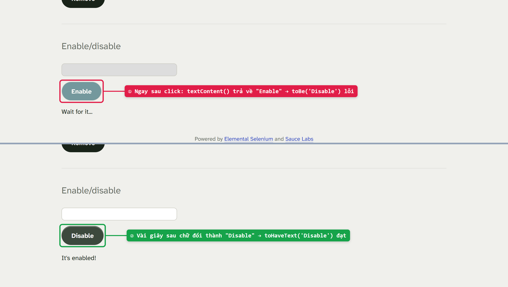
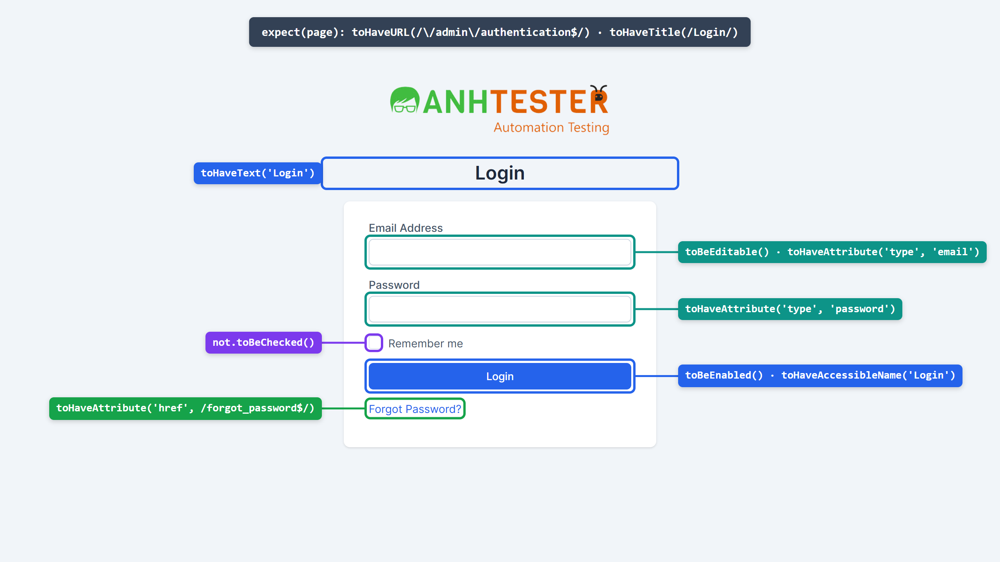
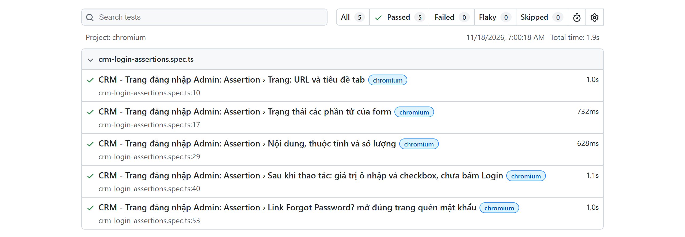
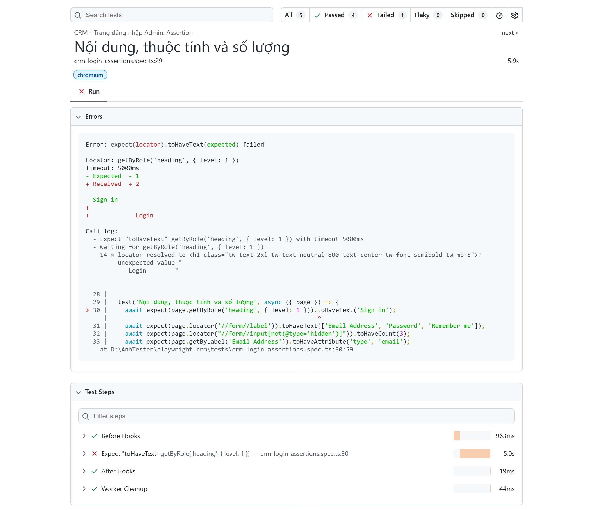
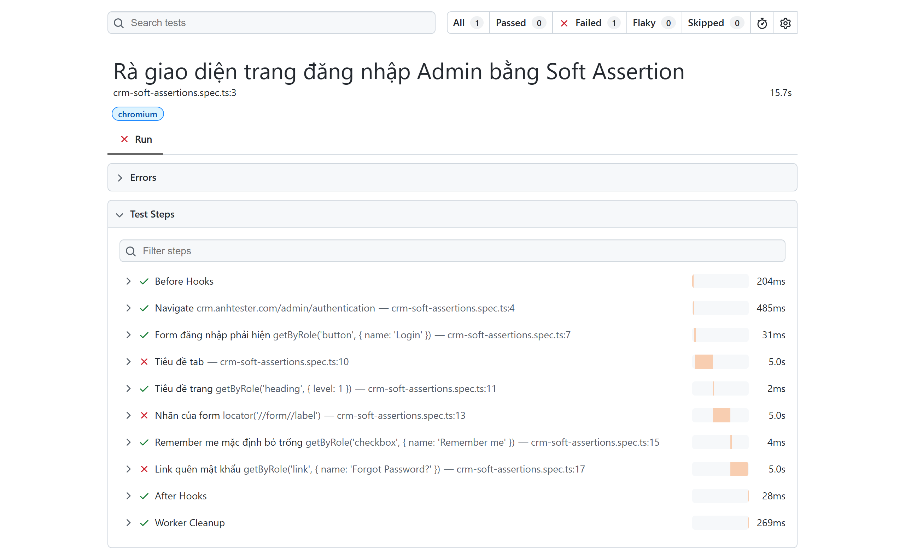

# Bài 18 - [Playwright Typescript] Assertion trong Playwright - expect thông thường, Web-First và Soft Assertion

Chương: 3. Assertion + Cơ chế Auto-Waiting

Nguồn: [https://anhtester.com/learn/website-and-api-testing-automation-with-playwright-javascript-typescript-day-code-js-ts-tu-dau/375](https://anhtester.com/learn/website-and-api-testing-automation-with-playwright-javascript-typescript-day-code-js-ts-tu-dau/375)

✅ Assertion là gì và vì sao test phải có Assertion  
✅ expect thông thường - kiểm tra một giá trị đã có  
✅ Web-First Assertion - tự chờ đến khi đúng  
✅ Thực hành Assertion trên trang đăng nhập CRM  
✅ Soft Assertion, expect.poll và toPass  
✅ Dùng Claude Code và bộ kit claude-testing-skills để sinh và rà Assertion

## ⭐ Mục tiêu bài học

Chương trước bạn đã dựng project `playwright-crm`, biết tìm phần tử bằng `getBy...`, XPath và `filter()`, thao tác, đọc dữ liệu, xử lý checkbox, dropdown, upload và download. Trong các file đó bạn đã viết nhiều dòng `expect(...)` như `toBeVisible`, `toHaveText`, `toHaveValue`, `toBeChecked` mà chưa được giải thích. Bài mở đầu chương Assertion và Auto-Waiting làm rõ chúng. Học xong bạn sẽ:

- Hiểu Assertion là gì và vì sao test không có Assertion thì không kiểm được gì.
- Phân biệt `expect` thông thường (so một giá trị đã có) với **Web-First Assertion** (tự chờ trên locator và page).
- Dùng `expect.soft` để kiểm nhiều điểm trong một test, biết `expect.poll` và `toPass` dùng vào việc gì.
- Đọc được lỗi Assertion và nhận ra Assertion yếu trong code AI sinh ra.

> 📌 Bài làm tiếp trong project `D:\AnhTester\playwright-crm` (macOS: `~/AnhTester/playwright-crm`), trên trang công khai của CRM demo và trang luyện tập `the-internet.herokuapp.com`. Bài này **chưa đăng nhập** CRM.

## ✅ Phần 1: Assertion là gì và vì sao test phải có Assertion

### 🔆 1. Từ việc nhận hàng tới Assertion

Bạn đặt mua một chiếc áo size M màu xanh. Khi nhận hàng, bạn mở hộp và **đối chiếu với đơn đặt**: đúng size, đúng màu thì nhận, sai một điểm là trả lại.

Trong lập trình test, bước đối chiếu đó gọi là **Assertion** (câu khẳng định): bạn nêu kết quả mong đợi, chương trình so với kết quả thật, lệch thì test **failed** ngay tại dòng đó. Trong automation, Assertion là cột **Expected Result** của test case manual viết thành code:

<table class="rt-table">
<thead>
<tr>
<th>Expected Result trong test case manual</th>
<th>Assertion trong Playwright</th>
</tr>
</thead>
<tbody>
<tr>
<td>Trang đăng nhập hiện tiêu đề Login</td>
<td><code><span>await</span> <span>expect(page.getByRole('heading',</span> <span>{</span> <span>name:</span> <span>'Login'</span> <span>})).toBeVisible();</span></code></td>
</tr>
<tr>
<td>Ô Email giữ đúng giá trị vừa nhập</td>
<td><code><span>await</span> <span>expect(page.getByLabel('Email</span> <span>Address')).toHaveValue('tester@example.com');</span></code></td>
</tr>
</tbody>
</table>

### 🔆 2. Test không có Assertion: xanh mà không kiểm gì

Tạo file `tests/no-assertion.spec.ts`:

```typescript
import { test } from '@playwright/test';

test('Form đăng nhập hoạt động', async ({ page }) => {
  await page.goto('https://crm.anhtester.com/admin/authentication');
  await page.getByLabel('Email Address').fill('tester@example.com');
  await page.getByRole('checkbox', { name: 'Remember me' }).check();
});
```

```bash
npx playwright test no-assertion.spec.ts --project=chromium --reporter=list
```

```bash
Running 1 test using 1 worker

  ✓  1 [chromium] › tests\no-assertion.spec.ts:3:1 › Form đăng nhập hoạt động (690ms)

  1 passed (1.3s)
```

Test xanh, nhưng chỉ chứng minh hai phần tử **thao tác được**. Ô Email có giữ đúng giá trị không, checkbox có được tick không, test không hỏi. Loại test này nguy hiểm hơn không có test, vì báo cáo xanh làm cả nhóm yên tâm sai chỗ.

> ⚠️ **Quy tắc:** mỗi test có ít nhất một Assertion kiểm đúng điều mà tên test nói. Thao tác (`click`, `fill`) không phải là kiểm tra.

### 🔆 3. Hai loại expect trong Playwright

<table class="rt-table">
<thead>
<tr>
<th>Tiêu chí</th>
<th>expect thông thường</th>
<th>Web-First Assertion</th>
</tr>
</thead>
<tbody>
<tr>
<td>Nhận vào</td>
<td>Một <strong>giá trị đã có</strong>: số, chuỗi, mảng, object</td>
<td>Một <strong>locator</strong> hoặc <strong>page</strong></td>
</tr>
<tr>
<td>Cách viết</td>
<td><code>expect(total).toBe(3);</code></td>
<td><code><span>await</span> <span>expect(locator).toHaveText('Login');</span></code></td>
</tr>
<tr>
<td>Có <code>await</code></td>
<td>Không</td>
<td><strong>Bắt buộc</strong></td>
</tr>
<tr>
<td>Khi chưa đúng</td>
<td>So <strong>một lần</strong>, sai là lỗi ngay</td>
<td><strong>Tự thử lại</strong> cho tới khi đúng, mặc định tối đa 5 giây</td>
</tr>
<tr>
<td>Dùng cho</td>
<td>Kết quả tính toán, dữ liệu file, dữ liệu API</td>
<td>Mọi thứ đang hiển thị trên trang web</td>
</tr>
</tbody>
</table>

Tài liệu: [playwright.dev/docs/test-assertions](https://playwright.dev/docs/test-assertions).

## ✅ Phần 2: expect thông thường - kiểm tra một giá trị đã có

### 🔆 1. Các matcher hay gặp

Phần đứng sau `expect(...)` như `toBe`, `toContain` gọi là **matcher** (phép so). Tạo file `tests/assertion-basics.spec.ts`:

```typescript
import { test, expect } from '@playwright/test';

test('expect thông thường với giá trị có sẵn', () => {
  const orderCode = 'DH-2026-0042';
  const quantity = 3;
  const tags = ['smoke', 'login', 'regression'];
  const customer = { name: 'Lan', city: 'Hà Nội', orders: 3 };

  expect(quantity).toBe(3);                            // bằng nhau, đúng cả kiểu dữ liệu
  expect(quantity).toBeGreaterThan(0);                 // lớn hơn
  expect(orderCode).toContain('2026');                 // chuỗi chứa chuỗi con
  expect(orderCode).toMatch(/^DH-\d{4}-\d{4}$/);       // khớp biểu thức chính quy
  expect(tags).toContain('login');                     // mảng chứa phần tử
  expect(tags).toHaveLength(3);                        // số phần tử của mảng
  expect(customer).toEqual({ name: 'Lan', city: 'Hà Nội', orders: 3 }); // object cùng nội dung
  expect(customer).toHaveProperty('city', 'Hà Nội');   // có thuộc tính, đúng giá trị
  expect(orderCode).toBeTruthy();                      // "có giá trị": không rỗng, không null
  expect('').toBeFalsy();                              // chuỗi rỗng, 0, null, undefined
  expect(quantity).not.toBe(0);                        // .not đảo ngược mọi matcher
});

test('toBe với object: lỗi dù nội dung giống nhau', () => {
  const expected = { name: 'Lan', orders: 3 };
  const actual = { name: 'Lan', orders: 3 };

  expect(actual).toBe(expected);
});

test('expect thông thường với dữ liệu đọc từ trang', async ({ page }) => {
  await page.goto('https://crm.anhtester.com/admin/authentication');

  const title = await page.title();
  const forgotHref = await page.getByRole('link', { name: 'Forgot Password?' }).getAttribute('href');
  const labels = await page.locator('//form//label').allInnerTexts();

  expect(title).toContain('Login');
  expect(forgotHref).toMatch(/forgot_password$/);
  expect(labels).toEqual(['Email Address', 'Password', 'Remember me']);
});
```

```bash
npx playwright test assertion-basics.spec.ts --project=chromium --reporter=list
```

```bash
Running 3 tests using 3 workers

  ✘  1 [chromium] › tests\assertion-basics.spec.ts:22:1 › toBe với object: lỗi dù nội dung giống nhau (10ms)
  ✓  3 [chromium] › tests\assertion-basics.spec.ts:3:1 › expect thông thường với giá trị có sẵn (13ms)
  ✓  2 [chromium] › tests\assertion-basics.spec.ts:29:1 › expect thông thường với dữ liệu đọc từ trang (684ms)

  1) [chromium] › tests\assertion-basics.spec.ts:22:1 › toBe với object: lỗi dù nội dung giống nhau

    Error: expect(received).toBe(expected) // Object.is equality

    If it should pass with deep equality, replace "toBe" with "toStrictEqual"

    Expected: {"name": "Lan", "orders": 3}
    Received: serializes to the same string

      24 |   const actual = { name: 'Lan', orders: 3 };
      25 |
    > 26 |   expect(actual).toBe(expected);
         |                  ^
      27 | });

  1 failed
  2 passed (1.3s)
```

### 🔆 2. toBe và toEqual

Test thứ hai lỗi là có chủ ý. `toBe` hỏi "có phải **cùng một thứ** không", hợp với số, chuỗi, `true`/`false`. Hai object tạo riêng dù nội dung giống hệt vẫn là hai thứ khác nhau, nên `toBe` báo lỗi kèm dòng `serializes to the same string`. So **nội dung** của object và mảng thì dùng `toEqual`: sửa dòng 26 thành `expect(actual).toEqual(expected);` để file xanh lại.

### 🔆 3. Giá trị được chụp lại một lần

Ở test thứ ba, `page.title()`, `getAttribute()`, `allInnerTexts()` là các hàm đọc dữ liệu đã học ở chương trước. Chúng trả về một **bản chụp** tại thời điểm gọi, và `expect` thông thường chỉ so bản chụp đó. Trang đăng nhập CRM đứng yên nên test này ổn. Với phần tử còn đang thay đổi thì cách này sai, Phần 3 sẽ cho bạn thấy.

## ✅ Phần 3: Web-First Assertion - tự chờ đến khi đúng

### 🔆 1. Cách hoạt động và các matcher theo nhóm

Trang web không hiện mọi thứ cùng lúc: bấm nút xong, dữ liệu về sau vài trăm mili giây hoặc vài giây. Vì vậy với `await expect(locator).toHaveText('Login')`, Playwright **tìm lại phần tử và so lại nhiều lần** cho tới khi đúng. Hết thời gian chờ (mặc định 5 giây) vẫn chưa đúng thì mới báo lỗi. Cơ chế chờ và các loại timeout học kỹ ở bài kế tiếp.

<table class="rt-table">
<thead>
<tr>
<th>Nhóm</th>
<th>Matcher</th>
<th>Kiểm điều gì</th>
</tr>
</thead>
<tbody>
<tr>
<td rowspan="4">Trạng thái</td>
<td><code>toBeVisible()</code>, <code>toBeHidden()</code></td>
<td>Đang hiện hay đang ẩn. <code>toBeHidden()</code> cũng đạt khi phần tử không tồn tại</td>
</tr>
<tr>
<td><code>toBeEnabled()</code>, <code>toBeDisabled()</code>, <code>toBeEditable()</code></td>
<td>Bấm được, bị khoá, nhập được</td>
</tr>
<tr>
<td><code>toBeChecked()</code>, <code>toBeFocused()</code></td>
<td>Checkbox hoặc radio đã chọn, con trỏ đang nằm trong ô</td>
</tr>
<tr>
<td><code>toBeEmpty()</code></td>
<td>Ô nhập chưa có giá trị, hoặc phần tử không có chữ</td>
</tr>
<tr>
<td rowspan="4">Nội dung</td>
<td><code>toHaveText()</code>, <code>toContainText()</code></td>
<td>Chữ của phần tử: khớp cả chuỗi, hoặc chỉ cần chứa</td>
</tr>
<tr>
<td><code>toHaveValue()</code></td>
<td>Giá trị hiện tại của ô nhập, dropdown</td>
</tr>
<tr>
<td><code>toHaveAttribute()</code>, <code>toHaveAccessibleName()</code></td>
<td>Giá trị một thuộc tính HTML, name của phần tử như ở <code>getByRole</code></td>
</tr>
<tr>
<td><code>toHaveCount()</code></td>
<td>Số phần tử mà locator khớp</td>
</tr>
<tr>
<td>Trang</td>
<td><code>toHaveURL()</code>, <code>toHaveTitle()</code></td>
<td>Địa chỉ và tiêu đề tab. Viết <code>expect(page)</code>, không phải locator</td>
</tr>
</tbody>
</table>

Mọi matcher đều đảo được bằng `.not`: `await expect(checkbox).not.toBeChecked()`. Danh sách đầy đủ ở [LocatorAssertions](https://playwright.dev/docs/api/class-locatorassertions) và [PageAssertions](https://playwright.dev/docs/api/class-pageassertions).

### 🔆 2. Vì sao không "đọc rồi so"?

Lỗi hay gặp nhất, kể cả trong code AI: lấy giá trị ra bằng hàm đọc (`textContent()`, `isVisible()`, `inputValue()`) rồi so bằng `expect` thông thường. Thử trên trang [dynamic\_controls](https://the-internet.herokuapp.com/dynamic_controls): bấm `Enable`, vài giây sau trang mới mở khoá ô nhập và đổi chữ trên nút thành `Disable`. Tạo file `tests/practice-web-first.spec.ts`:

```typescript
import { test, expect } from '@playwright/test';

const CONTROLS_URL = 'https://the-internet.herokuapp.com/dynamic_controls';

test.describe('Đọc rồi so và Web-First Assertion', () => {
  test('SAI: đọc chữ một lần rồi so', async ({ page }) => {
    await page.goto(CONTROLS_URL);
    const button = page.locator("//form[@id='input-example']/button");

    await button.click();                                 // bấm Enable, trang xử lý vài giây
    expect(await button.textContent()).toBe('Disable');   // đọc ngay lúc này: chữ vẫn là Enable
  });

  test('ĐÚNG: Web-First Assertion tự chờ', async ({ page }) => {
    await page.goto(CONTROLS_URL);
    const button = page.locator("//form[@id='input-example']/button");

    await button.click();
    await expect(button).toHaveText('Disable');           // thử lại cho tới khi chữ đổi
    await expect(page.getByRole('textbox')).toBeEnabled();
    await expect(page.getByText("It's enabled!")).toBeVisible();
  });

  test('SAI mà vẫn xanh: textContent() đọc cả chữ đang ẩn', async ({ page }) => {
    await page.goto('https://the-internet.herokuapp.com/dynamic_loading/1');
    const hello = page.getByText('Hello World!');         // chưa bấm Start, chữ này đang ẩn

    expect(await hello.textContent()).toBe('Hello World!'); // vẫn đạt, dù người dùng không thấy gì
    await expect(hello).toBeHidden();                       // sự thật: chữ đang ẩn
  });
});
```

```bash
npx playwright test practice-web-first.spec.ts --project=chromium --reporter=list
```

```bash
Running 3 tests using 3 workers

  ✓  3 [chromium] › tests\practice-web-first.spec.ts:24:3 › Đọc rồi so và Web-First Assertion › SAI mà vẫn xanh: textContent() đọc cả chữ đang ẩn (4.9s)
  ✘  2 [chromium] › tests\practice-web-first.spec.ts:6:3 › Đọc rồi so và Web-First Assertion › SAI: đọc chữ một lần rồi so (7.4s)
  ✓  1 [chromium] › tests\practice-web-first.spec.ts:14:3 › Đọc rồi so và Web-First Assertion › ĐÚNG: Web-First Assertion tự chờ (11.5s)

  1) [chromium] › tests\practice-web-first.spec.ts:6:3 › Đọc rồi so và Web-First Assertion › SAI: đọc chữ một lần rồi so

    Error: expect(received).toBe(expected) // Object.is equality

    Expected: "Disable"
    Received: "Enable"

       9 |
      10 |     await button.click();                                 // bấm Enable, trang xử lý vài giây
    > 11 |     expect(await button.textContent()).toBe('Disable');   // đọc ngay lúc này: chữ vẫn là Enable
         |                                        ^

  1 failed
  2 passed (12.1s)
```

[](https://anhtester.com/storage/photos/shares/lesson/js_ts_playwright/v2/bai_18_assertion/02_doc_roi_so_va_web_first.png)

*Cùng một nút ở hai thời điểm: đọc rồi so thì lỗi, Web-First Assertion thì đạt*

- **Test 1 lỗi** dù trang hoạt động đúng: `textContent()` đọc ngay sau cú click, lúc chữ vẫn là `Enable`, và `toBe` không thử lại.
- **Test 2 đạt** vì các Web-First Assertion tự thử lại tới khi trang xử lý xong. Nút được tìm bằng XPath theo form chứa nó, vì chữ trên nút thay đổi.
- **Test 3 xanh nhưng sai.** Trên trang `dynamic_loading/1`, chữ `Hello World!` có sẵn trong HTML nhưng đang ẩn. `textContent()` đọc cả chữ ẩn nên phép so vẫn đạt, trong khi người dùng không thấy gì (dòng `toBeHidden()` xác nhận điều đó).

> ⚠️ Các hàm đọc dùng để **lấy dữ liệu về xử lý**. Để **kiểm tra trang**, đưa thẳng locator vào `expect`: `await expect(x).toBeVisible()` thay cho `expect(await x.isVisible()).toBe(true)`, `await expect(x).toHaveText('...')` thay cho `expect(await x.textContent()).toBe('...')`.

### 🔆 3. toHaveText, toContainText và cách khớp chữ

<table class="rt-table">
<thead>
<tr>
<th>Cách viết</th>
<th>Khớp khi</th>
</tr>
</thead>
<tbody>
<tr>
<td><code>toHaveText('Forgot Password')</code></td>
<td>Chữ của phần tử <strong>đúng bằng</strong> chuỗi này, có phân biệt hoa thường. Khoảng trắng thừa và dấu xuống dòng được bỏ qua</td>
</tr>
<tr>
<td><code>toContainText('Forgot')</code></td>
<td>Chữ của phần tử <strong>có chứa</strong> chuỗi này</td>
</tr>
<tr>
<td><code>toHaveText(/^Forgot/)</code></td>
<td>Khớp biểu thức chính quy, dùng khi có phần thay đổi như ngày tháng</td>
</tr>
<tr>
<td><code><span>toHaveText(['Email</span> <span>Address',</span> <span>'Password',</span> <span>'Remember</span> <span>me'])</span></code></td>
<td>Locator khớp <strong>đúng 3 phần tử</strong>, chữ từng phần tử đúng theo thứ tự</td>
</tr>
</tbody>
</table>

Chọn `toHaveText` trước vì nó chặt. `toHaveURL`, `toHaveTitle`, `toHaveValue` cũng nhận chuỗi hoặc biểu thức chính quy.

### 🔆 4. Quên await trước Web-First Assertion

Web-First Assertion trả về một Promise, thiếu `await` thì test không đứng lại chờ kết quả. Trang đăng nhập CRM không có tiêu đề nào tên "Đăng nhập", thử kiểm nó mà quên `await` trong file nháp `tests/practice-missing-await.spec.ts`:

```typescript
test('Quên await trước Web-First Assertion', async ({ page }) => {
  await page.goto('https://crm.anhtester.com/admin/authentication');

  expect(page.getByRole('heading', { name: 'Đăng nhập' })).toBeVisible();   // thiếu await
});
```

```bash
  ✘  3 [chromium] › tests\practice-missing-await.spec.ts:3:1 › Quên await trước Web-First Assertion (463ms)

    Error: expect(locator).toBeVisible() failed

    Locator: getByRole('heading', { name: 'Đăng nhập' })
    Expected: visible
    Error: Test ended.

    Call log:
      - Expect "toBeVisible" getByRole('heading', { name: 'Đăng nhập' }) with timeout 5000ms
      - waiting for getByRole('heading', { name: 'Đăng nhập' })
      - Test ended.
```

Kết quả chạy thật với Playwright 1.65.1: test bị tính lỗi với lý do `Test ended.` Test kết thúc sau chưa tới 1 giây khi phép kiểm còn chờ dở, tức là **không hề có 5 giây thử lại**. Nếu phía sau còn các bước khác, phép kiểm chạy chen vào giữa và kiểm sai thời điểm. TypeScript không báo gì, nên bạn phải tự soát: **mọi `expect` nhận locator hoặc page đều có `await`**. Tài liệu Playwright khuyên bật luật ESLint `no-floating-promises` để máy soát giúp, xem [Best Practices](https://playwright.dev/docs/best-practices#lint-your-tests).

### 🔆 5. Message riêng và thời gian chờ riêng

Tham số thứ hai của `expect` là câu mô tả kỳ vọng. Khi lỗi, câu đó đứng đầu thông báo và thành tên bước trong HTML Report:

```typescript
await expect(page.getByRole('button', { name: 'Sign in' }), 'Nút đăng nhập phải hiện trên form')
  .toBeVisible({ timeout: 2000 });
```

```bash
    Error: Nút đăng nhập phải hiện trên form

    expect(locator).toBeVisible() failed

    Locator: getByRole('button', { name: 'Sign in' })
    Expected: visible
    Timeout: 2000ms
    Error: element(s) not found
```

Mỗi Web-First Assertion nhận thêm `{ timeout }` (mili giây) cho riêng dòng đó. Trang `dynamic_loading/2` cần hơn 5 giây mới hiện `Hello World!`: để mặc định thì lỗi `Timeout: 5000ms`, cho 10 giây thì đạt. Cả nhóm phép kiểm cần chờ lâu thì tạo một `expect` riêng bằng `expect.configure`:

```typescript
await page.goto('https://the-internet.herokuapp.com/dynamic_loading/2');
await page.getByRole('button', { name: 'Start' }).click();

// Cách 1: timeout cho riêng một dòng
await expect(page.getByText('Hello World!')).toBeVisible({ timeout: 10_000 });

// Cách 2: một expect riêng, mọi phép kiểm viết bằng slowExpect đều chờ tối đa 10 giây
const slowExpect = expect.configure({ timeout: 10_000 });
await slowExpect(page.getByText('Hello World!')).toHaveText('Hello World!');
```

Chỉ nới thời gian ở chỗ có lý do rõ ràng. Mức 5 giây của cả project đổi ở `expect.timeout` trong `playwright.config.ts`, học ở bài kế tiếp.

## ✅ Phần 4: Thực hành Assertion trên trang đăng nhập CRM

### 🔆 1. File crm-login-assertions.spec.ts

Mỗi nhãn trong ảnh là Assertion sẽ viết cho phần tử đó:

[](https://anhtester.com/storage/photos/shares/lesson/js_ts_playwright/v2/bai_18_assertion/01_trang_login_admin_assertion.png)

*Trang đăng nhập Admin CRM và Assertion cho từng phần tử*

Tạo file `tests/crm-login-assertions.spec.ts`:

```typescript
import { test, expect } from '@playwright/test';

const LOGIN_URL = 'https://crm.anhtester.com/admin/authentication';

test.describe('CRM - Trang đăng nhập Admin: Assertion', () => {
  test.beforeEach(async ({ page }) => {
    await page.goto(LOGIN_URL);
  });

  test('Trang: URL và tiêu đề tab', async ({ page }) => {
    await expect(page).toHaveURL(LOGIN_URL);
    await expect(page).toHaveURL(/\/admin\/authentication$/);
    await expect(page).toHaveTitle('Perfex CRM | Anh Tester Demo - Login');
    await expect(page).toHaveTitle(/Login/);
  });

  test('Trạng thái các phần tử của form', async ({ page }) => {
    const email = page.getByLabel('Email Address');

    await expect(page.getByRole('heading', { name: 'Login' }), 'Tiêu đề Login phải hiện').toBeVisible();
    await expect(email).toBeVisible();
    await expect(email).toBeEditable();
    await expect(email).toBeFocused();
    await expect(email).toBeEmpty();
    await expect(page.getByRole('checkbox', { name: 'Remember me' })).not.toBeChecked();
    await expect(page.getByRole('button', { name: 'Login' })).toBeEnabled();
  });

  test('Nội dung, thuộc tính và số lượng', async ({ page }) => {
    await expect(page.getByRole('heading', { level: 1 })).toHaveText('Login');
    await expect(page.locator('//form//label')).toHaveText(['Email Address', 'Password', 'Remember me']);
    await expect(page.locator("//form//input[not(@type='hidden')]")).toHaveCount(3);
    await expect(page.getByLabel('Email Address')).toHaveAttribute('type', 'email');
    await expect(page.getByLabel('Password')).toHaveAttribute('type', 'password');
    await expect(page.getByRole('link', { name: 'Forgot Password?' }))
      .toHaveAttribute('href', /\/admin\/authentication\/forgot_password$/);
    await expect(page.getByRole('button', { name: 'Login' })).toHaveAccessibleName('Login');
  });

  test('Sau khi thao tác: giá trị ô nhập và checkbox, chưa bấm Login', async ({ page }) => {
    const email = page.getByLabel('Email Address');
    const remember = page.getByRole('checkbox', { name: 'Remember me' });

    await email.fill('tester@example.com');
    await remember.check();

    await expect(email).toHaveValue('tester@example.com');
    await expect(email).not.toBeEmpty();
    await expect(remember).toBeChecked();
    await expect(page).toHaveURL(LOGIN_URL);
  });

  test('Link Forgot Password? mở đúng trang quên mật khẩu', async ({ page }) => {
    await page.getByRole('link', { name: 'Forgot Password?' }).click();

    await expect(page).toHaveURL(/\/forgot_password$/);
    await expect(page.getByRole('heading', { level: 1 })).toHaveText('Forgot Password');
    await expect(page.getByRole('heading', { level: 1 })).toContainText('Forgot');
    await expect(page.getByLabel('Email Address')).toBeEmpty();
    await expect(page.getByRole('button', { name: 'Confirm' })).toBeEnabled();
    await expect(page.getByLabel('Password')).toBeHidden();
  });
});
```

```bash
npx playwright test crm-login-assertions.spec.ts --project=chromium --reporter=list
```

```bash
Running 5 tests using 5 workers

  ✓  1 [chromium] › tests\crm-login-assertions.spec.ts:10:3 › CRM - Trang đăng nhập Admin: Assertion › Trang: URL và tiêu đề tab (885ms)
  ✓  4 [chromium] › tests\crm-login-assertions.spec.ts:17:3 › CRM - Trang đăng nhập Admin: Assertion › Trạng thái các phần tử của form (944ms)
  ✓  2 [chromium] › tests\crm-login-assertions.spec.ts:29:3 › CRM - Trang đăng nhập Admin: Assertion › Nội dung, thuộc tính và số lượng (1.0s)
  ✓  3 [chromium] › tests\crm-login-assertions.spec.ts:53:3 › CRM - Trang đăng nhập Admin: Assertion › Link Forgot Password? mở đúng trang quên mật khẩu (1.0s)
  ✓  5 [chromium] › tests\crm-login-assertions.spec.ts:40:3 › CRM - Trang đăng nhập Admin: Assertion › Sau khi thao tác: giá trị ô nhập và checkbox, chưa bấm Login (1.1s)

  5 passed (2.1s)
```

[](https://anhtester.com/storage/photos/shares/lesson/js_ts_playwright/v2/bai_18_assertion/05_html_report_thuc_hanh_pass.png)

*HTML Report của file crm-login-assertions.spec.ts: 5 test đạt*

- **`toHaveURL` và `toHaveTitle`** viết hai kiểu: chuỗi phải khớp toàn bộ, biểu thức chính quy chỉ cần khớp một phần nên bền hơn khi đổi môi trường.
- **`toBeFocused()`** đạt vì ô Email có thuộc tính `autofocus`: mở trang là gõ được ngay.
- **`//form//input[not(@type='hidden')]`** đếm 3 ô người dùng nhìn thấy. Ô ẩn của hệ thống không thuộc giao diện nên không đếm.
- **`toBeHidden()`** ở test cuối đạt vì trang quên mật khẩu không có ô Password nào.
- Test thứ tư nhập email giả và tick checkbox rồi **dừng**, không bấm `Login`. Tài khoản thật nằm trong file `.env` (biến `ADMIN_EMAIL`, `ADMIN_PASSWORD`), học ở bài đọc config từ file `.env`.

### 🔆 2. Đọc lỗi của một Assertion

Sửa tạm dòng 30 thành `toHaveText('Sign in')` rồi chạy lại. Test "Nội dung, thuộc tính và số lượng" lỗi sau 5.9 giây:

```bash
    Error: expect(locator).toHaveText(expected) failed

    Locator: getByRole('heading', { level: 1 })
    Timeout: 5000ms
    - Expected  - 1
    + Received  + 2

    - Sign in
    +
    +             Login

    Call log:
      - Expect "toHaveText" getByRole('heading', { level: 1 }) with timeout 5000ms
      - waiting for getByRole('heading', { level: 1 })
        14 × locator resolved to <h1 class="tw-text-2xl tw-text-neutral-800 text-center tw-font-semibold tw-mb-5">↵            Login        </h1>
           - unexpected value "
                Login        "

      29 |   test('Nội dung, thuộc tính và số lượng', async ({ page }) => {
    > 30 |     await expect(page.getByRole('heading', { level: 1 })).toHaveText('Sign in');
         |                                                           ^
        at D:\AnhTester\playwright-crm\tests\crm-login-assertions.spec.ts:30:59
```

[](https://anhtester.com/storage/photos/shares/lesson/js_ts_playwright/v2/bai_18_assertion/03_html_report_web_first_loi.png)

*HTML Report của một Web-First Assertion lỗi: Expected, Received và Call log*

Đọc theo thứ tự này:

1. **Dòng đầu** cho biết matcher nào lỗi, và **Locator** là phần tử nào.
2. **Expected / Received:** dòng có dấu `-` là giá trị bạn mong (`Sign in`), dòng có dấu `+` là giá trị thật trên trang (`Login`). Received in nguyên văn nên còn cả khoảng trắng, lúc so thì khoảng trắng thừa đã được bỏ qua.
3. **Call log:** `14 × locator resolved to <h1 ...>` nghĩa là Playwright tìm thấy phần tử và so lại 14 lần trong 5 giây. Nếu ở đây ghi `element(s) not found` thì lỗi nằm ở **locator**, không phải ở giá trị.
4. **Dòng code** có dấu `>` kèm tên file và số dòng.

Test viết sai kỳ vọng thì sửa test. Ứng dụng hiển thị sai so với yêu cầu thì đó là bug, **không sửa Expected cho test xanh**. Trả dòng 30 về `'Login'` sau khi thử.

## ✅ Phần 5: Soft Assertion, expect.poll và toPass

### 🔆 1. expect.soft - sai vẫn kiểm tiếp

Khám sức khoẻ tổng quát, bác sĩ đo mắt, huyết áp, cân nặng rồi mới kết luận một lần, không dừng buổi khám vì chỉ số đầu tiên chưa đạt. `expect` thường thì ngược lại: sai là test dừng ngay, các điểm phía sau chưa được kiểm.

`expect.soft(...)` ghi nhận lỗi rồi **chạy tiếp**. Cuối test, có một soft assertion lỗi là test **failed**, và báo cáo liệt kê đủ mọi điểm sai. Tạo file `tests/crm-soft-assertions.spec.ts`:

```typescript
import { test, expect } from '@playwright/test';

test('Rà giao diện trang đăng nhập Admin bằng Soft Assertion', async ({ page }) => {
  await page.goto('https://crm.anhtester.com/admin/authentication');

  // Điều kiện để rà tiếp: form phải hiện. Dùng expect thường, sai là dừng ngay.
  await expect(page.getByRole('button', { name: 'Login' }), 'Form đăng nhập phải hiện').toBeVisible();

  // Các điểm độc lập với nhau: dùng expect.soft, sai vẫn kiểm tiếp điểm sau.
  await expect.soft(page, 'Tiêu đề tab').toHaveTitle('Perfex CRM | Anh Tester Demo - Login');
  await expect.soft(page.getByRole('heading', { level: 1 }), 'Tiêu đề trang').toHaveText('Login');
  await expect.soft(page.locator('//form//label'), 'Nhãn của form')
    .toHaveText(['Email Address', 'Password', 'Remember me']);
  await expect.soft(page.getByRole('checkbox', { name: 'Remember me' }), 'Remember me mặc định bỏ trống')
    .not.toBeChecked();
  await expect.soft(page.getByRole('link', { name: 'Forgot Password?' }), 'Link quên mật khẩu')
    .toHaveAttribute('href', /forgot_password$/);
});
```

```bash
npx playwright test crm-soft-assertions.spec.ts --project=chromium --reporter=list
```

```bash
  ✓  1 [chromium] › tests\crm-soft-assertions.spec.ts:3:1 › Rà giao diện trang đăng nhập Admin bằng Soft Assertion (666ms)

  1 passed (1.3s)
```

Cố ý sửa sai ba giá trị: tiêu đề tab thành `'CRM - Đăng nhập'`, nhãn đầu tiên thành `'Email'`, đuôi link thành `/reset_password$/`. Chạy lại, một test báo đủ cả ba lỗi (đã lược Call log và phần trích code):

```bash
  ✘  1 [chromium] › tests\crm-soft-assertions.spec.ts:3:1 › Rà giao diện trang đăng nhập Admin bằng Soft Assertion (15.7s)

    Error: Tiêu đề tab

    expect(page).toHaveTitle(expected) failed

    Expected: "CRM - Đăng nhập"
    Received: "Perfex CRM | Anh Tester Demo - Login"
    Timeout:  5000ms

    Error: Nhãn của form

    expect(locator).toHaveText(expected) failed

    Locator: locator('//form//label')
    Timeout: 5000ms
    - Expected  - 3
    + Received  + 5

      Array [
    -   "Email",
    -   "Password",
    -   "Remember me",
    +   "
    +                     Email Address                ",
    +   "
    +                     Password                ",
    +   " Remember me",
      ]

    Error: Link quên mật khẩu

    expect(locator).toHaveAttribute(expected) failed

    Locator: getByRole('link', { name: 'Forgot Password?' })
    Expected pattern: /reset_password$/
    Received string:  "https://crm.anhtester.com/admin/authentication/forgot_password"
    Timeout: 5000ms

  1 failed
```

[](https://anhtester.com/storage/photos/shares/lesson/js_ts_playwright/v2/bai_18_assertion/04_html_report_soft_assertion_3_loi.png)

*HTML Report: ba soft assertion lỗi trong một test, các bước sau vẫn chạy*

Message riêng thành tên bước nên nhìn là biết điểm nào sai. Mỗi soft assertion lỗi vẫn chờ hết 5 giây. Trả ba giá trị về như cũ sau khi thử.

### 🔆 2. Khi nào dùng và khi nào không

**Nên dùng** cho nhiều điểm **độc lập** trên cùng một màn hình: tiêu đề, nhãn, giá trị mặc định, link, các cột của một dòng dữ liệu. **Không dùng** cho điều kiện mà **bước sau phụ thuộc** (trang đã mở, đăng nhập thành công, hộp thoại đã hiện) và cho phép kiểm chính của test.

Dùng soft cho điều kiện tiên quyết thì khi nó sai, test vẫn đi tiếp trên một trang không đúng và sinh hàng loạt lỗi vô nghĩa. Vì vậy file trên mở đầu bằng một `expect` thường làm chốt chặn. Muốn dừng giữa chừng khi đã có soft assertion lỗi, thêm dòng sau:

```typescript
expect(test.info().errors, 'Có soft assertion lỗi, dừng trước khi làm bước tiếp').toHaveLength(0);
```

### 🔆 3. expect.poll và toPass cho giá trị không phải locator

Khi thứ cần chờ là **một giá trị tự tính** (số phần tử phải lớn hơn một mức, kết quả gọi API) thì có hai công cụ. `expect.poll` gọi lại một hàm cho tới khi giá trị trả về qua được matcher. `toPass` chạy lại cả một khối lệnh cho tới khi mọi `expect` bên trong đều đạt. File `tests/practice-poll-topass.spec.ts`:

```typescript
import { test, expect } from '@playwright/test';

test.describe('expect.poll và toPass', () => {
  test.beforeEach(async ({ page }) => {
    await page.goto('https://the-internet.herokuapp.com/dynamic_loading/2');
    await page.getByRole('button', { name: 'Start' }).click();   // khoảng 5 giây sau mới hiện Hello World!
  });

  test('expect.poll: gọi lại hàm cho tới khi giá trị trả về đúng', async ({ page }) => {
    const headings = page.getByRole('heading', { level: 4 });

    await expect
      .poll(async () => await headings.count(), { message: 'Phải có thêm một tiêu đề cấp 4', timeout: 10_000 })
      .toBeGreaterThan(1);
  });

  test('toPass: chạy lại cả khối lệnh cho tới khi mọi expect bên trong đạt', async ({ page }) => {
    await expect(async () => {
      const texts = await page.getByRole('heading', { level: 4 }).allInnerTexts();
      expect(texts).toHaveLength(2);
      expect(texts).toContain('Hello World!');
    }).toPass({ timeout: 10_000 });
  });
});
```

```bash
  ✓  2 [chromium] › tests\practice-poll-topass.spec.ts:17:3 › expect.poll và toPass › toPass: chạy lại cả khối lệnh cho tới khi mọi expect bên trong đạt (12.9s)
  ✓  1 [chromium] › tests\practice-poll-topass.spec.ts:9:3 › expect.poll và toPass › expect.poll: gọi lại hàm cho tới khi giá trị trả về đúng (13.2s)

  2 passed (13.9s)
```

`toPass` không dùng thời gian chờ 5 giây của `expect`, nên luôn ghi rõ `timeout`. Hai hàm này hiếm khi cần: thấy AI dùng chúng cho thứ mà `toHaveText` hay `toHaveCount` làm được thì yêu cầu đổi lại. Tài liệu: [expect.poll](https://playwright.dev/docs/test-assertions#expectpoll), [expect.toPass](https://playwright.dev/docs/test-assertions#expecttopass).

## ✅ Phần 6: Dùng Claude Code và bộ kit claude-testing-skills để sinh và rà Assertion

### 🔆 1. Prompt mẫu

Anh Tester dùng [Claude](https://claude.ai/) và Claude Code (bản có phí) cùng bộ kit [claude-testing-skills](https://github.com/anhtester/claude-testing-skills). Với bản miễn phí [ChatGPT](https://chatgpt.com/) hoặc [Gemini](https://gemini.google.com/), chỗ có `@đường-dẫn` (cách đưa file vào câu hỏi của Claude Code, xem [tài liệu](https://code.claude.com/docs/en/common-workflows)) thì dán nội dung file vào thay.

**Sinh Assertion từ cột Expected Result:**

```markdown
Viết Assertion Playwright TypeScript cho test case manual dưới đây, trang https://crm.anhtester.com/admin/authentication.
Mỗi dòng Expected Result thành ít nhất một Assertion, ghi chú số thứ tự Expected ở cuối dòng code.

Expected Result:
1. Tiêu đề tab chứa chữ "Login".
2. Trang hiện tiêu đề "Login", ô Email Address đang được focus và để trống.
3. Checkbox "Remember me" mặc định không tick.
4. Link "Forgot Password?" dẫn tới trang có đuôi /forgot_password.

Ràng buộc:
- Chỉ dùng Web-First Assertion: await expect(locator hoặc page). KHÔNG đọc giá trị bằng textContent(), isVisible(), inputValue() rồi so bằng toBe.
- Locator theo thứ tự getByRole, getByLabel, getByText; không được thì XPath. KHÔNG dùng CSS Selector.
- Không thêm timeout riêng, không dùng waitForTimeout. Không đăng nhập, không bấm nút Login.
- Giá trị Expected lấy đúng từ đề bài, không tự dịch, không tự đoán. Chỗ nào không chắc chữ trên trang thì ghi "CẦN KIỂM" thay vì bịa.
```

**Rà Assertion yếu trong file đã có:**

```markdown
Đọc file @tests/crm-login-assertions.spec.ts (Playwright TypeScript). Với TỪNG test, trả lời câu hỏi:
"Test này có thể vẫn xanh trong khi tính năng đang hỏng không?"
Lập bảng: tên test | Assertion hiện có | yếu ở đâu | đề xuất Assertion mạnh hơn.
Đánh dấu riêng: test không có expect nào; test chỉ kiểm phần tử có sẵn từ trước khi thao tác; expect thiếu await; expect.soft dùng cho điều kiện mà bước sau phụ thuộc.
CHƯA sửa file. Tôi duyệt bảng xong mới sửa.
```

**Đổi "đọc rồi so" sang Web-First:**

```markdown
Trong đoạn code Playwright dưới đây, tìm mọi chỗ đọc giá trị từ trang (textContent, innerText, inputValue, getAttribute, isVisible, isChecked, count) rồi so bằng expect thông thường.
Đổi từng chỗ sang Web-First Assertion tương ứng (toHaveText, toHaveValue, toHaveAttribute, toBeVisible, toBeChecked, toHaveCount).
Trả về bảng "dòng cũ | dòng mới | vì sao", giữ nguyên locator và giá trị Expected.
Chỗ nào giá trị đọc ra còn được dùng để tính toán tiếp thì GIỮ NGUYÊN và nói rõ lý do.

[dán đoạn code]
```

**Nhờ giải thích một lỗi Assertion:**

```markdown
Tôi mới học Playwright. Đây là lỗi khi chạy test, hãy giải thích từng phần: dòng Error, Locator, Expected, Received, Timeout, Call log.
Sau đó cho biết lỗi nằm ở locator, ở giá trị mong đợi của test, hay có thể là bug của ứng dụng, và tôi cần kiểm thêm gì trên trang để kết luận.
KHÔNG đề xuất sửa Expected cho test xanh khi chưa biết yêu cầu đúng là gì.

[dán nguyên phần lỗi trên Terminal]
```

### 🔆 2. Bộ kit quy định gì về Assertion?

<table class="rt-table">
<thead>
<tr>
<th>Chỗ trong bộ kit</th>
<th>Quy định</th>
<th>Liên hệ với bài này</th>
</tr>
</thead>
<tbody>
<tr>
<td>Rule <a href="https://github.com/anhtester/claude-testing-skills/blob/main/.claude/rules/automation_rules.md">automation_rules.md</a>, mục 6</td>
<td>Mỗi test case bắt buộc có ít nhất 1 assertion ở cuối, assert phải mô tả rõ hành vi mong đợi</td>
<td>Phần 1 và message riêng ở Phần 3</td>
</tr>
<tr>
<td>Rule <a href="https://github.com/anhtester/claude-testing-skills/blob/main/.claude/rules/playwright_rules.md">playwright_rules.md</a>, mục 4 và 5</td>
<td>Cấm <code>page.waitForTimeout()</code>, dùng Web-First Assertions. Mỗi test block phải có assertion rõ ràng</td>
<td>Phần 3</td>
</tr>
<tr>
<td>Skill <a href="https://github.com/anhtester/claude-testing-skills/blob/main/.claude/skills/skills-automation-code-reviewer/SKILL.md"><span>skills-automation-code-reviewer</span></a></td>
<td>Assertion yếu: <code>toHaveURL(/./)</code>, <code>toBeVisible()</code> cho phần tử có sẵn từ trước hành động, assert không message</td>
<td>Phần 7</td>
</tr>
</tbody>
</table>

Lệnh [/review-automation-code](https://github.com/anhtester/claude-testing-skills/blob/main/.claude/commands/review-automation-code.md) có hẳn một bước "Soi sức mạnh assertion": với mỗi test, nó hỏi test này có thể pass trong khi tính năng đang hỏng không. Chạy ở chế độ chỉ báo cáo, chưa sửa code:

```markdown
/review-automation-code REVIEW tests/
```

Kết quả nằm ở `reports/automation_code_review.md`, có mục riêng liệt kê assertion yếu. Lệnh còn chấm cả Page Object và Allure Report là những phần chưa học, lúc này chỉ cần đọc mục Assertion và Wait. Lệnh [/generate-automation-web](https://github.com/anhtester/claude-testing-skills/blob/main/.claude/commands/generate-automation-web.md) của kit cũng ghi rõ: assertion lỗi vì ứng dụng làm sai thì không sửa kỳ vọng cho xanh.

## ✅ Phần 7: Kiểm tra code do AI sinh ra

Assertion do AI viết thường chạy xanh, nhưng xanh mà không kiểm được gì. Rà theo bảng sau:

<table class="rt-table">
<thead>
<tr>
<th>Dấu hiệu</th>
<th>Vì sao là vấn đề</th>
<th>Cách xử lý</th>
</tr>
</thead>
<tbody>
<tr>
<td>Test không có <code>expect</code> nào</td>
<td>Test luôn xanh, không kiểm gì</td>
<td>Thêm Assertion cho đúng Expected Result của test case</td>
</tr>
<tr>
<td><code><span>expect(await</span> <span>x.isVisible()).toBe(true)</span></code>, <code><span>expect(await</span> <span>x.textContent()).toBe('...')</span></code></td>
<td>Đọc một lần, không thử lại. <code>textContent()</code> còn đọc cả chữ đang ẩn</td>
<td>Đổi sang <code>await expect(x).toBeVisible()</code>, <code>toHaveText()</code>, <code>toHaveValue()</code></td>
</tr>
<tr>
<td><code>expect(locator).toBeVisible()</code> thiếu <code>await</code></td>
<td>Không chờ, kiểm sai thời điểm</td>
<td>Thêm <code>await</code> trước mọi <code>expect</code> nhận locator hoặc page</td>
</tr>
<tr>
<td><code>expect(locator).toBeTruthy()</code>, <code>toBeDefined()</code></td>
<td>Locator là một object nên <strong>luôn đạt</strong>, kể cả khi phần tử không có trên trang (đã chạy thật)</td>
<td>Đổi sang <code><span>await</span> <span>expect(locator).toBeVisible()</span></code></td>
</tr>
<tr>
<td><code>toContainText('')</code>, <code>toHaveURL(/./)</code></td>
<td>Điều kiện nào cũng thoả, tính năng hỏng test vẫn xanh</td>
<td>Ghi giá trị mong đợi cụ thể lấy từ yêu cầu</td>
</tr>
<tr>
<td><code>expect.soft</code> ở mọi dòng</td>
<td>Điều kiện tiên quyết sai mà test vẫn đi tiếp</td>
<td>Điều kiện tiên quyết dùng <code>expect</code> thường</td>
</tr>
<tr>
<td><code>toHaveClass(/btn-primary/)</code>, <code>toHaveCSS(...)</code> để kiểm trạng thái</td>
<td>Bám vào cách tạo kiểu, đổi giao diện là gãy</td>
<td>Kiểm thứ người dùng thấy: <code>toBeEnabled()</code>, <code>toBeChecked()</code>, <code>toHaveText()</code></td>
</tr>
<tr>
<td><code>{ timeout: 30000 }</code> ở hầu hết các <code>expect</code></td>
<td>Che ứng dụng chậm, mỗi lần lỗi chờ rất lâu</td>
<td>Bỏ. Chỉ giữ ở chỗ có lý do, kèm ghi chú</td>
</tr>
<tr>
<td>Expected là chữ đã bị dịch hoặc không có trên trang</td>
<td>AI đoán thay vì đọc trang thật</td>
<td>Mở trang, so từng chữ rồi mới chạy</td>
</tr>
</tbody>
</table>

Cách thử nhanh một Assertion: **cố ý sửa sai giá trị mong đợi** rồi chạy. Test vẫn xanh thì Assertion đó vô dụng.

## ✅ Phần 8: Bài tập thực hành

**Bài tập 1 - Trang quên mật khẩu.** Tạo `tests/bt1-forgot-password-assertions.spec.ts` cho trang `https://crm.anhtester.com/admin/authentication/forgot_password`. Viết ít nhất 8 Web-First Assertion đủ ba nhóm trang, trạng thái, nội dung. Nhập một email giả rồi kiểm `toHaveValue`. Không bấm `Confirm`.

**Bài tập 2 - Soft Assertion.** Tạo `tests/bt2-customer-login-soft.spec.ts` cho trang đăng nhập của khách hàng `https://crm.anhtester.com/authentication/login`: một `expect` thường làm chốt chặn, sau đó ít nhất 5 `expect.soft` có message riêng. Chạy đạt, rồi cố ý sửa sai 2 giá trị, chạy lại và đọc phần lỗi.

**Bài tập 3 - Phần tử hiện chậm.** Trên `https://the-internet.herokuapp.com/dynamic_loading/2`, bấm `Start` rồi kiểm chữ `Hello World!` bằng Web-First Assertion với timeout mặc định. Đọc lỗi, giải thích, rồi sửa để test đạt mà không dùng `waitForTimeout`.

**Bài tập 4 - Duyệt code AI.** Đoạn code dưới đây do AI viết cho trang quên mật khẩu. Nó **chạy xanh**, nhưng có 8 chỗ cần sửa (có một dòng mắc hai lỗi). Tìm đủ, nêu lý do theo bảng ở Phần 7 và viết lại.

```typescript
import { test, expect } from '@playwright/test';

test('Trang quên mật khẩu', async ({ page }) => {
  await page.goto('https://crm.anhtester.com/admin/authentication/forgot_password');
  await expect.soft(page).toHaveURL(/forgot_password$/);

  expect(await page.getByRole('heading', { name: 'Forgot Password' }).isVisible()).toBe(true);
  expect(page.getByRole('button', { name: 'Confirm' })).toBeTruthy();
  expect(page.getByLabel('Email Address')).toBeEditable();
  await expect(page.getByRole('heading', { level: 1 })).toContainText('');
  await expect(page.getByRole('button', { name: 'Confirm' })).toHaveClass(/btn-primary/, { timeout: 30000 });

  await page.getByLabel('Email Address').fill('tester@example.com');
  const value = await page.getByLabel('Email Address').inputValue();
  expect(value).toBe('tester@example.com');
});
```

## ✅ Phần 9: Ghi nhớ nhanh

- Assertion là Expected Result viết thành code. Test không có Assertion thì xanh cũng không có giá trị.
- `expect(giá trị)` so một lần, không có `await`: `toBe` cho số và chuỗi, `toEqual` cho object và mảng.
- `await expect(locator hoặc page)` là Web-First Assertion: tự thử lại, mặc định tối đa 5 giây. Kiểm trang web thì luôn dùng loại này, không "đọc rồi so".
- Không quên `await`. `toHaveText` khớp cả chuỗi, `toContainText` khớp một phần, `.not` để đảo ngược.
- Đọc lỗi: matcher và Locator, Expected và Received, Call log. Ứng dụng sai thì báo bug, không sửa Expected cho xanh.
- `expect.soft` cho nhiều điểm độc lập trên một màn hình, điều kiện tiên quyết vẫn dùng `expect` thường.

✅ **Kết luận:** Bạn đã biết viết và đọc Assertion. Playwright chờ những gì trước mỗi thao tác, timeout đặt ở đâu và vì sao có test lúc xanh lúc đỏ là nội dung của bài kế tiếp: **Cơ chế Auto-Waiting và waitUntil - cách tránh Flaky Test**.

---

## Bài tập riêng — Bài tập - Viết Assertion đúng loại, dùng Soft Assertion và duyệt Assertion do AI sinh

Nguồn bài tập: [https://anhtester.com/student-assignments?course=website-and-api-testing-automation-with-playwright-javascript-typescript-day-code-js-ts-tu-dau#assignment-108](https://anhtester.com/student-assignments?course=website-and-api-testing-automation-with-playwright-javascript-typescript-day-code-js-ts-tu-dau#assignment-108)

**Mục tiêu:** viết Assertion đúng loại cho từng tình huống (expect thông thường, Web-First, Soft Assertion), đọc được lỗi Assertion, và nhận ra Assertion yếu trong code AI sinh ra.

**Thư mục làm bài:** `D:\AnhTester\playwright-crm` (macOS: `~/AnhTester/playwright-crm`). Chỉ làm việc trên trang công khai của CRM demo và trang luyện tập `the-internet.herokuapp.com`, **không đăng nhập**, không bấm nút gửi form của CRM.

### 📝 Đề bài

#### Bài tập 1 - Assertion cho trang quên mật khẩu

Tạo file `tests/bt1-forgot-password-assertions.spec.ts` cho trang `https://crm.anhtester.com/admin/authentication/forgot_password`. Viết ít nhất **8 Web-First Assertion**, đủ ba nhóm:

1. Trang: `toHaveURL`, `toHaveTitle`.
2. Trạng thái: ô `Email Address` nhập được và đang trống, nút `Confirm` bấm được.
3. Nội dung: tiêu đề trang, thuộc tính `type` của ô email, số ô nhập nhìn thấy trong form.

Nhập một email giả (ví dụ `tester@example.com`) rồi kiểm bằng `toHaveValue`. **Không bấm `Confirm`.** Ít nhất 2 Assertion có message riêng.

#### Bài tập 2 - Soft Assertion trên trang đăng nhập khách hàng

Tạo file `tests/bt2-customer-login-soft.spec.ts` cho trang `https://crm.anhtester.com/authentication/login`. Mở đầu bằng một `expect` thường làm chốt chặn (form đã hiện), sau đó ít nhất **5 `expect.soft`** có message riêng cho các điểm độc lập: tiêu đề trang, link `Knowledge Base`, dropdown `Language`, checkbox `Remember me`, link `Forgot Password?`.

Chạy đạt một lần. Sau đó cố ý sửa sai **2** giá trị mong đợi, chạy lại và dán phần lỗi. Trả lời: test dừng ở lỗi đầu tiên hay báo đủ cả hai, và tổng thời gian chạy tăng thêm khoảng bao nhiêu giây, vì sao?

#### Bài tập 3 - Phần tử hiện chậm

Tạo file `tests/bt3-hello-world.spec.ts`: mở `https://the-internet.herokuapp.com/dynamic_loading/2`, bấm `Start`, kiểm chữ `Hello World!` bằng Web-First Assertion với timeout mặc định. Dán lỗi nhận được và giải thích từng dòng `Timeout`, `Call log`. Sau đó sửa để test đạt, **không dùng `waitForTimeout`**.

#### Bài tập 4 - Duyệt code AI

Đoạn code dưới đây do AI viết cho trang quên mật khẩu. Nó **chạy xanh**, nhưng có **8 chỗ cần sửa** (có một dòng mắc hai lỗi). Tìm đủ, nêu lý do và viết lại thành file `tests/bt4-duyet-code.spec.ts` chạy đạt.

```typescript
import { test, expect } from '@playwright/test';

test('Trang quên mật khẩu', async ({ page }) => {
  await page.goto('https://crm.anhtester.com/admin/authentication/forgot_password');
  await expect.soft(page).toHaveURL(/forgot_password$/);

  expect(await page.getByRole('heading', { name: 'Forgot Password' }).isVisible()).toBe(true);
  expect(page.getByRole('button', { name: 'Confirm' })).toBeTruthy();
  expect(page.getByLabel('Email Address')).toBeEditable();
  await expect(page.getByRole('heading', { level: 1 })).toContainText('');
  await expect(page.getByRole('button', { name: 'Confirm' })).toHaveClass(/btn-primary/, { timeout: 30000 });

  await page.getByLabel('Email Address').fill('tester@example.com');
  const value = await page.getByLabel('Email Address').inputValue();
  expect(value).toBe('tester@example.com');
});
```

### 📦 Cách nộp bài

1. Làm bài trong project `playwright-crm`, commit và push lên nhánh `main` của repo GitHub `playwright-crm` của bạn.
2. Dán link repo vào ô **Link GitHub**, dạng `https://github.com/<ten-ban>/playwright-crm`. Repo Private thì vào **Settings → Collaborators** thêm tài khoản GitHub của giảng viên, nếu không giảng viên không mở được.
3. Trong ô **Nội dung bài làm (Editor)**, dán **kết quả chạy thật** trên Terminal của từng lệnh (mỗi lệnh một **Đoạn code mẫu** chọn Text / Log) và phần trả lời các câu hỏi.
4. Với bài **Duyệt code AI**: liệt kê từng chỗ sai theo mẫu *Dòng – Lỗi – Lý do – Cách sửa*, rồi dán file đã sửa.
5. Dán thêm kết quả `npx playwright test bt1 bt2 bt3 bt4 --project=chromium --reporter=list` sau khi đã trả mọi giá trị cố ý sửa sai về như cũ.

### ✅ Tiêu chí Đạt

- Bài tập 1: ít nhất 8 Assertion đều là Web-First (`await expect(locator hoặc page)`), đủ ba nhóm trang, trạng thái, nội dung; không có dòng nào đọc giá trị bằng `textContent()`, `isVisible()`, `inputValue()` rồi so bằng `toBe`; không bấm `Confirm`; có ít nhất 2 message riêng.
- Bài tập 2: có một `expect` thường làm chốt chặn trước các `expect.soft`; ít nhất 5 soft assertion có message; phần lỗi dán lên cho thấy **cả 2** lỗi trong cùng một lần chạy; giải thích được mỗi soft assertion lỗi chờ hết thời gian mặc định 5 giây nên 2 lỗi làm test chậm thêm khoảng 10 giây.
- Bài tập 3: dán được lỗi có dòng `Timeout: 5000ms` và `element(s) not found`; giải thích trang cần hơn 5 giây mới hiện chữ trong khi Web-First Assertion mặc định chỉ thử lại 5 giây; bản sửa dùng `{ timeout: ... }` cho riêng dòng đó hoặc `expect.configure({ timeout })`, không có `waitForTimeout`.
- Bài tập 4 nêu đủ 8 lỗi: (1) `expect.soft` dùng cho điều kiện tiên quyết là URL của trang, phải là `expect` thường; (2) `expect(await ....isVisible()).toBe(true)` đọc một lần, không thử lại, đổi thành `await expect(...).toBeVisible()`; (3) `expect(locator).toBeTruthy()` luôn đạt vì locator là object, đổi thành `toBeVisible()` hoặc `toBeEnabled()`; (4) `expect(...).toBeEditable()` thiếu `await`; (5) `toContainText('')` luôn đạt, phải ghi chữ mong đợi `Forgot Password` và nên dùng `toHaveText`; (6) `toHaveClass(/btn-primary/)` kiểm class tạo kiểu thay vì trạng thái người dùng thấy, đổi thành `toBeEnabled()` hoặc `toBeVisible()`; (7) `{ timeout: 30000 }` ghi cứng không có lý do; (8) `inputValue()` rồi `toBe` là đọc rồi so, đổi thành `await expect(...).toHaveValue('tester@example.com')`. Nêu thêm tên test quá chung chung thì được ghi nhận nhưng không bắt buộc.
- File viết lại chạy đạt với `--project=chromium` và không còn dòng nào thuộc 8 lỗi trên.
- Không có mật khẩu, không có thao tác đăng nhập hay gửi form CRM trong code đã push.

### 🤖 Dùng AI thế nào cho đúng

Được dùng Claude, ChatGPT hoặc Gemini để **hỏi giải thích** lỗi và khái niệm (prompt mẫu ở phần AI của bài học). Không nhờ AI làm hộ rồi dán vào: bài **Duyệt code AI** chấm chính phần *lý do* do bạn tự viết. Không dán mật khẩu hay file `.env` vào khung chat. Bài nào nộp lại vì **Cần sửa** thì sửa đúng chỗ giảng viên ghi trong feedback rồi bấm **Nộp lại**.