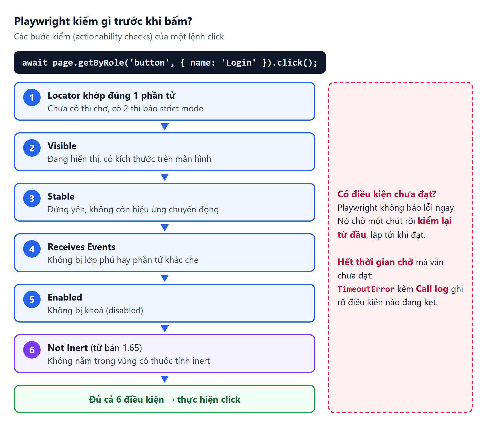
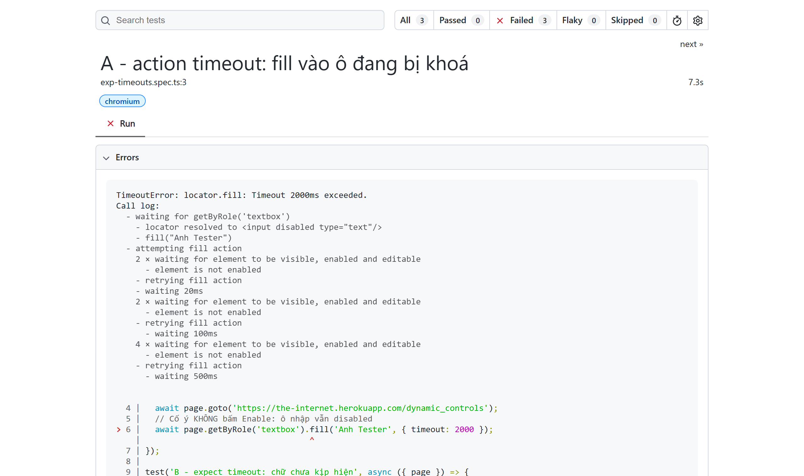
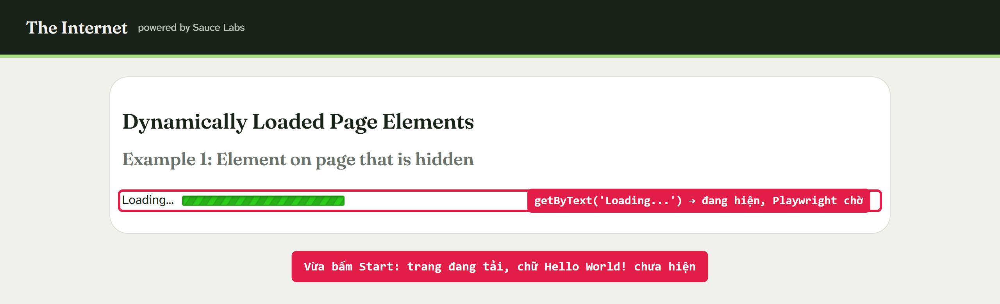
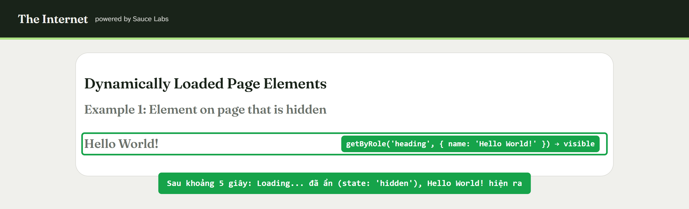
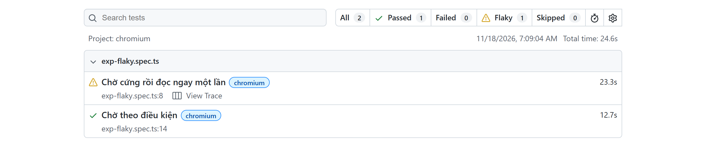
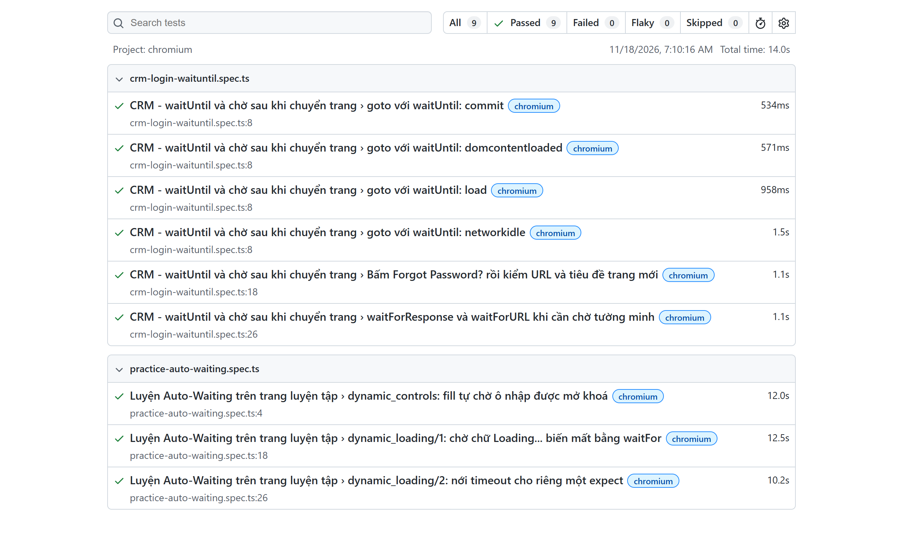

# Bài 19 - [Playwright Typescript] Cơ chế Auto-Waiting và waitUntil - cách tránh Flaky Test

Chương: 3. Assertion + Cơ chế Auto-Waiting

Nguồn: [https://anhtester.com/learn/website-and-api-testing-automation-with-playwright-javascript-typescript-day-code-js-ts-tu-dau/376](https://anhtester.com/learn/website-and-api-testing-automation-with-playwright-javascript-typescript-day-code-js-ts-tu-dau/376)

✅ Auto-Waiting - Playwright tự kiểm gì trước khi thao tác  
✅ Timeout - Playwright chờ bao lâu?  
✅ waitUntil khi mở trang và cách chờ sau khi bấm  
✅ Flaky Test - nguyên nhân và cách tránh  
✅ Thực hành trên trang luyện tập và CRM demo  
✅ Dùng Claude Code và bộ kit claude-testing-skills để tìm nguyên nhân Flaky Test

## ⭐ Mục tiêu bài học

Ở bài trước (Assertion trong Playwright) bạn đã viết `tests/crm-login-assertions.spec.ts` và `tests/crm-soft-assertions.spec.ts`, và biết Web-First Assertion **tự thử lại tối đa 5 giây**. Bài này trả lời phần còn bỏ ngỏ: Playwright chờ **cái gì**, chờ **bao lâu**, và vì sao có test **lúc đạt lúc lỗi**. Học xong bạn sẽ:

- Hiểu cơ chế **Auto-Waiting** và đọc được **Call log** khi một thao tác bị kẹt.
- Phân biệt timeout của test, của `expect`, của thao tác và biết đặt ở đâu.
- Chọn đúng `waitUntil` khi mở trang và đúng cách chờ sau khi bấm.
- Nhận ra nguyên nhân Flaky Test, bỏ được `waitForTimeout` và duyệt được code chờ do AI sinh ra.

> 📌 Bài làm tiếp trong project `D:\AnhTester\playwright-crm` (macOS: `~/AnhTester/playwright-crm`). Trang đăng nhập CRM demo tải quá nhanh nên khó thấy Playwright chờ, vì vậy bài dùng thêm trang luyện tập `https://the-internet.herokuapp.com`. Với CRM, bài vẫn **chưa đăng nhập**.

## ✅ Phần 1: Auto-Waiting - Playwright tự kiểm gì trước khi thao tác

### 🔆 1. Từ người lái xe cẩn thận tới Auto-Waiting

Người lái xe cẩn thận không đạp ga ngay khi vừa lên xe. Họ nhìn đèn đã xanh chưa, đường có trống không. Chưa đủ điều kiện thì họ **chờ**, không lao lên.

Trong lập trình, cách làm đó gọi là **chờ theo điều kiện**. Playwright làm sẵn cho mọi thao tác và gọi là **Auto-Waiting**: trước khi `click()` hay `fill()`, nó tự chạy một loạt bước kiểm (**actionability checks**). Trong automation, nhờ vậy bạn không phải tự viết lệnh chờ trước từng thao tác.

[](https://anhtester.com/storage/photos/shares/lesson/js_ts_playwright/v2/bai_19_auto_waiting/01_so_do_kiem_tra_truoc_khi_click.png)

*Các bước Playwright tự kiểm trước khi thực hiện một lệnh click*

### 🔆 2. Mỗi thao tác kiểm những điều kiện nào?

Bảng dưới gom lại theo [tài liệu Auto-waiting của Playwright](https://playwright.dev/docs/actionability):

<table class="rt-table">
<thead>
<tr>
<th>Thao tác</th>
<th>Điều kiện phải đạt trước khi làm</th>
</tr>
</thead>
<tbody>
<tr>
<td><code>click</code>, <code>dblclick</code>, <code>check</code>, <code>uncheck</code>, <code>setChecked</code></td>
<td>Visible, Stable, Receives Events, Enabled, Not Inert</td>
</tr>
<tr>
<td><code>hover</code>, <code>dragTo</code></td>
<td>Visible, Stable, Receives Events</td>
</tr>
<tr>
<td><code>fill</code>, <code>clear</code></td>
<td>Visible, Enabled, Editable (không bị <code>readonly</code>), Not Inert</td>
</tr>
<tr>
<td><code>selectOption</code></td>
<td>Visible, Enabled, Not Inert</td>
</tr>
<tr>
<td><code>press</code>, <code>pressSequentially</code>, <code>setInputFiles</code>, <code>focus</code></td>
<td>Không kiểm điều kiện nào trong bảng, chỉ cần tìm ra phần tử</td>
</tr>
</tbody>
</table>

- **Visible**: có kích thước và không bị ẩn (`opacity: 0` vẫn tính là visible).
- **Stable**: đứng yên, đã hết hiệu ứng chuyển động. **Receives Events**: không bị lớp phủ nào hứng mất cú bấm.
- **Not Inert**: từ bản **1.65**, thao tác còn chờ phần tử ra khỏi vùng có thuộc tính `inert` (vùng bị trang khoá tạm, thường là nền sau hộp thoại).

### 🔆 3. Xem Playwright chờ thật

Mở <https://the-internet.herokuapp.com/dynamic_controls>. Ô nhập đang bị khoá, bấm `Enable` thì khoảng 3 giây sau mới mở:

```markup
<form id="input-example">
  <input type="text" disabled="" style="width: 30%;">
  <button autocomplete="off" type="button" onclick="swapInput()">Enable</button>
</form>
```

Đoạn code sau không có lệnh chờ nào mà vẫn đạt:

```typescript
await page.getByRole('button', { name: 'Enable' }).click();
const start = Date.now();
await page.getByRole('textbox').fill('Anh Tester'); // fill tự chờ ô hết disabled
console.log(`fill đã tự chờ ${Date.now() - start}ms`);
```

```bash
fill đã tự chờ 3312ms
```

Muốn thấy nó chờ gì, hãy cố ý làm sai. Tạo file thử `tests/exp-timeouts.spec.ts` (Phần 2 dùng tiếp):

```typescript
import { test, expect } from '@playwright/test';

test('A - action timeout: fill vào ô đang bị khoá', async ({ page }) => {
  await page.goto('https://the-internet.herokuapp.com/dynamic_controls');
  // Cố ý KHÔNG bấm Enable: ô nhập vẫn disabled
  await page.getByRole('textbox').fill('Anh Tester', { timeout: 2000 });
});

test('B - expect timeout: chữ chưa kịp hiện', async ({ page }) => {
  await page.goto('https://the-internet.herokuapp.com/dynamic_loading/2');
  await page.getByRole('button', { name: 'Start' }).click();
  // Trang cần hơn 5 giây mới hiện chữ, expect mặc định chỉ chờ 5 giây
  await expect(page.getByText('Hello World!')).toBeVisible();
});

test('C - test timeout: cả test chỉ được 15 giây', async ({ page }) => {
  test.setTimeout(15_000);
  await page.goto('https://the-internet.herokuapp.com/dynamic_controls');
  // Không đặt timeout cho fill: nó chờ mãi, tới khi test hết giờ
  await page.getByRole('textbox').fill('Anh Tester');
});
```

```bash
npx playwright test exp-timeouts --project=chromium --workers=1 --reporter=list
```

Lỗi thật của test A (Playwright 1.65.1, chạy ngày 18/11/2026):

```bash
  1) [chromium] › tests\exp-timeouts.spec.ts:3:1 › A - action timeout: fill vào ô đang bị khoá ─────

    TimeoutError: locator.fill: Timeout 2000ms exceeded.
    Call log:
      - waiting for getByRole('textbox')
        - locator resolved to <input disabled type="text"/>
        - fill("Anh Tester")
      - attempting fill action
        2 × waiting for element to be visible, enabled and editable
          - element is not enabled
        - retrying fill action
        - waiting 20ms
        2 × waiting for element to be visible, enabled and editable
          - element is not enabled
        - retrying fill action
          - waiting 100ms
        4 × waiting for element to be visible, enabled and editable
          - element is not enabled
        - retrying fill action
          - waiting 500ms

    > 6 |   await page.getByRole('textbox').fill('Anh Tester', { timeout: 2000 });
        |                                   ^
        at D:\AnhTester\playwright-crm\tests\exp-timeouts.spec.ts:6:35
```

Đọc **Call log** từ trên xuống: tìm ra phần tử (`locator resolved to`), kiểm ba điều kiện của `fill`, kẹt ở `element is not enabled`, thử lại với khoảng nghỉ dài dần tới khi hết 2 giây. HTML Report hiện đúng như vậy:

[](https://anhtester.com/storage/photos/shares/lesson/js_ts_playwright/v2/bai_19_auto_waiting/02_html_report_loi_timeout_call_log.png)

*HTML Report của test A: TimeoutError kèm Call log ghi rõ element is not enabled*

## ✅ Phần 2: Timeout - Playwright chờ bao lâu?

### 🔆 1. Bốn loại timeout cần phân biệt

Chờ thì phải có giới hạn. Bốn loại bạn gặp hằng ngày:

<table class="rt-table">
<thead>
<tr>
<th>Loại</th>
<th>Mặc định</th>
<th>Giới hạn cho</th>
<th>Đặt trong config</th>
</tr>
</thead>
<tbody>
<tr>
<td>Test timeout</td>
<td>30 giây</td>
<td>Cả một test, tính cả <code>beforeEach</code></td>
<td><code>timeout</code></td>
</tr>
<tr>
<td>Expect timeout</td>
<td>5 giây</td>
<td>Một Web-First Assertion</td>
<td><code>expect: { timeout }</code></td>
</tr>
<tr>
<td>Action timeout</td>
<td>0 (không giới hạn)</td>
<td>Một thao tác: <code>click</code>, <code>fill</code>...</td>
<td><code>use: { actionTimeout }</code></td>
</tr>
<tr>
<td>Navigation timeout</td>
<td>0 (không giới hạn)</td>
<td>Một lần chuyển trang: <code>goto</code>, <code>waitForURL</code>...</td>
<td><code>use: { navigationTimeout }</code></td>
</tr>
</tbody>
</table>

"Không giới hạn" không phải là chờ mãi: thao tác vẫn bị **test timeout** 30 giây chặn lại. Bảng đầy đủ, gồm cả `globalTimeout` cho cả lượt chạy: [playwright.dev/docs/test-timeouts](https://playwright.dev/docs/test-timeouts).

### 🔆 2. Ba kiểu lỗi timeout trông khác nhau thế nào?

Test A là lỗi của **thao tác**: dòng đầu ghi rõ `locator.fill: Timeout 2000ms exceeded`. Hai test còn lại cho hai kiểu lỗi khác (kết quả thật):

```bash
  2) [chromium] › tests\exp-timeouts.spec.ts:9:1 › B - expect timeout: chữ chưa kịp hiện ───────────

    Error: expect(locator).toBeVisible() failed

    Locator: getByText('Hello World!')
    Expected: visible
    Timeout: 5000ms
    Error: element(s) not found

    Call log:
      - Expect "toBeVisible" getByText('Hello World!') with timeout 5000ms
      - waiting for getByText('Hello World!')

  3) [chromium] › tests\exp-timeouts.spec.ts:16:1 › C - test timeout: cả test chỉ được 15 giây ─────

    Test timeout of 15000ms exceeded.
```

Lỗi của **expect** (test B) cho biết câu kiểm tra nào không đạt, mong gì, nhận được gì. Lỗi **test timeout** (test C) thì chỉ có một dòng, **không nói** lệnh nào đang kẹt. Vì vậy Anh Tester khuyên đặt `actionTimeout`: thao tác kẹt sẽ tự báo lỗi rõ ràng thay vì kéo cả test tới lúc hết giờ.

### 🔆 3. Đặt timeout ở đâu?

Mở `playwright.config.ts`, thêm bốn dòng sau (các dòng khác giữ nguyên):

```typescript
export default defineConfig({
  testDir: './tests',
  /* Mỗi test tối đa 30 giây (mặc định), mỗi expect trên locator tối đa 5 giây (mặc định) */
  timeout: 30_000,
  expect: { timeout: 5_000 },
  // ...
  use: {
    /* Mỗi thao tác (click, fill...) tối đa 10 giây, mỗi lần chuyển trang tối đa 20 giây */
    actionTimeout: 10_000,
    navigationTimeout: 20_000,
    trace: 'on-first-retry',
  },
  // ...
});
```

Tạm bỏ dòng `test.setTimeout(15_000)` của test C rồi chạy lại, lỗi đã chỉ đúng chỗ (kết quả thật):

```bash
    TimeoutError: locator.fill: Timeout 10000ms exceeded.
    Call log:
      - waiting for getByRole('textbox')
        - locator resolved to <input disabled type="text"/>
      ...
    > 20 |   await page.getByRole('textbox').fill('Anh Tester');
```

Config là mặc định chung. Khi chỉ một chỗ cần khác đi, sửa ở phạm vi hẹp nhất:

<table class="rt-table">
<thead>
<tr>
<th>Phạm vi</th>
<th>Cách viết</th>
<th>Dùng khi</th>
</tr>
</thead>
<tbody>
<tr>
<td>Một lệnh</td>
<td><code>toBeVisible({ timeout: 10_000 })</code>, <code>click({ timeout: 3_000 })</code></td>
<td>Biết rõ đúng bước đó chậm. <strong>Ưu tiên cách này</strong></td>
</tr>
<tr>
<td>Một test</td>
<td><code>test.setTimeout(60_000)</code> ở đầu thân test</td>
<td>Kịch bản dài nhiều bước</td>
</tr>
<tr>
<td>Một test</td>
<td><code>test.slow()</code></td>
<td>Nhân ba test timeout của test đó, không cần tính số</td>
</tr>
</tbody>
</table>

## ✅ Phần 3: waitUntil khi mở trang và cách chờ sau khi bấm

### 🔆 1. Bốn giá trị của waitUntil

`page.goto(url)` cũng là một lệnh chờ: nó trả về khi trang đạt một mốc tải, chọn bằng option `waitUntil`. Cột cuối là thời gian đo thật trên trang đăng nhập Admin CRM, 3 lần chạy ngày 18/11/2026 (máy bạn sẽ ra số khác):

<table class="rt-table">
<thead>
<tr>
<th>Giá trị</th>
<th>goto trả về khi</th>
<th>Đo thật (ms)</th>
</tr>
</thead>
<tbody>
<tr>
<td><code>'commit'</code></td>
<td>Vừa nhận phản hồi từ server, trang mới bắt đầu tải</td>
<td>180 / 146 / 199</td>
</tr>
<tr>
<td><code>'domcontentloaded'</code></td>
<td>HTML đã đọc xong, ảnh và CSS có thể chưa về</td>
<td>143 / 156 / 139</td>
</tr>
<tr>
<td><code>'load'</code> (mặc định)</td>
<td>Trang cùng ảnh, CSS, script đã tải xong</td>
<td>542 / 601 / 555</td>
</tr>
<tr>
<td><code>'networkidle'</code></td>
<td>Không còn kết nối mạng nào trong ít nhất 500ms</td>
<td>1071 / 1143 / 1040</td>
</tr>
</tbody>
</table>

- **Để mặc định `load`** là đủ. Sau `goto`, thao tác và `expect` đầu tiên vẫn tự chờ phần tử của nó.
- `networkidle` chậm nhất, và trang có kết nối chạy nền có thể không bao giờ "im". Tài liệu Playwright ghi thẳng là **DISCOURAGED**: "Don't use this method for testing, rely on web assertions to assess readiness instead".

### 🔆 2. Chờ sau khi bấm: chờ kết quả, không chờ thời gian

Sau một cú bấm, thứ cần chờ là **kết quả của cú bấm đó**:

<table class="rt-table">
<thead>
<tr>
<th>Kết quả cần chờ</th>
<th>Cách chờ</th>
</tr>
</thead>
<tbody>
<tr>
<td>Phần tử mới hiện ra, đổi chữ</td>
<td><code><span>await</span> <span>expect(locator).toBeVisible()</span></code>, <code>toHaveText(...)</code></td>
</tr>
<tr>
<td>Sang trang khác</td>
<td><code>await expect(page).toHaveURL(...)</code>, hoặc <code>await page.waitForURL(...)</code> khi chỉ cần chờ, không cần kiểm</td>
</tr>
<tr>
<td>Phần tử biến mất (vòng xoay, chữ Loading)</td>
<td><code><span>await</span> <span>locator.waitFor({</span> <span>state:</span> <span>'hidden'</span> <span>})</span></code> hoặc <code>await expect(locator).toBeHidden()</code></td>
</tr>
<tr>
<td>Một request đã có phản hồi</td>
<td><code>page.waitForResponse(...)</code>, đặt <strong>trước</strong> thao tác gây ra request</td>
</tr>
</tbody>
</table>

`locator.waitFor()` nhận `state` là `'visible'` (mặc định), `'hidden'`, `'attached'` hoặc `'detached'`. Ở trang [dynamic\_loading/1](https://the-internet.herokuapp.com/dynamic_loading/1), bấm `Start` thì chữ `Loading...` hiện khoảng 5 giây rồi mới tới `Hello World!`. Khung trong ảnh do chính locator ghi trên ảnh tìm ra:

[](https://anhtester.com/storage/photos/shares/lesson/js_ts_playwright/v2/bai_19_auto_waiting/03_dynamic_loading_dang_tai.png)

*Vừa bấm Start: chữ Loading... đang hiện, Hello World! chưa có*

[](https://anhtester.com/storage/photos/shares/lesson/js_ts_playwright/v2/bai_19_auto_waiting/04_dynamic_loading_da_xong.png)

*Sau khoảng 5 giây: Loading... đã ẩn, tiêu đề Hello World! hiện ra*

```typescript
await page.getByRole('button', { name: 'Start' }).click();
await page.getByText('Loading...').waitFor({ state: 'hidden', timeout: 10_000 });
await expect(page.getByRole('heading', { name: 'Hello World!' })).toBeVisible();
```

## ✅ Phần 4: Flaky Test - nguyên nhân và cách tránh

### 🔆 1. Flaky Test là gì và từ đâu ra?

**Flaky Test** là test **lúc đạt lúc lỗi** trên cùng một bản code và cùng môi trường. Nó nguy hiểm hơn test luôn lỗi: cả đội quen với việc "chạy lại là xanh", tới khi có lỗi thật thì không ai còn tin báo cáo.

<table class="rt-table">
<thead>
<tr>
<th>Nguyên nhân</th>
<th>Cách xử lý</th>
</tr>
</thead>
<tbody>
<tr>
<td>Chờ cứng bằng <code>waitForTimeout</code></td>
<td>Chờ theo điều kiện: Web-First Assertion, <code>waitFor</code>, <code>waitForURL</code></td>
</tr>
<tr>
<td>Đọc giá trị một lần rồi so sánh (<code>isVisible()</code>, <code>textContent()</code>)</td>
<td>Đổi sang Web-First Assertion để được tự thử lại</td>
</tr>
<tr>
<td>Bấm xong kiểm ngay khi trang chưa chuyển</td>
<td>Chờ <code>toHaveURL</code> hoặc một phần tử của trang mới</td>
</tr>
<tr>
<td>Timeout đặt quá sát thời gian thật</td>
<td>Nới riêng dòng đó, có khoảng dư</td>
</tr>
<tr>
<td>Hiệu ứng chuyển động, lớp phủ</td>
<td>Để Auto-Waiting lo, không dùng <code>force: true</code></td>
</tr>
<tr>
<td>Test phụ thuộc test khác hoặc thứ tự chạy</td>
<td>Mỗi test tự chuẩn bị trong <code>beforeEach</code></td>
</tr>
<tr>
<td>Test chạy song song dùng chung dữ liệu</td>
<td>Mỗi test một bộ dữ liệu riêng</td>
</tr>
</tbody>
</table>

### 🔆 2. Vì sao không dùng waitForTimeout?

`page.waitForTimeout(3000)` bảo Playwright đứng yên đúng 3 giây, bất kể trang đã xong hay chưa. Đó là **đoán**, không phải chờ. Trang [dynamic\_loading/2](https://the-internet.herokuapp.com/dynamic_loading/2) cần khoảng 5 giây để hiện `Hello World!`. Tạo file thử `tests/exp-flaky.spec.ts` với hai cách chờ:

```typescript
import { test, expect } from '@playwright/test';

test.beforeEach(async ({ page }) => {
  await page.goto('https://the-internet.herokuapp.com/dynamic_loading/2');
  await page.getByRole('button', { name: 'Start' }).click();
});

test('Chờ cứng rồi đọc ngay một lần', async ({ page }) => {
  await page.waitForTimeout(4985);                                  // đoán thời gian
  const isShown = await page.getByText('Hello World!').isVisible(); // đọc 1 lần, không chờ
  expect(isShown).toBe(true);
});

test('Chờ theo điều kiện', async ({ page }) => {
  await expect(page.getByText('Hello World!')).toBeVisible({ timeout: 10_000 });
});
```

Số `4985` là Anh Tester cố ý chọn sát nút để flaky lộ ra ngay. Chạy một lần chưa nói lên gì, hãy cho mỗi test lặp nhiều lần bằng `--repeat-each`:

```bash
npx playwright test exp-flaky --project=chromium --repeat-each=10 --reporter=list
```

```bash
Running 20 tests using 6 workers

  ✘   2 [chromium] › tests\exp-flaky.spec.ts:8:1 › Chờ cứng rồi đọc ngay một lần (11.3s)
  ✓   1 [chromium] › tests\exp-flaky.spec.ts:8:1 › Chờ cứng rồi đọc ngay một lần (11.3s)
  ✓   5 [chromium] › tests\exp-flaky.spec.ts:8:1 › Chờ cứng rồi đọc ngay một lần (11.3s)
  ✓   6 [chromium] › tests\exp-flaky.spec.ts:14:1 › Chờ theo điều kiện (11.5s)
  ...
    Error: expect(received).toBe(expected) // Object.is equality

    Expected: true
    Received: false
  ...
  4 failed
  16 passed (48.2s)
```

Kết quả thật: test chờ cứng **đạt 6, lỗi 4**; test chờ theo điều kiện **đạt cả 10**. Đổi thành `waitForTimeout(5000)` thì 10 lần đều đạt, nhưng chỉ nhờ khoảng dư mười mấy mili giây. Chờ cứng sai theo cả hai hướng: **đặt thiếu** thì lúc đạt lúc lỗi tuỳ tốc độ máy và mạng, **đặt dư** thì test nào cũng mất đủ ngần ấy giây dù trang đã xong từ lâu.

> ⚠️ Tài liệu Playwright ghi rõ `isVisible()` "does not wait for the element to become visible and returns immediately", nên không dùng nó làm lệnh chờ hay để kiểm tra kết quả.

### 🔆 3. retries và nhãn flaky trong HTML Report

Playwright cho chạy lại test lỗi bằng `retries` trong config (project đang đặt `retries: process.env.CI ? 2 : 0`) hoặc `--retries` trên dòng lệnh:

```bash
npx playwright test exp-flaky --project=chromium --retries=2 --reporter=list,html
```

```bash
Running 2 tests using 2 workers

  ✘  1 [chromium] › tests\exp-flaky.spec.ts:8:1 › Chờ cứng rồi đọc ngay một lần (11.1s)
  ✓  2 [chromium] › tests\exp-flaky.spec.ts:14:1 › Chờ theo điều kiện (12.7s)
  ✓  3 [chromium] › tests\exp-flaky.spec.ts:8:1 › Chờ cứng rồi đọc ngay một lần (retry #1) (12.2s)
  ...
  1 flaky
    [chromium] › tests\exp-flaky.spec.ts:8:1 › Chờ cứng rồi đọc ngay một lần ───────────────────────
  1 passed (24.6s)
```

Test lỗi lần đầu rồi đạt khi chạy lại được xếp vào nhóm riêng tên **flaky**, không tính là passed (bạn có thể phải chạy vài lần mới gặp):

[](https://anhtester.com/storage/photos/shares/lesson/js_ts_playwright/v2/bai_19_auto_waiting/05_html_report_test_flaky.png)

*HTML Report: test chờ cứng được đánh dấu Flaky sau khi chạy lại*

> ⚠️ **`retries` là lưới an toàn, không phải cách sửa.** Test nằm ở cột Flaky là việc phải làm: tìm nguyên nhân theo bảng ở mục 1 và sửa tận gốc. Tăng `retries` lên 5 chỉ làm lỗi khó thấy hơn. Tài liệu: [playwright.dev/docs/test-retries](https://playwright.dev/docs/test-retries).

## ✅ Phần 5: Thực hành trên trang luyện tập và CRM demo

Bài này thêm hai file thực hành, bên cạnh hai file thử ở các phần trên:

```bash
D:\AnhTester\playwright-crm
├── tests
│   ├── crm-login-assertions.spec.ts     (bài trước)
│   ├── crm-soft-assertions.spec.ts      (bài trước)
│   ├── practice-auto-waiting.spec.ts    (file thực hành 1 của bài này)
│   ├── crm-login-waituntil.spec.ts      (file thực hành 2 của bài này)
│   ├── exp-timeouts.spec.ts             (file thử ở Phần 1 và Phần 2)
│   └── exp-flaky.spec.ts                (file thử ở Phần 4)
├── package.json
└── playwright.config.ts                 (đã thêm 4 dòng timeout ở Phần 2)
```

### 🔆 1. File tests/practice-auto-waiting.spec.ts

```typescript
import { test, expect } from '@playwright/test';

test.describe('Luyện Auto-Waiting trên trang luyện tập', () => {
  test('dynamic_controls: fill tự chờ ô nhập được mở khoá', async ({ page }) => {
    await page.goto('https://the-internet.herokuapp.com/dynamic_controls');
    const input = page.getByRole('textbox');
    await expect(input).toBeDisabled();

    await page.getByRole('button', { name: 'Enable' }).click();
    const start = Date.now();
    await input.fill('Anh Tester'); // không có lệnh chờ nào: fill tự chờ ô hết disabled
    console.log(`fill đã tự chờ ${Date.now() - start}ms`);

    await expect(input).toHaveValue('Anh Tester');
    await expect(page.getByText("It's enabled!")).toBeVisible();
  });

  test('dynamic_loading/1: chờ chữ Loading... biến mất bằng waitFor', async ({ page }) => {
    await page.goto('https://the-internet.herokuapp.com/dynamic_loading/1');
    await page.getByRole('button', { name: 'Start' }).click();

    await page.getByText('Loading...').waitFor({ state: 'hidden', timeout: 10_000 });
    await expect(page.getByRole('heading', { name: 'Hello World!' })).toBeVisible();
  });

  test('dynamic_loading/2: nới timeout cho riêng một expect', async ({ page }) => {
    await page.goto('https://the-internet.herokuapp.com/dynamic_loading/2');
    await page.getByRole('button', { name: 'Start' }).click();

    // Trang cần hơn 5 giây, expect mặc định chỉ chờ 5 giây nên nới riêng dòng này
    await expect(page.getByRole('heading', { name: 'Hello World!' })).toBeVisible({ timeout: 10_000 });
  });
});
```

### 🔆 2. File tests/crm-login-waituntil.spec.ts

```typescript
import { test, expect } from '@playwright/test';

const LOGIN_URL = 'https://crm.anhtester.com/admin/authentication';

test.describe('CRM - waitUntil và chờ sau khi chuyển trang', () => {
  // Vòng lặp sinh ra 4 test giống nhau, chỉ khác giá trị waitUntil
  for (const waitUntil of ['commit', 'domcontentloaded', 'load', 'networkidle'] as const) {
    test(`goto với waitUntil: ${waitUntil}`, async ({ page }) => {
      const start = Date.now();
      await page.goto(LOGIN_URL, { waitUntil });
      console.log(`${waitUntil}: goto xong sau ${Date.now() - start}ms`);

      // Dù goto trả về sớm hay muộn, expect vẫn tự chờ nút Login hiện ra
      await expect(page.getByRole('button', { name: 'Login' })).toBeVisible();
    });
  }

  test('Bấm Forgot Password? rồi kiểm URL và tiêu đề trang mới', async ({ page }) => {
    await page.goto(LOGIN_URL);
    await page.getByRole('link', { name: 'Forgot Password?' }).click();

    await expect(page).toHaveURL(/authentication\/forgot_password/);
    await expect(page.getByRole('heading', { name: 'Forgot Password' })).toBeVisible();
  });

  test('waitForResponse và waitForURL khi cần chờ tường minh', async ({ page }) => {
    await page.goto(LOGIN_URL);

    // Đặt "bẫy" chờ response TRƯỚC khi bấm, chưa await
    const responsePromise = page.waitForResponse('**/authentication/forgot_password');
    await page.getByRole('link', { name: 'Forgot Password?' }).click();
    const response = await responsePromise;
    console.log(`Response ${response.status()} từ ${response.url()}`);

    await page.waitForURL('**/authentication/forgot_password');
    await expect(page.getByRole('button', { name: 'Confirm' })).toBeVisible();
  });
});
```

Ở test cuối, `waitForResponse` được gọi **trước** cú bấm và chưa `await`. Bấm xong mới gọi thì response có thể đã về mất, lệnh chờ sẽ chờ một thứ không tới nữa.

```bash
npx playwright test practice-auto-waiting crm-login-waituntil --project=chromium --reporter=list
```

```bash
Running 9 tests using 6 workers

commit: goto xong sau 178ms
domcontentloaded: goto xong sau 186ms
  ✓  2 [chromium] › tests\crm-login-waituntil.spec.ts:8:5 › CRM - waitUntil và chờ sau khi chuyển trang › goto với waitUntil: commit (534ms)
  ✓  3 [chromium] › tests\crm-login-waituntil.spec.ts:8:5 › CRM - waitUntil và chờ sau khi chuyển trang › goto với waitUntil: domcontentloaded (571ms)
load: goto xong sau 622ms
  ✓  1 [chromium] › tests\crm-login-waituntil.spec.ts:8:5 › CRM - waitUntil và chờ sau khi chuyển trang › goto với waitUntil: load (958ms)
Response 200 từ https://crm.anhtester.com/admin/authentication/forgot_password
  ✓  6 [chromium] › tests\crm-login-waituntil.spec.ts:18:3 › CRM - waitUntil và chờ sau khi chuyển trang › Bấm Forgot Password? rồi kiểm URL và tiêu đề trang mới (1.1s)
  ✓  4 [chromium] › tests\crm-login-waituntil.spec.ts:26:3 › CRM - waitUntil và chờ sau khi chuyển trang › waitForResponse và waitForURL khi cần chờ tường minh (1.1s)
networkidle: goto xong sau 1122ms
  ✓  5 [chromium] › tests\crm-login-waituntil.spec.ts:8:5 › CRM - waitUntil và chờ sau khi chuyển trang › goto với waitUntil: networkidle (1.5s)
  ✓  9 [chromium] › tests\practice-auto-waiting.spec.ts:26:3 › Luyện Auto-Waiting trên trang luyện tập › dynamic_loading/2: nới timeout cho riêng một expect (10.2s)
fill đã tự chờ 3323ms
  ✓  7 [chromium] › tests\practice-auto-waiting.spec.ts:4:3 › Luyện Auto-Waiting trên trang luyện tập › dynamic_controls: fill tự chờ ô nhập được mở khoá (12.0s)
  ✓  8 [chromium] › tests\practice-auto-waiting.spec.ts:18:3 › Luyện Auto-Waiting trên trang luyện tập › dynamic_loading/1: chờ chữ Loading... biến mất bằng waitFor (12.5s)

  9 passed (14.0s)
```

Kết quả chạy thật (Playwright 1.65.1, ngày 18/11/2026): cả 9 test đều đạt, không dòng nào dùng `waitForTimeout`. Ba test trên trang luyện tập lâu hơn vì hôm đó chính trang này tải chậm.

[](https://anhtester.com/storage/photos/shares/lesson/js_ts_playwright/v2/bai_19_auto_waiting/06_html_report_bai_thuc_hanh_pass.png)

*HTML Report của hai file thực hành: 9 test đạt*

## ✅ Phần 6: Dùng Claude Code và bộ kit claude-testing-skills để tìm nguyên nhân Flaky Test

### 🔆 1. Bộ kit có sẵn gì cho việc chờ và flaky?

<table class="rt-table">
<thead>
<tr>
<th>Loại</th>
<th>Tên</th>
<th>Vai trò</th>
</tr>
</thead>
<tbody>
<tr>
<td>Rule</td>
<td><a href="https://github.com/anhtester/claude-testing-skills/blob/main/.claude/rules/playwright_rules.md">playwright_rules.md</a></td>
<td>Mục 4 "Chiến Lược Chờ Đợi": nghiêm cấm <code>page.waitForTimeout()</code>, yêu cầu dùng <span>auto-waiting</span> và Web-First Assertions</td>
</tr>
<tr>
<td>Command</td>
<td><a href="https://github.com/anhtester/claude-testing-skills/blob/main/.claude/commands/analyze-flaky-tests.md">/analyze-flaky-tests</a></td>
<td>Tìm nguyên nhân flaky. Chế độ <code>ANALYZE</code> (mặc định, chỉ báo cáo) và <code>FIX</code></td>
</tr>
<tr>
<td>Command</td>
<td><a href="https://github.com/anhtester/claude-testing-skills/blob/main/.claude/commands/run-and-fix-tests.md">/run-and-fix-tests</a></td>
<td>Chạy bộ test, phân loại lỗi theo nguyên nhân. Chế độ <code>RUN</code> và <code>FIX</code></td>
</tr>
<tr>
<td>Command</td>
<td><a href="https://github.com/anhtester/claude-testing-skills/blob/main/.claude/commands/analyze-test-report.md">/analyze-test-report</a></td>
<td>Đọc report đã có, gom lỗi theo nguyên nhân, đề xuất thứ tự xử lý</td>
</tr>
</tbody>
</table>

Các lệnh này gõ trong khung chat của Claude Code, bản có phí Anh Tester dùng trong khoá (tài liệu: [code.claude.com/docs/en/slash-commands](https://code.claude.com/docs/en/slash-commands)). Với bản miễn phí của [ChatGPT](https://chatgpt.com/) hoặc [Gemini](https://gemini.google.com/), bạn dán code và log lỗi vào khung chat rồi dùng các prompt ở mục 3.

### 🔆 2. Phân tích file flaky với /analyze-flaky-tests

```markdown
/analyze-flaky-tests ANALYZE tests/exp-flaky.spec.ts
```

Theo file lệnh của kit, Claude đọc file test, chạy 3 lần liên tiếp với `--retries=0`, phân loại nguyên nhân (locator, timing, dữ liệu, môi trường...) rồi tạo báo cáo `flaky_analysis.md` kèm bảng code hiện tại, code đề xuất. Chế độ `ANALYZE` dừng ở đó. Chế độ `FIX` chờ bạn duyệt rồi mới sửa và chạy lại với `--repeat-each=3`.

### 🔆 3. Prompt mẫu dùng được ở Claude, ChatGPT và Gemini

**Hỏi nguyên nhân trước khi xin cách sửa.** Dán log lỗi thật và đoạn code liên quan:

```markdown
Đây là log lỗi của một test Playwright TypeScript (bản 1.65) và đoạn code của test đó.

[dán log lỗi, gồm cả phần Call log]
[dán code test]

Chưa sửa code vội. Hãy trả lời theo thứ tự:
1. Đây là timeout của test, của expect hay của thao tác? Dựa vào dòng nào trong log?
2. Theo Call log, Playwright đang chờ điều kiện gì và điều kiện nào chưa đạt?
3. Nguyên nhân gốc có khả năng nhất là gì? Nêu thêm 1-2 khả năng khác và cách kiểm từng khả năng.
4. Sau đó mới đề xuất cách sửa. Không dùng waitForTimeout, không dùng force: true, không tăng timeout chung của project.
```

**Thay toàn bộ chờ cứng bằng chờ theo điều kiện.**

```markdown
Trong file test Playwright TypeScript dưới đây, hãy tìm mọi chỗ dùng page.waitForTimeout() hoặc setTimeout để chờ.

[dán code test]

Với từng chỗ, lập bảng: dòng số mấy | sau thao tác nào | thực ra đang chờ kết quả gì trên trang | lệnh thay thế.
Lệnh thay thế chỉ được là: Web-First Assertion (await expect(locator)...), locator.waitFor({ state }), expect(page).toHaveURL(), page.waitForURL() hoặc page.waitForResponse().
Locator chỉ dùng getBy... hoặc XPath, không dùng CSS Selector.
Chỗ nào không đủ thông tin để biết đang chờ gì thì ghi "cần xem trang thật", không đoán.
```

**Rà timeout trong config.**

```markdown
Đây là file playwright.config.ts của project.

[dán file config]

Hãy rà riêng các giá trị liên quan tới chờ: timeout, expect.timeout, use.actionTimeout, use.navigationTimeout, retries.
Với từng giá trị: đang đặt bao nhiêu, mặc định của Playwright là bao nhiêu, đặt như vậy có rủi ro gì.
Chỉ ra giá trị nào có dấu hiệu được tăng lên để che flaky test thay vì sửa nguyên nhân.
```

**Hỏi để hiểu sâu hơn** khi đọc tài liệu chưa rõ:

```markdown
Giải thích cho người mới học Playwright: vì sao await expect(locator).toBeVisible() ổn định hơn expect(await locator.isVisible()).toBe(true)?
Cho một ví dụ theo dòng thời gian (mili giây thứ mấy xảy ra chuyện gì) để thấy cách thứ hai lỗi ở đâu.
```

### 🔆 4. Thêm rule về chờ cho project

Giống rule locator ở bài Locators với các hàm `getBy...`, bạn thêm rule riêng thay vì sửa file của kit. Tạo `.claude/rules/project_wait_rules.md`:

```markdown
# Quy tắc chờ riêng của project (Playwright TypeScript)

> Bổ sung cho mục 4 "Chiến Lược Chờ Đợi" của `playwright_rules.md`. Chỗ nào khác nhau thì LÀM THEO FILE NÀY.

- KHÔNG dùng `page.waitForTimeout()` và mọi kiểu chờ theo thời gian cố định.
- KHÔNG dùng `page.waitForSelector()` (nhận CSS Selector). Cần chờ tường minh thì dùng `locator.waitFor({ state })`
  với locator getBy... hoặc XPath.
- KHÔNG dùng `{ force: true }` để vượt qua bước kiểm của thao tác.
- KHÔNG dùng `waitUntil: 'networkidle'`, không gọi `waitForLoadState()` sau mỗi thao tác.
- KHÔNG tăng `timeout`, `expect.timeout`, `retries` trong `playwright.config.ts` để làm test xanh.
  Cần nới thì nới ở đúng một lệnh, kèm comment nêu lý do.
- Sau thao tác chuyển trang: chờ bằng `await expect(page).toHaveURL(...)` hoặc một phần tử của trang mới.
- Kiểm tra kết quả bằng Web-First Assertion, không dùng `isVisible()` / `textContent()` rồi so sánh.
```

## ✅ Phần 7: Kiểm tra code do AI sinh ra

AI học từ rất nhiều code cũ đầy lệnh chờ cứng. Mỗi lần nhận code, rà theo bảng này:

<table class="rt-table">
<thead>
<tr>
<th>Dấu hiệu trong code</th>
<th>Vì sao là vấn đề</th>
<th>Cách xử lý</th>
</tr>
</thead>
<tbody>
<tr>
<td><code>await page.waitForTimeout(3000)</code></td>
<td>Chờ cứng: thiếu thì flaky, dư thì chậm</td>
<td>Thay bằng điều kiện đang thật sự chờ</td>
</tr>
<tr>
<td><code>waitUntil: 'networkidle'</code> ở mọi <code>goto</code></td>
<td>Chậm nhất, tài liệu ghi DISCOURAGED</td>
<td>Để mặc định <code>load</code></td>
</tr>
<tr>
<td><code>click({ force: true })</code></td>
<td>Bỏ qua bước kiểm. Chạy thử: <code>fill</code> kèm <code>force</code> điền được cả vào ô đang <code>disabled</code></td>
<td>Bỏ <code>force</code>, đọc Call log</td>
</tr>
<tr>
<td><code>{ timeout: 60000 }</code> ở mọi lệnh</td>
<td>Test lỗi thật phải chờ cả phút mới báo</td>
<td>Chỉ nới ở dòng có lý do</td>
</tr>
<tr>
<td><code>retries: 5</code> để "hết flaky"</td>
<td>Che triệu chứng, nguyên nhân còn nguyên</td>
<td>Sửa test ở cột Flaky</td>
</tr>
<tr>
<td><code>page.waitForSelector('.alert')</code></td>
<td>CSS Selector, và thường thừa vì <code>expect</code> đã tự chờ</td>
<td>Web-First Assertion hoặc <code>locator.waitFor()</code></td>
</tr>
<tr>
<td><code>if (await locator.isVisible())</code></td>
<td>Không chờ: phần tử chưa kịp hiện là khối <code>if</code> bị bỏ qua trong im lặng</td>
<td><code><span>await</span> <span>expect(locator).toBeVisible()</span></code></td>
</tr>
<tr>
<td><code>waitForLoadState()</code> sau mỗi thao tác</td>
<td>Thừa: lệnh kế tiếp đã tự chờ</td>
<td>Xoá</td>
</tr>
<tr>
<td><code>try { ... } catch {}</code> bọc <code>expect</code></td>
<td>Nuốt lỗi, test luôn xanh dù trang hỏng</td>
<td>Bỏ <code>try/catch</code></td>
</tr>
</tbody>
</table>

Đọc xong thì chạy `--repeat-each=5`: code AI "chạy được một lần" chưa nói gì về độ ổn định.

## ✅ Phần 8: Bài tập thực hành

**Bài tập 1 - Remove rồi Add checkbox.** Trên trang `https://the-internet.herokuapp.com/dynamic_controls`, viết file `tests/bt1-dynamic-controls.spec.ts`: bấm `Remove`, kiểm dòng `It's gone!` hiện ra và checkbox biến mất; bấm `Add`, kiểm dòng `It's back!` rồi tick checkbox mới. Không dùng `waitForTimeout`. Chạy `--repeat-each=3` phải đạt cả 3 lần.

**Bài tập 2 - Bắt flaky và sửa tận gốc.** Tạo file `tests/exp-flaky.spec.ts` như Phần 4. Chạy `--repeat-each=10`, ghi lại test chờ cứng đạt mấy lần, lỗi mấy lần trên máy bạn. Sửa thành chờ theo điều kiện tới khi đạt 20/20. Trả lời: vì sao ở trang này phải viết `{ timeout: 10_000 }`?

**Bài tập 3 - Duyệt code AI.** Đoạn code dưới đây do AI viết cho trang `dynamic_controls`. Nó **chạy đạt**, nhưng có **7 chỗ cần sửa**. Tìm đủ, nêu lý do theo bảng ở Phần 7 và viết lại thành file `tests/bt3-auto-waiting.spec.ts`.

```typescript
import { test, expect } from '@playwright/test';

test.describe.configure({ retries: 5 });

test('Mở khoá ô nhập rồi điền tên', async ({ page }) => {
  await page.goto('https://the-internet.herokuapp.com/dynamic_controls', { waitUntil: 'networkidle' });
  await page.getByRole('button', { name: 'Enable' }).click();
  await page.waitForTimeout(3000);
  await page.getByRole('textbox').fill('Anh Tester', { force: true });
  if (await page.getByText("It's enabled!").isVisible()) {
    console.log('Ô nhập đã được mở khoá');
  }
  try {
    await expect(page.getByRole('textbox')).toHaveValue('Anh Tester', { timeout: 60000 });
  } catch (error) {
    console.log('Bỏ qua lỗi kiểm tra giá trị');
  }
});
```

## ✅ Phần 9: Ghi nhớ nhanh

- Trước mỗi thao tác, Playwright tự kiểm phần tử đã sẵn sàng chưa, chưa đạt thì chờ và kiểm lại.
- Gặp lỗi timeout, đọc **Call log** trước khi tăng thời gian. Cần nới thì nới ở đúng một lệnh.
- Test timeout 30 giây, expect timeout 5 giây. Đặt `actionTimeout` để lỗi chỉ đúng dòng.
- `goto` để mặc định `load`. Không dùng `networkidle` cho test.
- Sau khi bấm, chờ **kết quả** bằng Web-First Assertion, `toHaveURL`, `waitFor({ state })`. Không dùng `waitForTimeout`.
- `--repeat-each` để bắt flaky. `retries` là lưới an toàn, không phải cách sửa.

✅ **Kết luận:** Bạn đã hiểu Playwright chờ gì, chờ bao lâu và cách viết test không phụ thuộc may rủi. Hộp thoại cảnh báo, tab mới, popup và trang lồng trong trang là việc của bài kế tiếp: **Cách xử lý Alert, Tab mới, Popup, iFrame và Shadow DOM**.

---

## Bài tập riêng — Bài tập - Bỏ chờ cứng, bắt Flaky Test và duyệt code chờ do AI viết

Nguồn bài tập: [https://anhtester.com/student-assignments?course=website-and-api-testing-automation-with-playwright-javascript-typescript-day-code-js-ts-tu-dau#assignment-109](https://anhtester.com/student-assignments?course=website-and-api-testing-automation-with-playwright-javascript-typescript-day-code-js-ts-tu-dau#assignment-109)

**Mục tiêu:** để Auto-Waiting và Web-First Assertion lo việc chờ thay cho chờ cứng, đọc được Call log của lỗi timeout, bắt Flaky Test bằng `--repeat-each`, và nhận ra cách chờ sai trong code AI.

**Thư mục làm bài:** `D:\AnhTester\playwright-crm` (macOS: `~/AnhTester/playwright-crm`). Bài làm trên trang luyện tập `https://the-internet.herokuapp.com`, **không đăng nhập** CRM.

### 📝 Đề bài

#### Bài tập 1 - Remove rồi Add checkbox

Trên trang `https://the-internet.herokuapp.com/dynamic_controls`, viết file `tests/bt1-dynamic-controls.spec.ts` gồm một test:

1. Bấm `Remove`, kiểm dòng `It's gone!` hiện ra và checkbox đã biến mất.
2. Bấm `Add`, kiểm dòng `It's back!` hiện ra.
3. Tick checkbox mới và kiểm nó đã được tick.

Không dùng `waitForTimeout`. Locator chỉ dùng `getBy...` hoặc XPath. Chạy `npx playwright test bt1-dynamic-controls --project=chromium --repeat-each=3 --reporter=list`, phải đạt cả 3 lần.

#### Bài tập 2 - Bắt flaky và sửa tận gốc

Tạo file `tests/exp-flaky.spec.ts` đúng như trong bài học:

```typescript
import { test, expect } from '@playwright/test';

test.beforeEach(async ({ page }) => {
  await page.goto('https://the-internet.herokuapp.com/dynamic_loading/2');
  await page.getByRole('button', { name: 'Start' }).click();
});

test('Chờ cứng rồi đọc ngay một lần', async ({ page }) => {
  await page.waitForTimeout(4985);                                  // đoán thời gian
  const isShown = await page.getByText('Hello World!').isVisible(); // đọc 1 lần, không chờ
  expect(isShown).toBe(true);
});

test('Chờ theo điều kiện', async ({ page }) => {
  await expect(page.getByText('Hello World!')).toBeVisible({ timeout: 10_000 });
});
```

1. Chạy `npx playwright test exp-flaky --project=chromium --repeat-each=10 --reporter=list`. Ghi lại test *Chờ cứng rồi đọc ngay một lần* đạt mấy lần, lỗi mấy lần trên máy bạn (nếu đạt cả 10 lần, giảm số trong `waitForTimeout` từng 10ms rồi chạy lại, ghi rõ số bạn dùng).
2. Sửa test đó thành chờ theo điều kiện, bỏ hẳn `waitForTimeout` và `isVisible()`. Chạy lại lệnh trên tới khi đạt 20/20.
3. Trả lời: vì sao ở trang này phải viết `{ timeout: 10_000 }` mà không để `expect` mặc định? Lỗi sẽ ghi gì nếu bỏ option đó?

#### Bài tập 3 - Duyệt code AI

Đoạn code dưới đây do AI viết cho trang `dynamic_controls`. Nó **chạy đạt**, nhưng có **7 chỗ cần sửa**. Tìm đủ, nêu lý do và viết lại thành file `tests/bt3-auto-waiting.spec.ts` chạy đạt.

```typescript
import { test, expect } from '@playwright/test';

test.describe.configure({ retries: 5 });

test('Mở khoá ô nhập rồi điền tên', async ({ page }) => {
  await page.goto('https://the-internet.herokuapp.com/dynamic_controls', { waitUntil: 'networkidle' });
  await page.getByRole('button', { name: 'Enable' }).click();
  await page.waitForTimeout(3000);
  await page.getByRole('textbox').fill('Anh Tester', { force: true });
  if (await page.getByText("It's enabled!").isVisible()) {
    console.log('Ô nhập đã được mở khoá');
  }
  try {
    await expect(page.getByRole('textbox')).toHaveValue('Anh Tester', { timeout: 60000 });
  } catch (error) {
    console.log('Bỏ qua lỗi kiểm tra giá trị');
  }
});
```

### 📦 Cách nộp bài

1. Làm bài trong project `playwright-crm`, commit và push lên nhánh `main` của repo GitHub `playwright-crm` của bạn.
2. Dán link repo vào ô **Link GitHub**, dạng `https://github.com/<ten-ban>/playwright-crm`. Repo Private thì vào **Settings → Collaborators** thêm tài khoản GitHub của giảng viên, nếu không giảng viên không mở được.
3. Trong ô **Nội dung bài làm (Editor)**, dán **kết quả chạy thật** trên Terminal của từng lệnh (mỗi lệnh một **Đoạn code mẫu** chọn Text / Log) và phần trả lời các câu hỏi.
4. Với bài **Duyệt code AI**: liệt kê từng chỗ sai theo mẫu *Dòng – Lỗi – Lý do – Cách sửa*, rồi dán file đã sửa.
5. Với Bài tập 2: dán kết quả `--repeat-each=10` **trước** và **sau** khi sửa.

### ✅ Tiêu chí Đạt

- Cả ba file không còn `waitForTimeout`, không `force: true`, không `networkidle`, không CSS Selector.
- Bài tập 1: mỗi bước chờ bằng Web-First Assertion (`toBeVisible`, `toBeHidden`, `toBeChecked`) hoặc `locator.waitFor()`; đạt 3/3 với `--repeat-each=3`.
- Bài tập 2: có kết quả trước khi sửa (có lần lỗi với `Expected: true / Received: false`) và sau khi sửa đạt 20/20. Câu trả lời nêu được: trang cần hơn 5 giây mới hiện chữ trong khi expect timeout mặc định là 5 giây, bỏ option thì lỗi ghi `expect(locator).toBeVisible() failed` kèm `Timeout: 5000ms`.
- Bài tập 3 nêu đủ 7 lỗi: `retries: 5` dùng để che flaky; `waitUntil: 'networkidle'` (tài liệu Playwright ghi DISCOURAGED); `waitForTimeout(3000)` chờ cứng; `force: true` bỏ qua bước kiểm của `fill` (điền được cả vào ô đang disabled); `if (await ...isVisible())` không chờ nên việc kiểm dòng `It's enabled!` có thể bị bỏ qua trong im lặng; `timeout: 60000` quá lớn không có lý do; `try/catch` nuốt lỗi của `expect` nên test luôn xanh. File viết lại bỏ `test.describe.configure`, `goto` để mặc định, `fill` không kèm option (tự chờ ô được mở khoá), kiểm bằng `await expect(page.getByText("It's enabled!")).toBeVisible()` và `await expect(page.getByRole('textbox')).toHaveValue('Anh Tester')`, chạy đạt với `--project=chromium`.

### 🤖 Dùng AI thế nào cho đúng

Được dùng Claude, ChatGPT hoặc Gemini để **hỏi giải thích** lỗi và khái niệm (prompt mẫu ở phần AI của bài học). Không nhờ AI làm hộ rồi dán vào: bài **Duyệt code AI** chấm chính phần *lý do* do bạn tự viết. Không dán mật khẩu hay file `.env` vào khung chat. Bài nào nộp lại vì **Cần sửa** thì sửa đúng chỗ giảng viên ghi trong feedback rồi bấm **Nộp lại**.