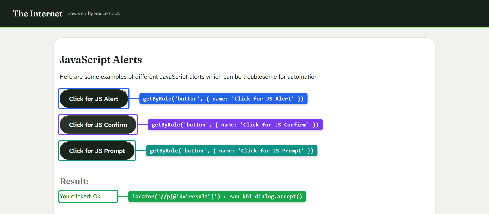
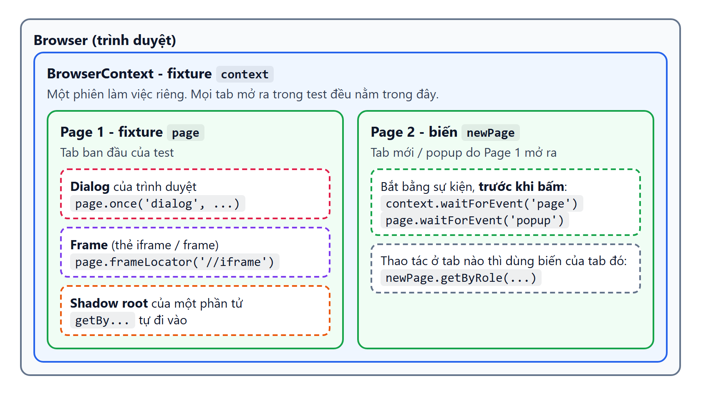
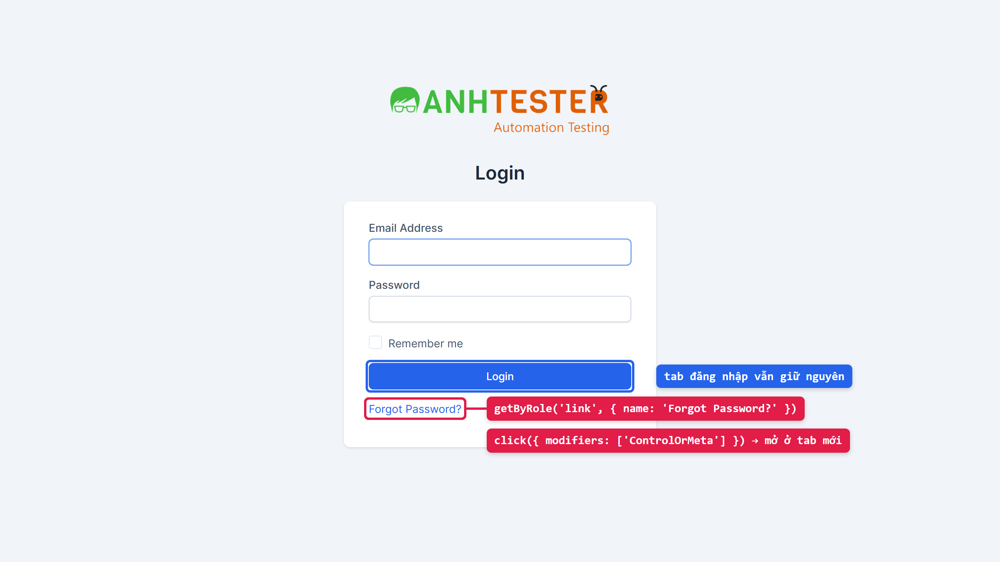
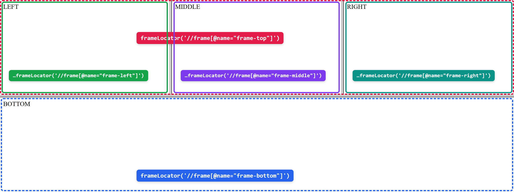
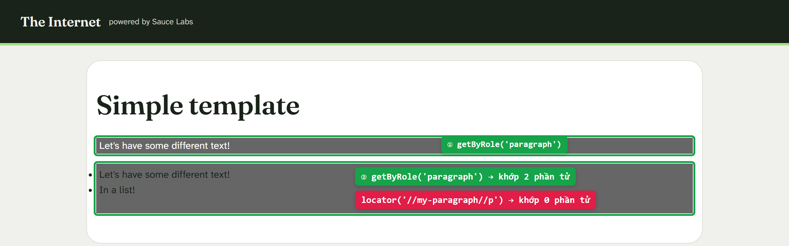
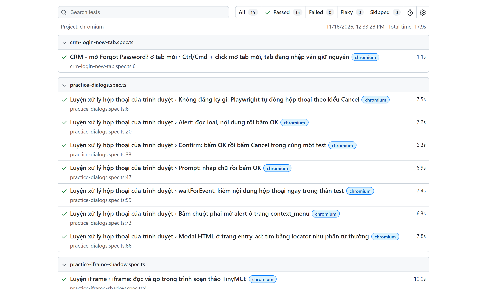

# Bài 20 - [Playwright Typescript] Cách xử lý Alert, Tab mới, Popup, iFrame và Shadow DOM

Chương: 3. Assertion + Cơ chế Auto-Waiting

Nguồn: [https://anhtester.com/learn/website-and-api-testing-automation-with-playwright-javascript-typescript-day-code-js-ts-tu-dau/377](https://anhtester.com/learn/website-and-api-testing-automation-with-playwright-javascript-typescript-day-code-js-ts-tu-dau/377)

✅ Hộp thoại của trình duyệt - Alert, Confirm, Prompt  
✅ Tab mới và Popup  
✅ iFrame - trang nằm trong trang  
✅ Shadow DOM - phần HTML được đóng gói  
✅ Dùng Claude Code và bộ kit claude-testing-skills để sinh code xử lý dialog, tab mới, iFrame  
✅ Kiểm tra code do AI sinh ra

## ⭐ Mục tiêu bài học

Ở bài trước (Cơ chế Auto-Waiting và waitUntil) bạn đã viết `tests/practice-auto-waiting.spec.ts`, `tests/crm-login-waituntil.spec.ts`. Bài này xử lý bốn thứ mà locator viết đúng vẫn **không chạm tới được**. Học xong bạn sẽ:

- Trả lời được hộp thoại `alert`, `confirm`, `prompt` bằng sự kiện `dialog`.
- Bắt được **tab mới**, **popup** và làm việc với hai trang cùng lúc.
- Đi vào **iFrame** bằng `frameLocator()`, hiểu vì sao XPath không tìm được phần tử trong **Shadow DOM**.
- Duyệt được code xử lý các tình huống này do AI sinh ra.

> 📌 Bài làm tiếp trong project `D:\AnhTester\playwright-crm` (macOS: `~/AnhTester/playwright-crm`). Trang luyện tập: `the-internet.herokuapp.com`, `book.anhtester.com`, trang đăng nhập Admin CRM (**chưa đăng nhập**).

## ✅ Phần 1: Hộp thoại của trình duyệt - Alert, Confirm, Prompt

### 🔆 1. Từ bác bảo vệ ở cổng tới Dialog

Bạn vào một toà nhà, bác bảo vệ chặn lại hỏi "Anh chị lên tầng mấy?". Chưa trả lời thì chưa được đi tiếp.

Trong lập trình web, ba hàm `alert()`, `confirm()`, `prompt()` cũng vậy: mở một **hộp thoại của trình duyệt** (dialog) và **khoá cả trang** tới khi người dùng bấm OK hoặc Cancel. Hộp thoại do trình duyệt vẽ, **không phải phần tử HTML**, nên không locator nào tìm ra. Trong automation, Playwright báo bằng sự kiện `dialog` kèm một đối tượng `Dialog` để bạn trả lời.

HTML thật của trang luyện tập [javascript\_alerts](https://the-internet.herokuapp.com/javascript_alerts):

```markup
<button onclick="jsAlert()">Click for JS Alert</button>
<button onclick="jsConfirm()">Click for JS Confirm</button>
<button onclick="jsPrompt()">Click for JS Prompt</button>
<h4>Result:</h4>
<p id="result" style="color:green"></p>
```

[](https://anhtester.com/storage/photos/shares/lesson/js_ts_playwright/v2/bai_20_alert_tab_popup_iframe_shadow_dom/02_javascript_alerts_ba_nut_va_ket_qua.png)

*Ba nút mở hộp thoại và dòng kết quả ở trang javascript\_alerts*

### 🔆 2. Không làm gì thì Playwright tự bấm Cancel

Tài liệu Playwright ghi: "By default, dialogs are auto-dismissed by Playwright". Bạn **không đăng ký** gì cho sự kiện `dialog` thì Playwright tự đóng hộp thoại kiểu Cancel. Kết quả chạy thật:

<table class="rt-table">
<thead>
<tr>
<th>Loại</th>
<th>Hộp thoại có gì</th>
<th>Dòng Result khi không đăng ký gì</th>
</tr>
</thead>
<tbody>
<tr>
<td><code>alert</code></td>
<td>Một nút OK</td>
<td><code>You successfully clicked an alert</code></td>
</tr>
<tr>
<td><code>confirm</code></td>
<td>OK và Cancel</td>
<td><code>You clicked: Cancel</code></td>
</tr>
<tr>
<td><code>prompt</code></td>
<td>Ô nhập, OK và Cancel</td>
<td><code>You entered: null</code></td>
</tr>
</tbody>
</table>

Với `confirm` kiểu "Bạn có chắc muốn xoá?", test sẽ **luôn chọn Cancel**. Muốn bấm OK hay nhập chữ, bạn phải tự trả lời.

### 🔆 3. Trả lời hộp thoại: đăng ký trước khi bấm

Hộp thoại bật lên **ngay trong lúc** `click()` đang chạy, nên phải dặn Playwright cách trả lời **trước** khi bấm:

```typescript
// once = chỉ xử lý đúng một hộp thoại kế tiếp
page.once('dialog', async dialog => {
  console.log(`[${dialog.type()}] ${dialog.message()} | giá trị sẵn có: "${dialog.defaultValue()}"`);
  await dialog.accept('Anh Tester');
});
await page.getByRole('button', { name: 'Click for JS Prompt' }).click();

await expect(page.locator('//p[@id="result"]')).toHaveText('You entered: Anh Tester');
```

```bash
[prompt] I am a JS prompt | giá trị sẵn có: ""
```

<table class="rt-table">
<thead>
<tr>
<th>Hàm của Dialog</th>
<th>Tác dụng</th>
</tr>
</thead>
<tbody>
<tr>
<td><code>dialog.type()</code></td>
<td><code>alert</code>, <code>confirm</code>, <code>prompt</code> hoặc <code>beforeunload</code> (hộp "Rời khỏi trang?")</td>
</tr>
<tr>
<td><code>dialog.message()</code></td>
<td>Câu chữ trong hộp thoại, nên kiểm tra</td>
</tr>
<tr>
<td><code>dialog.defaultValue()</code></td>
<td>Giá trị điền sẵn trong ô nhập của <code>prompt</code></td>
</tr>
<tr>
<td><code>dialog.accept(text?)</code></td>
<td>Bấm OK. <code>text</code> là chữ gõ vào ô nhập của <code>prompt</code></td>
</tr>
<tr>
<td><code>dialog.dismiss()</code></td>
<td>Bấm Cancel</td>
</tr>
</tbody>
</table>

`page.once` trả lời **một** hộp thoại rồi tự gỡ: **ưu tiên cách này**. `page.on` trả lời **mọi** hộp thoại tới hết test. `page.waitForEvent('dialog')` đưa `Dialog` ra thân test để `expect`, giống `waitForEvent('download')` đã học nhưng có một điểm khác (lỗi C bên dưới).

### 🔆 4. Ba lỗi hay gặp, chạy thật để thấy

Tạo file thử `tests/exp-dialogs.spec.ts`:

```typescript
import { test, expect } from '@playwright/test';

const ALERTS_URL = 'https://the-internet.herokuapp.com/javascript_alerts';

test('A - đăng ký handler SAU cú bấm', async ({ page }) => {
  await page.goto(ALERTS_URL);
  await page.getByRole('button', { name: 'Click for JS Confirm' }).click();
  page.once('dialog', dialog => dialog.accept()); // muộn rồi: hộp thoại đã bị tự đóng
  await expect(page.locator('//p[@id="result"]')).toHaveText('You clicked: Ok');
});

test('B - có handler nhưng không accept cũng không dismiss', async ({ page }) => {
  await page.goto(ALERTS_URL);
  page.on('dialog', dialog => console.log(`Hộp thoại: ${dialog.message()}`));
  await page.getByRole('button', { name: 'Click for JS Confirm' }).click();
  await expect(page.locator('//p[@id="result"]')).toHaveText('You clicked: Ok');
});

test('C - waitForEvent nhưng lại await click trước khi trả lời', async ({ page }) => {
  await page.goto(ALERTS_URL);
  const dialogPromise = page.waitForEvent('dialog');
  await page.getByRole('button', { name: 'Click for JS Prompt' }).click(); // kẹt ở đây
  const dialog = await dialogPromise;
  await dialog.accept('Anh Tester');
  await expect(page.locator('//p[@id="result"]')).toHaveText('You entered: Anh Tester');
});
```

```bash
npx playwright test exp-dialogs --project=chromium --workers=1 --reporter=list
```

Kết quả thật (Playwright 1.65.1, ngày 18/11/2026), đã lược phần lặp:

```bash
  1) [chromium] › tests\exp-dialogs.spec.ts:5:1 › A - đăng ký handler SAU cú bấm ───────────────────

    Error: expect(locator).toHaveText(expected) failed

    Locator:  locator('//p[@id="result"]')
    Expected: "You clicked: Ok"
    Received: "You clicked: Cancel"
    Timeout:  5000ms

  2) [chromium] › tests\exp-dialogs.spec.ts:12:1 › B - có handler nhưng không accept cũng không dismiss

    TimeoutError: locator.click: Timeout 10000ms exceeded.
    Call log:
      - waiting for getByRole('button', { name: 'Click for JS Confirm' })
        - locator resolved to <button onclick="jsConfirm()">Click for JS Confirm</button>
      - attempting click action
        - waiting for element to be visible, enabled and stable
        - element is visible, enabled and stable
        - scrolling into view if needed
        - done scrolling
        - performing click action

    > 15 |   await page.getByRole('button', { name: 'Click for JS Confirm' }).click();

  3) [chromium] › tests\exp-dialogs.spec.ts:19:1 › C - waitForEvent nhưng lại await click trước khi trả lời

    TimeoutError: locator.click: Timeout 10000ms exceeded.
    ...
    > 22 |   await page.getByRole('button', { name: 'Click for JS Prompt' }).click(); // kẹt ở đây

  3 failed
```

- **Lỗi A.** Lúc bấm chưa có ai nghe, Playwright đã tự bấm Cancel. Handler đăng ký muộn không được gọi.
- **Lỗi B.** Đã có handler thì Playwright **không tự đóng nữa**. Handler chỉ in log nên trang bị khoá, `click()` kẹt ở `performing click action`. Handler phải kết thúc bằng `accept()` hoặc `dismiss()`.
- **Lỗi C.** `waitForEvent('dialog')` cũng tính là có người nghe. `await click()` chờ hộp thoại được trả lời, mà dòng trả lời lại nằm sau nó: hai bên chờ nhau. Viết đúng là **không await cú bấm** cho tới khi trả lời xong:

```typescript
const dialogPromise = page.waitForEvent('dialog'); // 1. bắt đầu chờ, CHƯA await
const clickPromise = page.getByRole('button', { name: 'Click for JS Confirm' }).click(); // 2. bấm, CHƯA await
const dialog = await dialogPromise; // 3. hộp thoại đã mở
expect(dialog.message()).toBe('I am a JS Confirm');
await dialog.accept(); // 4. trả lời
await clickPromise; // 5. lúc này click mới xong
```

### 🔆 5. Hộp thoại của trình duyệt khác modal HTML

Phần lớn hộp xác nhận trên web ngày nay là **modal vẽ bằng HTML**, không phải dialog của trình duyệt:

<table class="rt-table">
<thead>
<tr>
<th>Tiêu chí</th>
<th>Dialog của trình duyệt</th>
<th>Modal HTML</th>
</tr>
</thead>
<tbody>
<tr>
<td>Thấy trong tab Elements của DevTools</td>
<td>Không</td>
<td>Có, là các thẻ <code>div</code>, <code>button</code> bình thường</td>
</tr>
<tr>
<td>Cách xử lý</td>
<td>Sự kiện <code>dialog</code>, <code>accept()</code> / <code>dismiss()</code></td>
<td>Locator và <code>click()</code>, thường là <code>getByRole('dialog')</code> rồi tìm nút bên trong</td>
</tr>
</tbody>
</table>

Modal ở trang [entry\_ad](https://the-internet.herokuapp.com/entry_ad) không khai báo `role="dialog"` nên tìm theo tiêu đề của nó:

```typescript
const modalTitle = page.getByRole('heading', { name: 'This is a modal window' });
await expect(modalTitle).toBeVisible();
await page.getByText('Close', { exact: true }).click();
await expect(modalTitle).toBeHidden();
```

## ✅ Phần 2: Tab mới và Popup

### 🔆 1. Từ đường link trong ứng dụng chat tới đối tượng Page mới

Bạn bấm một link trong ứng dụng chat, trình duyệt mở thêm một tab, mắt bạn phải **chuyển sang tab đó** mới đọc được.

Trong Playwright, mỗi tab hay cửa sổ là một đối tượng `Page` riêng, cùng nằm trong một `BrowserContext` (fixture `context`). Biến `page` chỉ điều khiển tab ban đầu. Trong automation, khi cú bấm mở tab mới, bạn phải **lấy được `Page` của tab đó** rồi mới tìm phần tử trong nó.

[](https://anhtester.com/storage/photos/shares/lesson/js_ts_playwright/v2/bai_20_alert_tab_popup_iframe_shadow_dom/01_so_do_browser_context_page_frame.png)

*Browser, BrowserContext, hai Page và những thứ nằm trong một Page*

### 🔆 2. Bắt tab mới: bắt đầu chờ trước khi bấm

Trang chủ [book.anhtester.com](https://book.anhtester.com/) có link mang `target="_blank"`, bấm vào là mở tab mới:

```markup
<a class="MuiTypography-root MuiLink-root ..." href="/swagger" target="_blank">
  <h6 class="MuiTypography-root MuiTypography-h6 ...">Swagger API Documentation</h6>
</a>
```

```typescript
test('Book: link Swagger API Documentation mở tab mới', async ({ page, context }) => {
  await page.goto('https://book.anhtester.com');

  const pagePromise = context.waitForEvent('page'); // 1. bắt đầu chờ tab mới, CHƯA await
  await page.getByRole('link', { name: 'Swagger API Documentation' }).click(); // 2. bấm
  const newPage = await pagePromise; // 3. nhận tab mới
  await newPage.waitForLoadState(); // 4. chờ tab mới tải xong

  await expect(newPage).toHaveURL('https://book.anhtester.com/swagger');
  await expect(newPage).toHaveTitle('AnhTester Book Management API');
});
```

**Vì sao dòng chờ đứng trước cú bấm?** Sự kiện `page` chỉ bắn **một lần**, đúng lúc tab mới được tạo. Giống chụp ảnh vận động viên nhảy xà: giơ máy lên trước rồi mới hô "nhảy".

Thử viết ngược lại (file `tests/exp-tab-events.spec.ts`): bấm xong chờ **ngay dòng kế tiếp** thì 10 lần chạy vẫn đạt cả 10, vì tab mới cần một lúc mới tạo xong. Chen vào giữa một việc tốn thời gian là lỗi:

```typescript
await page.getByRole('link', { name: 'Click Here' }).click();
await page.waitForTimeout(3000);                    // tab mới mở xong trong lúc này
const newPage = await context.waitForEvent('page'); // chờ một sự kiện đã xảy ra rồi
```

```bash
    TimeoutError: browserContext.waitForEvent: Timeout 10000ms exceeded while waiting for event "page"

    > 51 |   const newPage = await context.waitForEvent('page'); // chờ một sự kiện đã xảy ra rồi
         |                                 ^
        at D:\AnhTester\playwright-crm\tests\exp-tab-events.spec.ts:51:33
```

Code "đạt nhờ tab mở chậm" là mầm của Flaky Test. Luôn viết theo thứ tự: chờ, bấm, nhận. Cách gộp bằng `Promise.all` (chạy các việc trong mảng cùng lúc) có ý nghĩa giống hệt:

```typescript
const [newPage] = await Promise.all([
  context.waitForEvent('page'),                           // chờ
  page.getByRole('link', { name: 'Click Here' }).click(), // bấm, chạy cùng lúc
]);
```

### 🔆 3. Trên CRM: Ctrl/Cmd + click mở link ở tab mới

Trang đăng nhập Admin CRM không có link `target="_blank"`, nhưng người dùng vẫn hay giữ `Ctrl` (macOS: `Cmd`) rồi bấm link để mở ở tab mới. Playwright làm việc đó bằng option `modifiers`; `'ControlOrMeta'` tự thành `Control` trên Windows, Linux và `Meta` trên macOS:

[](https://anhtester.com/storage/photos/shares/lesson/js_ts_playwright/v2/bai_20_alert_tab_popup_iframe_shadow_dom/03_crm_login_forgot_password_ctrl_click.png)

*Trang đăng nhập Admin CRM: giữ Ctrl/Cmd rồi bấm Forgot Password? để mở ở tab mới*

```typescript
const pagePromise = context.waitForEvent('page');
await page.getByRole('link', { name: 'Forgot Password?' }).click({ modifiers: ['ControlOrMeta'] });
const forgotPage = await pagePromise;
await forgotPage.waitForLoadState();

await expect(forgotPage).toHaveURL(/authentication\/forgot_password$/);
await expect(page).toHaveURL('https://crm.anhtester.com/admin/authentication'); // tab cũ không đổi
```

### 🔆 4. Sự kiện popup của page khác gì sự kiện page của context?

Cho cả hai sự kiện cùng nghe rồi chạy thật hai tình huống (cùng file thử trên):

```typescript
const events: string[] = [];
context.on('page', () => events.push("context 'page'"));
page.on('popup', () => events.push("page 'popup'"));
// ... mở trang, chờ context.waitForEvent('page'), bấm, nhận newPage ...
// cuối test: in events.join(' + ') và kết quả của newPage.opener()
```

```bash
target="_blank"  => context 'page' + page 'popup' | opener là page: true
Ctrl/Cmd + click => context 'page' | opener: null
```

<table class="rt-table">
<thead>
<tr>
<th>Tiêu chí</th>
<th><code>context.waitForEvent('page')</code></th>
<th><code>page.waitForEvent('popup')</code></th>
</tr>
</thead>
<tbody>
<tr>
<td>Bắn ra khi</td>
<td><strong>Bất kỳ</strong> trang mới nào xuất hiện trong context</td>
<td>Chính trang này mở ra trang mới: link <code>target="_blank"</code> hoặc <code>window.open()</code></td>
</tr>
<tr>
<td>Ctrl/Cmd + click</td>
<td>Có bắn</td>
<td><strong>Không bắn</strong>: trang mới không có trang mở ra nó, <code>opener()</code> là <code>null</code></td>
</tr>
</tbody>
</table>

Mặc định dùng sự kiện `page` của `context` vì nó bắt được mọi trường hợp. Tab mới hay cửa sổ popup, với Playwright đều là một `Page` ([playwright.dev/docs/pages](https://playwright.dev/docs/pages)).

### 🔆 5. Làm việc với hai tab cùng lúc

- **Không có lệnh "chuyển tab".** Thao tác ở tab nào thì dùng biến của tab đó: `newPage.getByRole(...)`, `page.getByRole(...)`.
- `context.pages().length` đếm số tab đang mở, `await newPage.close()` đóng tab.
- `await page.bringToFront()` đưa tab lên trước. Playwright điều khiển được cả tab nằm sau, nên lệnh này **không cần** để test chạy đúng; nó chỉ giúp bạn nhìn thấy tab đang thao tác khi chạy `--headed`.

> ⚠️ **Lỗi hay gặp nhất: tab mới đã mở mà vẫn dùng `page`.** Ở trang `windows`, Anh Tester viết nhầm `page.getByRole('heading', { name: 'New Window' })` và test **vẫn đạt**: tab cũ có tiêu đề `Opening a new window`, mà `name` khớp kiểu chứa chuỗi. Thêm `exact: true` lỗi mới lộ ra.

## ✅ Phần 3: iFrame - trang nằm trong trang

### 🔆 1. Từ chiếc tivi trong tủ kính tới iFrame

Cửa hàng đặt một chiếc tivi đang phát trong tủ kính. Bạn thấy hình trên tivi, nhưng đó là một thiết bị riêng, không phải một phần của tủ kính.

Trong HTML, thẻ `<iframe>` (và `<frame>` đời cũ) nhúng **một trang web khác** vào trang hiện tại: trình soạn thảo, cổng thanh toán, video. Trong automation, locator gọi từ `page` **chỉ tìm trong tài liệu ngoài cùng**; muốn tìm trong frame phải đi vào frame trước.

Trang [iframe](https://the-internet.herokuapp.com/iframe) có trình soạn thảo TinyMCE nằm trong một iframe (HTML thật, đã rút gọn):

```markup
<iframe id="mce_0_ifr" title="Rich Text Area" class="tox-edit-area__iframe" frameborder="0">
  #document
    <html>
      <body id="tinymce" class="mce-content-body" contenteditable="true">
        <p>Your content goes here.</p>
      </body>
    </html>
</iframe>
```

### 🔆 2. frameLocator() và contentFrame()

```typescript
// Cách 1: frameLocator nhận XPath của thẻ iframe
const editor = page.frameLocator('//iframe[@id="mce_0_ifr"]');
await expect(editor.getByRole('paragraph')).toHaveText('Your content goes here.');

// Cách 2: tìm thẻ iframe bằng getBy... rồi đi vào trong bằng contentFrame()
const sameEditor = page.getByTitle('Rich Text Area').contentFrame();
await sameEditor.locator('//body').fill('Anh Tester học iFrame');
await expect(sameEditor.getByRole('paragraph')).toHaveText('Anh Tester học iFrame');

// owner(): từ FrameLocator quay ngược ra chính thẻ iframe
await expect(editor.owner()).toHaveAttribute('title', 'Rich Text Area');
```

- Cả hai cách trả về một `FrameLocator`, từ đó gọi `getBy...`, `locator('//...')` như bình thường, **Auto-Waiting vẫn hoạt động**.
- XPath **không đi xuyên ranh giới frame**. Chạy thật: `page.locator('//iframe//p')` khớp **0** phần tử.

### 🔆 3. Frame lồng nhau

Trang [nested\_frames](https://the-internet.herokuapp.com/nested_frames) có hai frame, frame trên lại chứa ba frame con (HTML thật):

```markup
<frameset frameborder="1" rows="50%,50%">
  <frame src="/frame_top" scrolling="no" name="frame-top">
  <frame src="/frame_bottom" scrolling="no" name="frame-bottom">
</frameset>

<!-- Bên trong frame-top -->
<frameset frameborder="1" name="frameset-middle" cols="33%,33%,33%">
  <frame src="/frame_left" scrolling="no" name="frame-left">
  <frame src="/frame_middle" scrolling="no" name="frame-middle">
  <frame src="/frame_right" scrolling="no" name="frame-right">
</frameset>
```

[](https://anhtester.com/storage/photos/shares/lesson/js_ts_playwright/v2/bai_20_alert_tab_popup_iframe_shadow_dom/04_nested_frames_cac_lop_frame.png)

*Trang nested\_frames: frame-top chứa ba frame con, bên dưới là frame-bottom*

Chữ `MIDDLE` nằm sâu hai lớp, nên nối hai `frameLocator`:

```typescript
console.log(`page.getByText('MIDDLE') khớp ${await page.getByText('MIDDLE').count()} phần tử`);

const top = page.frameLocator('//frame[@name="frame-top"]');
await expect(top.frameLocator('//frame[@name="frame-middle"]').getByText('MIDDLE')).toBeVisible();

// Từ bản 1.63: frameLocator() không tham số tìm trong mọi frame của trang
await expect(page.frameLocator().getByText('MIDDLE')).toBeVisible();
```

```bash
page.getByText('MIDDLE') khớp 0 phần tử
```

- `page.frameLocator()` **không tham số** tìm ở mọi frame; khớp ở nhiều frame thì Playwright báo lỗi.
- `page.frame({ name: 'frame-middle' })` lấy đối tượng `Frame` theo `name`, nhưng **không chờ**: sai tên hay frame chưa tải kịp thì nhận `null`. Ưu tiên `frameLocator`.

## ✅ Phần 4: Shadow DOM - phần HTML được đóng gói

### 🔆 1. Từ hộp quà đã gói tới Shadow DOM

Một hộp quà đã gói: nhìn từ ngoài chỉ thấy cái hộp. Hộp chưa niêm phong thì mở xem được, niêm phong rồi thì chịu.

Trong lập trình web, **Shadow DOM** cho một phần tử (**shadow host**) giữ một cây HTML riêng bên trong (**shadow root**), tách khỏi CSS và JavaScript của trang. Web Components dùng nó để đóng gói nút, ô nhập. Shadow root có hai chế độ: `open` (mở được từ ngoài) và `closed` (niêm phong). Trong automation, bạn cần biết locator nào đi vào được.

Cây DOM thật của phần tử `<my-paragraph>` đầu tiên ở trang [shadowdom](https://the-internet.herokuapp.com/shadowdom), nhìn trong DevTools:

```markup
<my-paragraph>                                  <!-- shadow host -->
  #shadow-root (open)
    <style> p { color: white; background-color: #666; padding: 5px; } </style>
    <p><slot name="my-text">My default text</slot></p>
  <span slot="my-text">Let's have some different text!</span>
</my-paragraph>
```

Thẻ `<p>` và `<slot>` nằm **trong** shadow root. Thẻ `<span>` được đưa vào chỗ `slot` nhưng vẫn nằm **ngoài** shadow root.

### 🔆 2. getBy... đi xuyên shadow root, XPath thì không

```typescript
const byRole = page.getByRole('paragraph');
const byXPath = page.locator('//my-paragraph//p');
console.log(`getByRole('paragraph') khớp ${await byRole.count()} phần tử`);
console.log(`locator('//my-paragraph//p') khớp ${await byXPath.count()} phần tử`);
console.log(`getByText('My default text') khớp ${await page.getByText('My default text').count()} phần tử`);
console.log(`locator('//slot') khớp ${await page.locator('//slot').count()} phần tử`);
```

```bash
getByRole('paragraph') khớp 2 phần tử
locator('//my-paragraph//p') khớp 0 phần tử
getByText('My default text') khớp 2 phần tử
locator('//slot') khớp 0 phần tử
```

[](https://anhtester.com/storage/photos/shares/lesson/js_ts_playwright/v2/bai_20_alert_tab_popup_iframe_shadow_dom/05_shadowdom_getby_va_xpath.png)

*Trang shadowdom: getByRole tìm ra hai thẻ p trong shadow root, XPath không tìm ra thẻ nào*

Kết quả khớp với [tài liệu Playwright, mục Locate in Shadow DOM](https://playwright.dev/docs/locators#locate-in-shadow-dom):

<table class="rt-table">
<thead>
<tr>
<th>Trường hợp</th>
<th>Playwright xử lý thế nào</th>
</tr>
</thead>
<tbody>
<tr>
<td>Chế độ <code>open</code>, dùng <code>getBy...</code></td>
<td>Tự đi vào, viết như thể không có shadow root</td>
</tr>
<tr>
<td>Chế độ <code>open</code>, dùng XPath</td>
<td><strong>Không đi vào được</strong>: "Locating by XPath does not pierce shadow roots". XPath chỉ thấy shadow host và phần nằm ngoài shadow root (thẻ <code>&lt;span&gt;</code> ở trên)</td>
</tr>
<tr>
<td>Chế độ <code>closed</code></td>
<td>Không hỗ trợ: "Closed-mode shadow roots are not supported".</td>
</tr>
</tbody>
</table>

Cần giới hạn vùng tìm thì tìm shadow host bằng XPath rồi **nối** `getBy...` cho đoạn bên trong:

```typescript
const firstHost = page.locator('//my-paragraph').first();
await expect(firstHost.getByRole('paragraph')).toBeVisible();
```

## ✅ Phần 5: Thực hành trên trang luyện tập và CRM demo

Bài này thêm bốn file thực hành và hai file thử:

```bash
D:\AnhTester\playwright-crm
├── tests
│   ├── practice-auto-waiting.spec.ts     (bài trước)
│   ├── crm-login-waituntil.spec.ts       (bài trước)
│   ├── practice-dialogs.spec.ts          (file thực hành 1)
│   ├── practice-tabs-popup.spec.ts       (file thực hành 2)
│   ├── practice-iframe-shadow.spec.ts    (file thực hành 3)
│   ├── crm-login-new-tab.spec.ts         (file thực hành 4)
│   ├── exp-dialogs.spec.ts               (file thử ở Phần 1)
│   └── exp-tab-events.spec.ts            (file thử ở Phần 2)
├── package.json
└── playwright.config.ts
```

### 🔆 1. File tests/practice-dialogs.spec.ts

```typescript
import { test, expect } from '@playwright/test';

const ALERTS_URL = 'https://the-internet.herokuapp.com/javascript_alerts';

test.describe('Luyện xử lý hộp thoại của trình duyệt', () => {
  test('Không đăng ký gì: Playwright tự đóng hộp thoại theo kiểu Cancel', async ({ page }) => {
    await page.goto(ALERTS_URL);
    const result = page.locator('//p[@id="result"]');

    await page.getByRole('button', { name: 'Click for JS Alert' }).click();
    await expect(result).toHaveText('You successfully clicked an alert');

    await page.getByRole('button', { name: 'Click for JS Confirm' }).click();
    await expect(result).toHaveText('You clicked: Cancel');

    await page.getByRole('button', { name: 'Click for JS Prompt' }).click();
    await expect(result).toHaveText('You entered: null');
  });

  test('Alert: đọc loại, nội dung rồi bấm OK', async ({ page }) => {
    await page.goto(ALERTS_URL);

    // Đăng ký TRƯỚC khi bấm. once = chỉ xử lý đúng một hộp thoại kế tiếp
    page.once('dialog', async dialog => {
      console.log(`[${dialog.type()}] ${dialog.message()}`);
      await dialog.accept();
    });
    await page.getByRole('button', { name: 'Click for JS Alert' }).click();

    await expect(page.locator('//p[@id="result"]')).toHaveText('You successfully clicked an alert');
  });

  test('Confirm: bấm OK rồi bấm Cancel trong cùng một test', async ({ page }) => {
    await page.goto(ALERTS_URL);
    const confirmButton = page.getByRole('button', { name: 'Click for JS Confirm' });
    const result = page.locator('//p[@id="result"]');

    page.once('dialog', dialog => dialog.accept());
    await confirmButton.click();
    await expect(result).toHaveText('You clicked: Ok');

    page.once('dialog', dialog => dialog.dismiss());
    await confirmButton.click();
    await expect(result).toHaveText('You clicked: Cancel');
  });

  test('Prompt: nhập chữ rồi bấm OK', async ({ page }) => {
    await page.goto(ALERTS_URL);

    page.once('dialog', async dialog => {
      console.log(`[${dialog.type()}] ${dialog.message()} | giá trị sẵn có: "${dialog.defaultValue()}"`);
      await dialog.accept('Anh Tester');
    });
    await page.getByRole('button', { name: 'Click for JS Prompt' }).click();

    await expect(page.locator('//p[@id="result"]')).toHaveText('You entered: Anh Tester');
  });

  test('waitForEvent: kiểm nội dung hộp thoại ngay trong thân test', async ({ page }) => {
    await page.goto(ALERTS_URL);

    const dialogPromise = page.waitForEvent('dialog'); // 1. bắt đầu chờ, CHƯA await
    const clickPromise = page.getByRole('button', { name: 'Click for JS Confirm' }).click(); // 2. bấm, CHƯA await
    const dialog = await dialogPromise; // 3. hộp thoại đã mở
    expect(dialog.type()).toBe('confirm');
    expect(dialog.message()).toBe('I am a JS Confirm');
    await dialog.accept(); // 4. trả lời
    await clickPromise; // 5. lúc này click mới xong

    await expect(page.locator('//p[@id="result"]')).toHaveText('You clicked: Ok');
  });

  test('Bấm chuột phải mở alert ở trang context_menu', async ({ page }) => {
    await page.goto('https://the-internet.herokuapp.com/context_menu');

    let message = '';
    page.once('dialog', async dialog => {
      message = dialog.message();
      await dialog.accept();
    });
    await page.locator('//div[@id="hot-spot"]').click({ button: 'right' });

    expect(message).toBe('You selected a context menu');
  });

  test('Modal HTML ở trang entry_ad: tìm bằng locator như phần tử thường', async ({ page }) => {
    await page.goto('https://the-internet.herokuapp.com/entry_ad');
    const modalTitle = page.getByRole('heading', { name: 'This is a modal window' });

    await expect(modalTitle).toBeVisible();
    await page.getByText('Close', { exact: true }).click();
    await expect(modalTitle).toBeHidden();
  });
});
```

### 🔆 2. File tests/practice-tabs-popup.spec.ts

```typescript
import { test, expect } from '@playwright/test';

test.describe('Luyện xử lý tab mới và popup', () => {
  test('Book: link Swagger API Documentation mở tab mới', async ({ page, context }) => {
    await page.goto('https://book.anhtester.com');

    const pagePromise = context.waitForEvent('page'); // 1. bắt đầu chờ tab mới, CHƯA await
    await page.getByRole('link', { name: 'Swagger API Documentation' }).click(); // 2. bấm
    const newPage = await pagePromise; // 3. nhận tab mới
    await newPage.waitForLoadState(); // 4. chờ tab mới tải xong

    await expect(newPage).toHaveURL('https://book.anhtester.com/swagger');
    await expect(newPage).toHaveTitle('AnhTester Book Management API');
    console.log(`Số tab đang mở: ${context.pages().length}`);

    // Tab cũ vẫn còn nguyên, điều khiển bằng biến page như trước
    await expect(page).toHaveURL('https://book.anhtester.com/');

    await newPage.close();
    console.log(`Sau khi đóng tab mới: ${context.pages().length}`);
  });

  test('the-internet: bắt cửa sổ mới bằng sự kiện popup của trang', async ({ page }) => {
    await page.goto('https://the-internet.herokuapp.com/windows');

    const popupPromise = page.waitForEvent('popup');
    await page.getByRole('link', { name: 'Click Here' }).click();
    const popup = await popupPromise;

    await expect(popup).toHaveURL(/\/windows\/new$/);
    await expect(popup.getByRole('heading', { name: 'New Window', exact: true })).toBeVisible();
    expect(await popup.opener()).toBe(page); // trang mở ra popup chính là page

    // Hai biến, hai trang: muốn thao tác ở đâu thì dùng biến của trang đó
    await expect(page.getByRole('heading', { name: 'Opening a new window' })).toBeVisible();
    await popup.close();
  });

  test('Cách viết Promise.all cho cùng việc đó', async ({ page, context }) => {
    await page.goto('https://the-internet.herokuapp.com/windows');

    const [newPage] = await Promise.all([
      context.waitForEvent('page'),
      page.getByRole('link', { name: 'Click Here' }).click(),
    ]);

    await expect(newPage.getByRole('heading', { name: 'New Window', exact: true })).toBeVisible();
    await newPage.close();
  });
});
```

### 🔆 3. File tests/practice-iframe-shadow.spec.ts

```typescript
import { test, expect } from '@playwright/test';

test.describe('Luyện iFrame', () => {
  test('iframe: đọc và gõ trong trình soạn thảo TinyMCE', async ({ page }) => {
    await page.goto('https://the-internet.herokuapp.com/iframe');

    // Cách 1: frameLocator nhận XPath của thẻ iframe
    const editor = page.frameLocator('//iframe[@id="mce_0_ifr"]');
    await expect(editor.getByRole('paragraph')).toHaveText('Your content goes here.');

    // Cách 2: tìm thẻ iframe bằng getBy... rồi đi vào trong bằng contentFrame()
    const sameEditor = page.getByTitle('Rich Text Area').contentFrame();
    await sameEditor.locator('//body').fill('Anh Tester học iFrame');
    await expect(sameEditor.getByRole('paragraph')).toHaveText('Anh Tester học iFrame');

    // owner(): từ FrameLocator quay ngược ra chính thẻ iframe
    await expect(editor.owner()).toHaveAttribute('title', 'Rich Text Area');
  });

  test('nested_frames: đi qua từng lớp frame', async ({ page }) => {
    await page.goto('https://the-internet.herokuapp.com/nested_frames');

    // Tìm thẳng từ page: không thấy, vì chữ MIDDLE nằm trong frame
    console.log(`page.getByText('MIDDLE') khớp ${await page.getByText('MIDDLE').count()} phần tử`);

    const top = page.frameLocator('//frame[@name="frame-top"]');
    const bottom = page.frameLocator('//frame[@name="frame-bottom"]');

    await expect(top.frameLocator('//frame[@name="frame-left"]').locator('//body')).toHaveText('LEFT');
    await expect(top.frameLocator('//frame[@name="frame-middle"]').getByText('MIDDLE')).toBeVisible();
    await expect(top.frameLocator('//frame[@name="frame-right"]').locator('//body')).toHaveText('RIGHT');
    await expect(bottom.locator('//body')).toHaveText('BOTTOM');

    // Từ bản 1.63: frameLocator() không tham số tìm trong mọi frame của trang
    await expect(page.frameLocator().getByText('MIDDLE')).toBeVisible();
  });

  test('nested_frames: page.frame() lấy frame theo đúng thuộc tính name', async ({ page }) => {
    await page.goto('https://the-internet.herokuapp.com/nested_frames');

    const middle = page.frame({ name: 'frame-middle' });
    expect(middle).not.toBeNull();
    await expect(middle!.getByText('MIDDLE')).toBeVisible();

    // Đoán sai tên: không báo lỗi, chỉ trả về null
    expect(page.frame({ name: 'middle' })).toBeNull();
  });
});

test.describe('Luyện Shadow DOM', () => {
  test('shadowdom: getBy... xuyên shadow root, XPath thì không', async ({ page }) => {
    await page.goto('https://the-internet.herokuapp.com/shadowdom');

    // Thẻ <p> nằm TRONG shadow root của <my-paragraph>
    const byRole = page.getByRole('paragraph');
    const byXPath = page.locator('//my-paragraph//p');
    await expect(byRole).toHaveCount(2);
    console.log(`getByRole('paragraph') khớp ${await byRole.count()} phần tử`);
    console.log(`locator('//my-paragraph//p') khớp ${await byXPath.count()} phần tử`);
    await expect(byXPath).toHaveCount(0);

    // Chữ "My default text" cũng nằm trong shadow root
    console.log(`getByText('My default text') khớp ${await page.getByText('My default text').count()} phần tử`);
    console.log(`locator('//slot') khớp ${await page.locator('//slot').count()} phần tử`);

    // Phần tử chủ (shadow host) và nội dung gắn vào slot nằm NGOÀI shadow root: XPath tìm được
    await expect(page.locator('//my-paragraph')).toHaveCount(2);
    await expect(page.locator('//my-paragraph/span')).toHaveText("Let's have some different text!");

    // Nối locator: tìm host bằng XPath, đoạn bên trong shadow root dùng getBy...
    const firstHost = page.locator('//my-paragraph').first();
    await expect(firstHost.getByRole('paragraph')).toBeVisible();
    await expect(firstHost.getByRole('paragraph')).toHaveCSS('background-color', 'rgb(102, 102, 102)');
  });
});
```

### 🔆 4. File tests/crm-login-new-tab.spec.ts

```typescript
import { test, expect } from '@playwright/test';

const LOGIN_URL = 'https://crm.anhtester.com/admin/authentication';

test.describe('CRM - mở Forgot Password? ở tab mới', () => {
  test('Ctrl/Cmd + click mở tab mới, tab đăng nhập vẫn giữ nguyên', async ({ page, context }) => {
    await page.goto(LOGIN_URL);

    const pagePromise = context.waitForEvent('page');
    await page.getByRole('link', { name: 'Forgot Password?' }).click({ modifiers: ['ControlOrMeta'] });
    const forgotPage = await pagePromise;
    await forgotPage.waitForLoadState();

    await test.step('Tab mới là trang Forgot Password', async () => {
      await expect(forgotPage).toHaveURL(/authentication\/forgot_password$/);
      await expect(forgotPage.getByRole('heading', { name: 'Forgot Password' })).toBeVisible();
      await expect(forgotPage.getByRole('button', { name: 'Confirm' })).toBeVisible();
    });

    await test.step('Tab đăng nhập không đổi', async () => {
      expect(context.pages()).toHaveLength(2);
      await expect(page).toHaveURL(LOGIN_URL);
    });

    await test.step('Đóng tab mới, quay lại tab đăng nhập', async () => {
      await forgotPage.close();
      await page.bringToFront();
      expect(context.pages()).toHaveLength(1);
      await expect(page.getByRole('button', { name: 'Login' })).toBeVisible();
    });
  });
});
```

```bash
npx playwright test practice-dialogs practice-tabs-popup practice-iframe-shadow crm-login-new-tab --project=chromium --reporter=list
```

```bash
Running 15 tests using 6 workers

  ✓   1 [chromium] › tests\crm-login-new-tab.spec.ts:6:3 › CRM - mở Forgot Password? ở tab mới › Ctrl/Cmd + click mở tab mới, tab đăng nhập vẫn giữ nguyên (1.1s)
  ✓   3 [chromium] › tests\practice-dialogs.spec.ts:33:3 › Luyện xử lý hộp thoại của trình duyệt › Confirm: bấm OK rồi bấm Cancel trong cùng một test (6.3s)
[prompt] I am a JS prompt | giá trị sẵn có: ""
  ✓   5 [chromium] › tests\practice-dialogs.spec.ts:47:3 › Luyện xử lý hộp thoại của trình duyệt › Prompt: nhập chữ rồi bấm OK (6.9s)
[alert] I am a JS Alert
  ✓   2 [chromium] › tests\practice-dialogs.spec.ts:20:3 › Luyện xử lý hộp thoại của trình duyệt › Alert: đọc loại, nội dung rồi bấm OK (7.2s)
  ✓   7 [chromium] › tests\practice-dialogs.spec.ts:73:3 › Luyện xử lý hộp thoại của trình duyệt › Bấm chuột phải mở alert ở trang context_menu (6.3s)
  ✓   4 [chromium] › tests\practice-dialogs.spec.ts:6:3 › Luyện xử lý hộp thoại của trình duyệt › Không đăng ký gì: Playwright tự đóng hộp thoại theo kiểu Cancel (7.5s)
  ✓   6 [chromium] › tests\practice-dialogs.spec.ts:59:3 › Luyện xử lý hộp thoại của trình duyệt › waitForEvent: kiểm nội dung hộp thoại ngay trong thân test (7.4s)
page.getByText('MIDDLE') khớp 0 phần tử
  ✓  10 [chromium] › tests\practice-iframe-shadow.spec.ts:20:3 › Luyện iFrame › nested_frames: đi qua từng lớp frame (1.4s)
  ✓  11 [chromium] › tests\practice-iframe-shadow.spec.ts:38:3 › Luyện iFrame › nested_frames: page.frame() lấy frame theo đúng thuộc tính name (1.3s)
Số tab đang mở: 2
Sau khi đóng tab mới: 1
  ✓  13 [chromium] › tests\practice-tabs-popup.spec.ts:4:3 › Luyện xử lý tab mới và popup › Book: link Swagger API Documentation mở tab mới (1.8s)
  ✓  14 [chromium] › tests\practice-tabs-popup.spec.ts:23:3 › Luyện xử lý tab mới và popup › the-internet: bắt cửa sổ mới bằng sự kiện popup của trang (3.2s)
  ✓  15 [chromium] › tests\practice-tabs-popup.spec.ts:39:3 › Luyện xử lý tab mới và popup › Cách viết Promise.all cho cùng việc đó (5.0s)
getByRole('paragraph') khớp 2 phần tử
locator('//my-paragraph//p') khớp 0 phần tử
getByText('My default text') khớp 2 phần tử
locator('//slot') khớp 0 phần tử
  ✓  12 [chromium] › tests\practice-iframe-shadow.spec.ts:51:3 › Luyện Shadow DOM › shadowdom: getBy... xuyên shadow root, XPath thì không (6.5s)
  ✓   8 [chromium] › tests\practice-dialogs.spec.ts:86:3 › Luyện xử lý hộp thoại của trình duyệt › Modal HTML ở trang entry_ad: tìm bằng locator như phần tử thường (7.8s)
  ✓   9 [chromium] › tests\practice-iframe-shadow.spec.ts:4:3 › Luyện iFrame › iframe: đọc và gõ trong trình soạn thảo TinyMCE (10.0s)

  15 passed (17.9s)
```

Kết quả chạy thật (Playwright 1.65.1, ngày 18/11/2026): cả 15 test đều đạt.

[](https://anhtester.com/storage/photos/shares/lesson/js_ts_playwright/v2/bai_20_alert_tab_popup_iframe_shadow_dom/06_html_report_bai_thuc_hanh_pass.png)

*HTML Report của bốn file thực hành: 15 test đạt*

## ✅ Phần 6: Dùng Claude Code và bộ kit claude-testing-skills để sinh code xử lý dialog, tab mới, iFrame

### 🔆 1. Bộ kit có sẵn gì và còn thiếu gì?

<table class="rt-table">
<thead>
<tr>
<th>Loại</th>
<th>Tên</th>
<th>Liên quan tới bài này</th>
</tr>
</thead>
<tbody>
<tr>
<td>Rule</td>
<td><a href="https://github.com/anhtester/claude-testing-skills/blob/main/.claude/rules/playwright_rules.md">playwright_rules.md</a></td>
<td><strong>Chưa có</strong> mục riêng cho dialog, tab mới, iFrame</td>
</tr>
<tr>
<td>Skill</td>
<td><a href="https://github.com/anhtester/claude-testing-skills/blob/main/.claude/skills/skills-ui-debug-agent/SKILL.md">skills-ui-debug-agent</a></td>
<td>Có mục Iframe và Shadow DOM cho bước khảo sát trang; ví dụ trong đó tìm iframe bằng CSS Selector</td>
</tr>
<tr>
<td>Command</td>
<td><a href="https://github.com/anhtester/claude-testing-skills/blob/main/.claude/commands/generate-automation-web.md">/generate-automation-web</a></td>
<td>Sinh test từ file Test Case (mode <code>TC</code>) hoặc URL kèm mô tả (mode <code>FLOW</code>). Về popup chỉ có một dòng: "Xử lý popup trước → tiếp tục flow"</td>
</tr>
<tr>
<td>Command</td>
<td><a href="https://github.com/anhtester/claude-testing-skills/blob/main/.claude/commands/review-automation-code.md">/review-automation-code</a></td>
<td>Chấm code đã viết, mode <code>REVIEW</code> (chỉ báo cáo) và <code>FIX</code></td>
</tr>
</tbody>
</table>

Phần kit chưa có, bạn dặn AI bằng một rule của project.

### 🔆 2. Thêm rule cho dialog, tab mới, iFrame và Shadow DOM

Tạo file `.claude/rules/project_dialog_tab_frame_rules.md` (cơ chế rules của Claude Code: [code.claude.com/docs/en/memory](https://code.claude.com/docs/en/memory)):

```markdown
# Quy tắc xử lý dialog, tab mới, iFrame, Shadow DOM của project (Playwright TypeScript)

> Bổ sung cho `playwright_rules.md` và `project_locator_rules.md`. Chỗ nào khác nhau thì LÀM THEO FILE NÀY.

- Dialog của trình duyệt: đăng ký `page.once('dialog', ...)` TRƯỚC thao tác mở hộp thoại.
  Handler luôn kết thúc bằng `dialog.accept()` hoặc `dialog.dismiss()`, và kiểm tra `dialog.message()`.
- Tab mới / popup: gọi `context.waitForEvent('page')` hoặc `page.waitForEvent('popup')` TRƯỚC cú bấm, chưa await;
  bấm xong mới await để nhận trang mới. KHÔNG dùng `waitForTimeout`, KHÔNG lấy tab bằng `context.pages()[n]`.
- Sau khi có trang mới: mọi locator và expect của trang đó phải gọi từ biến của trang mới, không gọi từ `page`.
- iFrame: dùng `locator.contentFrame()` hoặc `page.frameLocator('//iframe[...]')`, frame lồng nhau thì nối từng lớp.
  KHÔNG viết XPath đi xuyên thẻ iframe/frame, KHÔNG dùng CSS Selector để tìm iframe, KHÔNG đoán tên cho `page.frame()`.
- Shadow DOM: phần tử trong shadow root chỉ tìm bằng getBy... (XPath không đi vào được shadow root).
- Trước khi viết code cho dialog, tab, frame: mở trang thật, xác nhận đó là dialog của trình duyệt hay modal HTML,
  link có `target="_blank"` hay không, phần tử nằm trong frame / shadow root nào. Không đoán.
```

### 🔆 3. Prompt mẫu dùng được ở Claude, ChatGPT và Gemini

Claude Code (bản có phí, Anh Tester dùng trong khoá) tự mở trang để xem DOM. Với bản miễn phí của [ChatGPT](https://chatgpt.com/) hoặc [Gemini](https://gemini.google.com/), bạn dán thêm outerHTML lấy từ DevTools.

**Sinh test cho link mở tab mới.**

```markdown
Viết một test Playwright TypeScript (bản 1.65) cho trang https://book.anhtester.com:
bấm link "Swagger API Documentation" (link có target="_blank"), kiểm tra tab mới có URL kết thúc bằng /swagger
và title "AnhTester Book Management API", sau đó đóng tab mới và kiểm tra tab cũ vẫn ở trang chủ.

Yêu cầu:
- Bắt tab mới bằng context.waitForEvent('page'), gọi TRƯỚC cú bấm và chưa await; bấm xong mới await.
- Mọi kiểm tra trên tab mới phải gọi từ biến của tab mới, không gọi từ page.
- Không dùng waitForTimeout, không dùng context.pages()[1].
- Locator chỉ dùng getBy... hoặc XPath, không dùng CSS Selector.
- Không bấm nút nào làm thay đổi dữ liệu của trang.
Sau code, giải thích ngắn vì sao dòng waitForEvent phải đứng trước dòng click.
```

**Tìm nguyên nhân lỗi timeout trong iFrame trước khi sửa.**

```markdown
Test Playwright TypeScript dưới đây báo lỗi timeout khi tìm một phần tử mà tôi nhìn thấy rõ trên trang.

[dán log lỗi, gồm cả phần Call log]
[dán code test]
[dán outerHTML của vùng chứa phần tử, lấy từ DevTools]

Chưa sửa code vội. Hãy trả lời theo thứ tự:
1. Trong HTML tôi dán, phần tử có nằm trong thẻ iframe / frame nào không? Có nằm trong #shadow-root không? Trích dòng làm căn cứ.
2. Locator trong code đang tìm ở tài liệu nào (trang ngoài cùng hay trong frame)?
3. Nêu nguyên nhân có khả năng nhất và cách tự kiểm bằng locator.count().
4. Sau đó mới đề xuất cách sửa: dùng frameLocator() / contentFrame() với XPath hoặc getBy..., không dùng CSS Selector,
   không tăng timeout, không thêm waitForTimeout.
Nếu HTML tôi dán chưa đủ để kết luận thì nói rõ cần thêm phần nào, không đoán.
```

**Phân biệt dialog của trình duyệt với modal HTML.**

```markdown
Khi bấm nút "Delete" trên trang, một hộp xác nhận hiện ra. Đây là HTML của nút và đoạn JavaScript xử lý cú bấm:

[dán outerHTML của nút và đoạn script liên quan]

1. Hộp xác nhận này là dialog của trình duyệt (alert / confirm / prompt) hay modal HTML? Dựa vào dòng nào?
2. Viết đoạn Playwright TypeScript bấm đồng ý cho đúng loại đó.
   - Nếu là dialog của trình duyệt: page.once('dialog', ...) đăng ký trước cú bấm, kiểm tra dialog.message() rồi accept().
   - Nếu là modal HTML: tìm nút trong modal bằng getByRole.
3. Nếu tôi không viết gì để xử lý hộp này thì test sẽ chạy thế nào?
```

**Rà code đã có bằng lệnh của kit** (Claude Code):

```markdown
/review-automation-code REVIEW tests/practice-tabs-popup.spec.ts

Ngoài rubric của lệnh, rà thêm theo .claude/rules/project_dialog_tab_frame_rules.md:
liệt kê từng dòng vi phạm kèm file:line, chưa sửa code.
```

## ✅ Phần 7: Kiểm tra code do AI sinh ra

AI học từ nhiều code Selenium cũ, nơi "chuyển tab", "chuyển frame" làm theo cách khác. Rà code AI theo bảng này:

<table class="rt-table">
<thead>
<tr>
<th>Dấu hiệu trong code</th>
<th>Vì sao là vấn đề</th>
<th>Cách xử lý</th>
</tr>
</thead>
<tbody>
<tr>
<td><code>page.on('dialog', ...)</code> đứng <strong>sau</strong> <code>click()</code></td>
<td>Hộp thoại đã bị tự bấm Cancel, handler không chạy</td>
<td>Đưa lên trước cú bấm</td>
</tr>
<tr>
<td>Handler <code>dialog</code> chỉ <code>console.log</code></td>
<td>Trang bị khoá, <code>click()</code> kẹt tới timeout</td>
<td>Thêm <code>accept()</code> hoặc <code>dismiss()</code></td>
</tr>
<tr>
<td><code>waitForTimeout(3000)</code> để "chờ tab mới"</td>
<td>Chờ cứng; gọi <code>waitForEvent</code> sau đó còn timeout vì sự kiện đã qua</td>
<td>Chờ sự kiện trước khi bấm</td>
</tr>
<tr>
<td><code>context.pages()[1]</code></td>
<td>Đoán vị trí. Chạy thật: ngay sau cú bấm nó là <code>undefined</code></td>
<td><code>context.waitForEvent('page')</code></td>
</tr>
<tr>
<td>Tab mới đã mở mà vẫn <code>page.getBy...</code></td>
<td>Tìm trên tab cũ: lỗi, hoặc khớp nhầm rồi báo xanh</td>
<td>Dùng biến của tab mới</td>
</tr>
<tr>
<td><code>page.locator('//iframe//button')</code></td>
<td>XPath không đi xuyên frame, khớp 0</td>
<td><code>frameLocator(...)</code> rồi mới tìm nút</td>
</tr>
<tr>
<td>XPath cho phần tử trong shadow root</td>
<td>XPath không vào shadow root, khớp 0</td>
<td>Đổi sang <code>getBy...</code></td>
</tr>
<tr>
<td><code>page.frame('payment')</code>, <code>frameLocator('#payment')</code></td>
<td>Tên đoán thì nhận <code>null</code> ngay, không chờ. <code>#payment</code> là CSS Selector</td>
<td>XPath hoặc <code>getByTitle(...).contentFrame()</code></td>
</tr>
</tbody>
</table>

## ✅ Phần 8: Bài tập thực hành

**Bài tập 1 - Prompt.** File `tests/bt1-dialogs.spec.ts`, trang `javascript_alerts`: bấm `Click for JS Prompt`, kiểm tra loại và câu chữ của hộp thoại, nhập tên bạn rồi bấm OK, kiểm tra dòng Result. Bấm lần nữa nhưng chọn Cancel, kiểm tra lại.

**Bài tập 2 - Hai tab trên CRM và Book.** File `tests/bt2-tabs.spec.ts`. Test 1: ở trang đăng nhập Admin CRM, mở `Forgot Password?` ở tab mới bằng Ctrl/Cmd + click; ở tab mới gõ `tester@example.com` vào ô `Email Address` (**không bấm** `Confirm`); kiểm tra ô đó ở tab đăng nhập vẫn trống; đóng tab mới. Test 2: ở trang chủ Book, bắt tab Swagger bằng `page.waitForEvent('popup')` và kiểm tra title. Vì sao test 1 không dùng được sự kiện `popup`?

**Bài tập 3 - Frame và Shadow DOM.** File `tests/bt3-frames-shadow.spec.ts`. Ở `nested_frames`, đọc chữ của bốn frame vào một mảng rồi so với `['LEFT', 'MIDDLE', 'RIGHT', 'BOTTOM']`. Ở `shadowdom`, in số phần tử khớp của `getByRole('listitem')`, `locator('//li')`, `getByRole('paragraph')`, `locator('//p')` và giải thích vì sao XPath tìm được `li` mà không tìm được `p`.

**Bài tập 4 - Duyệt code AI.** Đoạn code dưới đây do AI viết, đang **lỗi** và có **6 chỗ cần sửa**. Tìm đủ, nêu lý do và viết lại thành file `tests/bt4-review-ai.spec.ts` chạy đạt. Đây là bài quan trọng nhất.

```typescript
import { test, expect } from '@playwright/test';

test('Confirm, cửa sổ mới và frame lồng nhau', async ({ page, context }) => {
  await page.goto('https://the-internet.herokuapp.com/javascript_alerts');
  await page.getByRole('button', { name: 'Click for JS Confirm' }).click();
  page.on('dialog', dialog => dialog.accept());
  await expect(page.locator('#result')).toHaveText('You clicked: Ok');

  await page.goto('https://the-internet.herokuapp.com/windows');
  await page.getByRole('link', { name: 'Click Here' }).click();
  await page.waitForTimeout(3000);
  const newPage = context.pages()[1];
  await expect(page.getByRole('heading', { name: 'New Window' })).toBeVisible();
  await newPage.close();

  await page.goto('https://the-internet.herokuapp.com/nested_frames');
  await expect(page.locator('//frame[@name="frame-middle"]//div[@id="content"]')).toHaveText('MIDDLE');
});
```

## ✅ Phần 9: Ghi nhớ nhanh

- Dialog của trình duyệt không phải phần tử HTML. Không đăng ký gì thì Playwright tự bấm Cancel.
- Đăng ký `page.once('dialog', ...)` **trước** cú bấm, kết thúc bằng `accept()` hoặc `dismiss()`.
- Bắt tab mới: `context.waitForEvent('page')`, bấm, rồi mới `await`. Thao tác ở tab nào dùng biến của tab đó.
- iFrame: đi vào bằng `frameLocator()` hoặc `contentFrame()`, lồng mấy lớp nối bấy nhiêu lần.
- Shadow DOM `open`: `getBy...` tự đi vào. XPath không đi xuyên frame, cũng không vào shadow root.

✅ **Kết luận:** Bạn đã xử lý được hộp thoại, tab mới, iFrame và Shadow DOM. Bài kế tiếp quay lại bên trong trang với ba việc tester gặp hằng ngày: **Xử lý Table, Date Picker và dùng evaluate()**.

---

## Bài tập riêng — Bài tập - Xử lý hộp thoại, tab mới, iFrame, Shadow DOM và duyệt code AI

Nguồn bài tập: [https://anhtester.com/student-assignments?course=website-and-api-testing-automation-with-playwright-javascript-typescript-day-code-js-ts-tu-dau#assignment-110](https://anhtester.com/student-assignments?course=website-and-api-testing-automation-with-playwright-javascript-typescript-day-code-js-ts-tu-dau#assignment-110)

**Mục tiêu:** trả lời được hộp thoại của trình duyệt bằng sự kiện `dialog`, bắt được tab mới và popup rồi làm việc với hai trang cùng lúc, đi vào iFrame lồng nhau bằng `frameLocator()`, hiểu giới hạn của XPath với Shadow DOM, và nhận ra cách xử lý sai trong code AI.

**Thư mục làm bài:** `D:\AnhTester\playwright-crm` (macOS: `~/AnhTester/playwright-crm`). Bài làm trên `https://the-internet.herokuapp.com`, trang chủ `https://book.anhtester.com` và trang đăng nhập Admin CRM `https://crm.anhtester.com/admin/authentication`. **Không đăng nhập** CRM, **không bấm** nút gửi form hay nút làm thay đổi dữ liệu trên CRM và Book.

### 📝 Đề bài

#### Bài tập 1 - Prompt: nhập tên rồi bấm Cancel

Trên trang `https://the-internet.herokuapp.com/javascript_alerts`, viết file `tests/bt1-dialogs.spec.ts` gồm một test:

1. Bấm `Click for JS Prompt`. Trong handler, kiểm tra `dialog.type()` là `prompt` và `dialog.message()` là `I am a JS prompt`, rồi nhập tên của bạn và bấm OK.
2. Kiểm tra dòng Result là `You entered: <tên bạn>`.
3. Bấm `Click for JS Prompt` lần nữa, lần này bấm Cancel. Kiểm tra dòng Result là `You entered: null`.

Dùng `page.once('dialog', ...)`, đăng ký trước mỗi cú bấm. Locator chỉ dùng `getBy...` hoặc XPath. Chạy `npx playwright test bt1-dialogs --project=chromium --reporter=list`.

#### Bài tập 2 - Hai tab trên CRM và Book

Viết file `tests/bt2-tabs.spec.ts` gồm hai test:

1. **CRM:** mở trang đăng nhập Admin, mở link `Forgot Password?` ở tab mới bằng `click({ modifiers: ['ControlOrMeta'] })`. Ở tab mới, gõ `tester@example.com` vào ô `Email Address` và kiểm tra giá trị của ô (**không bấm** `Confirm`). Kiểm tra ô `Email Address` ở tab đăng nhập vẫn trống. Đóng tab mới, kiểm tra context còn đúng 1 tab và nút `Login` vẫn hiển thị.
2. **Book:** mở trang chủ, bắt tab mở ra từ link `Swagger API Documentation` bằng `page.waitForEvent('popup')`. Kiểm tra title là `AnhTester Book Management API` và link `Introduction` hiển thị, rồi đóng tab đó.
3. Trả lời: vì sao test CRM không dùng được `page.waitForEvent('popup')`?

Chạy `npx playwright test bt2-tabs --project=chromium --repeat-each=3 --reporter=list`, phải đạt cả 6 lượt.

#### Bài tập 3 - Frame lồng nhau và Shadow DOM

Viết file `tests/bt3-frames-shadow.spec.ts`:

1. Ở trang `https://the-internet.herokuapp.com/nested_frames`, đọc chữ của bốn frame `frame-left`, `frame-middle`, `frame-right`, `frame-bottom` vào một mảng rồi so với `['LEFT', 'MIDDLE', 'RIGHT', 'BOTTOM']`.
2. Ở trang `https://the-internet.herokuapp.com/shadowdom`, in ra số phần tử khớp của bốn locator: `getByRole('listitem')`, `locator('//li')`, `getByRole('paragraph')`, `locator('//p')`, và viết assertion cho từng con số.
3. Trả lời: vì sao XPath tìm được `li` mà không tìm được `p`?

#### Bài tập 4 - Duyệt code AI

Đoạn code dưới đây do AI viết. Nó đang **lỗi ngay ở lệnh kiểm tra đầu tiên** và có tất cả **6 chỗ cần sửa**. Tìm đủ, nêu lý do và viết lại thành file `tests/bt4-review-ai.spec.ts` chạy đạt.

```typescript
import { test, expect } from '@playwright/test';

test('Confirm, cửa sổ mới và frame lồng nhau', async ({ page, context }) => {
  await page.goto('https://the-internet.herokuapp.com/javascript_alerts');
  await page.getByRole('button', { name: 'Click for JS Confirm' }).click();
  page.on('dialog', dialog => dialog.accept());
  await expect(page.locator('#result')).toHaveText('You clicked: Ok');

  await page.goto('https://the-internet.herokuapp.com/windows');
  await page.getByRole('link', { name: 'Click Here' }).click();
  await page.waitForTimeout(3000);
  const newPage = context.pages()[1];
  await expect(page.getByRole('heading', { name: 'New Window' })).toBeVisible();
  await newPage.close();

  await page.goto('https://the-internet.herokuapp.com/nested_frames');
  await expect(page.locator('//frame[@name="frame-middle"]//div[@id="content"]')).toHaveText('MIDDLE');
});
```

### 📦 Cách nộp bài

1. Làm bài trong project `playwright-crm`, commit và push lên nhánh `main` của repo GitHub `playwright-crm` của bạn.
2. Dán link repo vào ô **Link GitHub**, dạng `https://github.com/<ten-ban>/playwright-crm`. Repo Private thì vào **Settings → Collaborators** thêm tài khoản GitHub của giảng viên, nếu không giảng viên không mở được.
3. Trong ô **Nội dung bài làm (Editor)**, dán **kết quả chạy thật** trên Terminal của từng lệnh (mỗi lệnh một **Đoạn code mẫu** chọn Text / Log) và phần trả lời các câu hỏi.
4. Với bài **Duyệt code AI**: liệt kê từng chỗ sai theo mẫu *Dòng – Lỗi – Lý do – Cách sửa*, rồi dán file đã sửa.

### ✅ Tiêu chí Đạt

- Cả bốn file không có `waitForTimeout`, không `context.pages()[n]`, không CSS Selector; không test nào đăng nhập CRM, bấm `Confirm` ở trang Forgot Password hay bấm nút lưu / xoá trên Book.
- Bài tập 1: hai handler `page.once` đều đăng ký **trước** cú bấm và đều kết thúc bằng `accept(...)` hoặc `dismiss()`; có kiểm tra `dialog.type()` và `dialog.message()`; dòng Result kiểm bằng Web-First Assertion (`toHaveText`) với `You entered: <tên>` rồi `You entered: null`.
- Bài tập 2: lệnh chờ sự kiện (`context.waitForEvent('page')` ở test CRM, `page.waitForEvent('popup')` ở test Book) được gọi trước cú bấm và chưa `await`; mọi kiểm tra của tab mới gọi từ biến của tab mới; ô `Email Address` của tab đăng nhập được kiểm bằng `toHaveValue('')`; đạt 6/6 với `--repeat-each=3`. Câu trả lời nêu được: sự kiện `popup` chỉ bắn khi chính trang đó mở ra trang mới (link `target="_blank"` hoặc `window.open()`); Ctrl/Cmd + click tạo một tab độc lập, không có trang mở ra nó (`opener()` trả về `null`) nên chỉ có sự kiện `page` của `context`.
- Bài tập 3: ba frame con được tìm qua hai lớp `frameLocator` (`frame-top` rồi tới frame con), `frame-bottom` qua một lớp, hoặc dùng `page.frameLocator()` không tham số; mảng so bằng `toEqual`. Bốn con số đúng là `listitem` = 2, `//li` = 2, `paragraph` = 2, `//p` = 0. Câu trả lời nêu được: hai thẻ `li` là nội dung trang đưa vào `slot`, nằm ngoài shadow root nên XPath thấy; thẻ `p` nằm trong shadow root của `my-paragraph`, mà XPath không đi vào shadow root.
- Bài tập 4 nêu đủ 6 lỗi: (1) `page.on('dialog', ...)` đăng ký **sau** cú bấm nên hộp thoại đã bị Playwright tự bấm Cancel, kết quả là `You clicked: Cancel`; (2) `page.locator('#result')` là CSS Selector; (3) `waitForTimeout(3000)` chờ cứng để "chờ tab mới"; (4) `context.pages()[1]` đoán vị trí tab thay vì chờ sự kiện; (5) kiểm tra tiêu đề `New Window` bằng `page` (tab cũ) thay vì `newPage`, lại không có `exact: true` nên khớp nhầm tiêu đề `Opening a new window` của tab cũ; (6) XPath `//frame[@name="frame-middle"]//div[@id="content"]` đi xuyên thẻ frame, khớp 0 phần tử (và `frame-middle` còn nằm trong `frame-top`). File viết lại: `page.once('dialog', dialog => dialog.accept())` đặt trước cú bấm; dòng Result tìm bằng `page.locator('//p[@id="result"]')` hoặc `getByText`; `const pagePromise = context.waitForEvent('page')` trước cú bấm rồi `const newPage = await pagePromise`; `newPage.getByRole('heading', { name: 'New Window', exact: true })`; `page.frameLocator('//frame[@name="frame-top"]').frameLocator('//frame[@name="frame-middle"]').locator('//div[@id="content"]')`; chạy đạt với `--project=chromium`.

### 🤖 Dùng AI thế nào cho đúng

Được dùng Claude, ChatGPT hoặc Gemini để **hỏi giải thích** lỗi và khái niệm (prompt mẫu ở phần AI của bài học). Không nhờ AI làm hộ rồi dán vào: bài **Duyệt code AI** chấm chính phần *lý do* do bạn tự viết. Không dán mật khẩu hay file `.env` vào khung chat. Bài nào nộp lại vì **Cần sửa** thì sửa đúng chỗ giảng viên ghi trong feedback rồi bấm **Nộp lại**.