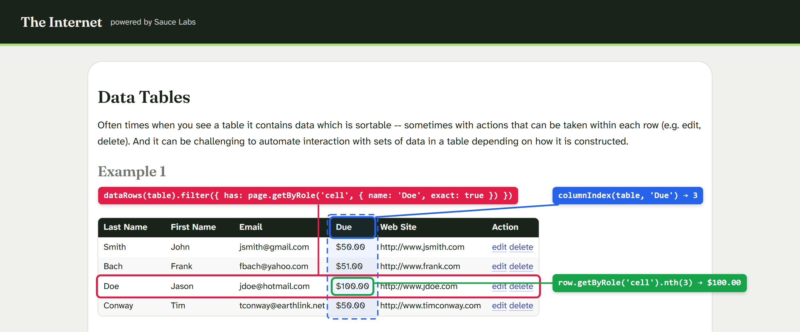
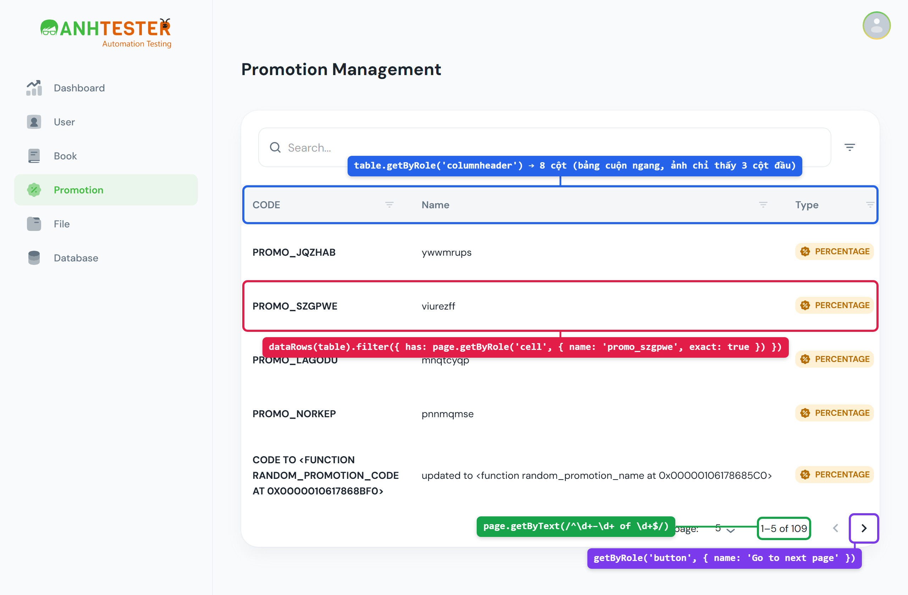
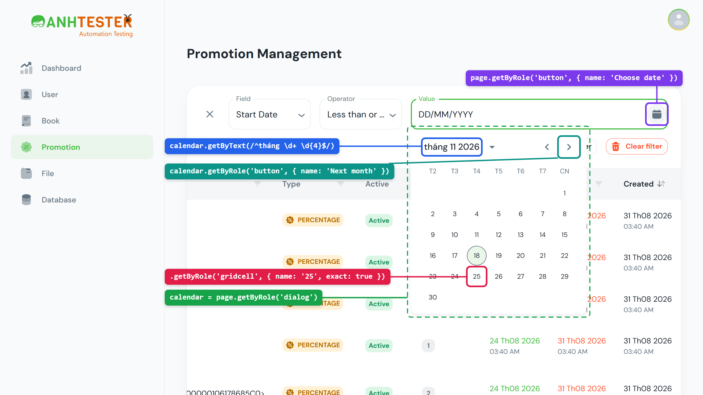
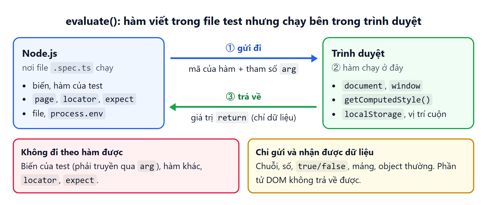
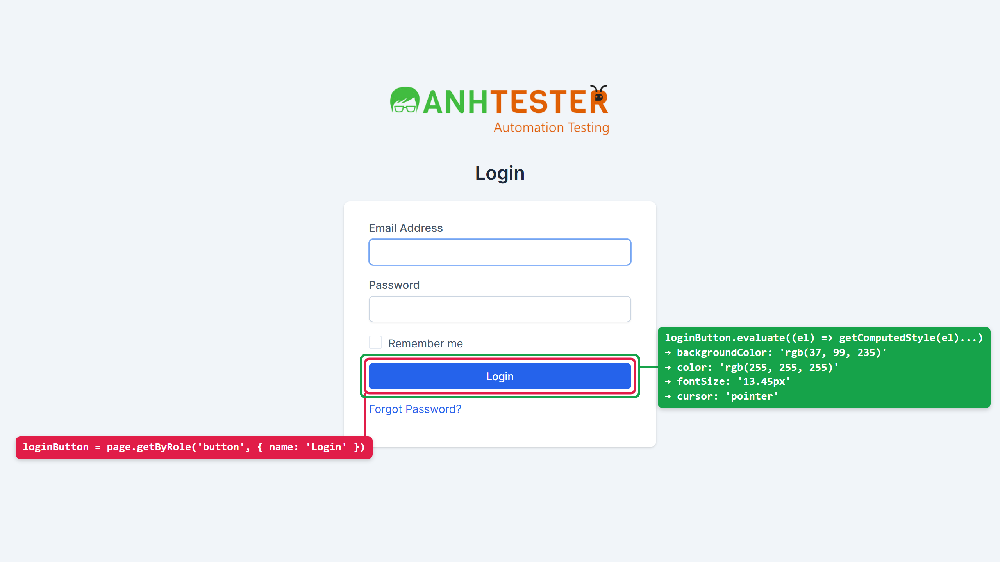
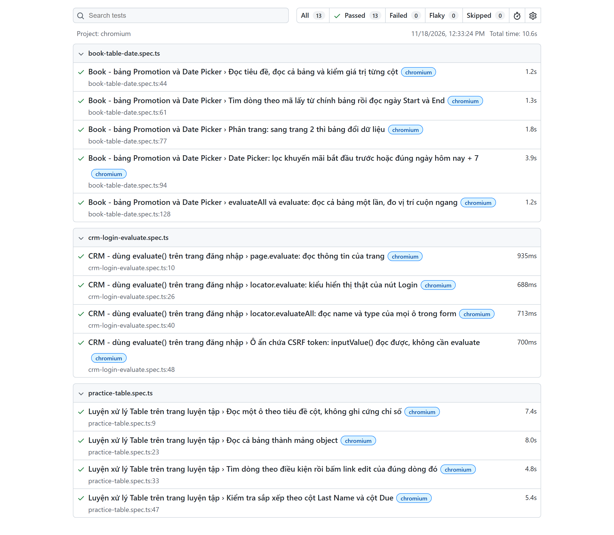

# Bài 21 - [Playwright Typescript] Xử lý Table, Date Picker và dùng evaluate()

Chương: 3. Assertion + Cơ chế Auto-Waiting

Nguồn: [https://anhtester.com/learn/website-and-api-testing-automation-with-playwright-javascript-typescript-day-code-js-ts-tu-dau/378](https://anhtester.com/learn/website-and-api-testing-automation-with-playwright-javascript-typescript-day-code-js-ts-tu-dau/378)

✅ Table - đọc dữ liệu theo dòng, cột và ô  
✅ Tìm dòng theo điều kiện, kiểm tra sắp xếp và bảng dữ liệu động  
✅ Date Picker - tính ngày và chọn ngày trên lịch  
✅ evaluate() - chạy JavaScript trong trang và khi nào nên dùng  
✅ Dùng Claude Code và bộ kit claude-testing-skills để sinh code xử lý Table, Date Picker  
✅ Kiểm tra code do AI sinh ra

## ⭐ Mục tiêu bài học

Ở bài trước (Cách xử lý Alert, Tab mới, Popup, iFrame và Shadow DOM) bạn đã viết `tests/practice-dialogs.spec.ts`, `tests/practice-tabs-popup.spec.ts`, `tests/practice-iframe-shadow.spec.ts` và `tests/crm-login-new-tab.spec.ts`: đăng ký sự kiện `dialog` trước cú bấm, bắt tab mới bằng `context.waitForEvent('page')`, vào iframe bằng `frameLocator`. Bài này xử lý ba thứ màn hình quản trị nào cũng có: **bảng dữ liệu**, **ô chọn ngày** và việc **chạy JavaScript trong trang**. Học xong bạn sẽ:

- Đọc được một ô, một dòng, cả bảng mà **không ghi cứng chỉ số cột**.
- Tìm dòng theo điều kiện, kiểm tra sắp xếp và phân trang.
- Tính ngày bằng JavaScript và chọn ngày trên hai loại Date Picker.
- Biết `evaluate()` chạy ở đâu, khi nào nên dùng, và duyệt được code AI sinh ra cho ba việc trên.

> 📌 Bài làm tiếp trong project `D:\AnhTester\playwright-crm` (macOS: `~/AnhTester/playwright-crm`). Bài dùng thêm trang luyện tập `https://the-internet.herokuapp.com/tables` và trang quản lý sách `https://book.anhtester.com` (xem được không cần đăng nhập). Book là trang demo **dùng chung**: chỉ đọc và lọc, **không bấm nút lưu, tạo hay xoá**. CRM vẫn **chưa đăng nhập**.

## ✅ Phần 1: Table - đọc dữ liệu theo dòng, cột và ô

### 🔆 1. Từ sổ điểm tới thẻ table

Muốn biết điểm Toán của bạn Lan trong sổ điểm, bạn dò **dòng** có tên Lan, dò **cột** "Toán", rồi đọc ô ở chỗ giao nhau. Bạn không nhớ "Toán là cột thứ 4", vì sổ thêm một cột là sai.

Trong HTML, bảng là thẻ `<table>`: mỗi dòng là một `<tr>`, ô tiêu đề là `<th>`, ô dữ liệu là `<td>`. Bảng Example 1 ở [the-internet.herokuapp.com/tables](https://the-internet.herokuapp.com/tables) (rút gọn còn 1 dòng dữ liệu):

```markup
<table id="table1" class="tablesorter">
  <thead>
    <tr>
      <th class="header"><span>Last Name</span></th>
      <th class="header"><span>First Name</span></th>
      <th class="header"><span>Email</span></th>
      <th class="header"><span>Due</span></th>
      <th class="header"><span>Web Site</span></th>
      <th class="header"><span>Action</span></th>
    </tr>
  </thead>
  <tbody>
    <tr>
      <td>Doe</td>
      <td>Jason</td>
      <td>jdoe@hotmail.com</td>
      <td>$100.00</td>
      <td>http://www.jdoe.com</td>
      <td><a href="#edit">edit</a> <a href="#delete">delete</a></td>
    </tr>
  </tbody>
</table>
```

Trong automation, mỗi thẻ trên có sẵn một role: `getByRole('table')`, `'row'` (thẻ `tr`), `'columnheader'` (thẻ `th`), `'cell'` (thẻ `td`). Trang này có 2 bảng nên đếm thật ra 2 `table`, 10 `row`, 12 `columnheader`, 48 `cell`. Vì vậy bước đầu tiên luôn là **khoanh đúng một bảng** rồi mới tìm bên trong: `const table = page.locator("//table[@id='table1']")`.

### 🔆 2. Tìm cột theo tiêu đề, không ghi cứng chỉ số

Cách viết nhanh nhất là XPath theo vị trí: `//table[@id='table1']//tbody/tr[3]/td[4]`. Nó hỏng trong im lặng khi bảng thêm một cột hay đổi thứ tự dòng: test vẫn đọc ra một giá trị, nhưng là **của ô khác**.

Cách bền hơn làm như dò sổ điểm: đọc dòng tiêu đề, xem chữ `Due` đứng thứ mấy, rồi lấy ô ở vị trí đó. Tạo thư mục `utils` ở gốc project và file `utils/table.ts`:

```typescript
import { type Locator } from '@playwright/test';

/** Các dòng dữ liệu của bảng: dòng có ô <td>, bỏ dòng tiêu đề (chỉ có <th>) */
export function dataRows(table: Locator): Locator {
  return table.getByRole('row').filter({ has: table.page().getByRole('cell') });
}

/** Vị trí (tính từ 0) của cột có tiêu đề cho trước. Không thấy cột thì báo lỗi rõ ràng */
export async function columnIndex(table: Locator, header: string): Promise<number> {
  const headers = await table.getByRole('columnheader').allInnerTexts();
  const index = headers.map((text) => text.trim()).indexOf(header);
  if (index === -1) {
    throw new Error(`Không thấy cột "${header}". Bảng đang có các cột: ${headers.join(' | ')}`);
  }
  return index;
}

/** Đọc cả bảng thành mảng object, tên thuộc tính lấy từ tiêu đề cột */
export async function readTable(table: Locator): Promise<Record<string, string>[]> {
  const headers = await table.getByRole('columnheader').allInnerTexts();
  const rows = dataRows(table);
  const data: Record<string, string>[] = [];
  for (let i = 0; i < await rows.count(); i++) {
    const cells = await rows.nth(i).getByRole('cell').allInnerTexts();
    const item: Record<string, string> = {};
    headers.forEach((header, col) => {
      item[header.trim()] = (cells[col] ?? '').trim();
    });
    data.push(item);
  }
  return data;
}
```

- `dataRows()` dùng lại `filter({ has })` của bài XPath và filter(): dòng tiêu đề chỉ có `<th>` nên bị loại.

Đọc số tiền ở cột `Due` của người có Last Name là `Doe`:

```typescript
const table = page.locator("//table[@id='table1']");

const dueIndex = await columnIndex(table, 'Due');
const row = dataRows(table).filter({ has: page.getByRole('cell', { name: 'Doe', exact: true }) });
const due = row.getByRole('cell').nth(dueIndex);

console.log(`Cột Due ở vị trí ${dueIndex}, Doe đang nợ ${await due.innerText()}`);
await expect(due).toHaveText('$100.00');
```

```bash
Tiêu đề cột: [ 'Last Name', 'First Name', 'Email', 'Due', 'Web Site', 'Action' ]
Cột Due ở vị trí 3, Doe đang nợ $100.00
```

[](https://anhtester.com/storage/photos/shares/lesson/js_ts_playwright/v2/bai_21_table_date_picker_evaluate/01_bang_tables_cot_due_dong_doe.png)

*Tìm cột theo tiêu đề Due, tìm dòng theo ô Doe, ô cần đọc nằm ở chỗ giao nhau*

### 🔆 3. Đọc cả bảng thành mảng object

Khi cần kiểm nhiều dòng, đọc cả bảng thành **mảng object** rồi xử lý bằng JavaScript sẽ gọn hơn. Hàm `readTable()` lấy tiêu đề cột làm tên thuộc tính:

```typescript
const data = await readTable(table);
console.table(data, ['Last Name', 'First Name', 'Email', 'Due']);

const conway = data.find((item) => item['Last Name'] === 'Conway');
expect(conway?.['Email']).toBe('tconway@earthlink.net');
```

```bash
┌─────────┬───────────┬────────────┬─────────────────────────┬───────────┐
│ (index) │ Last Name │ First Name │ Email                   │ Due       │
├─────────┼───────────┼────────────┼─────────────────────────┼───────────┤
│ 0       │ 'Smith'   │ 'John'     │ 'jsmith@gmail.com'      │ '$50.00'  │
│ 1       │ 'Bach'    │ 'Frank'    │ 'fbach@yahoo.com'       │ '$51.00'  │
│ 2       │ 'Doe'     │ 'Jason'    │ 'jdoe@hotmail.com'      │ '$100.00' │
│ 3       │ 'Conway'  │ 'Tim'      │ 'tconway@earthlink.net' │ '$50.00'  │
└─────────┴───────────┴────────────┴─────────────────────────┴───────────┘
```

Tên thuộc tính có dấu cách nên phải viết `item['Last Name']`, không viết `item.Last Name` được.

## ✅ Phần 2: Tìm dòng theo điều kiện, kiểm tra sắp xếp và bảng dữ liệu động

### 🔆 1. Tìm dòng rồi thao tác trong đúng dòng đó

Nút Sửa, Xoá ở dòng nào cũng giống nhau. Hãy tìm **dòng** trước rồi tìm nút **bên trong dòng**:

```typescript
// Dòng có ô Due đúng bằng $51.00
const row = dataRows(table).filter({ has: page.getByRole('cell', { name: '$51.00', exact: true }) });
await expect(row).toHaveCount(1);

await row.getByRole('link', { name: 'edit' }).click();
await expect(page).toHaveURL(/#edit$/);
```

Link `edit` ở trang luyện tập chỉ trỏ tới `#edit`, bấm không thay đổi gì. `toHaveCount(1)` là chốt chặn: điều kiện khớp 2 dòng thì test dừng, không bấm nhầm.

### 🔆 2. Kiểm tra sắp xếp

Bảng Example 2 sắp xếp lại khi bấm tiêu đề cột. Cách kiểm: tự sắp xếp một bản sao bằng JavaScript rồi so với trang. Cách viết dễ nghĩ ra nhất lại **lỗi thật** (file thử `tests/exp-table-evaluate.spec.ts`):

```typescript
await table.getByRole('columnheader', { name: 'Due' }).click();
const amounts = (await dues.allInnerTexts()).map((text) => Number(text.replace('$', '')));
console.log('Đọc ngay sau khi bấm:', amounts);
expect(amounts).toEqual([...amounts].sort((a, b) => a - b));
```

```bash
Trước khi bấm: [ '$50.00', '$51.00', '$100.00', '$50.00' ]
Đọc ngay sau khi bấm: [ 50, 51, 100, 50 ]

    Error: expect(received).toEqual(expected) // deep equality

      Array [
        50,
    -   50,
        51,
        100,
    +   50,
      ]
```

Trang cần vài mili giây để xếp lại, còn `allInnerTexts()` **đọc ngay một lần, không chờ**: chạy 3 lần, cả 3 lần đọc ra thứ tự cũ. Cách sửa: tính kết quả mong đợi **trước khi bấm**, rồi để Web-First Assertion tự thử lại. `toHaveText` nhận một mảng thì so từng phần tử theo thứ tự:

```typescript
const dueIndex = await columnIndex(table, 'Due');
const dues = table.locator(`//tbody/tr/td[${dueIndex + 1}]`);
const toNumber = (text: string) => Number(text.replace('$', ''));
const expectedDues = (await dues.allInnerTexts()).sort((a, b) => toNumber(a) - toNumber(b));

await table.getByRole('columnheader', { name: 'Due' }).click();
await expect(dues).toHaveText(expectedDues);
```

```bash
Due sau khi bấm tiêu đề: [ '$50.00', '$50.00', '$51.00', '$100.00' ]
```

- XPath `td[n]` đếm từ 1, `nth()` đếm từ 0, nên phải cộng 1. Chỉ số này **tính từ tiêu đề**, không ghi cứng.
- Cột tiền phải đổi sang số rồi mới sắp xếp, nếu không `'$100.00'` đứng trước `'$50.00'`.

### 🔆 3. Bảng thật: dữ liệu về sau, thay đổi liên tục, có phân trang

Bảng khuyến mãi ở [book.anhtester.com/promotion-book-management](https://book.anhtester.com/promotion-book-management) có 8 cột, mỗi trang 5 dòng, và khác bảng luyện tập ở ba điểm:

<table class="rt-table">
<thead>
<tr>
<th>Đặc điểm</th>
<th>Cách xử lý</th>
</tr>
</thead>
<tbody>
<tr>
<td>Dữ liệu về sau khi trang đã mở (gọi API)</td>
<td>Chờ dòng tóm tắt dưới bảng đổi thành <code>1–5 of 109</code> rồi mới đọc</td>
</tr>
<tr>
<td>Nhiều người cùng thêm, sửa dữ liệu</td>
<td>Lấy giá trị <strong>từ chính bảng</strong>, hoặc kiểm <strong>quy luật</strong>: cột Active chỉ có <code>Active</code>/<code>Inactive</code>, End không trước Start</td>
</tr>
<tr>
<td>Phân trang</td>
<td>Bấm <code>Go to next page</code> rồi chờ <strong>dữ liệu đổi</strong>, không chỉ chờ dòng tóm tắt đổi</td>
</tr>
</tbody>
</table>

Thêm một bẫy: bảng rỗng vẫn có một dòng `No Data`, nên đếm được 1 dòng chưa chắc là có 1 bản ghi. Còn đọc ngay sau `goto` thì nhận mảng rỗng, không có lỗi nào (kết quả thật):

```typescript
await page.goto('https://book.anhtester.com/promotion-book-management');
const cells = page.getByRole('table').getByRole('cell');
console.log('Ngay sau goto:', await cells.allInnerTexts());

await expect(page.getByText(/^1–\d+ of \d+$/)).toBeVisible();
console.log('Sau khi chờ dòng tóm tắt:', (await cells.allInnerTexts()).length, 'ô');
```

```bash
Ngay sau goto: []
Sau khi chờ dòng tóm tắt: 40 ô
```

[](https://anhtester.com/storage/photos/shares/lesson/js_ts_playwright/v2/bai_21_table_date_picker_evaluate/02_bang_promotion_book.png)

*Bảng Promotion trên Book: dòng tiêu đề, dòng tìm theo mã lấy từ chính bảng, dòng tóm tắt và nút sang trang*

> ⚠️ Mã hiện chữ hoa `PROMO_SZGPWE` nhưng trong HTML là `promo_szgpwe` (trang viết hoa bằng CSS). `innerText()` trả về chữ **như mắt thấy**, `textContent()` trả về chữ **gốc**. `getByRole` với `exact: true` so với chữ gốc, nên file thực hành lấy mã bằng `textContent()`.

## ✅ Phần 3: Date Picker - tính ngày và chọn ngày trên lịch

### 🔆 1. Hai loại ô chọn ngày

<table class="rt-table">
<thead>
<tr>
<th>Loại</th>
<th>Nhận biết trong HTML</th>
<th>Cách điền</th>
</tr>
</thead>
<tbody>
<tr>
<td>Ô ngày của trình duyệt</td>
<td><code>&lt;input type="date"&gt;</code></td>
<td><code>fill('2026-11-25')</code>, luôn là <code>yyyy-mm-dd</code> dù màn hình hiện kiểu nào</td>
</tr>
<tr>
<td>Lịch tự dựng của thư viện giao diện</td>
<td>Không có <code>type="date"</code>. Bấm vào thì hiện khối lịch gồm nhiều <code>div</code>, <code>button</code></td>
<td>Làm như người dùng: mở lịch, chuyển tháng, bấm ngày</td>
</tr>
</tbody>
</table>

Ba trang demo của khoá không có `input type="date"`, nên đoạn dưới là **mẫu chung**:

```typescript
const startDate = page.getByLabel('Ngày bắt đầu');
await startDate.fill('2026-11-25');
await expect(startDate).toHaveValue('2026-11-25');
```

Luôn kiểm lại bằng `toHaveValue`: thử điền sai dạng `'25/11/2026'` trên Chromium thì **không có lỗi nào**, ô chỉ bị để trống.

### 🔆 2. Tính ngày bằng JavaScript

Ngày ghi cứng trong test sẽ sai dần theo thời gian. Hãy **tính** từ ngày chạy test. Tạo file `utils/date.ts`:

```typescript
/** Trả về ngày mới = ngày gốc cộng thêm số ngày (số âm là lùi lại) */
export function addDays(date: Date, days: number): Date {
  const result = new Date(date);
  result.setDate(result.getDate() + days);
  return result;
}

/** Tách ngày theo GIỜ MÁY ĐANG CHẠY thành 3 chuỗi: dd, mm, yyyy */
export function dateParts(date: Date): { dd: string; mm: string; yyyy: string } {
  return {
    dd: String(date.getDate()).padStart(2, '0'),
    mm: String(date.getMonth() + 1).padStart(2, '0'), // getMonth() đếm từ 0
    yyyy: String(date.getFullYear()),
  };
}

/** 2026-11-25: định dạng mà thẻ input type="date" nhận */
export function formatYMD(date: Date): string {
  const { dd, mm, yyyy } = dateParts(date);
  return `${yyyy}-${mm}-${dd}`;
}
```

Vì sao không dùng `toISOString().slice(0, 10)` cho ngắn? Vì `toISOString()` đổi về giờ UTC, còn Việt Nam là UTC+7. Kết quả thật trên máy đặt giờ Việt Nam (file thử `tests/exp-date.spec.ts`):

```typescript
const morning = new Date(2026, 10, 25, 6, 30); // 06:30 sáng 25/11/2026 theo giờ máy (tháng đếm từ 0)
console.log('toISOString() :', morning.toISOString(), '→ cắt 10 ký tự:', morning.toISOString().slice(0, 10));
console.log('formatYMD()   :', formatYMD(morning));
console.log('Cộng 7 ngày   :', formatYMD(addDays(morning, 7)), dateParts(addDays(morning, 7)));
```

```bash
toISOString() : 2026-11-24T23:30:00.000Z → cắt 10 ký tự: 2026-11-24
formatYMD()   : 2026-11-25
Cộng 7 ngày   : 2026-12-02 { dd: '02', mm: '12', yyyy: '2026' }
```

Test chạy trước 7 giờ sáng sẽ **lệch một ngày**. Còn `setDate()` tự nhảy sang tháng sau khi cộng quá ngày cuối tháng.

> 💡 Cần tính ngày phức tạp hơn thì dùng thư viện [date-fns](https://date-fns.org/): `npm i -D date-fns` rồi `format(addDays(new Date(), 7), 'yyyy-MM-dd')` (bản 4.4.0 cho cùng kết quả).

### 🔆 3. Chọn ngày trên lịch của Book

Ở bảng Promotion, bấm biểu tượng lọc cạnh tiêu đề `Start` thì hiện dòng lọc có ô `Value` là lịch tự dựng. Lọc chỉ **đọc** dữ liệu nên an toàn với trang dùng chung. HTML thật của ô này (đã bỏ bớt class):

```markup
<div role="group" aria-labelledby="...">
  <span role="spinbutton" aria-label="Day" contenteditable="true">DD</span>/
  <span role="spinbutton" aria-label="Month" contenteditable="true">MM</span>/
  <span role="spinbutton" aria-label="Year" contenteditable="true">YYYY</span>
  <button type="button" aria-label="Choose date">...</button>
</div>
```

Bấm `Choose date` thì lịch hiện ra trong một `dialog`:

[](https://anhtester.com/storage/photos/shares/lesson/js_ts_playwright/v2/bai_21_table_date_picker_evaluate/03_date_picker_book_dang_mo.png)

*Lịch chọn ngày của Book đang mở, mỗi khung do chính locator ghi bên cạnh tìm ra*

Hàm `pickDate()` trong file thực hành làm đúng ba bước của người dùng:

```typescript
/** Mở lịch của ô Value rồi chọn đúng ngày cần, tự bấm chuyển tháng nếu lịch đang ở tháng khác */
async function pickDate(page: Page, target: Date) {
  await page.getByRole('button', { name: 'Choose date' }).click();
  const calendar = page.getByRole('dialog');

  // Tiêu đề lịch có dạng "tháng 11 2026": đọc ra để biết lịch đang ở tháng nào
  const label = await calendar.getByText(/^tháng \d+ \d{4}$/).innerText();
  const [, month, year] = label.match(/tháng (\d+) (\d{4})/)!;
  const diff = (target.getFullYear() - Number(year)) * 12 + (target.getMonth() + 1 - Number(month));

  const arrow = calendar.getByRole('button', { name: diff > 0 ? 'Next month' : 'Previous month' });
  for (let i = 0; i < Math.abs(diff); i++) {
    await arrow.click();
  }
  // Lịch trượt sang tháng mới: tháng cũ còn nằm trong DOM vài trăm mili giây. Chờ tới khi chỉ còn 1 tháng
  await expect(calendar.getByRole('rowgroup')).toHaveCount(1);
  const targetLabel = `tháng ${target.getMonth() + 1} ${target.getFullYear()}`;
  await calendar.getByRole('grid', { name: targetLabel })
    .getByRole('gridcell', { name: String(target.getDate()), exact: true })
    .click();
}
```

- Đọc tiêu đề lịch rồi tính `diff`: biết trước cần bấm chuyển tháng mấy lần.
- `exact: true`: thiếu nó, `name: '1'` khớp cả 10, 11... 21. Đo thật ở tháng 11/2026: **12 phần tử**.
- Chờ còn 1 `rowgroup`: khi lịch trượt sang tháng mới, tháng cũ còn nằm trong trang vài trăm mili giây. Bỏ dòng này, chọn ngày 08/12 báo `strict mode violation`.

Chọn xong, ba phần `Day`, `Month`, `Year` đổi thành `25`, `11`, `2026`. Ô này cũng cho gõ: `pressSequentially('25112026')` vào phần `Day` ra cùng kết quả.

## ✅ Phần 4: evaluate() - chạy JavaScript trong trang và khi nào nên dùng

### 🔆 1. Hỏi nhân viên hay tự vào kho?

Vào cửa hàng, bạn hỏi nhân viên và họ lấy hàng giúp, kiểm rồi mới đưa. Có thứ nhân viên không biết, bạn xin vào kho tự xem: thấy được mọi thứ, nhưng không còn ai kiểm giúp món hàng đã sẵn sàng chưa.

Trong lập trình, test chạy ở **Node.js**, trang web chạy trong **trình duyệt**. `click()`, `innerText()` là "nhân viên". `evaluate()` là "tự vào kho": gửi một hàm JavaScript sang trình duyệt, chạy ở đó và mang kết quả về.

[](https://anhtester.com/storage/photos/shares/lesson/js_ts_playwright/v2/bai_21_table_date_picker_evaluate/04_so_do_evaluate_node_va_trinh_duyet.png)

*evaluate() gửi hàm từ Node.js sang trình duyệt, chạy ở đó rồi trả dữ liệu về*

### 🔆 2. Ba hàm evaluate và cách truyền dữ liệu

<table class="rt-table">
<thead>
<tr>
<th>Hàm</th>
<th>Hàm của bạn nhận gì</th>
<th>Có chờ phần tử không</th>
</tr>
</thead>
<tbody>
<tr>
<td><code>page.evaluate(fn, arg)</code></td>
<td>Chỉ <code>arg</code></td>
<td>Không gắn với phần tử nào</td>
</tr>
<tr>
<td><code>locator.evaluate(fn, arg)</code></td>
<td><strong>Một</strong> phần tử khớp locator, rồi tới <code>arg</code></td>
<td>Chờ phần tử <strong>có trong trang</strong>, không kiểm visible hay enabled</td>
</tr>
<tr>
<td><code>locator.evaluateAll(fn, arg)</code></td>
<td><strong>Mảng</strong> mọi phần tử khớp, rồi tới <code>arg</code></td>
<td>Không chờ</td>
</tr>
</tbody>
</table>

Trên trang đăng nhập CRM, đọc kiểu hiển thị thật của nút `Login` sau khi mọi CSS đã áp dụng:

```typescript
const loginButton = page.getByRole('button', { name: 'Login' });

const style = await loginButton.evaluate((el) => {
  const css = getComputedStyle(el);
  return { backgroundColor: css.backgroundColor, color: css.color, fontSize: css.fontSize, cursor: css.cursor };
});
console.log('Nút Login:', style);
```

```bash
Nút Login: {
  backgroundColor: 'rgb(37, 99, 235)',
  color: 'rgb(255, 255, 255)',
  fontSize: '13.45px',
  cursor: 'pointer'
}
```

[](https://anhtester.com/storage/photos/shares/lesson/js_ts_playwright/v2/bai_21_table_date_picker_evaluate/05_crm_login_mau_nen_nut_login.png)

*Trang đăng nhập Admin CRM: bốn thuộc tính CSS của nút Login đọc về trong một lần evaluate*

Hàm bên trong `evaluate` **không thấy biến của test**, dù hai dòng nằm sát nhau. Đoạn sau không bị TypeScript báo đỏ nhưng lỗi khi chạy:

```typescript
const brand = 'Anh Tester';
await page.evaluate(() => document.title.includes(brand));
```

```bash
    Error: page.evaluate: ReferenceError: brand is not defined
```

Dữ liệu phải đi qua **tham số thứ hai** (nhiều giá trị thì gói vào object hoặc mảng):

```typescript
const hasBrand = await page.evaluate((text) => document.title.includes(text), brand); // true
```

Chiều về cũng chỉ **dữ liệu** đi qua được. Trả về một phần tử DOM, bạn chỉ nhận được một chuỗi (kết quả thật ở bản 1.65.1):

```typescript
const result = await page.getByRole('button', { name: 'Login' }).evaluate((el) => el);
console.log('Kết quả nhận được:', result, '| kiểu:', typeof result);
```

```bash
Kết quả nhận được: ref: <Node> | kiểu: string
```

`evaluateAll` đọc nhiều phần tử trong **một lần gọi**. Với 5 dòng của bảng Promotion, vòng lặp `readTable()` mất 89ms, `evaluateAll` mất 8ms (đo thật). Bảng vài trăm dòng mới cần tới nó:

```typescript
const byEvaluateAll = await dataRows(table).evaluateAll((rows: HTMLTableRowElement[]) =>
  rows.map((row) => Array.from(row.cells, (cell) => cell.innerText.trim())),
);
```

### 🔆 3. Khi nào nên dùng, khi nào không?

Quy tắc: **Playwright đã có hàm cho việc đó thì dùng hàm đó** (tài liệu: [playwright.dev/docs/evaluating](https://playwright.dev/docs/evaluating)).

<table class="rt-table">
<thead>
<tr>
<th>Nên dùng evaluate</th>
<th>Không nên dùng, đã có hàm tốt hơn</th>
</tr>
</thead>
<tbody>
<tr>
<td>Đọc nhiều thuộc tính CSS đã tính (<code>getComputedStyle</code>) trong một lần</td>
<td>Kiểm một thuộc tính CSS: <code>toHaveCSS('background-color', ...)</code></td>
</tr>
<tr>
<td>Vị trí cuộn: <code>window.scrollY</code>, <code>el.scrollLeft</code>, <code>el.scrollWidth</code></td>
<td>Đọc chữ, giá trị, thuộc tính: <code>innerText()</code>, <code>inputValue()</code>, <code>getAttribute()</code></td>
</tr>
<tr>
<td>Thông tin của trang: <code>document.readyState</code>, <code>localStorage</code></td>
<td>Bấm, điền, tick: <code>click()</code>, <code>fill()</code>, <code>check()</code></td>
</tr>
<tr>
<td>Đọc rất nhiều phần tử trong một lần gọi (<code>evaluateAll</code>)</td>
<td>Kiểm tra kết quả: Web-First Assertion</td>
</tr>
</tbody>
</table>

Vì sao **không thao tác bằng evaluate**? Ở trang User của Book, gõ tên vào ô tìm kiếm thì trang gọi API và lọc bảng. Thử hai cách với một tên lấy từ bảng (file thử `tests/exp-table-evaluate.spec.ts`):

```bash
evaluate: ô hiện "cueahccl" | request tìm kiếm: KHÔNG có | bảng còn 5 dòng
fill:     ô hiện "cueahccl" | request tìm kiếm: có | bảng còn 2 dòng
```

Gán `el.value` chỉ đổi chữ trên màn hình: trang không nhận sự kiện gõ phím nào nên không tìm kiếm, còn `fill()` phát đủ sự kiện như người dùng gõ. Tệ hơn, evaluate gán được cả vào ô đang `disabled` và `toHaveValue` vẫn đạt: test xanh cho việc người dùng không làm được. `el.click()` cũng bỏ qua mọi bước kiểm của Auto-Waiting như vậy.

## ✅ Phần 5: Thực hành trên trang luyện tập, Book và CRM demo

```bash
D:\AnhTester\playwright-crm
├── tests
│   ├── practice-table.spec.ts          (file thực hành 1)
│   ├── book-table-date.spec.ts         (file thực hành 2)
│   ├── crm-login-evaluate.spec.ts      (file thực hành 3)
│   ├── exp-table-evaluate.spec.ts      (file thử ở Phần 2 và Phần 4)
│   └── exp-date.spec.ts                (file thử ở Phần 3)
├── utils
│   ├── table.ts                        (Phần 1)
│   └── date.ts                         (Phần 3)
├── package.json
└── playwright.config.ts
```

### 🔆 1. File tests/practice-table.spec.ts

```typescript
import { test, expect } from '@playwright/test';
import { columnIndex, dataRows, readTable } from '../utils/table';

test.describe('Luyện xử lý Table trên trang luyện tập', () => {
  test.beforeEach(async ({ page }) => {
    await page.goto('https://the-internet.herokuapp.com/tables');
  });

  test('Đọc một ô theo tiêu đề cột, không ghi cứng chỉ số', async ({ page }) => {
    const table = page.locator("//table[@id='table1']");

    const headers = await table.getByRole('columnheader').allInnerTexts();
    console.log('Tiêu đề cột:', headers);

    const dueIndex = await columnIndex(table, 'Due');
    const row = dataRows(table).filter({ has: page.getByRole('cell', { name: 'Doe', exact: true }) });
    const due = row.getByRole('cell').nth(dueIndex);

    console.log(`Cột Due ở vị trí ${dueIndex}, Doe đang nợ ${await due.innerText()}`);
    await expect(due).toHaveText('$100.00');
  });

  test('Đọc cả bảng thành mảng object', async ({ page }) => {
    const table = page.locator("//table[@id='table1']");
    const data = await readTable(table);
    console.table(data, ['Last Name', 'First Name', 'Email', 'Due']);

    expect(data).toHaveLength(4);
    const conway = data.find((item) => item['Last Name'] === 'Conway');
    expect(conway?.['Email']).toBe('tconway@earthlink.net');
  });

  test('Tìm dòng theo điều kiện rồi bấm link edit của đúng dòng đó', async ({ page }) => {
    const table = page.locator("//table[@id='table1']");
    const dueIndex = await columnIndex(table, 'Due');

    // Dòng có ô Due đúng bằng $51.00
    const row = dataRows(table).filter({ has: page.getByRole('cell', { name: '$51.00', exact: true }) });
    await expect(row).toHaveCount(1);
    await expect(row.getByRole('cell').nth(dueIndex)).toHaveText('$51.00');
    console.log('Dòng tìm được:', await row.getByRole('cell').allInnerTexts());

    await row.getByRole('link', { name: 'edit' }).click();
    await expect(page).toHaveURL(/#edit$/);
  });

  test('Kiểm tra sắp xếp theo cột Last Name và cột Due', async ({ page }) => {
    const table = page.locator("//table[@id='table2']");

    // Cột Last Name: so với bản sao đã sắp xếp theo bảng chữ cái
    const lastNameIndex = await columnIndex(table, 'Last Name');
    const lastNames = table.locator(`//tbody/tr/td[${lastNameIndex + 1}]`);
    const before = await lastNames.allInnerTexts();
    const expected = [...before].sort((a, b) => a.localeCompare(b));

    await table.getByRole('columnheader', { name: 'Last Name' }).click();
    await expect(lastNames).toHaveText(expected);
    console.log('Last Name trước:', before, '→ sau khi bấm tiêu đề:', await lastNames.allInnerTexts());

    // Cột Due là tiền: đổi sang số rồi mới sắp xếp, nếu không '$100.00' sẽ đứng trước '$50.00'
    const dueIndex = await columnIndex(table, 'Due');
    const dues = table.locator(`//tbody/tr/td[${dueIndex + 1}]`);
    const toNumber = (text: string) => Number(text.replace('$', ''));
    const expectedDues = (await dues.allInnerTexts()).sort((a, b) => toNumber(a) - toNumber(b));

    await table.getByRole('columnheader', { name: 'Due' }).click();
    await expect(dues).toHaveText(expectedDues);
    console.log('Due sau khi bấm tiêu đề:', await dues.allInnerTexts());
  });
});
```

### 🔆 2. File tests/book-table-date.spec.ts

```typescript
import { test, expect, type Page } from '@playwright/test';
import { columnIndex, dataRows, readTable } from '../utils/table';
import { addDays, dateParts, formatYMD } from '../utils/date';

const PROMOTION_URL = 'https://book.anhtester.com/promotion-book-management';

/** Đổi chữ ngày trong bảng Promotion, ví dụ "24 Th08 2026", thành chuỗi so sánh được "2026-08-24" */
function tableDateToYMD(text: string): string {
  const match = text.match(/(\d{2}) Th(\d{2}) (\d{4})/);
  if (!match) throw new Error(`Ô ngày có định dạng lạ: "${text}"`);
  const [, dd, mm, yyyy] = match;
  return `${yyyy}-${mm}-${dd}`;
}

/** Mở lịch của ô Value rồi chọn đúng ngày cần, tự bấm chuyển tháng nếu lịch đang ở tháng khác */
async function pickDate(page: Page, target: Date) {
  await page.getByRole('button', { name: 'Choose date' }).click();
  const calendar = page.getByRole('dialog');

  // Tiêu đề lịch có dạng "tháng 11 2026": đọc ra để biết lịch đang ở tháng nào
  const label = await calendar.getByText(/^tháng \d+ \d{4}$/).innerText();
  const [, month, year] = label.match(/tháng (\d+) (\d{4})/)!;
  const diff = (target.getFullYear() - Number(year)) * 12 + (target.getMonth() + 1 - Number(month));

  const arrow = calendar.getByRole('button', { name: diff > 0 ? 'Next month' : 'Previous month' });
  for (let i = 0; i < Math.abs(diff); i++) {
    await arrow.click();
  }
  // Lịch trượt sang tháng mới: tháng cũ còn nằm trong DOM vài trăm mili giây. Chờ tới khi chỉ còn 1 tháng
  await expect(calendar.getByRole('rowgroup')).toHaveCount(1);
  const targetLabel = `tháng ${target.getMonth() + 1} ${target.getFullYear()}`;
  await calendar.getByRole('grid', { name: targetLabel })
    .getByRole('gridcell', { name: String(target.getDate()), exact: true })
    .click();
}

test.describe('Book - bảng Promotion và Date Picker', () => {
  test.beforeEach(async ({ page }) => {
    await page.goto(PROMOTION_URL);
    // Dữ liệu về sau bằng API: dòng tóm tắt dưới bảng đổi thành "1–5 of ..." là lúc bảng đã có dữ liệu
    await expect(page.getByText(/^1–\d+ of \d+$/)).toBeVisible();
  });

  test('Đọc tiêu đề, đọc cả bảng và kiểm giá trị từng cột', async ({ page }) => {
    const table = page.getByRole('table');
    await expect(table.getByRole('columnheader'))
      .toHaveText(['CODE', 'Name', 'Type', 'Active', 'Value', 'Start', 'End', 'Created']);

    const data = await readTable(table);
    console.log(`Trang 1 có ${data.length} dòng. Dòng đầu:`, data[0]);

    expect(data.length).toBeGreaterThan(0);
    for (const item of data) {
      expect(['Active', 'Inactive'], `Cột Active của ${item['CODE']}`).toContain(item['Active']);
      expect(['PERCENTAGE', 'FIXED_AMOUNT', 'FREE_SHIPPING'], `Cột Type của ${item['CODE']}`).toContain(item['Type']);
      // Ngày kết thúc không được trước ngày bắt đầu
      expect(tableDateToYMD(item['End']) >= tableDateToYMD(item['Start']), `Start/End của ${item['CODE']}`).toBe(true);
    }
  });

  test('Tìm dòng theo mã lấy từ chính bảng rồi đọc ngày Start và End', async ({ page }) => {
    const table = page.getByRole('table');
    const codeIndex = await columnIndex(table, 'CODE');
    const startIndex = await columnIndex(table, 'Start');
    const endIndex = await columnIndex(table, 'End');

    // Không ghi cứng mã: lấy mã của dòng thứ hai đang có trong bảng
    const code = (await dataRows(table).nth(1).getByRole('cell').nth(codeIndex).textContent())!.trim();

    const row = dataRows(table).filter({ has: page.getByRole('cell', { name: code, exact: true }) });
    await expect(row).toHaveCount(1);
    const start = await row.getByRole('cell').nth(startIndex).innerText();
    const end = await row.getByRole('cell').nth(endIndex).innerText();
    console.log(`Mã ${code}: Start = ${tableDateToYMD(start)}, End = ${tableDateToYMD(end)}`);
  });

  test('Phân trang: sang trang 2 thì bảng đổi dữ liệu', async ({ page }) => {
    const table = page.getByRole('table');
    const codeIndex = await columnIndex(table, 'CODE');
    const firstCode = dataRows(table).first().getByRole('cell').nth(codeIndex);
    const codeOnPage1 = await firstCode.innerText();

    const summary = page.getByText(/^\d+–\d+ of \d+$/);
    console.log('Trang 1:', await summary.innerText(), '| dòng đầu:', codeOnPage1);

    await page.getByRole('button', { name: 'Go to next page' }).click();
    await expect(summary).toHaveText(/^6–10 of \d+$/);
    await expect(firstCode).not.toHaveText(codeOnPage1);
    console.log('Trang 2:', await summary.innerText(), '| dòng đầu:', await firstCode.innerText());

    await expect(page.getByRole('button', { name: 'Go to previous page' })).toBeEnabled();
  });

  test('Date Picker: lọc khuyến mãi bắt đầu trước hoặc đúng ngày hôm nay + 7', async ({ page }) => {
    const target = addDays(new Date(), 7);
    const { dd, mm, yyyy } = dateParts(target);
    console.log(`Hôm nay ${formatYMD(new Date())}, ngày cần chọn ${formatYMD(target)}`);

    // Mở bộ lọc của cột Start, đổi phép so sánh thành "nhỏ hơn hoặc bằng"
    await page.getByRole('columnheader', { name: 'Start' }).getByRole('button').last().click();
    await page.getByRole('combobox', { name: 'Operator' }).click();
    await page.getByRole('option', { name: 'Less than or equal to (<=)' }).click();

    // Bẫy chờ response đặt TRƯỚC thao tác gây ra request
    const responsePromise = page.waitForResponse(/api\/promotion-book\?.*startDate/);
    await pickDate(page, target);
    const response = await responsePromise;

    // Tổng số dòng server trả về phải khớp dòng tóm tắt dưới bảng: lúc đó bảng đã vẽ lại xong
    const { pagination } = await response.json();
    await expect(page.getByText(/^\d+–\d+ of \d+$/)).toHaveText(new RegExp(` of ${pagination.total}$`));

    const value = page.getByRole('group', { name: 'Value' });
    await expect(value.getByRole('spinbutton', { name: 'Day' })).toHaveText(dd);
    await expect(value.getByRole('spinbutton', { name: 'Month' })).toHaveText(mm);
    await expect(value.getByRole('spinbutton', { name: 'Year' })).toHaveText(yyyy);

    // Bảng sau khi lọc: hoặc "No Data", hoặc mọi dòng có Start <= ngày đã chọn
    const table = page.getByRole('table');
    const data = await readTable(table);
    console.log(`Server trả về ${pagination.total} khuyến mãi, trang 1 đang hiện ${data.length} dòng`);
    for (const item of data) {
      if (item['CODE'] === 'No Data') continue;
      expect(tableDateToYMD(item['Start']) <= formatYMD(target), `Start của ${item['CODE']}`).toBe(true);
    }
  });

  test('evaluateAll và evaluate: đọc cả bảng một lần, đo vị trí cuộn ngang', async ({ page }) => {
    const table = page.getByRole('table');

    let start = Date.now();
    const byLoop = await readTable(table);
    const loopMs = Date.now() - start;

    // Một lần gọi duy nhất: hàm chạy trong trình duyệt, nhận mảng mọi dòng khớp locator
    start = Date.now();
    const byEvaluateAll = await dataRows(table).evaluateAll((rows: HTMLTableRowElement[]) =>
      rows.map((row) => Array.from(row.cells, (cell) => cell.innerText.trim())),
    );
    const evaluateAllMs = Date.now() - start;
    console.log(`Vòng lặp: ${byLoop.length} dòng, ${loopMs}ms | evaluateAll: ${byEvaluateAll.length} dòng, ${evaluateAllMs}ms`);
    expect(byEvaluateAll.map((cells) => cells[0])).toEqual(byLoop.map((item) => item['CODE']));

    // Bảng rộng hơn khung chứa: cột Created nằm ngoài vùng nhìn thấy
    const scrollBox = page.getByRole('region', { name: 'scrollable content' }).filter({ has: table });
    const readScroll = (el: HTMLElement) => ({ scrollLeft: el.scrollLeft, clientWidth: el.clientWidth, scrollWidth: el.scrollWidth });
    console.log('Trước khi cuộn:', await scrollBox.evaluate(readScroll));
    await table.getByRole('columnheader', { name: 'Created' }).scrollIntoViewIfNeeded();
    const after = await scrollBox.evaluate(readScroll);
    console.log('Sau khi cuộn tới cột Created:', after);
    expect(after.scrollLeft).toBeGreaterThan(0);
  });
});
```

- Test phân trang chờ **mã ở dòng đầu đổi**: dòng tóm tắt đổi thành `6–10` ngay lúc bấm, dữ liệu về sau.
- Test Date Picker dùng lại `waitForResponse` của bài Auto-Waiting, rồi chờ dòng tóm tắt khớp tổng số bản ghi server trả về.

### 🔆 3. File tests/crm-login-evaluate.spec.ts

```typescript
import { test, expect } from '@playwright/test';

const LOGIN_URL = 'https://crm.anhtester.com/admin/authentication';

test.describe('CRM - dùng evaluate() trên trang đăng nhập', () => {
  test.beforeEach(async ({ page }) => {
    await page.goto(LOGIN_URL);
  });

  test('page.evaluate: đọc thông tin của trang', async ({ page }) => {
    const info = await page.evaluate(() => ({
      title: document.title,
      readyState: document.readyState,
      scrollY: window.scrollY,
      localStorageKeys: Object.keys(localStorage),
    }));
    console.log(info);
    expect(info.readyState).toBe('complete');

    // Dữ liệu của test đi vào trình duyệt qua tham số thứ hai
    const brand = 'Anh Tester';
    const hasBrand = await page.evaluate((text) => document.title.includes(text), brand);
    expect(hasBrand).toBe(true);
  });

  test('locator.evaluate: kiểu hiển thị thật của nút Login', async ({ page }) => {
    const loginButton = page.getByRole('button', { name: 'Login' });

    const style = await loginButton.evaluate((el) => {
      const css = getComputedStyle(el);
      return { backgroundColor: css.backgroundColor, color: css.color, fontSize: css.fontSize, cursor: css.cursor };
    });
    console.log('Nút Login:', style);
    expect(style.backgroundColor).toBe('rgb(37, 99, 235)');

    // Chỉ kiểm MỘT thuộc tính CSS thì đã có Web-First Assertion, không cần evaluate
    await expect(loginButton).toHaveCSS('background-color', 'rgb(37, 99, 235)');
  });

  test('locator.evaluateAll: đọc name và type của mọi ô trong form', async ({ page }) => {
    const inputs = await page.locator('//form//input').evaluateAll((els: HTMLInputElement[]) =>
      els.map((el) => ({ name: el.name, type: el.type })),
    );
    console.table(inputs);
    expect(inputs.map((input) => input.name)).toEqual(['csrf_token_name', 'email', 'password', 'remember']);
  });

  test('Ô ẩn chứa CSRF token: inputValue() đọc được, không cần evaluate', async ({ page }) => {
    const token = page.locator("//input[@name='csrf_token_name']");
    await expect(token).toBeHidden();

    const byApi = await token.inputValue();
    const byEvaluate = await token.evaluate((el: HTMLInputElement) => el.value);
    // Token là dữ liệu nhạy cảm: chỉ in độ dài, không in giá trị
    console.log(`Token dài ${byApi.length} ký tự, hai cách đọc cho cùng kết quả: ${byApi === byEvaluate}`);
    expect(byApi).toHaveLength(32);
  });
});
```

```bash
npx playwright test practice-table book-table-date crm-login-evaluate --project=chromium --reporter=list
```

```bash
Running 13 tests using 6 workers

{
  title: 'Perfex CRM | Anh Tester Demo - Login',
  readyState: 'complete',
  scrollY: 0,
  localStorageKeys: []
}
  ✓   4 [chromium] › tests\crm-login-evaluate.spec.ts:10:3 › CRM - dùng evaluate() trên trang đăng nhập › page.evaluate: đọc thông tin của trang (935ms)
Hôm nay 2026-11-18, ngày cần chọn 2026-11-25
Vòng lặp: 5 dòng, 89ms | evaluateAll: 5 dòng, 8ms
Trước khi cuộn: { scrollLeft: 0, clientWidth: 900, scrollWidth: 1507 }
Mã promo_szgpwe: Start = 2026-08-24, End = 2026-08-31
  ✓   1 [chromium] › tests\book-table-date.spec.ts:61:3 › Book - bảng Promotion và Date Picker › Tìm dòng theo mã lấy từ chính bảng rồi đọc ngày Start và End (1.3s)
Trang 1 có 5 dòng. Dòng đầu: {
  CODE: 'PROMO_JQZHAB',
  Name: 'ywwmrups',
  Type: 'PERCENTAGE',
  Active: 'Active',
  Value: '1',
  Start: '24 Th08 2026\n\n03:40 AM',
  End: '31 Th08 2026\n\n03:40 AM',
  Created: '31 Th08 2026\n\n03:40 AM'
}
Sau khi cuộn tới cột Created: { scrollLeft: 607, clientWidth: 900, scrollWidth: 1507 }
  ✓   5 [chromium] › tests\book-table-date.spec.ts:44:3 › Book - bảng Promotion và Date Picker › Đọc tiêu đề, đọc cả bảng và kiểm giá trị từng cột (1.2s)
  ✓   6 [chromium] › tests\book-table-date.spec.ts:128:3 › Book - bảng Promotion và Date Picker › evaluateAll và evaluate: đọc cả bảng một lần, đo vị trí cuộn ngang (1.2s)
Nút Login: {
  backgroundColor: 'rgb(37, 99, 235)',
  color: 'rgb(255, 255, 255)',
  fontSize: '13.45px',
  cursor: 'pointer'
}
  ✓   7 [chromium] › tests\crm-login-evaluate.spec.ts:26:3 › CRM - dùng evaluate() trên trang đăng nhập › locator.evaluate: kiểu hiển thị thật của nút Login (688ms)
Trang 1: 1–5 of 109 | dòng đầu: PROMO_JQZHAB
Trang 2: 6–10 of 109 | dòng đầu: CODE TO <FUNCTION RANDOM_PROMOTION_CODE AT 0X0000023C148D8BF0>
  ✓   3 [chromium] › tests\book-table-date.spec.ts:77:3 › Book - bảng Promotion và Date Picker › Phân trang: sang trang 2 thì bảng đổi dữ liệu (1.8s)
┌─────────┬───────────────────┬────────────┐
│ (index) │ name              │ type       │
├─────────┼───────────────────┼────────────┤
│ 0       │ 'csrf_token_name' │ 'hidden'   │
│ 1       │ 'email'           │ 'email'    │
│ 2       │ 'password'        │ 'password' │
│ 3       │ 'remember'        │ 'checkbox' │
└─────────┴───────────────────┴────────────┘
  ✓   8 [chromium] › tests\crm-login-evaluate.spec.ts:40:3 › CRM - dùng evaluate() trên trang đăng nhập › locator.evaluateAll: đọc name và type của mọi ô trong form (713ms)
Token dài 32 ký tự, hai cách đọc cho cùng kết quả: true
  ✓   9 [chromium] › tests\crm-login-evaluate.spec.ts:48:3 › CRM - dùng evaluate() trên trang đăng nhập › Ô ẩn chứa CSRF token: inputValue() đọc được, không cần evaluate (700ms)
Server trả về 109 khuyến mãi, trang 1 đang hiện 5 dòng
  ✓   2 [chromium] › tests\book-table-date.spec.ts:94:3 › Book - bảng Promotion và Date Picker › Date Picker: lọc khuyến mãi bắt đầu trước hoặc đúng ngày hôm nay + 7 (3.9s)
Dòng tìm được: [
  'Bach',
  'Frank',
  'fbach@yahoo.com',
  '$51.00',
  'http://www.frank.com',
  'edit delete'
]
  ✓  12 [chromium] › tests\practice-table.spec.ts:33:3 › Luyện xử lý Table trên trang luyện tập › Tìm dòng theo điều kiện rồi bấm link edit của đúng dòng đó (4.8s)
Last Name trước: [ 'Smith', 'Bach', 'Doe', 'Conway' ] → sau khi bấm tiêu đề: [ 'Bach', 'Conway', 'Doe', 'Smith' ]
Due sau khi bấm tiêu đề: [ '$50.00', '$50.00', '$51.00', '$100.00' ]
  ✓  13 [chromium] › tests\practice-table.spec.ts:47:3 › Luyện xử lý Table trên trang luyện tập › Kiểm tra sắp xếp theo cột Last Name và cột Due (5.4s)
Tiêu đề cột: [ 'Last Name', 'First Name', 'Email', 'Due', 'Web Site', 'Action' ]
Cột Due ở vị trí 3, Doe đang nợ $100.00
  ✓  10 [chromium] › tests\practice-table.spec.ts:9:3 › Luyện xử lý Table trên trang luyện tập › Đọc một ô theo tiêu đề cột, không ghi cứng chỉ số (7.4s)
┌─────────┬───────────┬────────────┬─────────────────────────┬───────────┐
│ (index) │ Last Name │ First Name │ Email                   │ Due       │
├─────────┼───────────┼────────────┼─────────────────────────┼───────────┤
│ 0       │ 'Smith'   │ 'John'     │ 'jsmith@gmail.com'      │ '$50.00'  │
│ 1       │ 'Bach'    │ 'Frank'    │ 'fbach@yahoo.com'       │ '$51.00'  │
│ 2       │ 'Doe'     │ 'Jason'    │ 'jdoe@hotmail.com'      │ '$100.00' │
│ 3       │ 'Conway'  │ 'Tim'      │ 'tconway@earthlink.net' │ '$50.00'  │
└─────────┴───────────┴────────────┴─────────────────────────┴───────────┘
  ✓  11 [chromium] › tests\practice-table.spec.ts:23:3 › Luyện xử lý Table trên trang luyện tập › Đọc cả bảng thành mảng object (8.0s)

  13 passed (10.6s)
```

Kết quả chạy thật (Playwright 1.65.1, ngày 18/11/2026): cả 13 test đều đạt. Dữ liệu Book trên máy bạn sẽ khác; dòng đầu của trang 2 là dữ liệu rác do bộ test của người khác tạo ra.

[](https://anhtester.com/storage/photos/shares/lesson/js_ts_playwright/v2/bai_21_table_date_picker_evaluate/06_html_report_bai_thuc_hanh_pass.png)

*HTML Report của ba file thực hành: 13 test đạt*

## ✅ Phần 6: Dùng Claude Code và bộ kit claude-testing-skills để sinh code xử lý Table, Date Picker

### 🔆 1. Bộ kit có gì cho ba việc này?

<table class="rt-table">
<thead>
<tr>
<th>Loại</th>
<th>Tên</th>
<th>Vai trò</th>
</tr>
</thead>
<tbody>
<tr>
<td>Rule</td>
<td><a href="https://github.com/anhtester/claude-testing-skills/blob/main/.claude/rules/playwright_rules.md">playwright_rules.md</a></td>
<td>Có thứ tự ưu tiên locator và mục cấm chờ cứng. <strong>Chưa có dòng nào</strong> về bảng, Date Picker hay <code>evaluate()</code></td>
</tr>
<tr>
<td>Command</td>
<td><a href="https://github.com/anhtester/claude-testing-skills/blob/main/.claude/commands/generate-automation-web.md">/generate-automation-web</a></td>
<td>Xem DOM thật rồi sinh code. Chế độ <code>TC</code> (từ file Test Case) và <code>FLOW</code> (từ URL kèm mô tả luồng)</td>
</tr>
<tr>
<td>Command</td>
<td><a href="https://github.com/anhtester/claude-testing-skills/blob/main/.claude/commands/review-automation-code.md">/review-automation-code</a></td>
<td>Chấm code đã viết: chờ cứng, assertion yếu, "XPath vị trí"... Chế độ <code>REVIEW</code> (mặc định) và <code>FIX</code></td>
</tr>
</tbody>
</table>

Vì vậy bạn thêm một rule của project, như đã làm với locator và cách chờ. Tạo `.claude/rules/project_table_evaluate_rules.md`:

```markdown
# Quy tắc riêng của project: Table, Date Picker, evaluate() (Playwright TypeScript)

- Bảng: KHÔNG ghi cứng chỉ số cột (`td[3]`, `nth(2)`). Tìm cột theo tiêu đề bằng `columnIndex()` trong `utils/table.ts`.
- KHÔNG ghi cứng nội dung dòng của trang demo dùng chung. Lấy giá trị từ chính bảng hoặc kiểm quy luật của cột.
- Trước khi đọc bảng (`allInnerTexts()`, `count()`, `readTable()`) phải có một Web-First Assertion chờ dữ liệu về.
- Ngày tháng: tính từ `new Date()` bằng hàm trong `utils/date.ts`. KHÔNG dùng `toISOString()` để lấy ngày theo giờ máy.
- KHÔNG dùng `evaluate()` để click, gán `value`, đọc text hay attribute. Chỉ dùng khi Playwright không có hàm tương ứng,
  và phải có comment nêu lý do.
- KHÔNG dùng `page.$`, `page.$$`, `page.$eval`, `page.$$eval`. Locator chỉ dùng getBy... hoặc XPath.
- Trang demo dùng chung: chỉ đọc và lọc, KHÔNG bấm nút lưu, tạo, sửa, xoá.
```

### 🔆 2. Prompt mẫu dùng được ở Claude, ChatGPT và Gemini

Trong Claude Code (bản có phí Anh Tester dùng trong khoá), gõ lệnh của kit trong khung chat (tài liệu: [code.claude.com/docs/en/slash-commands](https://code.claude.com/docs/en/slash-commands)):

```markdown
/review-automation-code REVIEW tests/book-table-date.spec.ts
```

Bản miễn phí của [ChatGPT](https://chatgpt.com/) hoặc [Gemini](https://gemini.google.com/) không mở được trang của bạn: hãy dán **HTML thật** (trong DevTools: chuột phải vào phần tử, `Copy` → `Copy outerHTML`) kèm các prompt sau.

**Đọc bảng theo tiêu đề cột.**

```markdown
Đây là HTML của một bảng trên trang web tôi đang test bằng Playwright TypeScript (bản 1.65).

[dán outerHTML của bảng, giữ 2-3 dòng dữ liệu là đủ]

Hãy viết hàm đọc bảng thành mảng object, tên thuộc tính lấy từ tiêu đề cột.
Yêu cầu:
- Không ghi cứng chỉ số cột. Vị trí cột phải tìm theo chữ của tiêu đề.
- Locator chỉ dùng getByRole hoặc XPath, không dùng CSS Selector, không dùng page.$$eval.
- Nói rõ hàm xử lý thế nào khi bảng rỗng và khi một ô có nhiều dòng chữ.
- Giải thích từng bước bằng tiếng Việt cho người mới học.
```

**Chọn ngày trên một Date Picker.**

```markdown
Đây là HTML của ô chọn ngày và của khối lịch hiện ra sau khi bấm vào ô.

[dán outerHTML của ô]
[dán outerHTML của khối lịch]

Trước khi viết code, hãy trả lời: đây là input type="date" của trình duyệt hay lịch tự dựng? Dựa vào thẻ nào?
Sau đó viết hàm Playwright TypeScript chọn ngày "hôm nay + 7 ngày":
- Ngày tính bằng JavaScript theo giờ máy, không dùng toISOString().
- Xử lý được trường hợp ngày cần chọn nằm ở tháng sau.
- Locator chỉ dùng getByRole hoặc XPath. Không dùng waitForTimeout.
- Cuối hàm có assertion kiểm ô đã hiện đúng ngày vừa chọn.
```

**Rà các chỗ dùng evaluate.**

```markdown
Trong file test Playwright TypeScript dưới đây, hãy tìm mọi chỗ gọi evaluate, evaluateAll, $eval, $$eval.

[dán code test]

Với từng chỗ, lập bảng: dòng số mấy | đoạn JavaScript đang làm việc gì | Playwright có hàm sẵn cho việc đó không | đề xuất.
Chỗ nào dùng để click, gán value, đọc text hoặc attribute thì đề xuất thay bằng hàm của Playwright và nói rõ lợi ích.
Chỗ nào thật sự cần evaluate thì giữ lại và nêu lý do. Không tự ý sửa những dòng khác.
```

## ✅ Phần 7: Kiểm tra code do AI sinh ra

AI học từ rất nhiều code cũ hay chạy JavaScript trong trang. Mỗi lần nhận code, rà theo bảng này:

<table class="rt-table">
<thead>
<tr>
<th>Dấu hiệu trong code</th>
<th>Vì sao là vấn đề</th>
<th>Cách xử lý</th>
</tr>
</thead>
<tbody>
<tr>
<td><code>//tr[2]/td[3]</code>, <code>cells.nth(2)</code> với số ghi cứng</td>
<td>Bảng thêm cột là đọc nhầm ô, không có lỗi nào báo</td>
<td>Tìm cột theo tiêu đề, tìm dòng theo điều kiện</td>
</tr>
<tr>
<td>Ghi cứng mã, tên, số dòng của trang dùng chung</td>
<td>Người khác sửa hay xoá bản ghi là test lỗi</td>
<td>Lấy giá trị từ chính bảng, hoặc kiểm quy luật</td>
</tr>
<tr>
<td><code>allInnerTexts()</code>, <code>count()</code> ngay sau <code>goto</code> hay cú bấm, hoặc sau <code>waitForTimeout</code></td>
<td>Không chờ, hoặc chờ cứng: nhận mảng rỗng hay dữ liệu cũ</td>
<td>Thêm Web-First Assertion chờ dữ liệu về</td>
</tr>
<tr>
<td><code>evaluate((el) =&gt; el.click())</code>, <code>el.value = '...'</code></td>
<td>Bỏ qua Auto-Waiting, trang không nhận sự kiện gõ</td>
<td><code>click()</code>, <code>fill()</code></td>
</tr>
<tr>
<td><code>toISOString().slice(0, 10)</code> để lấy ngày</td>
<td>Lệch một ngày khi chạy trước 7 giờ sáng</td>
<td>Định dạng theo giờ máy như <code>formatYMD()</code></td>
</tr>
<tr>
<td><code>page.$$eval('table tr', ...)</code>, <code>page.$('...')</code></td>
<td>Cách viết cũ, nhận CSS Selector, không chờ</td>
<td>Locator <code>getBy...</code>, cần thì thêm <code>evaluateAll</code></td>
</tr>
<tr>
<td><code>evaluate</code> trả về phần tử DOM rồi <code>toBeTruthy()</code></td>
<td>Nhận về chuỗi <code>ref: &lt;Node&gt;</code>, luôn "đúng"</td>
<td>Dùng locator và Web-First Assertion</td>
</tr>
</tbody>
</table>

Với Date Picker, kiểm thêm AI có **xem HTML thật** trước khi viết không: `fill('2026-11-25')` vào một lịch tự dựng trông hợp lý nhưng không chạy.

## ✅ Phần 8: Bài tập thực hành

**Bài tập 1 - Tổng nợ và người nợ nhiều nhất.** Với bảng Example 2 (`//table[@id='table2']`) ở `https://the-internet.herokuapp.com/tables`, viết file `tests/bt1-table-due.spec.ts`: đọc cả bảng thành mảng object, tính tổng cột `Due`, tìm người nợ nhiều nhất, bấm link `delete` ở **đúng dòng của người đó** và kiểm URL kết thúc bằng `#delete`. Không ghi cứng chỉ số cột hay số thứ tự dòng.

**Bài tập 2 - Ba trang đầu của bảng Promotion.** Viết `tests/bt2-promotion-pages.spec.ts` cho `https://book.anhtester.com/promotion-book-management`: đọc 3 trang đầu, kiểm cột `Type` chỉ chứa `PERCENTAGE`, `FIXED_AMOUNT`, `FREE_SHIPPING`, `End` không trước `Start`, và không mã nào lặp lại giữa 3 trang. Chạy `--repeat-each=5` phải đạt cả 5 lần. Trả lời: sau khi bấm sang trang, bạn chờ dấu hiệu gì trước khi đọc, vì sao?

**Bài tập 3 - Lọc theo ngày kết thúc.** Viết `tests/bt3-end-date.spec.ts`: mở bộ lọc của cột `End`, chọn phép so sánh `Greater than or equal to (>=)`, chọn ngày **hôm nay + 30** trên lịch, kiểm ô `Value` hiện đúng ngày, rồi kiểm mọi dòng còn lại có `End` từ ngày đó trở đi (hoặc bảng hiện `No Data`). Chỉ lọc, không lưu gì.

**Bài tập 4 - Duyệt code AI.** Đoạn code dưới đây do AI viết cho bảng Promotion. Ngày 18/11/2026 nó chạy **đạt**; tới lượt bạn có thể không còn đạt, vì chính các lỗi cần tìm. Có **7 chỗ cần sửa**: tìm đủ, nêu lý do và viết lại thành file `tests/bt4-duyet-code.spec.ts`.

```typescript
import { test, expect } from '@playwright/test';

test('Khuyến mãi promo_jqzhab đã bắt đầu', async ({ page }) => {
  await page.goto('https://book.anhtester.com/promotion-book-management');
  await page.waitForTimeout(3000);

  const rowCount = await page.$$eval('tbody tr', (rows) => rows.length);
  console.log('Số dòng:', rowCount);

  const row = page.getByRole('row').filter({ hasText: 'promo_jqzhab' });
  const start = await row.locator('//td[6]').innerText();
  const [dd, mm, yyyy] = start.match(/\d+/g)!;
  const today = new Date().toISOString().slice(0, 10);
  expect(`${yyyy}-${mm}-${dd}` <= today).toBe(true);

  await page.getByRole('button', { name: 'Go to next page' }).evaluate((el: HTMLElement) => el.click());
  const firstRow = await page.evaluate(() => document.querySelector('tbody tr'));
  expect(firstRow).toBeTruthy();
});
```

## ✅ Phần 9: Ghi nhớ nhanh

- Bảng: tìm **cột theo tiêu đề**, tìm **dòng theo điều kiện**, rồi mới đọc ô hay bấm nút trong dòng.
- `allInnerTexts()` và `count()` không chờ: trước khi đọc bảng phải có Web-First Assertion chờ dữ liệu về.
- Trang dùng chung: không ghi cứng dữ liệu, kiểm quy luật của cột.
- Ngày tháng: tính từ `new Date()`, định dạng theo giờ máy, không dùng `toISOString()`.
- `input type="date"` thì `fill('yyyy-mm-dd')`. Lịch tự dựng thì mở lịch, chuyển tháng, bấm ngày.
- `evaluate()` chạy trong trình duyệt, chỉ gửi và nhận dữ liệu. Dùng để **đọc** thứ Playwright không có hàm sẵn, không dùng để bấm hay điền.

✅ **Kết luận:** Bạn đã xử lý được bảng, ô chọn ngày và biết dùng `evaluate()` đúng chỗ. Bài kế tiếp ghép mọi thứ đã học thành bộ test thật đầu tiên: **Thực hành viết test automation đầu tiên trên CRM với Codegen và AI**.

---

## Bài tập riêng — Bài tập - Đọc bảng theo tiêu đề cột, chọn ngày trên Date Picker và duyệt code evaluate do AI viết

Nguồn bài tập: [https://anhtester.com/student-assignments?course=website-and-api-testing-automation-with-playwright-javascript-typescript-day-code-js-ts-tu-dau#assignment-111](https://anhtester.com/student-assignments?course=website-and-api-testing-automation-with-playwright-javascript-typescript-day-code-js-ts-tu-dau#assignment-111)

**Mục tiêu:** đọc bảng theo tiêu đề cột và theo điều kiện của dòng, xử lý bảng có dữ liệu về sau và có phân trang, tính ngày rồi chọn ngày trên Date Picker, dùng `evaluate()` đúng chỗ, và nhận ra code xử lý bảng, ngày tháng, `evaluate` yếu do AI sinh ra.

**Thư mục làm bài:** `D:\AnhTester\playwright-crm` (macOS: `~/AnhTester/playwright-crm`). Dùng lại `utils/table.ts` và `utils/date.ts` của bài học. Chỉ làm việc trên trang luyện tập `the-internet.herokuapp.com` và các trang xem được không cần đăng nhập của `book.anhtester.com`. Book là trang demo dùng chung: **chỉ đọc và lọc, không bấm nút lưu, tạo, sửa hay xoá**. Không đăng nhập CRM.

### 📝 Đề bài

#### Bài tập 1 - Tổng nợ và người nợ nhiều nhất

Tạo file `tests/bt1-table-due.spec.ts` cho bảng Example 2 (`//table[@id='table2']`) ở `https://the-internet.herokuapp.com/tables`:

1. Đọc cả bảng thành mảng object, tên thuộc tính lấy từ tiêu đề cột.
2. Tính tổng cột `Due` (đổi sang số trước khi cộng) và in ra. Tìm người có `Due` lớn nhất, in họ tên và số tiền.
3. Tìm **đúng dòng của người đó** rồi bấm link `delete` trong dòng. Kiểm URL kết thúc bằng `#delete`.

Không ghi cứng chỉ số cột (`td[4]`, `nth(3)`) và số thứ tự dòng.

#### Bài tập 2 - Ba trang đầu của bảng Promotion

Tạo file `tests/bt2-promotion-pages.spec.ts` cho `https://book.anhtester.com/promotion-book-management`. Đọc lần lượt **3 trang đầu** của bảng, mỗi trang in số dòng đọc được và kiểm:

1. Cột `Type` chỉ chứa `PERCENTAGE`, `FIXED_AMOUNT` hoặc `FREE_SHIPPING`.
2. Ngày `End` không trước ngày `Start`.
3. Sau khi đọc xong cả 3 trang: không mã (`CODE`) nào xuất hiện hai lần.

Không ghi cứng mã, tên hay ngày của bất kỳ dòng nào. Chạy `--repeat-each=5` phải đạt cả 5 lần. Trả lời: sau khi bấm `Go to next page`, bạn chờ dấu hiệu gì trước khi đọc bảng, và vì sao chỉ chờ dòng tóm tắt `6–10 of ...` là chưa đủ?

#### Bài tập 3 - Lọc theo ngày kết thúc bằng Date Picker

Tạo file `tests/bt3-end-date.spec.ts` trên cùng trang Promotion:

1. Tính ngày **hôm nay + 30** bằng hàm trong `utils/date.ts`, không ghi cứng ngày.
2. Mở bộ lọc của cột `End`, chọn phép so sánh `Greater than or equal to (>=)`.
3. Mở lịch, chuyển tới đúng tháng rồi bấm ngày cần chọn. Code phải chạy đúng cả khi ngày đó nằm ở tháng sau hoặc năm sau.
4. Kiểm ba phần `Day`, `Month`, `Year` của ô `Value` hiện đúng ngày đã tính.
5. Kiểm bảng sau khi lọc: hoặc hiện `No Data`, hoặc mọi dòng có `End` từ ngày đã chọn trở đi.

Chỉ lọc, không lưu gì. Không dùng `waitForTimeout`.

#### Bài tập 4 - Duyệt code AI

Đoạn code dưới đây do AI viết cho bảng Promotion. Ngày 18/11/2026 nó chạy **đạt**; tới lượt bạn có thể không còn đạt, vì chính các lỗi cần tìm. Có **7 chỗ cần sửa**. Tìm đủ, nêu lý do và viết lại thành file `tests/bt4-duyet-code.spec.ts` chạy đạt.

```typescript
import { test, expect } from '@playwright/test';

test('Khuyến mãi promo_jqzhab đã bắt đầu', async ({ page }) => {
  await page.goto('https://book.anhtester.com/promotion-book-management');
  await page.waitForTimeout(3000);

  const rowCount = await page.$$eval('tbody tr', (rows) => rows.length);
  console.log('Số dòng:', rowCount);

  const row = page.getByRole('row').filter({ hasText: 'promo_jqzhab' });
  const start = await row.locator('//td[6]').innerText();
  const [dd, mm, yyyy] = start.match(/\d+/g)!;
  const today = new Date().toISOString().slice(0, 10);
  expect(`${yyyy}-${mm}-${dd}` <= today).toBe(true);

  await page.getByRole('button', { name: 'Go to next page' }).evaluate((el: HTMLElement) => el.click());
  const firstRow = await page.evaluate(() => document.querySelector('tbody tr'));
  expect(firstRow).toBeTruthy();
});
```

### 📦 Cách nộp bài

1. Làm bài trong project `playwright-crm`, commit và push lên nhánh `main` của repo GitHub `playwright-crm` của bạn (gồm cả thư mục `utils`).
2. Dán link repo vào ô **Link GitHub**, dạng `https://github.com/<ten-ban>/playwright-crm`. Repo Private thì vào **Settings → Collaborators** thêm tài khoản GitHub của giảng viên, nếu không giảng viên không mở được.
3. Trong ô **Nội dung bài làm (Editor)**, dán **kết quả chạy thật** trên Terminal của từng lệnh (mỗi lệnh một **Đoạn code mẫu** chọn Text / Log) và phần trả lời câu hỏi của Bài tập 2.
4. Với bài **Duyệt code AI**: liệt kê từng chỗ sai theo mẫu *Dòng – Lỗi – Lý do – Cách sửa*, rồi dán file đã sửa.
5. Dán thêm kết quả `npx playwright test bt1 bt2 bt3 bt4 --project=chromium --reporter=list` và kết quả `npx playwright test bt2 --project=chromium --repeat-each=5 --reporter=list`.

### ✅ Tiêu chí Đạt

- Bài tập 1: bảng được đọc thành mảng object theo tiêu đề cột (dùng `readTable()` hoặc hàm tự viết tương đương); kết quả in ra tổng **251** và người nợ nhiều nhất là **Jason Doe ($100.00)**; dòng cần bấm được tìm bằng `filter()` theo một ô của chính người đó (ví dụ Email hoặc Last Name với `exact: true`), link `delete` được tìm **bên trong dòng**; có `toHaveURL(/#delete$/)`; không có `td[số]` hay `nth(số)` ghi cứng cho cột, không có `tr[số]` cho dòng.
- Bài tập 2: trước lần đọc đầu tiên có một Web-First Assertion chờ dữ liệu về (ví dụ dòng tóm tắt khớp `/^1–\d+ of \d+$/`); sau mỗi lần bấm sang trang có chờ **dữ liệu đổi** (mã ở dòng đầu khác trang trước, hoặc `waitForResponse` đặt trước cú bấm kèm một assertion trên bảng); ba phép kiểm đều có; kết quả `--repeat-each=5` đạt 5/5. Câu trả lời nêu được: dòng tóm tắt đổi ngay lúc bấm còn dữ liệu trang mới về sau, nên chỉ chờ dòng tóm tắt thì có lần đọc phải dữ liệu của trang cũ (biểu hiện: phép kiểm "không mã nào lặp lại" lúc đạt lúc lỗi).
- Bài tập 3: ngày được tính từ `new Date()` theo giờ máy (không có `toISOString()`, không ghi cứng ngày); ô `Operator` được chọn bằng cách bấm mở rồi bấm `option`; có đọc tiêu đề lịch (dạng `tháng 12 2026`) hoặc cách tương đương để biết cần bấm `Next month` mấy lần; ô ngày được tìm với `exact: true`; có xử lý hiệu ứng trượt tháng (ví dụ chờ còn 1 `rowgroup`, hoặc tìm ô ngày trong `grid` có tên đúng tháng) nên không gặp `strict mode violation`; có 3 assertion cho `Day`, `Month`, `Year`; phép kiểm bảng chấp nhận cả trường hợp `No Data`; không có `waitForTimeout`; không bấm nút nào làm thay đổi dữ liệu.
- Bài tập 4 nêu đủ 7 lỗi: (1) `waitForTimeout(3000)` là chờ cứng, đổi thành Web-First Assertion chờ dữ liệu về; (2) `page.$$eval('tbody tr', ...)` là cách viết cũ dùng CSS Selector và không chờ, đổi thành locator (`dataRows(table)`, `getByRole('row')`) rồi `count()` hoặc `toHaveCount`; (3) ghi cứng mã `promo_jqzhab` của trang demo dùng chung (cả trong tên test), bản ghi bị sửa, xoá hoặc trôi sang trang 2 là test lỗi, phải lấy mã từ chính bảng; (4) `//td[6]` ghi cứng chỉ số cột, đổi thành tìm cột `Start` theo tiêu đề; (5) `new Date().toISOString().slice(0, 10)` lệch một ngày khi chạy trước 7 giờ sáng ở Việt Nam, đổi thành định dạng theo giờ máy như `formatYMD()`; (6) `evaluate((el) => el.click())` bỏ qua Auto-Waiting, đổi thành `locator.click()`; (7) `page.evaluate(() => document.querySelector('tbody tr'))` trả về phần tử DOM (dùng CSS Selector), Node.js chỉ nhận được chuỗi `ref: <Node>` nên `toBeTruthy()` luôn đạt và không chứng minh bảng đã sang trang 2, đổi thành Web-First Assertion trên locator (dòng tóm tắt `6–10 of ...`, mã ở dòng đầu đã đổi). Nêu thêm: regex `/\d+/g` tách ngày quá lỏng, hoặc sau khi bấm sang trang không kiểm kết quả, thì được ghi nhận nhưng không bắt buộc.
- File viết lại chạy đạt với `--project=chromium` và không còn dòng nào thuộc 7 lỗi trên.
- Trong toàn bộ code đã push: locator chỉ dùng `getBy...` hoặc XPath; không có thao tác lưu, tạo, sửa, xoá trên Book; không có mật khẩu và không đăng nhập CRM.

### 🤖 Dùng AI thế nào cho đúng

Được dùng Claude, ChatGPT hoặc Gemini để **hỏi giải thích** lỗi và khái niệm (prompt mẫu ở phần AI của bài học), kể cả dán HTML của lịch vào để hỏi cách đọc. Không nhờ AI làm hộ rồi dán vào: bài **Duyệt code AI** chấm chính phần *lý do* do bạn tự viết. Không dán mật khẩu hay file `.env` vào khung chat. Bài nào nộp lại vì **Cần sửa** thì sửa đúng chỗ giảng viên ghi trong feedback rồi bấm **Nộp lại**.