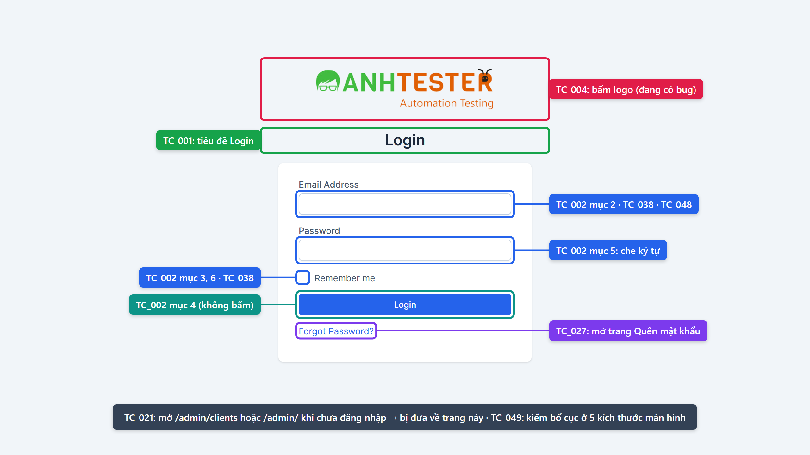
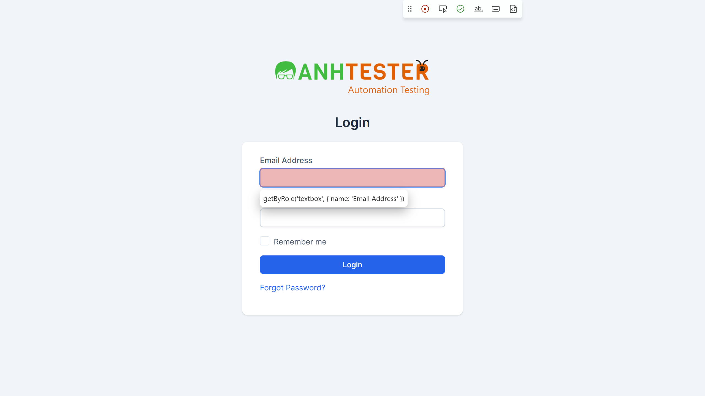
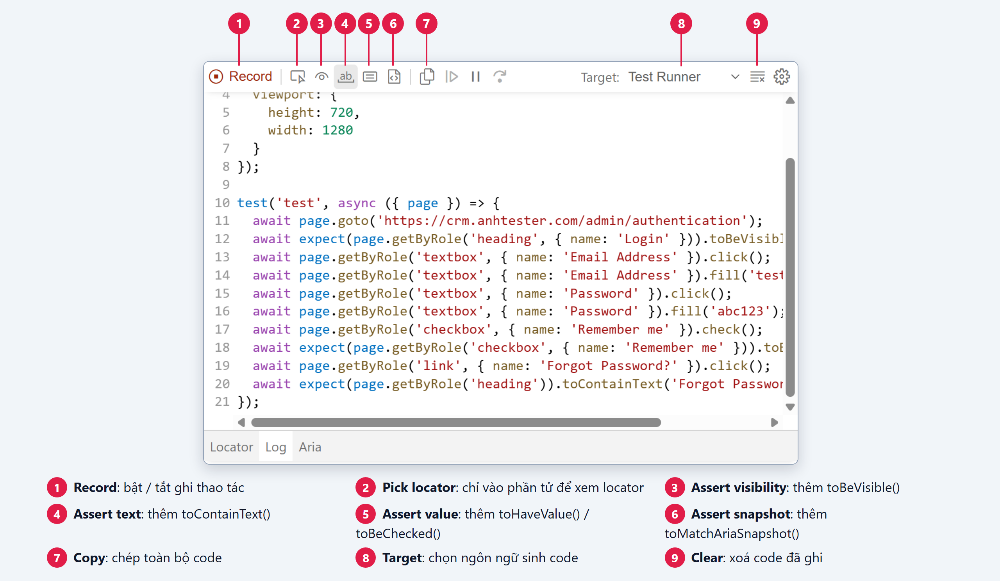
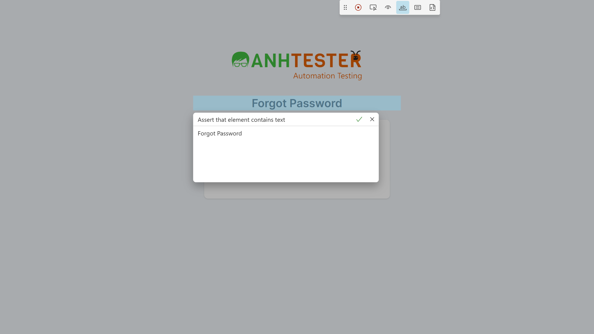
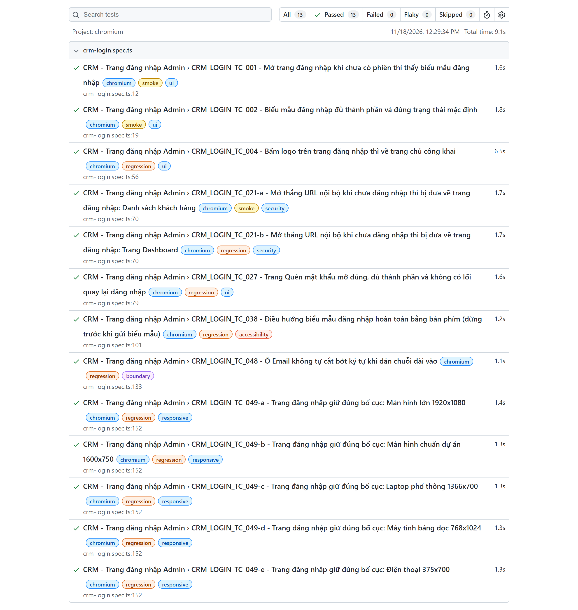
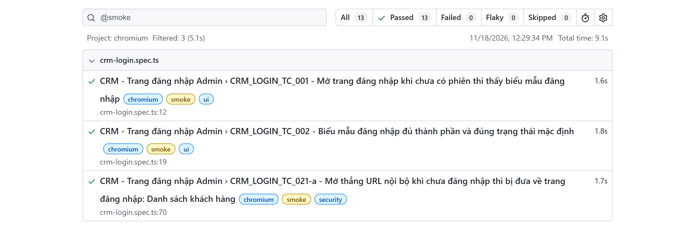
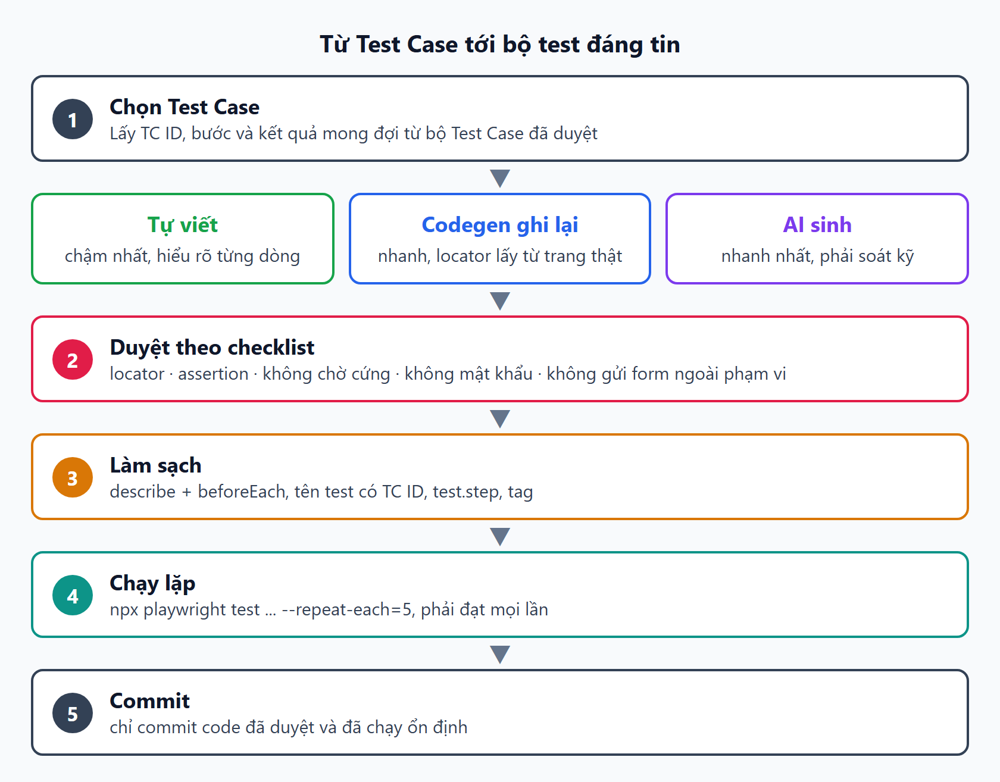

# Bài 22 - [Playwright Typescript] Thực hành viết test automation đầu tiên trên CRM với Codegen và AI

Chương: 3. Assertion + Cơ chế Auto-Waiting

Nguồn: [https://anhtester.com/learn/website-and-api-testing-automation-with-playwright-javascript-typescript-day-code-js-ts-tu-dau/379](https://anhtester.com/learn/website-and-api-testing-automation-with-playwright-javascript-typescript-day-code-js-ts-tu-dau/379)

✅ Chọn phạm vi từ Test Case thật  
✅ Ghi lại thao tác trên CRM demo bằng Codegen  
✅ Duyệt và làm sạch code Codegen  
✅ Tự viết bộ test cho trang đăng nhập CRM  
✅ Dùng Claude Code và bộ kit claude-testing-skills để sinh test  
✅ So sánh ba cách viết test và kiểm tra code do AI và Codegen sinh ra

## ⭐ Mục tiêu bài học

Ở bài trước (Xử lý Table, Date Picker và dùng evaluate()) bạn đã viết `tests/practice-table.spec.ts`, `tests/book-table-date.spec.ts` và `tests/crm-login-evaluate.spec.ts`: tìm cột theo tiêu đề, đọc bảng thành mảng object, phân biệt date picker gốc với lịch tự dựng, và biết `evaluate()` chạy trong trình duyệt nên không dùng để bấm hay điền.

Bài cuối chương này ghép mọi thứ đã học thành **bộ test thật đầu tiên**, bám theo Test Case thật của trang đăng nhập CRM. Học xong bạn sẽ:

- Chọn được Test Case nào tự động hoá ngay, Test Case nào phải để sau.
- Dùng **Codegen** ghi lại thao tác, đọc và **làm sạch** code nó sinh ra.
- Tự viết bộ test `tests/crm-login.spec.ts`, mỗi test mang một TC ID.
- Giao việc cho AI đúng cách, so sánh ba cách viết test và duyệt kết quả bằng checklist.

> 📌 Bài làm tiếp trong project `D:\AnhTester\playwright-crm` (macOS: `~/AnhTester/playwright-crm`). CRM demo là môi trường dùng chung, nên bài này **không đăng nhập và không gửi biểu mẫu nào**.

## ✅ Phần 1: Chọn phạm vi từ Test Case thật

### 🔆 1. Vì sao bắt đầu từ Test Case?

Thợ xây không tự nghĩ ra ngôi nhà, họ xây theo bản vẽ đã duyệt. Trong kiểm thử, bản vẽ đó là **Test Case**. Test automation chỉ là cách chạy lại Test Case bằng code. Test không bám Test Case nào thì khi nó đỏ, không ai biết yêu cầu nào đang hỏng.

Bộ kit có sẵn bộ Test Case thật của chính trang này: [docs/testcases/login/web/test\_cases\_login\_web.md](https://github.com/anhtester/claude-testing-skills/blob/main/docs/testcases/login/web/test_cases_login_web.md), 51 TC, mã từ `CRM_LOGIN_TC_001` tới `CRM_LOGIN_TC_051`. Một TC có thể gồm nhiều biến thể `a`, `b`, `c`, khi lỗi phải ghi rõ, ví dụ `CRM_LOGIN_TC_021-a`.

### 🔆 2. TC nào làm được ngay, TC nào để sau?

Tiêu chí: TC chạy được trên trang công khai, **không cần tài khoản và không phải gửi biểu mẫu**.

<table class="rt-table">
<thead>
<tr>
<th>TC ID</th>
<th>Tên TC</th>
<th>Tự động hoá trong bài?</th>
<th>Lý do</th>
</tr>
</thead>
<tbody>
<tr>
<td><code>TC_001</code></td>
<td>Mở trang đăng nhập khi chưa có phiên thì thấy biểu mẫu đăng nhập</td>
<td>Có</td>
<td>Chỉ mở trang và đọc URL, tiêu đề</td>
</tr>
<tr>
<td><code>TC_002</code></td>
<td>Biểu mẫu đăng nhập đủ thành phần và đúng trạng thái mặc định</td>
<td>Có</td>
<td>Bảng kiểm 6 mục, không mục nào cần gửi biểu mẫu</td>
</tr>
<tr>
<td><code>TC_004</code></td>
<td>Bấm logo trên trang đăng nhập thì về trang chủ công khai</td>
<td>Có, đánh dấu <code>test.fail</code></td>
<td>Đang có bug đã ghi nhận, xem Phần 4</td>
</tr>
<tr>
<td><code>TC_021</code></td>
<td>Mở thẳng URL nội bộ khi chưa đăng nhập thì bị đưa về trang đăng nhập</td>
<td>Có, 2 biến thể</td>
<td>Chỉ cần <code>goto</code> rồi kiểm URL</td>
</tr>
<tr>
<td><code>TC_027</code></td>
<td>Trang Quên mật khẩu mở đúng, đủ thành phần và không có lối quay lại đăng nhập</td>
<td>Có</td>
<td>Chỉ điều hướng và quan sát</td>
</tr>
<tr>
<td><code>TC_038</code></td>
<td>Điều hướng và gửi biểu mẫu đăng nhập hoàn toàn bằng bàn phím</td>
<td>Một phần</td>
<td>Dừng ở bước Tab vào nút Login. Nhấn <code>Enter</code> thì cần tài khoản</td>
</tr>
<tr>
<td><code>TC_048</code></td>
<td>Ô Email không tự cắt bớt ký tự khi dán chuỗi dài vào</td>
<td>Có</td>
<td>TC ghi rõ không bấm Login</td>
</tr>
<tr>
<td><code>TC_049</code></td>
<td>Trang đăng nhập giữ đúng bố cục ở mọi kích thước màn hình đã chốt</td>
<td>Có, 5 biến thể</td>
<td>Kiểm cuộn ngang và 7 thành phần. Mục "chữ không đè nhau" vẫn kiểm bằng mắt</td>
</tr>
<tr>
<td><code>TC_003</code>, <code>TC_042</code></td>
<td>Không có CAPTCHA, không nạp JavaScript · Ô Mật khẩu che ký tự</td>
<td>Để làm bài tập</td>
<td>Dành cho Bài tập 1</td>
</tr>
<tr>
<td><code>TC_005</code>, <code>TC_011</code>, <code>TC_013</code>, <code>TC_028</code>...</td>
<td>Đăng nhập hợp lệ · Trường bắt buộc · Sai thông tin đăng nhập · Bỏ trống email rồi bấm Confirm</td>
<td>Chưa</td>
<td>Cần tài khoản hoặc phải gửi biểu mẫu. Làm sau khi học file <code>.env</code> và Storage State</td>
</tr>
</tbody>
</table>

Vị trí của từng TC trên trang thật, mỗi khung do đúng locator của bộ test ở Phần 4 tìm ra:

[](https://anhtester.com/storage/photos/shares/lesson/js_ts_playwright/v2/bai_22_test_dau_tien_crm_codegen_ai/01_trang_login_crm_theo_tc_id.png)

*Trang đăng nhập Admin CRM và các Test Case được tự động hoá trong bài*

## ✅ Phần 2: Ghi lại thao tác trên CRM demo bằng Codegen

### 🔆 1. Codegen là gì?

Khi họp, thư ký ghi lại từng câu bạn nói thành biên bản. Biên bản đủ ý nhưng còn thô, bạn vẫn phải đọc và sửa trước khi gửi đi. **Codegen** (Code Generator) của Playwright làm đúng việc đó với trình duyệt: bạn bấm, gõ, chọn trên trang, nó viết ra từng dòng code tương ứng.

Anh Tester để tới bài này mới dạy Codegen vì giờ bạn đã **đọc và duyệt được** thứ nó viết ra.

### 🔆 2. Lệnh chạy và các option hay dùng

Mở Terminal trong thư mục project rồi chạy:

```bash
npx playwright codegen https://crm.anhtester.com/admin/authentication
```

Các option dưới đây lấy từ `npx playwright codegen --help` của bản 1.65.1:

```plaintext
  -o, --output <file name>             saves the generated script to a file
  --target <language>                  language to generate, one of javascript,
                                       playwright-test, python, python-async,
                                       python-pytest, csharp, csharp-mstest,
                                       csharp-nunit, csharp-xunit, java,
                                       java-junit (default: "playwright-test")
  --channel <channel>                  Chromium distribution channel, "chrome",
                                       "chrome-beta", "msedge-dev", etc
  --device <deviceName>                emulate device, for example  "iPhone 11"
  --save-storage <filename>            save context storage state at the end,
                                       for later use with --load-storage
  --viewport-size <size>               specify browser viewport size in pixels,
                                       for example "1280, 720"
```

- `-o`: ghi thẳng code ra file, không phải chép tay từ cửa sổ Inspector.
- `--target`: ngôn ngữ sinh code. Mặc định `playwright-test` đúng là thứ khoá học dùng nên không cần ghi.
- `--viewport-size`, `--device`: kích thước vùng hiển thị, hoặc giả lập một thiết bị di động.
- `--channel=chrome`: ghi trên Google Chrome đã cài trong máy thay cho Chromium đi kèm Playwright.
- `--save-storage`: lưu trạng thái đăng nhập, học ở bài Storage State.

Lệnh dùng trong bài:

```bash
npx playwright codegen --viewport-size=1280,720 -o tests/crm-login-codegen.spec.ts https://crm.anhtester.com/admin/authentication
```

### 🔆 3. Hai cửa sổ của Codegen

Lệnh mở ra hai cửa sổ. Cửa sổ thứ nhất là **trình duyệt**, nơi bạn thao tác. Rê chuột tới đâu, phần tử ở đó được tô màu kèm locator mà Playwright sẽ dùng. Phía trên trang có một thanh công cụ nhỏ:

[](https://anhtester.com/storage/photos/shares/lesson/js_ts_playwright/v2/bai_22_test_dau_tien_crm_codegen_ai/02_codegen_cua_so_trinh_duyet.png)

*Cửa sổ trình duyệt của Codegen: rê chuột vào ô Email là thấy locator*

Cửa sổ thứ hai là **Playwright Inspector**, nơi code hiện ra theo từng thao tác. Các nút ghi và nút Assert có ở cả hai cửa sổ:

[](https://anhtester.com/storage/photos/shares/lesson/js_ts_playwright/v2/bai_22_test_dau_tien_crm_codegen_ai/03_codegen_cua_so_inspector.png)

*Cửa sổ Playwright Inspector và các nút trên thanh công cụ*

**Pick locator** chỉ cho bạn xem locator của phần tử vừa bấm, **không** ghi thành thao tác. Ba nút Assert thêm một dòng `expect` cho phần tử bạn bấm vào.

> ⚠️ **Codegen không tự thêm assertion.** Bạn không bấm nút Assert nào thì code sinh ra chỉ có thao tác, và test đó luôn đạt dù trang hiển thị sai.
>
> 🔗 Tài liệu: [playwright.dev/docs/codegen](https://playwright.dev/docs/codegen).

### 🔆 4. Các bước ghi một luồng

Trên lớp Anh Tester sẽ ghi trực tiếp cho bạn xem. Khi tự làm, đi theo thứ tự này:

1. Chạy lệnh ở mục 2, chờ trang đăng nhập hiện ra. Nút Record đang bật sẵn.
2. Bấm **Assert visibility**, rồi bấm vào tiêu đề `Login`.
3. Bấm vào ô `Email Address`, gõ `tester@example.com`. Bấm vào ô `Password`, gõ một chuỗi giả.
4. Tick `Remember me`. Bấm **Assert value**, rồi bấm lại vào chính checkbox đó.
5. Bấm link `Forgot Password?`. Ở trang mới, bấm **Assert text**, bấm vào tiêu đề, rồi bấm dấu tick để xác nhận đoạn chữ.
6. Đóng cửa sổ trình duyệt. Code đã nằm trong file bạn chỉ định ở `-o`.

> 🔒 **Không bấm nút Login, không bấm nút Confirm.** Codegen ghi cả những gì bạn gõ vào ô Password dưới dạng chữ thường, nên không bao giờ gõ mật khẩu thật khi đang ghi.

[](https://anhtester.com/storage/photos/shares/lesson/js_ts_playwright/v2/bai_22_test_dau_tien_crm_codegen_ai/04_codegen_assert_text.png)

*Assert text: Codegen hỏi lại đoạn chữ cần kiểm trước khi thêm assertion*

Code Codegen ghi lại trong `tests/crm-login-codegen.spec.ts` với đúng các bước trên (Playwright 1.65.1, ngày 18/11/2026), chưa sửa chữ nào:

```typescript
import { test, expect } from '@playwright/test';

test.use({
  viewport: {
    height: 720,
    width: 1280
  }
});

test('test', async ({ page }) => {
  await page.goto('https://crm.anhtester.com/admin/authentication');
  await expect(page.getByRole('heading', { name: 'Login' })).toBeVisible();
  await page.getByRole('textbox', { name: 'Email Address' }).click();
  await page.getByRole('textbox', { name: 'Email Address' }).fill('tester@example.com');
  await page.getByRole('textbox', { name: 'Password' }).click();
  await page.getByRole('textbox', { name: 'Password' }).fill('abc123');
  await page.getByRole('checkbox', { name: 'Remember me' }).check();
  await expect(page.getByRole('checkbox', { name: 'Remember me' })).toBeChecked();
  await page.getByRole('link', { name: 'Forgot Password?' }).click();
  await expect(page.getByRole('heading')).toContainText('Forgot Password');
});
```

```bash
npx playwright test crm-login-codegen --project=chromium --reporter=list
```

```plaintext
Running 1 test using 1 worker

  ✓  1 [chromium] › tests\crm-login-codegen.spec.ts:10:1 › test (1.0s)

  1 passed (1.6s)
```

## ✅ Phần 3: Duyệt và làm sạch code Codegen

### 🔆 1. Soi từng dòng theo kiến thức đã học

Điểm tốt trước: locator đều là `getByRole`, không có CSS Selector, checkbox được ghi bằng `check()`. Phần cần sửa trước khi đưa vào project:

<table class="rt-table">
<thead>
<tr>
<th>Codegen viết</th>
<th>Vấn đề</th>
<th>Bản làm sạch</th>
</tr>
</thead>
<tbody>
<tr>
<td><code>test('test', ...)</code></td>
<td>Tên không nói test kiểm gì, không gắn với TC nào</td>
<td>Đặt trong <code>test.describe</code>, tên nêu rõ hành vi hoặc TC ID</td>
</tr>
<tr>
<td>Khối <code>test.use({ viewport })</code></td>
<td>Sinh ra do <code>--viewport-size</code>. Kích thước màn hình là việc của config</td>
<td>Xoá</td>
</tr>
<tr>
<td><code>.click()</code> rồi <code>.fill()</code> trên cùng một ô</td>
<td><code>fill()</code> đã tự đưa con trỏ vào ô, dòng <code>click()</code> là thừa</td>
<td>Chỉ giữ <code>fill()</code></td>
</tr>
<tr>
<td><code><span>getByRole('textbox',</span> <span>{</span> <span>name:</span> <span>'Password'</span> <span>})</span></code></td>
<td>Chạy đúng. Project thống nhất dùng <code>getByLabel</code> cho ô nhập có nhãn</td>
<td><code>getByLabel('Password')</code></td>
</tr>
<tr>
<td><code>getByRole('heading')</code> không có <code>name</code></td>
<td>Trang Quên mật khẩu chỉ có một tiêu đề nên đạt. Thêm một tiêu đề nữa là lỗi strict mode</td>
<td><code><span>getByRole('heading',</span> <span>{</span> <span>name:</span> <span>'Forgot</span> <span>Password'</span> <span>})</span></code></td>
</tr>
<tr>
<td>Bấm link xong chỉ kiểm chữ tiêu đề, điền Email xong không kiểm gì</td>
<td>Codegen chỉ viết assertion khi bạn bấm nút Assert</td>
<td>Thêm <code>toHaveURL(...)</code>, <code>toHaveValue(...)</code></td>
</tr>
<tr>
<td>Một test dài, không <code>test.step</code>, không tag</td>
<td>Test lỗi không biết đang ở bước nào, không lọc được bằng <code>--grep</code></td>
<td>Chia <code>test.step</code>, thêm tag</td>
</tr>
</tbody>
</table>

### 🔆 2. Bản đã làm sạch

Tạo file thử `tests/exp-codegen-clean.spec.ts`. Đây cũng là cách **tự viết** cùng luồng đó:

```typescript
import { test, expect } from '@playwright/test';

const LOGIN_URL = 'https://crm.anhtester.com/admin/authentication';

test.describe('CRM - Luồng Codegen đã làm sạch', () => {
  test('Điền form đăng nhập rồi mở trang Quên mật khẩu, không gửi biểu mẫu',
    { tag: ['@regression', '@ui'] }, async ({ page }) => {
      const rememberCheckbox = page.getByRole('checkbox', { name: 'Remember me' });

      await test.step('Mở trang đăng nhập Admin', async () => {
        await page.goto(LOGIN_URL);
        await expect(page.getByRole('heading', { name: 'Login' })).toBeVisible();
      });

      await test.step('Điền Email, một chuỗi Password giả và tick Remember me', async () => {
        await page.getByLabel('Email Address').fill('tester@example.com');
        await page.getByLabel('Password').fill('abc123');
        await rememberCheckbox.check();

        await expect(page.getByLabel('Email Address')).toHaveValue('tester@example.com');
        await expect(rememberCheckbox).toBeChecked();
      });

      await test.step('Mở trang Quên mật khẩu', async () => {
        await page.getByRole('link', { name: 'Forgot Password?' }).click();

        await expect(page).toHaveURL(/authentication\/forgot_password$/);
        await expect(page.getByRole('heading', { name: 'Forgot Password' })).toBeVisible();
      });
    });
});
```

```bash
npx playwright test exp-codegen-clean --project=chromium --reporter=list
```

```plaintext
Running 1 test using 1 worker

  ✓  1 [chromium] › tests\exp-codegen-clean.spec.ts:6:3 › CRM - Luồng Codegen đã làm sạch › Điền form đăng nhập rồi mở trang Quên mật khẩu, không gửi biểu mẫu @regression @ui (909ms)

  1 passed (1.6s)
```

> 💡 **Codegen là trợ thủ, không phải người làm thay.** Nó ghi được thao tác, không ghi được ý định: không biết bạn đang chạy TC nào, không viết vòng lặp, không biết bước nào cần kiểm. Dùng nó để lấy locator và khung sườn thật nhanh.

## ✅ Phần 4: Tự viết bộ test cho trang đăng nhập CRM

### 🔆 1. Quy ước của bộ test

- Một `test.describe` cho cả trang, `beforeEach` mở trang đăng nhập.
- Mỗi TC một `test`, tên là **TC ID** kèm đúng tên TC. Test đỏ là biết ngay TC nào hỏng.
- Mỗi mục của Bảng kiểm một `test.step`. TC có biến thể thì dùng vòng lặp sinh test, tên kèm `-a`, `-b`.
- Tag theo bộ TC: `@smoke` hoặc `@regression`, kèm một tag nhóm như `@ui`.

### 🔆 2. File tests/crm-login.spec.ts

```typescript
import { test, expect } from '@playwright/test';

const LOGIN_URL = 'https://crm.anhtester.com/admin/authentication';
const FORGOT_URL = 'https://crm.anhtester.com/admin/authentication/forgot_password';
const LOGIN_TITLE = 'Perfex CRM | Anh Tester Demo - Login';

test.describe('CRM - Trang đăng nhập Admin', () => {
  test.beforeEach(async ({ page }) => {
    await page.goto(LOGIN_URL);
  });

  test('CRM_LOGIN_TC_001 - Mở trang đăng nhập khi chưa có phiên thì thấy biểu mẫu đăng nhập',
    { tag: ['@smoke', '@ui'] }, async ({ page }) => {
      await expect(page).toHaveURL(LOGIN_URL);
      await expect(page).toHaveTitle(LOGIN_TITLE);
      await expect(page.getByRole('heading', { name: 'Login' })).toBeVisible();
    });

  test('CRM_LOGIN_TC_002 - Biểu mẫu đăng nhập đủ thành phần và đúng trạng thái mặc định',
    { tag: ['@smoke', '@ui'] }, async ({ page }) => {
      const emailInput = page.getByLabel('Email Address');
      const passwordInput = page.getByLabel('Password');
      const rememberCheckbox = page.getByRole('checkbox', { name: 'Remember me' });
      const loginButton = page.getByRole('button', { name: 'Login' });

      await test.step('Mục 1: đủ 5 thành phần', async () => {
        await expect(emailInput).toBeVisible();
        await expect(passwordInput).toBeVisible();
        await expect(rememberCheckbox).toBeVisible();
        await expect(loginButton).toBeVisible();
        await expect(page.getByRole('link', { name: 'Forgot Password?' })).toBeVisible();
      });

      await test.step('Mục 2: con trỏ nằm sẵn trong ô Email', async () => {
        await expect(emailInput).toBeFocused();
      });

      await test.step('Mục 3 và 4: Remember me chưa tick, nút Login bấm được', async () => {
        await expect(rememberCheckbox).not.toBeChecked();
        await expect(rememberCheckbox).toBeEnabled();
        await expect(loginButton).toBeEnabled();
      });

      await test.step('Mục 5: ô Password che ký tự', async () => {
        await passwordInput.fill('Abc12345');
        await expect(passwordInput).toHaveAttribute('type', 'password');
        await expect(passwordInput).toHaveValue('Abc12345');
      });

      await test.step('Mục 6: bấm vào chữ Remember me thì checkbox được tick', async () => {
        await page.getByText('Remember me').click();
        await expect(rememberCheckbox).toBeChecked();
      });
    });

  test.fail('CRM_LOGIN_TC_004 - Bấm logo trên trang đăng nhập thì về trang chủ công khai',
    {
      tag: ['@regression', '@ui'],
      annotation: { type: 'issue', description: 'BUG_login_1787226513_TC004: logo dẫn sang /authentication/login' },
    }, async ({ page }) => {
      await page.getByRole('link', { name: 'Perfex CRM | Anh Tester Demo' }).click();
      await expect(page).toHaveURL('https://crm.anhtester.com/');
    });

  const protectedUrls = [
    { variant: 'a', name: 'Danh sách khách hàng', url: 'https://crm.anhtester.com/admin/clients', tag: '@smoke' },
    { variant: 'b', name: 'Trang Dashboard', url: 'https://crm.anhtester.com/admin/', tag: '@regression' },
  ];
  for (const { variant, name, url, tag } of protectedUrls) {
    test(`CRM_LOGIN_TC_021-${variant} - Mở thẳng URL nội bộ khi chưa đăng nhập thì bị đưa về trang đăng nhập: ${name}`,
      { tag: [tag, '@security'] }, async ({ page }) => {
        await page.goto(url);
        await expect(page).toHaveURL(LOGIN_URL);
        await expect(page).toHaveTitle(LOGIN_TITLE);
        await expect(page.getByRole('button', { name: 'Login' })).toBeVisible();
      });
  }

  test('CRM_LOGIN_TC_027 - Trang Quên mật khẩu mở đúng, đủ thành phần và không có lối quay lại đăng nhập',
    { tag: ['@regression', '@ui'] }, async ({ page }) => {
      await page.getByRole('link', { name: 'Forgot Password?' }).click();

      await test.step('Mục 1: đúng URL', async () => {
        await expect(page).toHaveURL(FORGOT_URL);
      });

      await test.step('Mục 2: tiêu đề, đúng 1 ô nhập, nút Confirm', async () => {
        await expect(page.getByRole('heading', { name: 'Forgot Password' })).toBeVisible();
        await expect(page.getByRole('textbox')).toHaveCount(1);
        await expect(page.getByLabel('Email Address')).toBeVisible();
        await expect(page.getByRole('button', { name: 'Confirm' })).toBeVisible();
      });

      await test.step('Mục 3: link duy nhất trên trang là logo', async () => {
        await expect(page.getByRole('link')).toHaveCount(1);
        await expect(page.getByRole('link', { name: 'Perfex CRM | Anh Tester Demo' }))
          .toHaveAttribute('href', 'https://crm.anhtester.com/');
      });
    });

  test('CRM_LOGIN_TC_038 - Điều hướng biểu mẫu đăng nhập hoàn toàn bằng bàn phím (dừng trước khi gửi biểu mẫu)',
    { tag: ['@regression', '@accessibility'] }, async ({ page }) => {
      const emailInput = page.getByLabel('Email Address');
      const passwordInput = page.getByLabel('Password');
      const rememberCheckbox = page.getByRole('checkbox', { name: 'Remember me' });

      await test.step('Bước 1-2: gõ ngay vào ô Email, không bấm chuột', async () => {
        await expect(emailInput).toBeFocused();
        await page.keyboard.type('tester@example.com');
        await expect(emailInput).toHaveValue('tester@example.com');
      });

      await test.step('Bước 3-4: Tab sang ô Password rồi gõ một chuỗi giả', async () => {
        await page.keyboard.press('Tab');
        await expect(passwordInput).toBeFocused();
        await page.keyboard.type('Abc12345');
        await expect(passwordInput).toHaveValue('Abc12345');
      });

      await test.step('Bước 5-6: Tab tới Remember me, phím Space tick được', async () => {
        await page.keyboard.press('Tab');
        await expect(rememberCheckbox).toBeFocused();
        await page.keyboard.press('Space');
        await expect(rememberCheckbox).toBeChecked();
      });

      await test.step('Bước 7 (nửa đầu): Tab tới nút Login rồi dừng, không nhấn Enter', async () => {
        await page.keyboard.press('Tab');
        await expect(page.getByRole('button', { name: 'Login' })).toBeFocused();
      });
    });

  test('CRM_LOGIN_TC_048 - Ô Email không tự cắt bớt ký tự khi dán chuỗi dài vào',
    { tag: ['@regression', '@boundary'] }, async ({ page }) => {
      const longText = 'a'.repeat(300);
      const emailInput = page.getByLabel('Email Address');

      await emailInput.fill(longText);

      await expect(emailInput).toHaveValue(longText);
      expect((await emailInput.inputValue()).length).toBe(300);
    });

  const viewports = [
    { variant: 'a', name: 'Màn hình lớn', width: 1920, height: 1080 },
    { variant: 'b', name: 'Màn hình chuẩn dự án', width: 1600, height: 750 },
    { variant: 'c', name: 'Laptop phổ thông', width: 1366, height: 700 },
    { variant: 'd', name: 'Máy tính bảng dọc', width: 768, height: 1024 },
    { variant: 'e', name: 'Điện thoại', width: 375, height: 700 },
  ];
  for (const { variant, name, width, height } of viewports) {
    test(`CRM_LOGIN_TC_049-${variant} - Trang đăng nhập giữ đúng bố cục: ${name} ${width}x${height}`,
      { tag: ['@regression', '@responsive'] }, async ({ page }) => {
        await page.setViewportSize({ width, height });
        await page.reload();

        await test.step('Bước 4: không cuộn ngang được', async () => {
          const size = await page.evaluate(() => ({
            scrollWidth: document.documentElement.scrollWidth,
            clientWidth: document.documentElement.clientWidth,
          }));
          expect(size.scrollWidth).toBeLessThanOrEqual(size.clientWidth);
        });

        await test.step('Bước 5: thấy đủ 7 thành phần', async () => {
          await expect(page.getByAltText('Perfex CRM | Anh Tester Demo')).toBeVisible();
          await expect(page.getByRole('heading', { name: 'Login' })).toBeVisible();
          await expect(page.getByLabel('Email Address')).toBeVisible();
          await expect(page.getByLabel('Password')).toBeVisible();
          await expect(page.getByRole('checkbox', { name: 'Remember me' })).toBeVisible();
          await expect(page.getByRole('button', { name: 'Login' })).toBeVisible();
          await expect(page.getByRole('link', { name: 'Forgot Password?' })).toBeVisible();
        });
      });
  }
});
```

Ba chỗ cần đọc kỹ:

- **`TC_004` dùng `test.fail`.** Bộ kit đã ghi nhận bug [BUG\_login\_1787226513\_TC004](https://github.com/anhtester/claude-testing-skills/blob/main/docs/bugs/login/web/BUG_login_1787226513_TC004.md): bấm logo thì trang dừng ở `/authentication/login`, không phải trang chủ. Assertion vẫn giữ đúng kết quả mong đợi của TC, còn `test.fail` báo rằng test này **đang được chờ là lỗi**. Ngày bug được sửa, test tự đỏ để nhắc bạn gỡ `test.fail`. Không sửa kết quả mong đợi cho test xanh.
- **`TC_038` dừng trước phím `Enter`**, và tên test ghi rõ điều đó.
- **`TC_049`** đổi kích thước bằng `page.setViewportSize()`, rồi dùng `page.evaluate()` của bài trước để đọc `scrollWidth`, thứ không locator nào đọc được.

### 🔆 3. Chạy bộ test

```bash
npx playwright test crm-login.spec.ts --project=chromium --reporter=list,html
```

```plaintext
Running 13 tests using 6 workers

  ✓   1 [chromium] › tests\crm-login.spec.ts:79:3 › CRM - Trang đăng nhập Admin › CRM_LOGIN_TC_027 - Trang Quên mật khẩu mở đúng, đủ thành phần và không có lối quay lại đăng nhập @regression @ui (1.6s)
  ✓   3 [chromium] › tests\crm-login.spec.ts:12:3 › CRM - Trang đăng nhập Admin › CRM_LOGIN_TC_001 - Mở trang đăng nhập khi chưa có phiên thì thấy biểu mẫu đăng nhập @smoke @ui (1.6s)
  ✓   4 [chromium] › tests\crm-login.spec.ts:70:5 › CRM - Trang đăng nhập Admin › CRM_LOGIN_TC_021-a - Mở thẳng URL nội bộ khi chưa đăng nhập thì bị đưa về trang đăng nhập: Danh sách khách hàng @smoke @security (1.7s)
  ✓   5 [chromium] › tests\crm-login.spec.ts:70:5 › CRM - Trang đăng nhập Admin › CRM_LOGIN_TC_021-b - Mở thẳng URL nội bộ khi chưa đăng nhập thì bị đưa về trang đăng nhập: Trang Dashboard @regression @security (1.7s)
  ✓   2 [chromium] › tests\crm-login.spec.ts:19:3 › CRM - Trang đăng nhập Admin › CRM_LOGIN_TC_002 - Biểu mẫu đăng nhập đủ thành phần và đúng trạng thái mặc định @smoke @ui (1.8s)
  ✓   7 [chromium] › tests\crm-login.spec.ts:101:3 › CRM - Trang đăng nhập Admin › CRM_LOGIN_TC_038 - Điều hướng biểu mẫu đăng nhập hoàn toàn bằng bàn phím (dừng trước khi gửi biểu mẫu) @regression @accessibility (1.2s)
  ✓   8 [chromium] › tests\crm-login.spec.ts:133:3 › CRM - Trang đăng nhập Admin › CRM_LOGIN_TC_048 - Ô Email không tự cắt bớt ký tự khi dán chuỗi dài vào @regression @boundary (1.1s)
  ✓  10 [chromium] › tests\crm-login.spec.ts:152:5 › CRM - Trang đăng nhập Admin › CRM_LOGIN_TC_049-c - Trang đăng nhập giữ đúng bố cục: Laptop phổ thông 1366x700 @regression @responsive (1.3s)
  ✓   9 [chromium] › tests\crm-login.spec.ts:152:5 › CRM - Trang đăng nhập Admin › CRM_LOGIN_TC_049-a - Trang đăng nhập giữ đúng bố cục: Màn hình lớn 1920x1080 @regression @responsive (1.4s)
  ✓  11 [chromium] › tests\crm-login.spec.ts:152:5 › CRM - Trang đăng nhập Admin › CRM_LOGIN_TC_049-b - Trang đăng nhập giữ đúng bố cục: Màn hình chuẩn dự án 1600x750 @regression @responsive (1.3s)
  ✓  12 [chromium] › tests\crm-login.spec.ts:152:5 › CRM - Trang đăng nhập Admin › CRM_LOGIN_TC_049-d - Trang đăng nhập giữ đúng bố cục: Máy tính bảng dọc 768x1024 @regression @responsive (1.3s)
  ✓  13 [chromium] › tests\crm-login.spec.ts:152:5 › CRM - Trang đăng nhập Admin › CRM_LOGIN_TC_049-e - Trang đăng nhập giữ đúng bố cục: Điện thoại 375x700 @regression @responsive (1.3s)
  ✘   6 [chromium] › tests\crm-login.spec.ts:56:8 › CRM - Trang đăng nhập Admin › CRM_LOGIN_TC_004 - Bấm logo trên trang đăng nhập thì về trang chủ công khai @regression @ui (6.5s)

  13 passed (9.1s)
```

Kết quả chạy thật (Playwright 1.65.1, ngày 18/11/2026): **13 passed**. Dòng `TC_004` có dấu `✘` vì nó lỗi thật, nhưng là lỗi đã khai báo trước nên vẫn tính vào passed. Báo cáo mở bằng `npx playwright show-report`:

[](https://anhtester.com/storage/photos/shares/lesson/js_ts_playwright/v2/bai_22_test_dau_tien_crm_codegen_ai/05_html_report_bo_test_crm_login.png)

*HTML Report của bộ test crm-login.spec.ts: mỗi dòng mang một TC ID và các tag*

Chạy riêng nhóm smoke:

```bash
npx playwright test crm-login.spec.ts --project=chromium --grep @smoke --reporter=list
```

```plaintext
Running 3 tests using 3 workers

  ✓  3 [chromium] › tests\crm-login.spec.ts:12:3 › CRM - Trang đăng nhập Admin › CRM_LOGIN_TC_001 - Mở trang đăng nhập khi chưa có phiên thì thấy biểu mẫu đăng nhập @smoke @ui (794ms)
  ✓  1 [chromium] › tests\crm-login.spec.ts:70:5 › CRM - Trang đăng nhập Admin › CRM_LOGIN_TC_021-a - Mở thẳng URL nội bộ khi chưa đăng nhập thì bị đưa về trang đăng nhập: Danh sách khách hàng @smoke @security (994ms)
  ✓  2 [chromium] › tests\crm-login.spec.ts:19:3 › CRM - Trang đăng nhập Admin › CRM_LOGIN_TC_002 - Biểu mẫu đăng nhập đủ thành phần và đúng trạng thái mặc định @smoke @ui (1.0s)

  3 passed (1.9s)
```

Trong HTML Report, gõ `@smoke` vào ô tìm kiếm cũng lọc ra đúng ba test đó:

[](https://anhtester.com/storage/photos/shares/lesson/js_ts_playwright/v2/bai_22_test_dau_tien_crm_codegen_ai/06_html_report_loc_tag_smoke.png)

*HTML Report lọc theo tag @smoke: còn 3 test*

Cuối cùng, chạy lặp mỗi test 5 lần để chắc bộ test không flaky:

```bash
npx playwright test crm-login.spec.ts --project=chromium --repeat-each=5 --reporter=dot
```

```plaintext
Running 65 tests using 6 workers
·································································
  65 passed (27.3s)
```

### 🔆 4. Test cần tài khoản thì viết thế nào?

Đoạn dưới là `CRM_LOGIN_TC_005`. Email và mật khẩu đọc từ biến môi trường `ADMIN_EMAIL`, `ADMIN_PASSWORD`, **không có giá trị nào nằm trong code**. Thiếu biến thì test tự bỏ qua.

```typescript
import { test, expect } from '@playwright/test';

test('CRM_LOGIN_TC_005 - Đăng nhập bằng tài khoản Admin hợp lệ thì vào được Dashboard',
  { tag: ['@smoke', '@ui'] }, async ({ page }) => {
    test.skip(!process.env.ADMIN_EMAIL || !process.env.ADMIN_PASSWORD, 'Chưa khai báo ADMIN_EMAIL / ADMIN_PASSWORD');

    await page.goto('https://crm.anhtester.com/admin/authentication');
    await page.getByLabel('Email Address').fill(process.env.ADMIN_EMAIL!);
    await page.getByLabel('Password').fill(process.env.ADMIN_PASSWORD!);
    await page.getByRole('button', { name: 'Login' }).click();

    await expect(page).toHaveURL('https://crm.anhtester.com/admin/');
    await expect(page).toHaveTitle(/Dashboard/);
  });
```

> 📌 Đoạn này **chưa chạy đăng nhập thật** trong bài nên không có kết quả minh hoạ. Bạn sẽ hoàn thiện nó ở bài đọc config từ file `.env` và bài Storage State.

## ✅ Phần 5: Dùng Claude Code và bộ kit claude-testing-skills để sinh test

### 🔆 1. Hai lệnh sinh automation của bộ kit

<table class="rt-table">
<thead>
<tr>
<th>Command</th>
<th>Vai trò</th>
</tr>
</thead>
<tbody>
<tr>
<td><a href="https://github.com/anhtester/claude-testing-skills/blob/main/.claude/commands/generate-automation-from-testcases.md">/generate-automation-from-testcases</a></td>
<td>Cửa vào chung: nhận ra file TC thuộc web, mobile hay API rồi chuyển sang đúng lệnh của nền tảng đó</td>
</tr>
<tr>
<td><a href="https://github.com/anhtester/claude-testing-skills/blob/main/.claude/commands/generate-automation-web.md">/generate-automation-web</a></td>
<td>Mode <code>TC</code> (mặc định): mỗi TC thành một test, giữ TC ID. Mode <code>FLOW</code>: chưa có TC, chỉ có URL và mô tả thao tác</td>
</tr>
</tbody>
</table>

Theo file lệnh, `/generate-automation-web` nạp bốn skill (trong đó có `skills-smart-locator-agent`), mở trình duyệt thật qua Playwright MCP để lấy locator, sinh **Page Object và file test**, rồi chạy và tự sửa tới khi đạt hai lần liên tiếp.

Chép thư mục `docs/testcases/login` của bộ kit vào project, rồi gọi lệnh kèm ràng buộc:

```markdown
/generate-automation-from-testcases WEB docs/testcases/login/web/test_cases_login_web.md

Ràng buộc cho lần chạy này:
- Chỉ sinh cho các TC: CRM_LOGIN_TC_001, 002, 021, 027, 048.
- URL: https://crm.anhtester.com/admin/authentication. KHÔNG đăng nhập, KHÔNG bấm Login hay Confirm, không cần credentials.
- Stack: Playwright + TypeScript, project đã có sẵn. Ghi vào tests/crm-login-ai.spec.ts.
- Chưa tách Page Object ở lần này: viết locator ngay trong file test.
- Locator theo .claude/rules/project_locator_rules.md: getBy... trước, XPath sau, không CSS Selector.
- Tên test: "<TC ID> - <tên TC>". TC có biến thể thì mỗi biến thể một test.
```

> ⚠️ Kit mặc định sinh Page Object, thứ bạn học ở chương kế tiếp, nên prompt ghi rõ "chưa tách". Kit cũng xếp CSS trước XPath, vì vậy file `.claude/rules/project_locator_rules.md` tạo ở bài Locators với các hàm `getBy...` phải còn trong project. Cách gõ lệnh: [code.claude.com/docs/en/slash-commands](https://code.claude.com/docs/en/slash-commands).

### 🔆 2. Prompt dùng được ở Claude, ChatGPT và Gemini

Claude Code là bản có phí Anh Tester dùng trong khoá. Bản miễn phí của [ChatGPT](https://chatgpt.com/) hoặc [Gemini](https://gemini.google.com/) không mở được trang, nên bạn phải **đưa HTML thật và Test Case thật** vào prompt, thiếu là AI đoán.

```markdown
Bạn là Test Automation Engineer dùng Playwright Test + TypeScript (bản 1.65).

Trang cần test: https://crm.anhtester.com/admin/authentication
HTML thật của form (đã bỏ các thẻ div bọc ngoài):

<h1>Login</h1>
<form action="https://crm.anhtester.com/admin/authentication" method="post">
  <label for="email" class="control-label">Email Address</label>
  <input type="email" id="email" name="email" class="form-control" autofocus="1">
  <label for="password" class="control-label">Password</label>
  <input type="password" id="password" name="password" class="form-control">
  <input type="checkbox" value="estimate" id="remember" name="remember">
  <label for="remember">Remember me</label>
  <button type="submit" class="btn btn-primary btn-block">Login</button>
  <a href="https://crm.anhtester.com/admin/authentication/forgot_password">Forgot Password?</a>
</form>

Test Case cần tự động hoá:
[dán nguyên dòng CRM_LOGIN_TC_002 và CRM_LOGIN_TC_027 từ file Test Case]

Yêu cầu:
1. Một test.describe, beforeEach mở trang. Mỗi TC một test, tên "<TC ID> - <tên TC>", mỗi mục của Bảng kiểm một test.step.
2. Locator chỉ dùng getByRole, getByLabel, getByText; bí quá mới dùng XPath. Không dùng CSS Selector.
3. Chỉ dùng Web-First Assertion (await expect(locator)...). Không waitForTimeout.
4. KHÔNG bấm nút Login, không gửi biểu mẫu, không viết mật khẩu vào code.
5. Bước nào trong TC không làm được nếu không đăng nhập thì ghi chú lại, không tự bịa cách làm.
```

**Nhờ AI duyệt code Codegen** thay vì nhờ viết mới:

```markdown
Đây là code do Playwright Codegen ghi lại, chưa sửa:

[dán nội dung tests/crm-login-codegen.spec.ts]

Chưa viết lại vội. Hãy lập bảng: dòng số mấy | vấn đề | mức độ (phải sửa / nên sửa) | cách sửa.
Rà theo các tiêu chí: tên test, cấu trúc describe + test.step, thao tác thừa, locator thiếu name, assertion còn thiếu sau mỗi thao tác quan trọng, giá trị viết cứng.
Sau bảng mới đưa bản đã sửa. Giữ nguyên luồng, không thêm bước bấm Login.
```

## ✅ Phần 6: So sánh ba cách viết test và quy trình nên dùng

### 🔆 1. Ba cách đặt cạnh nhau

Cột AI ghi những gì **thường gặp**, ví dụ ở Bài tập 4:

<table class="rt-table">
<thead>
<tr>
<th>Tiêu chí</th>
<th>Tự viết</th>
<th>Codegen ghi lại</th>
<th>AI sinh</th>
</tr>
</thead>
<tbody>
<tr>
<td>Tốc độ</td>
<td>Chậm nhất</td>
<td>Nhanh</td>
<td>Nhanh nhất</td>
</tr>
<tr>
<td>Locator</td>
<td>Theo đúng quy ước project</td>
<td>Lấy từ trang thật, đôi khi thiếu <code>name</code></td>
<td>Không mở được trang thì đoán. Hay ra CSS như <code>#email</code></td>
</tr>
<tr>
<td>Assertion</td>
<td>Bám kết quả mong đợi của TC</td>
<td>Chỉ có khi bạn bấm nút Assert</td>
<td>Thường có, nhưng hay kiểm một điều luôn đúng</td>
</tr>
<tr>
<td>Bám Test Case</td>
<td>Có TC ID</td>
<td>Không biết TC là gì</td>
<td>Có, nếu bạn đưa TC vào prompt</td>
</tr>
<tr>
<td>Nên dùng khi</td>
<td>Học, và các TC quan trọng</td>
<td>Cần locator, khung sườn, tái hiện bug</td>
<td>Có sẵn TC và rule rõ ràng</td>
</tr>
</tbody>
</table>

### 🔆 2. Quy trình Anh Tester dùng

Dùng Codegen hoặc AI để có bản nháp nhanh, rồi mọi bản nháp đi qua cùng một cửa:

[](https://anhtester.com/storage/photos/shares/lesson/js_ts_playwright/v2/bai_22_test_dau_tien_crm_codegen_ai/07_so_do_quy_trinh_3_cach_viet_test.png)

*Quy trình: chọn Test Case, viết bằng một trong ba cách, duyệt, làm sạch, chạy lặp rồi mới commit*

## ✅ Phần 7: Kiểm tra code do AI và Codegen sinh ra

Những lỗi hay gặp nhất khi sinh test cho một trang đăng nhập:

<table class="rt-table">
<thead>
<tr>
<th>Dấu hiệu trong code</th>
<th>Vì sao là vấn đề</th>
<th>Cách xử lý</th>
</tr>
</thead>
<tbody>
<tr>
<td><code>locator('#email')</code>, <code>locator('.btn-primary')</code></td>
<td>CSS Selector, trái quy ước project</td>
<td>Đổi sang <code>getByLabel</code>, <code>getByRole</code></td>
</tr>
<tr>
<td><code>getByText('Login').click()</code></td>
<td>Tiêu đề và nút đều chứa chữ Login: lỗi strict mode</td>
<td><code><span>getByRole('button',</span> <span>{</span> <span>name:</span> <span>'Login'</span> <span>})</span></code></td>
</tr>
<tr>
<td>Thiếu <code>await</code> trước thao tác hoặc <code>expect</code></td>
<td>Test đi tiếp khi lệnh chưa xong, lúc đạt lúc lỗi</td>
<td>Thêm <code>await</code></td>
</tr>
<tr>
<td><code>waitForTimeout(3000)</code></td>
<td>Chờ cứng: thiếu thì flaky, dư thì chậm</td>
<td>Chờ kết quả bằng Web-First Assertion</td>
</tr>
<tr>
<td><code>fill('123456')</code> vào ô Password</td>
<td>Mật khẩu nằm trong code là nằm luôn trên Git</td>
<td><code>process.env.ADMIN_PASSWORD</code></td>
</tr>
<tr>
<td>Bấm <code>Login</code> hoặc <code>Confirm</code> khi TC không yêu cầu</td>
<td>Gửi biểu mẫu lên môi trường dùng chung, ngoài phạm vi</td>
<td>Xoá, ghi ràng buộc vào prompt</td>
</tr>
<tr>
<td><code><span>expect(page.url()).toContain('admin')</span></code></td>
<td>Không tự chờ, và luôn đúng vì URL trang đăng nhập cũng chứa <code>admin</code></td>
<td><code>await expect(page).toHaveURL(...)</code> với URL đủ cụ thể</td>
</tr>
<tr>
<td>Mọi <code>expect</code> dồn xuống cuối, cả luồng nằm trong một <code>test('test')</code></td>
<td>Lỗi ở bước 2 tới cuối mới báo, báo cáo không cho biết TC nào hỏng</td>
<td>Kiểm ngay sau thao tác, mỗi TC một test có TC ID</td>
</tr>
<tr>
<td><code>page.goto(...)</code> lặp lại ở đầu mọi test</td>
<td>Đổi URL phải sửa nhiều chỗ</td>
<td>Đưa vào <code>beforeEach</code>, URL thành hằng số</td>
</tr>
</tbody>
</table>

## ✅ Phần 8: Bài tập thực hành

**Bài tập 1 - Thêm 2 Test Case vào bộ test.** Đọc `CRM_LOGIN_TC_003` và `CRM_LOGIN_TC_042` trong file Test Case của bộ kit. Viết file `tests/bt1-them-testcase.spec.ts` tự động hoá `TC_003` (cả 3 mục) và `TC_042` (bước 1 đến 3). Tên test có TC ID, có tag. Ghi lại bước nào của `TC_042` bạn chưa làm và vì sao.

**Bài tập 2 - Ghi bằng Codegen rồi làm sạch.** Dùng Codegen ghi vào `tests/bt2-codegen-raw.spec.ts`: mở trang đăng nhập Admin, bấm `Forgot Password?`, Assert visibility tiêu đề, gõ `tester@example.com` vào ô Email, Assert value ô đó. **Không bấm Confirm.** Sau đó làm sạch thành `tests/bt2-codegen-clean.spec.ts` theo bảng ở Phần 3, liệt kê từng chỗ đã sửa.

**Bài tập 3 - Giao việc cho AI rồi duyệt.** Dùng prompt ở Phần 5 (đổi sang `CRM_LOGIN_TC_021` và `CRM_LOGIN_TC_048`) với Claude, ChatGPT hoặc Gemini. Lưu nguyên kết quả vào `tests/bt3-ai-raw.spec.ts`, duyệt theo bảng ở Phần 7, rồi sửa thành `tests/bt3-ai-clean.spec.ts` chạy đạt với `--repeat-each=5`.

**Bài tập 4 - Duyệt code AI.** Đoạn dưới là kiểu code AI thường sinh ra khi được nhờ viết test mở trang Quên mật khẩu mà không kèm HTML và rule. Nó có **7 dòng cần sửa, tổng cộng 8 lỗi** (một dòng mắc hai lỗi). Tìm đủ, nêu lý do theo bảng ở Phần 7 và viết lại thành `tests/bt4-duyet-code-ai.spec.ts`.

```typescript
import { test, expect } from '@playwright/test';

test('test', async ({ page }) => {
  await page.goto('https://crm.anhtester.com/admin/authentication');
  await page.locator('#email').fill('tester@example.com');
  page.locator('#remember').check();
  await page.waitForTimeout(2000);
  await page.getByText('Password').click();
  expect(page.url()).toContain('authentication');
  await expect(page.locator('.btn-primary')).toBeVisible();
});
```

## ✅ Phần 9: Ghi nhớ nhanh

- Test automation bám theo Test Case: tên test mang TC ID, assertion là kết quả mong đợi của TC.
- Codegen: `npx playwright codegen <url>`, thêm `-o` để ghi ra file. Nó không tự thêm assertion và không bao giờ gõ mật khẩu thật khi đang ghi.
- Code Codegen cần làm sạch: tên test, `click()` thừa trước `fill()`, locator thiếu `name`, thiếu assertion, thiếu `test.step` và tag.
- Bug đã ghi nhận thì dùng `test.fail`, không sửa kết quả mong đợi.
- Giao việc cho AI phải kèm HTML thật, Test Case thật và ràng buộc. Mọi bản nháp đều qua: duyệt, làm sạch, `--repeat-each=5`, commit.

✅ **Kết luận:** Bạn đã có bộ test thật đầu tiên cho CRM, 13 test mang TC ID và chạy ổn định. Nhưng hãy đếm thử trong `tests/crm-login.spec.ts`: `getByLabel('Email Address')` xuất hiện 5 lần, `getByRole('button', { name: 'Login' })` 4 lần. Ngày nhãn ô Email đổi chữ, bạn phải sửa cả 5 chỗ, và còn nhiều hơn khi có thêm file test. Gom locator của một trang về một nơi là việc của chương kế tiếp, bắt đầu bằng bài: **Cấu trúc code theo Page Object Model (POM)**.

---

## Bài tập riêng — Bài tập - Viết bộ test đầu tiên cho CRM, làm sạch code Codegen và duyệt code AI

Nguồn bài tập: [https://anhtester.com/student-assignments?course=website-and-api-testing-automation-with-playwright-javascript-typescript-day-code-js-ts-tu-dau#assignment-112](https://anhtester.com/student-assignments?course=website-and-api-testing-automation-with-playwright-javascript-typescript-day-code-js-ts-tu-dau#assignment-112)

**Mục tiêu:** viết được test bám theo Test Case thật (tên test mang TC ID), dùng Codegen để ghi rồi tự làm sạch code, giao việc cho AI kèm ràng buộc rõ ràng, và duyệt được code do Codegen hoặc AI sinh ra.

**Thư mục làm bài:** `D:\AnhTester\playwright-crm` (macOS: `~/AnhTester/playwright-crm`). Bài làm trên trang công khai `https://crm.anhtester.com/admin/authentication`: **không đăng nhập**, **không bấm Login hay Confirm**, không gõ mật khẩu thật.

### 📝 Đề bài

#### Bài tập 1 - Thêm 2 Test Case vào bộ test

Đọc `CRM_LOGIN_TC_003` và `CRM_LOGIN_TC_042` trong file Test Case của bộ kit: [docs/testcases/login/web/test\_cases\_login\_web.md](https://github.com/anhtester/claude-testing-skills/blob/main/docs/testcases/login/web/test_cases_login_web.md). Viết file `tests/bt1-them-testcase.spec.ts`:

1. Một `test.describe`, `beforeEach` mở trang đăng nhập Admin.
2. Test `CRM_LOGIN_TC_003`: kiểm đủ 3 mục của Bảng kiểm (không có CAPTCHA, chỉ có một nút gửi là `Login`, trang không nạp JavaScript), mỗi mục một `test.step`.
3. Test `CRM_LOGIN_TC_042`: làm bước 1 đến 3 (gõ `Abc12345` vào ô Password, kiểm ô che ký tự, kiểm biểu mẫu không có nút hiện/ẩn mật khẩu).
4. Tên test dạng `<TC ID> - <tên TC>`, có tag. Locator chỉ dùng `getBy...` hoặc XPath.
5. Trả lời: bước nào của `TC_042` bạn chưa tự động hoá, vì sao?

Chạy `npx playwright test bt1-them-testcase --project=chromium --reporter=list`.

#### Bài tập 2 - Ghi bằng Codegen rồi làm sạch

1. Chạy `npx playwright codegen -o tests/bt2-codegen-raw.spec.ts https://crm.anhtester.com/admin/authentication`.
2. Ghi luồng: bấm `Forgot Password?`, dùng **Assert visibility** trên tiêu đề, gõ `tester@example.com` vào ô Email, dùng **Assert value** trên ô đó. **Không bấm Confirm.** Đóng trình duyệt.
3. Giữ nguyên file raw. Chép sang `tests/bt2-codegen-clean.spec.ts` rồi làm sạch theo bảng ở Phần 3 của bài học.
4. Liệt kê từng chỗ bạn đã sửa theo mẫu *Codegen viết – Vấn đề – Bản làm sạch*.

Chạy `npx playwright test bt2-codegen --project=chromium --reporter=list`, cả hai file phải đạt.

#### Bài tập 3 - Giao việc cho AI rồi duyệt

1. Dùng prompt ở Phần 5 của bài học (kèm HTML thật của form), đổi Test Case thành `CRM_LOGIN_TC_021` và `CRM_LOGIN_TC_048`. Dùng Claude, ChatGPT hoặc Gemini.
2. Lưu **nguyên văn** code AI trả về vào `tests/bt3-ai-raw.spec.ts` (chưa cần chạy đạt).
3. Duyệt theo bảng ở Phần 7, ghi lại các lỗi tìm được. Không tìm thấy lỗi nào thì ghi rõ bạn đã kiểm những tiêu chí gì.
4. Sửa thành `tests/bt3-ai-clean.spec.ts`. `TC_021` có 2 biến thể thì phải có 2 test.

Chạy `npx playwright test bt3-ai-clean --project=chromium --repeat-each=5 --reporter=list`.

#### Bài tập 4 - Duyệt code AI

Đoạn dưới là kiểu code AI thường sinh ra khi được nhờ viết test mở trang Quên mật khẩu mà không kèm HTML và rule. Nó có **7 dòng cần sửa, tổng cộng 8 lỗi** (một dòng mắc hai lỗi). Tìm đủ, nêu lý do và viết lại thành `tests/bt4-duyet-code-ai.spec.ts` chạy đạt.

```typescript
import { test, expect } from '@playwright/test';

test('test', async ({ page }) => {
  await page.goto('https://crm.anhtester.com/admin/authentication');
  await page.locator('#email').fill('tester@example.com');
  page.locator('#remember').check();
  await page.waitForTimeout(2000);
  await page.getByText('Password').click();
  expect(page.url()).toContain('authentication');
  await expect(page.locator('.btn-primary')).toBeVisible();
});
```

### 📦 Cách nộp bài

1. Làm bài trong project `playwright-crm`, commit và push lên nhánh `main` của repo GitHub `playwright-crm` của bạn.
2. Dán link repo vào ô **Link GitHub**, dạng `https://github.com/<ten-ban>/playwright-crm`. Repo Private thì vào **Settings → Collaborators** thêm tài khoản GitHub của giảng viên, nếu không giảng viên không mở được.
3. Trong ô **Nội dung bài làm (Editor)**, dán **kết quả chạy thật** trên Terminal của từng lệnh (mỗi lệnh một **Đoạn code mẫu** chọn Text / Log) và phần trả lời các câu hỏi.
4. Với bài **Duyệt code AI**: liệt kê từng chỗ sai theo mẫu *Dòng – Lỗi – Lý do – Cách sửa*, rồi dán file đã sửa.
5. Với Bài tập 2 và 3: repo phải có **cả file raw lẫn file clean** để giảng viên so sánh.

### ✅ Tiêu chí Đạt

- Không file nào (trừ các file raw) còn CSS Selector, `waitForTimeout`, mật khẩu viết trong code. Không test nào bấm `Login` hoặc `Confirm`.
- Bài tập 1: 2 test đạt, tên có TC ID, có tag. `TC_003` kiểm được: không có `iframe` / chữ CAPTCHA (ví dụ `page.locator('//iframe')` có `toHaveCount(0)`), `page.getByRole('button')` có `toHaveCount(1)` và đó là nút `Login`, `page.locator('//script')` có `toHaveCount(0)`. `TC_042` kiểm được `toHaveAttribute('type', 'password')` sau khi `fill`, và trong form chỉ có một nút. Câu trả lời nêu được: bước 4 đến 6 (dán mật khẩu thật rồi bấm Login) cần tài khoản và phải gửi biểu mẫu nên để sau.
- Bài tập 2: file raw đúng là code Codegen (một `test('test')`, có `toBeVisible` và `toHaveValue`, không có thao tác với nút Confirm). File clean có `test.describe`, tên test rõ nghĩa, bỏ `click()` thừa trước `fill()`, tiêu đề tìm bằng `getByRole('heading', { name: 'Forgot Password' })`, có thêm `toHaveURL`. Có bảng liệt kê chỗ đã sửa.
- Bài tập 3: có file raw và bản ghi kết quả duyệt. File clean có 3 test (`TC_021-a`, `TC_021-b`, `TC_048`), kiểm `toHaveURL('https://crm.anhtester.com/admin/authentication')` sau khi `goto` URL nội bộ, kiểm ô Email giữ đủ 300 ký tự, đạt 15/15 với `--repeat-each=5`.
- Bài tập 4 nêu đủ 8 lỗi trên 7 dòng: (1) `test('test')` tên không nói test kiểm gì, không có TC ID; (2) `locator('#email')` là CSS Selector; (3) `locator('#remember')` là CSS Selector và (4) cùng dòng đó thiếu `await` trước `check()`; (5) `waitForTimeout(2000)` chờ cứng; (6) `getByText('Password').click()` khớp 2 phần tử (nhãn `Password` và link `Forgot Password?`) nên lỗi strict mode, test dừng tại đây; (7) `expect(page.url()).toContain('authentication')` không tự chờ và luôn đúng vì URL trang đăng nhập cũng chứa chữ đó; (8) `locator('.btn-primary')` là CSS Selector theo class tạo kiểu. File viết lại: tên test có TC ID (`CRM_LOGIN_TC_027`) và tag, dùng `getByLabel('Email Address')`, `await page.getByRole('checkbox', { name: 'Remember me' }).check()`, bỏ `waitForTimeout`, bấm `getByRole('link', { name: 'Forgot Password?' })`, kiểm `await expect(page).toHaveURL(/authentication\/forgot_password$/)` và `await expect(page.getByRole('button', { name: 'Confirm' })).toBeVisible()`, chạy đạt với `--project=chromium`.

### 🤖 Dùng AI thế nào cho đúng

Bài tập 3 yêu cầu dùng AI để sinh code, phần được chấm là **kết quả duyệt và bản sửa của bạn**. Các bài còn lại được dùng Claude, ChatGPT hoặc Gemini để **hỏi giải thích**, không nhờ làm hộ rồi dán vào: bài **Duyệt code AI** chấm chính phần *lý do* do bạn tự viết. Không dán mật khẩu hay file `.env` vào khung chat, không nhờ AI đăng nhập CRM. Bài nào nộp lại vì **Cần sửa** thì sửa đúng chỗ giảng viên ghi trong feedback rồi bấm **Nộp lại**.