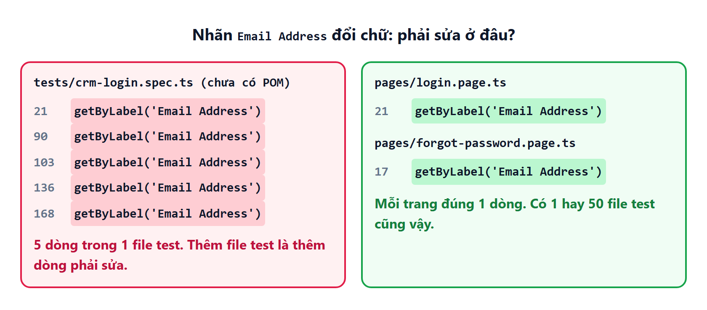
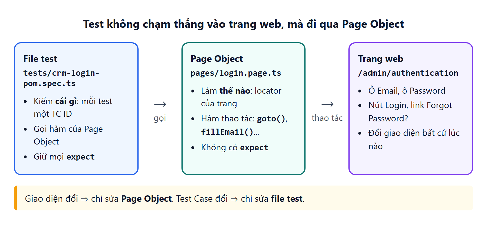
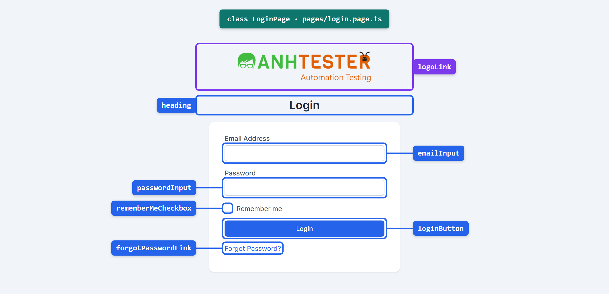
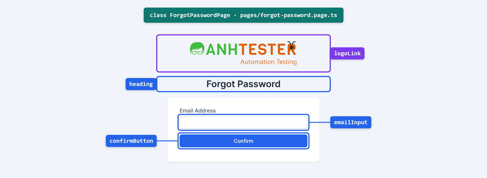
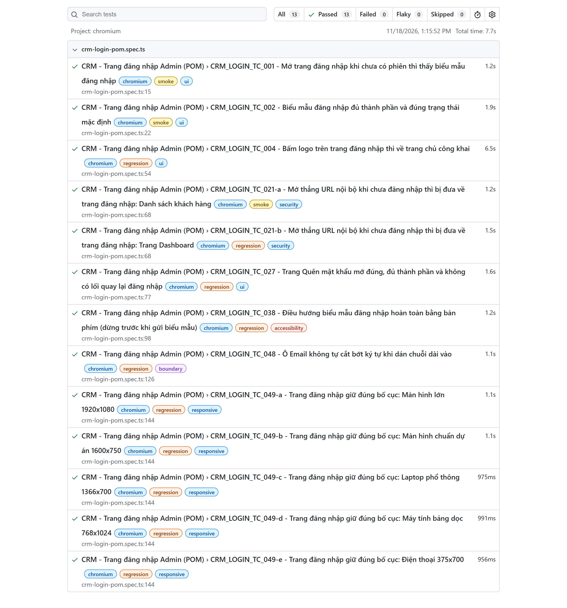

# Bài 23 - [Playwright Typescript] Cấu trúc code theo Page Object Model (POM)

Chương: 4. Cấu trúc code Page Object Model + Fixture

Nguồn: [https://anhtester.com/learn/website-and-api-testing-automation-with-playwright-javascript-typescript-day-code-js-ts-tu-dau/380](https://anhtester.com/learn/website-and-api-testing-automation-with-playwright-javascript-typescript-day-code-js-ts-tu-dau/380)

✅ Vì sao cần Page Object Model  
✅ Cấu trúc một Page class  
✅ Viết LoginPage, ForgotPasswordPage cho CRM demo và dùng trong test  
✅ Tổ chức thư mục pages, tests và quy tắc đặt tên  
✅ Dùng Claude Code và bộ kit claude-testing-skills để sinh Page class  
✅ Kiểm tra code POM do AI sinh ra

## ⭐ Mục tiêu bài học

Ở bài trước (Thực hành viết test automation đầu tiên trên CRM với Codegen và AI) bạn đã có `tests/crm-login.spec.ts`: 13 test, mỗi test mang một TC ID như `CRM_LOGIN_TC_002`, chạy ổn định với `--repeat-each=5`. Bài kết thúc bằng một phép đếm: cùng một locator bị viết đi viết lại nhiều lần trong file.

Bài này mở đầu chương mới và xử lý đúng chỗ đó bằng **Page Object Model (POM)**: gom locator và thao tác của mỗi trang về một class. Học xong bạn sẽ:

- Giải thích được vì sao cần POM bằng chính số liệu trong project của bạn.
- Đọc và viết được một Page class: locator, constructor, hàm thao tác.
- Tránh được lỗi `TypeError` của kiểu gán locator ngay tại dòng khai báo ở Playwright 1.65.
- Viết `LoginPage`, `ForgotPasswordPage` cho CRM demo và viết lại bộ test cũ thành `tests/crm-login-pom.spec.ts`.
- Giao việc sinh Page class cho AI và duyệt kết quả bằng checklist.

> 📌 Bài làm tiếp trong project `D:\AnhTester\playwright-crm` (macOS: `~/AnhTester/playwright-crm`). Vẫn như bài trước: **không đăng nhập và không gửi biểu mẫu nào** trên CRM demo.

## ✅ Phần 1: Vì sao cần Page Object Model

### 🔆 1. Đếm lại bộ test của bài trước

Mở `tests/crm-login.spec.ts`, bấm `Ctrl+F` và tìm từng locator. Số lần xuất hiện thật trong file:

<table class="rt-table">
<thead>
<tr>
<th>Locator</th>
<th>Số lần viết lại trong file</th>
</tr>
</thead>
<tbody>
<tr>
<td><code>getByLabel('Email Address')</code></td>
<td>5</td>
</tr>
<tr>
<td><code><span>getByRole('button',</span> <span>{</span> <span>name:</span> <span>'Login'</span> <span>})</span></code></td>
<td>4</td>
</tr>
<tr>
<td><code>getByLabel('Password')</code></td>
<td>3</td>
</tr>
<tr>
<td><code><span>getByRole('checkbox',</span> <span>{</span> <span>name:</span> <span>'Remember</span> <span>me'</span> <span>})</span></code></td>
<td>3</td>
</tr>
<tr>
<td><code><span>getByRole('link',</span> <span>{</span> <span>name:</span> <span>'Forgot</span> <span>Password?'</span> <span>})</span></code></td>
<td>3</td>
</tr>
<tr>
<td><code><span>getByRole('heading',</span> <span>{</span> <span>name:</span> <span>'Login'</span> <span>})</span></code></td>
<td>2</td>
</tr>
</tbody>
</table>

Cả file có **28 dòng** chứa `getBy...`. Giả sử tuần sau nhãn `Email Address` đổi chữ. Bạn phải rà cả 5 dòng: 4 dòng của trang đăng nhập, 1 dòng của trang Quên mật khẩu, và phải đọc từng test mới biết dòng nào thuộc trang nào. Project thật có vài chục file test thì con số 5 thành vài chục, sót một dòng là một test đỏ oan.

[](https://anhtester.com/storage/photos/shares/lesson/js_ts_playwright/v2/bai_23_page_object_model/04_so_do_doi_nhan_email_sua_o_dau.png)

*Nhãn Email Address đổi chữ: 5 dòng trong file test cũ, còn với POM mỗi trang đúng 1 dòng*

### 🔆 2. Page Object là gì?

**Ví dụ đời thường.** Trong điện thoại, bạn bấm vào tên "Mẹ" để gọi, không ai bấm lại 10 chữ số mỗi lần. Số của mẹ lưu ở **một chỗ** là danh bạ. Mẹ đổi số thì sửa một lần trong danh bạ.

**Khái niệm lập trình.** Page Object là một `class` đại diện cho một trang (hoặc một vùng lớn) của ứng dụng. Class đó trả lời hai câu hỏi: trên trang **có gì** (các locator) và trên trang **làm được gì** (các hàm thao tác).

**Trong automation.** File test không còn gọi thẳng `page.getByLabel(...)`. Nó gọi `loginPage.fillEmail(...)`. Test chỉ nói **kiểm cái gì**, còn **tìm phần tử thế nào** là việc của Page Object.

[](https://anhtester.com/storage/photos/shares/lesson/js_ts_playwright/v2/bai_23_page_object_model/01_so_do_test_page_object_trang_web.png)

*File test gọi Page Object, Page Object thao tác lên trang web*

### 🔆 3. Không có POM và có POM

<table class="rt-table">
<thead>
<tr>
<th>Tiêu chí</th>
<th>Không có POM</th>
<th>Có POM</th>
</tr>
</thead>
<tbody>
<tr>
<td>Locator nằm ở đâu</td>
<td>Rải trong từng test, từng file</td>
<td>Một chỗ: class của trang đó</td>
</tr>
<tr>
<td>Giao diện đổi</td>
<td>Tìm và sửa ở mọi nơi đã dùng</td>
<td>Sửa một dòng trong Page class</td>
</tr>
<tr>
<td>Đọc một test</td>
<td>Phải dịch từng locator mới hiểu test làm gì</td>
<td>Đọc gần như một Test Case: <code>loginPage.fillEmail(...)</code></td>
</tr>
<tr>
<td>Cái giá phải trả</td>
<td>Không có, viết là chạy</td>
<td>Thêm file, thêm một lớp phải đọc</td>
</tr>
</tbody>
</table>

> 🔗 Playwright có trang tài liệu riêng cho cách tổ chức này: [playwright.dev/docs/pom](https://playwright.dev/docs/pom).

## ✅ Phần 2: Cấu trúc một Page class

### 🔆 1. Ba phần: thuộc tính, constructor, hàm thao tác

Một Page class chỉ là class thường như bạn đã học ở bài Kiểu dữ liệu, type, interface và class trong TypeScript, xếp theo ba phần cố định:

```typescript
import { type Page, type Locator } from '@playwright/test';

export class LoginPage {
  // 1. Thuộc tính: trang có gì
  readonly page: Page;
  readonly emailInput: Locator;

  // 2. Constructor: nhận page từ test, gán locator
  constructor(page: Page) {
    this.page = page;
    this.emailInput = page.getByLabel('Email Address');
  }

  // 3. Hàm thao tác: trang làm được gì
  async fillEmail(email: string): Promise<void> {
    await this.emailInput.fill(email);
  }
}
```

<table class="rt-table">
<thead>
<tr>
<th>Cách viết</th>
<th>Vì sao</th>
</tr>
</thead>
<tbody>
<tr>
<td>Thuộc tính <code>readonly</code></td>
<td>Không ai gán lại được locator giữa chừng, TypeScript báo lỗi ngay khi gõ</td>
</tr>
<tr>
<td>Thuộc tính để công khai, không <code>private</code></td>
<td>Test cần chạm vào locator để kiểm tra: <code><span>await</span> <span>expect(loginPage.emailInput).toBeVisible()</span></code></td>
</tr>
<tr>
<td>Constructor chỉ gán, không mở trang</td>
<td>Constructor không dùng được <code>await</code>. Tạo locator thì chưa tìm gì nên không cần chờ, còn <code>page.goto()</code> phải chờ nên nằm trong hàm <code>goto()</code></td>
</tr>
<tr>
<td>Hàm thao tác là <code>async</code>, bên trong có <code>await</code></td>
<td>Thiếu <code>await</code> là test đi tiếp khi thao tác chưa xong</td>
</tr>
</tbody>
</table>

Hàm của Page class thường thuộc một trong ba loại: **thao tác** (`fillEmail`, không trả về gì), **đọc dữ liệu** (trả về giá trị, ví dụ `Promise<string>`, bạn sẽ tự viết một hàm ở Bài tập 1) và **chuyển trang** (trả về Page Object của trang kế tiếp, xem Phần 3).

> ⚠️ Trong bài này Page class **không chứa `expect`**. Page Object lo thao tác, test lo kiểm tra, nên test đỏ là thấy ngay dòng `expect` nào của TC nào. Có ngoại lệ nào đáng dùng không là nội dung của bài kế tiếp.

### 🔆 2. Bẫy ở Playwright 1.65: gán locator ngay tại dòng khai báo

Trên mạng và trong code AI sinh ra có rất nhiều Page class viết gọn kiểu dưới đây. Tạo thử file `pages/exp-login-field.page.ts`:

```typescript
import { type Page } from '@playwright/test';

export class ExpLoginFieldPage {
  readonly emailInput = this.page.getByLabel('Email Address');
  readonly loginButton = this.page.getByRole('button', { name: 'Login' });

  constructor(private readonly page: Page) {}

  async goto(): Promise<void> {
    await this.page.goto('https://crm.anhtester.com/admin/authentication');
  }
}
```

Và file test `tests/exp-pom-field-trap.spec.ts`:

```typescript
import { test, expect } from '@playwright/test';
import { ExpLoginFieldPage } from '../pages/exp-login-field.page';

test('Thử Page class gán locator ngay tại dòng khai báo', async ({ page }) => {
  const loginPage = new ExpLoginFieldPage(page);
  await loginPage.goto();
  await expect(loginPage.emailInput).toBeVisible();
});
```

```bash
npx playwright test exp-pom-field-trap --project=chromium --reporter=list
```

```plaintext
Running 1 test using 1 worker

  ✘   1 [chromium] › tests\exp-pom-field-trap.spec.ts:4:1 › Thử Page class gán locator ngay tại dòng khai báo (111ms)


  1) [chromium] › tests\exp-pom-field-trap.spec.ts:4:1 › Thử Page class gán locator ngay tại dòng khai báo 

    TypeError: Cannot read properties of undefined (reading 'getByLabel')

       at ..\pages\exp-login-field.page.ts:4

      2 |
      3 | export class ExpLoginFieldPage {
    > 4 |   readonly emailInput = this.page.getByLabel('Email Address');
        |                                   ^
      5 |   readonly loginButton = this.page.getByRole('button', { name: 'Login' });
      6 |
      7 |   constructor(private readonly page: Page) {}
        at ExpLoginFieldPage.constructor (D:\AnhTester\playwright-crm\pages\exp-login-field.page.ts:4:35)
        at ExpLoginFieldPage (D:\AnhTester\playwright-crm\pages\exp-login-field.page.ts:7:14)
        at D:\AnhTester\playwright-crm\tests\exp-pom-field-trap.spec.ts:5:21

    Error Context: test-results\exp-pom-field-trap-Thử-Pag-4ee4d-ator-ngay-tại-dòng-khai-báo-chromium\error-context.md

  1 failed
    [chromium] › tests\exp-pom-field-trap.spec.ts:4:1 › Thử Page class gán locator ngay tại dòng khai báo
```

Kết quả chạy thật (Playwright 1.65.1, ngày 18/11/2026). Test lỗi ngay ở dòng `new ExpLoginFieldPage(page)`, chưa kịp mở trang. Lý do nằm ở **thứ tự chạy** khi tạo object:

1. Các thuộc tính có giá trị ngay tại dòng khai báo (`readonly emailInput = ...`) được tính **trước**.
2. Sau đó mới tới phần gán `this.page = page` mà cách viết tắt `constructor(private readonly page: Page)` sinh ra.

Lúc bước 1 chạy, `this.page` vẫn là `undefined`, nên `this.page.getByLabel` báo `Cannot read properties of undefined`. Từ bản **1.65**, Playwright dịch class theo đúng thứ tự chuẩn này (option `useDefineForClassFields` của TypeScript), nên code kiểu trên từng chạy được ở bản cũ nay lỗi. Bài class trong chương TypeScript đã nhắc trước điều này.

Anh Tester thử đổi cấu hình TypeScript, mỗi dòng là một lần chạy thật:

<table class="rt-table">
<thead>
<tr>
<th>File <code>tsconfig.json</code> ở gốc project</th>
<th>Kết quả test trên</th>
</tr>
</thead>
<tbody>
<tr>
<td>Không có file (project mặc định của khoá học)</td>
<td>Lỗi <code>TypeError</code></td>
</tr>
<tr>
<td><code>"target": "ES2022"</code></td>
<td>Lỗi <code>TypeError</code></td>
</tr>
<tr>
<td><code>"target": "ES2020"</code></td>
<td>Đạt</td>
</tr>
<tr>
<td><code>"useDefineForClassFields": false</code></td>
<td>Đạt</td>
</tr>
</tbody>
</table>

Cùng một Page class, chạy được hay không lại phụ thuộc một file cấu hình nằm ở chỗ khác. Vì vậy khoá học thống nhất cách viết **đúng với mọi cấu hình**: khai báo thuộc tính ở trên, **gán trong constructor**, như khung ở mục 1.

> 🔗 Ghi chú chính thức: mục Breaking Changes của bản 1.65 trong [playwright.dev/docs/release-notes](https://playwright.dev/docs/release-notes#version-165) và option [useDefineForClassFields](https://www.typescriptlang.org/tsconfig/#useDefineForClassFields) của TypeScript.
>
> 💡 Thuộc tính gán sẵn một giá trị **không đọc `this.page`** thì không dính bẫy, ví dụ `readonly url = 'https://...'`.

Chạy xong thì xoá hai file `exp-...` vừa tạo.

## ✅ Phần 3: Viết LoginPage, ForgotPasswordPage cho CRM demo và dùng trong test

### 🔆 1. File pages/login.page.ts

Tạo thư mục `pages` ở gốc project, rồi tạo file `pages/login.page.ts`. Locator lấy nguyên từ bộ test của bài trước:

```typescript
import { type Page, type Locator } from '@playwright/test';
import { ForgotPasswordPage } from './forgot-password.page';

export class LoginPage {
  // 1. Những thứ CÓ TRÊN TRANG: mỗi phần tử một thuộc tính kiểu Locator
  readonly page: Page;
  readonly url = 'https://crm.anhtester.com/admin/authentication';
  readonly logoLink: Locator;
  readonly heading: Locator;
  readonly emailInput: Locator;
  readonly passwordInput: Locator;
  readonly rememberMeCheckbox: Locator;
  readonly loginButton: Locator;
  readonly forgotPasswordLink: Locator;

  // 2. Constructor: nhận page từ test rồi gán toàn bộ locator. Chưa mở trang, chưa tìm gì.
  constructor(page: Page) {
    this.page = page;
    this.logoLink = page.getByRole('link', { name: 'Perfex CRM | Anh Tester Demo' });
    this.heading = page.getByRole('heading', { name: 'Login' });
    this.emailInput = page.getByLabel('Email Address');
    this.passwordInput = page.getByLabel('Password');
    this.rememberMeCheckbox = page.getByRole('checkbox', { name: 'Remember me' });
    this.loginButton = page.getByRole('button', { name: 'Login' });
    this.forgotPasswordLink = page.getByRole('link', { name: 'Forgot Password?' });
  }

  // 3. Những việc LÀM ĐƯỢC TRÊN TRANG: mỗi việc một hàm async
  async goto(): Promise<void> {
    await this.page.goto(this.url);
  }

  async fillEmail(email: string): Promise<void> {
    await this.emailInput.fill(email);
  }

  async fillPassword(password: string): Promise<void> {
    await this.passwordInput.fill(password);
  }

  /** Điền cả hai ô, KHÔNG gửi biểu mẫu */
  async fillCredentials(email: string, password: string): Promise<void> {
    await this.fillEmail(email);
    await this.fillPassword(password);
  }

  /**
   * Điền rồi bấm Login. Dùng từ bài đọc config từ file .env và bài Storage State,
   * khi email và mật khẩu lấy từ biến môi trường. Không chạy với tài khoản thật trên CRM demo trong bài này.
   */
  async login(email: string, password: string): Promise<void> {
    await this.fillCredentials(email, password);
    await this.loginButton.click();
  }

  /** Bấm link Forgot Password? và trả về Page Object của trang vừa mở */
  async openForgotPassword(): Promise<ForgotPasswordPage> {
    await this.forgotPasswordLink.click();
    return new ForgotPasswordPage(this.page);
  }
}
```

Mỗi khung trong ảnh là vị trí mà **chính thuộc tính cùng tên** của `LoginPage` tìm ra khi chạy thật, mỗi locator khớp đúng 1 phần tử:

[](https://anhtester.com/storage/photos/shares/lesson/js_ts_playwright/v2/bai_23_page_object_model/02_trang_login_crm_theo_thuoc_tinh_loginpage.png)

*Trang đăng nhập Admin CRM và 7 thuộc tính locator của class LoginPage*

- **`fillCredentials()` và `login()` là hai hàm khác nhau.** Hàm đầu chỉ điền, hàm sau điền rồi bấm `Login`. Bài này chỉ dùng hàm đầu. `login()` để dành cho lúc học file `.env` và Storage State, khi email và mật khẩu lấy từ biến `ADMIN_EMAIL`, `ADMIN_PASSWORD`.
- **Không có email hay mật khẩu nào trong class.** Dữ liệu do test truyền vào qua tham số, nhờ vậy class dùng lại được cho mọi TC.
- **URL đang là một hằng trong class.** Khi học file config bạn sẽ chuyển phần tên miền sang `baseURL`.

### 🔆 2. File pages/forgot-password.page.ts và cách nối hai trang

HTML thật của form trên trang Quên mật khẩu (đã bỏ các thẻ `div` bọc ngoài và ô ẩn):

```markup
<h1 class="tw-text-2xl tw-text-neutral-800 text-center tw-font-semibold tw-mb-5">Forgot Password</h1>
<form action="https://crm.anhtester.com/admin/authentication/forgot_password" method="post" accept-charset="utf-8">
  <label for="email" class="control-label">Email Address</label>
  <input type="email" id="email" name="email" class="form-control" value="">
  <button type="submit" class="btn btn-primary btn-block">Confirm</button>
</form>
```

Tạo file `pages/forgot-password.page.ts`:

```typescript
import { type Page, type Locator } from '@playwright/test';

export class ForgotPasswordPage {
  readonly page: Page;
  readonly url = 'https://crm.anhtester.com/admin/authentication/forgot_password';
  readonly logoLink: Locator;
  readonly heading: Locator;
  readonly emailInput: Locator;
  readonly confirmButton: Locator;
  readonly allTextboxes: Locator;
  readonly allLinks: Locator;

  constructor(page: Page) {
    this.page = page;
    this.logoLink = page.getByRole('link', { name: 'Perfex CRM | Anh Tester Demo' });
    this.heading = page.getByRole('heading', { name: 'Forgot Password' });
    this.emailInput = page.getByLabel('Email Address');
    this.confirmButton = page.getByRole('button', { name: 'Confirm' });
    this.allTextboxes = page.getByRole('textbox');
    this.allLinks = page.getByRole('link');
  }

  async goto(): Promise<void> {
    await this.page.goto(this.url);
  }

  /** Điền ô Email, KHÔNG bấm Confirm */
  async fillEmail(email: string): Promise<void> {
    await this.emailInput.fill(email);
  }
}
```

[](https://anhtester.com/storage/photos/shares/lesson/js_ts_playwright/v2/bai_23_page_object_model/03_trang_quen_mat_khau_theo_forgotpasswordpage.png)

*Trang Quên mật khẩu và các thuộc tính locator của class ForgotPasswordPage*

Hai thuộc tính `allTextboxes` và `allLinks` cố ý khớp **nhiều** phần tử: TC\_027 cần đếm "đúng 1 ô nhập" và "đúng 1 link". Ô `Email Address` có ở cả hai trang, nhưng mỗi trang giữ locator riêng, vì trang này đổi nhãn không có nghĩa trang kia đổi theo.

Nhìn lại hàm `openForgotPassword()` của `LoginPage`: nó bấm link rồi `return new ForgotPasswordPage(this.page)`. Test gọi hàm là nhận về Page Object của trang mới:

```typescript
const forgotPasswordPage = await loginPage.openForgotPassword();
await expect(forgotPasswordPage.heading).toBeVisible();
```

> ⚠️ Chỉ trả về Page Object khác khi thao tác đó **thật sự chuyển trang**. Đừng nối thành chuỗi dài kiểu `a().b().c()` qua ba bốn trang: lỗi ở giữa chuỗi rất khó biết đang đứng ở trang nào.

### 🔆 3. File tests/crm-login-pom.spec.ts

Giữ nguyên `tests/crm-login.spec.ts` để so sánh. Tạo file mới `tests/crm-login-pom.spec.ts` với đúng 13 test đó, cùng TC ID, cùng tag, cùng `test.fail` cho TC\_004:

```typescript
import { test, expect } from '@playwright/test';
import { LoginPage } from '../pages/login.page';

const LOGIN_TITLE = 'Perfex CRM | Anh Tester Demo - Login';
const HOME_URL = 'https://crm.anhtester.com/';

test.describe('CRM - Trang đăng nhập Admin (POM)', () => {
  let loginPage: LoginPage;

  test.beforeEach(async ({ page }) => {
    loginPage = new LoginPage(page);
    await loginPage.goto();
  });

  test('CRM_LOGIN_TC_001 - Mở trang đăng nhập khi chưa có phiên thì thấy biểu mẫu đăng nhập',
    { tag: ['@smoke', '@ui'] }, async ({ page }) => {
      await expect(page).toHaveURL(loginPage.url);
      await expect(page).toHaveTitle(LOGIN_TITLE);
      await expect(loginPage.heading).toBeVisible();
    });

  test('CRM_LOGIN_TC_002 - Biểu mẫu đăng nhập đủ thành phần và đúng trạng thái mặc định',
    { tag: ['@smoke', '@ui'] }, async ({ page }) => {
      await test.step('Mục 1: đủ 5 thành phần', async () => {
        await expect(loginPage.emailInput).toBeVisible();
        await expect(loginPage.passwordInput).toBeVisible();
        await expect(loginPage.rememberMeCheckbox).toBeVisible();
        await expect(loginPage.loginButton).toBeVisible();
        await expect(loginPage.forgotPasswordLink).toBeVisible();
      });

      await test.step('Mục 2: con trỏ nằm sẵn trong ô Email', async () => {
        await expect(loginPage.emailInput).toBeFocused();
      });

      await test.step('Mục 3 và 4: Remember me chưa tick, nút Login bấm được', async () => {
        await expect(loginPage.rememberMeCheckbox).not.toBeChecked();
        await expect(loginPage.rememberMeCheckbox).toBeEnabled();
        await expect(loginPage.loginButton).toBeEnabled();
      });

      await test.step('Mục 5: ô Password che ký tự', async () => {
        await loginPage.fillPassword('Abc12345');
        await expect(loginPage.passwordInput).toHaveAttribute('type', 'password');
        await expect(loginPage.passwordInput).toHaveValue('Abc12345');
      });

      await test.step('Mục 6: bấm vào chữ Remember me thì checkbox được tick', async () => {
        await page.getByText('Remember me').click();
        await expect(loginPage.rememberMeCheckbox).toBeChecked();
      });
    });

  test.fail('CRM_LOGIN_TC_004 - Bấm logo trên trang đăng nhập thì về trang chủ công khai',
    {
      tag: ['@regression', '@ui'],
      annotation: { type: 'issue', description: 'BUG_login_1787226513_TC004: logo dẫn sang /authentication/login' },
    }, async ({ page }) => {
      await loginPage.logoLink.click();
      await expect(page).toHaveURL(HOME_URL);
    });

  const protectedUrls = [
    { variant: 'a', name: 'Danh sách khách hàng', url: 'https://crm.anhtester.com/admin/clients', tag: '@smoke' },
    { variant: 'b', name: 'Trang Dashboard', url: 'https://crm.anhtester.com/admin/', tag: '@regression' },
  ];
  for (const { variant, name, url, tag } of protectedUrls) {
    test(`CRM_LOGIN_TC_021-${variant} - Mở thẳng URL nội bộ khi chưa đăng nhập thì bị đưa về trang đăng nhập: ${name}`,
      { tag: [tag, '@security'] }, async ({ page }) => {
        await page.goto(url);
        await expect(page).toHaveURL(loginPage.url);
        await expect(page).toHaveTitle(LOGIN_TITLE);
        await expect(loginPage.loginButton).toBeVisible();
      });
  }

  test('CRM_LOGIN_TC_027 - Trang Quên mật khẩu mở đúng, đủ thành phần và không có lối quay lại đăng nhập',
    { tag: ['@regression', '@ui'] }, async ({ page }) => {
      const forgotPasswordPage = await loginPage.openForgotPassword();

      await test.step('Mục 1: đúng URL', async () => {
        await expect(page).toHaveURL(forgotPasswordPage.url);
      });

      await test.step('Mục 2: tiêu đề, đúng 1 ô nhập, nút Confirm', async () => {
        await expect(forgotPasswordPage.heading).toBeVisible();
        await expect(forgotPasswordPage.allTextboxes).toHaveCount(1);
        await expect(forgotPasswordPage.emailInput).toBeVisible();
        await expect(forgotPasswordPage.confirmButton).toBeVisible();
      });

      await test.step('Mục 3: link duy nhất trên trang là logo', async () => {
        await expect(forgotPasswordPage.allLinks).toHaveCount(1);
        await expect(forgotPasswordPage.logoLink).toHaveAttribute('href', HOME_URL);
      });
    });

  test('CRM_LOGIN_TC_038 - Điều hướng biểu mẫu đăng nhập hoàn toàn bằng bàn phím (dừng trước khi gửi biểu mẫu)',
    { tag: ['@regression', '@accessibility'] }, async ({ page }) => {
      await test.step('Bước 1-2: gõ ngay vào ô Email, không bấm chuột', async () => {
        await expect(loginPage.emailInput).toBeFocused();
        await page.keyboard.type('tester@example.com');
        await expect(loginPage.emailInput).toHaveValue('tester@example.com');
      });

      await test.step('Bước 3-4: Tab sang ô Password rồi gõ một chuỗi giả', async () => {
        await page.keyboard.press('Tab');
        await expect(loginPage.passwordInput).toBeFocused();
        await page.keyboard.type('Abc12345');
        await expect(loginPage.passwordInput).toHaveValue('Abc12345');
      });

      await test.step('Bước 5-6: Tab tới Remember me, phím Space tick được', async () => {
        await page.keyboard.press('Tab');
        await expect(loginPage.rememberMeCheckbox).toBeFocused();
        await page.keyboard.press('Space');
        await expect(loginPage.rememberMeCheckbox).toBeChecked();
      });

      await test.step('Bước 7 (nửa đầu): Tab tới nút Login rồi dừng, không nhấn Enter', async () => {
        await page.keyboard.press('Tab');
        await expect(loginPage.loginButton).toBeFocused();
      });
    });

  test('CRM_LOGIN_TC_048 - Ô Email không tự cắt bớt ký tự khi dán chuỗi dài vào',
    { tag: ['@regression', '@boundary'] }, async () => {
      const longText = 'a'.repeat(300);

      await loginPage.fillEmail(longText);

      await expect(loginPage.emailInput).toHaveValue(longText);
      expect((await loginPage.emailInput.inputValue()).length).toBe(300);
    });

  const viewports = [
    { variant: 'a', name: 'Màn hình lớn', width: 1920, height: 1080 },
    { variant: 'b', name: 'Màn hình chuẩn dự án', width: 1600, height: 750 },
    { variant: 'c', name: 'Laptop phổ thông', width: 1366, height: 700 },
    { variant: 'd', name: 'Máy tính bảng dọc', width: 768, height: 1024 },
    { variant: 'e', name: 'Điện thoại', width: 375, height: 700 },
  ];
  for (const { variant, name, width, height } of viewports) {
    test(`CRM_LOGIN_TC_049-${variant} - Trang đăng nhập giữ đúng bố cục: ${name} ${width}x${height}`,
      { tag: ['@regression', '@responsive'] }, async ({ page }) => {
        await page.setViewportSize({ width, height });
        await page.reload();

        await test.step('Bước 4: không cuộn ngang được', async () => {
          const size = await page.evaluate(() => ({
            scrollWidth: document.documentElement.scrollWidth,
            clientWidth: document.documentElement.clientWidth,
          }));
          expect(size.scrollWidth).toBeLessThanOrEqual(size.clientWidth);
        });

        await test.step('Bước 5: thấy đủ 7 thành phần', async () => {
          await expect(loginPage.logoLink).toBeVisible();
          await expect(loginPage.heading).toBeVisible();
          await expect(loginPage.emailInput).toBeVisible();
          await expect(loginPage.passwordInput).toBeVisible();
          await expect(loginPage.rememberMeCheckbox).toBeVisible();
          await expect(loginPage.loginButton).toBeVisible();
          await expect(loginPage.forgotPasswordLink).toBeVisible();
        });
      });
  }
});
```

Ba chỗ cần đọc kỹ:

- **`let loginPage` khai báo trong `describe`, gán trong `beforeEach`.** Mỗi test nhận một `page` mới nên phải tạo `new LoginPage(page)` cho từng test, không tạo một lần rồi dùng chung.
- **Test vẫn nhận `{ page }`** cho những việc thuộc về trình duyệt: `toHaveURL`, `toHaveTitle`, bàn phím, `setViewportSize`. Test nào không cần thì bỏ hẳn, như TC\_048.
- **Còn đúng một dòng `getBy...` trong file test**: `page.getByText('Remember me')` ở TC\_002, chỉ dùng một lần. Dùng tới lần thứ hai thì chuyển vào `LoginPage`.

```bash
npx playwright test crm-login-pom.spec.ts --project=chromium --reporter=list,html
```

```plaintext
Running 13 tests using 6 workers

  ✓   1 [chromium] › tests\crm-login-pom.spec.ts:15:3 › CRM - Trang đăng nhập Admin (POM) › CRM_LOGIN_TC_001 - Mở trang đăng nhập khi chưa có phiên thì thấy biểu mẫu đăng nhập @smoke @ui (1.3s)
  ✓   2 [chromium] › tests\crm-login-pom.spec.ts:68:5 › CRM - Trang đăng nhập Admin (POM) › CRM_LOGIN_TC_021-a - Mở thẳng URL nội bộ khi chưa đăng nhập thì bị đưa về trang đăng nhập: Danh sách khách hàng @smoke @security (1.5s)
  ✓   6 [chromium] › tests\crm-login-pom.spec.ts:77:3 › CRM - Trang đăng nhập Admin (POM) › CRM_LOGIN_TC_027 - Trang Quên mật khẩu mở đúng, đủ thành phần và không có lối quay lại đăng nhập @regression @ui (1.4s)
  ✓   4 [chromium] › tests\crm-login-pom.spec.ts:68:5 › CRM - Trang đăng nhập Admin (POM) › CRM_LOGIN_TC_021-b - Mở thẳng URL nội bộ khi chưa đăng nhập thì bị đưa về trang đăng nhập: Trang Dashboard @regression @security (1.5s)
  ✓   5 [chromium] › tests\crm-login-pom.spec.ts:22:3 › CRM - Trang đăng nhập Admin (POM) › CRM_LOGIN_TC_002 - Biểu mẫu đăng nhập đủ thành phần và đúng trạng thái mặc định @smoke @ui (1.6s)
  ✓   7 [chromium] › tests\crm-login-pom.spec.ts:98:3 › CRM - Trang đăng nhập Admin (POM) › CRM_LOGIN_TC_038 - Điều hướng biểu mẫu đăng nhập hoàn toàn bằng bàn phím (dừng trước khi gửi biểu mẫu) @regression @accessibility (808ms)
  ✓   8 [chromium] › tests\crm-login-pom.spec.ts:126:3 › CRM - Trang đăng nhập Admin (POM) › CRM_LOGIN_TC_048 - Ô Email không tự cắt bớt ký tự khi dán chuỗi dài vào @regression @boundary (717ms)
  ✓  10 [chromium] › tests\crm-login-pom.spec.ts:144:5 › CRM - Trang đăng nhập Admin (POM) › CRM_LOGIN_TC_049-b - Trang đăng nhập giữ đúng bố cục: Màn hình chuẩn dự án 1600x750 @regression @responsive (837ms)
  ✓   9 [chromium] › tests\crm-login-pom.spec.ts:144:5 › CRM - Trang đăng nhập Admin (POM) › CRM_LOGIN_TC_049-a - Trang đăng nhập giữ đúng bố cục: Màn hình lớn 1920x1080 @regression @responsive (866ms)
  ✓  11 [chromium] › tests\crm-login-pom.spec.ts:144:5 › CRM - Trang đăng nhập Admin (POM) › CRM_LOGIN_TC_049-c - Trang đăng nhập giữ đúng bố cục: Laptop phổ thông 1366x700 @regression @responsive (804ms)
  ✓  12 [chromium] › tests\crm-login-pom.spec.ts:144:5 › CRM - Trang đăng nhập Admin (POM) › CRM_LOGIN_TC_049-d - Trang đăng nhập giữ đúng bố cục: Máy tính bảng dọc 768x1024 @regression @responsive (726ms)
  ✓  13 [chromium] › tests\crm-login-pom.spec.ts:144:5 › CRM - Trang đăng nhập Admin (POM) › CRM_LOGIN_TC_049-e - Trang đăng nhập giữ đúng bố cục: Điện thoại 375x700 @regression @responsive (813ms)
  ✘    3 [chromium] › tests\crm-login-pom.spec.ts:54:8 › CRM - Trang đăng nhập Admin (POM) › CRM_LOGIN_TC_004 - Bấm logo trên trang đăng nhập thì về trang chủ công khai @regression @ui (6.4s)

  13 passed (7.5s)
```

Kết quả chạy thật (Playwright 1.65.1, ngày 18/11/2026): **13 passed**, TC\_004 vẫn có dấu `✘` vì là lỗi đã khai báo trước bằng `test.fail`. Trong HTML Report, tên test và TC ID không đổi so với bài trước:

[](https://anhtester.com/storage/photos/shares/lesson/js_ts_playwright/v2/bai_23_page_object_model/05_html_report_crm_login_pom.png)

*HTML Report của crm-login-pom.spec.ts: 13 test mang TC ID đều đạt*

Chạy bộ cũ và bộ mới cùng lúc (cả hai tên file đều chứa `crm-login`), rồi chạy lặp bộ mới 5 lần:

```bash
npx playwright test crm-login --project=chromium --reporter=dot
```

```plaintext
Running 26 tests using 6 workers
··························
  26 passed (9.3s)
```

```bash
npx playwright test crm-login-pom.spec.ts --project=chromium --repeat-each=5 --reporter=dot
```

```plaintext
Running 65 tests using 6 workers
·································································
  65 passed (20.7s)
```

> 📌 Nếu project của bạn còn file `tests/crm-login-locators.spec.ts` từ bài Locators với các hàm getBy... thì lệnh đầu chạy thêm cả file đó, số test sẽ lớn hơn 26.

### 🔆 4. So sánh trước và sau

Cùng mục 2 của TC\_027, bản cũ trong `crm-login.spec.ts`:

```typescript
await page.getByRole('link', { name: 'Forgot Password?' }).click();
// ...
await expect(page.getByRole('heading', { name: 'Forgot Password' })).toBeVisible();
await expect(page.getByRole('textbox')).toHaveCount(1);
await expect(page.getByLabel('Email Address')).toBeVisible();
await expect(page.getByRole('button', { name: 'Confirm' })).toBeVisible();
```

Bản mới trong `crm-login-pom.spec.ts`:

```typescript
const forgotPasswordPage = await loginPage.openForgotPassword();
// ...
await expect(forgotPasswordPage.heading).toBeVisible();
await expect(forgotPasswordPage.allTextboxes).toHaveCount(1);
await expect(forgotPasswordPage.emailInput).toBeVisible();
await expect(forgotPasswordPage.confirmButton).toBeVisible();
```

<table class="rt-table">
<thead>
<tr>
<th>Số liệu thật</th>
<th><code>crm-login.spec.ts</code></th>
<th><code>crm-login-pom.spec.ts</code></th>
</tr>
</thead>
<tbody>
<tr>
<td>Số dòng có <code>getBy...</code> trong file test</td>
<td>28</td>
<td>1</td>
</tr>
<tr>
<td>Nhãn <code>Email Address</code> của trang đăng nhập đổi</td>
<td>Rà 5 dòng, sửa 4</td>
<td>Sửa 1 dòng trong <code>login.page.ts</code></td>
</tr>
<tr>
<td>Số test và kết quả</td>
<td>13 passed</td>
<td>13 passed</td>
</tr>
</tbody>
</table>

Số dòng của file test gần như không giảm (176 và 168 dòng). POM không nhằm làm code ngắn đi, nó nhằm **mỗi locator chỉ được viết ở một nơi**.

## ✅ Phần 4: Tổ chức thư mục pages, tests và quy tắc đặt tên

Project sau bài này:

```plaintext
playwright-crm/
├── pages/
│   ├── login.page.ts              ← class LoginPage
│   └── forgot-password.page.ts    ← class ForgotPasswordPage
├── tests/
│   ├── crm-login.spec.ts          ← bộ test của bài trước, giữ để so sánh
│   └── crm-login-pom.spec.ts      ← cùng các TC, viết qua Page Object
├── utils/
│   ├── table.ts
│   └── date.ts
└── playwright.config.ts
```

<table class="rt-table">
<thead>
<tr>
<th>Hạng mục</th>
<th>Quy tắc của project</th>
</tr>
</thead>
<tbody>
<tr>
<td>Tên file</td>
<td>Chữ thường, nối bằng gạch ngang, đuôi <code>.page.ts</code>: <code>forgot-password.page.ts</code></td>
</tr>
<tr>
<td>Tên class</td>
<td>PascalCase, kết thúc bằng <code>Page</code>: <code>ForgotPasswordPage</code></td>
</tr>
<tr>
<td>Cách export</td>
<td><code>export class ...</code>, không dùng <code>export default</code>. Tên lúc import luôn trùng tên class</td>
</tr>
<tr>
<td>Phạm vi</td>
<td>Một trang một class, một class một file. Không gom cả ứng dụng vào một class <code>CrmPage</code></td>
</tr>
<tr>
<td>Locator</td>
<td>Khai báo <code>readonly</code>, gán trong constructor. Ưu tiên <code>getBy...</code>, sau đó XPath, không CSS Selector</td>
</tr>
<tr>
<td>Kiểm tra</td>
<td>Không viết <code>expect</code> trong Page class ở giai đoạn này</td>
</tr>
<tr>
<td>Chờ</td>
<td>Không <code>waitForTimeout</code>. Thao tác của Playwright đã tự chờ</td>
</tr>
<tr>
<td>Dữ liệu test</td>
<td>Truyền qua tham số của hàm. Không viết cứng email, mật khẩu trong Page class</td>
</tr>
</tbody>
</table>

## ✅ Phần 5: Dùng Claude Code và bộ kit claude-testing-skills để sinh Page class

### 🔆 1. Bộ kit nói gì về POM?

Dòng đầu tiên trong mục Kiến trúc của rule [automation\_rules.md](https://github.com/anhtester/claude-testing-skills/blob/main/.claude/rules/automation_rules.md) ghi: "Bắt buộc sử dụng mô hình Page Object Model (POM)", và assertion chỉ đặt trong test. Ba lệnh liên quan tới bài này:

<table class="rt-table">
<thead>
<tr>
<th>Command</th>
<th>Làm gì</th>
</tr>
</thead>
<tbody>
<tr>
<td><a href="https://github.com/anhtester/claude-testing-skills/blob/main/.claude/commands/generate-automation-web.md">/generate-automation-web</a></td>
<td>Mở trang thật qua Playwright MCP, lấy locator từ DOM, sinh <strong>Page class và file test</strong>, chạy tới khi đạt hai lần liên tiếp. Project đã có <code>pages/</code> thì sinh vào đó, không tạo trùng. <strong>Hợp với việc sinh Page class cho một trang có sẵn</strong></td>
</tr>
<tr>
<td><a href="https://github.com/anhtester/claude-testing-skills/blob/main/.claude/commands/generate-automation-framework.md">/generate-automation-framework</a></td>
<td>Dựng cả framework <strong>từ đầu</strong>: cấu trúc thư mục, class nền, cấu hình, báo cáo, CI và một <code>LoginPage</code> mẫu. Dùng khi mở project mới, không dùng để thêm một trang</td>
</tr>
<tr>
<td><a href="https://github.com/anhtester/claude-testing-skills/blob/main/.claude/commands/review-automation-code.md">/review-automation-code</a></td>
<td>Chấm code đã có theo 6 nhóm, có nhóm "POM &amp; cấu trúc". Mode <code>REVIEW</code> chỉ báo cáo, mode <code>FIX</code> sửa sau khi bạn duyệt</td>
</tr>
</tbody>
</table>

### 🔆 2. Thêm rule riêng cho POM

Bộ kit viết cho nhiều stack nên có vài điểm khác quy ước của project này: mẫu trong kit đặt Page class ở `src/pages/`, và có mẫu code gán locator ngay tại dòng khai báo, kiểu viết phổ biến trước bản 1.65. Như lần làm với locator, bạn **không sửa file của kit** mà thêm rule riêng.

Anh Tester tách thành file mới `.claude/rules/project_pom_rules.md` thay vì viết thêm vào `project_locator_rules.md`: mỗi file một chủ đề thì ngắn và dễ rà. Nội dung:

```markdown
# Quy tắc Page Object Model riêng của project (Playwright TypeScript)

> Chỗ nào khác với mẫu code của bộ kit (vị trí thư mục, cách khai báo locator)
> thì LÀM THEO FILE NÀY. Các quy tắc còn lại của bộ kit giữ nguyên.

## Vị trí và tên gọi
- Page class đặt ở `pages/` tại gốc project (KHÔNG phải `src/pages/`).
- Tên file: `kebab-case.page.ts`. Tên class: PascalCase + hậu tố `Page`.
- Dùng `export class`, KHÔNG dùng `export default`. Một trang một class, một class một file.

## Cấu trúc class
- Khai báo `readonly page: Page;` và từng locator dạng `readonly tenPhanTu: Locator;`.
- GÁN locator TRONG constructor: `this.emailInput = page.getByLabel('Email Address');`
- KHÔNG gán locator tại dòng khai báo kiểu `readonly x = this.page.getBy...`
  (Playwright 1.65 báo TypeError vì this.page chưa có giá trị).
- Constructor chỉ gán, KHÔNG gọi `page.goto()`. Mở trang bằng hàm `async goto()`.
- Hàm thao tác là `async`, có `await` cho mọi thao tác, tên theo việc người dùng làm.
- Hàm làm chuyển trang thì trả về Page Object của trang mới. Không nối chuỗi quá một bước.

## Không đưa vào Page class
- KHÔNG `expect`. Assertion nằm trong file test.
- KHÔNG `waitForTimeout`.
- KHÔNG viết cứng email, mật khẩu, dữ liệu test. Dữ liệu truyền qua tham số.
- Locator theo `.claude/rules/project_locator_rules.md`: getBy... trước, XPath sau, không CSS.
```

> 🔗 File `.md` trong `.claude/rules/` không khai báo `paths` được nạp khi mở phiên làm việc: [code.claude.com/docs/en/memory](https://code.claude.com/docs/en/memory).

### 🔆 3. Prompt mẫu

**Với Claude Code và bộ kit** (bản có phí Anh Tester dùng trong khoá), dùng mode `FLOW` khi chỉ có URL và mô tả thao tác:

```markdown
/generate-automation-web FLOW https://crm.anhtester.com/admin/authentication/forgot_password

Flow: mở trang Quên mật khẩu, điền ô Email Address bằng tester@example.com, DỪNG ở đó.
Ràng buộc cho lần chạy này:
- KHÔNG bấm Confirm, KHÔNG đăng nhập, không cần credentials.
- Stack: Playwright + TypeScript, project đã có sẵn. Sinh pages/forgot-password.page.ts
  và tests/crm-forgot-password-ai.spec.ts. Không tạo BasePage ở lần này.
- Page class theo .claude/rules/project_pom_rules.md, locator theo .claude/rules/project_locator_rules.md.
```

**Với ChatGPT hoặc Gemini** (bản miễn phí): AI không mở được trang, nên bạn đưa HTML thật và quy ước vào prompt.

```markdown
Bạn là Test Automation Engineer dùng Playwright Test + TypeScript (bản 1.65).

Hãy viết Page class cho trang https://crm.anhtester.com/admin/authentication/forgot_password
HTML thật của trang (đã bỏ các thẻ div bọc ngoài):

<h1>Forgot Password</h1>
<form action="https://crm.anhtester.com/admin/authentication/forgot_password" method="post">
  <label for="email" class="control-label">Email Address</label>
  <input type="email" id="email" name="email" class="form-control" value="">
  <button type="submit" class="btn btn-primary btn-block">Confirm</button>
</form>

Quy ước bắt buộc:
1. File pages/forgot-password.page.ts, `export class ForgotPasswordPage`, không export default.
2. Khai báo `readonly page: Page;` và các locator `readonly ...: Locator;`, GÁN TRONG constructor.
   Không viết `readonly x = this.page.getBy...` (Playwright 1.65 báo TypeError).
3. Locator chỉ dùng getByRole, getByLabel, getByText; bí quá mới dùng XPath. Không CSS Selector.
4. Constructor không gọi goto. Có hàm async goto() và async fillEmail(email).
5. Không expect, không waitForTimeout, không viết cứng dữ liệu test trong class.
6. KHÔNG viết hàm bấm Confirm. Phần tử nào không có trong HTML trên thì không tự thêm.
Sau code, liệt kê từng locator kèm dòng HTML mà bạn dựa vào.
```

**Nhờ AI chuyển một file test có sẵn sang POM**, đi từng bước để còn duyệt được:

```markdown
Đây là file test đang chạy đạt, chưa dùng Page Object:

[dán nội dung tests/crm-login-locators.spec.ts]

Và đây là Page class đã có của project:

[dán nội dung pages/login.page.ts]

Chưa viết code vội. Hãy lập bảng: locator trong file test | đã có thuộc tính nào trong LoginPage | nếu chưa có thì đề xuất tên thuộc tính.
Sau khi tôi duyệt bảng, mới viết lại file test: beforeEach tạo `new LoginPage(page)` rồi gọi `goto()`,
giữ nguyên tên test, số test và mọi assertion. Không thêm bước bấm Login. Không sửa LoginPage khi tôi chưa đồng ý.
```

## ✅ Phần 6: Kiểm tra code POM do AI sinh ra

Mỗi lần nhận Page class từ AI, rà theo bảng:

<table class="rt-table">
<thead>
<tr>
<th>Dấu hiệu trong code</th>
<th>Vì sao là vấn đề</th>
<th>Cách xử lý</th>
</tr>
</thead>
<tbody>
<tr>
<td><code>readonly x = this.page.getBy...</code> đi cùng <code><span>constructor(private</span> <span>readonly</span> <span>page:</span> <span>Page)</span></code></td>
<td>Playwright 1.65 báo <code>TypeError</code> ngay khi <code>new</code></td>
<td>Khai báo kiểu ở trên, gán trong constructor</td>
</tr>
<tr>
<td><code>this.page.locator('#email')</code></td>
<td>CSS Selector, trái quy ước project</td>
<td>Đổi sang <code>getByLabel</code>, <code>getByRole</code></td>
</tr>
<tr>
<td><code>page.goto()</code> nằm trong constructor, hoặc <code>async constructor</code></td>
<td>Constructor không <code>await</code> được: trang chưa mở xong test đã chạy tiếp</td>
<td>Tách thành hàm <code>async goto()</code></td>
</tr>
<tr>
<td>Thiếu <code>await</code> trong hàm thao tác</td>
<td>Hàm kết thúc khi thao tác chưa xong, lúc đạt lúc lỗi</td>
<td>Thêm <code>await</code> cho mọi thao tác</td>
</tr>
<tr>
<td><code>expect</code> nằm trong hàm của Page class</td>
<td>Dòng lỗi nằm trong Page class, khó biết TC nào đang kiểm gì</td>
<td>Đưa <code>expect</code> về test, Page class chỉ đưa ra locator</td>
</tr>
<tr>
<td>Email, mật khẩu viết cứng trong class</td>
<td>Không dùng lại được, và mật khẩu lọt lên Git</td>
<td>Truyền qua tham số, giá trị thật lấy từ biến môi trường</td>
</tr>
<tr>
<td>Bấm link sang trang khác nhưng hàm không trả về gì</td>
<td>Test phải tự <code>new</code> trang kế tiếp, dễ tạo sai trang</td>
<td>Trả về Page Object của trang mới</td>
</tr>
<tr>
<td>Một class <code>CrmPage</code> chứa locator của mọi trang</td>
<td>Càng thêm trang càng phình</td>
<td>Một trang một class</td>
</tr>
<tr>
<td><code>waitForTimeout</code> trong hàm thao tác</td>
<td>Mọi test dùng hàm đó đều chậm theo</td>
<td>Xoá. Thao tác và <span>Web-First</span> Assertion đã tự chờ</td>
</tr>
<tr>
<td>Tên nút, nhãn không có trên trang thật</td>
<td>AI đoán thay vì đọc HTML</td>
<td>Kiểm từng locator bằng <code>toHaveCount(1)</code></td>
</tr>
</tbody>
</table>

## ✅ Phần 7: Bài tập thực hành

**Bài tập 1 - Thêm locator và hàm đọc dữ liệu vào LoginPage.** Đọc `CRM_LOGIN_TC_003` và `CRM_LOGIN_TC_042` trong [file Test Case của bộ kit](https://github.com/anhtester/claude-testing-skills/blob/main/docs/testcases/login/web/test_cases_login_web.md). Thêm vào `LoginPage` thuộc tính `allButtons` (mọi nút trên trang) và hàm `getPasswordInputType()` trả về `Promise<string | null>` là giá trị thuộc tính `type` của ô Password. Viết `tests/bt1-login-pom.spec.ts` cho mục 2 của TC\_003 (trang chỉ có một nút, là `Login`) và bước 1 đến 3 của TC\_042.

**Bài tập 2 - Test cho ForgotPasswordPage.** Viết `tests/bt2-forgot-password-pom.spec.ts`: `beforeEach` tạo `new ForgotPasswordPage(page)` và mở thẳng trang bằng `goto()`. Test 1 kiểm URL, tiêu đề, đúng 1 ô nhập, nút `Confirm` bấm được. Test 2 gọi `fillEmail('tester@example.com')` rồi kiểm giá trị trong ô. **Không bấm Confirm**, và file test không có dòng `getBy...` nào.

**Bài tập 3 - Tự chuyển một file test sang POM.** Lấy `tests/crm-login-locators.spec.ts` của bài Locators với các hàm getBy... (3 test), viết lại thành `tests/bt3-crm-login-locators-pom.spec.ts` dùng `LoginPage` và `openForgotPassword()`. Ghi lại locator nào bạn để nguyên trong test và vì sao.

**Bài tập 4 - Duyệt code AI.** Page class dưới đây do AI sinh ra khi không được đưa HTML và rule. Nó có **8 lỗi** (lỗi gán locator tại dòng khai báo lặp ở 3 dòng, tính là 1). Tìm đủ, nêu lý do theo bảng ở Phần 6, viết lại thành `pages/bt4-forgot-password.page.ts` và một file `tests/bt4-duyet-code-ai.spec.ts` chạy đạt, không bấm Confirm.

```typescript
import { Page, expect } from '@playwright/test';

export class ForgotPasswordAiPage {
  readonly heading = this.page.getByRole('heading', { name: 'Forgot Password' });
  readonly emailInput = this.page.locator('#email');
  readonly confirmButton = this.page.getByRole('button', { name: 'Submit' });

  constructor(private readonly page: Page) {
    this.page.goto('https://crm.anhtester.com/admin/authentication/forgot_password');
  }

  async fillEmail(email: string) {
    this.emailInput.fill(email);
    await this.page.waitForTimeout(2000);
  }

  async fillDefaultEmail() {
    await this.fillEmail('admin@example.com');
  }

  async checkOpened() {
    await expect(this.heading).toBeVisible();
  }
}
```

## ✅ Phần 8: Ghi nhớ nhanh

- Page Object là class đại diện cho một trang: thuộc tính là locator (trang có gì), hàm là thao tác (trang làm được gì). Test chỉ gọi Page Object và giữ mọi `expect`.
- Khai báo `readonly tenPhanTu: Locator;` rồi **gán trong constructor**. Kiểu `readonly x = this.page.getBy...` báo `TypeError` ở Playwright 1.65 với cấu hình mặc định.
- Constructor không mở trang. Mở trang bằng hàm `async goto()`, mọi thao tác trong hàm đều có `await`.
- Thao tác làm chuyển trang thì trả về Page Object của trang mới, không nối chuỗi dài.
- Tên file `kebab-case.page.ts`, class PascalCase có hậu tố `Page`, `export class`, một trang một class.
- Quy ước POM của project nằm ở `.claude/rules/project_pom_rules.md`. Page class AI sinh ra phải rà theo bảng ở Phần 6 và chạy thật.

✅ **Kết luận:** Locator của trang đăng nhập và trang Quên mật khẩu giờ mỗi cái chỉ còn viết ở một nơi. Nhưng đặt `login.page.ts` cạnh `forgot-password.page.ts` bạn sẽ thấy sự lặp lại mới: cả hai class đều có `readonly page`, `readonly url`, hàm `goto()` giống hệt nhau và cùng một `logoLink`. Thêm trang thứ ba là chép thêm ngần ấy dòng. Gom phần chung của mọi trang về một chỗ là việc của bài kế tiếp: **BasePage, hàm dùng chung (utils) và Component Object**.

---

## Bài tập riêng — Bài tập - Viết Page class, chuyển test sang Page Object Model và duyệt Page class do AI sinh

Nguồn bài tập: [https://anhtester.com/student-assignments?course=website-and-api-testing-automation-with-playwright-javascript-typescript-day-code-js-ts-tu-dau#assignment-113](https://anhtester.com/student-assignments?course=website-and-api-testing-automation-with-playwright-javascript-typescript-day-code-js-ts-tu-dau#assignment-113)

**Mục tiêu:** viết và mở rộng được Page class theo đúng quy ước của project (locator `readonly`, gán trong constructor, hàm thao tác `async`, không `expect` trong Page class), chuyển được một file test có sẵn sang Page Object Model, và nhận ra lỗi trong Page class do AI sinh ra.

**Thư mục làm bài:** `D:\AnhTester\playwright-crm` (macOS: `~/AnhTester/playwright-crm`). Dùng tiếp `pages/login.page.ts`, `pages/forgot-password.page.ts` của bài học. Chỉ làm việc trên hai trang công khai của CRM demo (trang đăng nhập Admin và trang Quên mật khẩu), **không đăng nhập**, không bấm `Login` hay `Confirm`.

### 📝 Đề bài

#### Bài tập 1 - Thêm locator và hàm đọc dữ liệu vào LoginPage

Đọc `CRM_LOGIN_TC_003` và `CRM_LOGIN_TC_042` trong [file Test Case của bộ kit](https://github.com/anhtester/claude-testing-skills/blob/main/docs/testcases/login/web/test_cases_login_web.md). Thêm vào class `LoginPage`:

1. Thuộc tính `allButtons` kiểu `Locator`, khớp mọi nút trên trang, khai báo `readonly` và gán trong constructor.
2. Hàm `getPasswordInputType()` trả về `Promise<string | null>` là giá trị thuộc tính `type` của ô Password.

Tạo file `tests/bt1-login-pom.spec.ts`, `beforeEach` tạo `new LoginPage(page)` rồi gọi `goto()`, gồm 2 test có TC ID trong tên và có tag: mục 2 của `TC_003` (trên trang chỉ có một nút, chữ trên nút là `Login`) và bước 1 đến 3 của `TC_042` (điền `Abc12345` vào ô Password, ô vẫn là kiểu `password`, không có nút hiện/ẩn mật khẩu). Sau khi sửa `LoginPage`, chạy lại `crm-login-pom.spec.ts` để chắc 13 test cũ vẫn đạt.

#### Bài tập 2 - Test cho ForgotPasswordPage

Tạo file `tests/bt2-forgot-password-pom.spec.ts`: `beforeEach` tạo `new ForgotPasswordPage(page)` và mở thẳng trang bằng `goto()`. Viết 2 test:

1. Kiểm URL bằng `toHaveURL(forgotPasswordPage.url)`, tiêu đề `Forgot Password` hiển thị, trang có đúng 1 ô nhập, nút `Confirm` bấm được.
2. Gọi `fillEmail('tester@example.com')` rồi kiểm giá trị trong ô bằng `toHaveValue`. **Không bấm `Confirm`.**

File test không được có dòng `getBy...` hay `page.locator(...)` nào: mọi phần tử đi qua thuộc tính của `ForgotPasswordPage`.

#### Bài tập 3 - Tự chuyển một file test sang POM

Lấy file `tests/crm-login-locators.spec.ts` của bài Locators với các hàm getBy... (3 test). Viết lại thành `tests/bt3-crm-login-locators-pom.spec.ts` dùng `LoginPage`; test mở trang Quên mật khẩu phải dùng `openForgotPassword()` và kiểm trên Page Object được trả về. Giữ nguyên số test, tên test và ý nghĩa từng assertion. Trả lời: locator nào bạn để nguyên trong file test, vì sao không đưa vào `LoginPage`?

#### Bài tập 4 - Duyệt code AI

Page class dưới đây do AI sinh ra cho trang Quên mật khẩu khi không được đưa HTML và rule. Nó có **8 lỗi** (lỗi gán locator tại dòng khai báo lặp ở 3 dòng, tính là 1 lỗi). Tìm đủ, nêu lý do, rồi viết lại thành `pages/bt4-forgot-password.page.ts` và một file `tests/bt4-duyet-code-ai.spec.ts` chạy đạt: mở trang, kiểm tiêu đề, điền `tester@example.com`, kiểm giá trị ô Email và nút `Confirm` hiển thị. Không bấm `Confirm`.

```typescript
import { Page, expect } from '@playwright/test';

export class ForgotPasswordAiPage {
  readonly heading = this.page.getByRole('heading', { name: 'Forgot Password' });
  readonly emailInput = this.page.locator('#email');
  readonly confirmButton = this.page.getByRole('button', { name: 'Submit' });

  constructor(private readonly page: Page) {
    this.page.goto('https://crm.anhtester.com/admin/authentication/forgot_password');
  }

  async fillEmail(email: string) {
    this.emailInput.fill(email);
    await this.page.waitForTimeout(2000);
  }

  async fillDefaultEmail() {
    await this.fillEmail('admin@example.com');
  }

  async checkOpened() {
    await expect(this.heading).toBeVisible();
  }
}
```

### 📦 Cách nộp bài

1. Làm bài trong project `playwright-crm`, commit và push lên nhánh `main` của repo GitHub `playwright-crm` của bạn.
2. Dán link repo vào ô **Link GitHub**, dạng `https://github.com/<ten-ban>/playwright-crm`. Repo Private thì vào **Settings → Collaborators** thêm tài khoản GitHub của giảng viên, nếu không giảng viên không mở được.
3. Trong ô **Nội dung bài làm (Editor)**, dán **kết quả chạy thật** trên Terminal của từng lệnh (mỗi lệnh một **Đoạn code mẫu** chọn Text / Log) và phần trả lời câu hỏi của Bài tập 3.
4. Với bài **Duyệt code AI**: liệt kê từng chỗ sai theo mẫu *Dòng – Lỗi – Lý do – Cách sửa*, rồi dán file Page class đã sửa.
5. Dán thêm kết quả `npx playwright test bt1 bt2 bt3 bt4 crm-login-pom --project=chromium --reporter=list`.

### ✅ Tiêu chí Đạt

- Bài tập 1: `allButtons` khai báo `readonly allButtons: Locator;` và gán trong constructor bằng `page.getByRole('button')` (không gán tại dòng khai báo, không CSS); `getPasswordInputType()` là hàm `async` trả về kết quả của `this.passwordInput.getAttribute('type')`, không chứa `expect`; test TC\_003 kiểm `toHaveCount(1)` và chữ `Login` trên `allButtons`; test TC\_042 điền qua `fillPassword`, kiểm kiểu `password` và không có nút thứ hai; tên test có TC ID, có tag; 13 test của `crm-login-pom.spec.ts` vẫn đạt.
- Bài tập 2: `ForgotPasswordPage` được tạo trong `beforeEach` và mở bằng `goto()`; đủ 2 test với các assertion đề bài nêu, đều là Web-First; file test không có `getBy...` hay `page.locator`; không bấm `Confirm`.
- Bài tập 3: đủ 3 test, cùng tên với file gốc; các phần tử đã có trong `LoginPage` (`heading`, `passwordInput`, `loginButton`, `emailInput`, `rememberMeCheckbox`, logo) đi qua thuộc tính của class; mở trang Quên mật khẩu bằng `openForgotPassword()` và kiểm `heading` của object trả về; chấp nhận để nguyên trong test hai dòng `page.getByText('Login')` (đếm 2) và `page.getByText('Password', { exact: true })` (đếm 1) với lý do hợp lý: đó là locator minh hoạ cho một lần đếm, không phải phần tử của trang mà test khác dùng lại. Đưa hai locator này vào `LoginPage` dưới tên rõ nghĩa cũng được tính là đạt.
- Bài tập 4 nêu đủ 8 lỗi: (1) ba thuộc tính `heading`, `emailInput`, `confirmButton` gán tại dòng khai báo và đọc `this.page` trong khi `page` là parameter property của constructor: Playwright 1.65 báo `TypeError: Cannot read properties of undefined (reading 'getByRole')` ngay khi `new`; sửa bằng cách khai báo `readonly page: Page;`, `readonly ...: Locator;` và gán trong constructor; (2) `this.page.locator('#email')` là CSS Selector, đổi thành `page.getByLabel('Email Address')`; (3) nút tên `Submit` không có trên trang (đếm được 0 phần tử), nút thật là `Confirm`; (4) `page.goto()` gọi trong constructor và không thể `await`, phải tách thành hàm `async goto()`; (5) `this.emailInput.fill(email)` thiếu `await`; (6) `waitForTimeout(2000)` là chờ cứng, xoá; (7) `fillDefaultEmail()` viết cứng dữ liệu test `admin@example.com` trong Page class, xoá hàm và để test truyền email qua tham số của `fillEmail`; (8) `checkOpened()` đặt `expect` trong Page class, trái quy ước của project: xoá hàm (và bỏ `expect` khỏi dòng import), test tự viết `await expect(forgotPasswordPage.heading).toBeVisible()`. Nêu thêm `import { Page }` nên viết `import { type Page, type Locator }`, hoặc hàm thiếu kiểu trả về `Promise<void>`, thì được ghi nhận nhưng không bắt buộc.
- Page class viết lại và file `tests/bt4-duyet-code-ai.spec.ts` chạy đạt với `--project=chromium`, không còn dòng nào thuộc 8 lỗi trên.
- Trong toàn bộ code đã push: không có mật khẩu, không gọi `login()`, không bấm `Login` hay `Confirm`, không có CSS Selector, không có `expect` trong thư mục `pages/`.

### 🤖 Dùng AI thế nào cho đúng

Được dùng Claude, ChatGPT hoặc Gemini để **hỏi giải thích** lỗi và khái niệm, hoặc để sinh bản nháp Page class theo prompt mẫu ở phần AI của bài học rồi tự duyệt theo bảng kiểm. Không nhờ AI làm hộ rồi dán vào: bài **Duyệt code AI** chấm chính phần *lý do* do bạn tự viết. Không dán mật khẩu hay file `.env` vào khung chat. Bài nào nộp lại vì **Cần sửa** thì sửa đúng chỗ giảng viên ghi trong feedback rồi bấm **Nộp lại**.