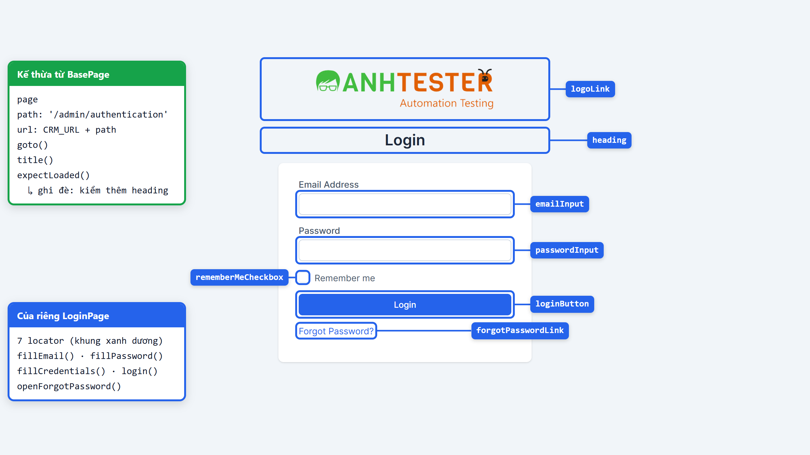
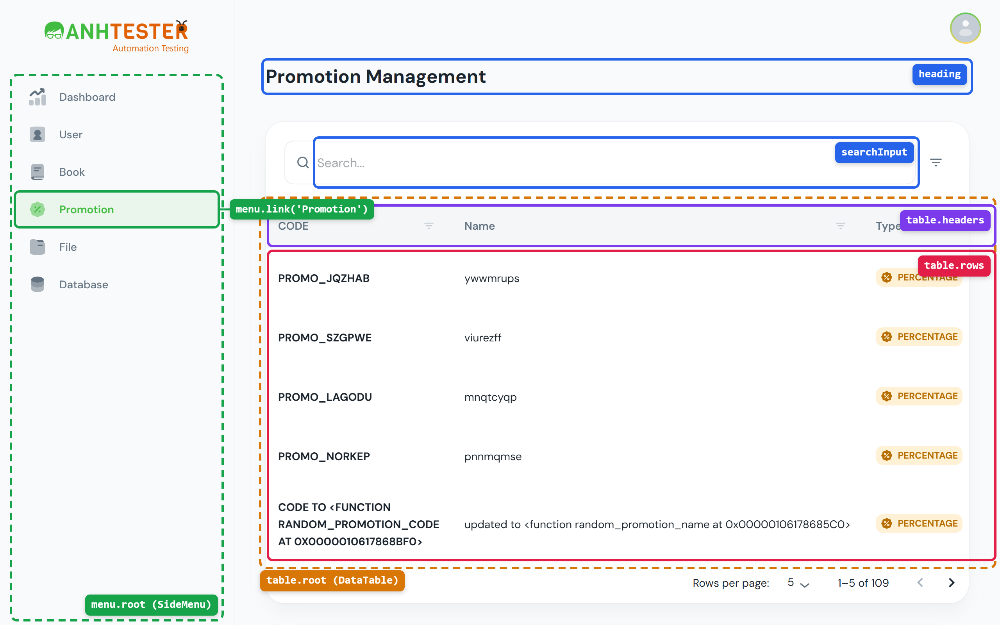
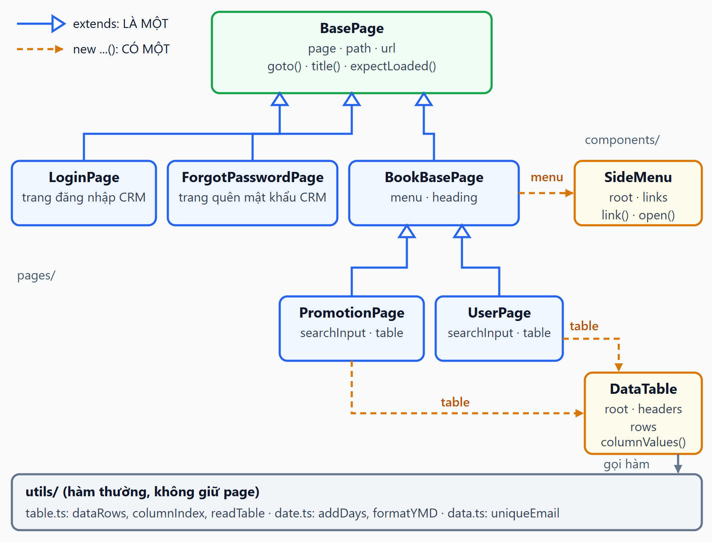
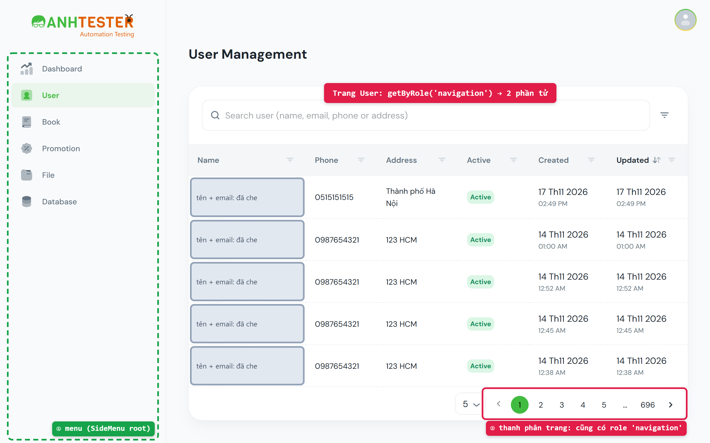
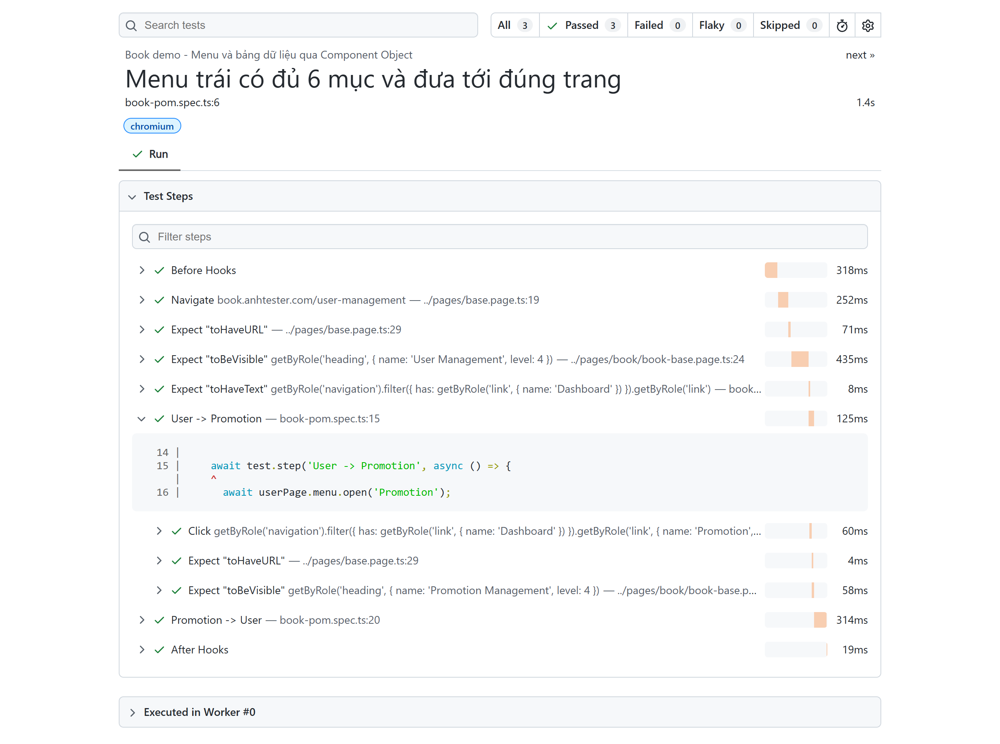
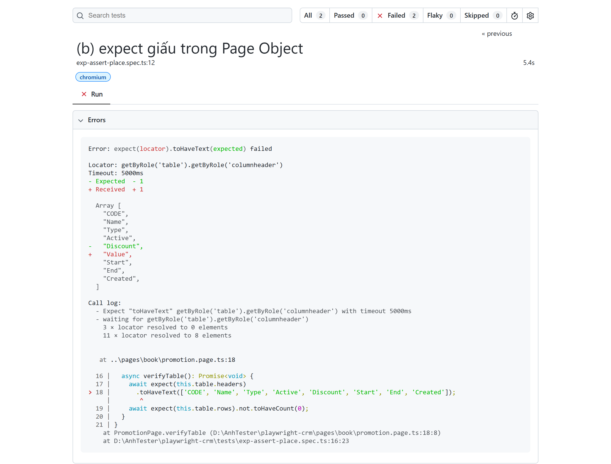

# Bài 24 - [Playwright Typescript] BasePage, hàm dùng chung (utils) và Component Object

Chương: 4. Cấu trúc code Page Object Model + Fixture

Nguồn: [https://anhtester.com/learn/website-and-api-testing-automation-with-playwright-javascript-typescript-day-code-js-ts-tu-dau/381](https://anhtester.com/learn/website-and-api-testing-automation-with-playwright-javascript-typescript-day-code-js-ts-tu-dau/381)

✅ BasePage - gom phần chung của mọi trang  
✅ utils - hàm dùng chung không cần page  
✅ Component Object cho phần giao diện lặp lại: menu, bảng  
✅ Đặt Assertion ở đâu: trong test hay trong Page Object  
✅ Dùng Claude Code và bộ kit claude-testing-skills để tái cấu trúc code  
✅ Kiểm tra code do AI sinh ra

## ⭐ Mục tiêu bài học

Ở bài trước bạn đã gom locator của trang đăng nhập CRM vào `pages/login.page.ts` (class `LoginPage`), của trang Quên mật khẩu vào `pages/forgot-password.page.ts` (class `ForgotPasswordPage`), và viết lại bộ test thành `tests/crm-login-pom.spec.ts`. Locator gán trong constructor, Page class không chứa `expect`.

Mới hai trang đã thấy sự lặp lại mới: hai class giống nhau ở vài dòng đầu và ở hàm `goto()`. Học xong bài này bạn sẽ:

- Viết được `BasePage` và cho các Page class kế thừa nó, biết thứ gì **không** được đưa vào BasePage.
- Phân biệt hàm nên nằm trong BasePage với hàm nên nằm trong thư mục `utils`.
- Tách menu và bảng dữ liệu thành **Component Object**, dùng lại ở nhiều trang.
- Quyết định được `expect` đặt ở đâu, và duyệt được code tái cấu trúc do AI sinh ra.

> 📌 Bài dùng hai hệ thống demo của Anh Tester: trang đăng nhập CRM `https://crm.anhtester.com/admin/authentication` (vẫn **chưa đăng nhập**) và trang quản lý sách `https://book.anhtester.com`, xem được không cần tài khoản. Trang Book là demo dùng chung: bài chỉ **đọc**, không bấm Save, Create, Delete hay Update.

## ✅ Phần 1: BasePage - gom phần chung của mọi trang

### 🔆 1. Hai Page class đang lặp những gì?

Đặt hai file của bài trước cạnh nhau và chỉ giữ lại các dòng giống nhau:

```typescript
// pages/login.page.ts
export class LoginPage {
  readonly page: Page;
  readonly url = 'https://crm.anhtester.com/admin/authentication';
  readonly logoLink: Locator;
  // ...
  async goto(): Promise<void> {
    await this.page.goto(this.url);
  }
}

// pages/forgot-password.page.ts
export class ForgotPasswordPage {
  readonly page: Page;
  readonly url = 'https://crm.anhtester.com/admin/authentication/forgot_password';
  readonly logoLink: Locator;
  // ...
  async goto(): Promise<void> {
    await this.page.goto(this.url);
  }
}
```

Thuộc tính `page`, thuộc tính `url` và hàm `goto()` có ở cả hai class, chỉ khác đúng một chuỗi địa chỉ. Muốn đổi cách mở trang, bạn phải sửa ở mọi class.

### 🔆 2. BasePage là gì?

Mẫu đơn của một công ty thường in sẵn phần đầu: tên công ty, ngày, người lập. Đơn xin nghỉ phép hay đơn đề nghị thanh toán chỉ khác nhau ở phần thân.

Trong lập trình, phần in sẵn đó là **class cha**. Ở bài Class, constructor và kế thừa (extends) trong JavaScript bạn đã viết `class BasePage` nhận `(page, path)` và cho `LoginPage extends BasePage`: class con có sẵn mọi thứ của class cha, và phải gọi `super(...)` trước.

Trong automation, **BasePage** là class cha của mọi Page Object, chứa những thứ **trang nào cũng có**. Đưa nhầm thứ vào thì BasePage phình thành một class khổng lồ mà trang nào cũng phải mang theo:

<table class="rt-table">
<thead>
<tr>
<th>Thứ đang cân nhắc</th>
<th>Vào BasePage?</th>
<th>Lý do</th>
</tr>
</thead>
<tbody>
<tr>
<td><code>page</code>, <code>path</code>, <code>url</code>, <code>goto()</code>, <code>title()</code></td>
<td>✅ Có</td>
<td>Trang nào cũng có địa chỉ và tiêu đề</td>
</tr>
<tr>
<td>Chốt "đã ở đúng trang" <code>expectLoaded()</code></td>
<td>✅ Có</td>
<td>Test nào cũng cần. Phần 4 giải thích</td>
</tr>
<tr>
<td><code>emailInput</code>, <code>loginButton</code></td>
<td>❌ Không</td>
<td>Chỉ trang đăng nhập có</td>
</tr>
<tr>
<td><code>logoLink</code> của CRM</td>
<td>❌ Không</td>
<td>Hai trang CRM có, trang Book không có. Mới lặp hai lần thì để nguyên ở hai class; nhiều hơn thì tạo lớp cha riêng cho nhóm, như <code>BookBasePage</code> ở Phần 3</td>
</tr>
<tr>
<td>Luồng nghiệp vụ: <code>login()</code>, <code>createCustomer()</code></td>
<td>❌ Không</td>
<td>Thuộc về trang có form đó</td>
</tr>
<tr>
<td>Hàm bọc lại <code>click()</code>, <code>fill()</code> kiểu <code>clickWhenReady()</code></td>
<td>❌ Không</td>
<td>Playwright đã tự chờ trong mọi thao tác</td>
</tr>
<tr>
<td>Dữ liệu test, kết quả mong đợi của một Test Case</td>
<td>❌ Không</td>
<td>Nằm ở test</td>
</tr>
</tbody>
</table>

### 🔆 3. File pages/base.page.ts

Tạo file `pages/base.page.ts` trong project `D:\AnhTester\playwright-crm`:

```typescript
import { expect, type Page } from '@playwright/test';

/** Địa chỉ gốc của CRM demo. Chương cấu hình sẽ chuyển giá trị này vào playwright.config.ts */
export const CRM_URL = 'https://crm.anhtester.com';

export class BasePage {
  readonly page: Page;
  readonly path: string;
  readonly url: string;

  constructor(page: Page, path: string, baseUrl: string = CRM_URL) {
    this.page = page;
    this.path = path;
    this.url = baseUrl + path;
  }

  /** Mở thẳng trang này bằng URL */
  async goto(): Promise<void> {
    await this.page.goto(this.url);
  }

  /** Tiêu đề trên thẻ trình duyệt */
  async title(): Promise<string> {
    return this.page.title();
  }

  /** Chốt "đã ở đúng trang". Class con ghi đè để kiểm thêm phần tử đặc trưng của mình */
  async expectLoaded(): Promise<void> {
    await expect(this.page).toHaveURL(this.url);
  }
}
```

- **`path`** là phần riêng của từng trang (`/admin/authentication`). Địa chỉ gốc chỉ viết một lần ở hằng `CRM_URL`. Chương cấu hình sẽ chuyển nó vào `baseURL` của `playwright.config.ts`.
- **`baseUrl`** mặc định là CRM. Nhóm trang Book ở Phần 3 truyền địa chỉ gốc của nó vào đây.
- **`expectLoaded()`** là hàm duy nhất có `expect`, kiểm bằng Web-First Assertion `toHaveURL` nên tự chờ, không cần `waitForTimeout`.

### 🔆 4. Cho LoginPage và ForgotPasswordPage kế thừa BasePage

Sửa `pages/login.page.ts`. Ba chỗ thay đổi: thêm `extends BasePage`, bỏ `page` + `url` + `goto()`, thay `this.page = page` bằng `super(...)`:

```typescript
// TRƯỚC: pages/login.page.ts của bài trước (trích)
import { type Page, type Locator } from '@playwright/test';
import { ForgotPasswordPage } from './forgot-password.page';

export class LoginPage {
  readonly page: Page;
  readonly url = 'https://crm.anhtester.com/admin/authentication';
  readonly logoLink: Locator;
  // ... 6 locator còn lại

  constructor(page: Page) {
    this.page = page;
    this.logoLink = page.getByRole('link', { name: 'Perfex CRM | Anh Tester Demo' });
    // ...
  }

  async goto(): Promise<void> {
    await this.page.goto(this.url);
  }
  // ... fillEmail(), fillPassword(), fillCredentials(), login(), openForgotPassword()
}
```

```typescript
// SAU: pages/login.page.ts (trích, phần không nhắc tới giữ nguyên)
import { expect, type Page, type Locator } from '@playwright/test';
import { BasePage } from './base.page';
import { ForgotPasswordPage } from './forgot-password.page';

export class LoginPage extends BasePage {
  // page, path, url, goto(), title() đã có sẵn từ BasePage
  readonly logoLink: Locator;
  // ... 6 locator còn lại

  constructor(page: Page) {
    super(page, '/admin/authentication'); // phải gọi trước khi dùng this
    this.logoLink = page.getByRole('link', { name: 'Perfex CRM | Anh Tester Demo' });
    // ...
  }

  /** Đúng URL và đã thấy tiêu đề Login */
  async expectLoaded(): Promise<void> {
    await super.expectLoaded();
    await expect(this.heading).toBeVisible();
  }
  // ... fillEmail(), fillPassword(), fillCredentials(), login(), openForgotPassword()
}
```

`expectLoaded()` ở class con **ghi đè** hàm cùng tên của class cha: `super.expectLoaded()` chạy phần kiểm URL của BasePage, dòng sau kiểm thêm phần tử đặc trưng của riêng trang này. File `pages/forgot-password.page.ts` làm y hệt, đây là toàn bộ file sau khi sửa:

```typescript
import { expect, type Page, type Locator } from '@playwright/test';
import { BasePage } from './base.page';

export class ForgotPasswordPage extends BasePage {
  readonly logoLink: Locator;
  readonly heading: Locator;
  readonly emailInput: Locator;
  readonly confirmButton: Locator;
  readonly allTextboxes: Locator;
  readonly allLinks: Locator;

  constructor(page: Page) {
    super(page, '/admin/authentication/forgot_password');
    this.logoLink = page.getByRole('link', { name: 'Perfex CRM | Anh Tester Demo' });
    this.heading = page.getByRole('heading', { name: 'Forgot Password' });
    this.emailInput = page.getByLabel('Email Address');
    this.confirmButton = page.getByRole('button', { name: 'Confirm' });
    this.allTextboxes = page.getByRole('textbox');
    this.allLinks = page.getByRole('link');
  }

  /** Đúng URL và đã thấy tiêu đề Forgot Password */
  async expectLoaded(): Promise<void> {
    await super.expectLoaded();
    await expect(this.heading).toBeVisible();
  }

  /** Điền ô Email, KHÔNG bấm Confirm */
  async fillEmail(email: string): Promise<void> {
    await this.emailInput.fill(email);
  }
}
```

[](https://anhtester.com/storage/photos/shares/lesson/js_ts_playwright/v2/bai_24_basepage_utils_component/02_trang_login_crm_loginpage_ke_thua_basepage.png)

*LoginPage sau khi kế thừa BasePage: phần lấy từ class cha và phần của riêng trang đăng nhập CRM*

Tên thuộc tính và tên hàm không đổi, nên file test của bài trước **không phải sửa dòng nào**. Chạy lại để chứng minh:

```bash
npx playwright test crm-login-pom.spec.ts --project=chromium --reporter=dot
```

```plaintext
Running 13 tests using 6 workers
·············
  13 passed (7.2s)
```

Kết quả chạy thật (Playwright 1.65.1, ngày 18/11/2026): vẫn **13 passed**. Tái cấu trúc đúng cách là vậy: sửa code, test vẫn xanh mà không ai đụng vào test.

> ⚠️ **`super()` phải đứng trước mọi dòng dùng `this`.** Đảo thứ tự là test dừng ngay lúc `new`, chưa kịp mở trang.

```typescript
class BadLoginPage extends BasePage {
  readonly heading: Locator;
  constructor(page: Page) {
    this.heading = page.getByRole('heading', { name: 'Login' });
    super(page, '/admin/authentication');
  }
}
```

```plaintext
ReferenceError: Must call super constructor in derived class before accessing 'this' or returning from derived constructor

   5 |   readonly heading: Locator;
   6 |   constructor(page: Page) {
>  7 |     this.heading = page.getByRole('heading', { name: 'Login' });
     |     ^
   8 |     super(page, '/admin/authentication');
   9 |   }
```

## ✅ Phần 2: utils - hàm dùng chung không cần page

### 🔆 1. utils khác BasePage ở đâu?

Máy tính bỏ túi không thuộc về phòng ban nào: ai cần thì cầm lên bấm. Hàm trong thư mục `utils` cũng vậy: nhận đầu vào, trả kết quả, **không giữ `page`**, không nhớ gì giữa hai lần gọi. Bạn đã có hai file như thế từ bài xử lý Table và Date Picker: `utils/table.ts` và `utils/date.ts`.

<table class="rt-table">
<thead>
<tr>
<th>Tiêu chí</th>
<th>BasePage</th>
<th>utils</th>
</tr>
</thead>
<tbody>
<tr>
<td>Giữ <code>page</code>?</td>
<td>Có, <code>this.page</code> sống suốt test</td>
<td>Không. Cần gì thì nhận qua tham số</td>
</tr>
<tr>
<td>Ai gọi</td>
<td>Page class con</td>
<td>Test, Page class, Component đều gọi được</td>
</tr>
<tr>
<td>Ví dụ</td>
<td><code>goto()</code>, <code>title()</code>, <code>expectLoaded()</code></td>
<td><code>uniqueEmail()</code>, <code>formatYMD(date)</code>, <code>columnIndex(table, header)</code></td>
</tr>
<tr>
<td>Câu hỏi để chọn</td>
<td>Hàm này có cần biết đang ở trang nào không? Có thì ở đây</td>
<td>Chép hàm sang project khác có chạy được ngay không? Có thì ở đây</td>
</tr>
</tbody>
</table>

### 🔆 2. Thêm utils/data.ts

Email viết cứng `tester@example.com` dùng tạm được khi chưa gửi form. Đến lúc tạo dữ liệu thật, hai test cùng tạo một email là đụng nhau. Tạo file `utils/data.ts`:

```typescript
/** Email không trùng giữa các lần chạy, ví dụ tester+1763456789012@example.com */
export function uniqueEmail(prefix: string = 'tester'): string {
  return `${prefix}+${Date.now()}@example.com`;
}

/** Chuỗi dài đúng `length` ký tự, dùng cho test giá trị biên */
export function textOfLength(length: number, char: string = 'a'): string {
  return char.repeat(length);
}
```

Thử trong một file tạm `tests/exp-utils.spec.ts`. Test dùng cả `ForgotPasswordPage` đã kế thừa BasePage:

```typescript
import { test, expect } from '@playwright/test';
import { ForgotPasswordPage } from '../pages/forgot-password.page';
import { uniqueEmail, textOfLength } from '../utils/data';
import { addDays, formatYMD } from '../utils/date';

test('Hàm trong utils gọi được từ test, không cần page', async ({ page }) => {
  const email = uniqueEmail('tester');
  console.log('uniqueEmail():', email);
  console.log('textOfLength(5):', textOfLength(5));
  console.log('7 ngày nữa:', formatYMD(addDays(new Date(), 7)));

  const forgotPage = new ForgotPasswordPage(page);
  await forgotPage.goto();
  await forgotPage.expectLoaded();
  await forgotPage.fillEmail(email); // chỉ điền, KHÔNG bấm Confirm
  await expect(forgotPage.emailInput).toHaveValue(email);
});
```

```bash
npx playwright test exp-utils.spec.ts --project=chromium --reporter=list
```

```plaintext
Running 1 test using 1 worker

uniqueEmail(): tester+1794982757349@example.com
textOfLength(5): aaaaa
7 ngày nữa: 2026-11-25
  ✓  1 [chromium] › tests\exp-utils.spec.ts:6:1 › Hàm trong utils gọi được từ test, không cần page (728ms)

  1 passed (1.4s)
```

> 📌 `Date.now()` đổi theo từng mili giây nên đủ dùng cho bài này. Dữ liệu giống người thật hơn (họ tên, số điện thoại) là việc của thư viện Faker, học ở bài tạo dữ liệu test.

## ✅ Phần 3: Component Object cho phần giao diện lặp lại: menu, bảng

### 🔆 1. Component Object là gì?

Phòng nào trong nhà cũng có ổ cắm điện cùng một loại. Không ai nói "phòng khách *là* một ổ cắm". Phòng khách **có** ổ cắm.

Trang web cũng có những phần lặp lại như thế: menu, bảng dữ liệu, hộp thoại xác nhận. **Component Object** là một class mô tả **một phần** của trang. Nó không nhận cả `page` mà nhận một **root**: locator của vùng chứa nó. Mọi phần tử con đều tìm **bên trong root**.

Mở <https://book.anhtester.com/promotion-book-management>. Menu trái có ở mọi trang, còn kiểu bảng này xuất hiện ở cả trang User và trang Promotion:

[](https://anhtester.com/storage/photos/shares/lesson/js_ts_playwright/v2/bai_24_basepage_utils_component/03_trang_promotion_book_menu_va_bang_la_component.png)

*Trang Promotion của Book demo: khung nét đứt là root của hai component, khung liền là phần tử con*

HTML thật của hai vùng đó (đã lược các thẻ `span`, `svg` và thuộc tính phụ):

```markup
<!-- Menu trái: có ở mọi trang -->
<nav class="MuiBox-root css-exwgyy">
  <ul class="MuiBox-root css-5a3gqx">
    <li class="MuiListItem-root css-1ohqk82"><a class="MuiButtonBase-root MuiListItemButton-root css-12hoen1" href="/">Dashboard</a></li>
    <li class="MuiListItem-root css-1ohqk82"><a class="MuiButtonBase-root MuiListItemButton-root css-12hoen1" href="/user-management">User</a></li>
    <li class="MuiListItem-root css-1ohqk82"><a class="MuiButtonBase-root MuiListItemButton-root css-12hoen1" href="/book-management">Book</a></li>
    <li class="MuiListItem-root css-1ohqk82"><a class="MuiButtonBase-root MuiListItemButton-root css-1blpju5" href="/promotion-book-management">Promotion</a></li>
    <li class="MuiListItem-root css-1ohqk82"><a class="MuiButtonBase-root MuiListItemButton-root css-12hoen1" href="/file-management">File</a></li>
    <li class="MuiListItem-root css-1ohqk82"><a class="MuiButtonBase-root MuiListItemButton-root css-12hoen1" href="/db-management">Database</a></li>
  </ul>
</nav>

<!-- Bảng dữ liệu: trang User và trang Promotion dùng cùng một kiểu bảng -->
<table class="MuiTable-root css-ww4ton">
  <thead class="MuiTableHead-root css-s4zxv0">
    <tr class="MuiTableRow-root MuiTableRow-head css-1wgfnd6">
      <th class="MuiTableCell-root MuiTableCell-head css-1j7o3x1" scope="col"><span role="button">CODE</span></th>
      <th class="MuiTableCell-root MuiTableCell-head css-1j7o3x1" scope="col"><span role="button">Name</span></th>
      ...
    </tr>
  </thead>
  <tbody>...</tbody>
</table>
```

Class kiểu `css-exwgyy` do thư viện giao diện tự sinh, đổi sau mỗi lần build. Component dưới đây vì thế chỉ dùng role.

### 🔆 2. Hai file trong thư mục components

Tạo thư mục `components` ở gốc project và file `components/side-menu.component.ts`:

```typescript
import { type Locator } from '@playwright/test';

/** Menu điều hướng bên trái của Book demo. Có mặt ở mọi trang */
export class SideMenu {
  readonly root: Locator;
  readonly links: Locator;

  constructor(root: Locator) {
    this.root = root;
    this.links = root.getByRole('link'); // tìm BÊN TRONG root, không tìm từ page
  }

  /** Một mục menu theo đúng chữ hiển thị */
  link(name: string): Locator {
    return this.root.getByRole('link', { name, exact: true });
  }

  async open(name: string): Promise<void> {
    await this.link(name).click();
  }
}
```

File `components/data-table.component.ts` không viết lại logic đọc bảng mà gọi các hàm đã có trong `utils/table.ts`:

```typescript
import { type Locator } from '@playwright/test';
import { columnIndex, dataRows, readTable } from '../utils/table';

/** Một bảng dữ liệu bất kỳ. Trang nào có bảng thì đưa root của bảng đó vào */
export class DataTable {
  readonly root: Locator;
  readonly headers: Locator;
  readonly rows: Locator;

  constructor(root: Locator) {
    this.root = root;
    this.headers = root.getByRole('columnheader');
    this.rows = dataRows(root); // hàm của utils/table.ts
  }

  /** Chữ của mọi ô trong một cột, tìm cột theo tiêu đề */
  async columnValues(header: string): Promise<string[]> {
    const index = await columnIndex(this.root, header);
    const values: string[] = [];
    for (const row of await this.rows.all()) {
      values.push((await row.getByRole('cell').nth(index).innerText()).trim());
    }
    return values;
  }

  /** Cả bảng thành mảng object, tên thuộc tính là tiêu đề cột */
  async read(): Promise<Record<string, string>[]> {
    return readTable(this.root);
  }
}
```

### 🔆 3. Trang chứa component: kết hợp, không kế thừa

Menu có ở mọi trang Book nhưng không có ở trang đăng nhập CRM, nên nó không vào `BasePage`. Nó vào lớp cha riêng của nhóm trang Book. Tạo `pages/book/book-base.page.ts`:

```typescript
import { expect, type Page, type Locator } from '@playwright/test';
import { BasePage } from '../base.page';
import { SideMenu } from '../../components/side-menu.component';

export const BOOK_URL = 'https://book.anhtester.com';

/** Lớp cha của các trang Book demo: thêm những thứ trang Book nào cũng có */
export class BookBasePage extends BasePage {
  readonly menu: SideMenu;
  readonly heading: Locator;

  constructor(page: Page, path: string, headingName: string) {
    super(page, path, BOOK_URL);
    // Trang User có 2 vùng navigation (menu và phân trang) nên phải lọc ra đúng menu
    this.menu = new SideMenu(
      page.getByRole('navigation').filter({ has: page.getByRole('link', { name: 'Dashboard' }) }),
    );
    this.heading = page.getByRole('heading', { name: headingName, level: 4 });
  }

  /** Đúng URL và đã thấy tiêu đề của trang */
  async expectLoaded(): Promise<void> {
    await super.expectLoaded();
    await expect(this.heading).toBeVisible();
  }
}
```

Hai trang có bảng thì tự tạo thêm `DataTable`. File `pages/book/promotion.page.ts`:

```typescript
import { type Page, type Locator } from '@playwright/test';
import { BookBasePage } from './book-base.page';
import { DataTable } from '../../components/data-table.component';

export class PromotionPage extends BookBasePage {
  readonly searchInput: Locator;
  readonly table: DataTable;

  constructor(page: Page) {
    super(page, '/promotion-book-management', 'Promotion Management');
    this.searchInput = page.getByPlaceholder('Search...');
    this.table = new DataTable(page.getByRole('table'));
  }
}
```

File `pages/book/user.page.ts` chỉ khác đường dẫn, tiêu đề và placeholder của ô tìm kiếm:

```typescript
import { type Page, type Locator } from '@playwright/test';
import { BookBasePage } from './book-base.page';
import { DataTable } from '../../components/data-table.component';

export class UserPage extends BookBasePage {
  readonly searchInput: Locator;
  readonly table: DataTable;

  constructor(page: Page) {
    super(page, '/user-management', 'User Management');
    this.searchInput = page.getByPlaceholder('Search user (name, email, phone or address)');
    this.table = new DataTable(page.getByRole('table'));
  }
}
```

Có hai quan hệ khác nhau trong mấy file trên:

- **Kế thừa (`extends`)**: `PromotionPage` *là một* trang Book, trang Book *là một* trang.
- **Kết hợp (`new` trong constructor)**: `PromotionPage` *có một* menu và *có một* bảng. Test gọi qua thuộc tính: `promotionPage.menu.open('User')`, `promotionPage.table.rows`.

[](https://anhtester.com/storage/photos/shares/lesson/js_ts_playwright/v2/bai_24_basepage_utils_component/01_so_do_basepage_ke_thua_va_component.png)

*Sơ đồ các class sau bài này: mũi tên liền là kế thừa, mũi tên đứt là trang chứa component*

> ⚠️ **Không viết `class DataTable extends BasePage`.** Cái bảng không có URL, không `goto()` được. Và một class chỉ `extends` được một class cha, nên trang vừa có menu vừa có bảng sẽ không biết kế thừa cái nào.

**Vì sao root của menu phải lọc?** Trên trang User, thanh phân trang cũng mang role `navigation`. Lấy root bằng `page.getByRole('navigation')` rồi thao tác trên nó:

```typescript
const menuRoot = page.getByRole('navigation');
await expect(menuRoot).toBeVisible();
```

```plaintext
Error: expect(locator).toBeVisible() failed

Locator: getByRole('navigation')
Expected: visible
Error: strict mode violation: getByRole('navigation') resolved to 2 elements:
    1) <nav class="MuiBox-root css-exwgyy">…</nav> aka getByRole('navigation').filter({ hasText: 'DashboardUserBookPromotionFileDatabase' })
    2) <nav aria-label="pagination navigation" class="MuiPagination-root MuiPagination-text css-l7og2u">…</nav> aka getByRole('navigation', { name: 'pagination navigation' })
```

[](https://anhtester.com/storage/photos/shares/lesson/js_ts_playwright/v2/bai_24_basepage_utils_component/04_trang_user_book_hai_vung_navigation.png)

*Trang User của Book demo có hai vùng navigation: menu trái và thanh phân trang*

Vì vậy `BookBasePage` lọc bằng `filter({ has: ...link 'Dashboard' })` để root chỉ còn đúng menu. Root của component phải kiểm trên **mọi** trang dùng nó.

### 🔆 4. File tests/book-pom.spec.ts

Vì dữ liệu của trang Book đổi liên tục, test chỉ kiểm **cấu trúc**: tên cột, có dòng dữ liệu, định dạng của một cột.

```typescript
import { test, expect } from '@playwright/test';
import { PromotionPage } from '../pages/book/promotion.page';
import { UserPage } from '../pages/book/user.page';

test.describe('Book demo - Menu và bảng dữ liệu qua Component Object', () => {
  test('Menu trái có đủ 6 mục và đưa tới đúng trang', async ({ page }) => {
    const userPage = new UserPage(page);
    const promotionPage = new PromotionPage(page);

    await userPage.goto();
    await userPage.expectLoaded();
    await expect(userPage.menu.links)
      .toHaveText(['Dashboard', 'User', 'Book', 'Promotion', 'File', 'Database']);

    await test.step('User -> Promotion', async () => {
      await userPage.menu.open('Promotion');
      await promotionPage.expectLoaded();
    });

    await test.step('Promotion -> User', async () => {
      await promotionPage.menu.open('User');
      await userPage.expectLoaded();
    });
  });

  test('Bảng Promotion đúng cột, có dữ liệu, cột Start đúng định dạng ngày', async ({ page }) => {
    const promotionPage = new PromotionPage(page);
    await promotionPage.goto();
    await promotionPage.expectLoaded();

    await expect(promotionPage.table.headers)
      .toHaveText(['CODE', 'Name', 'Type', 'Active', 'Value', 'Start', 'End', 'Created']);
    await expect(promotionPage.table.rows).not.toHaveCount(0); // chờ dữ liệu về

    const startDates = await promotionPage.table.columnValues('Start');
    console.log(`Số dòng: ${startDates.length} | Ô Start đầu tiên: ${JSON.stringify(startDates[0])}`);
    for (const value of startDates) {
      expect(value, 'Cột Start phải bắt đầu bằng ngày dạng "24 Th08 2026"').toMatch(/^\d{2} Th\d{2} \d{4}/);
    }
  });

  test('Bảng User dùng lại đúng component của bảng Promotion', async ({ page }) => {
    const userPage = new UserPage(page);
    await userPage.goto();
    await userPage.expectLoaded();

    await expect(userPage.table.headers)
      .toHaveText(['Name', 'Phone', 'Address', 'Active', 'Created', 'Updated']);
    await expect(userPage.table.rows).not.toHaveCount(0);
    expect(await userPage.table.rows.count()).toBeLessThanOrEqual(5); // mặc định 5 dòng mỗi trang
  });
});
```

```bash
npx playwright test book-pom.spec.ts --project=chromium --reporter=list,html
```

```plaintext
Running 3 tests using 3 workers

Số dòng: 5 | Ô Start đầu tiên: "24 Th08 2026\n\n03:40 AM"
  ✓  2 [chromium] › tests\book-pom.spec.ts:26:3 › Book demo - Menu và bảng dữ liệu qua Component Object › Bảng Promotion đúng cột, có dữ liệu, cột Start đúng định dạng ngày (703ms)
  ✓  1 [chromium] › tests\book-pom.spec.ts:42:3 › Book demo - Menu và bảng dữ liệu qua Component Object › Bảng User dùng lại đúng component của bảng Promotion (1.4s)
  ✓  3 [chromium] › tests\book-pom.spec.ts:6:3 › Book demo - Menu và bảng dữ liệu qua Component Object › Menu trái có đủ 6 mục và đưa tới đúng trang (1.8s)

  3 passed (2.5s)
```

Kết quả chạy thật (Playwright 1.65.1, ngày 18/11/2026): **3 passed**. Trong HTML Report, mỗi bước ghi rõ nó đến từ file nào: `goto()` và `toHaveURL` từ `base.page.ts`, kiểm tiêu đề từ `book-base.page.ts`:

[](https://anhtester.com/storage/photos/shares/lesson/js_ts_playwright/v2/bai_24_basepage_utils_component/05_html_report_book_pom.png)

*HTML Report của book-pom.spec.ts: từng bước ghi rõ đến từ base.page.ts hay book-base.page.ts*

### 🔆 5. Component dùng chung hay để trong trang?

<table class="rt-table">
<thead>
<tr>
<th>Phần giao diện</th>
<th>Đặt ở đâu</th>
<th>Ví dụ trong bài</th>
</tr>
</thead>
<tbody>
<tr>
<td>Có ở mọi trang của một nhóm</td>
<td>File trong <code>components/</code>, tạo trong lớp cha của nhóm</td>
<td><code>SideMenu</code> tạo trong <code>BookBasePage</code></td>
</tr>
<tr>
<td>Có ở vài trang</td>
<td>File trong <code>components/</code>, trang nào có thì tự tạo</td>
<td><code>DataTable</code> tạo trong <code>PromotionPage</code>, <code>UserPage</code></td>
</tr>
<tr>
<td>Chỉ có ở một trang</td>
<td>Để locator ngay trong Page class của trang đó</td>
<td>Dãy tab danh mục của trang <code>/book-management</code></td>
</tr>
</tbody>
</table>

## ✅ Phần 4: Đặt Assertion ở đâu: trong test hay trong Page Object

### 🔆 1. Ba cách viết cho cùng một Test Case

Lấy một yêu cầu đơn giản: bảng Promotion phải có đúng 8 cột. Để thấy báo lỗi trông ra sao, hai cách đầu **cố ý ghi sai** tên cột thứ năm thành `Discount` (tên đúng là `Value`).

```typescript
// Cách (a): expect nằm trong test
test('(a) expect nằm trong test', async ({ page }) => {
  const promotionPage = new PromotionPage(page);
  await promotionPage.goto();

  await expect(promotionPage.table.headers)
    .toHaveText(['CODE', 'Name', 'Type', 'Active', 'Discount', 'Start', 'End', 'Created']);
});
```

```typescript
// Cách (b): thêm tạm vào pages/book/promotion.page.ts
async verifyTable(): Promise<void> {
  await expect(this.table.headers)
    .toHaveText(['CODE', 'Name', 'Type', 'Active', 'Discount', 'Start', 'End', 'Created']);
  await expect(this.table.rows).not.toHaveCount(0);
}

// ... và test chỉ còn một dòng
test('(b) expect giấu trong Page Object', async ({ page }) => {
  const promotionPage = new PromotionPage(page);
  await promotionPage.goto();

  await promotionPage.verifyTable();
});
```

```typescript
// Cách (c): kết hợp. Đây chính là cách viết của tests/book-pom.spec.ts
test('Bảng Promotion đúng cột', async ({ page }) => {
  const promotionPage = new PromotionPage(page);
  await promotionPage.goto();
  await promotionPage.expectLoaded(); // chốt "đúng trang": giống nhau ở mọi TC, nằm trong Page Object

  await expect(promotionPage.table.headers) // kết quả mong đợi của TC: nằm trong test
    .toHaveText(['CODE', 'Name', 'Type', 'Active', 'Value', 'Start', 'End', 'Created']);
});
```

### 🔆 2. Chạy thử hai cách sai để đọc báo lỗi

Cách (a), lỗi chỉ thẳng vào dòng của file test, ngay cạnh là giá trị mong đợi:

```plaintext
  1) [chromium] › tests\exp-assert-place.spec.ts:4:1 › (a) expect nằm trong test

    Error: expect(locator).toHaveText(expected) failed
    ...
    -   "Discount",
    +   "Value",
    ...
       7 |
       8 |   await expect(promotionPage.table.headers)
    >  9 |     .toHaveText(['CODE', 'Name', 'Type', 'Active', 'Discount', 'Start', 'End', 'Created']);
         |      ^
      10 | });
        at D:\AnhTester\playwright-crm\tests\exp-assert-place.spec.ts:9:6
```

Cách (b), cùng lỗi đó nhưng đoạn code được trích ra là của **Page Object**. Muốn biết test nào gọi, bạn phải đọc xuống dòng cuối của stack:

```plaintext
  2) [chromium] › tests\exp-assert-place.spec.ts:12:1 › (b) expect giấu trong Page Object

    Error: expect(locator).toHaveText(expected) failed
    ...
    -   "Discount",
    +   "Value",
    ...
       at ..\pages\book\promotion.page.ts:18

      16 |   async verifyTable(): Promise<void> {
      17 |     await expect(this.table.headers)
    > 18 |       .toHaveText(['CODE', 'Name', 'Type', 'Active', 'Discount', 'Start', 'End', 'Created']);
         |        ^
      19 |     await expect(this.table.rows).not.toHaveCount(0);
      20 |   }
        at PromotionPage.verifyTable (D:\AnhTester\playwright-crm\pages\book\promotion.page.ts:18:8)
        at D:\AnhTester\playwright-crm\tests\exp-assert-place.spec.ts:16:23
```

[](https://anhtester.com/storage/photos/shares/lesson/js_ts_playwright/v2/bai_24_basepage_utils_component/06_html_report_expect_giau_trong_page_object.png)

*HTML Report của cách (b): đoạn code báo lỗi nằm trong promotion.page.ts, không nằm trong file test*

Playwright vẫn báo đủ thông tin ở cả hai cách. Cái mất ở cách (b) nằm ở chỗ khác: mở file test ra, bạn chỉ thấy `verifyTable()` mà không biết Test Case này mong đợi điều gì. Và khi Test Case khác cần kiểm khác đi một chút, bạn lại viết thêm `verifyTableWith...()`, Page Object cứ thế dài ra.

### 🔆 3. So sánh và cách Anh Tester chọn

<table class="rt-table">
<thead>
<tr>
<th>Tiêu chí</th>
<th>(a) Trong test</th>
<th>(b) Trong Page Object</th>
<th>(c) Kết hợp</th>
</tr>
</thead>
<tbody>
<tr>
<td>Đọc test có thấy kết quả mong đợi?</td>
<td>Có</td>
<td>Không, phải mở Page Object</td>
<td>Có</td>
</tr>
<tr>
<td>Lỗi chỉ vào đâu?</td>
<td>Dòng của file test</td>
<td>Dòng của Page Object</td>
<td>Dòng của file test, trừ chốt đúng trang</td>
</tr>
<tr>
<td>Kiểm lặp ở mọi test</td>
<td>Chép lại 2 dòng URL + tiêu đề</td>
<td>Gọi một hàm</td>
<td>Gọi <code>expectLoaded()</code></td>
</tr>
</tbody>
</table>

Anh Tester dùng **cách (c)** cho cả khoá học, với hai quy định:

- Page Object và Component **để lộ locator** (`readonly`) cho test tự `expect`.
- Trong Page Object chỉ có **một** hàm chứa `expect` là `expectLoaded()`: đúng URL và thấy một phần tử đặc trưng. Điều này giống nhau ở mọi Test Case.

> ⚠️ Cũng đừng nối chuỗi trang kiểu `loginPage.login().openCustomers().openDetail()`. **Test** là nơi điều phối đi từ trang nào sang trang nào; chuỗi dài thì một trang đổi luồng là mọi test đi qua nó cùng gãy.

### 🔆 4. Project sau bài này

```plaintext
playwright-crm/
├── components/
│   ├── side-menu.component.ts     ← class SideMenu (menu trái của Book demo)
│   └── data-table.component.ts    ← class DataTable (bảng dữ liệu bất kỳ)
├── pages/
│   ├── base.page.ts               ← class BasePage: page, path, url, goto(), title(), expectLoaded()
│   ├── login.page.ts              ← LoginPage extends BasePage
│   ├── forgot-password.page.ts    ← ForgotPasswordPage extends BasePage
│   └── book/
│       ├── book-base.page.ts      ← BookBasePage extends BasePage, có menu + heading
│       ├── promotion.page.ts      ← PromotionPage extends BookBasePage, có table
│       └── user.page.ts           ← UserPage extends BookBasePage, có table
├── tests/
│   ├── crm-login.spec.ts          ← bộ test chưa dùng POM, giữ để so sánh
│   ├── crm-login-pom.spec.ts      ← không sửa dòng nào trong bài này
│   └── book-pom.spec.ts           ← test qua Component Object
├── utils/
│   ├── table.ts
│   ├── date.ts
│   └── data.ts                    ← uniqueEmail(), textOfLength()
└── playwright.config.ts
```

Xem xong thì xoá các file tạm `tests/exp-*.spec.ts` và hàm `verifyTable()` thử nghiệm.

## ✅ Phần 5: Dùng Claude Code và bộ kit claude-testing-skills để tái cấu trúc code

### 🔆 1. Bổ sung file quy tắc POM của dự án

Bộ kit [claude-testing-skills](https://github.com/anhtester/claude-testing-skills) bắt buộc dùng POM và quy định "Assertions chỉ đặt trong Test classes" (file [automation\_rules.md](https://github.com/anhtester/claude-testing-skills/blob/main/.claude/rules/automation_rules.md)). Mẫu `BasePage` hay gặp trên mạng và trong code AI sinh ra thường kèm vài hàm bọc `click()`, `fill()`. Quy ước của project này khác vài điểm, nên phải ghi ra để AI làm theo.

Mở file quy tắc POM của dự án `.claude/rules/project_pom_rules.md` đã tạo ở bài trước. **Sửa** dòng `` - KHÔNG `expect`. Assertion nằm trong file test. `` thành `` - KHÔNG `expect`, trừ hàm `expectLoaded()` (xem mục Assertion). `` rồi thêm vào cuối file:

```markdown
## BasePage và kế thừa
- Mọi Page class `extends BasePage` (`pages/base.page.ts`). Dòng ĐẦU TIÊN của constructor
  là `super(page, '/duong-dan')`. Không khai báo lại `page`, `url`, `goto()` ở class con.
- BasePage chỉ chứa thứ MỌI trang đều có: `page`, `path`, `url`, `goto()`, `title()`, `expectLoaded()`.
  KHÔNG thêm locator, luồng nghiệp vụ của riêng một trang. KHÔNG bọc lại `click()`, `fill()`.
- Nhóm trang chung bố cục thì có lớp cha riêng của nhóm (ví dụ `BookBasePage`), kế thừa BasePage.

## utils
- Hàm không cần `page` (tạo dữ liệu, tính ngày, đọc bảng từ một Locator) đặt ở `utils/`,
  viết dạng `export function`, không giữ trạng thái, không dùng biến toàn cục.

## Component Object
- Phần giao diện lặp lại ở nhiều trang là một class trong `components/`, tên file `ten.component.ts`.
- Constructor nhận MỘT `root: Locator`. Mọi phần tử con tìm từ `root`, KHÔNG tìm từ `page`.
- Component KHÔNG `extends` BasePage hay Page class nào. Trang dùng component qua thuộc tính:
  `this.table = new DataTable(page.getByRole('table'));`

## Assertion (thay cho dòng "KHÔNG expect" ở trên và cho quy định của automation_rules.md)
- Page class chỉ được có `expect` trong hàm `expectLoaded()`: đúng URL và một phần tử đặc trưng.
- Kết quả mong đợi của Test Case luôn viết trong file test. KHÔNG tạo hàm `verify...()` trong Page class.
- Trang demo dùng chung dữ liệu: KHÔNG ghi cứng nội dung dòng của bảng vào code.
```

> ⚠️ Phải **sửa dòng cũ** chứ không chỉ viết thêm. Theo [tài liệu Claude Code](https://code.claude.com/docs/en/memory), hai chỉ dẫn mâu thuẫn nhau thì Claude có thể chọn một trong hai một cách tuỳ ý.

### 🔆 2. Prompt dùng được ở Claude, ChatGPT và Gemini

Claude Code là bản có phí Anh Tester dùng trong khoá. Với bản miễn phí của [ChatGPT](https://chatgpt.com/) hoặc [Gemini](https://gemini.google.com/), bạn dán code và HTML thật vào prompt.

**Tách BasePage từ hai class có sẵn:**

```markdown
Đây là hai Page class Playwright TypeScript của project:

[dán nội dung pages/login.page.ts]
[dán nội dung pages/forgot-password.page.ts]

Hãy tách phần lặp lại thành class BasePage trong pages/base.page.ts.
Ràng buộc:
- Chữ ký: constructor(page: Page, path: string, baseUrl: string = CRM_URL). BasePage có page, path, url, goto(), title(), expectLoaded().
- BasePage KHÔNG chứa locator của riêng trang nào, KHÔNG bọc lại click()/fill(), KHÔNG waitForTimeout.
- Hai class con gọi super(page, '/duong-dan') ở dòng đầu constructor. Locator vẫn gán trong constructor.
- KHÔNG đổi tên thuộc tính hay tên hàm đang có: file tests/crm-login-pom.spec.ts phải chạy lại mà không sửa dòng nào.
Trước khi đưa code, hãy liệt kê: dòng nào chuyển lên BasePage, dòng nào ở lại class con và vì sao.
```

**Tạo component từ HTML thật:**

```markdown
HTML thật của menu trái và bảng dữ liệu trên https://book.anhtester.com/promotion-book-management:

[dán khối HTML ở Phần 3]

Trang /user-management cũng có đúng menu này và một bảng cùng kiểu. Trang đó còn có thanh phân trang cũng mang role navigation.
Hãy viết 2 Component Object bằng Playwright TypeScript:
- components/side-menu.component.ts: class SideMenu, có link(name) và open(name).
- components/data-table.component.ts: class DataTable, có headers, rows, columnValues(header).
Ràng buộc:
- Constructor nhận một root: Locator, mọi phần tử con tìm từ root, không tìm từ page.
- Component không extends class nào. Không có expect bên trong.
- Locator chỉ dùng getByRole, getByText; bí quá mới dùng XPath. Không dùng CSS Selector, không dùng class dạng css-xxxx.
- Chỉ ra dòng tạo root của SideMenu để nó không khớp nhầm thanh phân trang.
- Đây là trang demo dùng chung: không ghi cứng nội dung dòng nào của bảng, không bấm Save, Create, Delete, Update.
```

**Tái cấu trúc mà vẫn giữ test xanh** (dành cho Claude Code, vì nó tự chạy được lệnh):

```markdown
Tái cấu trúc project theo .claude/rules/project_pom_rules.md: cho pages/login.page.ts và pages/forgot-password.page.ts kế thừa BasePage.

Quy trình bắt buộc:
1. Chạy `npx playwright test crm-login-pom.spec.ts --project=chromium` TRƯỚC khi sửa, ghi lại số test đạt.
2. Chỉ sửa file trong pages/. KHÔNG sửa file trong tests/, không đổi giá trị mong đợi, không thêm skip.
3. Chạy lại đúng lệnh ở bước 1. Số test đạt phải bằng lúc đầu.
4. Báo cáo: danh sách file đã sửa, kết quả chạy trước và sau.
Nếu có test đỏ sau khi sửa: dừng lại và nêu nguyên nhân, không tự sửa test cho xanh.
```

### 🔆 3. Hai lệnh của bộ kit dùng sau khi tái cấu trúc

```markdown
/run-and-fix-tests RUN tests/crm-login-pom.spec.ts
/review-automation-code REVIEW pages
```

<table class="rt-table">
<thead>
<tr>
<th>Command</th>
<th>Vai trò</th>
</tr>
</thead>
<tbody>
<tr>
<td><a href="https://github.com/anhtester/claude-testing-skills/blob/main/.claude/commands/run-and-fix-tests.md">/run-and-fix-tests</a></td>
<td>Mode <code>RUN</code> chạy bộ test và phân loại lỗi theo nguyên nhân. Mode <code>FIX</code> sửa nhóm lỗi sửa được rồi chạy lại, không được đổi giá trị mong đợi cho test xanh</td>
</tr>
<tr>
<td><a href="https://github.com/anhtester/claude-testing-skills/blob/main/.claude/commands/review-automation-code.md">/review-automation-code</a></td>
<td>Mode <code>REVIEW</code> chấm code theo 6 nhóm, trong đó có "POM &amp; cấu trúc", mỗi vi phạm kèm tên file và số dòng. Mode <code>FIX</code> sửa sau khi bạn duyệt danh sách</td>
</tr>
</tbody>
</table>

Chạy `RUN` và `REVIEW` trước, đọc báo cáo rồi mới dùng `FIX`. Cách gõ lệnh: [code.claude.com/docs/en/slash-commands](https://code.claude.com/docs/en/slash-commands).

## ✅ Phần 6: Kiểm tra code do AI sinh ra

Khi nhờ AI viết BasePage và component, rà theo bảng này:

<table class="rt-table">
<thead>
<tr>
<th>Dấu hiệu trong code</th>
<th>Vì sao là vấn đề</th>
<th>Cách xử lý</th>
</tr>
</thead>
<tbody>
<tr>
<td>BasePage có <code>emailInput</code>, <code>login()</code>, <code>createCustomer()</code></td>
<td>Thứ của riêng một trang bị đẩy cho mọi trang</td>
<td>Chuyển về Page class của trang đó</td>
</tr>
<tr>
<td>BasePage có <code>clickWhenReady()</code>, <code>fillField()</code>, <code>waitForTimeout</code> trong <code>goto()</code></td>
<td>Bọc lại việc Playwright đã tự làm, hoặc chờ cứng</td>
<td>Xoá, gọi thẳng <code>click()</code>, <code>fill()</code></td>
</tr>
<tr>
<td><code>class DataTable extends BasePage</code></td>
<td>Component không phải là trang, không có URL</td>
<td>Bỏ <code>extends</code>, nhận <code>root: Locator</code></td>
</tr>
<tr>
<td>Component nhận <code>page</code> rồi <code>page.getByRole('row')</code></td>
<td>Lẫn sang vùng khác, có hai bảng là lỗi strict mode</td>
<td>Tìm từ <code>this.root</code></td>
</tr>
<tr>
<td>Dùng <code>this</code> trước <code>super()</code>, hoặc class con thiếu <code>super()</code></td>
<td>Lỗi ngay lúc <code>new</code>, chưa mở được trang</td>
<td>Đưa <code>super(page, path)</code> lên dòng đầu constructor</td>
</tr>
<tr>
<td>Hàm trong <code>utils</code> giữ <code>page</code> vào biến ngoài hàm</td>
<td>Chạy song song là test này dùng nhầm <code>page</code> của test kia</td>
<td>Nhận <code>page</code> hoặc <code>Locator</code> qua tham số</td>
</tr>
<tr>
<td><code>verifyLoginSuccess()</code>, <code>checkTable()</code> trong Page class</td>
<td>Kết quả mong đợi bị giấu khỏi file test</td>
<td>Đưa <code>expect</code> ra test, chỉ giữ <code>expectLoaded()</code></td>
</tr>
<tr>
<td><code>toContainText('PROMO_JQZHAB')</code> trên trang demo dùng chung</td>
<td>Dòng dữ liệu đó có thể biến mất bất cứ lúc nào</td>
<td>Kiểm cấu trúc: tên cột, số dòng, định dạng</td>
</tr>
<tr>
<td><code>page.locator('.MuiTable-root')</code>, <code>locator('nav.css-exwgyy')</code></td>
<td>CSS Selector, lại bám vào class tự sinh</td>
<td>Đổi sang <code>getByRole</code> theo file quy tắc locator</td>
</tr>
</tbody>
</table>

> 💡 Bạn sẽ gặp AI viết `readonly heading = this.page.getByRole(...)` trong class con. Kiểu này **chạy được** khi `page` được gán trong constructor của BasePage. Project vẫn thống nhất gán trong constructor.

## ✅ Phần 7: Bài tập thực hành

**Bài tập 1 - Thêm một trang Book.** Viết `pages/book/book.page.ts` (class `BookPage extends BookBasePage`) cho trang `/book-management`, có locator cho dãy tab danh mục và tab `All`. Viết test đi từ trang Promotion sang trang Book **bằng menu**, gọi `expectLoaded()`, kiểm tab `All` đang được chọn.

**Bài tập 2 - Component thứ ba.** Viết `components/pagination.component.ts` cho thanh phân trang của trang User: root là vùng `navigation` có tên `pagination navigation`, có nút trang trước, nút trang sau và trang đang chọn. Test: ở trang 1 nút trang trước bị vô hiệu, bấm trang sau thì trang đang chọn là `2`.

**Bài tập 3 - Đưa Assertion về đúng chỗ.** AI thêm vào `UserPage` một hàm `verifyUserPage()` chứa 5 dòng `expect`: URL, tiêu đề, tên 6 cột, `expect(await this.table.rows.count()).toBe(5)`, ô tìm kiếm đang trống. Viết lại thành một test theo cách (c), và chỉ ra dòng nào phải viết lại vì đọc giá trị rồi mới so.

**Bài tập 4 - Duyệt code.** Đoạn code dưới đây do AI viết cho trang Promotion, gộp bốn file vào một chỗ cho dễ đọc. Nó có **8 chỗ cần sửa** (có một dòng mắc hai lỗi). Tìm đủ, nêu lý do theo bảng ở Phần 6, rồi viết một test làm đúng việc đó bằng các class của bài này.

```typescript
import { test, expect, type Page, type Locator } from '@playwright/test';

const BOOK_URL = 'https://book.anhtester.com';

// ----- pages/base.page.ts -----
class BasePage {
  readonly page: Page;
  readonly path: string;
  readonly emailInput: Locator;

  constructor(page: Page, path: string) {
    this.page = page;
    this.path = path;
    this.emailInput = page.locator('#email');
  }

  async goto(): Promise<void> {
    await this.page.goto(BOOK_URL + this.path);
    await this.page.waitForTimeout(3000);
  }
}

// ----- components/data-table.component.ts -----
class DataTable extends BasePage {
  readonly rows: Locator;

  constructor(page: Page) {
    super(page, '');
    this.rows = page.getByRole('row');
  }
}

// ----- pages/book/promotion.page.ts -----
class PromotionPage extends BasePage {
  readonly table: DataTable;

  constructor(page: Page) {
    this.table = new DataTable(page);
    super(page, '/promotion-book-management');
  }

  async verifyFirstRow(): Promise<void> {
    await expect(this.table.rows.filter({ hasText: 'PROMO_JQZHAB' })).toBeVisible();
  }
}

// ----- tests/promotion.spec.ts -----
test('Bảng Promotion có dữ liệu', async ({ page }) => {
  const promotionPage = new PromotionPage(page);
  await promotionPage.goto();
  await promotionPage.verifyFirstRow();
});
```

## ✅ Phần 8: Ghi nhớ nhanh

- `BasePage` chỉ chứa thứ trang nào cũng có: `page`, `path`, `url`, `goto()`, `title()`, `expectLoaded()`. Thứ của riêng một trang ở lại trang đó.
- Class con gọi `super(page, path)` ở dòng đầu constructor, trước mọi dòng dùng `this`.
- Hàm không cần `page` thì vào `utils`: `table.ts`, `date.ts`, `data.ts`.
- Component Object nhận một `root` và tìm phần tử con bên trong root. Trang **có** component (`new` trong constructor), không `extends` component.
- Kết quả mong đợi của Test Case nằm trong test. Page Object chỉ có `expectLoaded()`.
- Trang demo dùng chung: kiểm cấu trúc, không ghi cứng dữ liệu, không bấm nút làm đổi dữ liệu.

✅ **Kết luận:** Phần chung giờ ở `BasePage`, phần lặp lại ở `components`, hàm thuần ở `utils`. Nhưng các file test vẫn còn một thứ lặp: test nào cũng mở đầu bằng `new LoginPage(page)`, `new UserPage(page)`, `new PromotionPage(page)`. Để Playwright tự tạo sẵn Page Object và đưa vào test như cách nó đưa `page` là việc của bài kế tiếp: **Tạo Fixture riêng trong Playwright**.

---

## Bài tập riêng — Bài tập - Kế thừa BasePage, tách Component Object và đặt Assertion đúng chỗ

Nguồn bài tập: [https://anhtester.com/student-assignments?course=website-and-api-testing-automation-with-playwright-javascript-typescript-day-code-js-ts-tu-dau#assignment-114](https://anhtester.com/student-assignments?course=website-and-api-testing-automation-with-playwright-javascript-typescript-day-code-js-ts-tu-dau#assignment-114)

**Mục tiêu:** cho Page class kế thừa `BasePage`, tách phần giao diện lặp lại thành Component Object, đặt Assertion đúng chỗ, và nhận ra lỗi cấu trúc trong code BasePage / component do AI sinh ra.

**Thư mục làm bài:** `D:\AnhTester\playwright-crm` (macOS: `~/AnhTester/playwright-crm`), dùng tiếp các file của bài học: `pages/base.page.ts`, `pages/book/book-base.page.ts`, `pages/book/promotion.page.ts`, `pages/book/user.page.ts`, `components/side-menu.component.ts`, `components/data-table.component.ts`. Chỉ làm việc trên trang công khai của Book demo `https://book.anhtester.com`: **chỉ đọc**, không bấm Save, Create, Delete, Update, không ghi cứng nội dung dòng nào của bảng. Không đăng nhập CRM.

### 📝 Đề bài

#### Bài tập 1 - Thêm một trang Book

Tạo `pages/book/book.page.ts`: class `BookPage extends BookBasePage` cho trang `/book-management` (tiêu đề `Book Management`), có hai locator `categoryTabs` (mọi tab trong dãy tab danh mục) và `allTab` (tab `All`). Tạo `tests/bt1-book-page.spec.ts`: mở trang Promotion, sang trang Book **bằng menu** (`promotionPage.menu.open('Book')`), gọi `bookPage.expectLoaded()`, kiểm tab `All` đang được chọn (thuộc tính `aria-selected` bằng `true`) và dãy tab có nhiều hơn một tab.

Trả lời: vì sao dãy tab danh mục để trong `BookPage` mà không tách thành component?

#### Bài tập 2 - Component thứ ba: thanh phân trang

Tạo `components/pagination.component.ts`: class `Pagination`, constructor nhận `root: Locator`, có `previousButton`, `nextButton`, `currentPage` và hàm `next()`. Mọi phần tử con tìm từ `root`. Tạo `tests/bt2-pagination.spec.ts` trên trang `/user-management`, root là vùng `navigation` có tên `pagination navigation`:

1. Ở trang 1: trang đang chọn là `1`, nút trang trước bị vô hiệu.
2. Gọi `next()`: trang đang chọn là `2`, nút trang trước bấm được, bảng vẫn có dòng dữ liệu.

Trả lời: nếu lấy root bằng `page.getByRole('navigation')` thì chuyện gì xảy ra trên trang này? Dán lỗi thật.

#### Bài tập 3 - Đưa Assertion về đúng chỗ

AI thêm vào `UserPage` hàm sau:

```typescript
async verifyUserPage(): Promise<void> {
  await expect(this.page).toHaveURL(this.url);
  await expect(this.heading).toBeVisible();
  await expect(this.table.headers).toHaveText(['Name', 'Phone', 'Address', 'Active', 'Created', 'Updated']);
  expect(await this.table.rows.count()).toBe(5);
  await expect(this.searchInput).toHaveValue('');
}
```

**Không** thêm hàm này vào `UserPage`. Viết `tests/bt3-user-assertions.spec.ts` kiểm đủ các điều trên theo cách kết hợp của bài học. Trả lời: dòng nào đã có sẵn trong `expectLoaded()`, dòng nào phải nằm trong test, và dòng nào phải viết lại vì sao.

#### Bài tập 4 - Duyệt code AI

Đoạn code dưới đây do AI viết cho trang Promotion của Book demo, gộp bốn file vào một chỗ cho dễ đọc. Nó có **8 chỗ cần sửa** (có một dòng mắc hai lỗi). Tìm đủ, nêu lý do, rồi viết `tests/bt4-duyet-code.spec.ts` làm đúng việc đó (kiểm bảng Promotion có dữ liệu ở dòng đầu) bằng các class của bài học, **không tạo class mới**.

```typescript
import { test, expect, type Page, type Locator } from '@playwright/test';

const BOOK_URL = 'https://book.anhtester.com';

// ----- pages/base.page.ts -----
class BasePage {
  readonly page: Page;
  readonly path: string;
  readonly emailInput: Locator;

  constructor(page: Page, path: string) {
    this.page = page;
    this.path = path;
    this.emailInput = page.locator('#email');
  }

  async goto(): Promise<void> {
    await this.page.goto(BOOK_URL + this.path);
    await this.page.waitForTimeout(3000);
  }
}

// ----- components/data-table.component.ts -----
class DataTable extends BasePage {
  readonly rows: Locator;

  constructor(page: Page) {
    super(page, '');
    this.rows = page.getByRole('row');
  }
}

// ----- pages/book/promotion.page.ts -----
class PromotionPage extends BasePage {
  readonly table: DataTable;

  constructor(page: Page) {
    this.table = new DataTable(page);
    super(page, '/promotion-book-management');
  }

  async verifyFirstRow(): Promise<void> {
    await expect(this.table.rows.filter({ hasText: 'PROMO_JQZHAB' })).toBeVisible();
  }
}

// ----- tests/promotion.spec.ts -----
test('Bảng Promotion có dữ liệu', async ({ page }) => {
  const promotionPage = new PromotionPage(page);
  await promotionPage.goto();
  await promotionPage.verifyFirstRow();
});
```

### 📦 Cách nộp bài

1. Làm bài trong project `playwright-crm`, commit và push lên nhánh `main` của repo GitHub `playwright-crm` của bạn.
2. Dán link repo vào ô **Link GitHub**, dạng `https://github.com/<ten-ban>/playwright-crm`. Repo Private thì vào **Settings → Collaborators** thêm tài khoản GitHub của giảng viên, nếu không giảng viên không mở được.
3. Trong ô **Nội dung bài làm (Editor)**, dán **kết quả chạy thật** trên Terminal của từng lệnh (mỗi lệnh một **Đoạn code mẫu** chọn Text / Log) và phần trả lời các câu hỏi.
4. Với bài **Duyệt code AI**: liệt kê từng chỗ sai theo mẫu *Dòng – Lỗi – Lý do – Cách sửa*, rồi dán file đã viết lại.
5. Dán thêm kết quả `npx playwright test bt1 bt2 bt3 bt4 crm-login-pom --project=chromium --reporter=list`.

### ✅ Tiêu chí Đạt

- Bài tập 1: `BookPage` kế thừa `BookBasePage`, constructor gọi `super(page, '/book-management', 'Book Management')` ở dòng đầu, không khai báo lại `page`, `url`, `goto()`, `menu`. Test chuyển trang bằng `menu.open('Book')`, không `page.goto` thẳng tới trang Book. Số tab kiểm bằng Web-First Assertion (ví dụ `await expect(bookPage.categoryTabs).not.toHaveCount(1)`); đọc `count()` rồi so ngay là chưa đạt vì danh mục tải chậm hơn trang. Trả lời đúng ý: dãy tab chỉ có ở một trang nên chưa cần tách.
- Bài tập 2: `Pagination` không `extends` class nào, nhận `root: Locator`, mọi phần tử con tìm từ `root` (không có `page.getBy...` trong class). Trang đang chọn tìm bằng thuộc tính `aria-current="page"` qua XPath hoặc bằng `getByRole`, không dùng CSS Selector. Test đạt đủ 2 bước. Phần trả lời có lỗi `strict mode violation ... resolved to 2 elements` và nêu được hai phần tử là menu trái và thanh phân trang.
- Bài tập 3: file test gọi `userPage.expectLoaded()` (thay cho hai dòng URL và tiêu đề), ba kiểm tra còn lại nằm trong test; `UserPage` không có hàm `verify...`. Dòng `expect(await this.table.rows.count()).toBe(5)` được chỉ ra là phải viết lại vì hai lý do: đọc giá trị rồi mới so nên không tự chờ dữ liệu về, và con số 5 phụ thuộc dữ liệu của trang demo dùng chung. Cách viết lại chấp nhận: `await expect(userPage.table.rows).not.toHaveCount(0)`.
- Bài tập 4: tìm được ít nhất **6 trong 8** lỗi, kèm lý do đúng. **Đáp án cho người chấm**: (1) `BasePage` khai báo `emailInput`: locator của riêng trang đăng nhập nằm trong class cha của mọi trang; (2) `page.locator('#email')` là CSS Selector, trái quy tắc locator của project; (3) `waitForTimeout(3000)` trong `goto()`: chờ cứng, mọi test chậm thêm 3 giây; (4) `class DataTable extends BasePage`: component không phải là trang, phải bỏ `extends` và `super(page, '')`; (5) `DataTable` nhận `page` và dùng `page.getByRole('row')`: tìm trên cả trang thay vì trong root, tính cả dòng tiêu đề và lẫn bảng khác nếu có, phải nhận `root: Locator`; (6) trong `PromotionPage`, `this.table = ...` đứng trước `super(...)`: lỗi `ReferenceError: Must call super constructor in derived class before accessing 'this'` ngay lúc `new`; (7) `hasText: 'PROMO_JQZHAB'`: ghi cứng dữ liệu của trang demo dùng chung; (8) cùng dòng đó: `expect` là kết quả mong đợi của Test Case nhưng bị giấu trong hàm `verifyFirstRow()` của Page class, phải đưa ra file test. Nêu thêm việc test thiếu chốt `expectLoaded()` thì được ghi nhận nhưng không bắt buộc.
- File `tests/bt4-duyet-code.spec.ts` dùng `PromotionPage` và `DataTable` của bài học, chạy đạt với `--project=chromium`, không còn dòng nào thuộc 8 lỗi trên, không ghi cứng mã khuyến mãi nào.
- `crm-login-pom.spec.ts` vẫn đạt đủ 13 test sau khi làm bài. Không có thao tác Save, Create, Delete, Update trên Book, không có mật khẩu hay thao tác đăng nhập CRM trong code đã push.

### 🤖 Dùng AI thế nào cho đúng

Được dùng Claude, ChatGPT hoặc Gemini để **hỏi giải thích** lỗi và khái niệm (prompt mẫu ở phần AI của bài học). Không nhờ AI làm hộ rồi dán vào: bài **Duyệt code AI** chấm chính phần *lý do* do bạn tự viết. Không dán mật khẩu hay file `.env` vào khung chat. Bài nào nộp lại vì **Cần sửa** thì sửa đúng chỗ giảng viên ghi trong feedback rồi bấm **Nộp lại**.