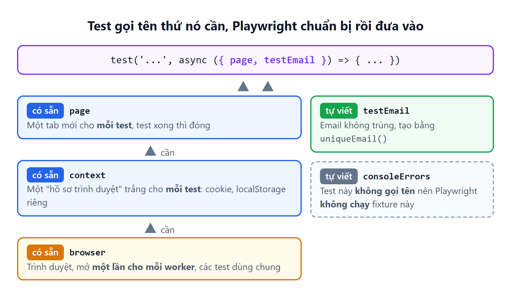
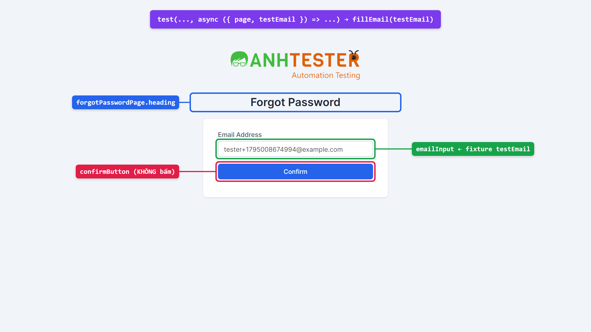
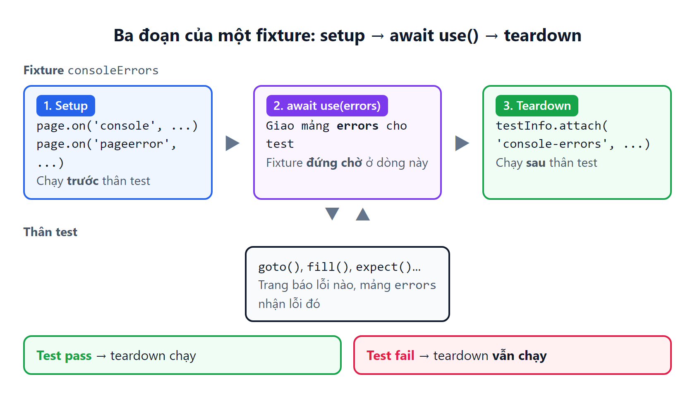
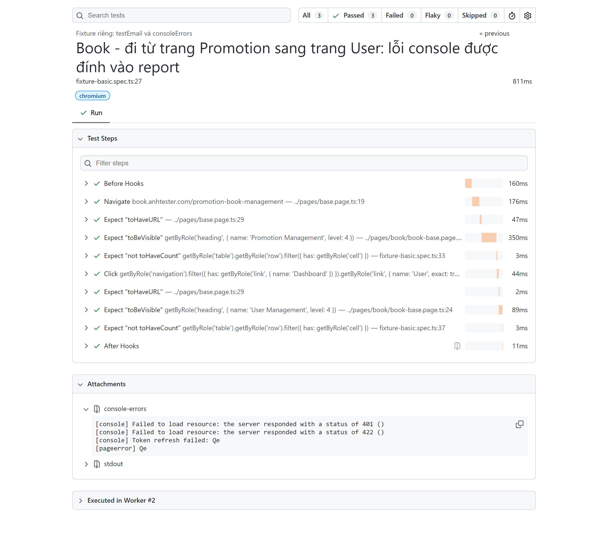
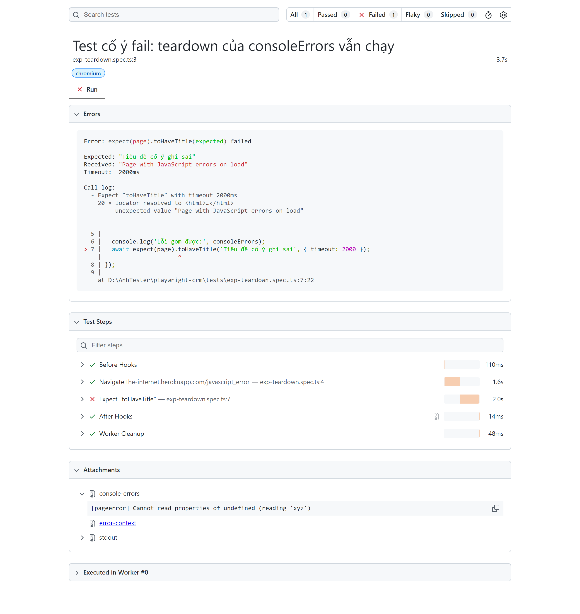

# Bài 25 - [Playwright Typescript] Tạo Fixture riêng trong Playwright

Chương: 4. Cấu trúc code Page Object Model + Fixture

Nguồn: [https://anhtester.com/learn/website-and-api-testing-automation-with-playwright-javascript-typescript-day-code-js-ts-tu-dau/382](https://anhtester.com/learn/website-and-api-testing-automation-with-playwright-javascript-typescript-day-code-js-ts-tu-dau/382)

✅ Fixture là gì và vì sao test viết ({ page })  
✅ Các Fixture có sẵn: page, context, browser, browserName, request  
✅ Tạo Fixture riêng với test.extend  
✅ Chuẩn bị và dọn dẹp trong Fixture với use  
✅ Dùng Claude Code và bộ kit claude-testing-skills để sinh Fixture

## ⭐ Mục tiêu bài học

Ở bài BasePage, hàm dùng chung (utils) và Component Object, bạn đã đưa phần chung của mọi trang vào `pages/base.page.ts`, hàm thuần vào `utils/` (trong đó có `uniqueEmail()` của `utils/data.ts`), menu và bảng vào `components/`. Chỗ còn lặp: test nào cũng tự `new` Page Object ở dòng đầu.

Bài này trả lời câu hỏi đứng trước chuyện đó: `page` từ đâu ra, và bạn tự tạo một thứ tương tự bằng cách nào. Học xong bạn sẽ:

- Giải thích được Fixture là gì và vì sao hàm test viết `async ({ page })`.
- Biết các Fixture có sẵn `page`, `context`, `browser`, `browserName`, `request` dùng khi nào.
- Tạo được Fixture riêng bằng `test.extend()`, có phần chuẩn bị và phần dọn dẹp quanh `await use()`.
- Đọc được lỗi thật khi viết sai Fixture và duyệt được Fixture do AI sinh ra.

> 📌 Bài dùng ba trang demo: trang Quên mật khẩu của CRM `https://crm.anhtester.com/admin/authentication/forgot_password` (chỉ điền, **không bấm Confirm**, không đăng nhập), trang quản lý sách `https://book.anhtester.com` (chỉ đọc) và một trang cố ý có lỗi JavaScript của `https://the-internet.herokuapp.com`.

## ✅ Phần 1: Fixture là gì và vì sao test viết ({ page })

### 🔆 1. Hai câu hỏi còn lại từ bài trước

Trong project `D:\AnhTester\playwright-crm`, đếm số dòng tự tạo Page Object ở thư mục `tests`. Kết quả thật: **5 dòng**:

```plaintext
tests/book-pom.spec.ts:7:    const userPage = new UserPage(page);
tests/book-pom.spec.ts:8:    const promotionPage = new PromotionPage(page);
tests/book-pom.spec.ts:27:    const promotionPage = new PromotionPage(page);
tests/book-pom.spec.ts:43:    const userPage = new UserPage(page);
tests/crm-login-pom.spec.ts:11:    loginPage = new LoginPage(page);
```

Thêm trang nào là thêm dòng đó. Câu hỏi thứ hai: dòng nào cũng nhận `page`, nhưng bạn chưa từng viết lệnh mở trình duyệt hay mở tab. Ai tạo ra `page`? Câu trả lời cho cả hai là **Fixture**.

### 🔆 2. Fixture là gì?

Ở phòng thí nghiệm của trường, trước buổi thực hành bạn ghi tên những thứ mình cần: kính hiển vi, ống nghiệm. Vào phòng là đồ đã nằm sẵn trên bàn. Hết giờ bạn đi về, người phụ trách rửa và cất. Bạn chỉ **gọi tên thứ cần dùng**.

Trong lập trình, **Fixture** là một hàm làm ba việc theo đúng thứ tự: chuẩn bị một giá trị, giao giá trị đó cho test, test xong thì dọn dẹp. Test "ghi tên" thứ mình cần ngay trong cặp ngoặc `({ ... })`.

Cặp ngoặc đó là **destructuring** bạn đã học ở bài về Object và JSON: `const { name, age } = user` lấy hai thuộc tính ra khỏi một object. Hàm test cũng nhận **một** object chứa mọi fixture, và `async ({ page })` lấy ra đúng thuộc tính `page`. Playwright đọc các tên trong ngoặc để biết phải chuẩn bị gì.

Trong automation, `page` chính là một fixture có sẵn. Trước mỗi test, Playwright tạo một **context** trắng (một "hồ sơ trình duyệt" chưa có cookie, chưa có dữ liệu lưu) và một tab trong đó, đưa tab vào test dưới tên `page`. Test xong, nó đóng cả hai.

[](https://anhtester.com/storage/photos/shares/lesson/js_ts_playwright/v2/bai_25_tao_fixture/01_so_do_test_goi_ten_fixture.png)

*Test gọi tên fixture, Playwright chuẩn bị rồi đưa vào*

### 🔆 3. Bằng chứng: mỗi test một page mới

Tạo file tạm `tests/exp-isolation.spec.ts`. Test 1 ghi một giá trị vào `localStorage` của trình duyệt (chỉ nằm trên máy bạn). Test 2 mở lại đúng trang đó và đọc:

```typescript
import { test, expect } from '@playwright/test';

const BOOK_SIGN_IN = 'https://book.anhtester.com/sign-in';

test('Test 1: ghi một giá trị vào localStorage của trình duyệt', async ({ page }) => {
  await page.goto(BOOK_SIGN_IN);
  await page.evaluate(() => localStorage.setItem('ghi-chu', 'test 1 đã ở đây'));

  const value = await page.evaluate(() => localStorage.getItem('ghi-chu'));
  console.log('Test 1 đọc lại:', value, '| số tab trong context:', page.context().pages().length);
  expect(value).toBe('test 1 đã ở đây');
});

test('Test 2: mở lại đúng trang đó, giá trị của test 1 không còn', async ({ page }) => {
  await page.goto(BOOK_SIGN_IN);

  const value = await page.evaluate(() => localStorage.getItem('ghi-chu'));
  console.log('Test 2 đọc được:', value, '| số tab trong context:', page.context().pages().length);
  expect(value).toBeNull();
});
```

```bash
npx playwright test exp-isolation.spec.ts --project=chromium --reporter=list --workers=1
```

```plaintext
Running 2 tests using 1 worker

Test 1 đọc lại: test 1 đã ở đây | số tab trong context: 1
  ✓  1 [chromium] › tests\exp-isolation.spec.ts:5:1 › Test 1: ghi một giá trị vào localStorage của trình duyệt (252ms)
Test 2 đọc được: null | số tab trong context: 1
  ✓  2 [chromium] › tests\exp-isolation.spec.ts:14:1 › Test 2: mở lại đúng trang đó, giá trị của test 1 không còn (222ms)

  2 passed (961ms)
```

Kết quả chạy thật (Playwright 1.65.1, ngày 18/11/2026). `--workers=1` cho hai test chạy lần lượt, vậy mà test 2 vẫn đọc ra `null`. Mỗi test nhận một context và một `page` riêng, nên test này không để lại gì cho test kia. Đó là **tính cô lập** (isolation).

## ✅ Phần 2: Các Fixture có sẵn: page, context, browser, browserName, request

<table class="rt-table">
<thead>
<tr>
<th>Fixture</th>
<th>Tạo mới khi nào</th>
<th>Là gì, cần khi nào</th>
</tr>
</thead>
<tbody>
<tr>
<td><code>page</code></td>
<td>Mỗi test</td>
<td>Một tab trình duyệt. Hầu hết test chỉ cần fixture này</td>
</tr>
<tr>
<td><code>context</code></td>
<td>Mỗi test</td>
<td>"Hồ sơ trình duyệt" chứa <code>page</code>: cookie, dữ liệu lưu. Cần khi mở thêm tab, đọc hoặc xoá cookie</td>
</tr>
<tr>
<td><code>browser</code></td>
<td>Mỗi worker</td>
<td>Trình duyệt, các test trong cùng worker dùng chung. Cần khi tự tạo thêm một context</td>
</tr>
<tr>
<td><code>browserName</code></td>
<td>Mỗi worker</td>
<td>Chuỗi <code>chromium</code>, <code>firefox</code> hoặc <code>webkit</code>. Cần khi một test phải bỏ qua trên một trình duyệt</td>
</tr>
<tr>
<td><code>request</code></td>
<td>Mỗi test</td>
<td>Gọi HTTP thẳng tới server, không mở trang. Chương API Testing dạy kỹ</td>
</tr>
</tbody>
</table>

Thử cả bốn fixture còn lại trong file tạm `tests/exp-builtin.spec.ts`:

```typescript
import { test, expect } from '@playwright/test';

test('context: mở tab thứ hai trong cùng một context', async ({ page, context }) => {
  await page.goto('https://crm.anhtester.com/admin/authentication');

  const secondPage = await context.newPage();
  await secondPage.goto('https://book.anhtester.com/sign-in');

  console.log('Số tab trong context:', context.pages().length);
  console.log('Tab 1:', await page.title());
  console.log('Tab 2:', await secondPage.title());
  expect(context.pages()).toHaveLength(2);
});

test('browser và browserName: biết test đang chạy trên trình duyệt nào', async ({ browser, browserName }) => {
  test.skip(browserName === 'webkit', 'Ví dụ: tính năng này chưa hỗ trợ Safari');

  console.log('browserName:', browserName);
  console.log('Phiên bản:', browser.version());
  console.log('Số context đang mở:', browser.contexts().length);
});

test('request: gọi thẳng HTTP, không mở trang', async ({ request }) => {
  const response = await request.get('https://book.anhtester.com');

  console.log('Status:', response.status(), '| content-type:', response.headers()['content-type']);
  expect(response.status()).toBe(200);
});
```

```bash
npx playwright test exp-builtin.spec.ts --project=chromium --reporter=list --workers=1
```

```plaintext
Running 3 tests using 1 worker

Số tab trong context: 2
Tab 1: Perfex CRM | Anh Tester Demo - Login
Tab 2: API RESTful miễn phí dành cho Tester kiểm thử
  ✓  1 [chromium] › tests\exp-builtin.spec.ts:3:1 › context: mở tab thứ hai trong cùng một context (496ms)
browserName: chromium
Phiên bản: 159.0.8154.6
Số context đang mở: 0
  ✓  2 [chromium] › tests\exp-builtin.spec.ts:15:1 › browser và browserName: biết test đang chạy trên trình duyệt nào (0ms)
Status: 200 | content-type: text/html;charset=utf-8
  ✓  3 [chromium] › tests\exp-builtin.spec.ts:23:1 › request: gọi thẳng HTTP, không mở trang (72ms)

  3 passed (1.1s)
```

Nhìn dòng `Số context đang mở: 0`: test thứ hai không gọi tên `page` hay `context`, nên Playwright **không tạo** context nào. Phần 4 quay lại điểm này.

> 📌 `testInfo` (tên test, trạng thái, hàm `attach()` đính file vào report) **không phải** fixture. Nó là tham số thứ hai của hàm test: `async ({ page }, testInfo) => {}`.

## ✅ Phần 3: Tạo Fixture riêng với test.extend

### 🔆 1. Cách cũ: hook và biến let

Giả sử bạn muốn mỗi test tự gom lỗi JavaScript của trang rồi đính vào report. Với hook `beforeEach`, `afterEach` đã học, bạn sẽ viết như file tạm `tests/exp-hooks.spec.ts` này:

```typescript
import { test, expect } from '@playwright/test';

// Cách dùng hook: biến đặt ngoài test, hai hook nằm ở hai chỗ
let errors: string[];

test.beforeEach(async ({ page }) => {
  errors = [];
  page.on('pageerror', (error) => {
    errors.push(`[pageerror] ${error.message}`);
  });
});

test.afterEach(async ({}, testInfo) => {
  if (errors.length > 0) {
    await testInfo.attach('console-errors', { body: errors.join('\n'), contentType: 'text/plain' });
  }
});

test('Trang có lỗi JavaScript', async ({ page }) => {
  await page.goto('https://the-internet.herokuapp.com/javascript_error');
  console.log('Số lỗi:', errors.length);
  expect(errors).toHaveLength(1);
});

test('Trang đăng nhập CRM - test này không cần errors nhưng hook vẫn chạy', async ({ page }) => {
  await page.goto('https://crm.anhtester.com/admin/authentication');
  await expect(page).toHaveTitle(/Login/);
});
```

File này chạy được (kết quả thật: `2 passed`). File `crm-login-pom.spec.ts` của bạn cũng đang dùng kiểu này: `let loginPage` ở ngoài, gán trong `beforeEach`. So với fixture:

<table class="rt-table">
<thead>
<tr>
<th>Tiêu chí</th>
<th>Hook + biến <code>let</code></th>
<th>Fixture</th>
</tr>
</thead>
<tbody>
<tr>
<td>Dùng ở file test khác</td>
<td>Chép lại biến và cả hai hook sang file đó</td>
<td>Viết một lần, file nào cần thì <code>import</code></td>
</tr>
<tr>
<td>Chuẩn bị và dọn dẹp</td>
<td>Nằm ở hai hook, cách nhau bởi một biến</td>
<td>Nằm trong một hàm, đọc từ trên xuống</td>
</tr>
<tr>
<td>Test không cần tới</td>
<td>Hook vẫn chạy cho mọi test trong file</td>
<td>Không gọi tên thì không chạy</td>
</tr>
<tr>
<td>Kiểu dữ liệu</td>
<td>Quên gán trong hook là biến mang giá trị <code>undefined</code>, TypeScript không báo</td>
<td>Test luôn nhận giá trị đúng kiểu đã khai báo</td>
</tr>
<tr>
<td>Biến dùng chung</td>
<td>Mọi test trong file ghi vào cùng một biến</td>
<td>Mỗi test nhận một giá trị riêng</td>
</tr>
</tbody>
</table>

Hook không sai: việc chỉ một file cần, như mở trang trước mỗi test, vẫn hợp với `beforeEach`. Thứ cần **dùng lại ở nhiều file** hoặc **phải dọn dẹp** thì viết thành fixture.

### 🔆 2. File fixtures/common.fixture.ts với fixture đầu tiên

Bắt đầu bằng fixture chỉ đưa cho test một giá trị. Tạo thư mục `fixtures` ở gốc project và file `fixtures/common.fixture.ts`:

```typescript
import { test as base } from '@playwright/test';
import { uniqueEmail } from '../utils/data';

/** Kiểu của các fixture thêm vào: tên fixture và kiểu giá trị test nhận được */
export type CommonFixtures = {
  testEmail: string;
};

export const test = base.extend<CommonFixtures>({
  /** Email không trùng, mỗi test một giá trị mới */
  testEmail: async ({}, use) => {
    await use(uniqueEmail('tester'));
  },
});

export { expect } from '@playwright/test';
```

- **`import { test as base }`**: lấy hàm `test` gốc của Playwright và gọi nó là `base`, để nhường tên `test` cho bản mới.
- **`CommonFixtures`**: tên và kiểu của từng fixture, để VS Code biết `testEmail` là `string`.
- **`base.extend<CommonFixtures>({...})`**: trả về một hàm `test` **mới**, có đủ fixture cũ (`page`, `context`...) cộng thêm fixture của bạn.
- **Hàm của fixture** nhận hai tham số. Tham số đầu là object chứa các fixture khác mà nó cần; `testEmail` không cần gì nên viết `{}` (bắt buộc phải có cặp ngoặc này). Tham số thứ hai là hàm `use`: gọi `await use(giá_trị)` để giao giá trị cho test.
- **`export { expect }`**: xuất lại `expect` từ cùng file, để file test chỉ cần **một** dòng import.

### 🔆 3. Dùng testEmail trong test

Tạo `tests/fixture-basic.spec.ts`. Dòng import đổi từ `@playwright/test` sang file fixture, và test gọi tên `testEmail` ngay cạnh `page`:

```typescript
import { test, expect } from '../fixtures/common.fixture';
import { ForgotPasswordPage } from '../pages/forgot-password.page';

test.describe('Fixture riêng: testEmail và consoleErrors', () => {
  test('CRM - ô Email của trang Quên mật khẩu nhận đúng testEmail', async ({ page, testEmail }) => {
    const forgotPasswordPage = new ForgotPasswordPage(page);
    await forgotPasswordPage.goto();
    await forgotPasswordPage.expectLoaded();

    console.log('testEmail:', testEmail);
    await forgotPasswordPage.fillEmail(testEmail); // chỉ điền, KHÔNG bấm Confirm
    await expect(forgotPasswordPage.emailInput).toHaveValue(testEmail);
  });
});
```

```bash
npx playwright test fixture-basic.spec.ts --project=chromium --reporter=list
```

```plaintext
Running 1 test using 1 worker

testEmail: tester+1795008940453@example.com
  ✓  1 [chromium] › tests\fixture-basic.spec.ts:5:3 › Fixture riêng: testEmail và consoleErrors › CRM - ô Email của trang Quên mật khẩu nhận đúng testEmail (261ms)

  1 passed (712ms)
```

[](https://anhtester.com/storage/photos/shares/lesson/js_ts_playwright/v2/bai_25_tao_fixture/03_trang_quen_mat_khau_crm_dien_testemail.png)

*Trang Quên mật khẩu của CRM: ô Email nhận giá trị của fixture testEmail*

Test không biết email được tạo ra thế nào, nó chỉ gọi tên. Dòng `new ForgotPasswordPage(page)` vẫn còn đó: đưa Page Object vào fixture là việc của bài kế tiếp.

## ✅ Phần 4: Chuẩn bị và dọn dẹp trong Fixture với use

### 🔆 1. Ba đoạn: setup, await use(), teardown

Một fixture đầy đủ có ba đoạn, chia bởi dòng `await use()`:

- **Trước `await use()`** là phần chuẩn bị (setup), chạy trước thân test.
- **Tại `await use(giá_trị)`**, fixture giao giá trị và **đứng chờ** cho tới khi thân test chạy xong.
- **Sau `await use()`** là phần dọn dẹp (teardown), chạy sau thân test.

[](https://anhtester.com/storage/photos/shares/lesson/js_ts_playwright/v2/bai_25_tao_fixture/02_so_do_fixture_setup_use_teardown.png)

*Ba đoạn của fixture consoleErrors: setup, await use(), teardown*

Viết lại ví dụ gom lỗi JavaScript ở Phần 3 thành fixture `consoleErrors`. Đây là toàn bộ file `fixtures/common.fixture.ts` sau khi thêm:

```typescript
import { test as base } from '@playwright/test';
import { uniqueEmail } from '../utils/data';

/** Kiểu của các fixture thêm vào: tên fixture và kiểu giá trị test nhận được */
export type CommonFixtures = {
  testEmail: string;
  consoleErrors: string[];
};

export const test = base.extend<CommonFixtures>({
  /** Email không trùng, mỗi test một giá trị mới */
  testEmail: async ({}, use) => {
    await use(uniqueEmail('tester'));
  },

  /** Gom lỗi JavaScript của trang trong lúc test chạy, đính vào report khi test xong */
  consoleErrors: async ({ page }, use, testInfo) => {
    // 1. Chuẩn bị (setup): chạy TRƯỚC thân test
    const errors: string[] = [];
    page.on('console', (message) => {
      if (message.type() === 'error') errors.push(`[console] ${message.text()}`);
    });
    page.on('pageerror', (error) => {
      errors.push(`[pageerror] ${error.message}`);
    });

    // 2. Giao mảng cho test. Thân test chạy ở đúng dòng này
    await use(errors);

    // 3. Dọn dẹp (teardown): chạy SAU thân test, kể cả khi test fail
    if (errors.length > 0) {
      await testInfo.attach('console-errors', {
        body: errors.join('\n'),
        contentType: 'text/plain',
      });
    }
  },
});

export { expect } from '@playwright/test';
```

- `consoleErrors` cần `page` nên ghi `{ page }` ở tham số đầu. Tham số thứ ba là `testInfo`, dùng để đính file vào report.
- `page.on('console')` nhận mọi dòng trang in ra Console, ở đây chỉ giữ loại `error`. `page.on('pageerror')` nhận lỗi JavaScript không được trang xử lý.
- Fixture này **chỉ gom và đính kèm, không tự làm test fail**. Coi lỗi console là fail hay không do từng test quyết định.

### 🔆 2. Dùng consoleErrors trên CRM và trên Book

Thêm hai test vào `tests/fixture-basic.spec.ts`. Toàn bộ file:

```typescript
import { test, expect } from '../fixtures/common.fixture';
import { ForgotPasswordPage } from '../pages/forgot-password.page';
import { PromotionPage } from '../pages/book/promotion.page';
import { UserPage } from '../pages/book/user.page';

test.describe('Fixture riêng: testEmail và consoleErrors', () => {
  test('CRM - ô Email của trang Quên mật khẩu nhận đúng testEmail', async ({ page, testEmail }) => {
    const forgotPasswordPage = new ForgotPasswordPage(page);
    await forgotPasswordPage.goto();
    await forgotPasswordPage.expectLoaded();

    console.log('testEmail:', testEmail);
    await forgotPasswordPage.fillEmail(testEmail); // chỉ điền, KHÔNG bấm Confirm
    await expect(forgotPasswordPage.emailInput).toHaveValue(testEmail);
  });

  test('CRM - trang Quên mật khẩu không có lỗi JavaScript', async ({ page, testEmail, consoleErrors }) => {
    const forgotPasswordPage = new ForgotPasswordPage(page);
    await forgotPasswordPage.goto();
    await forgotPasswordPage.expectLoaded();
    await forgotPasswordPage.fillEmail(testEmail); // chỉ điền, KHÔNG bấm Confirm

    console.log('CRM - số lỗi console:', consoleErrors.length);
    expect(consoleErrors, 'Trang Quên mật khẩu không được có lỗi JavaScript').toEqual([]);
  });

  test('Book - đi từ trang Promotion sang trang User: lỗi console được đính vào report', async ({ page, consoleErrors }) => {
    const promotionPage = new PromotionPage(page);
    const userPage = new UserPage(page);

    await promotionPage.goto();
    await promotionPage.expectLoaded();
    await expect(promotionPage.table.rows).not.toHaveCount(0); // chờ dữ liệu về

    await promotionPage.menu.open('User');
    await userPage.expectLoaded();
    await expect(userPage.table.rows).not.toHaveCount(0);

    console.log('Book - số lỗi console:', consoleErrors.length);
    for (const error of consoleErrors) console.log('  ', error);
  });
});
```

```bash
npx playwright test fixture-basic.spec.ts --project=chromium --reporter=list,html
```

```plaintext
Running 3 tests using 3 workers

CRM - số lỗi console: 0
  ✓  1 [chromium] › tests\fixture-basic.spec.ts:17:3 › Fixture riêng: testEmail và consoleErrors › CRM - trang Quên mật khẩu không có lỗi JavaScript (294ms)
testEmail: tester+1795008543702@example.com
  ✓  2 [chromium] › tests\fixture-basic.spec.ts:7:3 › Fixture riêng: testEmail và consoleErrors › CRM - ô Email của trang Quên mật khẩu nhận đúng testEmail (319ms)
Book - số lỗi console: 4
   [console] Failed to load resource: the server responded with a status of 401 ()
   [console] Failed to load resource: the server responded with a status of 422 ()
   [console] Token refresh failed: Qe
   [pageerror] Qe
  ✓  3 [chromium] › tests\fixture-basic.spec.ts:27:3 › Fixture riêng: testEmail và consoleErrors › Book - đi từ trang Promotion sang trang User: lỗi console được đính vào report (811ms)

  3 passed (1.3s)
```

Kết quả chạy thật (Playwright 1.65.1, ngày 18/11/2026). Hai trang cho hai kết quả khác nhau:

- **CRM**: 0 lỗi. Test này tự quyết định coi lỗi console là fail bằng `expect(consoleErrors).toEqual([])`.
- **Book**: 4 lỗi thật. Vì chưa đăng nhập, trang nhận mã 401, xin cấp lại token thì nhận 422, rồi để lọt một lỗi JavaScript không được xử lý (`[pageerror] Qe`). Giao diện vẫn hiện đủ nên nhìn bằng mắt không thấy gì. Test không `expect` trên mảng lỗi nên vẫn pass, nhưng cả 4 dòng đã nằm trong report:

[](https://anhtester.com/storage/photos/shares/lesson/js_ts_playwright/v2/bai_25_tao_fixture/04_html_report_dinh_kem_console_errors.png)

*HTML Report của test trên trang Book: mục Attachments có console-errors*

> ⚠️ Lỗi console tới **sau** khi trang đã hiện, và fixture chỉ gom được lỗi xuất hiện **trước khi test kết thúc**. Test trên Book đi qua hai trang nên nhận đủ 4 lỗi; test chỉ mở trang rồi kết thúc ngay có thể gom được 0 lỗi. Đừng chữa bằng `waitForTimeout`.

### 🔆 3. Test fail thì teardown vẫn chạy

Tạo file tạm `tests/exp-teardown.spec.ts`, mở một trang cố ý có lỗi JavaScript rồi **cố ý ghi sai** tiêu đề mong đợi:

```typescript
import { test, expect } from '../fixtures/common.fixture';

test('Test cố ý fail: teardown của consoleErrors vẫn chạy', async ({ page, consoleErrors }) => {
  await page.goto('https://the-internet.herokuapp.com/javascript_error');

  console.log('Lỗi gom được:', consoleErrors);
  await expect(page).toHaveTitle('Tiêu đề cố ý ghi sai', { timeout: 2000 });
});
```

```plaintext
Lỗi gom được: [ "[pageerror] Cannot read properties of undefined (reading 'xyz')" ]
  ✘  1 [chromium] › tests\exp-teardown.spec.ts:3:1 › Test cố ý fail: teardown của consoleErrors vẫn chạy (3.7s)

  1) [chromium] › tests\exp-teardown.spec.ts:3:1 › Test cố ý fail: teardown của consoleErrors vẫn chạy

    Error: expect(page).toHaveTitle(expected) failed

    Expected: "Tiêu đề cố ý ghi sai"
    Received: "Page with JavaScript errors on load"
    Timeout:  2000ms
    ...
        at D:\AnhTester\playwright-crm\tests\exp-teardown.spec.ts:7:22

    attachment #1: console-errors (text/plain) ─────────────────────────────────────────────────────
    [pageerror] Cannot read properties of undefined (reading 'xyz')
    ────────────────────────────────────────────────────────────────────────────────────────────────

  1 failed
```

Test dừng ở dòng 7, nhưng dòng `attachment #1: console-errors` cho thấy phần sau `await use()` vẫn chạy. Lúc test fail chính là lúc file đính kèm có ích nhất.

[](https://anhtester.com/storage/photos/shares/lesson/js_ts_playwright/v2/bai_25_tao_fixture/05_html_report_test_fail_van_co_dinh_kem.png)

*HTML Report của test cố ý fail: vẫn có console-errors*

### 🔆 4. Fixture chỉ chạy khi test gọi tên nó

File tạm `tests/exp-lazy.spec.ts` có một fixture in ra màn hình mỗi khi chạy, và hai test, chỉ một test gọi tên nó:

```typescript
import { test as base, expect } from '@playwright/test';

const test = base.extend<{ greeting: string }>({
  greeting: async ({}, use) => {
    console.log('  [greeting] setup');
    await use('Xin chào từ fixture');
    console.log('  [greeting] teardown');
  },
});

test('Test A: có gọi tên greeting', async ({ greeting }) => {
  console.log('  Thân test A:', greeting);
  expect(greeting).toContain('fixture');
});

test('Test B: không gọi tên greeting', async ({ page }) => {
  console.log('  Thân test B');
  await page.goto('https://crm.anhtester.com/admin/authentication');
  await expect(page).toHaveTitle(/Login/);
});
```

```plaintext
Running 2 tests using 1 worker

  [greeting] setup
  Thân test A: Xin chào từ fixture
  [greeting] teardown
  ✓  1 [chromium] › tests\exp-lazy.spec.ts:11:1 › Test A: có gọi tên greeting (4ms)
  Thân test B
  ✓  2 [chromium] › tests\exp-lazy.spec.ts:16:1 › Test B: không gọi tên greeting (265ms)

  2 passed (733ms)
```

Test A in đủ ba dòng theo thứ tự setup, thân test, teardown. Test B không có dòng `[greeting]` nào: khai báo nhiều fixture không làm chậm những test không dùng tới.

### 🔆 5. Năm lỗi hay gặp khi viết Fixture

Các lỗi dưới đây chạy thật trên fixture `greeting` ở trên, mỗi lần sửa sai một chỗ.

**Lỗi 1: thiếu `await` trước `use`.** Viết `use('Xin chào');` thay cho `await use('Xin chào');`:

```plaintext
  [greeting] setup
  [greeting] teardown
  Thân test: Xin chào
  ✓  1 [chromium] › tests\exp-mistake-1.spec.ts:11:1 › Lỗi 1: thiếu await trước use (1ms)

  1 passed (373ms)
```

Test vẫn **pass** và không có cảnh báo nào, nhưng teardown đã chạy **trước** thân test. Đây là lỗi nguy hiểm nhất vì Playwright không báo.

**Lỗi 2: không gọi `use`.** Test fail ngay:

```plaintext
    Error: use() was not called in fixture "greeting"
```

**Lỗi 3: gọi `use` hai lần.**

```plaintext
    Error: Cannot provide fixture value for the second time

      4 |   greeting: async ({}, use) => {
      5 |     await use('Xin chào');
    > 6 |     await use('Xin chào lần hai');
        |           ^
```

**Lỗi 4: tham số đầu không viết dạng `{ }`.** Viết `async (page, use)` thì Playwright dừng ngay khi đọc file:

```plaintext
First argument must use the object destructuring pattern: page

   at exp-mistake-4.spec.ts:3
```

**Lỗi 5: file test import `test` từ `@playwright/test`.**

```plaintext
Test has unknown parameter "testEmail".

   at exp-mistake-5.spec.ts:3

  1 | import { test, expect } from '@playwright/test'; // nhầm: phải import từ '../fixtures/common.fixture'
  2 |
> 3 | test('Lỗi 5: import test từ @playwright/test', async ({ page, testEmail }) => {
    | ^
```

### 🔆 6. Project sau bài này

```plaintext
playwright-crm/
├── components/                    ← không đổi
├── fixtures/
│   └── common.fixture.ts          ← MỚI: test (có testEmail, consoleErrors) + expect
├── pages/                         ← không đổi
├── tests/
│   ├── crm-login.spec.ts
│   ├── crm-login-pom.spec.ts      ← chưa sửa, vẫn new LoginPage(page) trong beforeEach
│   ├── book-pom.spec.ts           ← chưa sửa
│   └── fixture-basic.spec.ts      ← MỚI: 3 test dùng testEmail và consoleErrors
├── utils/                         ← không đổi
└── playwright.config.ts
```

Xoá các file tạm `tests/exp-*.spec.ts` rồi chạy lại cả project. Kết quả thật: 29 test cũ cộng 3 test mới.

```bash
npx playwright test --project=chromium --reporter=dot
```

```plaintext
  32 passed (7.9s)
```

## ✅ Phần 5: Dùng Claude Code và bộ kit claude-testing-skills để sinh Fixture

### 🔆 1. Thêm mục Fixture vào file quy tắc của dự án

Mở `.claude/rules/project_pom_rules.md` và thêm vào cuối file. Cách Claude Code đọc thư mục rules: [code.claude.com/docs/en/memory](https://code.claude.com/docs/en/memory).

```markdown
## Fixture
- Fixture đặt ở `fixtures/` tại gốc project (KHÔNG phải `src/fixtures/`). Tên file: `chu-de.fixture.ts`.
- Mỗi file fixture export `test` (tạo bằng `base.extend<Kieu>({...})`), export kiểu của các fixture,
  và có dòng `export { expect } from '@playwright/test';`.
- File test dùng fixture riêng thì import `test`, `expect` từ file fixture, KHÔNG từ `@playwright/test`.
- Tham số đầu của hàm fixture luôn viết dạng `{ }`. Luôn `await use(...)`, gọi đúng MỘT lần.
- Chuẩn bị viết TRƯỚC `await use()`, dọn dẹp viết SAU. KHÔNG bọc dọn dẹp trong `try/catch` rỗng.
- Mỗi fixture làm MỘT việc. KHÔNG `waitForTimeout`. KHÔNG tự bấm Save, Create, Delete, Update, Confirm.
- Dữ liệu trong fixture lấy từ `utils/data.ts` (`uniqueEmail()`...), KHÔNG ghi cứng email.
- KHÔNG dùng biến `let` ngoài test để chia sẻ dữ liệu giữa hook và test. Cần dùng lại thì viết fixture.
```

Bộ kit có sẵn một mẫu file fixture trong [CODE\_TEMPLATES.md](https://github.com/anhtester/claude-testing-skills/blob/main/.claude/skills/skills-framework-architect/references/CODE_TEMPLATES.md) (mục `src/fixtures/base.fixture.ts`): cùng cấu trúc `base.extend` và dòng `export { expect }` như file của bạn. Mẫu đó đặt trong `src/` và đưa Page Object vào fixture; project này để thư mục ở gốc, còn Page Object trong fixture là nội dung bài kế tiếp.

### 🔆 2. Prompt dùng được ở Claude, ChatGPT và Gemini

Claude Code là bản có phí Anh Tester dùng trong khoá. Với bản miễn phí của [ChatGPT](https://chatgpt.com/) hoặc [Gemini](https://gemini.google.com/), bạn dán code thật vào chỗ trong ngoặc vuông.

**Chuyển hook + biến `let` thành fixture:**

```markdown
Đây là một file test Playwright TypeScript đang dùng biến let và hai hook beforeEach, afterEach:

[dán nội dung file test]

Hãy chuyển phần chuẩn bị và dọn dẹp thành MỘT fixture trong fixtures/common.fixture.ts.
Ràng buộc:
- Dùng base.extend<Kieu>({...}), export test, export kiểu, và export { expect } từ cùng file.
- Code của beforeEach nằm trước await use(), code của afterEach nằm sau. Gọi await use() đúng một lần.
- Fixture không tự làm test fail, không waitForTimeout, không try/catch rỗng.
- File test import test, expect từ '../fixtures/common.fixture' và không còn biến let nào ở ngoài.
- Không đổi tên test, không đổi giá trị mong đợi.
Trước khi đưa code, hãy liệt kê: dòng nào thành setup, dòng nào thành teardown, test nào cần gọi tên fixture.
```

**Viết fixture có teardown từ mô tả:**

```markdown
Viết thêm một fixture Playwright TypeScript vào file sau:

[dán nội dung fixtures/common.fixture.ts]

Tên: failedRequests, kiểu string[]. Việc của nó:
- Setup: nghe sự kiện response của page, gom các response có status từ 400 trở lên dạng "404 GET https://...".
- Giao mảng cho test bằng await use().
- Teardown: nếu mảng không rỗng thì testInfo.attach('failed-requests', ...) dạng text/plain.
Ràng buộc: không sửa hai fixture đang có, không tự làm test fail, không waitForTimeout.
Chỉ dùng API có trong tài liệu playwright.dev, ghi rõ link trang tài liệu của từng API đã dùng.
Kèm một test mẫu mở https://book.anhtester.com/promotion-book-management (chỉ đọc, không bấm nút nào làm đổi dữ liệu).
```

**Nhờ AI rà một file fixture:**

```markdown
Hãy review file fixture Playwright TypeScript sau, KHÔNG viết lại:

[dán nội dung file fixture và một file test đang dùng nó]

Kiểm từng điểm và trả lời Có / Không kèm số dòng:
1. Mọi lời gọi use() đều có await và chỉ gọi một lần?
2. Có dòng nào nằm sau await use() mà đáng lẽ phải nằm trước (đăng ký sự kiện, tạo dữ liệu)?
3. Có fixture nào làm nhiều hơn một việc?
4. Phần dọn dẹp có try/catch rỗng nuốt lỗi không?
5. Có biến khai báo ngoài hàm fixture mà nhiều test cùng ghi vào không?
6. File test import test từ file fixture hay từ @playwright/test?
7. Có waitForTimeout, CSS Selector, email ghi cứng không?
Với mỗi điểm Không đạt: nêu hậu quả khi chạy và cách sửa trong 1-2 dòng.
```

### 🔆 3. Rà bằng lệnh của bộ kit

```markdown
/review-automation-code REVIEW fixtures tests/fixture-basic.spec.ts
```

Lệnh [/review-automation-code](https://github.com/anhtester/claude-testing-skills/blob/main/.claude/commands/review-automation-code.md) ở mode `REVIEW` chỉ báo cáo, không sửa code: nó chấm 6 nhóm (trong đó có "Wait strategy" và "Assertion & độc lập"), mỗi vi phạm kèm tên file, số dòng và nguyên văn dòng code. Rubric của lệnh không có mục riêng cho fixture; quy định về fixture nằm ở file quy tắc vừa bổ sung.

## ✅ Phần 6: Kiểm tra Fixture do AI sinh ra

Khi nhờ AI viết fixture, rà theo bảng này:

<table class="rt-table">
<thead>
<tr>
<th>Dấu hiệu trong code</th>
<th>Vì sao là vấn đề</th>
<th>Cách xử lý</th>
</tr>
</thead>
<tbody>
<tr>
<td><code>use(value);</code> không có <code>await</code></td>
<td>Teardown chạy trước thân test, test vẫn pass nên không ai biết</td>
<td>Thêm <code>await</code></td>
</tr>
<tr>
<td><code>page.on(...)</code> hoặc tạo dữ liệu nằm <strong>sau</strong> <code>await use()</code></td>
<td>Lúc đó test đã chạy xong, không còn gì để nghe</td>
<td>Đưa lên trước <code>await use()</code></td>
</tr>
<tr>
<td>Một fixture vừa tạo email, vừa mở trang, vừa gom lỗi</td>
<td>Test chỉ cần một việc cũng phải chạy cả ba, khó dùng lại</td>
<td>Tách thành ba fixture, mỗi cái một việc</td>
</tr>
<tr>
<td>File test <code>import { test } from '@playwright/test'</code> nhưng gọi tên fixture riêng</td>
<td>Lỗi <code>Test has unknown parameter</code></td>
<td>Import từ file fixture</td>
</tr>
<tr>
<td><code>let errors = []</code> đặt ngoài hàm fixture</td>
<td>Mọi test cùng ghi vào một mảng, lỗi của test trước dính sang test sau</td>
<td>Khai báo bên trong hàm fixture</td>
</tr>
<tr>
<td><code>try { ... } catch {}</code> quanh phần dọn dẹp</td>
<td>Dọn dẹp hỏng mà không ai biết</td>
<td>Bỏ <code>try/catch</code>, để lỗi hiện ra</td>
</tr>
<tr>
<td><code>waitForTimeout</code> trong setup</td>
<td>Mọi test dùng fixture chậm thêm từng ấy giây</td>
<td>Xoá, chờ bằng Web-First Assertion trong test</td>
</tr>
<tr>
<td><code>use('tester@example.com')</code></td>
<td>Hai test tạo dữ liệu bằng cùng một email sẽ đụng nhau</td>
<td>Dùng <code>uniqueEmail()</code></td>
</tr>
<tr>
<td><code>page.locator('#email')</code> trong fixture hoặc test</td>
<td>CSS Selector, trái file quy tắc locator</td>
<td>Dùng locator của Page Object hoặc <code>getByLabel</code></td>
</tr>
</tbody>
</table>

## ✅ Phần 7: Bài tập thực hành

**Bài tập 1 - Fixture giá trị.** Thêm vào `fixtures/common.fixture.ts` fixture `longText` (kiểu `string`) trả về chuỗi 300 ký tự bằng `textOfLength()` của `utils/data.ts`. Viết test điền `longText` vào ô Email của trang đăng nhập CRM qua `LoginPage` và kiểm ô giữ nguyên 300 ký tự.

**Bài tập 2 - Fixture có chuẩn bị và dọn dẹp.** Thêm fixture `pageTimer` (kiểu `number`): setup ghi lại thời điểm bắt đầu bằng `Date.now()`, giao giá trị đó cho test, teardown tính số mili giây đã trôi qua và đính vào report dưới tên `thoi-gian-chay`. Viết một test dùng nó trên trang đăng nhập CRM.

**Bài tập 3 - Từ hook sang fixture.** Lấy file `exp-hooks.spec.ts` ở Phần 3, viết lại thành `tests/bt3-hook-sang-fixture.spec.ts` dùng fixture `consoleErrors`: không còn biến `let`, không còn `beforeEach`, `afterEach`. Trả lời: test thứ hai có cần gọi tên `consoleErrors` không, vì sao?

**Bài tập 4 - Duyệt code.** Đoạn code dưới đây do AI viết, gộp hai file vào một chỗ cho dễ đọc. Nó có **8 chỗ cần sửa** (có một dòng mắc hai lỗi). Tìm đủ, nêu lý do theo bảng ở Phần 6, rồi viết lại test bằng `testEmail` và `consoleErrors` của bài này.

```typescript
// ----- fixtures/common.fixture.ts -----
import { test as base } from '@playwright/test';

let errors: string[] = [];

export const test = base.extend<{ testEmail: string; pageErrors: string[] }>({
  testEmail: async ({}, use) => {
    use('tester@example.com');
  },

  pageErrors: async ({ page }, use) => {
    await use(errors);
    page.on('pageerror', (error) => errors.push(error.message));
    await page.waitForTimeout(2000);
  },
});

// ----- tests/forgot-password.spec.ts -----
import { test, expect } from '@playwright/test';
import { ForgotPasswordPage } from '../pages/forgot-password.page';

test('Ô Email nhận đúng giá trị', async ({ page, testEmail, pageErrors }) => {
  const forgotPasswordPage = new ForgotPasswordPage(page);
  await forgotPasswordPage.goto();
  await page.locator('#email').fill(testEmail);
  await expect(forgotPasswordPage.emailInput).toHaveValue(testEmail);
  try {
    expect(pageErrors).toEqual([]);
  } catch {}
});
```

## ✅ Phần 8: Ghi nhớ nhanh

- Fixture là hàm chuẩn bị một giá trị, giao cho test, rồi dọn dẹp. Test gọi tên thứ nó cần trong `({ ... })`.
- `page` và `context` tạo mới cho mỗi test nên các test không ảnh hưởng nhau.
- Tạo fixture riêng bằng `base.extend<Kiểu>({...})` trong `fixtures/ten.fixture.ts`, export `test` và `expect`. File test import từ file fixture.
- Trước `await use()` là setup, sau là teardown. Teardown chạy cả khi test fail.
- Luôn `await use()`, đúng một lần. Thiếu `await` thì test vẫn pass nhưng teardown chạy sai lúc.
- Fixture chỉ chạy khi có test gọi tên nó, và mỗi fixture chỉ làm một việc.

✅ **Kết luận:** Bạn đã biết `page` từ đâu ra và tự viết được hai fixture `testEmail`, `consoleErrors`. Nhưng 5 dòng `new ...Page(page)` đếm ở đầu bài vẫn còn nguyên. Đưa Page Object vào fixture, hiểu fixture sống bao lâu, cho fixture này dùng fixture kia và gộp nhiều file fixture lại là việc của bài kế tiếp: **Dùng Fixture cho project POM - vòng đời, Fixture Chaining và mergeTests**.

---

## Bài tập riêng — Bài tập - Tạo Fixture riêng với test.extend, setup và teardown quanh await use()

Nguồn bài tập: [https://anhtester.com/student-assignments?course=website-and-api-testing-automation-with-playwright-javascript-typescript-day-code-js-ts-tu-dau#assignment-115](https://anhtester.com/student-assignments?course=website-and-api-testing-automation-with-playwright-javascript-typescript-day-code-js-ts-tu-dau#assignment-115)

**Mục tiêu:** tự tạo Fixture bằng `test.extend()`, viết đúng phần chuẩn bị và dọn dẹp quanh `await use()`, chuyển được hook + biến `let` thành Fixture, và nhận ra lỗi trong Fixture do AI sinh ra.

**Thư mục làm bài:** `D:\AnhTester\playwright-crm` (macOS: `~/AnhTester/playwright-crm`), dùng tiếp các file của bài học: `fixtures/common.fixture.ts`, `tests/fixture-basic.spec.ts`, `pages/login.page.ts`, `pages/forgot-password.page.ts`, `utils/data.ts`. Chỉ làm việc trên trang công khai: trang đăng nhập và trang Quên mật khẩu của CRM (**chỉ điền, không bấm Login, không bấm Confirm**, không đăng nhập), và trang `https://the-internet.herokuapp.com/javascript_error`.

### 📝 Đề bài

#### Bài tập 1 - Fixture giá trị

Thêm vào `fixtures/common.fixture.ts` fixture `longText` (kiểu `string`, khai báo trong `CommonFixtures`) trả về chuỗi 300 ký tự bằng `textOfLength()` của `utils/data.ts`. **Không sửa** hai fixture `testEmail`, `consoleErrors` đang có. Tạo `tests/bt1-long-text.spec.ts`: mở trang đăng nhập CRM qua `LoginPage`, điền `longText` vào ô Email, kiểm ô giữ nguyên đủ 300 ký tự.

Trả lời: vì sao tham số đầu của hàm fixture này phải viết `{}` dù không dùng fixture nào?

#### Bài tập 2 - Fixture có chuẩn bị và dọn dẹp

Thêm fixture `pageTimer` (kiểu `number`): phần chuẩn bị ghi lại thời điểm bắt đầu bằng `Date.now()`, giao giá trị đó cho test, phần dọn dẹp tính số mili giây đã trôi qua rồi đính vào report bằng `testInfo.attach('thoi-gian-chay', ...)` dạng `text/plain`. Tạo `tests/bt2-page-timer.spec.ts` có 2 test trên trang đăng nhập CRM:

1. Test đạt: mở trang, gọi `loginPage.expectLoaded()`.
2. Test **cố ý fail**: kiểm một tiêu đề trang ghi sai, đặt `timeout` của assertion là 2000.

Chạy với `--reporter=list` và dán kết quả. Trả lời: ở test fail, file `thoi-gian-chay` có được đính kèm không, dòng nào trong kết quả cho thấy điều đó? Chụp xong kết quả thì xoá test cố ý fail.

#### Bài tập 3 - Từ hook sang fixture

File dưới đây dùng biến `let` và hai hook:

```typescript
import { test, expect } from '@playwright/test';

// Cách dùng hook: biến đặt ngoài test, hai hook nằm ở hai chỗ
let errors: string[];

test.beforeEach(async ({ page }) => {
  errors = [];
  page.on('pageerror', (error) => {
    errors.push(`[pageerror] ${error.message}`);
  });
});

test.afterEach(async ({}, testInfo) => {
  if (errors.length > 0) {
    await testInfo.attach('console-errors', { body: errors.join('\n'), contentType: 'text/plain' });
  }
});

test('Trang có lỗi JavaScript', async ({ page }) => {
  await page.goto('https://the-internet.herokuapp.com/javascript_error');
  console.log('Số lỗi:', errors.length);
  expect(errors).toHaveLength(1);
});

test('Trang đăng nhập CRM - test này không cần errors nhưng hook vẫn chạy', async ({ page }) => {
  await page.goto('https://crm.anhtester.com/admin/authentication');
  await expect(page).toHaveTitle(/Login/);
});
```

Viết lại thành `tests/bt3-hook-sang-fixture.spec.ts` dùng fixture `consoleErrors` của bài học: không còn biến `let`, không còn `beforeEach`, `afterEach`, giữ nguyên tên và giá trị mong đợi của hai test. Trả lời: test thứ hai có cần gọi tên `consoleErrors` không, vì sao?

#### Bài tập 4 - Duyệt code AI

Đoạn code dưới đây do AI viết, gộp hai file vào một chỗ cho dễ đọc. Nó có **8 chỗ cần sửa** (có một dòng mắc hai lỗi). Tìm đủ, nêu lý do, rồi viết `tests/bt4-duyet-code.spec.ts` làm đúng việc đó (ô Email của trang Quên mật khẩu nhận đúng giá trị và trang không có lỗi JavaScript) bằng `testEmail`, `consoleErrors` và `ForgotPasswordPage` của bài học, **không tạo fixture mới**.

```typescript
// ----- fixtures/common.fixture.ts -----
import { test as base } from '@playwright/test';

let errors: string[] = [];

export const test = base.extend<{ testEmail: string; pageErrors: string[] }>({
  testEmail: async ({}, use) => {
    use('tester@example.com');
  },

  pageErrors: async ({ page }, use) => {
    await use(errors);
    page.on('pageerror', (error) => errors.push(error.message));
    await page.waitForTimeout(2000);
  },
});

// ----- tests/forgot-password.spec.ts -----
import { test, expect } from '@playwright/test';
import { ForgotPasswordPage } from '../pages/forgot-password.page';

test('Ô Email nhận đúng giá trị', async ({ page, testEmail, pageErrors }) => {
  const forgotPasswordPage = new ForgotPasswordPage(page);
  await forgotPasswordPage.goto();
  await page.locator('#email').fill(testEmail);
  await expect(forgotPasswordPage.emailInput).toHaveValue(testEmail);
  try {
    expect(pageErrors).toEqual([]);
  } catch {}
});
```

### 📦 Cách nộp bài

1. Làm bài trong project `playwright-crm`, commit và push lên nhánh `main` của repo GitHub `playwright-crm` của bạn.
2. Dán link repo vào ô **Link GitHub**, dạng `https://github.com/<ten-ban>/playwright-crm`. Repo Private thì vào **Settings → Collaborators** thêm tài khoản GitHub của giảng viên, nếu không giảng viên không mở được.
3. Trong ô **Nội dung bài làm (Editor)**, dán **kết quả chạy thật** trên Terminal của từng lệnh (mỗi lệnh một **Đoạn code mẫu** chọn Text / Log) và phần trả lời các câu hỏi.
4. Với bài **Duyệt code AI**: liệt kê từng chỗ sai theo mẫu *Dòng – Lỗi – Lý do – Cách sửa*, rồi dán file đã viết lại.
5. Dán thêm kết quả `npx playwright test bt1 bt2 bt3 bt4 fixture-basic --project=chromium --reporter=list`.

### ✅ Tiêu chí Đạt

- Bài tập 1: `longText: string` có trong kiểu `CommonFixtures`; hàm fixture viết `async ({}, use) => { await use(textOfLength(300)); }`, có `await`, gọi `use` đúng một lần, không ghi cứng chuỗi 300 ký tự. File test import `test`, `expect` từ `../fixtures/common.fixture`, kiểm bằng `toHaveValue(longText)`, không bấm Login. Trả lời đúng ý: Playwright bắt buộc tham số đầu viết dạng destructuring để nó đọc được fixture cần chuẩn bị; viết tên biến thường sẽ gặp lỗi `First argument must use the object destructuring pattern`.
- Bài tập 2: `Date.now()` nằm **trước** `await use()`, phần tính thời gian và `testInfo.attach` nằm **sau**; hàm fixture nhận `testInfo` ở tham số thứ ba; không có `try/catch`, không có `waitForTimeout`. Kết quả dán vào có dòng `attachment #1: thoi-gian-chay (text/plain)` ở test fail và phần trả lời chỉ ra đúng dòng đó. Test cố ý fail đã được xoá khỏi code push lên.
- Bài tập 3: file mới import từ file fixture, test thứ nhất gọi tên `{ page, consoleErrors }` và kiểm `expect(consoleErrors).toHaveLength(1)`; không còn `let`, `beforeEach`, `afterEach`; cả 2 test đạt. Trả lời đúng ý: test thứ hai **không cần** gọi tên, vì nó không dùng tới mảng lỗi và fixture chỉ chạy khi được gọi tên (khác với hook chạy cho mọi test trong file). Học viên chọn gọi tên để vẫn có file đính kèm thì chấp nhận nếu nêu được lý do đó.
- Bài tập 4: tìm được ít nhất **6 trong 8** lỗi, kèm lý do đúng. **Đáp án cho người chấm**: (1) `let errors` khai báo ngoài hàm fixture: mọi test trong cùng worker ghi chung một mảng, lỗi của test trước dính sang test sau, phải khai báo bên trong hàm; (2) `use('tester@example.com')` thiếu `await`: phần sau `use` chạy trước thân test mà Playwright không báo; (3) cùng dòng đó: email ghi cứng, phải dùng `uniqueEmail()`; (4) `page.on('pageerror', ...)` đặt sau `await use()`: lúc đăng ký thì test đã chạy xong nên mảng luôn rỗng, phải đưa lên trước; (5) `waitForTimeout(2000)` trong fixture: chờ cứng, mọi test dùng fixture chậm thêm 2 giây; (6) file test import `test` từ `@playwright/test`: lỗi `Test has unknown parameter "testEmail"`, phải import từ file fixture; (7) `page.locator('#email')`: CSS Selector, trong khi `ForgotPasswordPage` đã có `emailInput` và `fillEmail()`; (8) `try { expect(...) } catch {}`: nuốt lỗi của assertion nên test không bao giờ fail vì lỗi JavaScript. Nêu thêm việc file fixture thiếu dòng `export { expect }`, thiếu kiểu export riêng, hoặc test thiếu `expectLoaded()` thì được ghi nhận nhưng không bắt buộc.
- File `tests/bt4-duyet-code.spec.ts` dùng `testEmail`, `consoleErrors` và `ForgotPasswordPage` của bài học, điền bằng `fillEmail(testEmail)`, kiểm `toHaveValue(testEmail)` và `expect(consoleErrors).toEqual([])`, chạy đạt với `--project=chromium`, không còn dòng nào thuộc 8 lỗi trên, không bấm Confirm.
- `fixture-basic.spec.ts` vẫn đạt đủ 3 test sau khi làm bài. Không có thao tác bấm Login, Confirm trên CRM, không có mật khẩu hay thao tác đăng nhập trong code đã push.

### 🤖 Dùng AI thế nào cho đúng

Được dùng Claude, ChatGPT hoặc Gemini để **hỏi giải thích** lỗi và khái niệm (prompt mẫu ở phần AI của bài học). Không nhờ AI làm hộ rồi dán vào: bài **Duyệt code AI** chấm chính phần *lý do* do bạn tự viết. Không dán mật khẩu hay file `.env` vào khung chat. Bài nào nộp lại vì **Cần sửa** thì sửa đúng chỗ giảng viên ghi trong feedback rồi bấm **Nộp lại**.