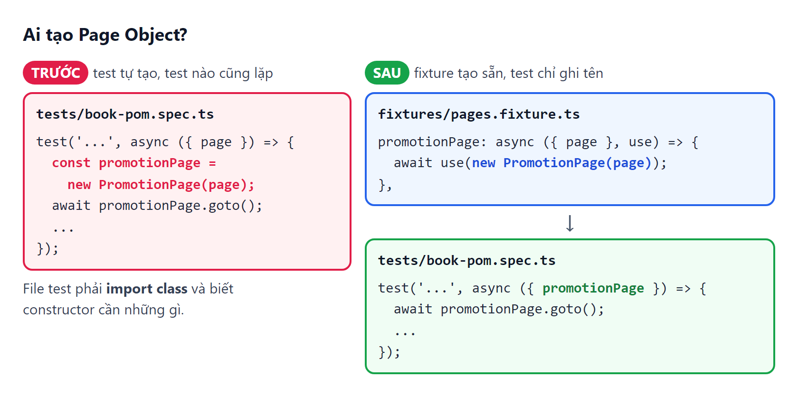
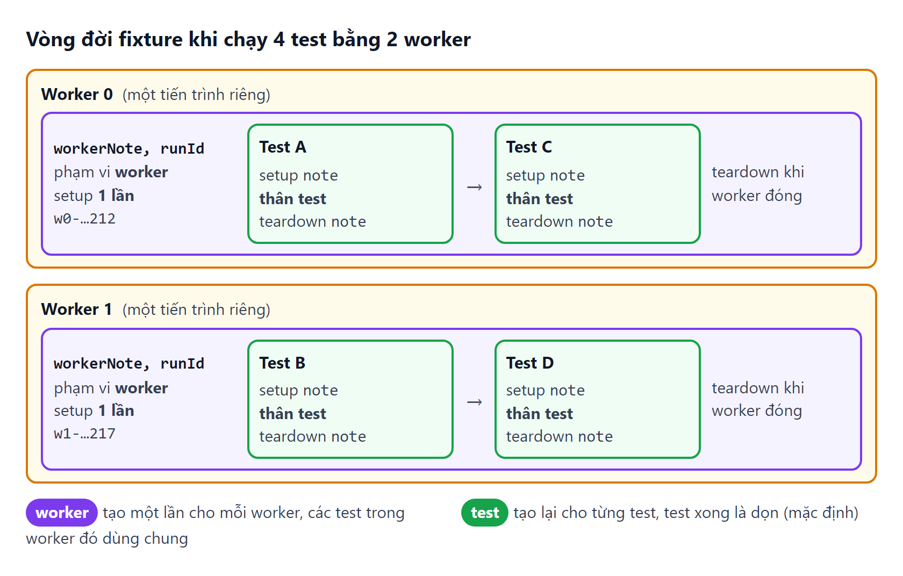
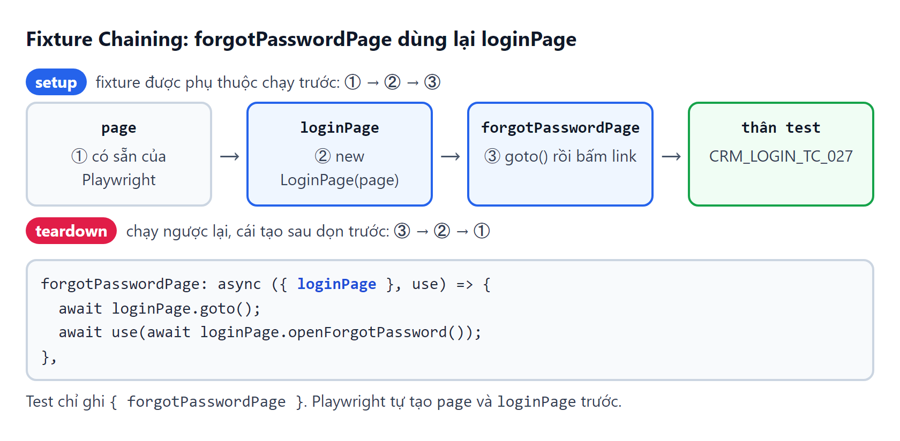
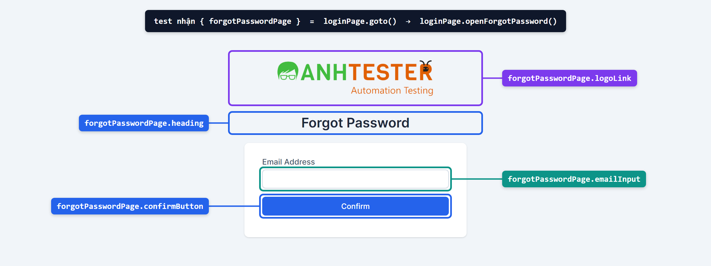
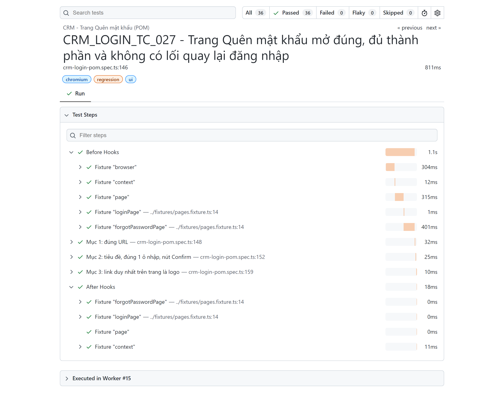
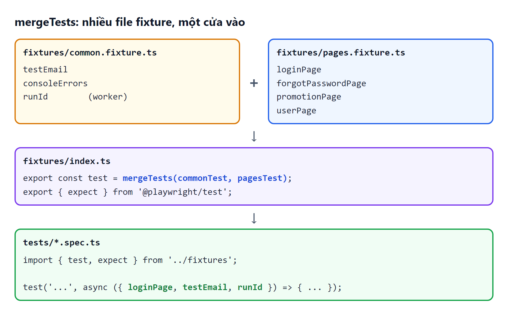

# Bài 26 - [Playwright Typescript] Dùng Fixture cho project POM - vòng đời, Fixture Chaining và mergeTests

Chương: 4. Cấu trúc code Page Object Model + Fixture

Nguồn: [https://anhtester.com/learn/website-and-api-testing-automation-with-playwright-javascript-typescript-day-code-js-ts-tu-dau/383](https://anhtester.com/learn/website-and-api-testing-automation-with-playwright-javascript-typescript-day-code-js-ts-tu-dau/383)

✅ Đưa Page Object vào Fixture  
✅ Vòng đời Fixture - phạm vi test và worker  
✅ Fixture Chaining - Fixture dùng Fixture khác  
✅ Gộp nhiều bộ Fixture với mergeTests  
✅ Dùng Claude Code và bộ kit claude-testing-skills để tổ chức Fixture

## ⭐ Mục tiêu bài học

Ở bài trước bạn đã tạo fixture đầu tiên của mình trong `fixtures/common.fixture.ts` bằng `test.extend`: `testEmail` trả về một email không trùng, `consoleErrors` gom lỗi console với đủ ba đoạn setup, `await use()`, teardown. File `tests/fixture-basic.spec.ts` lấy `test` và `expect` từ chính file fixture đó.

Nhưng thứ lặp lại nhiều nhất trong project vẫn còn nguyên: các dòng `new LoginPage(page)`, `new PromotionPage(page)`. Học xong bài này bạn sẽ:

- Đưa được Page Object vào fixture, để test chỉ ghi tên là có sẵn object.
- Hiểu vòng đời của fixture: thứ tự setup và teardown, phạm vi `test` khác phạm vi `worker` ở đâu.
- Cho fixture này dùng fixture khác (**Fixture Chaining**) và gộp nhiều file fixture bằng `mergeTests`.
- Duyệt được phần fixture do AI sinh ra: sai phạm vi, giấu bước, gộp lẫn lộn.

> 📌 Bài vẫn dùng trang đăng nhập CRM `https://crm.anhtester.com/admin/authentication` (**chưa đăng nhập**, không bấm Confirm) và trang Book `https://book.anhtester.com` (chỉ **đọc**).

## ✅ Phần 1: Đưa Page Object vào Fixture

### 🔆 1. Test đang lặp những gì?

Đếm thật trong hai file test dùng POM của project `D:\AnhTester\playwright-crm`: `tests/book-pom.spec.ts` có **4** dòng `new ...Page(page)` trong 3 test, `tests/crm-login-pom.spec.ts` có 1 dòng trong `beforeEach` kèm một biến `let loginPage` khai báo ngoài test. Mỗi lần constructor của một Page class đổi tham số, bạn phải sửa mọi test có dòng `new` của class đó.

Ở quán cà phê, bạn gọi tên món, nhân viên pha rồi mang ra. Fixture làm đúng việc đó cho test: test **ghi tên** thứ mình cần, Playwright tạo sẵn và đưa vào, như bạn vẫn làm với `page`. Giờ làm vậy với Page Object.

[](https://anhtester.com/storage/photos/shares/lesson/js_ts_playwright/v2/bai_26_fixture_cho_pom/01_so_do_truoc_sau_fixture_tao_page_object.png)

*Trước: test tự tạo Page Object. Sau: fixture tạo sẵn, test chỉ ghi tên*

### 🔆 2. File fixtures/pages.fixture.ts

Tạo file `fixtures/pages.fixture.ts`, cạnh `common.fixture.ts` của bài trước:

```typescript
import { test as base } from '@playwright/test';
import { LoginPage } from '../pages/login.page';
import { PromotionPage } from '../pages/book/promotion.page';
import { UserPage } from '../pages/book/user.page';

export type PageFixtures = {
  loginPage: LoginPage;
  promotionPage: PromotionPage;
  userPage: UserPage;
};

export const test = base.extend<PageFixtures>({
  /** Chỉ TẠO Page Object, chưa mở trang. Test tự gọi goto() */
  loginPage: async ({ page }, use) => {
    await use(new LoginPage(page));
  },

  promotionPage: async ({ page }, use) => {
    await use(new PromotionPage(page));
  },

  userPage: async ({ page }, use) => {
    await use(new UserPage(page));
  },
});

export { expect } from '@playwright/test';
```

- Mỗi fixture xin `page`, tạo object rồi đưa cho test qua `await use(...)`. Không có gì cần dọn nên sau `use` không có dòng nào.
- Tên fixture là tên class viết kiểu camelCase: `LoginPage` thành `loginPage`.

### 🔆 3. Viết lại hai file test

Sửa `tests/book-pom.spec.ts`. Phần đầu file và test thứ hai, trước và sau:

```typescript
// TRƯỚC: tests/book-pom.spec.ts (trích)
import { test, expect } from '@playwright/test';
import { PromotionPage } from '../pages/book/promotion.page';
import { UserPage } from '../pages/book/user.page';

test('Bảng Promotion đúng cột, có dữ liệu, cột Start đúng định dạng ngày', async ({ page }) => {
  const promotionPage = new PromotionPage(page);
  await promotionPage.goto();
  await promotionPage.expectLoaded();
  // ...
});
```

```typescript
// SAU: tests/book-pom.spec.ts (trích, thân test giữ nguyên)
import { test, expect } from '../fixtures/pages.fixture';

test('Bảng Promotion đúng cột, có dữ liệu, cột Start đúng định dạng ngày', async ({ promotionPage }) => {
  await promotionPage.goto();
  await promotionPage.expectLoaded();
  // ...
});
```

Hai test còn lại làm tương tự: test menu nhận `async ({ userPage, promotionPage })`, test bảng User nhận `async ({ userPage })`.

Với `tests/crm-login-pom.spec.ts`, biến `let` dùng chung biến mất:

```typescript
// TRƯỚC: tests/crm-login-pom.spec.ts (trích)
import { test, expect } from '@playwright/test';
import { LoginPage } from '../pages/login.page';

test.describe('CRM - Trang đăng nhập Admin (POM)', () => {
  let loginPage: LoginPage;

  test.beforeEach(async ({ page }) => {
    loginPage = new LoginPage(page);
    await loginPage.goto();
  });

  test('CRM_LOGIN_TC_001 - Mở trang đăng nhập khi chưa có phiên thì thấy biểu mẫu đăng nhập',
    { tag: ['@smoke', '@ui'] }, async ({ page }) => {
      await expect(page).toHaveURL(loginPage.url);
      // ...
    });
});
```

```typescript
// SAU: tests/crm-login-pom.spec.ts (trích)
import { test, expect } from '../fixtures/pages.fixture';

test.describe('CRM - Trang đăng nhập Admin (POM)', () => {
  test.beforeEach(async ({ loginPage }) => {
    await loginPage.goto();
  });

  test('CRM_LOGIN_TC_001 - Mở trang đăng nhập khi chưa có phiên thì thấy biểu mẫu đăng nhập',
    { tag: ['@smoke', '@ui'] }, async ({ page, loginPage }) => {
      await expect(page).toHaveURL(loginPage.url);
      // ...
    });
});
```

Các test còn lại chỉ đổi đúng dòng tham số: thêm `loginPage` vào `async ({ page, loginPage })`. TC ID, tag, `test.fail` của TC\_004 giữ nguyên. `beforeEach` và thân test nhận **cùng một** object `loginPage`.

```bash
npx playwright test crm-login-pom book-pom --project=chromium --reporter=dot
```

```plaintext
Running 16 tests using 16 workers
·············Số dòng: 5 | Ô Start đầu tiên: "24 Th08 2026\n\n03:40 AM"
···
  16 passed (7.5s)
```

Kết quả chạy thật (Playwright 1.65.1, ngày 18/11/2026): vẫn **16 passed**, gồm 13 test CRM và 3 test Book. Số worker mặc định tính theo số nhân CPU, máy bạn có thể ra số khác.

> ⚠️ Quên đổi dòng `import` (vẫn lấy `test` từ `@playwright/test`) thì Playwright dừng ngay khi đọc file: `Test has unknown parameter "loginPage".`

### 🔆 4. Fixture chỉ tạo object, test tự mở trang

Có thể viết fixture mở luôn trang cho tiện. Anh Tester **không** chọn cách đó cho fixture Page Object cơ bản:

<table class="rt-table">
<thead>
<tr>
<th>Tiêu chí</th>
<th>Fixture chỉ tạo (bài này dùng)</th>
<th>Fixture tạo rồi <code>goto()</code> luôn</th>
</tr>
</thead>
<tbody>
<tr>
<td>Đọc test</td>
<td>Thấy rõ dòng <code>goto()</code>: test bắt đầu từ trang nào</td>
<td>Bước mở trang bị giấu, phải mở file fixture mới biết</td>
</tr>
<tr>
<td>Test bắt đầu ở trang khác</td>
<td>Dùng được. TC_021 mở thẳng URL nội bộ rồi mới dùng <code>loginPage.url</code></td>
<td>Tốn một lần tải trang thừa trước khi test làm việc của nó</td>
</tr>
<tr>
<td>Test dùng 2 Page Object</td>
<td>Test menu nhận cả <code>userPage</code> và <code>promotionPage</code>, tự quyết mở trang nào</td>
<td>Hai fixture cùng <code>goto()</code>, trang cuối cùng là trang nào tuỳ thứ tự chạy</td>
</tr>
</tbody>
</table>

Khi nhiều test cần "đã đứng sẵn ở trang X", hãy tạo một fixture **riêng, tên nói rõ** việc đó, như `forgotPasswordPage` ở Phần 3.

## ✅ Phần 2: Vòng đời Fixture - phạm vi test và worker

### 🔆 1. Hai phạm vi của fixture

Trong một ca làm ở quầy thu ngân, hoá đơn in **mỗi khách một tờ**, còn thẻ tên nhân viên phát **một lần cho cả ca**. Fixture cũng có hai phạm vi như thế:

- **Phạm vi `test`** (mặc định): tạo lại cho từng test, test xong là dọn. `page`, `loginPage`, `testEmail` đều thuộc loại này.
- **Phạm vi `worker`**: tạo một lần cho mỗi **worker** (một tiến trình chạy test), các test trong worker đó dùng chung. `browser` của Playwright là fixture phạm vi worker: mở trình duyệt một lần, mỗi test chỉ mở một `page` mới.

Thêm một fixture phạm vi worker vào `fixtures/common.fixture.ts`: `runId`, mã của lượt chạy. Hai fixture của bài trước giữ nguyên:

```typescript
import { test as base } from '@playwright/test';
import { uniqueEmail } from '../utils/data';

export type CommonFixtures = {
  testEmail: string;
  consoleErrors: string[];
};

export type CommonWorkerFixtures = {
  runId: string;
};

export const test = base.extend<CommonFixtures, CommonWorkerFixtures>({
  // testEmail và consoleErrors: giữ nguyên như bài trước
  // ...

  /** Mã của lượt chạy, mỗi worker tạo MỘT lần, các test trong worker dùng chung */
  runId: [async ({}, use, workerInfo) => {
    await use(`w${workerInfo.workerIndex}-${Date.now()}`);
  }, { scope: 'worker' }],
});

export { expect } from '@playwright/test';
```

- Fixture phạm vi worker viết dạng **mảng 2 phần tử**: `[hàm, { scope: 'worker' }]`.
- Kiểu của nó khai báo ở **tham số thứ hai** của `extend<...>`. Đặt nhầm sang tham số thứ nhất là TypeScript báo lỗi.
- Tham số thứ ba của hàm lúc này là `workerInfo` (ở fixture phạm vi test là `testInfo`).

### 🔆 2. Nhìn vòng đời bằng log

Tạo `tests/fixture-lifecycle.spec.ts`. File này thêm hai fixture chỉ để in log, không dùng cho test thật:

```typescript
import { test as base, expect } from '../fixtures/common.fixture';

type DemoFixtures = { note: string };
type DemoWorkerFixtures = { workerNote: string };

// Thêm 2 fixture chỉ để IN LOG, giúp nhìn thấy vòng đời. Không dùng cho test thật.
const test = base.extend<DemoFixtures, DemoWorkerFixtures>({
  // Phạm vi worker: phụ thuộc runId (cũng phạm vi worker)
  workerNote: [async ({ runId }, use) => {
    console.log(`[${runId}] ▶ SETUP    workerNote (phạm vi worker)`);
    await use(`ghi chú của ${runId}`);
    console.log(`[${runId}] ◀ TEARDOWN workerNote (phạm vi worker)`);
  }, { scope: 'worker' }],

  // Phạm vi test (mặc định): phụ thuộc workerNote và runId
  note: async ({ workerNote, runId }, use, testInfo) => {
    console.log(`[${runId}]   ▶ setup    note cho "${testInfo.title}"`);
    await use(`${workerNote} / ${testInfo.title}`);
    console.log(`[${runId}]   ◀ teardown note cho "${testInfo.title}"`);
  },
});

for (const name of ['Test A', 'Test B', 'Test C', 'Test D']) {
  test(name, async ({ note, runId }) => {
    console.log(`[${runId}]     • thân ${name} đang chạy`);
    expect(note).toContain(runId);
  });
}
```

Chạy bằng **một** worker trước (`--workers=1`):

```bash
npx playwright test fixture-lifecycle --project=chromium --reporter=list --workers=1
```

```plaintext
Running 4 tests using 1 worker

[w0-1795008442798] ▶ SETUP    workerNote (phạm vi worker)
[w0-1795008442798]   ▶ setup    note cho "Test A"
[w0-1795008442798]     • thân Test A đang chạy
[w0-1795008442798]   ◀ teardown note cho "Test A"
  ✓  1 [chromium] › tests\fixture-lifecycle.spec.ts:24:3 › Test A (4ms)
[w0-1795008442798]   ▶ setup    note cho "Test B"
[w0-1795008442798]     • thân Test B đang chạy
[w0-1795008442798]   ◀ teardown note cho "Test B"
  ✓  2 [chromium] › tests\fixture-lifecycle.spec.ts:24:3 › Test B (0ms)
[w0-1795008442798]   ▶ setup    note cho "Test C"
[w0-1795008442798]     • thân Test C đang chạy
[w0-1795008442798]   ◀ teardown note cho "Test C"
  ✓  3 [chromium] › tests\fixture-lifecycle.spec.ts:24:3 › Test C (0ms)
[w0-1795008442798]   ▶ setup    note cho "Test D"
[w0-1795008442798]     • thân Test D đang chạy
[w0-1795008442798]   ◀ teardown note cho "Test D"
  ✓  4 [chromium] › tests\fixture-lifecycle.spec.ts:24:3 › Test D (0ms)
[w0-1795008442798] ◀ TEARDOWN workerNote (phạm vi worker)

  4 passed (464ms)
```

`SETUP workerNote` in **1 lần** cho cả 4 test, `TEARDOWN` của nó in sau cùng khi worker đóng. `setup note` và `teardown note` in **4 lần**, bọc quanh thân từng test. Cả 4 test thấy cùng một `runId`.

Giờ chạy bằng **hai** worker:

```bash
npx playwright test fixture-lifecycle --project=chromium --reporter=list --workers=2
```

```plaintext
Running 4 tests using 2 workers

[w0-1795008445212] ▶ SETUP    workerNote (phạm vi worker)
[w0-1795008445212]   ▶ setup    note cho "Test A"
[w0-1795008445212]     • thân Test A đang chạy
[w0-1795008445212]   ◀ teardown note cho "Test A"
[w1-1795008445217] ▶ SETUP    workerNote (phạm vi worker)
[w1-1795008445217]   ▶ setup    note cho "Test B"
[w1-1795008445217]     • thân Test B đang chạy
  ✓  1 [chromium] › tests\fixture-lifecycle.spec.ts:24:3 › Test A (5ms)
[w1-1795008445217]   ◀ teardown note cho "Test B"
[w0-1795008445212]   ▶ setup    note cho "Test C"
[w0-1795008445212]     • thân Test C đang chạy
[w0-1795008445212]   ◀ teardown note cho "Test C"
  ✓  2 [chromium] › tests\fixture-lifecycle.spec.ts:24:3 › Test B (6ms)
  ✓  3 [chromium] › tests\fixture-lifecycle.spec.ts:24:3 › Test C (0ms)
[w1-1795008445217]   ▶ setup    note cho "Test D"
[w1-1795008445217]     • thân Test D đang chạy
[w0-1795008445212] ◀ TEARDOWN workerNote (phạm vi worker)
[w1-1795008445217]   ◀ teardown note cho "Test D"
  ✓  4 [chromium] › tests\fixture-lifecycle.spec.ts:24:3 › Test D (0ms)
[w1-1795008445217] ◀ TEARDOWN workerNote (phạm vi worker)

  4 passed (607ms)
```

Hai worker là hai tiến trình riêng: `SETUP workerNote` in **2 lần**, mỗi worker một `runId`. Test A, C chạy ở worker 0; Test B, D ở worker 1.

[](https://anhtester.com/storage/photos/shares/lesson/js_ts_playwright/v2/bai_26_fixture_cho_pom/02_so_do_vong_doi_fixture_2_worker.png)

*Vòng đời fixture khi chạy 4 test bằng 2 worker: fixture phạm vi worker setup một lần cho mỗi worker*

> ⚠️ "Một lần cho mỗi worker" **không** có nghĩa là "một lần cho cả lượt chạy". Sau một test rớt, Playwright bỏ worker đó và mở worker mới cho các test còn lại.

Kiểm chứng bằng file tạm `tests/exp-worker-restart.spec.ts`, chạy với `--workers=1`:

```typescript
import { test, expect } from '../fixtures/common.fixture';

test.describe.configure({ mode: 'default' }); // chạy lần lượt trong file này để dễ đọc log

test('Test 1 đạt', async ({ runId }) => {
  console.log('Test 1 dùng runId:', runId);
});

test('Test 2 cố ý rớt', async ({ runId }) => {
  console.log('Test 2 dùng runId:', runId);
  expect(1 + 1, 'cố ý sai để xem worker').toBe(3);
});

test('Test 3 đạt', async ({ runId }) => {
  console.log('Test 3 dùng runId:', runId);
});
```

```plaintext
Running 3 tests using 1 worker

Test 1 dùng runId: w0-1795008462969
  ✓  1 [chromium] › tests\exp-worker-restart.spec.ts:5:1 › Test 1 đạt (1ms)
Test 2 dùng runId: w0-1795008462969
  ✘  2 [chromium] › tests\exp-worker-restart.spec.ts:9:1 › Test 2 cố ý rớt (4ms)
Test 3 dùng runId: w1-1795008463462
  ✓  3 [chromium] › tests\exp-worker-restart.spec.ts:14:1 › Test 3 đạt (1ms)
```

Test 3 nhận `runId` mới (`w1-...`). Đừng viết test dựa vào việc "fixture worker chắc chắn chỉ chạy một lần".

### 🔆 3. Chọn phạm vi nào?

<table class="rt-table">
<thead>
<tr>
<th>Phạm vi</th>
<th>Dùng cho</th>
<th>Ví dụ</th>
</tr>
</thead>
<tbody>
<tr>
<td><code>test</code> (mặc định)</td>
<td>Mọi thứ giữ <code>page</code> hoặc giữ trạng thái mà test có thể làm thay đổi</td>
<td><code>loginPage</code>, <code>promotionPage</code>, <code>testEmail</code>, <code>consoleErrors</code></td>
</tr>
<tr>
<td><code>worker</code></td>
<td>Thứ tạo ra tốn thời gian, <strong>chỉ đọc</strong>, dùng chung được</td>
<td><code>runId</code>, nội dung một file dữ liệu lớn đọc một lần</td>
</tr>
</tbody>
</table>

Cho fixture phạm vi worker giữ `page` để "đỡ tạo lại LoginPage" thì Playwright từ chối ngay khi đọc file:

```typescript
const test = base.extend<{}, { sharedLoginPage: LoginPage }>({
  // SAI: fixture phạm vi worker đòi `page` (phạm vi test)
  sharedLoginPage: [async ({ page }, use) => {
    await use(new LoginPage(page));
  }, { scope: 'worker' }],
});
```

```plaintext
worker fixture "sharedLoginPage" cannot depend on a test fixture "page" defined in <builtin>.

   at exp-worker-page.spec.ts:4
```

Lý do: `page` sinh ra và mất đi theo từng test, còn fixture worker sống lâu hơn test. Chiều ngược lại thì được, như `note` dùng `runId` ở trên.

### 🔆 4. Tuỳ chọn auto: fixture tự chạy dù test không gọi

Bài trước cho thấy fixture chỉ chạy khi test ghi tên nó. Tuỳ chọn `{ auto: true }` đảo lại: fixture chạy cho **mọi** test dùng `test` đó. File tạm `tests/exp-auto.spec.ts` (hai Page Object lấy từ `fixtures/index.ts`, file gộp sẽ tạo ở Phần 4):

```typescript
import { test as base, expect } from '../fixtures';

const test = base.extend<{ reportConsoleErrors: void }>({
  // auto: true => chạy cho MỌI test dùng `test` này, dù test không ghi tên nó
  reportConsoleErrors: [async ({ consoleErrors }, use, testInfo) => {
    await use();
    console.log(`"${testInfo.title}": ${consoleErrors.length} lỗi console`);
  }, { auto: true }],
});

test('Trang đăng nhập CRM', async ({ loginPage }) => {
  await loginPage.goto();
  await loginPage.expectLoaded();
});

test('Trang Promotion của Book demo', async ({ promotionPage }) => {
  await promotionPage.goto();
  await promotionPage.expectLoaded();
  await expect(promotionPage.table.rows).not.toHaveCount(0);
});
```

```plaintext
Running 2 tests using 1 worker

"Trang đăng nhập CRM": 0 lỗi console
  ✓  1 [chromium] › tests\exp-auto.spec.ts:11:1 › Trang đăng nhập CRM (266ms)
"Trang Promotion của Book demo": 4 lỗi console
  ✓  2 [chromium] › tests\exp-auto.spec.ts:16:1 › Trang Promotion của Book demo (1.2s)

  2 passed (2.0s)
```

Không test nào ghi tên `reportConsoleErrors`, vậy mà cả hai đều được đếm lỗi console (trang Promotion có 4 lỗi console thật ở lần chạy này). `auto` hợp với việc **quan sát** mà test nào cũng cần: gom log, chụp ảnh khi rớt. **Đừng** dùng cho Page Object hay việc mở trang: test nào cũng tốn thời gian cho thứ nó không dùng, và người đọc không biết có gì chạy ngầm.

> 📌 Mảng tuỳ chọn còn nhận `timeout` cho fixture chậm. Tuỳ chọn `option` để chỉnh fixture từ file cấu hình sẽ học ở chương về `playwright.config.ts`.

## ✅ Phần 3: Fixture Chaining - Fixture dùng Fixture khác

### 🔆 1. forgotPasswordPage dùng lại loginPage

Muốn có cà phê sữa thì phải có cà phê trước, và người pha lấy đúng phần cà phê đã pha sẵn. Fixture cũng xin fixture khác như vậy: `loginPage` đã xin `page`. **Fixture Chaining** là nối dài thêm: fixture của bạn xin một fixture khác cũng của bạn.

Trang Quên mật khẩu của CRM được mở từ link `Forgot Password?` trên trang đăng nhập, và `LoginPage` đã có sẵn hàm `openForgotPassword()`. Thêm vào `fixtures/pages.fixture.ts`:

```typescript
// fixtures/pages.fixture.ts (phần thêm mới)
import { ForgotPasswordPage } from '../pages/forgot-password.page';

export type PageFixtures = {
  loginPage: LoginPage;
  forgotPasswordPage: ForgotPasswordPage; // thêm
  promotionPage: PromotionPage;
  userPage: UserPage;
};

export const test = base.extend<PageFixtures>({
  loginPage: async ({ page }, use) => {
    await use(new LoginPage(page));
  },

  /** Fixture Chaining: dùng lại loginPage, đi qua link Forgot Password? để tới trang */
  forgotPasswordPage: async ({ loginPage }, use) => {
    await loginPage.goto();
    await use(await loginPage.openForgotPassword());
  },

  // promotionPage, userPage: giữ nguyên
});
```

Fixture này **có** mở trang, khác ba fixture ở Phần 1. Lý do: đi tới trang qua link chính là việc của nó. Nó không tự `new LoginPage(page)` mà xin `loginPage`, nên cách tạo `LoginPage` vẫn chỉ viết ở một chỗ.

[](https://anhtester.com/storage/photos/shares/lesson/js_ts_playwright/v2/bai_26_fixture_cho_pom/04_so_do_fixture_chaining_forgot_password.png)

*Fixture Chaining: page, loginPage, forgotPasswordPage setup theo thứ tự phụ thuộc và teardown theo thứ tự ngược lại*

### 🔆 2. Dùng trong CRM\_LOGIN\_TC\_027

TC\_027 là Test Case duy nhất làm việc trên trang Quên mật khẩu. Fixture tự đi tới trang nên nó không cần `beforeEach` nữa: chuyển nó sang một `describe` riêng ở cuối `tests/crm-login-pom.spec.ts`:

```typescript
// TRƯỚC: nằm trong describe có beforeEach mở trang đăng nhập
test('CRM_LOGIN_TC_027 - Trang Quên mật khẩu mở đúng, đủ thành phần và không có lối quay lại đăng nhập',
  { tag: ['@regression', '@ui'] }, async ({ page, loginPage }) => {
    const forgotPasswordPage = await loginPage.openForgotPassword();

    await test.step('Mục 1: đúng URL', async () => {
      await expect(page).toHaveURL(forgotPasswordPage.url);
    });
    // ... Mục 2, Mục 3
  });
```

```typescript
// SAU: describe riêng ở cuối file, không có beforeEach
test.describe('CRM - Trang Quên mật khẩu (POM)', () => {
  test('CRM_LOGIN_TC_027 - Trang Quên mật khẩu mở đúng, đủ thành phần và không có lối quay lại đăng nhập',
    { tag: ['@regression', '@ui'] }, async ({ page, forgotPasswordPage }) => {
      await test.step('Mục 1: đúng URL', async () => {
        await expect(page).toHaveURL(forgotPasswordPage.url);
      });

      await test.step('Mục 2: tiêu đề, đúng 1 ô nhập, nút Confirm', async () => {
        await expect(forgotPasswordPage.heading).toBeVisible();
        await expect(forgotPasswordPage.allTextboxes).toHaveCount(1);
        await expect(forgotPasswordPage.emailInput).toBeVisible();
        await expect(forgotPasswordPage.confirmButton).toBeVisible();
      });

      await test.step('Mục 3: link duy nhất trên trang là logo', async () => {
        await expect(forgotPasswordPage.allLinks).toHaveCount(1);
        await expect(forgotPasswordPage.logoLink).toHaveAttribute('href', HOME_URL);
      });
    });
});
```

[](https://anhtester.com/storage/photos/shares/lesson/js_ts_playwright/v2/bai_26_fixture_cho_pom/03_trang_quen_mat_khau_crm_qua_fixture_chaining.png)

*Trang Quên mật khẩu của CRM lúc test nhận forgotPasswordPage, kèm các thuộc tính locator của Page Object*

Để thấy thứ tự, thêm **tạm** bốn dòng `console.log` vào hai fixture (trước và sau `await use`) rồi chạy riêng TC\_027:

```bash
npx playwright test crm-login-pom -g "TC_027" --project=chromium --reporter=list
```

```plaintext
Running 1 test using 1 worker

1. setup    loginPage
2. setup    forgotPasswordPage (mở trang Login, bấm link)
3. teardown forgotPasswordPage
4. teardown loginPage
  ✓  1 [chromium] › tests\crm-login-pom.spec.ts:146:3 › CRM - Trang Quên mật khẩu (POM) › CRM_LOGIN_TC_027 - Trang Quên mật khẩu mở đúng, đủ thành phần và không có lối quay lại đăng nhập @regression @ui (655ms)

  1 passed (1.8s)
```

Setup đi từ fixture **được phụ thuộc** trước, teardown đi **ngược lại**: cái tạo sau dọn trước. Xoá bốn dòng log đi, bạn vẫn xem được thứ tự này trong HTML Report: mở test, bung mục `Before Hooks` và `After Hooks`.

[](https://anhtester.com/storage/photos/shares/lesson/js_ts_playwright/v2/bai_26_fixture_cho_pom/06_html_report_thu_tu_fixture_tc_027.png)

*HTML Report của TC\_027: Before Hooks tạo page, loginPage, forgotPasswordPage; After Hooks dọn theo thứ tự ngược lại*

### 🔆 3. Hai điều cần tránh khi nối fixture

**Phụ thuộc vòng tròn.** A xin B, B lại xin A thì không cái nào tạo trước được. Playwright báo ngay khi đọc file:

```typescript
const test = base.extend<{ first: string; second: string }>({
  first: async ({ second }, use) => {
    await use(`first cần ${second}`);
  },
  second: async ({ first }, use) => {
    await use(`second cần ${first}`);
  },
});
```

```plaintext
Fixtures "first" -> "second" -> "first" form a dependency cycle: tests\exp-circular.spec.ts:3:19 -> tests\exp-circular.spec.ts:3:19 -> tests\exp-circular.spec.ts:3:19
```

**Chuỗi quá dài.** Fixture nối qua 4 đến 5 trang thì một trang giữa chuỗi đổi luồng là mọi test phía sau rớt ngay ở setup. Giữ chuỗi ở một đến hai tầng; đi qua nhiều trang là việc của test.

> 📌 Fixture "đã đăng nhập" cần lưu phiên đăng nhập, sẽ dựng ở bài Lưu trạng thái đăng nhập với Storage State và test nhiều tài khoản.

## ✅ Phần 4: Gộp nhiều bộ Fixture với mergeTests

### 🔆 1. Vì sao tách file rồi lại gộp?

Project đang có hai file fixture, mỗi file export một `test` riêng. Test cần cả `loginPage` lẫn `testEmail` thì import từ file nào? Dồn hết vào một file thì file đó dài dần, hai người cùng sửa là xung đột khi merge code.

Cách làm: **mỗi file một chủ đề**, rồi gộp ở một file duy nhất bằng hàm `mergeTests` của Playwright. Tạo `fixtures/index.ts`:

```typescript
import { mergeTests } from '@playwright/test';
import { test as commonTest } from './common.fixture';
import { test as pagesTest } from './pages.fixture';

/** Điểm nhập DUY NHẤT của các file test: import { test, expect } from '../fixtures'; */
export const test = mergeTests(commonTest, pagesTest);

export { expect } from '@playwright/test';
```

`mergeTests` nhận các `test` đã `extend` và trả về một `test` có fixture của tất cả, kiểu TypeScript cũng tự gộp. File tên `index.ts` nên import chỉ cần ghi tới thư mục.

[](https://anhtester.com/storage/photos/shares/lesson/js_ts_playwright/v2/bai_26_fixture_cho_pom/05_so_do_mergetests_index.png)

*mergeTests gộp common.fixture.ts và pages.fixture.ts tại fixtures/index.ts, file test chỉ import từ một chỗ*

### 🔆 2. Đổi dòng import và chạy cả bộ

Trong `tests/crm-login-pom.spec.ts`, `tests/book-pom.spec.ts` và `tests/fixture-lifecycle.spec.ts`, đổi dòng import thành:

```typescript
import { test, expect } from '../fixtures';
```

Từ giờ một test xin được fixture của cả hai file, ví dụ `async ({ forgotPasswordPage, testEmail })`. Xoá các file tạm `tests/exp-*.spec.ts` rồi chạy toàn bộ:

```bash
npx playwright test --project=chromium --reporter=dot
```

```plaintext
Running 36 tests using 16 workers
···Số dòng: 5 | Ô Start đầu tiên: "24 Th08 2026

03:40 AM"
·testEmail: tester+1795009734337@example.com
·······CRM - số lỗi console: 0
······Book - số lỗi console: 4
   [console] Failed to load resource: the server responded with a status of 401 ()
   [console] Failed to load resource: the server responded with a status of 422 ()
   [console] Token refresh failed: Qe
   [pageerror] Qe
... (lược các dòng log SETUP / TEARDOWN của fixture-lifecycle.spec.ts)

  36 passed (8.4s)
```

Kết quả chạy thật: **36 passed**, gồm 13 test chưa dùng POM, 16 test dùng fixture Page Object, 3 test của bài trước (vẫn import từ `common.fixture`), 4 test vòng đời.

### 🔆 3. mergeTests hay toán tử spread?

Trong code cũ và code AI sinh ra còn một cách gộp khác: mỗi file export một **object** chứa các hàm fixture, file tổng dùng spread `...` đổ hết vào một lần `extend`:

```typescript
// Mỗi file chỉ export một OBJECT chứa các hàm fixture (chưa phải test)
const dataFixtures: Fixtures<DataFixtures, {}, Builtin, BuiltinWorker> = {
  testEmail: async ({}, use) => { await use(uniqueEmail('tester')); },
};
const pageFixtures: Fixtures<PageFixtures, {}, Builtin, BuiltinWorker> = {
  loginPage: async ({ page }, use) => { await use(new LoginPage(page)); },
};

// Gộp bằng spread: phải tự ghép kiểu DataFixtures & PageFixtures
const test = base.extend<DataFixtures & PageFixtures>({ ...dataFixtures, ...pageFixtures });
```

Đoạn này chạy được, nhưng phải tự khai báo kiểu `Fixtures<...>` bốn tham số để TypeScript hiểu `page` là gì.

<table class="rt-table">
<thead>
<tr>
<th>Tiêu chí</th>
<th><code>mergeTests</code> (bài này dùng)</th>
<th>Spread <code>...</code></th>
</tr>
</thead>
<tbody>
<tr>
<td>Mỗi file export</td>
<td>Một <code>test</code> hoàn chỉnh, dùng riêng được</td>
<td>Một object, chưa dùng được cho đến khi <code>extend</code></td>
</tr>
<tr>
<td>Kiểu TypeScript</td>
<td>Tự gộp</td>
<td>Tự viết <code>A &amp; B</code> và kiểu cho từng object</td>
</tr>
<tr>
<td>Hai file trùng tên fixture</td>
<td>Không báo lỗi, cái đứng <strong>sau</strong> thắng</td>
<td>Không báo lỗi, cái đứng <strong>sau</strong> thắng</td>
</tr>
</tbody>
</table>

Dòng cuối đã kiểm bằng hai `test` cùng có fixture `testEmail` trả về hai giá trị khác nhau:

```plaintext
mergeTests(testA, testB) -> b@example.com
mergeTests(testB, testA) -> a@example.com
```

> ⚠️ Trùng tên **không có cảnh báo nào**. Trước khi thêm fixture mới, tìm tên đó trong cả thư mục `fixtures/`.

### 🔆 4. Project sau bài này

```plaintext
playwright-crm/
├── components/                    ← không đổi
├── fixtures/
│   ├── common.fixture.ts          ← testEmail, consoleErrors + runId (phạm vi worker)
│   ├── pages.fixture.ts           ← loginPage, forgotPasswordPage, promotionPage, userPage
│   └── index.ts                   ← mergeTests(commonTest, pagesTest), export lại expect
├── pages/                         ← không đổi
├── tests/
│   ├── crm-login.spec.ts          ← bộ test chưa dùng POM, giữ để so sánh
│   ├── crm-login-pom.spec.ts      ← dùng fixture, không còn new LoginPage(page)
│   ├── book-pom.spec.ts           ← dùng fixture
│   ├── fixture-basic.spec.ts      ← của bài trước
│   └── fixture-lifecycle.spec.ts  ← demo vòng đời
├── utils/                         ← không đổi
└── playwright.config.ts
```

Quy ước: file fixture tên `chu-de.fixture.ts` (`common`, `pages`, sau này thêm `auth`, `data`). File test **chỉ** import từ `'../fixtures'`.

## ✅ Phần 5: Dùng Claude Code và bộ kit claude-testing-skills để tổ chức Fixture

### 🔆 1. Bổ sung quy tắc Fixture của dự án

Mẫu code của bộ kit [claude-testing-skills](https://github.com/anhtester/claude-testing-skills) cũng tạo Page Object trong fixture: xem `src/fixtures/base.fixture.ts` trong [CODE\_TEMPLATES.md](https://github.com/anhtester/claude-testing-skills/blob/main/.claude/skills/skills-framework-architect/references/CODE_TEMPLATES.md), fixture `loginPage` viết giống bài này. Mẫu đó dùng thư mục `src/` và một file fixture; project của bạn để thư mục ở gốc và tách file theo chủ đề. Ghi phần khác đó vào file quy tắc để AI làm theo.

Mở `.claude/rules/project_pom_rules.md`, thêm các dòng sau vào cuối mục `## Fixture` đã tạo ở bài trước:

```markdown
### Fixture cho Page Object
- Mỗi Page class có MỘT fixture trong `fixtures/pages.fixture.ts`, tên = tên class viết camelCase
  (`LoginPage` -> `loginPage`). Thêm kiểu vào `PageFixtures`.
- Fixture Page Object chỉ TẠO object: `await use(new LoginPage(page));`
  KHÔNG gọi `goto()`, KHÔNG đăng nhập, KHÔNG `expect` trong fixture. Test tự mở trang.
- File test KHÔNG viết `new XxxPage(page)` và không import Page class. Thiếu fixture thì thêm fixture.

### Fixture Chaining
- Fixture cần trang khác thì XIN fixture của trang đó (`async ({ loginPage }, use)`), không tự `new`.
- Chỉ fixture có tên nói rõ đường đi mới được mở trang (ví dụ `forgotPasswordPage`). Chuỗi tối đa 2 tầng.

### Phạm vi và tuỳ chọn
- Mặc định phạm vi test. Chỉ dùng `{ scope: 'worker' }` cho thứ chỉ đọc, dùng chung được (`runId`).
  KHÔNG để fixture worker giữ `page` hay Page Object.
- `{ auto: true }` chỉ cho fixture quan sát (log, ảnh khi rớt). KHÔNG dùng cho Page Object.

### Gộp và import
- Mỗi chủ đề một file `fixtures/<chu-de>.fixture.ts`, export `test` và kiểu. Gộp bằng `mergeTests`
  trong `fixtures/index.ts`. Không đặt hai fixture trùng tên ở hai file.
- File test chỉ import: `import { test, expect } from '../fixtures';`
```

File trong `.claude/rules/` được Claude Code nạp làm chỉ dẫn của dự án: [code.claude.com/docs/en/memory](https://code.claude.com/docs/en/memory).

### 🔆 2. Prompt dùng được ở Claude, ChatGPT và Gemini

Claude Code là bản có phí Anh Tester dùng trong khoá. Với bản miễn phí của [ChatGPT](https://chatgpt.com/) hoặc [Gemini](https://gemini.google.com/), bạn dán nội dung file vào chỗ có ngoặc vuông và tự chạy các lệnh.

**Chuyển test POM sang dùng fixture mà vẫn xanh:**

```markdown
Chuyển tests/book-pom.spec.ts sang dùng fixture Page Object theo .claude/rules/project_pom_rules.md.

[dán nội dung fixtures/pages.fixture.ts và tests/book-pom.spec.ts nếu không dùng Claude Code]

Quy trình bắt buộc:
1. Chạy `npx playwright test book-pom --project=chromium` TRƯỚC khi sửa, ghi lại số test đạt.
2. Bỏ mọi dòng `new XxxPage(page)` và dòng import Page class. Test nhận object qua tham số:
   async ({ promotionPage, userPage }). Import duy nhất: import { test, expect } from '../fixtures';
3. KHÔNG sửa thân test, không đổi giá trị mong đợi, không thêm skip. Chạy lại lệnh ở bước 1,
   số test đạt phải bằng lúc đầu.
4. Thiếu fixture cho trang nào thì thêm vào fixtures/pages.fixture.ts: chỉ tạo object, không goto().
Báo cáo: file đã sửa, kết quả chạy trước và sau. Có test đỏ thì dừng lại nêu nguyên nhân.
```

**Tách một file fixture lớn:**

```markdown
Đây là file fixture Playwright TypeScript đang chứa mọi thứ:

[dán nội dung file fixture]

Hãy tách thành các file theo chủ đề trong thư mục fixtures/ rồi gộp bằng mergeTests ở fixtures/index.ts.
Ràng buộc:
- Mỗi file export `test` (base.extend) và kiểu của nó. index.ts export `test` đã gộp và `expect`.
- Giữ nguyên tên, phạm vi (test/worker) và nội dung từng fixture. Không đổi fixture nào sang auto.
- Fixture nào xin fixture ở file khác thì nêu rõ, và đề xuất cách xử lý (đặt chung file, hoặc
  file này extend từ test của file kia).
Trước khi đưa code, lập bảng: tên fixture | phạm vi | xin fixture nào | sẽ nằm ở file nào.
Cuối cùng liệt kê các tên fixture bị trùng giữa các file, nếu có.
```

**Hỏi để hiểu sâu phạm vi:**

```markdown
Tôi đang học fixture của Playwright Test (TypeScript). Với từng fixture dưới đây, hãy cho biết
nên để phạm vi test hay worker, vì sao, và chuyện gì xảy ra nếu chọn sai:

[dán nội dung fixtures/common.fixture.ts và fixtures/pages.fixture.ts]

Yêu cầu:
- Fixture nào giữ page hoặc dữ liệu mà test có thể làm thay đổi thì phải chỉ ra.
- Giải thích điều gì xảy ra với fixture phạm vi worker sau khi một test rớt.
- Chỉ dùng API có trong tài liệu https://playwright.dev/docs/test-fixtures , không tự nghĩ ra tuỳ chọn.
```

### 🔆 3. Hai lệnh của bộ kit

```markdown
/run-and-fix-tests RUN tests/crm-login-pom.spec.ts
/review-automation-code REVIEW fixtures
```

<table class="rt-table">
<thead>
<tr>
<th>Command</th>
<th>Dùng ở bài này</th>
</tr>
</thead>
<tbody>
<tr>
<td><a href="https://github.com/anhtester/claude-testing-skills/blob/main/.claude/commands/run-and-fix-tests.md">/run-and-fix-tests</a></td>
<td>Mode <code>RUN</code> chạy lại bộ test sau khi chuyển sang fixture và phân loại lỗi nếu có</td>
</tr>
<tr>
<td><a href="https://github.com/anhtester/claude-testing-skills/blob/main/.claude/commands/review-automation-code.md">/review-automation-code</a></td>
<td>Mode <code>REVIEW</code> ghi vi phạm kèm file, số dòng. Lệnh không có mục chấm riêng cho phạm vi fixture, nên nhắc thêm: "đối chiếu mục Fixture trong project_pom_rules.md"</td>
</tr>
</tbody>
</table>

## ✅ Phần 6: Kiểm tra code do AI sinh ra

Fixture do AI viết thường chạy được ngay, lỗi nằm ở cách tổ chức. Rà theo bảng này:

<table class="rt-table">
<thead>
<tr>
<th>Dấu hiệu trong code</th>
<th>Vì sao là vấn đề</th>
<th>Cách xử lý</th>
</tr>
</thead>
<tbody>
<tr>
<td>Fixture <code>loginPage</code> gọi <code>goto()</code> rồi <code>login(...)</code> bên trong</td>
<td>Bước mở trang và đăng nhập bị giấu. Test kiểm chính trang đăng nhập không dùng được</td>
<td>Fixture chỉ tạo object. Đăng nhập sẵn là fixture riêng</td>
</tr>
<tr>
<td><code>{ scope: 'worker' }</code> trên fixture xin <code>page</code> hoặc trả về Page Object</td>
<td>Lỗi <code><span>worker</span> <span>fixture</span> <span>...</span> <span>cannot</span> <span>depend</span> <span>on</span> <span>a</span> <span>test</span> <span>fixture</span> <span>"page"</span></code></td>
<td>Bỏ <code>scope</code>, để phạm vi test</td>
</tr>
<tr>
<td><code>{ scope: 'worker' }</code> trên fixture tạo dữ liệu như <code>testEmail</code></td>
<td>Các test trong cùng worker nhận cùng một email, tạo dữ liệu là đụng nhau</td>
<td>Dữ liệu riêng của test để phạm vi test</td>
</tr>
<tr>
<td>Một file fixture chứa 20 fixture đủ loại</td>
<td>Khó tìm, dễ trùng tên, dễ xung đột khi merge</td>
<td>Tách theo chủ đề, gộp bằng <code>mergeTests</code></td>
</tr>
<tr>
<td>Test vừa nhận <code>loginPage</code> vừa có <code>new LoginPage(page)</code></td>
<td>Hai object cho một trang, hai cách tạo cùng tồn tại</td>
<td>Xoá dòng <code>new</code> và dòng import class</td>
</tr>
<tr>
<td>Fixture A xin B, B xin A; hoặc chuỗi 4 đến 5 tầng</td>
<td>Vòng tròn: lỗi <code>dependency cycle</code>. Chuỗi dài: một trang đổi là rớt hàng loạt ở setup</td>
<td>Chuỗi tối đa 2 tầng</td>
</tr>
<tr>
<td>File fixture không <code>export { expect }</code>; test lấy <code>test</code> một nơi, <code>expect</code> một nơi</td>
<td>Vẫn chạy, nhưng khi project có <code>expect</code> mở rộng thì mỗi file test dùng một bản khác nhau</td>
<td>Mọi file test import cả hai từ <code>'../fixtures'</code></td>
</tr>
<tr>
<td><code>mergeTests</code> hai file cùng có một tên fixture</td>
<td>Không báo lỗi, cái đứng sau ghi đè âm thầm</td>
<td>Đổi tên hoặc gộp về một file</td>
</tr>
<tr>
<td>Code dựa vào thứ tự teardown giữa hai fixture <strong>không</strong> phụ thuộc nhau</td>
<td>Thứ tự đó không được khai báo ở đâu, người sau sửa test là dễ đổi</td>
<td>Cần thứ tự thì khai báo phụ thuộc: fixture này xin fixture kia</td>
</tr>
<tr>
<td><code>{ auto: true }</code> trên Page Object hoặc trên mọi fixture</td>
<td>Test nào cũng chạy thứ nó không dùng, có việc chạy ngầm khó lần ra</td>
<td>Chỉ giữ <code>auto</code> cho fixture quan sát</td>
</tr>
</tbody>
</table>

## ✅ Phần 7: Bài tập thực hành

**Bài tập 1 - Fixture cho trang Book.** Dùng class `BookPage` đã viết ở bài tập của bài BasePage. Thêm fixture `bookPage` vào `fixtures/pages.fixture.ts`, rồi viết test: mở trang Promotion, sang trang Book bằng menu, gọi `bookPage.expectLoaded()`, kiểm tab `All` đang được chọn. File test không có dòng `new` nào.

**Bài tập 2 - Fixture nối chuỗi.** Thêm fixture `openedPromotionPage` xin `promotionPage`, gọi `goto()` và `expectLoaded()` rồi mới `use`. Viết hai test dùng nó: bảng đủ 8 cột, ô tìm kiếm đang trống. Thêm tạm log để chứng minh thứ tự setup và teardown.

**Bài tập 3 - Fixture phạm vi worker.** Tạo fixture phạm vi worker `columnNames` trả về mảng 8 tên cột của bảng Promotion, có log ở setup và teardown kèm `workerInfo.workerIndex`. Viết 4 test dùng nó, chạy với `--workers=1` rồi `--workers=2`: dòng SETUP in mấy lần, vì sao?

**Bài tập 4 - Duyệt code.** Đoạn code dưới đây do AI viết, gộp file fixture và file test vào một chỗ cho dễ đọc. Nó có **7 chỗ cần sửa**. Tìm đủ, nêu lý do, rồi viết lại test đó bằng fixture của bài này.

```typescript
// ----- fixtures/pages.fixture.ts -----
import { test as base } from '@playwright/test';
import { LoginPage } from '../pages/login.page';
import { PromotionPage } from '../pages/book/promotion.page';
import { uniqueEmail } from '../utils/data';

type TestFixtures = { promotionPage: PromotionPage };
type WorkerFixtures = { loginPage: LoginPage; testEmail: string };

export const test = base.extend<TestFixtures, WorkerFixtures>({
  loginPage: [async ({ page }, use) => {
    const loginPage = new LoginPage(page);
    await loginPage.goto();
    await loginPage.login(process.env.ADMIN_EMAIL!, process.env.ADMIN_PASSWORD!);
    await use(loginPage);
  }, { scope: 'worker' }],

  testEmail: [async ({}, use) => {
    await use(uniqueEmail('tester'));
  }, { scope: 'worker' }],

  promotionPage: [async ({ page }, use) => {
    await use(new PromotionPage(page));
  }, { auto: true }],
});

// ----- tests/promotion.spec.ts -----
import { test } from '../fixtures/pages.fixture';
import { expect } from '@playwright/test';
import { PromotionPage } from '../pages/book/promotion.page';

test('Bảng Promotion có dữ liệu', async ({ page, promotionPage }) => {
  const promotion = new PromotionPage(page);
  await promotion.goto();
  await expect(promotionPage.table.rows).not.toHaveCount(0);
});
```

## ✅ Phần 8: Ghi nhớ nhanh

- Page Object vào fixture: test ghi tên (`loginPage`) là có object, không còn `new XxxPage(page)` trong file test.
- Fixture Page Object **chỉ tạo**, test tự `goto()`. Fixture mở sẵn trang phải có tên nói rõ việc đó.
- Phạm vi `test` (mặc định) tạo lại cho từng test. Phạm vi `worker` tạo một lần cho mỗi worker, chỉ cho thứ chỉ đọc, không giữ được `page`; test rớt là có worker mới.
- Fixture Chaining: setup theo thứ tự phụ thuộc, teardown ngược lại. Không vòng tròn, chuỗi tối đa 2 tầng.
- Mỗi chủ đề một file `*.fixture.ts`, gộp bằng `mergeTests` ở `fixtures/index.ts`. Trùng tên thì cái đứng sau thắng mà không báo.
- File test chỉ import `{ test, expect }` từ `'../fixtures'`.

✅ **Kết luận:** Project đã đủ các tầng: `pages` và `components` mô tả giao diện, `utils` chứa hàm thuần, `fixtures` tạo sẵn mọi thứ, file test chỉ còn các bước và kết quả mong đợi. Bài kế tiếp bạn dùng trọn bộ cấu trúc này trên nhiều trang CRM hơn, có AI làm cùng: **Thực hành Page Object Model trên CRM với AI**.

---

## Bài tập riêng — Bài tập - Fixture cho Page Object, Fixture Chaining và phạm vi worker

Nguồn bài tập: [https://anhtester.com/student-assignments?course=website-and-api-testing-automation-with-playwright-javascript-typescript-day-code-js-ts-tu-dau#assignment-116](https://anhtester.com/student-assignments?course=website-and-api-testing-automation-with-playwright-javascript-typescript-day-code-js-ts-tu-dau#assignment-116)

**Mục tiêu:** đưa Page Object vào fixture, viết được fixture nối chuỗi (Fixture Chaining) và fixture phạm vi worker, và nhận ra lỗi tổ chức trong phần fixture do AI sinh ra.

**Thư mục làm bài:** `D:\AnhTester\playwright-crm` (macOS: `~/AnhTester/playwright-crm`), dùng tiếp các file của bài học: `fixtures/common.fixture.ts`, `fixtures/pages.fixture.ts`, `fixtures/index.ts` và các Page class trong `pages/`. Mọi file test của bài tập chỉ import `{ test, expect }` từ `'../fixtures'`. Chỉ làm việc trên trang công khai của Book demo `https://book.anhtester.com`: **chỉ đọc**, không bấm Save, Create, Delete, Update, không ghi cứng nội dung dòng nào của bảng. Không đăng nhập CRM.

### 📝 Đề bài

#### Bài tập 1 - Fixture cho trang Book

Dùng class `BookPage` trong `pages/book/book.page.ts` đã viết ở bài tập của bài BasePage (chưa có thì tạo: `BookPage extends BookBasePage` cho trang `/book-management`, tiêu đề `Book Management`, có `categoryTabs` là mọi tab và `allTab` là tab `All`). Thêm fixture `bookPage` vào `fixtures/pages.fixture.ts` và thêm kiểu vào `PageFixtures`. Viết `tests/bt1-book-fixture.spec.ts`: mở trang Promotion, sang trang Book **bằng menu**, gọi `bookPage.expectLoaded()`, kiểm tab `All` đang được chọn (thuộc tính `aria-selected` bằng `true`).

Trả lời: vì sao fixture `bookPage` không gọi `goto()`?

#### Bài tập 2 - Fixture nối chuỗi

Thêm vào `fixtures/pages.fixture.ts` fixture `openedPromotionPage` (kiểu `PromotionPage`): xin fixture `promotionPage`, gọi `goto()` và `expectLoaded()` rồi mới `await use(promotionPage)`. Viết `tests/bt2-opened-promotion.spec.ts` gồm 2 test chỉ nhận `openedPromotionPage`:

1. Bảng có đúng 8 cột: `CODE`, `Name`, `Type`, `Active`, `Value`, `Start`, `End`, `Created`.
2. Ô tìm kiếm đang trống.

Thêm tạm một dòng `console.log` trước và một dòng sau `await use` của `promotionPage` và của `openedPromotionPage`, chạy một test với `--reporter=list` rồi dán log. Trả lời: fixture nào setup trước, fixture nào teardown trước, vì sao?

#### Bài tập 3 - Fixture phạm vi worker

Trong `tests/bt3-worker-fixture.spec.ts`, mở rộng `test` lấy từ `'../fixtures'` thêm một fixture phạm vi worker `columnNames` trả về mảng 8 tên cột của bảng Promotion, có `console.log` ở setup và teardown kèm `workerInfo.workerIndex`. Viết 4 test (dùng vòng lặp) cùng mở trang Promotion và kiểm tiêu đề cột bằng `columnNames`. Chạy hai lần:

```bash
npx playwright test bt3 --project=chromium --reporter=list --workers=1
npx playwright test bt3 --project=chromium --reporter=list --workers=2
```

Trả lời: dòng SETUP in mấy lần ở mỗi lần chạy, vì sao? Vì sao `columnNames` để phạm vi worker được còn `promotionPage` thì không?

#### Bài tập 4 - Duyệt code AI

Đoạn code dưới đây do AI viết, gộp file fixture và file test vào một chỗ cho dễ đọc. Nó có **7 chỗ cần sửa**. Tìm đủ, nêu lý do, rồi viết `tests/bt4-duyet-code.spec.ts` làm đúng việc đó (kiểm bảng Promotion có dữ liệu) bằng fixture của bài học, **không tạo fixture mới**.

```typescript
// ----- fixtures/pages.fixture.ts -----
import { test as base } from '@playwright/test';
import { LoginPage } from '../pages/login.page';
import { PromotionPage } from '../pages/book/promotion.page';
import { uniqueEmail } from '../utils/data';

type TestFixtures = { promotionPage: PromotionPage };
type WorkerFixtures = { loginPage: LoginPage; testEmail: string };

export const test = base.extend<TestFixtures, WorkerFixtures>({
  loginPage: [async ({ page }, use) => {
    const loginPage = new LoginPage(page);
    await loginPage.goto();
    await loginPage.login(process.env.ADMIN_EMAIL!, process.env.ADMIN_PASSWORD!);
    await use(loginPage);
  }, { scope: 'worker' }],

  testEmail: [async ({}, use) => {
    await use(uniqueEmail('tester'));
  }, { scope: 'worker' }],

  promotionPage: [async ({ page }, use) => {
    await use(new PromotionPage(page));
  }, { auto: true }],
});

// ----- tests/promotion.spec.ts -----
import { test } from '../fixtures/pages.fixture';
import { expect } from '@playwright/test';
import { PromotionPage } from '../pages/book/promotion.page';

test('Bảng Promotion có dữ liệu', async ({ page, promotionPage }) => {
  const promotion = new PromotionPage(page);
  await promotion.goto();
  await expect(promotionPage.table.rows).not.toHaveCount(0);
});
```

### 📦 Cách nộp bài

1. Làm bài trong project `playwright-crm`, commit và push lên nhánh `main` của repo GitHub `playwright-crm` của bạn.
2. Dán link repo vào ô **Link GitHub**, dạng `https://github.com/<ten-ban>/playwright-crm`. Repo Private thì vào **Settings → Collaborators** thêm tài khoản GitHub của giảng viên, nếu không giảng viên không mở được.
3. Trong ô **Nội dung bài làm (Editor)**, dán **kết quả chạy thật** trên Terminal của từng lệnh (mỗi lệnh một **Đoạn code mẫu** chọn Text / Log) và phần trả lời các câu hỏi.
4. Với bài **Duyệt code AI**: liệt kê từng chỗ sai theo mẫu *Dòng – Lỗi – Lý do – Cách sửa*, rồi dán file đã viết lại.
5. Dán thêm kết quả `npx playwright test bt1 bt2 bt4 crm-login-pom book-pom --project=chromium --reporter=list`.

### ✅ Tiêu chí Đạt

- Bài tập 1: fixture `bookPage` có dạng `async ({ page }, use) => { await use(new BookPage(page)); }`, không `goto()`, không `expect`; kiểu `bookPage: BookPage` có trong `PageFixtures`. File test nhận `{ promotionPage, bookPage }`, không có `new`, không import Page class, chuyển trang bằng `promotionPage.menu.open('Book')`. Trả lời đúng ý: fixture Page Object chỉ tạo object, test tự quyết mở trang nào; ở bài này test đi tới trang Book qua menu nên một lần `goto()` trong fixture là thừa.
- Bài tập 2: `openedPromotionPage` xin `promotionPage` (không tự `new PromotionPage(page)`), có `goto()` và `expectLoaded()` trước `use`. Hai test đạt và không tự gọi `goto()`. Log đúng thứ tự: setup `promotionPage` → setup `openedPromotionPage` → teardown `openedPromotionPage` → teardown `promotionPage`; giải thích được: fixture được phụ thuộc setup trước, teardown theo thứ tự ngược lại. Các dòng log tạm đã xoá trong code push lên.
- Bài tập 3: `columnNames` viết dạng mảng `[hàm, { scope: 'worker' }]`, kiểu khai báo ở tham số thứ hai của `extend`, không xin `page`. Kết quả dán đúng: `--workers=1` in SETUP 1 lần, `--workers=2` in SETUP 2 lần (mỗi worker một lần), 4 test đều đạt. Trả lời đúng ý: mảng tên cột chỉ đọc, dùng chung được; `promotionPage` giữ `page` là fixture phạm vi test nên fixture worker không xin được (lỗi `worker fixture ... cannot depend on a test fixture "page"`).
- Bài tập 4: tìm được ít nhất **5 trong 7** lỗi, kèm lý do đúng. **Đáp án cho người chấm**: (1) `loginPage` khai báo `{ scope: 'worker' }` (và kiểu nằm trong `WorkerFixtures`) nhưng xin `page`: Playwright dừng ngay khi đọc file với lỗi `worker fixture "loginPage" cannot depend on a test fixture "page" defined in <builtin>`; phải để phạm vi test; (2) fixture `loginPage` gọi `goto()`: fixture Page Object chỉ tạo object, test tự mở trang; (3) fixture `loginPage` gọi `login(...)`: bước đăng nhập bị giấu trong fixture, test kiểm chính trang đăng nhập không dùng được, và mọi test xin `loginPage` đều đăng nhập; đăng nhập sẵn phải là fixture riêng có tên nói rõ (học ở bài Storage State); (4) `testEmail` để `{ scope: 'worker' }`: các test trong cùng worker nhận cùng một email, mất tính "không trùng"; phải để phạm vi test; (5) `promotionPage` có `{ auto: true }`: mọi test đều tạo object này dù không dùng; `auto` chỉ dành cho fixture quan sát; (6) file fixture không `export { expect }` nên file test phải lấy `test` một nơi, `expect` một nơi, và không import từ `'../fixtures'`; (7) test đã nhận fixture `promotionPage` nhưng vẫn `new PromotionPage(page)` (kèm dòng import class và tham số `page`): hai object cho một trang, hai cách tạo cùng tồn tại. Nêu thêm việc test thiếu chốt `expectLoaded()` hoặc việc đọc mật khẩu bằng `process.env` khi chưa học file `.env` thì được ghi nhận nhưng không bắt buộc.
- File `tests/bt4-duyet-code.spec.ts` import từ `'../fixtures'`, test nhận `{ promotionPage }`, gọi `goto()`, `expectLoaded()` rồi `await expect(promotionPage.table.rows).not.toHaveCount(0)`; chạy đạt với `--project=chromium`; không còn dòng nào thuộc 7 lỗi trên, không có thao tác đăng nhập.
- `crm-login-pom.spec.ts` (13 test) và `book-pom.spec.ts` (3 test) vẫn đạt sau khi làm bài. Không có fixture trùng tên giữa các file trong `fixtures/`. Không có thao tác Save, Create, Delete, Update trên Book, không có mật khẩu hay thao tác đăng nhập CRM trong code đã push.

### 🤖 Dùng AI thế nào cho đúng

Được dùng Claude, ChatGPT hoặc Gemini để **hỏi giải thích** lỗi và khái niệm (prompt mẫu ở phần AI của bài học). Không nhờ AI làm hộ rồi dán vào: bài **Duyệt code AI** chấm chính phần *lý do* do bạn tự viết. Không dán mật khẩu hay file `.env` vào khung chat. Bài nào nộp lại vì **Cần sửa** thì sửa đúng chỗ giảng viên ghi trong feedback rồi bấm **Nộp lại**.