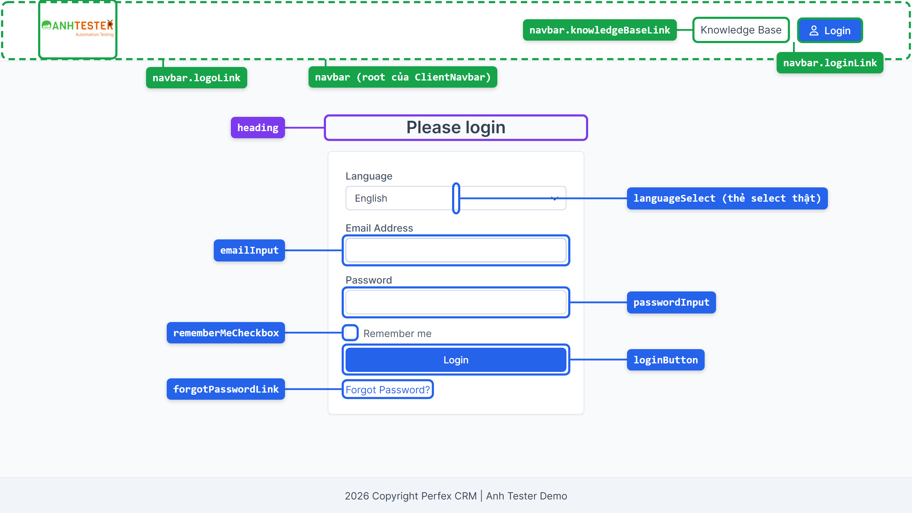
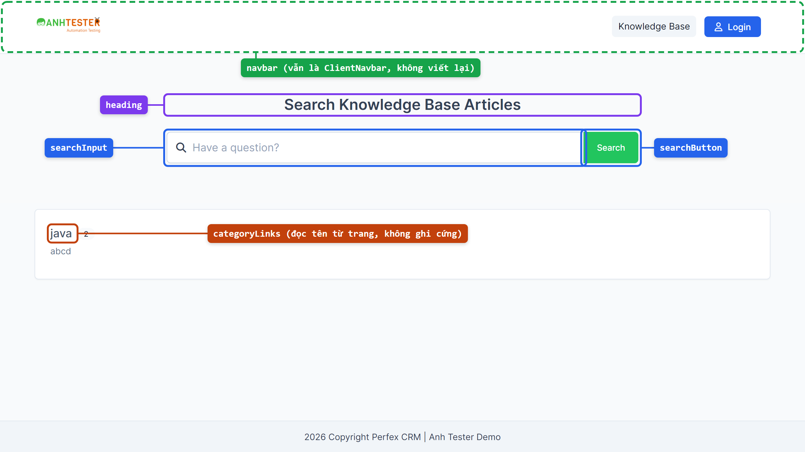
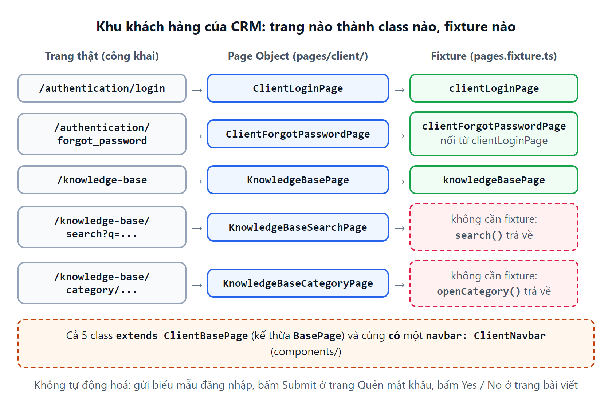
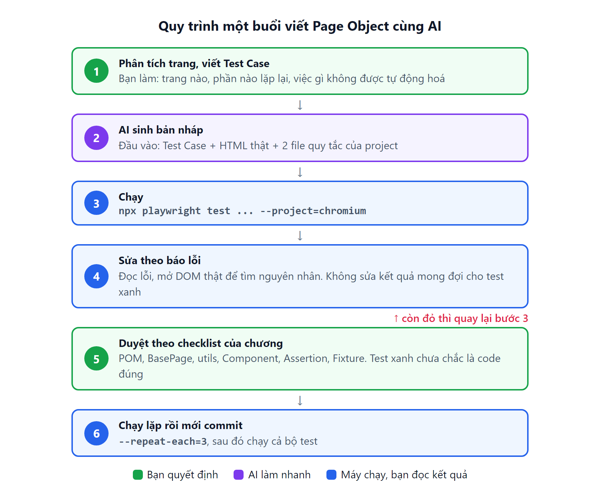
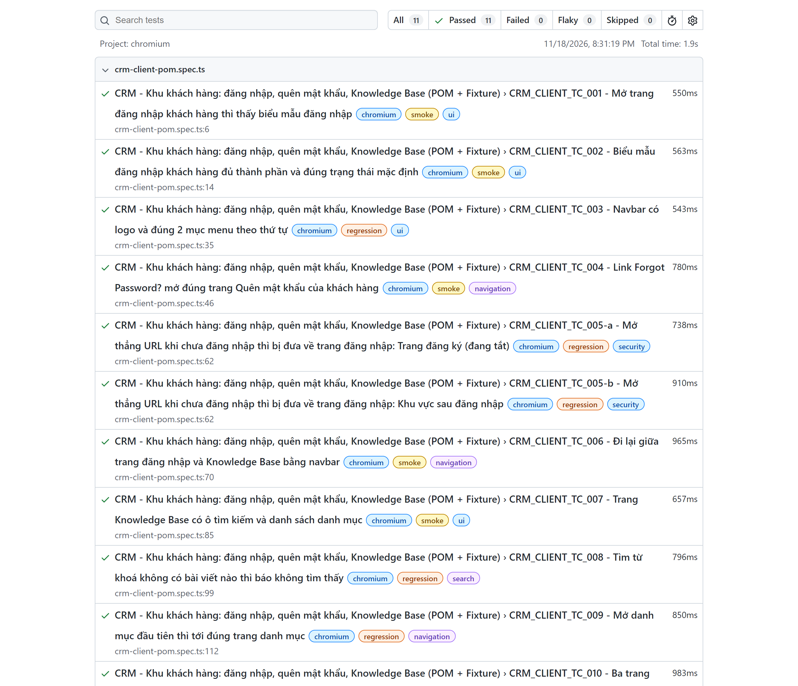
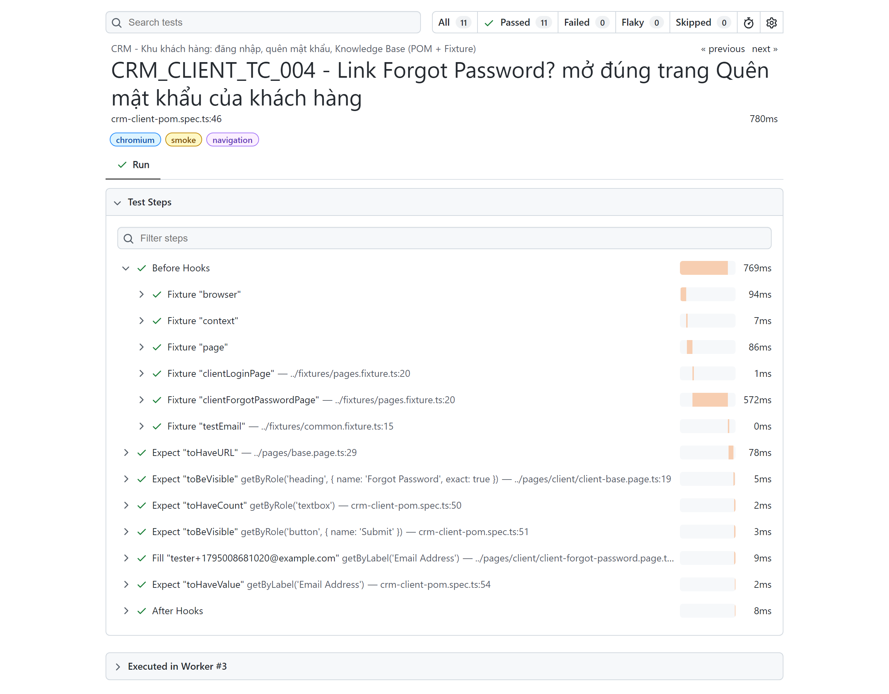

# Bài 27 - [Playwright Typescript] Thực hành Page Object Model trên CRM với AI

Chương: 4. Cấu trúc code Page Object Model + Fixture

Nguồn: [https://anhtester.com/learn/website-and-api-testing-automation-with-playwright-javascript-typescript-day-code-js-ts-tu-dau/384](https://anhtester.com/learn/website-and-api-testing-automation-with-playwright-javascript-typescript-day-code-js-ts-tu-dau/384)

✅ Phân tích các trang CRM demo cần viết Page Object  
✅ Dùng Claude Code và bộ kit claude-testing-skills để sinh Page Object và test  
✅ Chạy, sửa lỗi và duyệt lại code POM do AI sinh ra  
✅ Dựng project POM kèm Fixture cho khu khách hàng CRM  
✅ Bài tập mở rộng cho các module khác của CRM

## ⭐ Mục tiêu bài học

Chương này đã dựng xong bộ khung: Page class gom locator, `BasePage` giữ phần chung, `utils` và `components` giữ thứ dùng lại, `expect` chỉ nằm trong test và `expectLoaded()`. Ở bài trước (Dùng Fixture cho project POM), test thôi `new LoginPage(page)` mà gọi tên `loginPage`, `forgotPasswordPage`... từ `fixtures/pages.fixture.ts`, và import một cửa `'../fixtures'`.

Bài cuối chương là buổi thực hành: áp bộ khung đó lên một nhóm trang **chưa có dòng code nào**, có AI phụ giúp. Học xong bạn sẽ:

- Phân tích được một nhóm trang: trang nào thành Page Object, phần nào thành Component, việc gì không tự động hoá.
- Giao việc cho Claude Code và bộ kit, hoặc ChatGPT, Gemini, theo từng bước có ràng buộc.
- Chạy bản nháp của AI, đọc báo lỗi, sửa đúng nguyên nhân, rồi duyệt bằng checklist của cả chương.

> 📌 Bài làm tiếp trong project `D:\AnhTester\playwright-crm` (macOS: `~/AnhTester/playwright-crm`), trên các trang **công khai** của CRM demo: **không đăng nhập**, không bấm Login, Submit, không gõ mật khẩu thật.

## ✅ Phần 1: Phân tích các trang CRM demo cần viết Page Object

### 🔆 1. Vì sao phân tích trước, viết code sau?

Thợ may đo người trước khi cắt vải. Viết Page Object cũng vậy: chưa biết trang nào dùng chung phần nào mà đã viết (hoặc nhờ AI viết) thì được mấy class chép lại của nhau.

CRM demo có ba vai trò. Admin và Project Manager đăng nhập ở `/admin/authentication`, trang đã có `LoginPage`. Customer đăng nhập ở **khu khách hàng**, một khu khác hẳn và có vài trang xem được không cần tài khoản. Đó là phạm vi hôm nay.

### 🔆 2. Mở từng trang và ghi lại

Mở <https://crm.anhtester.com/authentication/login>, bấm qua các link và ghi lại:

<table class="rt-table">
<thead>
<tr>
<th>Trang → Page Object</th>
<th>Trên trang có gì</th>
<th>Không tự động hoá</th>
</tr>
</thead>
<tbody>
<tr>
<td><code>/authentication/login</code><br/><code>ClientLoginPage</code></td>
<td>Tiêu đề <code>Please login</code>, Language, Email, Password, Remember me, Login, Forgot Password?</td>
<td>Bấm Login, đổi ngôn ngữ</td>
</tr>
<tr>
<td><code>/authentication/forgot_password</code><br/><code>ClientForgotPasswordPage</code></td>
<td>Tiêu đề <code>Forgot Password</code>, ô Email, nút Submit</td>
<td>Bấm Submit (gửi email thật)</td>
</tr>
<tr>
<td><code>/knowledge-base</code><br/><code>KnowledgeBasePage</code></td>
<td>Ô tìm kiếm, nút Search, danh sách danh mục</td>
<td>Không có: tìm kiếm là yêu cầu GET, chỉ đọc</td>
</tr>
<tr>
<td><code>/knowledge-base/search?q=...</code><br/><code>KnowledgeBaseSearchPage</code></td>
<td>Bài viết khớp từ khoá, hoặc dòng báo không tìm thấy</td>
<td>Không có</td>
</tr>
<tr>
<td><code>/knowledge-base/category/...</code><br/><code>KnowledgeBaseCategoryPage</code></td>
<td>Bài viết của một danh mục</td>
<td>Nút Yes / No ở trang bài viết (ghi lượt bình chọn)</td>
</tr>
<tr>
<td><code>/authentication/register</code><br/>Không cần</td>
<td>Bị chuyển về trang đăng nhập: demo đang tắt đăng ký</td>
<td>Chỉ kiểm việc chuyển hướng</td>
</tr>
</tbody>
</table>

Mọi trang đều có chung thanh điều hướng trên cùng: logo, link Knowledge Base, link Login. Phần lặp lại đó là một **Component Object**, như menu trái của trang Book.

[](https://anhtester.com/storage/photos/shares/lesson/js_ts_playwright/v2/bai_27_thuc_hanh_pom_crm_ai/01_trang_dang_nhap_khach_hang_crm_locator.png)

*Trang đăng nhập của khách hàng trên CRM demo: khung nét đứt là root của component navbar, khung liền là locator của Page Object*

[](https://anhtester.com/storage/photos/shares/lesson/js_ts_playwright/v2/bai_27_thuc_hanh_pom_crm_ai/02_trang_knowledge_base_navbar_va_o_tim_kiem.png)

*Trang Knowledge Base dùng lại đúng navbar đó, thêm ô tìm kiếm và danh sách danh mục*

### 🔆 3. HTML thật của hai vùng dễ sai nhất

Bấm chuột phải vào navbar và ô Language, chọn Inspect. HTML thật (đã lược thẻ bọc ngoài và danh sách 26 ngôn ngữ):

```markup
<!-- Navbar: có ở mọi trang của khu khách hàng -->
<nav class="navbar navbar-default header">
  <a href="https://crm.anhtester.com/" class="logo img-responsive navbar-brand logo">
    
  </a>
  <ul class="nav navbar-nav navbar-right">
    <li class="customers-nav-item-knowledge-base">
      <a href="https://crm.anhtester.com/knowledge-base">Knowledge Base</a>
    </li>
    <li class="customers-nav-item-login active">
      <a href="https://crm.anhtester.com/authentication/login"><i class="fa-regular fa-user"></i> Login</a>
    </li>
  </ul>
</nav>

<!-- Ô Language của trang đăng nhập -->
<label for="language" class="control-label">Language</label>
<div class="dropdown bootstrap-select form-control bs3">
  <select name="language" id="language" class="form-control selectpicker" onchange="change_contact_language(this)">
    <option value="english" selected>English</option>
    <option value="vietnamese">Vietnamese</option>
    ...
  </select>
  <button type="button" class="btn dropdown-toggle btn-default" role="combobox" title="English">...</button>
</div>
```

Hai chi tiết sẽ quay lại ở Phần 3, vì AI vấp đúng vào chúng:

- Link Login có thẻ `<i>` vẽ icon đứng trước chữ. Tên trình duyệt đọc ra cho link này là **ký tự icon + Login**.
- Ô Language gồm **hai** phần tử: thẻ `select` thật và một nút giả lập vẽ đè lên. Cả hai mang role `combobox`.

### 🔆 4. Trang nào thành class nào?

[](https://anhtester.com/storage/photos/shares/lesson/js_ts_playwright/v2/bai_27_thuc_hanh_pom_crm_ai/03_so_do_trang_page_object_fixture_khu_khach_hang.png)

*Sơ đồ phân tích khu khách hàng của CRM: mỗi trang một Page Object, navbar là component, ba trang mở đầu có fixture*

Ba quyết định cần nói rõ lý do:

- **Có lớp cha `ClientBasePage`.** Năm trang cùng có navbar và một tiêu đề, giống trường hợp `BookBasePage`. Navbar không lên `BasePage` vì trang Admin và trang Book không có nó.
- **Không gộp `ClientLoginPage` với `LoginPage` của Admin.** Hai trang khác URL, khác tiêu đề, bên này có thêm navbar và ô Language, nút ở trang Quên mật khẩu là `Submit` chứ không phải `Confirm`. Chúng phục vụ hai vai trò nên thay đổi độc lập; gộp chung thì sửa trang này làm gãy test của trang kia.
- **Trang kết quả tìm kiếm và trang danh mục không cần fixture.** Người dùng đi tới chúng từ trang Knowledge Base, nên `search()` và `openCategory()` trả về Page Object của trang mới.

### 🔆 5. Viết Test Case trước khi viết code

Bộ kit chưa có Test Case cho khu này: [system\_map.md](https://github.com/anhtester/claude-testing-skills/blob/main/docs/requirements/_discovery/system_map.md) xếp "Cổng khách hàng" vào vùng chưa khảo sát. 10 Test Case dưới đây được viết ngay trong bài, từ bảng ở mục 2. Lưu vào `docs/testcases/client/web/test_cases_client_web.md` để lát nữa giao cho AI.

<table class="rt-table">
<thead>
<tr>
<th>TC ID</th>
<th>Tên Test Case</th>
<th>Kết quả mong đợi</th>
</tr>
</thead>
<tbody>
<tr><td>TC_001</td><td>Mở trang đăng nhập khách hàng thì thấy biểu mẫu đăng nhập</td><td>Đúng URL, thẻ trình duyệt ghi <code>Please login</code>, thấy tiêu đề trang</td></tr>
<tr><td>TC_002</td><td>Biểu mẫu đăng nhập khách hàng đủ thành phần và đúng trạng thái mặc định</td><td>Language là English; con trỏ ở ô Email; Password che ký tự; Remember me chưa tick; Login bấm được</td></tr>
<tr><td>TC_003</td><td>Navbar có logo và đúng 2 mục menu theo thứ tự</td><td>Knowledge Base rồi Login, hai link trỏ đúng địa chỉ</td></tr>
<tr><td>TC_004</td><td>Link Forgot Password? mở đúng trang Quên mật khẩu của khách hàng</td><td>Đúng trang; đúng 1 ô nhập; có nút Submit; ô Email giữ giá trị vừa gõ (<strong>không</strong> bấm Submit)</td></tr>
<tr><td>TC_005</td><td>Mở thẳng URL khi chưa đăng nhập thì bị đưa về trang đăng nhập</td><td>(a) <code>/authentication/register</code> và (b) <code>/clients/</code> đều dừng ở trang đăng nhập</td></tr>
<tr><td>TC_006</td><td>Đi lại giữa trang đăng nhập và Knowledge Base bằng navbar</td><td>Mỗi lần bấm tới đúng trang</td></tr>
<tr><td>TC_007</td><td>Trang Knowledge Base có ô tìm kiếm và danh sách danh mục</td><td>Ô tìm kiếm gõ được, có ít nhất 1 danh mục</td></tr>
<tr><td>TC_008</td><td>Tìm từ khoá không có bài viết nào thì báo không tìm thấy</td><td>Hiện <code>No knowledge base articles found</code>, ô tìm kiếm giữ từ khoá</td></tr>
<tr><td>TC_009</td><td>Mở danh mục đầu tiên thì tới đúng trang danh mục</td><td>Đúng URL và tên danh mục</td></tr>
<tr><td>TC_010</td><td>Ba trang công khai không có lỗi JavaScript</td><td>Console không ghi lỗi nào</td></tr>
</tbody>
</table>

> ⚠️ Mã đầy đủ có tiền tố `CRM_CLIENT_`. Danh mục và bài viết trên Knowledge Base do mọi người dùng demo tạo ra, đổi từng ngày: TC\_007 và TC\_009 chỉ kiểm **cấu trúc**, đọc tên danh mục từ trang.

## ✅ Phần 2: Dùng Claude Code và bộ kit claude-testing-skills để sinh Page Object và test

### 🔆 1. Hai lệnh của bộ kit dùng trong buổi này

<table class="rt-table">
<thead>
<tr>
<th>Command</th>
<th>Lệnh thật sự làm gì (theo file lệnh của kit)</th>
</tr>
</thead>
<tbody>
<tr>
<td><a href="https://github.com/anhtester/claude-testing-skills/blob/main/.claude/commands/generate-automation-web.md">/generate-automation-web</a></td>
<td>Mode <code>TC</code> (mặc định): mỗi Test Case thành một test, giữ TC ID. Mode <code>FLOW</code>: chỉ có URL và mô tả thao tác. Lệnh mở trình duyệt thật qua Playwright MCP để lấy locator (không được đoán), sinh Page Object và test, rồi chạy và tự sửa tối đa 5 vòng tới khi đạt 2 lần liên tiếp</td>
</tr>
<tr>
<td><a href="https://github.com/anhtester/claude-testing-skills/blob/main/.claude/commands/review-automation-code.md">/review-automation-code</a></td>
<td>Mode <code>REVIEW</code> (mặc định) chấm code <strong>đã có</strong> theo 6 nhóm, có "POM &amp; cấu trúc" và "Assertion &amp; độc lập", mỗi vi phạm kèm tên file và số dòng, không sửa gì. Mode <code>FIX</code> chỉ sửa sau khi bạn duyệt danh sách</td>
</tr>
</tbody>
</table>

Mẫu code của kit khác quy ước project vài điểm: Page class có "verification methods", code đặt trong `src/`, test gắn thông tin cho Allure Report (học ở chương báo cáo). Claude Code tự nạp các file trong `.claude/rules/` mỗi phiên ([tài liệu Claude Code](https://code.claude.com/docs/en/memory)), nên hai file quy tắc của project, gồm cả mục Fixture, là thứ kéo AI về đúng quy ước. Bài này không thêm quy tắc mới.

### 🔆 2. Gọi lệnh trong project

Mở Claude Code tại thư mục project, gõ lệnh kèm ràng buộc của lần chạy:

```markdown
/generate-automation-web TC docs/testcases/client/web/test_cases_client_web.md

Ràng buộc cho lần chạy này:
- URL gốc: https://crm.anhtester.com. Chỉ các trang công khai. KHÔNG đăng nhập, KHÔNG bấm Login, Submit, Yes, No, KHÔNG đổi Language. Không cần credentials.
- Project đã có sẵn BasePage, components, fixtures. Làm theo .claude/rules/project_locator_rules.md và .claude/rules/project_pom_rules.md, kể cả chỗ khác với mẫu của kit.
- Page class đặt ở pages/client/, kế thừa một lớp cha ClientBasePage extends BasePage. Navbar là component components/client-navbar.component.ts.
- Thêm fixture vào fixtures/pages.fixture.ts: clientLoginPage, clientForgotPasswordPage (nối từ clientLoginPage), knowledgeBasePage. Test import từ '../fixtures', không dùng new trong test.
- Ghi test vào tests/crm-client-pom.spec.ts. Tên test: "<TC ID> - <Tên Test Case>". Tag theo cột Tags của file Test Case.
- Chưa tích hợp Allure: giữ reporter html đang có, không cài thêm thư viện.
- Dữ liệu Knowledge Base là dữ liệu dùng chung: không ghi cứng tên danh mục hay tên bài viết.
Trước khi viết code, hãy đưa bảng Locator Collection để tôi duyệt.
```

Có code rồi thì chạy và chấm:

```markdown
/run-and-fix-tests RUN tests/crm-client-pom.spec.ts
/review-automation-code REVIEW pages/client
```

[/run-and-fix-tests](https://github.com/anhtester/claude-testing-skills/blob/main/.claude/commands/run-and-fix-tests.md) đã dùng ở bài BasePage, utils và Component Object: mode `RUN` chạy và phân loại lỗi, chưa sửa gì. Cách gõ lệnh: [code.claude.com/docs/en/slash-commands](https://code.claude.com/docs/en/slash-commands).

> 📌 Kết quả AI trả về mỗi lần mỗi khác, nên bài không chép lại output của AI. Bản nháp ở Phần 3 do Anh Tester dựng lại từ những lỗi AI hay mắc khi prompt thiếu ràng buộc; các báo lỗi bên dưới nó là kết quả chạy thật.

### 🔆 3. Dùng ChatGPT hoặc Gemini: mỗi bước một prompt

Claude Code là bản có phí Anh Tester dùng trong khoá. Bản miễn phí của [ChatGPT](https://chatgpt.com/) hoặc [Gemini](https://gemini.google.com/) không mở được trang, không đọc được project: bạn phải dán HTML thật, hai file quy tắc và code đang có. Năm prompt dưới đây đi từng bước, dùng được ở cả ba công cụ.

**Bước 1 - Phân tích trang:**

```markdown
Tôi sắp viết Page Object (Playwright TypeScript) cho khu khách hàng của https://crm.anhtester.com.
HTML thật của 3 trang (đã lược bớt):

[dán HTML trang /authentication/login]
[dán HTML trang /authentication/forgot_password]
[dán HTML trang /knowledge-base]

CHƯA viết code. Hãy lập bảng: trang | phần tử cần tương tác | phần nào lặp lại ở nhiều trang (ứng viên Component) | thao tác nào làm thay đổi dữ liệu (không được tự động hoá).
Chỉ dựa trên HTML tôi dán. Chỗ nào không thấy trong HTML thì ghi "chưa rõ", không đoán.
```

**Bước 2 - Sinh Page Object:**

```markdown
Quy tắc của project:
[dán .claude/rules/project_locator_rules.md]
[dán .claude/rules/project_pom_rules.md]

Code đang có để làm mẫu:
[dán pages/base.page.ts, pages/book/book-base.page.ts, components/side-menu.component.ts]

Hãy viết:
- components/client-navbar.component.ts: class ClientNavbar nhận root: Locator.
- pages/client/client-base.page.ts: class ClientBasePage extends BasePage, có navbar và heading, ghi đè expectLoaded().
- pages/client/client-login.page.ts: class ClientLoginPage. Hàm openForgotPassword() trả về ClientForgotPasswordPage.
- pages/client/client-forgot-password.page.ts: class ClientForgotPasswordPage. KHÔNG có hàm bấm Submit.
Với mỗi locator, ghi kèm dòng HTML mà bạn dựa vào. Phần tử nào có thể khớp nhiều hơn 1 thì nói rõ.
```

**Bước 3 - Thêm fixture:**

```markdown
Đây là fixtures/pages.fixture.ts hiện tại:

[dán nội dung file]

Thêm 3 fixture: clientLoginPage, clientForgotPasswordPage, knowledgeBasePage.
- Fixture chỉ TẠO Page Object, không tự mở trang. Riêng clientForgotPasswordPage nối từ clientLoginPage: mở trang đăng nhập rồi gọi openForgotPassword().
- Giữ nguyên các fixture đang có. Chỉ đưa các dòng thêm mới và vị trí chèn.
```

**Bước 4 - Sinh test từ bảng Test Case:**

```markdown
Bảng Test Case:

[dán bảng 10 TC ở Phần 1]

Viết tests/crm-client-pom.spec.ts:
- import { test, expect } from '../fixtures'. Không import Page class, không dùng new trong test.
- Mỗi TC một test, tên "<TC ID> - <Tên Test Case>", có tag @smoke hoặc @regression kèm một tag nhóm. TC có biến thể a, b thì dùng vòng lặp.
- expect viết trong test. Chốt "đúng trang" thì gọi expectLoaded() của Page Object.
- Không ghi cứng tên danh mục: đọc từ trang. Không bấm Login, Submit, Yes, No.
```

**Bước 5 - Nhờ duyệt lại sau khi chạy:**

```markdown
Test sau đang lỗi. Báo lỗi đầy đủ của Playwright:

[dán nguyên báo lỗi, gồm cả phần Call log]

HTML thật của phần tử liên quan:
[dán HTML]

Hãy giải thích nguyên nhân dựa trên báo lỗi và HTML. Đề xuất cách sửa LOCATOR hoặc code.
KHÔNG sửa kết quả mong đợi, KHÔNG thêm first(), nth(), waitForTimeout hay tăng timeout để né lỗi.
```

[](https://anhtester.com/storage/photos/shares/lesson/js_ts_playwright/v2/bai_27_thuc_hanh_pom_crm_ai/04_so_do_quy_trinh_viet_page_object_cung_ai.png)

*Quy trình một buổi viết Page Object cùng AI: bạn phân tích và duyệt, AI sinh bản nháp, máy chạy*

## ✅ Phần 3: Chạy, sửa lỗi và duyệt lại code POM do AI sinh ra

### 🔆 1. Một bản nháp điển hình

Khi prompt chỉ có một câu "viết Page Object cho trang đăng nhập khách hàng", bản nháp thường trông như sau. Lưu vào file tạm `tests/exp-ai-draft.spec.ts` (gộp class và test vào một file cho dễ đọc):

```typescript
import { test, expect, type Page } from '@playwright/test';

// ----- pages/client/client-login.page.ts (bản nháp) -----
class ClientLoginPage {
  readonly emailInput = this.page.locator('#email');
  readonly passwordInput = this.page.locator('#password');
  readonly languageDropdown = this.page.getByRole('combobox');
  readonly loginButton = this.page.locator('button[type="submit"]');
  readonly navLoginLink = this.page.getByRole('link', { name: 'Login', exact: true });

  constructor(private readonly page: Page) {}

  async goto(): Promise<void> {
    await this.page.goto('https://crm.anhtester.com/authentication/login');
    await this.page.waitForTimeout(2000);
  }

  async verifyLoginForm(): Promise<void> {
    await expect(this.emailInput).toBeVisible();
    await expect(this.passwordInput).toBeVisible();
    await expect(this.languageDropdown).toBeVisible();
    await expect(this.navLoginLink).toBeVisible();
    await expect(this.loginButton).toBeVisible();
  }
}

// ----- tests/crm-client.spec.ts (bản nháp) -----
test('Trang đăng nhập khách hàng hiển thị đủ thành phần', async ({ page }) => {
  const clientLoginPage = new ClientLoginPage(page);
  await clientLoginPage.goto();
  await clientLoginPage.verifyLoginForm();
});
```

```bash
npx playwright test exp-ai-draft.spec.ts --project=chromium --reporter=list
```

### 🔆 2. Ba lần chạy đỏ, ba nguyên nhân

**Lần 1: test dừng ngay ở dòng `new`, chưa mở được trang.**

```plaintext
    TypeError: Cannot read properties of undefined (reading 'locator')

      3 | // ----- pages/client/client-login.page.ts (bản nháp) -----
      4 | class ClientLoginPage {
    > 5 |   readonly emailInput = this.page.locator('#email');
        |                                   ^
      6 |   readonly passwordInput = this.page.locator('#password');
        at ClientLoginPage.constructor (D:\AnhTester\playwright-crm\tests\exp-ai-draft.spec.ts:5:35)
```

Lỗi đã gặp ở bài Cấu trúc code theo Page Object Model: từ Playwright 1.65, dòng khai báo thuộc tính chạy **trước** khi `page` được gán. Sửa: chỉ khai báo kiểu `readonly emailInput: Locator;`, gán trong constructor.

**Lần 2: sau khi chuyển phần gán vào constructor.**

```plaintext
    Error: expect(locator).toBeVisible() failed

    Locator: getByRole('combobox')
    Expected: visible
    Error: strict mode violation: getByRole('combobox') resolved to 2 elements:
        1) <select id="language" tabindex="-98" name="language" data-live-search="true" class="form-control selectpicker" onchange="change_contact_language(this)" data-none-selected-text="Nothing selected">…</select> aka getByLabel('Language')
        2) <button type="button" role="combobox" title="English" data-id="language" aria-expanded="false" data-toggle="dropdown" aria-owns="bs-select-1" aria-haspopup="listbox" class="btn dropdown-toggle btn-default">…</button> aka getByRole('combobox', { name: 'English' })
```

Ô Language là hai phần tử, và báo lỗi gợi ý luôn locator cho từng cái. Chọn `getByLabel('Language')`: nó trỏ vào thẻ `select` thật, nơi giữ giá trị. **Không** sửa bằng `.first()`: đổi giao diện là phần tử đầu thành cái khác.

**Lần 3: sau khi đổi sang `getByLabel('Language')`.**

```plaintext
    Error: expect(locator).toBeVisible() failed

    Locator: getByRole('link', { name: 'Login', exact: true })
    Expected: visible
    Timeout: 5000ms
    Error: element(s) not found
```

Link Login nằm ngay trên màn hình mà Playwright không tìm thấy. Nguyên nhân là thẻ `<i>` icon: tên của link là ký tự icon cộng chữ `Login`, nên `exact: true` không khớp. Bỏ `exact: true` là đủ, vì trang chỉ có một `link` chứa chữ Login (nút Login mang role `button`). AI không mở trang thật thì không thấy được lỗi này, nên lệnh của kit mới bắt buộc khảo sát DOM trước.

### 🔆 3. Test xanh rồi vẫn chưa xong

Sửa ba chỗ trên là test đạt. Bản nháp vẫn còn sáu vấn đề mà **không lần chạy nào báo**, chỉ người duyệt mới thấy:

<table class="rt-table">
<thead>
<tr>
<th>Mục của chương</th>
<th>Bản nháp</th>
<th>Sau khi duyệt</th>
</tr>
</thead>
<tbody>
<tr><td>Locator</td><td><code>locator('#email')</code>, <code>locator('button[type="submit"]')</code></td><td><code>getByLabel('Email Address')</code>, <code><span>getByRole('button',</span> <span>{</span> <span>name:</span> <span>'Login'</span> <span>})</span></code></td></tr>
<tr><td>BasePage</td><td>Class đứng một mình, tự viết <code>goto()</code> với URL đầy đủ</td><td><code>extends ClientBasePage</code>, gọi <code>super(...)</code></td></tr>
<tr><td>Component</td><td>Link của navbar khai báo trong trang đăng nhập</td><td>Chuyển vào <code>ClientNavbar</code></td></tr>
<tr><td>Chờ</td><td><code>waitForTimeout(2000)</code> sau <code>goto()</code></td><td>Xoá. Test gọi <code>expectLoaded()</code>, tự chờ</td></tr>
<tr><td>Assertion</td><td><code>verifyLoginForm()</code> chứa 5 dòng <code>expect</code></td><td>Xoá hàm. Kết quả mong đợi viết trong test</td></tr>
<tr><td>Fixture</td><td>Test nhận <code>{ page }</code> rồi <code>new ClientLoginPage(page)</code></td><td>Test nhận <code>{ clientLoginPage }</code></td></tr>
</tbody>
</table>

Xoá file tạm. Phần 4 là code sau cả hai vòng sửa và duyệt.

## ✅ Phần 4: Dựng project POM kèm Fixture cho khu khách hàng CRM

### 🔆 1. Component navbar và lớp cha của nhóm trang

Tạo file `components/client-navbar.component.ts`:

```typescript
import { type Locator } from '@playwright/test';

/** Thanh điều hướng trên cùng của khu khách hàng CRM. Có mặt ở mọi trang công khai */
export class ClientNavbar {
  readonly root: Locator;
  readonly logoLink: Locator;
  readonly menuLinks: Locator;
  readonly knowledgeBaseLink: Locator;
  readonly loginLink: Locator;

  constructor(root: Locator) {
    this.root = root;
    this.logoLink = root.getByRole('link', { name: 'Perfex CRM | Anh Tester Demo' });
    this.menuLinks = root.getByRole('listitem').getByRole('link'); // các mục menu, không tính logo
    this.knowledgeBaseLink = root.getByRole('link', { name: 'Knowledge Base' });
    // KHÔNG thêm exact: true. Tên của link này có kèm ký tự icon đứng trước chữ Login
    this.loginLink = root.getByRole('link', { name: 'Login' });
  }

  async openKnowledgeBase(): Promise<void> {
    await this.knowledgeBaseLink.click();
  }

  async openLogin(): Promise<void> {
    await this.loginLink.click();
  }
}
```

Tạo thư mục `pages/client` và file `pages/client/client-base.page.ts`:

```typescript
import { expect, type Page, type Locator } from '@playwright/test';
import { BasePage } from '../base.page';
import { ClientNavbar } from '../../components/client-navbar.component';

/** Lớp cha của các trang khu khách hàng CRM: trang nào cũng có navbar và một tiêu đề */
export class ClientBasePage extends BasePage {
  readonly navbar: ClientNavbar;
  readonly heading: Locator;

  constructor(page: Page, path: string, headingName: string) {
    super(page, path); // baseUrl mặc định là CRM_URL
    this.navbar = new ClientNavbar(page.getByRole('navigation'));
    this.heading = page.getByRole('heading', { name: headingName, exact: true });
  }

  /** Đúng URL và đã thấy tiêu đề của trang */
  async expectLoaded(): Promise<void> {
    await super.expectLoaded();
    await expect(this.heading).toBeVisible();
  }
}
```

Tiêu đề dùng `exact: true` vì trang kết quả tìm kiếm có hai tiêu đề gần giống nhau. Root của navbar là `getByRole('navigation')`: đã đo trên cả năm trang, mỗi trang đúng 1 phần tử.

### 🔆 2. Hai trang đăng nhập và Quên mật khẩu

File `pages/client/client-forgot-password.page.ts`:

```typescript
import { type Page, type Locator } from '@playwright/test';
import { ClientBasePage } from './client-base.page';

export class ClientForgotPasswordPage extends ClientBasePage {
  readonly emailInput: Locator;
  readonly submitButton: Locator;
  readonly allTextboxes: Locator;

  constructor(page: Page) {
    super(page, '/authentication/forgot_password', 'Forgot Password');
    this.emailInput = page.getByLabel('Email Address');
    this.submitButton = page.getByRole('button', { name: 'Submit' });
    this.allTextboxes = page.getByRole('textbox');
  }

  /** Điền ô Email, KHÔNG bấm Submit */
  async fillEmail(email: string): Promise<void> {
    await this.emailInput.fill(email);
  }
}
```

File `pages/client/client-login.page.ts`:

```typescript
import { type Page, type Locator } from '@playwright/test';
import { ClientBasePage } from './client-base.page';
import { ClientForgotPasswordPage } from './client-forgot-password.page';

/** Trang đăng nhập của khách hàng (vai trò Customer). Trang đăng nhập Admin là pages/login.page.ts */
export class ClientLoginPage extends ClientBasePage {
  readonly languageSelect: Locator;
  readonly languageOptions: Locator;
  readonly emailInput: Locator;
  readonly passwordInput: Locator;
  readonly rememberMeCheckbox: Locator;
  readonly loginButton: Locator;
  readonly forgotPasswordLink: Locator;

  constructor(page: Page) {
    super(page, '/authentication/login', 'Please login');
    // Trang có 2 phần tử role combobox (thẻ select thật và nút giả lập của giao diện) nên tìm theo nhãn
    this.languageSelect = page.getByLabel('Language');
    this.languageOptions = this.languageSelect.getByRole('option');
    this.emailInput = page.getByLabel('Email Address');
    this.passwordInput = page.getByLabel('Password');
    this.rememberMeCheckbox = page.getByRole('checkbox', { name: 'Remember me' });
    this.loginButton = page.getByRole('button', { name: 'Login' });
    this.forgotPasswordLink = page.getByRole('link', { name: 'Forgot Password?' });
  }

  async fillEmail(email: string): Promise<void> {
    await this.emailInput.fill(email);
  }

  async fillPassword(password: string): Promise<void> {
    await this.passwordInput.fill(password);
  }

  /** Điền cả hai ô, KHÔNG gửi biểu mẫu */
  async fillCredentials(email: string, password: string): Promise<void> {
    await this.fillEmail(email);
    await this.fillPassword(password);
  }

  /** Bấm link Forgot Password? và trả về Page Object của trang vừa mở */
  async openForgotPassword(): Promise<ClientForgotPasswordPage> {
    await this.forgotPasswordLink.click();
    return new ClientForgotPasswordPage(this.page);
  }
}
```

### 🔆 3. Ba trang Knowledge Base

File `pages/client/knowledge-base-search.page.ts`:

```typescript
import { type Page, type Locator } from '@playwright/test';
import { ClientBasePage } from './client-base.page';

/** Trang kết quả tìm kiếm của Knowledge Base. Mỗi từ khoá là một URL */
export class KnowledgeBaseSearchPage extends ClientBasePage {
  readonly keyword: string;
  readonly searchInput: Locator;
  readonly articleLinks: Locator;
  readonly emptyMessage: Locator;

  constructor(page: Page, keyword: string) {
    // URLSearchParams mã hoá từ khoá đúng kiểu trình duyệt gửi biểu mẫu GET (dấu cách thành dấu +)
    super(page, `/knowledge-base/search?${new URLSearchParams({ q: keyword })}`, 'Search Knowledge Base Articles');
    this.keyword = keyword;
    this.searchInput = page.getByRole('searchbox', { name: 'Have a question?' });
    this.articleLinks = page.getByRole('heading', { level: 4 }).getByRole('link');
    this.emptyMessage = page.getByText('No knowledge base articles found');
  }
}
```

File `pages/client/knowledge-base-category.page.ts`:

```typescript
import { type Page, type Locator } from '@playwright/test';
import { ClientBasePage } from './client-base.page';

/** Trang một danh mục của Knowledge Base: danh sách bài viết thuộc danh mục đó */
export class KnowledgeBaseCategoryPage extends ClientBasePage {
  readonly articleLinks: Locator;

  /** path lấy từ href của link danh mục, ví dụ /knowledge-base/category/java */
  constructor(page: Page, path: string) {
    super(page, path, 'Search Knowledge Base Articles');
    this.articleLinks = page.getByRole('heading', { level: 4 }).getByRole('link');
  }
}
```

File `pages/client/knowledge-base.page.ts`:

```typescript
import { type Page, type Locator } from '@playwright/test';
import { ClientBasePage } from './client-base.page';
import { KnowledgeBaseSearchPage } from './knowledge-base-search.page';
import { KnowledgeBaseCategoryPage } from './knowledge-base-category.page';

export class KnowledgeBasePage extends ClientBasePage {
  readonly searchInput: Locator;
  readonly searchButton: Locator;
  readonly categoryLinks: Locator;

  constructor(page: Page) {
    super(page, '/knowledge-base', 'Search Knowledge Base Articles');
    this.searchInput = page.getByRole('searchbox', { name: 'Have a question?' });
    this.searchButton = page.getByRole('button', { name: 'Search' });
    this.categoryLinks = page.getByRole('heading', { level: 3 }).getByRole('link');
  }

  /** Tên các danh mục đang có. Dữ liệu demo dùng chung nên đọc từ trang, không ghi cứng */
  async categoryNames(): Promise<string[]> {
    const names = await this.categoryLinks.allInnerTexts();
    return names.map((name) => name.trim());
  }

  /** Tìm kiếm là yêu cầu GET, chỉ đọc dữ liệu. Trả về Page Object của trang kết quả */
  async search(keyword: string): Promise<KnowledgeBaseSearchPage> {
    await this.searchInput.fill(keyword);
    await this.searchButton.click();
    return new KnowledgeBaseSearchPage(this.page, keyword);
  }

  /** Mở danh mục theo tên hiển thị, trả về Page Object của trang danh mục */
  async openCategory(name: string): Promise<KnowledgeBaseCategoryPage> {
    const link = this.categoryLinks.filter({ hasText: name });
    const href = (await link.getAttribute('href')) ?? '';
    await link.click();
    return new KnowledgeBaseCategoryPage(this.page, new URL(href).pathname);
  }
}
```

`openCategory()` đọc `href` của link trước khi bấm để biết đường dẫn trang sắp tới. Nhờ vậy `expectLoaded()` của trang danh mục kiểm được URL mà code không ghi cứng tên danh mục nào.

### 🔆 4. Nối vào Fixture

Mở `fixtures/pages.fixture.ts` và thêm ba chỗ. `fixtures/index.ts` không phải sửa: `mergeTests` tự mang theo fixture mới.

```typescript
// fixtures/pages.fixture.ts - các dòng THÊM MỚI (phần không nhắc tới giữ nguyên)

// 1. Thêm import
import { ClientLoginPage } from '../pages/client/client-login.page';
import { ClientForgotPasswordPage } from '../pages/client/client-forgot-password.page';
import { KnowledgeBasePage } from '../pages/client/knowledge-base.page';

// 2. Thêm vào type PageFixtures
export type PageFixtures = {
  // ... loginPage, forgotPasswordPage, promotionPage, userPage
  clientLoginPage: ClientLoginPage;
  clientForgotPasswordPage: ClientForgotPasswordPage;
  knowledgeBasePage: KnowledgeBasePage;
};

// 3. Thêm vào base.extend<PageFixtures>({ ... }), sau userPage
  // ----- Khu khách hàng của CRM -----
  clientLoginPage: async ({ page }, use) => {
    await use(new ClientLoginPage(page));
  },

  /** Fixture Chaining: dùng lại clientLoginPage, đi qua link Forgot Password? để tới trang */
  clientForgotPasswordPage: async ({ clientLoginPage }, use) => {
    await clientLoginPage.goto();
    await use(await clientLoginPage.openForgotPassword());
  },

  knowledgeBasePage: async ({ page }, use) => {
    await use(new KnowledgeBasePage(page));
  },
```

### 🔆 5. File tests/crm-client-pom.spec.ts

```typescript
import { test, expect } from '../fixtures';

const CATEGORY_HREF = /\/knowledge-base\/category\/.+/;

test.describe('CRM - Khu khách hàng: đăng nhập, quên mật khẩu, Knowledge Base (POM + Fixture)', () => {
  test('CRM_CLIENT_TC_001 - Mở trang đăng nhập khách hàng thì thấy biểu mẫu đăng nhập',
    { tag: ['@smoke', '@ui'] }, async ({ page, clientLoginPage }) => {
      await clientLoginPage.goto();

      await clientLoginPage.expectLoaded();
      await expect(page).toHaveTitle('Please login');
    });

  test('CRM_CLIENT_TC_002 - Biểu mẫu đăng nhập khách hàng đủ thành phần và đúng trạng thái mặc định',
    { tag: ['@smoke', '@ui'] }, async ({ clientLoginPage }) => {
      await clientLoginPage.goto();

      await test.step('Mục 1: ngôn ngữ mặc định là English, danh sách có Vietnamese', async () => {
        await expect(clientLoginPage.languageSelect).toHaveValue('english');
        await expect(clientLoginPage.languageOptions.filter({ hasText: 'Vietnamese' })).toHaveCount(1);
      });

      await test.step('Mục 2: con trỏ nằm sẵn trong ô Email, ô Password che ký tự', async () => {
        await expect(clientLoginPage.emailInput).toBeFocused();
        await expect(clientLoginPage.passwordInput).toHaveAttribute('type', 'password');
      });

      await test.step('Mục 3: Remember me chưa tick, nút Login bấm được, có link Forgot Password?', async () => {
        await expect(clientLoginPage.rememberMeCheckbox).not.toBeChecked();
        await expect(clientLoginPage.loginButton).toBeEnabled();
        await expect(clientLoginPage.forgotPasswordLink).toBeVisible();
      });
    });

  test('CRM_CLIENT_TC_003 - Navbar có logo và đúng 2 mục menu theo thứ tự',
    { tag: ['@regression', '@ui'] }, async ({ clientLoginPage }) => {
      await clientLoginPage.goto();
      const navbar = clientLoginPage.navbar;

      await expect(navbar.logoLink).toBeVisible();
      await expect(navbar.menuLinks).toHaveText(['Knowledge Base', 'Login']);
      await expect(navbar.knowledgeBaseLink).toHaveAttribute('href', /\/knowledge-base$/);
      await expect(navbar.loginLink).toHaveAttribute('href', clientLoginPage.url);
    });

  test('CRM_CLIENT_TC_004 - Link Forgot Password? mở đúng trang Quên mật khẩu của khách hàng',
    { tag: ['@smoke', '@navigation'] }, async ({ clientForgotPasswordPage, testEmail }) => {
      // clientForgotPasswordPage đã tự đi qua trang đăng nhập (Fixture Chaining)
      await clientForgotPasswordPage.expectLoaded();
      await expect(clientForgotPasswordPage.allTextboxes).toHaveCount(1);
      await expect(clientForgotPasswordPage.submitButton).toBeVisible();

      await clientForgotPasswordPage.fillEmail(testEmail); // chỉ điền, KHÔNG bấm Submit
      await expect(clientForgotPasswordPage.emailInput).toHaveValue(testEmail);
    });

  const protectedUrls = [
    { variant: 'a', name: 'Trang đăng ký (đang tắt)', path: '/authentication/register' },
    { variant: 'b', name: 'Khu vực sau đăng nhập', path: '/clients/' },
  ];
  for (const { variant, name, path } of protectedUrls) {
    test(`CRM_CLIENT_TC_005-${variant} - Mở thẳng URL khi chưa đăng nhập thì bị đưa về trang đăng nhập: ${name}`,
      { tag: ['@regression', '@security'] }, async ({ page, clientLoginPage }) => {
        await page.goto(`https://crm.anhtester.com${path}`);

        await clientLoginPage.expectLoaded();
      });
  }

  test('CRM_CLIENT_TC_006 - Đi lại giữa trang đăng nhập và Knowledge Base bằng navbar',
    { tag: ['@smoke', '@navigation'] }, async ({ clientLoginPage, knowledgeBasePage }) => {
      await clientLoginPage.goto();

      await test.step('Đăng nhập -> Knowledge Base', async () => {
        await clientLoginPage.navbar.openKnowledgeBase();
        await knowledgeBasePage.expectLoaded();
      });

      await test.step('Knowledge Base -> Đăng nhập', async () => {
        await knowledgeBasePage.navbar.openLogin();
        await clientLoginPage.expectLoaded();
      });
    });

  test('CRM_CLIENT_TC_007 - Trang Knowledge Base có ô tìm kiếm và danh sách danh mục',
    { tag: ['@smoke', '@ui'] }, async ({ page, knowledgeBasePage }) => {
      await knowledgeBasePage.goto();
      await knowledgeBasePage.expectLoaded();

      await expect(page).toHaveTitle('Knowledge Base');
      await expect(knowledgeBasePage.searchInput).toBeEditable();
      await expect(knowledgeBasePage.searchButton).toBeEnabled();
      await expect(knowledgeBasePage.categoryLinks).not.toHaveCount(0);
      for (const link of await knowledgeBasePage.categoryLinks.all()) {
        await expect(link).toHaveAttribute('href', CATEGORY_HREF);
      }
    });

  test('CRM_CLIENT_TC_008 - Tìm từ khoá không có bài viết nào thì báo không tìm thấy',
    { tag: ['@regression', '@search'] }, async ({ knowledgeBasePage, runId }) => {
      const keyword = `khong-co-${runId}`; // runId: fixture phạm vi worker của common.fixture.ts
      await knowledgeBasePage.goto();

      const searchPage = await knowledgeBasePage.search(keyword);

      await searchPage.expectLoaded();
      await expect(searchPage.emptyMessage).toBeVisible();
      await expect(searchPage.articleLinks).toHaveCount(0);
      await expect(searchPage.searchInput).toHaveValue(keyword);
    });

  test('CRM_CLIENT_TC_009 - Mở danh mục đầu tiên thì tới đúng trang danh mục',
    { tag: ['@regression', '@navigation'] }, async ({ page, knowledgeBasePage }) => {
      await knowledgeBasePage.goto();
      await expect(knowledgeBasePage.categoryLinks).not.toHaveCount(0);
      const [firstCategory] = await knowledgeBasePage.categoryNames(); // đọc từ trang, không ghi cứng

      const categoryPage = await knowledgeBasePage.openCategory(firstCategory);

      await categoryPage.expectLoaded();
      await expect(page).toHaveTitle(firstCategory);
      console.log(`Danh mục "${firstCategory}" | ${categoryPage.path} | số bài viết: ${await categoryPage.articleLinks.count()}`);
    });

  test('CRM_CLIENT_TC_010 - Ba trang công khai không có lỗi JavaScript',
    { tag: ['@regression', '@ui'] }, async ({ clientLoginPage, clientForgotPasswordPage, knowledgeBasePage, consoleErrors }) => {
      // clientForgotPasswordPage đã mở trang đăng nhập rồi trang Quên mật khẩu
      await clientForgotPasswordPage.expectLoaded();
      await knowledgeBasePage.goto();
      await knowledgeBasePage.expectLoaded();
      await clientLoginPage.goto();
      await clientLoginPage.expectLoaded();

      expect(consoleErrors, 'Các trang công khai của khu khách hàng không được có lỗi JavaScript').toEqual([]);
    });
});
```

Cả file không có chữ `new` và không import Page class nào. Các fixture chung cũng có mặt: `testEmail` ở TC\_004, `runId` ở TC\_008, `consoleErrors` ở TC\_010.

```bash
npx playwright test crm-client-pom.spec.ts --project=chromium --reporter=list,html
```

```plaintext

Running 11 tests using 11 workers

  ✓   2 [chromium] › tests\crm-client-pom.spec.ts:35:3 › CRM - Khu khách hàng: đăng nhập, quên mật khẩu, Knowledge Base (POM + Fixture) › CRM_CLIENT_TC_003 - Navbar có logo và đúng 2 mục menu theo thứ tự @regression @ui (543ms)
  ✓   1 [chromium] › tests\crm-client-pom.spec.ts:14:3 › CRM - Khu khách hàng: đăng nhập, quên mật khẩu, Knowledge Base (POM + Fixture) › CRM_CLIENT_TC_002 - Biểu mẫu đăng nhập khách hàng đủ thành phần và đúng trạng thái mặc định @smoke @ui (563ms)
  ✓   4 [chromium] › tests\crm-client-pom.spec.ts:6:3 › CRM - Khu khách hàng: đăng nhập, quên mật khẩu, Knowledge Base (POM + Fixture) › CRM_CLIENT_TC_001 - Mở trang đăng nhập khách hàng thì thấy biểu mẫu đăng nhập @smoke @ui (550ms)
  ✓   3 [chromium] › tests\crm-client-pom.spec.ts:46:3 › CRM - Khu khách hàng: đăng nhập, quên mật khẩu, Knowledge Base (POM + Fixture) › CRM_CLIENT_TC_004 - Link Forgot Password? mở đúng trang Quên mật khẩu của khách hàng @smoke @navigation (780ms)
  ✓   6 [chromium] › tests\crm-client-pom.spec.ts:85:3 › CRM - Khu khách hàng: đăng nhập, quên mật khẩu, Knowledge Base (POM + Fixture) › CRM_CLIENT_TC_007 - Trang Knowledge Base có ô tìm kiếm và danh sách danh mục @smoke @ui (657ms)
  ✓   9 [chromium] › tests\crm-client-pom.spec.ts:62:5 › CRM - Khu khách hàng: đăng nhập, quên mật khẩu, Knowledge Base (POM + Fixture) › CRM_CLIENT_TC_005-a - Mở thẳng URL khi chưa đăng nhập thì bị đưa về trang đăng nhập: Trang đăng ký (đang tắt) @regression @security (738ms)
  ✓   7 [chromium] › tests\crm-client-pom.spec.ts:99:3 › CRM - Khu khách hàng: đăng nhập, quên mật khẩu, Knowledge Base (POM + Fixture) › CRM_CLIENT_TC_008 - Tìm từ khoá không có bài viết nào thì báo không tìm thấy @regression @search (796ms)
Danh mục "java" | /knowledge-base/category/java | số bài viết: 2
  ✓  10 [chromium] › tests\crm-client-pom.spec.ts:112:3 › CRM - Khu khách hàng: đăng nhập, quên mật khẩu, Knowledge Base (POM + Fixture) › CRM_CLIENT_TC_009 - Mở danh mục đầu tiên thì tới đúng trang danh mục @regression @navigation (850ms)
  ✓   8 [chromium] › tests\crm-client-pom.spec.ts:62:5 › CRM - Khu khách hàng: đăng nhập, quên mật khẩu, Knowledge Base (POM + Fixture) › CRM_CLIENT_TC_005-b - Mở thẳng URL khi chưa đăng nhập thì bị đưa về trang đăng nhập: Khu vực sau đăng nhập @regression @security (910ms)
  ✓   5 [chromium] › tests\crm-client-pom.spec.ts:70:3 › CRM - Khu khách hàng: đăng nhập, quên mật khẩu, Knowledge Base (POM + Fixture) › CRM_CLIENT_TC_006 - Đi lại giữa trang đăng nhập và Knowledge Base bằng navbar @smoke @navigation (965ms)
  ✓  11 [chromium] › tests\crm-client-pom.spec.ts:125:3 › CRM - Khu khách hàng: đăng nhập, quên mật khẩu, Knowledge Base (POM + Fixture) › CRM_CLIENT_TC_010 - Ba trang công khai không có lỗi JavaScript @regression @ui (983ms)

  11 passed (1.9s)
```

Kết quả chạy thật (Playwright 1.65.1, ngày 18/11/2026): **11 passed** (TC\_005 có hai biến thể). `Danh mục "java"` là tên đọc từ trang lúc chạy, ngày bạn chạy có thể khác.

[](https://anhtester.com/storage/photos/shares/lesson/js_ts_playwright/v2/bai_27_thuc_hanh_pom_crm_ai/05_html_report_crm_client_pom.png)

*HTML Report của crm-client-pom.spec.ts: 11 test đạt, mỗi dòng mang một TC ID và các tag*

Mở TC\_004 trong report: mục Before Hooks cho thấy Fixture Chaining chạy đúng thứ tự `page`, `clientLoginPage`, `clientForgotPasswordPage`, và từng `expect` ghi rõ đến từ Page Object hay từ file test:

[](https://anhtester.com/storage/photos/shares/lesson/js_ts_playwright/v2/bai_27_thuc_hanh_pom_crm_ai/06_html_report_fixture_chaining_tc_004.png)

*HTML Report của TC\_004: Before Hooks liệt kê các fixture theo đúng thứ tự phụ thuộc*

Chạy lặp mỗi test 3 lần để chắc bộ test không flaky:

```bash
npx playwright test crm-client-pom.spec.ts --project=chromium --repeat-each=3 --reporter=dot
```

```plaintext

Running 33 tests using 16 workers
·············Danh mục "java" | /knowledge-base/category/java | số bài viết: 2
·········Danh mục "java" | /knowledge-base/category/java | số bài viết: 2
·········Danh mục "java" | /knowledge-base/category/java | số bài viết: 2
··
  33 passed (5.9s)
```

### 🔆 6. Project sau cả chương

```plaintext
playwright-crm/
├── .claude/rules/
│   ├── project_locator_rules.md
│   └── project_pom_rules.md
├── components/
│   ├── side-menu.component.ts            ← SideMenu (Book)
│   ├── data-table.component.ts           ← DataTable (Book)
│   └── client-navbar.component.ts        ← ClientNavbar (MỚI)
├── docs/testcases/client/web/
│   └── test_cases_client_web.md          ← 10 Test Case của bài này (MỚI)
├── fixtures/
│   ├── common.fixture.ts                 ← testEmail, consoleErrors, runId
│   ├── pages.fixture.ts                  ← 4 fixture cũ + 3 fixture khu khách hàng
│   └── index.ts                          ← mergeTests, cửa import duy nhất
├── pages/
│   ├── base.page.ts                      ← BasePage
│   ├── login.page.ts                     ← LoginPage (Admin)
│   ├── forgot-password.page.ts           ← ForgotPasswordPage (Admin)
│   ├── book/                             ← BookBasePage, PromotionPage, UserPage
│   └── client/                           ← (MỚI)
│       ├── client-base.page.ts           ← ClientBasePage extends BasePage, có navbar
│       ├── client-login.page.ts          ← ClientLoginPage
│       ├── client-forgot-password.page.ts
│       ├── knowledge-base.page.ts        ← KnowledgeBasePage: search(), openCategory()
│       ├── knowledge-base-search.page.ts
│       └── knowledge-base-category.page.ts
├── tests/
│   ├── crm-login.spec.ts                 ← chưa dùng POM, giữ để so sánh
│   ├── crm-login-pom.spec.ts
│   ├── book-pom.spec.ts
│   ├── fixture-basic.spec.ts
│   ├── fixture-lifecycle.spec.ts         ← demo vòng đời fixture
│   └── crm-client-pom.spec.ts            ← (MỚI) 11 test
├── utils/                                ← table.ts, date.ts, data.ts
└── playwright.config.ts
```

Thêm code mới xong thì chạy lại **cả bộ test**. Option `--quiet` ẩn các dòng `console.log` của test:

```bash
npx playwright test --project=chromium --reporter=dot --quiet
```

```plaintext
Running 47 tests using 16 workers
···············································
  47 passed (9.0s)
```

Kết quả chạy thật: **47 passed** từ 6 file test (13 + 13 + 3 + 3 + 4 + 11). Bạn đã xoá bớt file demo nào của các bài trước thì con số sẽ nhỏ hơn.

## ✅ Phần 5: Kiểm tra code do AI sinh ra

Bảng ở Phần 3 đã nêu sáu lỗi về cấu trúc. Thêm bốn dấu hiệu dưới đây là đủ bộ để rà code AI viết, kể cả khi test đã xanh:

<table class="rt-table">
<thead>
<tr>
<th>Dấu hiệu trong code</th>
<th>Vì sao là vấn đề</th>
<th>Cách xử lý</th>
</tr>
</thead>
<tbody>
<tr><td><code>readonly x = this.page.getBy...</code> trong class không kế thừa BasePage</td><td>TypeError ngay lúc <code>new</code> (Playwright 1.65)</td><td>Gán trong constructor</td></tr>
<tr><td><code>exact: true</code> trên link hoặc nút có icon</td><td>Tên phần tử có kèm ký tự icon nên không khớp</td><td>Bỏ <code>exact</code>, kiểm lại số phần tử khớp trên trang thật</td></tr>
<tr><td>Fixture tự bấm Login, Submit, hoặc quên <code>await use(...)</code></td><td>Giấu một bước gửi dữ liệu lên demo; thiếu <code>await</code> thì phần dọn dẹp chạy trước cả thân test mà không báo lỗi</td><td>Fixture chỉ tạo đối tượng, luôn <code>await use(...)</code></td></tr>
<tr><td>Tên danh mục, tên bài viết ghi cứng trong code</td><td>Dữ liệu demo dùng chung đổi là test đỏ</td><td>Đọc từ trang, kiểm cấu trúc</td></tr>
</tbody>
</table>

## ✅ Phần 6: Bài tập mở rộng cho các module khác của CRM

Phần lớn CRM nằm sau trang đăng nhập. Bộ kit có tài liệu yêu cầu thật cho hai module: [Customers](https://github.com/anhtester/claude-testing-skills/blob/main/docs/requirements/customers/REQUIREMENTS_CUSTOMERS_SUMMARY.md) và [Projects](https://github.com/anhtester/claude-testing-skills/blob/main/docs/requirements/projects/REQUIREMENTS_PROJECTS_SUMMARY.md). Từ đó bạn làm lại Phần 1 cho một module. Chú ý việc không tự động hoá: tài liệu Customers cảnh báo đường dẫn xoá khách hàng là yêu cầu GET, mở URL là xoá thật.

Chạy test cho các module này thì phải đăng nhập. Cách làm đúng, đăng nhập một lần rồi dùng lại, là nội dung của bài **Lưu trạng thái đăng nhập với Storage State và test nhiều tài khoản**. Trước lúc đó, bạn có thể tự thử theo khung dưới đây: email và mật khẩu đọc từ biến môi trường.

```typescript
import { test, expect } from '../fixtures';
import { CRM_URL } from '../pages/base.page';

const email = process.env.ADMIN_EMAIL ?? '';
const password = process.env.ADMIN_PASSWORD ?? '';

test('Phác thảo: sau khi đăng nhập Admin thì mở được danh sách Customers',
  { tag: ['@sketch'] }, async ({ page, loginPage }) => {
    test.skip(!email || !password, 'Chưa đặt biến môi trường ADMIN_EMAIL / ADMIN_PASSWORD');

    await loginPage.goto();
    await loginPage.login(email, password);

    await page.goto(`${CRM_URL}/admin/clients`);
    await expect(page).toHaveURL(`${CRM_URL}/admin/clients`);
  });
```

> 🔒 **Phần này bạn tự chạy với tài khoản của mình.** Bài không đăng nhập thật nên không có kết quả minh hoạ; chưa đặt hai biến môi trường thì test báo `1 skipped`. Không viết mật khẩu vào code, không commit mật khẩu.

## ✅ Phần 7: Bài tập thực hành

**Bài tập 1 - Thêm trang bài viết.** Viết `pages/client/knowledge-base-article.page.ts` (class `KnowledgeBaseArticlePage extends ClientBasePage`) có tiêu đề bài (heading cấp 1) và tiêu đề `Related Articles`. Thêm vào `KnowledgeBaseCategoryPage` hàm `openArticle(name)` trả về Page Object mới. Viết `CRM_CLIENT_TC_011`: mở danh mục đầu tiên, mở bài viết đầu tiên (tên đọc từ trang), kiểm URL và tên bài. Danh mục chưa có bài thì `test.skip`. **Không** bấm Yes, No.

**Bài tập 2 - Thêm 3 Test Case dùng fixture.** `TC_012`: tìm từ khoá có dấu cách (`automation test`) thì URL và ô tìm kiếm giữ đúng từ khoá. `TC_013`: ở chiều rộng 375px link Knowledge Base bị ẩn, bấm nút `Toggle navigation` thì hiện. `TC_014`: địa chỉ `/forgot_password` cũng hiện biểu mẫu Quên mật khẩu.

**Bài tập 3 - Component thứ hai.** Ô tìm kiếm và nút Search có ở cả ba trang Knowledge Base, và hai class đang khai báo lặp `searchInput`. Viết `components/kb-search-box.component.ts` (class `KbSearchBox`, root là biểu mẫu tìm kiếm) cho các trang đó dùng chung, rồi chạy lại cả bộ test.

**Bài tập 4 - Duyệt code AI.** Đoạn dưới gộp ba file vào một chỗ, có **10 chỗ cần sửa** (hai dòng mắc hai lỗi mỗi dòng). Tìm đủ, nêu lý do theo hai bảng ở Phần 3 và Phần 5, rồi viết lại test bằng class và fixture của bài này.

```typescript
import { test as base, expect, type Page, type Locator } from '@playwright/test';

// ----- pages/client/knowledge-base.page.ts -----
class KnowledgeBasePage {
  readonly searchInput = this.page.locator('input[name="q"]');
  readonly loginLink: Locator;

  constructor(private readonly page: Page) {
    this.loginLink = page.getByRole('link', { name: 'Login', exact: true });
    page.goto('https://crm.anhtester.com/knowledge-base');
  }

  async searchAndVerify(keyword: string): Promise<void> {
    await this.searchInput.fill(keyword);
    await this.page.getByRole('button', { name: 'Search' }).click();
    await this.page.waitForTimeout(3000);
    await expect(this.page.getByRole('link', { name: 'AT07 Article 179497147527629' })).toBeVisible();
  }
}

// ----- fixtures/pages.fixture.ts -----
const test = base.extend<{ knowledgeBasePage: KnowledgeBasePage }>({
  knowledgeBasePage: async ({ page }, use) => {
    use(new KnowledgeBasePage(page));
  },
});

// ----- tests/crm-client-kb.spec.ts -----
test('Tìm bài viết trong Knowledge Base', async ({ page }) => {
  const knowledgeBasePage = new KnowledgeBasePage(page);
  await knowledgeBasePage.searchAndVerify('article');
});
```

**Bài tập 5 (tuỳ chọn).** Lập bảng phân tích trang cho module Customers hoặc Projects theo Phần 6.

## ✅ Phần 8: Ghi nhớ nhanh

- Phân tích trước, code sau: trang nào một class, phần nào thành Component, việc gì không tự động hoá. Dữ liệu demo dùng chung thì đọc từ trang, không ghi cứng.
- Viết Test Case trước. AI cần Test Case, HTML thật và hai file quy tắc mới ra code đúng quy ước.
- Sửa đúng nguyên nhân mà báo lỗi chỉ ra, không né bằng `.first()`, `waitForTimeout` hay đổi kết quả mong đợi.
- Test xanh chưa phải là xong: CSS Selector, `expect` giấu trong Page class, `new` trong test đều không làm test đỏ.

✅ **Kết luận:** Chương Page Object Model + Fixture khép lại với một project đủ tầng `pages`, `components`, `utils`, `fixtures`, `tests` và 47 test đang xanh. Còn hai thứ viết cứng: địa chỉ `CRM_URL`, `BOOK_URL` nằm trong code, và lệnh nào cũng phải gõ `--project=chromium`. Cả hai được giải quyết ở bài mở đầu chương kế tiếp: **File cấu hình playwright.config.ts - testDir, Projects và chạy đa trình duyệt**.

---

## Bài tập riêng — Bài tập - Mở rộng Page Object, Component, Fixture cho khu khách hàng CRM và duyệt code AI

Nguồn bài tập: [https://anhtester.com/student-assignments?course=website-and-api-testing-automation-with-playwright-javascript-typescript-day-code-js-ts-tu-dau#assignment-117](https://anhtester.com/student-assignments?course=website-and-api-testing-automation-with-playwright-javascript-typescript-day-code-js-ts-tu-dau#assignment-117)

**Mục tiêu:** phân tích một nhóm trang trước khi viết code, mở rộng bộ Page Object + Component + Fixture của khu khách hàng CRM, và nhận ra lỗi trong code Page Object / Fixture do AI sinh ra kể cả khi lỗi đó không làm test đỏ.

**Thư mục làm bài:** `D:\AnhTester\playwright-crm` (macOS: `~/AnhTester/playwright-crm`), dùng tiếp các file của bài học: `pages/client/*.page.ts`, `components/client-navbar.component.ts`, `fixtures/pages.fixture.ts`, `fixtures/index.ts`, `tests/crm-client-pom.spec.ts`. Chỉ làm việc trên các trang **công khai** của CRM demo `https://crm.anhtester.com`: **không đăng nhập**, không bấm Login, Submit, không bấm Yes / No ở trang bài viết, không đổi Language, không ghi cứng tên danh mục hay tên bài viết của Knowledge Base.

### 📝 Đề bài

#### Bài tập 1 - Thêm trang bài viết của Knowledge Base

Tạo `pages/client/knowledge-base-article.page.ts`: class `KnowledgeBaseArticlePage extends ClientBasePage`, constructor nhận `(page, path)`, có hai locator `articleHeading` (heading cấp 1 của bài) và `relatedHeading` (tiêu đề `Related Articles`). Thêm vào `KnowledgeBaseCategoryPage` hàm `openArticle(name)` trả về `KnowledgeBaseArticlePage` (đọc `href` của link trước khi bấm, giống `openCategory()`). Thêm vào `tests/crm-client-pom.spec.ts` test `CRM_CLIENT_TC_011 - Mở bài viết đầu tiên của danh mục đầu tiên thì tới đúng trang bài viết`:

1. Mở Knowledge Base, mở danh mục đầu tiên (tên đọc từ trang).
2. Danh mục chưa có bài viết nào thì `test.skip` kèm lý do.
3. Mở bài viết đầu tiên (tên đọc từ trang), gọi `expectLoaded()`, kiểm tiêu đề thẻ trình duyệt và `articleHeading` đúng tên bài.

Trả lời: vì sao trang bài viết không cần một fixture riêng trong `fixtures/pages.fixture.ts`?

#### Bài tập 2 - Thêm 3 Test Case dùng fixture

Thêm vào `tests/crm-client-pom.spec.ts` ba test, tên theo mẫu `<TC ID> - <Tên Test Case>`, có tag:

1. `CRM_CLIENT_TC_012`: tìm từ khoá có dấu cách `automation test` thì `searchPage.expectLoaded()` đạt và ô tìm kiếm giữ đúng từ khoá.
2. `CRM_CLIENT_TC_013`: ở kích thước `375x700`, link Knowledge Base của navbar bị ẩn; bấm nút `Toggle navigation` của navbar thì link hiện ra. Thêm locator của nút này vào `ClientNavbar`.
3. `CRM_CLIENT_TC_014`: mở địa chỉ rút gọn `/forgot_password` thì thấy tiêu đề `Forgot Password`, đúng 1 ô nhập và nút Submit (**không** bấm Submit).

Trả lời: ở TC\_012, URL thật trên thanh địa chỉ viết dấu cách của từ khoá thành ký tự gì, và dòng code nào của `KnowledgeBaseSearchPage` đã lo việc đó?

#### Bài tập 3 - Component thứ hai: ô tìm kiếm của Knowledge Base

Ô tìm kiếm và nút Search có mặt ở cả ba trang Knowledge Base (trang chính, trang kết quả, trang danh mục), và `searchInput` đang được khai báo lặp ở hai class. Tạo `components/kb-search-box.component.ts`: class `KbSearchBox`, constructor nhận `root: Locator` (root là biểu mẫu tìm kiếm), có `input`, `button` và hàm `fillAndSubmit(keyword)`. Cho các trang Knowledge Base dùng component này (qua một lớp cha `KnowledgeBaseBasePage extends ClientBasePage` hoặc qua thuộc tính ở từng trang), sửa các test đang dùng `searchInput`, `searchButton`, rồi chạy lại cả bộ test.

Trả lời: root của `KbSearchBox` bạn tìm bằng locator nào, và nó khớp mấy phần tử trên mỗi trang trong ba trang?

#### Bài tập 4 - Duyệt code AI

Đoạn code dưới đây do AI viết cho trang Knowledge Base, gộp ba file vào một chỗ cho dễ đọc. Nó có **10 chỗ cần sửa** (có hai dòng mắc hai lỗi mỗi dòng). Tìm đủ, nêu lý do, rồi viết `tests/bt4-duyet-code.spec.ts` làm đúng việc đó (tìm kiếm một từ khoá trong Knowledge Base và kiểm đã tới trang kết quả) bằng các class và fixture của bài học, **không tạo class mới**.

```typescript
import { test as base, expect, type Page, type Locator } from '@playwright/test';

// ----- pages/client/knowledge-base.page.ts -----
class KnowledgeBasePage {
  readonly searchInput = this.page.locator('input[name="q"]');
  readonly loginLink: Locator;

  constructor(private readonly page: Page) {
    this.loginLink = page.getByRole('link', { name: 'Login', exact: true });
    page.goto('https://crm.anhtester.com/knowledge-base');
  }

  async searchAndVerify(keyword: string): Promise<void> {
    await this.searchInput.fill(keyword);
    await this.page.getByRole('button', { name: 'Search' }).click();
    await this.page.waitForTimeout(3000);
    await expect(this.page.getByRole('link', { name: 'AT07 Article 179497147527629' })).toBeVisible();
  }
}

// ----- fixtures/pages.fixture.ts -----
const test = base.extend<{ knowledgeBasePage: KnowledgeBasePage }>({
  knowledgeBasePage: async ({ page }, use) => {
    use(new KnowledgeBasePage(page));
  },
});

// ----- tests/crm-client-kb.spec.ts -----
test('Tìm bài viết trong Knowledge Base', async ({ page }) => {
  const knowledgeBasePage = new KnowledgeBasePage(page);
  await knowledgeBasePage.searchAndVerify('article');
});
```

#### Bài tập 5 - Module sau đăng nhập (tuỳ chọn, không tính vào kết quả Đạt)

Chọn module Customers hoặc Projects. Đọc tài liệu yêu cầu của bộ kit ([Customers](https://github.com/anhtester/claude-testing-skills/blob/main/docs/requirements/customers/REQUIREMENTS_CUSTOMERS_SUMMARY.md), [Projects](https://github.com/anhtester/claude-testing-skills/blob/main/docs/requirements/projects/REQUIREMENTS_PROJECTS_SUMMARY.md)) và lập bảng phân tích như Phần 1 của bài học: trang, phần tử chính, Page Object, Component, việc không tự động hoá. Nếu tự chạy thử trên máy mình thì email và mật khẩu đọc từ biến môi trường `ADMIN_EMAIL`, `ADMIN_PASSWORD`; **không** dán mật khẩu hay kết quả có chứa mật khẩu vào bài nộp, không bấm Save, Delete trên dữ liệu demo.

### 📦 Cách nộp bài

1. Làm bài trong project `playwright-crm`, commit và push lên nhánh `main` của repo GitHub `playwright-crm` của bạn.
2. Dán link repo vào ô **Link GitHub**, dạng `https://github.com/<ten-ban>/playwright-crm`. Repo Private thì vào **Settings → Collaborators** thêm tài khoản GitHub của giảng viên, nếu không giảng viên không mở được.
3. Trong ô **Nội dung bài làm (Editor)**, dán **kết quả chạy thật** trên Terminal của từng lệnh (mỗi lệnh một **Đoạn code mẫu** chọn Text / Log) và phần trả lời các câu hỏi.
4. Với bài **Duyệt code AI**: liệt kê từng chỗ sai theo mẫu *Dòng – Lỗi – Lý do – Cách sửa*, rồi dán file đã viết lại.
5. Dán thêm kết quả `npx playwright test crm-client-pom bt4 --project=chromium --repeat-each=3 --reporter=dot` và kết quả chạy cả bộ test `npx playwright test --project=chromium --reporter=dot --quiet`.

### ✅ Tiêu chí Đạt

- Bài tập 1: `KnowledgeBaseArticlePage` kế thừa `ClientBasePage`, dòng đầu constructor là `super(page, path, 'Search Knowledge Base Articles')` (tiêu đề này có ở mọi trang Knowledge Base), locator gán trong constructor, chỉ dùng `getBy...` hoặc XPath tương đối. `openArticle()` trả về Page Object của trang mới. Test không có `new`, không ghi cứng tên danh mục / tên bài, có `test.skip` khi danh mục rỗng, **không** bấm Yes / No. Trả lời đúng ý: người dùng chỉ tới trang bài viết từ trang danh mục (hoặc trang kết quả), URL phụ thuộc dữ liệu nên Page Object do hàm chuyển trang trả về.
- Bài tập 2: cả ba test đạt, nhận Page Object qua fixture (`knowledgeBasePage`, `clientLoginPage`...), không `new` trong test (riêng TC\_014 được dùng `page.goto` với địa chỉ rút gọn rồi kiểm bằng locator của `clientForgotPasswordPage` hoặc locator viết trong test). Nút `Toggle navigation` là thuộc tính của `ClientNavbar`, tìm từ `root`. TC\_013 kiểm ẩn / hiện bằng Web-First Assertion (`toBeHidden`, `toBeVisible`), không `waitForTimeout`. Trả lời đúng: dấu cách thành dấu `+` (`search?q=automation+test`), nhờ `new URLSearchParams({ q: keyword })` trong constructor.
- Bài tập 3: `KbSearchBox` không `extends` class nào, nhận `root: Locator`, mọi phần tử con tìm từ `root`. Root chấp nhận: XPath tương đối bám `id` của biểu mẫu (`//form[@id="kb-search-form"]`) hoặc một locator `getBy...` khớp đúng 1 phần tử trên cả ba trang; không dùng CSS Selector. Không còn khai báo lặp `searchInput` ở hai class. Cả bộ test chạy lại đạt, số test đạt không giảm so với trước khi sửa.
- Bài tập 4: tìm được ít nhất **7 trong 10** lỗi, kèm lý do đúng, và file `tests/bt4-duyet-code.spec.ts` chạy đạt. **Đáp án cho người chấm**: (1) `readonly searchInput = this.page.locator(...)` gán ngay tại dòng khai báo trong class nhận `private readonly page`: Playwright 1.65 báo `TypeError: Cannot read properties of undefined (reading 'locator')` ngay lúc `new`; (2) cùng dòng đó: `input[name="q"]` là CSS Selector, phải là `getByRole('searchbox', { name: 'Have a question?' })`; (3) class không kế thừa `ClientBasePage` (không có `super(page, '/knowledge-base', ...)`, tự giữ `page`), nên mất `goto()`, `expectLoaded()`, `navbar`; (4) `loginLink` của navbar khai báo trong Page class thay vì dùng `ClientNavbar`, lại thêm `exact: true` nên không khớp phần tử nào vì tên link có ký tự icon; (5) `page.goto(...)` gọi trong constructor (còn thiếu `await`): constructor chỉ gán, mở trang bằng `goto()`; (6) `waitForTimeout(3000)`: chờ cứng; (7) `expect` nằm trong hàm `searchAndVerify()` của Page class: kết quả mong đợi bị giấu khỏi file test; (8) cùng dòng đó: ghi cứng tên bài viết `AT07 Article ...` của dữ liệu demo dùng chung; (9) fixture gọi `use(...)` thiếu `await`: không báo lỗi, nhưng mọi dòng viết sau `use` (phần dọn dẹp) sẽ chạy trước cả thân test; (10) test nhận `{ page }` rồi `new KnowledgeBasePage(page)` thay vì nhận fixture `knowledgeBasePage`. Nêu thêm việc nút Search bị viết locator ngay trong hàm, hoặc fixture khai báo trong file test thay vì `fixtures/pages.fixture.ts`, là điểm cộng. Bản viết lại chấp nhận: `test('...', async ({ knowledgeBasePage }) => { await knowledgeBasePage.goto(); const searchPage = await knowledgeBasePage.search('article'); await searchPage.expectLoaded(); await expect(searchPage.searchInput).toHaveValue('article'); })`; không được kiểm tên một bài viết cụ thể.
- Chung: không có CSS Selector, không `waitForTimeout`, không `expect` trong Page class ngoài `expectLoaded()`, không mật khẩu trong code; kết quả `--repeat-each=3` không có test nào lúc đạt lúc lỗi. Bài tập 5 không bắt buộc.

### 🤖 Dùng AI thế nào cho đúng

- Được dùng Claude, ChatGPT, Gemini để sinh bản nháp Page Object, Component, test. Luôn dán kèm HTML thật của trang, hai file `.claude/rules/project_locator_rules.md`, `.claude/rules/project_pom_rules.md` và code đang có.
- Chạy bản nháp trước khi nộp. Test đỏ thì đọc báo lỗi và mở DOM thật để tìm nguyên nhân; không nhờ AI thêm `.first()`, `waitForTimeout` hay sửa kết quả mong đợi cho test xanh.
- Test xanh rồi vẫn phải duyệt theo hai bảng ở Phần 3 và Phần 5 của bài học. Bài tập 4 tự làm trước, sau đó mới nhờ AI soát lại xem còn sót lỗi nào.
- Không dán mật khẩu, email thật của bạn vào prompt.