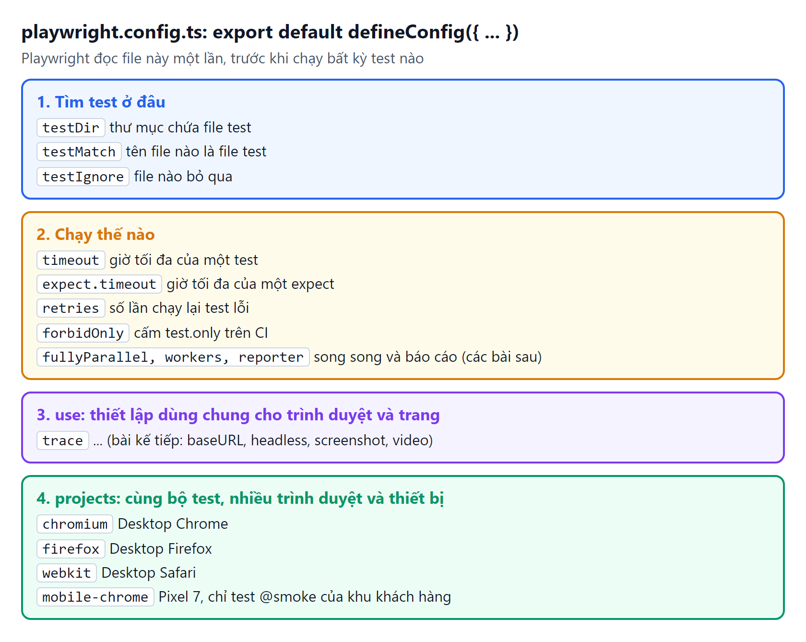
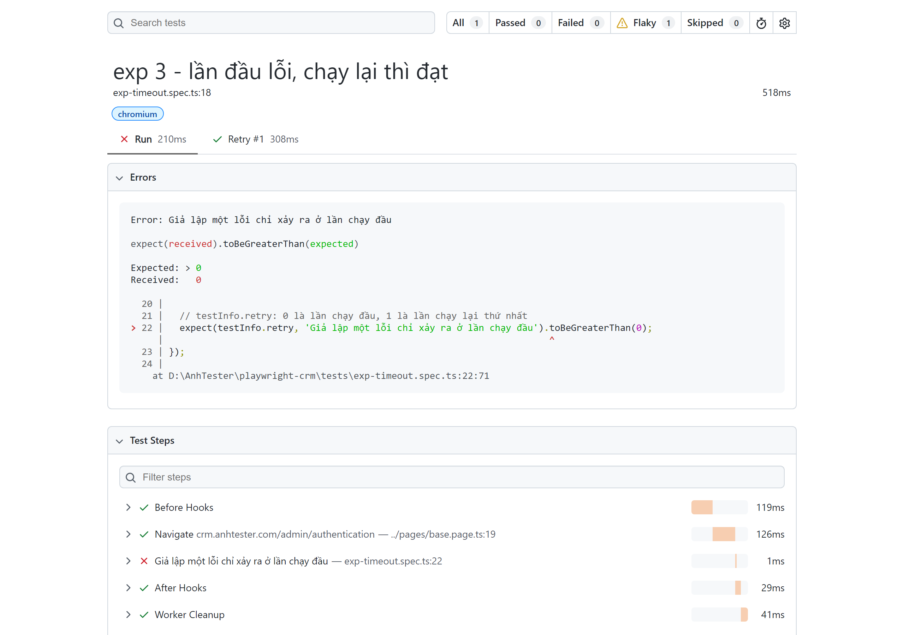
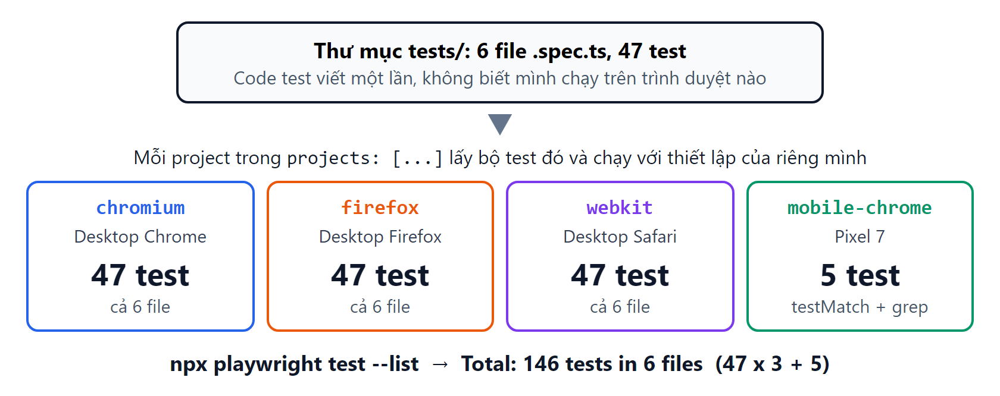
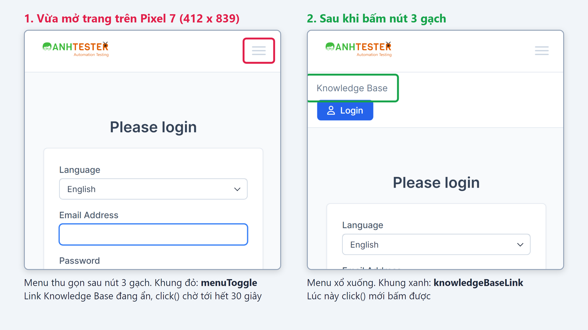
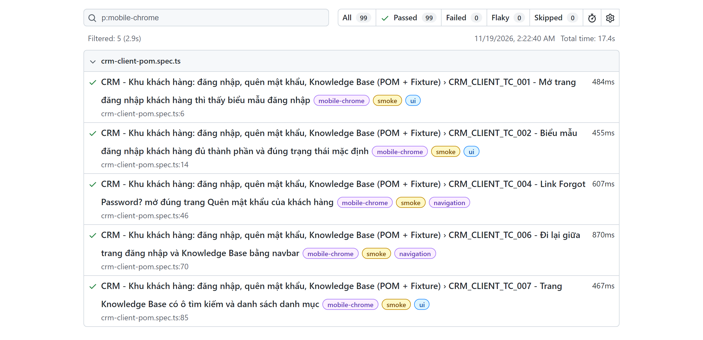

# Bài 28 - [Playwright Typescript] File cấu hình playwright.config.ts - testDir, Projects và chạy đa trình duyệt

Chương: 5. File Config + Truyền Data Test (Data Driven) + Parallel Execution

Nguồn: [https://anhtester.com/learn/website-and-api-testing-automation-with-playwright-javascript-typescript-day-code-js-ts-tu-dau/385](https://anhtester.com/learn/website-and-api-testing-automation-with-playwright-javascript-typescript-day-code-js-ts-tu-dau/385)

✅ File cấu hình playwright.config.ts là gì?  
✅ testDir, testMatch và testIgnore - Playwright tìm test ở đâu  
✅ timeout, expect.timeout, retries và forbidOnly  
✅ Projects - chạy trên nhiều trình duyệt và thiết bị  
✅ Chạy một project, một file hoặc một test từ dòng lệnh  
✅ Dùng Claude Code và bộ kit claude-testing-skills để đọc hiểu và chỉnh file cấu hình

## ⭐ Mục tiêu bài học

Chương Page Object Model + Fixture khép lại với project `playwright-crm` đủ tầng `pages`, `components`, `utils`, `fixtures`, `tests` và 47 test xanh trên Chromium. Bài trước (Thực hành Page Object Model trên CRM với AI) để lại hai thứ viết cứng: lệnh nào cũng phải gõ `--project=chromium`, và địa chỉ `CRM_URL`, `BOOK_URL` nằm trong code.

Cả hai thuộc về file `playwright.config.ts`. Bài này xử lý việc thứ nhất: chọn trình duyệt, thiết bị trong file cấu hình và từ dòng lệnh. Địa chỉ trang được chuyển vào `baseURL` ở bài kế tiếp, rồi vào file `.env` ở bài sau đó. Học xong bạn sẽ:

- Đọc được từng dòng của `playwright.config.ts` và biết dòng nào quyết định việc gì.
- Chỉnh được `testDir`, `testMatch`, `timeout`, `retries` và hiểu báo lỗi của từng thiết lập.
- Khai báo Projects để một bộ test chạy trên Chromium, Firefox, WebKit và điện thoại giả lập.
- Chạy đúng một project, một file hoặc một test từ dòng lệnh.
- Dùng AI để đọc hiểu, chỉnh file cấu hình và bắt được cấu hình sai do AI sinh ra.

> 📌 Bài làm tiếp trong project `D:\AnhTester\playwright-crm` (macOS: `~/AnhTester/playwright-crm`). Kết quả trong bài chạy thật với Playwright 1.65.1 ngày 19/11/2026, chỉ trên các trang **công khai** của CRM demo và trang Book.

## ✅ Phần 1: File cấu hình playwright.config.ts là gì?

### 🔆 1. Từ bảng nội quy tới file cấu hình

Một phòng tập có bảng nội quy dán ở cửa: mở cửa mấy giờ, mỗi ca tối đa bao lâu. Không ai phải nhắc lại với từng người, và muốn đổi giờ thì sửa đúng một tấm bảng.

Trong lập trình, tấm bảng đó là **file cấu hình**: nơi chứa các thiết lập mà chương trình đọc **một lần lúc khởi động**. Với Playwright, đó là `playwright.config.ts` ở gốc project: mỗi lần bạn gõ `npx playwright test`, Playwright đọc file này trước rồi mới tìm và chạy test.

Với automation, file này trả lời bốn nhóm câu hỏi: test nằm ở đâu, chạy thế nào, trình duyệt được thiết lập ra sao, và chạy trên những trình duyệt, thiết bị nào.

[](https://anhtester.com/storage/photos/shares/lesson/js_ts_playwright/v2/bai_28_playwright_config/01_so_do_bon_nhom_thiet_lap_trong_playwright_config.png)

*Bốn nhóm thiết lập trong playwright.config.ts của project sau bài này*

### 🔆 2. Đọc file mặc định từ trên xuống

Mở `playwright.config.ts`. File do `npm init playwright@latest` sinh ra ở bài Cài đặt Playwright TypeScript, bỏ chú thích thì còn lại:

```typescript
import { defineConfig, devices } from '@playwright/test';

export default defineConfig({
  testDir: './tests',
  fullyParallel: true,
  forbidOnly: !!process.env.CI,
  retries: process.env.CI ? 2 : 0,
  workers: process.env.CI ? 1 : undefined,
  reporter: 'html',
  use: {
    trace: 'on-first-retry',
  },
  projects: [
    { name: 'chromium', use: { ...devices['Desktop Chrome'] } },
    { name: 'firefox', use: { ...devices['Desktop Firefox'] } },
    { name: 'webkit', use: { ...devices['Desktop Safari'] } },
  ],
});
```

Cả file là **một object** đưa vào hàm `defineConfig()` rồi `export default`. Hàm này giúp VS Code biết kiểu của object: gõ sai tên thiết lập là bị gạch đỏ, gõ `Ctrl + Space` là hiện gợi ý. `process.env.CI` là một **biến môi trường**: các hệ thống CI tự đặt `CI=true`, còn trên máy bạn thì nó không có giá trị. Học kỹ ở bài Đọc config đa môi trường từ file .env.

<table class="rt-table">
<thead>
<tr>
<th>Thiết lập</th>
<th>Quyết định việc gì</th>
<th>Học kỹ ở đâu</th>
</tr>
</thead>
<tbody>
<tr><td><code>testDir</code></td><td>Thư mục Playwright tìm file test</td><td>Phần 2</td></tr>
<tr><td><code>forbidOnly</code>, <code>retries</code></td><td>Cấm <code>test.only</code> trên CI; số lần chạy lại test lỗi</td><td>Phần 3</td></tr>
<tr><td><code>fullyParallel</code>, <code>workers</code></td><td>Chạy song song cả các test trong một file; số tiến trình chạy cùng lúc</td><td>Bài Chạy test song song với Parallel Execution</td></tr>
<tr><td><code>reporter</code></td><td>Kiểu báo cáo sau khi chạy</td><td>Bài Cài đặt và sử dụng HTML Report, Allure Report</td></tr>
<tr><td><code>use</code></td><td>Thiết lập cho trình duyệt và trang, dùng chung cho mọi project</td><td>Bài kế tiếp</td></tr>
<tr><td><code>projects</code></td><td>Danh sách trình duyệt, thiết bị sẽ chạy bộ test</td><td>Phần 4</td></tr>
</tbody>
</table>

## ✅ Phần 2: testDir, testMatch và testIgnore - Playwright tìm test ở đâu

### 🔆 1. Hai bước tìm file test

Playwright tìm test theo hai bước: quét mọi file trong `testDir` (kể cả thư mục con), rồi chỉ giữ file có tên khớp `testMatch`. Khi không khai báo `testMatch`, file được giữ là file JavaScript hoặc TypeScript có `.test` hoặc `.spec` trước phần đuôi.

Thử ngay. Tạo hai file tạm trong `tests/`, nội dung giống nhau, chỉ khác tên: `tests/exp-nhap.test.ts` và `tests/exp-ghi-chu.ts`.

```typescript
import { test, expect } from '@playwright/test';

test('File nháp', () => {
  expect(1 + 1).toBe(2);
});
```

Option `--list` liệt kê test mà **không chạy**, rất hợp để kiểm file cấu hình:

```bash
npx playwright test --list --project=chromium
```

```plaintext
Listing tests:
  [chromium] › book-pom.spec.ts:4:3 › Book demo - Menu và bảng dữ liệu qua Component Object › Menu trái có đủ 6 mục và đưa tới đúng trang
  ...
  [chromium] › exp-nhap.test.ts:3:1 › File nháp
  ...
Total: 48 tests in 7 files
```

Trước đó là 47 test trong 6 file. File `exp-nhap.test.ts` được nhận, file `exp-ghi-chu.ts` thì không, dù bên trong có `test(...)`. Tên file quyết định, không phải nội dung.

### 🔆 2. testMatch: một quy ước tên cho cả project

Project này đặt tên mọi file test là `*.spec.ts`. Ghi quy ước đó vào file cấu hình:

```typescript
  testDir: './tests',
  testMatch: '**/*.spec.ts',
```

`**` là "mọi thư mục con", `*` là "tên bất kỳ". Chạy lại `--list`: tổng về `47 tests in 6 files`.

### 🔆 3. testIgnore: bỏ qua có chủ đích

Đổi tên file nháp thành `tests/exp-nhap.spec.ts`: nó khớp `testMatch` nên tổng lại là 48. Muốn giữ file nháp trong thư mục mà không chạy, thêm tạm một dòng:

```typescript
  testIgnore: '**/exp-*.spec.ts',
```

Tổng về 47. Lúc này gọi đích danh file đó cũng không được:

```bash
npx playwright test exp-nhap --project=chromium
```

```plaintext
Error: No tests found.
Make sure that arguments are regular expressions matching test files.
You may need to escape symbols like "$" or "*" and quote the arguments.
```

Gặp `No tests found` thì kiểm `testDir`, `testMatch`, `testIgnore` trước khi nghi code test. Thử xong, **xoá** dòng `testIgnore` và hai file `exp-*`.

## ✅ Phần 3: timeout, expect.timeout, retries và forbidOnly

### 🔆 1. Hai chiếc đồng hồ: của test và của expect

File mặc định không ghi thời gian chờ nào, nên Playwright dùng giá trị sẵn có: mỗi test tối đa 30 giây, mỗi `expect` Web-First tối đa 5 giây. Ghi rõ ra để ai mở file cũng thấy:

```typescript
  timeout: 30_000,
  expect: {
    timeout: 5_000,
  },
```

Đơn vị là mili giây, dấu `_` chỉ để dễ đọc. Để thấy hai đồng hồ khác nhau, tạo file tạm `tests/exp-timeout.spec.ts`:

```typescript
import { test, expect } from '../fixtures';

test('exp 1 - expect chờ hết expect.timeout', async ({ loginPage, page }) => {
  await loginPage.goto();

  // Trang đăng nhập Admin không có nút nào tên "Đăng ký"
  await expect(page.getByRole('button', { name: 'Đăng ký' })).toBeVisible();
});

test('exp 2 - cả test chạy quá timeout', async ({ loginPage, page }) => {
  test.setTimeout(3_000); // chỉ để thử: ép test này còn 3 giây

  await loginPage.goto();
  // click() tự chờ phần tử xuất hiện. Không có expect.timeout nào chặn, nên chờ tới hết giờ của test
  await page.getByRole('button', { name: 'Đăng ký' }).click();
});

test('exp 3 - lần đầu lỗi, chạy lại thì đạt', async ({ loginPage }, testInfo) => {
  await loginPage.goto();

  // testInfo.retry: 0 là lần chạy đầu, 1 là lần chạy lại thứ nhất
  expect(testInfo.retry, 'Giả lập một lỗi chỉ xảy ra ở lần chạy đầu').toBeGreaterThan(0);
});
```

```bash
npx playwright test exp-timeout --project=chromium --reporter=list -g "exp 1|exp 2"
```

```plaintext
Running 2 tests using 2 workers

  ✘  1 [chromium] › tests\exp-timeout.spec.ts:10:1 › exp 2 - cả test chạy quá timeout (3.0s)
  ✘  2 [chromium] › tests\exp-timeout.spec.ts:3:1 › exp 1 - expect chờ hết expect.timeout (5.4s)

  1) [chromium] › tests\exp-timeout.spec.ts:3:1 › exp 1 - expect chờ hết expect.timeout ────────────

    Error: expect(locator).toBeVisible() failed

    Locator: getByRole('button', { name: 'Đăng ký' })
    Expected: visible
    Timeout: 5000ms
    Error: element(s) not found

    Call log:
      - Expect "toBeVisible" getByRole('button', { name: 'Đăng ký' }) with timeout 5000ms
      - waiting for getByRole('button', { name: 'Đăng ký' })

       5 |
       6 |   // Trang đăng nhập Admin không có nút nào tên "Đăng ký"
    >  7 |   await expect(page.getByRole('button', { name: 'Đăng ký' })).toBeVisible();
         |                                                               ^
       8 | });
       9 |
      10 | test('exp 2 - cả test chạy quá timeout', async ({ loginPage, page }) => {
        at D:\AnhTester\playwright-crm\tests\exp-timeout.spec.ts:7:63

  2) [chromium] › tests\exp-timeout.spec.ts:10:1 › exp 2 - cả test chạy quá timeout ────────────────

    Test timeout of 3000ms exceeded.

    Error: locator.click: Test timeout of 3000ms exceeded.
    Call log:
      - waiting for getByRole('button', { name: 'Đăng ký' })

      13 |   await loginPage.goto();
      14 |   // click() tự chờ phần tử xuất hiện. Không có expect.timeout nào chặn, nên chờ tới hết giờ của test
    > 15 |   await page.getByRole('button', { name: 'Đăng ký' }).click();
         |                                                       ^
      16 | });
      17 |
      18 | test('exp 3 - lần đầu lỗi, chạy lại thì đạt', async ({ loginPage }, testInfo) => {
        at D:\AnhTester\playwright-crm\tests\exp-timeout.spec.ts:15:55

  2 failed
```

<table class="rt-table">
<thead>
<tr>
<th>Thiết lập</th>
<th>Đếm giờ cho</th>
<th>Báo lỗi khi hết giờ</th>
</tr>
</thead>
<tbody>
<tr><td><code>expect.timeout</code></td><td>Một lệnh <code>expect</code> Web-First chờ điều kiện đúng</td><td><code>Timeout: 5000ms</code> kèm tên assertion và locator</td></tr>
<tr><td><code>timeout</code></td><td>Cả một test, tính cả hook và fixture của nó. Thao tác như <code>click()</code>, <code>fill()</code> chờ trong quỹ giờ này</td><td><code>Test timeout of ...ms exceeded.</code></td></tr>
</tbody>
</table>

> ⚠️ Thấy `Test timeout of 30000ms exceeded` thì **không** tăng `timeout` chung lên 2 phút. Dòng `waiting for ...` trong Call log cho biết test đang chờ phần tử nào. Test chậm có lý do chính đáng thì đánh dấu riêng bằng `test.slow()`.

### 🔆 2. retries: chạy lại test lỗi

Test `exp 3` giả lập một lỗi chỉ xảy ra ở lần chạy đầu. Chạy thường thì nó đỏ. Thêm `--retries=1` (option dòng lệnh, ghi đè giá trị trong file cấu hình):

```bash
npx playwright test exp-timeout --project=chromium --reporter=list -g "exp 3" --retries=1
```

```plaintext
Running 1 test using 1 worker

  ✘  1 [chromium] › tests\exp-timeout.spec.ts:18:1 › exp 3 - lần đầu lỗi, chạy lại thì đạt (273ms)
  ✓  2 [chromium] › tests\exp-timeout.spec.ts:18:1 › exp 3 - lần đầu lỗi, chạy lại thì đạt (retry #1) (346ms)

  1) [chromium] › tests\exp-timeout.spec.ts:18:1 › exp 3 - lần đầu lỗi, chạy lại thì đạt ───────────

    Error: Giả lập một lỗi chỉ xảy ra ở lần chạy đầu

    expect(received).toBeGreaterThan(expected)

    Expected: > 0
    Received:   0

  1 flaky
    [chromium] › tests\exp-timeout.spec.ts:18:1 › exp 3 - lần đầu lỗi, chạy lại thì đạt ────────────
```

Lần chạy lại đạt, nên kết quả là `flaky`: lúc đỏ lúc xanh. Lệnh vẫn kết thúc với mã thoát 0, tức CI coi là đạt. HTML Report tách riêng từng lần chạy:

[](https://anhtester.com/storage/photos/shares/lesson/js_ts_playwright/v2/bai_28_playwright_config/02_html_report_test_flaky_co_tab_retry.png)

*HTML Report của một test flaky: tab Run là lần chạy đầu bị lỗi, tab Retry #1 là lần chạy lại đạt*

Dòng `retries: process.env.CI ? 2 : 0` vì thế có hai nửa. Trên CI cho chạy lại 2 lần để một lần nghẽn mạng không làm đỏ cả lượt chạy. Trên máy bạn thì **0**: test đỏ phải đỏ ngay để còn sửa. Bật retries ở máy mình là giấu test flaky đi.

### 🔆 3. forbidOnly: chặn test.only lọt lên CI

Khi sửa một test, bạn hay thêm `test.only`. Quên gỡ thì CI chỉ chạy đúng một test và báo xanh. Thêm `.only` vào test `exp 1`, rồi giả làm CI bằng cách đặt biến `CI`:

```bash
# Git Bash, macOS, Linux
CI=1 npx playwright test --project=chromium

# PowerShell
$env:CI='1'; npx playwright test --project=chromium; Remove-Item Env:CI
```

```plaintext
Error: item focused with '.only' is not allowed due to the 'forbidOnly' option in '..\playwright.config.ts': "exp-timeout.spec.ts exp 1 - expect chờ hết expect.timeout"

   at exp-timeout.spec.ts:3

  1 | import { test, expect } from '../fixtures';
  2 |
> 3 | test.only('exp 1 - expect chờ hết expect.timeout', async ({ loginPage, page }) => {
    |      ^
  4 |   await loginPage.goto();
  5 |
  6 |   // Trang đăng nhập Admin không có nút nào tên "Đăng ký"
```

Không test nào được chạy, lệnh kết thúc với mã lỗi. Giữ nguyên dòng `forbidOnly: !!process.env.CI`. Thử xong, xoá file `tests/exp-timeout.spec.ts`.

## ✅ Phần 4: Projects - chạy trên nhiều trình duyệt và thiết bị

### 🔆 1. Một bộ test, nhiều project

Người dùng thật mở CRM bằng nhiều trình duyệt, trên máy tính lẫn điện thoại. Mỗi trình duyệt có bộ máy hiển thị riêng, nên có lỗi chỉ lộ ra ở một nơi: ô chọn ngày hiện khác đi, menu bị thu gọn trên màn hình hẹp. Test chỉ chạy trên Chromium thì không thấy.

Playwright giải quyết bằng **project**: một nhóm test chạy với một bộ thiết lập. Code test viết một lần, mỗi project chạy nó trên trình duyệt, thiết bị của mình.

[](https://anhtester.com/storage/photos/shares/lesson/js_ts_playwright/v2/bai_28_playwright_config/03_so_do_mot_bo_test_chay_tren_bon_project.png)

*Một bộ test, bốn project: ba trình duyệt máy tính chạy cả 47 test, project điện thoại chạy 5 test được chọn*

### 🔆 2. Bên trong một project: name, use và devices

```typescript
{
  name: 'chromium',
  use: { ...devices['Desktop Chrome'] },
},
```

`name` là tên bạn tự đặt, hiện trong kết quả chạy và dùng với `--project`. `devices` là danh sách thiết bị dựng sẵn của Playwright, mỗi thiết bị là một object. Toán tử spread `...` (bài Object, Destructuring và JSON) trải các thuộc tính của object đó vào `use`. In thử một thiết bị:

```bash
node -e "const { devices } = require('@playwright/test'); console.log(devices['Pixel 7'])"
```

```plaintext
{
  userAgent: 'Mozilla/5.0 (Linux; Android 14; Pixel 7) AppleWebKit/537.36 (KHTML, like Gecko) Chrome/159.0.8154.6 Mobile Safari/537.36',
  viewport: { width: 412, height: 839 },
  screen: { width: 412, height: 915 },
  deviceScaleFactor: 2.625,
  isMobile: true,
  hasTouch: true,
  defaultBrowserType: 'chromium'
}
```

Vậy "thiết bị" là một gói thiết lập: kích thước vùng hiển thị, `userAgent`, cảm ứng, và `defaultBrowserType` là **bộ máy trình duyệt** sẽ chạy. Playwright có ba bộ máy: `chromium` (Chrome, Edge), `firefox`, `webkit` (Safari). Đây là **giả lập** trên máy tính, đủ để bắt lỗi bố cục và menu, không thay được việc kiểm trên điện thoại thật.

Ba bộ máy này do Playwright tải về riêng. Máy mới hoặc vừa nâng phiên bản Playwright thì chạy `npx playwright install` (trên CI Linux thêm `--with-deps` để cài luôn thư viện hệ điều hành).

### 🔆 3. Chạy trên Chrome, Edge thật với channel

Muốn chạy trên **Microsoft Edge** hoặc **Google Chrome** đã cài trên máy, thêm `channel`:

```typescript
    {
      name: 'edge',
      use: { ...devices['Desktop Edge'], channel: 'msedge' },
    },
    // {
    //   name: 'chrome',
    //   use: { ...devices['Desktop Chrome'], channel: 'chrome' },
    // },
```

File tạm `tests/exp-browser.spec.ts` in ra trình duyệt đang chạy. `browserName`, `isMobile`, `viewport` là các fixture có sẵn, lấy giá trị từ `use` của project:

```typescript
import { test } from '@playwright/test';

test('exp - trình duyệt nào đang chạy test này?', async ({ browserName, browser, isMobile, viewport }) => {
  const project = test.info().project.name;
  console.log(`${project} | browserName=${browserName} | version=${browser.version()} | isMobile=${isMobile} | viewport=${viewport?.width}x${viewport?.height}`);
});
```

```bash
npx playwright test exp-browser --project=chromium --project=webkit --project=edge --reporter=list
```

```plaintext
Running 3 tests using 3 workers

webkit | browserName=webkit | version=27.2 | isMobile=false | viewport=1280x720
  ✓  1 [webkit] › tests\exp-browser.spec.ts:3:1 › exp - trình duyệt nào đang chạy test này? (1ms)
chromium | browserName=chromium | version=159.0.8154.6 | isMobile=false | viewport=1280x720
  ✓  2 [chromium] › tests\exp-browser.spec.ts:3:1 › exp - trình duyệt nào đang chạy test này? (1ms)
edge | browserName=chromium | version=157.0.4341.60 | isMobile=false | viewport=1280x720
  ✓  3 [edge] › tests\exp-browser.spec.ts:3:1 › exp - trình duyệt nào đang chạy test này? (1ms)

  3 passed (947ms)
```

Project `edge` vẫn là bộ máy `chromium`, nhưng phiên bản là của Edge cài trên máy (157), khác bản Chromium đi kèm Playwright (159). Máy không cài trình duyệt đó thì project báo lỗi, nên thử xong hãy xoá file tạm và project `edge`.

### 🔆 4. Thêm project điện thoại và file cấu hình hoàn chỉnh

Project thứ tư giả lập điện thoại Android. Nó chỉ chạy các test `@smoke` của khu khách hàng. `testMatch` và `grep` đặt **trong project** chỉ tác dụng với project đó. Toàn bộ `playwright.config.ts` sau bài này:

```typescript
import { defineConfig, devices } from '@playwright/test';

/**
 * File cấu hình của project playwright-crm.
 * Tài liệu: https://playwright.dev/docs/test-configuration
 */
export default defineConfig({
  // Thư mục Playwright tìm file test
  testDir: './tests',
  // Chỉ file có đuôi .spec.ts mới được coi là file test
  testMatch: '**/*.spec.ts',

  // Thời gian tối đa cho MỘT test, tính cả hook và fixture của test đó
  timeout: 30_000,
  expect: {
    // Thời gian tối đa mỗi expect(...) Web-First chờ điều kiện đúng
    timeout: 5_000,
  },

  // Chạy song song cả các test trong cùng một file
  fullyParallel: true,
  // Trên CI: còn sót test.only thì báo lỗi ngay, không chạy
  forbidOnly: !!process.env.CI,
  // Trên CI chạy lại test lỗi 2 lần, ở máy mình thì không
  retries: process.env.CI ? 2 : 0,
  // Trên CI chạy 1 worker, ở máy mình để Playwright tự chọn
  workers: process.env.CI ? 1 : undefined,
  reporter: 'html',

  // Thiết lập dùng chung cho mọi project (học kỹ ở bài kế tiếp)
  use: {
    trace: 'on-first-retry',
  },

  projects: [
    {
      name: 'chromium',
      use: { ...devices['Desktop Chrome'] },
    },
    {
      name: 'firefox',
      use: { ...devices['Desktop Firefox'] },
    },
    {
      name: 'webkit',
      use: { ...devices['Desktop Safari'] },
    },
    {
      // Điện thoại Android giả lập trên Chromium: chỉ chạy test @smoke của khu khách hàng
      name: 'mobile-chrome',
      use: { ...devices['Pixel 7'] },
      testMatch: 'crm-client-pom.spec.ts',
      grep: /@smoke/,
    },
  ],
});
```

Một số thiết lập đặt được ở cả hai tầng. Giá trị trong project **thắng** giá trị chung, và option dòng lệnh thắng cả hai (đã chạy thử với `retries` và `timeout`):

<table class="rt-table">
<thead>
<tr>
<th>Thiết lập trong project</th>
<th>Dùng khi nào</th>
</tr>
</thead>
<tbody>
<tr><td><code>testMatch</code>, <code>testIgnore</code></td><td>Project chỉ chạy một số file</td></tr>
<tr><td><code>grep</code>, <code>grepInvert</code></td><td>Project chỉ chạy, hoặc loại ra, test có tên hay tag khớp biểu thức</td></tr>
<tr><td><code>timeout</code>, <code>retries</code></td><td>Một nhóm test cần giờ chờ hoặc số lần chạy lại khác phần còn lại</td></tr>
<tr><td><code>dependencies</code></td><td>Project này phải chạy sau project khác, ví dụ đăng nhập một lần trước. Học ở bài Lưu trạng thái đăng nhập với Storage State và test nhiều tài khoản</td></tr>
</tbody>
</table>

### 🔆 5. Test đỏ trên điện thoại: sửa ở đâu?

```bash
npx playwright test --project=mobile-chrome --reporter=list
```

```plaintext
Running 5 tests using 5 workers

  ✓  3 [mobile-chrome] › tests\crm-client-pom.spec.ts:85:3 › CRM - Khu khách hàng: đăng nhập, quên mật khẩu, Knowledge Base (POM + Fixture) › CRM_CLIENT_TC_007 - Trang Knowledge Base có ô tìm kiếm và danh sách danh mục @smoke @ui (498ms)
  ✓  1 [mobile-chrome] › tests\crm-client-pom.spec.ts:14:3 › CRM - Khu khách hàng: đăng nhập, quên mật khẩu, Knowledge Base (POM + Fixture) › CRM_CLIENT_TC_002 - Biểu mẫu đăng nhập khách hàng đủ thành phần và đúng trạng thái mặc định @smoke @ui (514ms)
  ✓  4 [mobile-chrome] › tests\crm-client-pom.spec.ts:6:3 › CRM - Khu khách hàng: đăng nhập, quên mật khẩu, Knowledge Base (POM + Fixture) › CRM_CLIENT_TC_001 - Mở trang đăng nhập khách hàng thì thấy biểu mẫu đăng nhập @smoke @ui (477ms)
  ✓  5 [mobile-chrome] › tests\crm-client-pom.spec.ts:46:3 › CRM - Khu khách hàng: đăng nhập, quên mật khẩu, Knowledge Base (POM + Fixture) › CRM_CLIENT_TC_004 - Link Forgot Password? mở đúng trang Quên mật khẩu của khách hàng @smoke @navigation (623ms)
  ✘  2 [mobile-chrome] › tests\crm-client-pom.spec.ts:70:3 › CRM - Khu khách hàng: đăng nhập, quên mật khẩu, Knowledge Base (POM + Fixture) › CRM_CLIENT_TC_006 - Đi lại giữa trang đăng nhập và Knowledge Base bằng navbar @smoke @navigation (30.0s)

  1) [mobile-chrome] › tests\crm-client-pom.spec.ts:70:3 › CRM - Khu khách hàng: đăng nhập, quên mật khẩu, Knowledge Base (POM + Fixture) › CRM_CLIENT_TC_006 - Đi lại giữa trang đăng nhập và Knowledge Base bằng navbar @smoke @navigation › Đăng nhập -> Knowledge Base 

    Test timeout of 30000ms exceeded.

    Error: locator.click: Test timeout of 30000ms exceeded.
    Call log:
      - waiting for getByRole('navigation').getByRole('link', { name: 'Knowledge Base' })

       at ..\components\client-navbar.component.ts:21

      19 |
      20 |   async openKnowledgeBase(): Promise<void> {
    > 21 |     await this.knowledgeBaseLink.click();
         |                                  ^
      22 |   }
      23 |
      24 |   async openLogin(): Promise<void> {
        at ClientNavbar.openKnowledgeBase (D:\AnhTester\playwright-crm\components\client-navbar.component.ts:21:34)

  1 failed
    [mobile-chrome] › tests\crm-client-pom.spec.ts:70:3 › CRM - Khu khách hàng: đăng nhập, quên mật khẩu, Knowledge Base (POM + Fixture) › CRM_CLIENT_TC_006 - Đi lại giữa trang đăng nhập và Knowledge Base bằng navbar @smoke @navigation 
  4 passed (30.7s)
```

`CRM_CLIENT_TC_006` đỏ sau đúng 30 giây: `click()` chờ link `Knowledge Base` mà không thấy. Mở trang ở kích thước của Pixel 7 thì rõ nguyên nhân:

[](https://anhtester.com/storage/photos/shares/lesson/js_ts_playwright/v2/bai_28_playwright_config/04_crm_khach_hang_tren_pixel_7_menu_thu_gon_va_sau_khi_mo.png)

*Trang đăng nhập khách hàng của CRM trên Pixel 7: menu thu gọn sau nút 3 gạch, bấm nút thì link Knowledge Base mới hiện*

HTML thật của navbar lúc vừa mở trang (đã lược phần logo):

```markup
<nav class="navbar navbar-default header">
  <button type="button" class="navbar-toggle collapsed" data-toggle="collapse"
          data-target="#theme-navbar-collapse" aria-expanded="false">
    <span class="sr-only">Toggle navigation</span>
    <span class="icon-bar"></span> ...
  </button>
  <div class="collapse navbar-collapse" id="theme-navbar-collapse">
    <ul class="nav navbar-nav navbar-right">
      <li class="customers-nav-item-knowledge-base">
        <a href="https://crm.anhtester.com/knowledge-base">Knowledge Base</a>
      </li>
      ...
    </ul>
  </div>
</nav>
```

Trên màn hình hẹp, khối chứa menu bị ẩn, chỉ còn nút tên `Toggle navigation`. Cách sửa **sai** là chèn `if (isMobile)` vào từng test: sửa giao diện là sửa hàng loạt. Cách sửa đúng nằm ở một chỗ, `components/client-navbar.component.ts`, vì "mở menu thế nào" là việc của component:

```typescript
// components/client-navbar.component.ts - các dòng THÊM MỚI (phần không nhắc tới giữ nguyên)

  /** Nút 3 gạch: chỉ hiện khi màn hình hẹp (điện thoại), menu bị thu gọn sau nút này */
  readonly menuToggle: Locator;

  constructor(root: Locator) {
    // ...
    this.menuToggle = root.getByRole('button', { name: 'Toggle navigation' });
  }

  /** Màn hình hẹp thì bấm nút 3 gạch để mở menu; màn hình rộng thì không làm gì */
  private async openMenuIfCollapsed(): Promise<void> {
    if (await this.menuToggle.isVisible()) {
      // Nút 3 gạch chỉ mở được menu khi JavaScript của trang đã chạy xong
      await this.root.page().waitForLoadState();
      await this.menuToggle.click();
    }
  }

  async openKnowledgeBase(): Promise<void> {
    await this.openMenuIfCollapsed(); // THÊM
    await this.knowledgeBaseLink.click();
  }

  async openLogin(): Promise<void> {
    await this.openMenuIfCollapsed(); // THÊM
    await this.loginLink.click();
  }
```

```bash
npx playwright test crm-client-pom.spec.ts:70 --reporter=list --project=chromium --project=webkit --project=mobile-chrome
```

```plaintext
Running 3 tests using 3 workers

  ✓  2 [chromium] › tests\crm-client-pom.spec.ts:70:3 › CRM - Khu khách hàng: đăng nhập, quên mật khẩu, Knowledge Base (POM + Fixture) › CRM_CLIENT_TC_006 - Đi lại giữa trang đăng nhập và Knowledge Base bằng navbar @smoke @navigation (693ms)
  ✓  3 [mobile-chrome] › tests\crm-client-pom.spec.ts:70:3 › CRM - Khu khách hàng: đăng nhập, quên mật khẩu, Knowledge Base (POM + Fixture) › CRM_CLIENT_TC_006 - Đi lại giữa trang đăng nhập và Knowledge Base bằng navbar @smoke @navigation (850ms)
  ✓  1 [webkit] › tests\crm-client-pom.spec.ts:70:3 › CRM - Khu khách hàng: đăng nhập, quên mật khẩu, Knowledge Base (POM + Fixture) › CRM_CLIENT_TC_006 - Đi lại giữa trang đăng nhập và Knowledge Base bằng navbar @smoke @navigation (927ms)

  3 passed (1.4s)
```

File test **không sửa dòng nào** mà xanh trên cả máy tính lẫn điện thoại. Khác biệt giữa các thiết bị nằm trong Page Object hoặc Component, test chỉ nói việc người dùng làm.

Dòng `waitForLoadState()` đến từ một lần đỏ thứ hai. Bản đầu của hàm chỉ có `isVisible()` rồi `click()`, và đã đỏ đúng một lượt khi CRM phản hồi chậm: nút 3 gạch hiện ra trước khi JavaScript của trang chạy xong, nên cú bấm không mở được menu. `waitForLoadState()` chờ sự kiện `load` của trang, tức một **điều kiện thật**, khác hẳn kiểu chờ cứng vài giây. Chạy lặp 5 lần để kiểm:

```bash
npx playwright test --project=mobile-chrome --repeat-each=5 --reporter=dot
```

```plaintext
Running 25 tests using 16 workers
·························
  25 passed (4.1s)
```

## ✅ Phần 5: Chạy một project, một file hoặc một test từ dòng lệnh

### 🔆 1. Các cách chọn

Không có `--project`, Playwright chạy **mọi** project. Kiểm bằng `--list`:

```bash
npx playwright test --list
```

```plaintext
Listing tests:
  [chromium] › book-pom.spec.ts:4:3 › Book demo - Menu và bảng dữ liệu qua Component Object › Menu trái có đủ 6 mục và đưa tới đúng trang
  ...
  [mobile-chrome] › crm-client-pom.spec.ts:70:3 › CRM - Khu khách hàng: đăng nhập, quên mật khẩu, Knowledge Base (POM + Fixture) › CRM_CLIENT_TC_006 - Đi lại giữa trang đăng nhập và Knowledge Base bằng navbar
  [mobile-chrome] › crm-client-pom.spec.ts:85:3 › CRM - Khu khách hàng: đăng nhập, quên mật khẩu, Knowledge Base (POM + Fixture) › CRM_CLIENT_TC_007 - Trang Knowledge Base có ô tìm kiếm và danh sách danh mục
Total: 146 tests in 6 files
```

146 = 47 x 3 + 5. Khi đang viết test, bạn hiếm khi cần cả 146:

<table class="rt-table">
<thead>
<tr>
<th>Muốn chạy</th>
<th>Lệnh</th>
<th>Kết quả thật</th>
</tr>
</thead>
<tbody>
<tr><td>Một project</td><td><code><span>npx</span> <span>playwright</span> <span>test</span> <span>--project=webkit</span></code></td><td>47 passed</td></tr>
<tr><td>Hai project</td><td><code><span>npx</span> <span>playwright</span> <span>test</span> <span>--project=chromium</span> <span>--project=mobile-chrome</span></code></td><td>52 passed</td></tr>
<tr><td>Một file</td><td><code><span>npx</span> <span>playwright</span> <span>test</span> <span>crm-login-pom.spec.ts</span> <span>--project=chromium</span></code></td><td>13 passed</td></tr>
<tr><td>Một test theo số dòng</td><td><code><span>npx</span> <span>playwright</span> <span>test</span> <span>crm-client-pom.spec.ts:70</span> <span>--project=mobile-chrome</span></code></td><td>1 passed</td></tr>
<tr><td>Các test có tên khớp</td><td><code><span>npx</span> <span>playwright</span> <span>test</span> <span>-g</span> <span>"CRM_CLIENT_TC_00"</span> <span>--project=webkit</span></code></td><td>10 passed</td></tr>
<tr><td>Project kết hợp tag</td><td><code><span>npx</span> <span>playwright</span> <span>test</span> <span>--project=webkit</span> <span>--grep</span> <span>@smoke</span></code></td><td>11 passed</td></tr>
</tbody>
</table>

### 🔆 2. Gói lệnh hay dùng vào npm scripts

Việc phải gõ `--project=chromium` ở mọi lệnh được giải quyết bằng mục `scripts` của `package.json`:

```json
  "scripts": {
    "test": "playwright test",
    "test:chromium": "playwright test --project=chromium",
    "report": "playwright show-report"
  },
```

`npm run test:chromium` chạy riêng Chromium, `npm run report` mở HTML Report. Muốn thêm option cho Playwright thì đặt sau dấu `--`:

```bash
npm run test:chromium -- tests/book-pom.spec.ts --reporter=list
```

```plaintext
> playwright-crm@1.0.0 test:chromium
> playwright test --project=chromium tests/book-pom.spec.ts --reporter=list


Running 3 tests using 3 workers

  ✓  2 [chromium] › tests\book-pom.spec.ts:36:3 › Book demo - Menu và bảng dữ liệu qua Component Object › Bảng User dùng lại đúng component của bảng Promotion (722ms)
Số dòng: 5 | Ô Start đầu tiên: "24 Th08 2026\n\n03:40 AM"
  ✓  3 [chromium] › tests\book-pom.spec.ts:21:3 › Book demo - Menu và bảng dữ liệu qua Component Object › Bảng Promotion đúng cột, có dữ liệu, cột Start đúng định dạng ngày (793ms)
  ✓  1 [chromium] › tests\book-pom.spec.ts:4:3 › Book demo - Menu và bảng dữ liệu qua Component Object › Menu trái có đủ 6 mục và đưa tới đúng trang (1.2s)

  3 passed (1.8s)
```

Thiếu dấu `--`, npm giữ option lại cho chính nó và in cảnh báo `npm warn Unknown cli config "--reporter"`.

### 🔆 3. HTML Report khi có nhiều project

```bash
npx playwright test --project=chromium --project=webkit --project=mobile-chrome
npm run report
```

Lượt chạy này cho **99 passed** (47 + 47 + 5). Trong report, mỗi test mang nhãn tên project. Bấm vào nhãn, hoặc gõ `p:mobile-chrome` vào ô tìm kiếm, để chỉ xem một project:

[](https://anhtester.com/storage/photos/shares/lesson/js_ts_playwright/v2/bai_28_playwright_config/05_html_report_loc_theo_project_mobile_chrome.png)

*Lọc HTML Report theo project mobile-chrome: đúng 5 test @smoke của khu khách hàng*

## ✅ Phần 6: Dùng Claude Code và bộ kit claude-testing-skills để đọc hiểu và chỉnh file cấu hình

### 🔆 1. Mẫu cấu hình của bộ kit khác project ở đâu?

Lệnh [/generate-automation-framework](https://github.com/anhtester/claude-testing-skills/blob/main/.claude/commands/generate-automation-framework.md) của bộ kit sinh `playwright.config.ts` theo mẫu trong [CODE\_TEMPLATES.md](https://github.com/anhtester/claude-testing-skills/blob/main/.claude/skills/skills-framework-architect/references/CODE_TEMPLATES.md) (mục 1). Mẫu đó dành cho project dựng mới: `testDir: './src/tests'`, `expect.timeout` 10 giây, `workers` đọc từ biến `WORKERS` (mặc định 5), và chỉ một project `chromium`.

Khi khoá học dựng framework hoàn chỉnh cùng AI, file cấu hình sẽ giống [playwright.config.ts của framework mẫu](https://github.com/anhtester/playwright-typescript-framework-ai/blob/main/playwright.config.ts): project đặt tên theo kiểu `bộ test-trình duyệt` (`crm-chrome`, `crm-edge`, `crm-firefox`), Chrome và Edge thật qua `channel`, thêm project `api`. Project học tập giữ bản đơn giản vì các mảnh ghép kia (file `.env`, API, Allure) nằm ở những bài sau.

AI đọc mẫu của kit sẽ kéo file của bạn về mẫu đó. Như hai file quy tắc trước, project thêm một file riêng. Tạo `.claude/rules/project_config_rules.md`:

```markdown
# Quy tắc cấu hình riêng của project (Playwright TypeScript)

> Chỗ nào khác với mẫu `playwright.config.ts` trong bộ kit (vị trí thư mục, số project,
> viewport, số worker) thì LÀM THEO FILE NÀY. Các quy tắc còn lại của bộ kit giữ nguyên.

## Cấu hình chung
- File cấu hình duy nhất là `playwright.config.ts` ở gốc project, viết bằng `defineConfig`.
- Test nằm ở `tests/` (KHÔNG phải `src/tests/`), tên file `*.spec.ts`. Không đổi `testDir`, `testMatch`.
- `timeout` của một test 30 giây, `expect.timeout` 5 giây. Test chậm thì dùng `test.slow()`,
  KHÔNG tăng timeout chung của cả project.
- `retries` chỉ bật trên CI (`process.env.CI ? 2 : 0`). Ở máy mình test đỏ phải đỏ ngay để còn sửa.
- Giữ `forbidOnly: !!process.env.CI`. Không commit `test.only`.

## Projects
- Ba project trình duyệt máy tính: `chromium`, `firefox`, `webkit`, dùng `devices[...]` có sẵn.
- Project điện thoại `mobile-chrome` (`devices['Pixel 7']`) chỉ chạy test `@smoke` của khu khách hàng.
  Thêm file vào project này thì sửa `testMatch` của project, KHÔNG viết `if (isMobile)` trong test.
- Muốn chạy một trình duyệt thì chọn bằng dòng lệnh (`--project=chromium` hoặc `npm run test:chromium`),
  KHÔNG xoá project khỏi file cấu hình.
- Giao diện khác nhau giữa máy tính và điện thoại (menu thu gọn...) thì xử lý trong Page Object
  hoặc Component, KHÔNG sửa test.
```

Claude Code tự nạp mọi file trong `.claude/rules/` mỗi phiên làm việc ([tài liệu Claude Code](https://code.claude.com/docs/en/memory)), bạn không phải nhắc lại.

### 🔆 2. Ba prompt hay dùng với file cấu hình

Claude Code là bản có phí Anh Tester dùng trong khoá. Với bản miễn phí của [ChatGPT](https://chatgpt.com/) hoặc [Gemini](https://gemini.google.com/), bạn dán file cấu hình và file quy tắc vào chỗ ghi `[dán ...]`.

**Prompt 1 - Đọc hiểu:**

```markdown
Đây là playwright.config.ts của project tôi (Playwright 1.65):

[dán nội dung playwright.config.ts]

Giải thích từng thiết lập theo bảng: thiết lập | giá trị đang đặt | tác dụng | nếu bỏ dòng này thì Playwright dùng giá trị nào.
Với mỗi project trong projects, cho biết nó chạy bộ máy trình duyệt nào và chạy những file test nào.
Chỉ dựa trên file tôi dán. Chỗ nào bạn không chắc về giá trị mặc định thì ghi "cần kiểm tài liệu playwright.dev", không đoán.
```

**Prompt 2 - Thêm project:**

```markdown
Làm theo .claude/rules/project_config_rules.md [dán nội dung file nếu dùng ChatGPT, Gemini].
Thêm vào playwright.config.ts một project tên mobile-safari giả lập iPhone 15, chỉ chạy các test có tag @smoke trong tests/crm-client-pom.spec.ts.
- Chỉ thêm đúng một phần tử vào mảng projects. KHÔNG sửa testDir, timeout, retries, KHÔNG xoá project đang có.
- KHÔNG sửa file test. Nếu có test đỏ vì giao diện điện thoại khác máy tính, chỉ ra Page Object hoặc Component cần sửa.
- Đưa lệnh --list để tôi kiểm project mới có bao nhiêu test trước khi chạy.
```

**Prompt 3 - Duyệt lại:**

```markdown
Đối chiếu playwright.config.ts với .claude/rules/project_config_rules.md.
Lập bảng: dòng | quy tắc bị vi phạm | hậu quả khi chạy | cách sửa.
Chưa sửa file. Không vi phạm thì trả lời "Không có vi phạm", không tự nghĩ thêm đề xuất tối ưu.
```

Với Claude Code, lệnh [/review-automation-code](https://github.com/anhtester/claude-testing-skills/blob/main/.claude/commands/review-automation-code.md) ở mode `REVIEW` cũng chấm cả cấu hình. AI trả lời mỗi lần mỗi khác nên bài không chép lại câu trả lời: bạn kiểm bằng `--list` rồi chạy thật.

## ✅ Phần 7: Kiểm tra code do AI sinh ra

File cấu hình sai thường **không báo lỗi cú pháp**. Nó lặng lẽ chạy ít test hơn, chậm hơn, hoặc xanh giả. Các dấu hiệu dưới đây đã chạy thử:

<table class="rt-table">
<thead>
<tr>
<th>Dấu hiệu trong file cấu hình</th>
<th>Vì sao là vấn đề</th>
<th>Cách xử lý</th>
</tr>
</thead>
<tbody>
<tr><td><code>testDir: './src/tests'</code> chép từ mẫu</td><td>Project không có thư mục đó: <code>Error: No tests found</code></td><td>Giữ <code>'./tests'</code>, kiểm bằng <code>--list</code></td></tr>
<tr><td><code>retries: 3</code> không kèm điều kiện <code>CI</code></td><td>Test flaky thành xanh ngay trên máy bạn, không ai sửa nguyên nhân</td><td><code>process.env.CI ? 2 : 0</code></td></tr>
<tr><td><code>timeout: 120_000</code> cho cả project</td><td>Mỗi test đỏ tốn 2 phút mới báo</td><td>Giữ 30 giây, test chậm dùng <code>test.slow()</code></td></tr>
<tr><td>Xoá <code>firefox</code>, <code>webkit</code> "cho chạy nhanh"</td><td>Mất kiểm thử đa trình duyệt</td><td>Giữ project, chọn bằng <code>--project</code> hoặc npm script</td></tr>
<tr><td>Project tên <code>mobile-chrome</code> dùng <code>devices['iPhone 15']</code></td><td>iPhone 15 có <code>defaultBrowserType: 'webkit'</code>: tên một đằng, chạy một nẻo</td><td>In <code>devices[...]</code> ra xem, đặt tên theo đúng bộ máy</td></tr>
</tbody>
</table>

## ✅ Phần 8: Bài tập thực hành

Làm bài tập trên một nhánh git riêng (ví dụ `bt-config`): bài kế tiếp dùng tiếp file cấu hình bốn project ở Phần 4.

**Bài tập 1 - Thêm project mobile-safari.** Thêm project `mobile-safari` dùng `devices['iPhone 15']`, chỉ chạy test `@smoke` của `crm-client-pom.spec.ts`. In `devices['iPhone 15']` và cho biết project chạy bộ máy nào. Dùng `--list` đếm số test rồi chạy thật.

**Bài tập 2 - Thiết lập riêng cho một project.** Thêm project `chromium-login` chỉ chạy `crm-login-pom.spec.ts`, có `retries: 1` và `timeout: 20_000`. Viết một test tạm in `testInfo.project.retries`, `testInfo.timeout` để chứng minh giá trị của project thắng giá trị chung, rồi chạy thêm với `--retries=0`.

**Bài tập 3 - Đếm trước khi chạy.** Chỉ dùng `--list`, điền số test của từng lệnh và giải thích: `--project=mobile-chrome`; `--grep @smoke` (mọi project); `book-pom.spec.ts` (mọi project); `-g "CRM_CLIENT_TC_00" --project=webkit`.

**Bài tập 4 - Duyệt code AI.** File cấu hình dưới đây do AI viết lại "cho gọn và ổn định hơn". Nó có **6 chỗ sai** so với quy tắc của project. Tìm đủ, nêu hậu quả từng chỗ, sửa lại rồi chạy `--list`.

```typescript
import { defineConfig, devices } from '@playwright/test';

export default defineConfig({
  testDir: './src/tests',
  testMatch: '**/*.spec.ts',
  timeout: 120_000,
  expect: { timeout: 5_000 },
  fullyParallel: true,
  forbidOnly: false,
  retries: 3,
  workers: process.env.CI ? 1 : undefined,
  reporter: 'html',
  use: {
    trace: 'on-first-retry',
  },
  projects: [
    {
      name: 'chromium',
      use: { ...devices['Desktop Chrome'] },
    },
    {
      name: 'mobile-chrome',
      use: { ...devices['iPhone 15'] },
      testMatch: 'crm-client-pom.spec.ts',
      grep: /@smoke/,
    },
  ],
});
```

## ✅ Phần 9: Ghi nhớ nhanh

- `testDir` cộng `testMatch` quyết định file nào là test. Gặp `No tests found` thì xem chúng trước.
- `timeout` đếm giờ cả test, `expect.timeout` đếm giờ một `expect`. Hết giờ thì đọc dòng `waiting for`, không tăng timeout.
- `retries` chỉ bật trên CI. Test lúc đỏ lúc xanh được báo là `flaky` và vẫn phải tìm nguyên nhân.
- Project là bộ test cộng một bộ thiết lập. `devices[...]` giả lập thiết bị, `channel` chọn Chrome, Edge thật. Thiết lập trong project thắng thiết lập chung, dòng lệnh thắng cả hai.
- Khác biệt giữa máy tính và điện thoại xử lý trong Page Object hoặc Component, không rải `if (isMobile)` trong test.

✅ **Kết luận:** File cấu hình giờ đã nói rõ test nằm ở đâu, chờ bao lâu, chạy trên bốn project nào. Khối `use` thì vẫn gần như trống, chỉ có `trace`, còn `CRM_URL` và `BOOK_URL` vẫn là hằng số trong code. Bài kế tiếp, **Cấu hình use - headless, viewport, screenshot, video và trace**, chuyển địa chỉ CRM vào `baseURL` và thiết lập bằng chứng tự động mỗi khi test lỗi.

---

## Bài tập riêng — Bài tập - Thêm project, thiết lập riêng cho project, đếm test bằng --list và duyệt file cấu hình do AI sinh ra

Nguồn bài tập: [https://anhtester.com/student-assignments?course=website-and-api-testing-automation-with-playwright-javascript-typescript-day-code-js-ts-tu-dau#assignment-118](https://anhtester.com/student-assignments?course=website-and-api-testing-automation-with-playwright-javascript-typescript-day-code-js-ts-tu-dau#assignment-118)

**Mục tiêu:** đọc và chỉnh được `playwright.config.ts`: thêm project, đặt thiết lập riêng cho một project, dùng `--list` để kiểm trước khi chạy, và nhận ra cấu hình sai do AI sinh ra kể cả khi file không báo lỗi cú pháp.

**Thư mục làm bài:** `D:\AnhTester\playwright-crm` (macOS: `~/AnhTester/playwright-crm`), dùng tiếp `playwright.config.ts` bốn project của bài học (`chromium`, `firefox`, `webkit`, `mobile-chrome`). Làm trên một nhánh git riêng tên `bt-config`, **không** merge vào `main`: bài kế tiếp dùng tiếp file cấu hình của bài học. Chỉ làm việc trên các trang **công khai** của CRM demo `https://crm.anhtester.com` và trang Book: **không đăng nhập**, không bấm Login, Submit, Save, Delete.

### 📝 Đề bài

#### Bài tập 1 - Thêm project mobile-safari

Thêm vào `projects` một project tên `mobile-safari` dùng `devices['iPhone 15']`, chỉ chạy các test có tag `@smoke` của `crm-client-pom.spec.ts` (dùng `testMatch` và `grep` của project). **Không** sửa file test.

1. In thiết bị ra Terminal: `node -e "const { devices } = require('@playwright/test'); console.log(devices['iPhone 15'])"`.
2. Chạy `npx playwright test --list --project=mobile-safari` và ghi lại dòng `Total`.
3. Chạy thật: `npx playwright test --project=mobile-safari --reporter=list`.

Trả lời: project này chạy trên bộ máy trình duyệt nào, vùng hiển thị (viewport) bao nhiêu, và vì sao `CRM_CLIENT_TC_006` đạt trên điện thoại mà file test không có dòng nào nhắc tới điện thoại?

#### Bài tập 2 - Thiết lập riêng cho một project

Thêm project `chromium-login` dùng `devices['Desktop Chrome']`, chỉ chạy `crm-login-pom.spec.ts`, có `retries: 1` và `timeout: 20_000`. Tạo file tạm `tests/bt2-project-options.spec.ts` có một test in ra `testInfo.project.name`, `testInfo.project.retries`, `testInfo.timeout`, và thêm file này vào `testMatch` của project `chromium-login`.

1. Chạy test tạm trên `--project=chromium-login` rồi trên `--project=chromium`, so sánh hai dòng in ra.
2. Chạy lại trên `--project=chromium-login` kèm `--retries=0`.
3. Chạy `npx playwright test --list --project=chromium-login` và ghi lại dòng `Total`.

Trả lời: giữa giá trị chung, giá trị trong project và option dòng lệnh, cái nào thắng? Vì sao quy tắc của project vẫn giữ `retries` chung là 0 khi chạy ở máy mình?

#### Bài tập 3 - Đếm trước khi chạy

Quay về file cấu hình bốn project của bài học (tạm bỏ hai project của Bài tập 1 và 2, hoặc đổi sang nhánh `main`). Chỉ dùng `--list`, điền dòng `Total` của từng lệnh và giải thích con số:

1. `npx playwright test --list`
2. `npx playwright test --list --project=mobile-chrome`
3. `npx playwright test --list --grep @smoke`
4. `npx playwright test --list book-pom.spec.ts`
5. `npx playwright test --list -g "CRM_CLIENT_TC_00" --project=webkit`

#### Bài tập 4 - Duyệt code AI

File cấu hình dưới đây do AI viết lại "cho gọn và ổn định hơn". Nó có **6 chỗ sai** so với `.claude/rules/project_config_rules.md` của project. Tìm đủ, nêu hậu quả của từng chỗ. Lưu đoạn này thành `bt4.config.ts` ở gốc project, sửa cho đúng quy tắc, rồi chứng minh bằng `npx playwright test --list -c bt4.config.ts` (option `-c` chỉ định file cấu hình khác file mặc định).

```typescript
import { defineConfig, devices } from '@playwright/test';

export default defineConfig({
  testDir: './src/tests',
  testMatch: '**/*.spec.ts',
  timeout: 120_000,
  expect: { timeout: 5_000 },
  fullyParallel: true,
  forbidOnly: false,
  retries: 3,
  workers: process.env.CI ? 1 : undefined,
  reporter: 'html',
  use: {
    trace: 'on-first-retry',
  },
  projects: [
    {
      name: 'chromium',
      use: { ...devices['Desktop Chrome'] },
    },
    {
      name: 'mobile-chrome',
      use: { ...devices['iPhone 15'] },
      testMatch: 'crm-client-pom.spec.ts',
      grep: /@smoke/,
    },
  ],
});
```

### 📦 Cách nộp bài

1. Làm bài trong project `playwright-crm`, commit và push nhánh `bt-config` lên repo GitHub `playwright-crm` của bạn.
2. Dán link nhánh vào ô **Link GitHub**, dạng `https://github.com/<ten-ban>/playwright-crm/tree/bt-config`. Repo Private thì vào **Settings → Collaborators** thêm tài khoản GitHub của giảng viên, nếu không giảng viên không mở được.
3. Trong ô **Nội dung bài làm (Editor)**, dán **kết quả chạy thật** trên Terminal của từng lệnh (mỗi lệnh một **Đoạn code mẫu** chọn Text / Log) và phần trả lời các câu hỏi.
4. Với bài **Duyệt code AI**: liệt kê từng chỗ sai theo mẫu *Dòng – Lỗi – Hậu quả – Cách sửa*, rồi dán file `bt4.config.ts` đã sửa và kết quả `--list` của nó.

### ✅ Tiêu chí Đạt

- Bài tập 1: project `mobile-safari` có đủ `use: { ...devices['iPhone 15'] }`, `testMatch: 'crm-client-pom.spec.ts'`, `grep: /@smoke/`; không xoá hay sửa project đang có; file test không đổi. `--list` báo `Total: 5 tests in 1 file` và lần chạy thật `5 passed`. Trả lời đúng: bộ máy `webkit` (`defaultBrowserType: 'webkit'`), viewport `393x659`; TC\_006 đạt vì việc mở menu thu gọn nằm trong `ClientNavbar.openMenuIfCollapsed()`, test chỉ gọi `openKnowledgeBase()` / `openLogin()`.
- Bài tập 2: project `chromium-login` đặt `retries`, `timeout` **trong project**, không sửa giá trị chung. Kết quả in ra đúng: trên `chromium-login` là `retries=1`, `timeout=20000`; trên `chromium` là `retries=0`, `timeout=30000`; thêm `--retries=0` thì `chromium-login` in `retries=0`. `--list --project=chromium-login` báo 14 test trong 2 file (13 test của `crm-login-pom.spec.ts` cộng 1 test tạm). Trả lời đúng thứ tự: dòng lệnh thắng project, project thắng giá trị chung; retries ở máy mình làm test lúc đỏ lúc xanh thành `flaky` mà lệnh vẫn kết thúc đạt, nên nguyên nhân không được sửa.
- Bài tập 3: đúng cả năm dòng `Total` với file cấu hình của bài học: (1) `146 tests in 6 files` = 47 x 3 + 5; (2) `5 tests in 1 file`: `testMatch` và `grep` của project; (3) `38 tests in 3 files` = 11 test `@smoke` x 3 trình duyệt + 5 của `mobile-chrome`; (4) `9 tests in 1 file` = 3 test x 3 trình duyệt, `mobile-chrome` không nhận file này; (5) `10 tests in 1 file`: TC\_001 tới TC\_009, trong đó TC\_005 có hai biến thể, TC\_010 không khớp. Học viên đã thêm test ở các bài tập trước thì chấp nhận con số khác nếu giải thích khớp với repo của họ.
- Bài tập 4: tìm được ít nhất **5 trong 6** lỗi, kèm hậu quả đúng, và `bt4.config.ts` đã sửa cho `--list` ra `Total: 146 tests in 6 files`. **Đáp án cho người chấm**: (1) `testDir: './src/tests'`: project không có thư mục này, chạy báo `Error: No tests found`, `--list` ra `Total: 0 tests in 0 files`; sửa thành `'./tests'`; (2) `timeout: 120_000`: tăng timeout chung của cả project, mỗi test đỏ vì sai locator phải chờ 2 phút mới báo; quy tắc là 30 giây, test chậm dùng `test.slow()`; (3) `forbidOnly: false`: `test.only` lọt lên CI thì chỉ một test chạy và báo đạt; sửa thành `!!process.env.CI`; (4) `retries: 3` không kèm điều kiện CI: ở máy mình test flaky cũng thành đạt; sửa thành `process.env.CI ? 2 : 0`; (5) thiếu hai project `firefox` và `webkit`: mất kiểm thử đa trình duyệt, `--project=webkit` báo `Project(s) "webkit" not found`; quy tắc là chọn trình duyệt bằng dòng lệnh, không xoá project; (6) project `mobile-chrome` dùng `devices['iPhone 15']`: thiết bị này có `defaultBrowserType: 'webkit'` nên project tên Chrome lại chạy trên WebKit; quy tắc là `devices['Pixel 7']`. Sau khi chỉ sửa `testDir`, `--list` của file lỗi ra `52 tests in 6 files` (47 + 5); sửa đủ sáu chỗ mới ra 146. Nêu thêm việc `use` chưa có `baseURL` hay thiếu chú thích tiếng Việt **không** tính là lỗi của bài này.
- Chung: không commit `test.only`, không viết `if (isMobile)` trong file test, không mật khẩu trong code hay trong file cấu hình; kết quả dán vào bài nộp là kết quả chạy thật trên máy của bạn.

### 🤖 Dùng AI thế nào cho đúng

- Được dùng Claude, ChatGPT, Gemini để giải thích từng dòng của file cấu hình và để viết bản nháp project mới. Luôn dán kèm `playwright.config.ts` đang có và file `.claude/rules/project_config_rules.md`.
- Sau mỗi lần AI sửa file cấu hình, chạy `--list` trước, so số test với con số bạn tự tính, rồi mới chạy thật.
- Test đỏ trên điện thoại thì đọc báo lỗi và mở trang ở đúng kích thước đó để tìm nguyên nhân; không nhờ AI tăng `timeout`, bật `retries` hay bỏ project cho test xanh.
- Bài tập 3 và Bài tập 4 tự làm trước, sau đó mới nhờ AI soát lại.
- Không dán mật khẩu, email thật của bạn vào prompt.