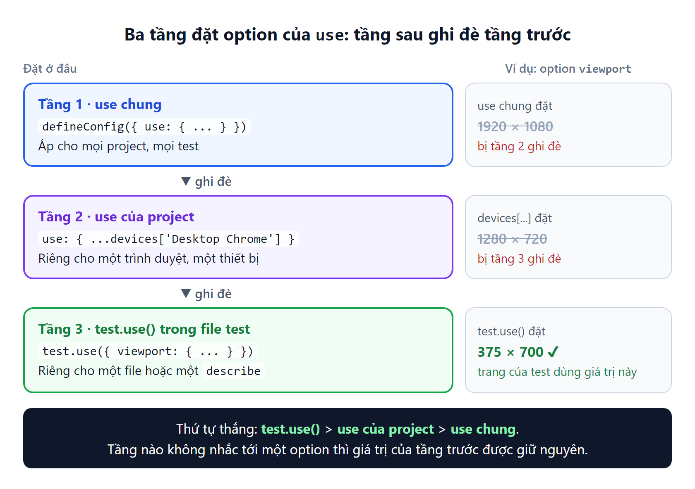
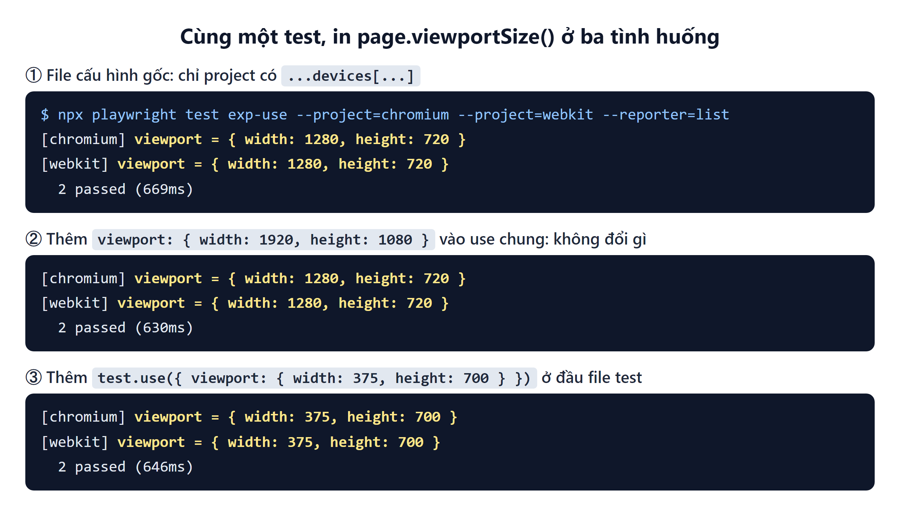
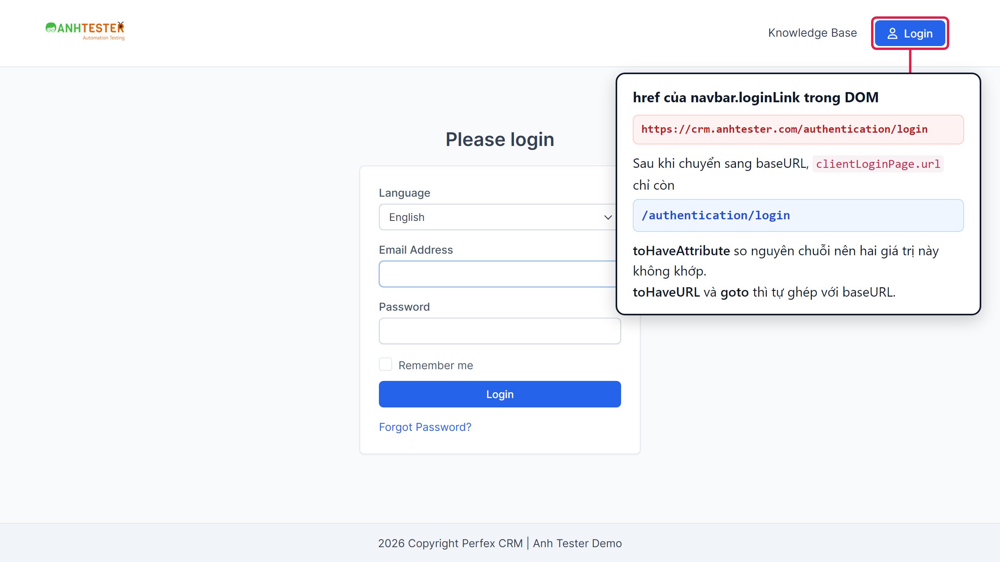
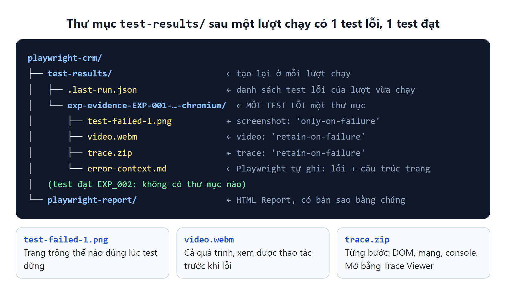
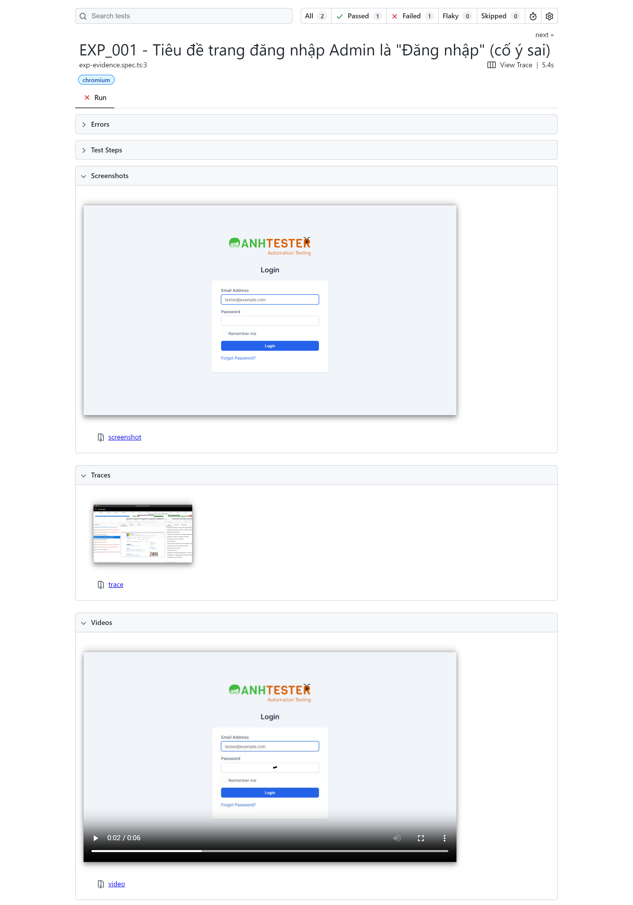

# Bài 29 - [Playwright Typescript] Cấu hình use - headless, viewport, screenshot, video và trace

Chương: 5. File Config + Truyền Data Test (Data Driven) + Parallel Execution

Nguồn: [https://anhtester.com/learn/website-and-api-testing-automation-with-playwright-javascript-typescript-day-code-js-ts-tu-dau/386](https://anhtester.com/learn/website-and-api-testing-automation-with-playwright-javascript-typescript-day-code-js-ts-tu-dau/386)

✅ Khối use và ba tầng cấu hình: use chung, use của project, test.use()  
✅ headless, viewport và baseURL: bỏ địa chỉ CRM viết cứng trong code  
✅ locale và timezoneId: cố định ngôn ngữ, múi giờ cho mọi máy chạy  
✅ screenshot, video và trace khi test lỗi  
✅ Dùng Claude Code và bộ kit claude-testing-skills để chọn cấu hình use và duyệt cấu hình do AI sinh ra

## ⭐ Mục tiêu bài học

Ở bài trước (File cấu hình playwright.config.ts - testDir, Projects và chạy đa trình duyệt), bạn đã đọc file cấu hình từ trên xuống: `defineConfig`, `testDir`, `timeout`, `retries` chỉ bật trên CI, ba project trình duyệt máy tính và project điện thoại `mobile-chrome`. Quy ước đã ghi vào `.claude/rules/project_config_rules.md`.

Còn một khối mới chỉ có đúng một dòng: `use: { trace: 'on-first-retry' }`. Bài này đi hết khối đó. Học xong bạn sẽ:

- Hiểu `use` chứa gì, đặt được ở ba tầng nào và tầng nào thắng.
- Dùng đúng `headless`, `viewport`, `baseURL`, `locale`, `timezoneId`, và bỏ được địa chỉ CRM viết cứng trong code.
- Cấu hình `screenshot`, `video`, `trace` để test lỗi tự để lại bằng chứng.

> 📌 Bài làm tiếp trong project `D:\AnhTester\playwright-crm` (macOS: `~/AnhTester/playwright-crm`), trên các trang **công khai** của CRM demo: **không đăng nhập**, không bấm Login, Submit. Các file `tests/exp-*.spec.ts` là file thử nghiệm, xem xong kết quả thì xoá.

## ✅ Phần 1: Khối use và ba tầng cấu hình

### 🔆 1. use là gì?

Ngày đầu đi làm, tester nào cũng nhận một bộ đồ nghề giống nhau: laptop cài sẵn, màn hình, tài khoản. Nhóm kiểm thử mobile đổi màn hình lấy điện thoại. Ai nhận việc đặc biệt thì mượn thêm đúng món cần cho việc đó.

Playwright cũng phát "bộ đồ nghề" cho mỗi test: một trình duyệt, một context, một `page`. Khối `use` là nơi bạn khai báo bộ đó trông thế nào: chạy ẩn hay hiện, màn hình rộng bao nhiêu, địa chỉ gốc là gì, có quay video không. Tài liệu gọi chúng là **test options** ([playwright.dev/docs/test-use-options](https://playwright.dev/docs/test-use-options)). Fixture `page` bạn vẫn xin trong test được tạo ra từ các option này.

### 🔆 2. Ba tầng đặt option và tầng nào thắng

[](https://anhtester.com/storage/photos/shares/lesson/js_ts_playwright/v2/bai_29_cau_hinh_use/01_so_do_ba_tang_cau_hinh_use.png)

*Ba tầng đặt option của use: use chung, use của project, test.use() trong file test. Tầng sau ghi đè tầng trước*

Đừng tin sơ đồ, hãy đo. Tạo file tạm `tests/exp-use.spec.ts`:

```typescript
import { test } from '@playwright/test';

test('In ra thiết lập trang đang dùng', async ({ page }, testInfo) => {
  console.log(`[${testInfo.project.name}] viewport =`, page.viewportSize());
});
```

```bash
npx playwright test exp-use --project=chromium --project=webkit --reporter=list
```

Chạy ba lần. Lần ① giữ nguyên file cấu hình. Lần ② thêm `viewport: { width: 1920, height: 1080 }` vào `use` chung. Lần ③ thêm vào đầu file test dòng `test.use({ viewport: { width: 375, height: 700 } });`. Kết quả thật của lần ②:

```plaintext
Running 2 tests using 2 workers

[chromium] viewport = { width: 1280, height: 720 }
  ok 2 [chromium] › tests\exp-use.spec.ts:3:1 › In ra thiết lập trang đang dùng (77ms)
[webkit] viewport = { width: 1280, height: 720 }
  ok 1 [webkit] › tests\exp-use.spec.ts:3:1 › In ra thiết lập trang đang dùng (172ms)

  2 passed (630ms)
```

[](https://anhtester.com/storage/photos/shares/lesson/js_ts_playwright/v2/bai_29_cau_hinh_use/02_ket_qua_thi_nghiem_viewport_ba_tang.png)

*Kết quả chạy thật ba lần: viewport ở use chung không có tác dụng, test.use() thì thắng*

Đã ghi 1920 × 1080 mà trang vẫn 1280 × 720. Lý do nằm ở tầng 2: `devices['Desktop Chrome']` và `devices['Desktop Safari']` đều có sẵn `viewport: { width: 1280, height: 720 }`, và project ghi đè `use` chung. Vì vậy project này **không đặt `viewport` ở `use` chung**: dòng đó có mặt mà không làm gì, người đọc sau sẽ hiểu sai. Xoá dòng `viewport` vừa thêm.

`test.use()` đặt ở đầu file thì áp cho cả file, đặt trong một `test.describe` thì chỉ áp cho nhóm đó. Không gọi được bên trong thân một test.

### 🔆 3. Ghi đè là thay cả mục, không trộn từng khoá

Có option mà giá trị là một object, ví dụ `launchOptions` (thiết lập lúc mở trình duyệt). Thử đặt nó ở hai tầng:

```typescript
// playwright.config.ts - CHỈ ĐỂ THỬ, xem xong thì trả lại như cũ
use: {
  launchOptions: { slowMo: 500 },            // tầng 1: mỗi thao tác chậm lại 500ms
},
projects: [
  {
    name: 'chromium',
    use: { ...devices['Desktop Chrome'], launchOptions: { args: ['--disable-gpu'] } },   // tầng 2
  },
  { name: 'webkit', use: { ...devices['Desktop Safari'] } },
],
```

Sửa `tests/exp-use.spec.ts` để in `launchOptions` và đo thời gian ba thao tác:

```typescript
import { test } from '@playwright/test';

test('In ra launchOptions của project', async ({ page }, testInfo) => {
  console.log(`[${testInfo.project.name}] launchOptions =`, testInfo.project.use.launchOptions);
  const start = Date.now();
  await page.goto('https://crm.anhtester.com/admin/authentication');
  await page.getByLabel('Email Address').fill('tester@example.com');
  await page.getByRole('checkbox', { name: 'Remember me' }).check();
  console.log(`[${testInfo.project.name}] 3 thao tác mất ${Date.now() - start}ms`);
});
```

```plaintext
Running 2 tests using 2 workers

[chromium] launchOptions = { args: [ '--disable-gpu' ] }
[webkit] launchOptions = { slowMo: 500 }
[chromium] 3 thao tác mất 208ms
  ok 1 [chromium] › tests\exp-use.spec.ts:3:1 › In ra launchOptions của project (314ms)
[webkit] 3 thao tác mất 1766ms
  ok 2 [webkit] › tests\exp-use.spec.ts:3:1 › In ra launchOptions của project (2.0s)

  2 passed (2.7s)
```

Project `chromium` mất hẳn `slowMo`: object `launchOptions` của tầng 2 **thay nguyên** object của tầng 1, không trộn từng khoá. Đây đúng là cách toán tử spread `...` hoạt động mà bạn đã gặp ở bài Object và JSON. Quy tắc rút ra: khi ghi đè một option kiểu object (`launchOptions`, `viewport`, `extraHTTPHeaders`), viết lại **đủ** các khoá cần giữ. Trả file cấu hình về như cũ trước khi đi tiếp.

## ✅ Phần 2: headless, viewport và baseURL

### 🔆 1. headless, --headed và slowMo

`headless: true` là mặc định: trình duyệt chạy thật nhưng không vẽ cửa sổ. Máy CI không có màn hình nên bắt buộc chạy kiểu này. Khi cần nhìn trình duyệt, gõ thêm `--headed` vào lệnh: chỉ lượt chạy đó hiện cửa sổ, file cấu hình không đổi. **Không** sửa thành `headless: false` trong file cấu hình: lỡ commit thì máy đồng nghiệp bật hàng loạt cửa sổ, còn CI có thể không mở được trình duyệt.

`slowMo` (đã gặp ở Phần 1) làm chậm từng thao tác cho mắt kịp theo. Đặt nó bằng `test.use()` trong đúng file đang xem, không đặt ở `use` chung. File tạm `tests/exp-headed.spec.ts`:

```typescript
import { test, expect } from '@playwright/test';

// Chỉ file này chạy chậm lại: mỗi thao tác cách nhau 500ms
test.use({ launchOptions: { slowMo: 500 } });

test('Xem trình duyệt điền biểu mẫu đăng nhập', async ({ page }, testInfo) => {
  const start = Date.now();
  await page.goto('https://crm.anhtester.com/admin/authentication');
  await page.getByLabel('Email Address').fill('tester@example.com'); // chỉ điền, không bấm Login
  await page.getByRole('checkbox', { name: 'Remember me' }).check();
  await expect(page.getByRole('checkbox', { name: 'Remember me' })).toBeChecked();
  console.log(`headless = ${testInfo.project.use.headless} | 4 bước mất ${Date.now() - start}ms`);
});
```

```bash
npx playwright test exp-headed --project=chromium --headed --reporter=list
```

```plaintext
Running 1 test using 1 worker

headless = false | 4 bước mất 1805ms
  ok 1 [chromium] › tests\exp-headed.spec.ts:6:1 › Xem trình duyệt điền biểu mẫu đăng nhập (2.1s)

  1 passed (3.1s)
```

Khi file cấu hình đã ghi `headless: true`, lượt chạy này vẫn in `false`: option gõ trên dòng lệnh thắng file cấu hình. Đổi `slowMo` về 0 thì bốn bước chỉ còn 255ms. `page.pause()` cũng cần trình duyệt hiện ra mới dùng được, sẽ học ở bài Debug.

### 🔆 2. viewport: để project quyết định

`viewport` là kích thước vùng hiển thị trang, không phải kích thước cửa sổ. Mỗi `devices[...]` mang sẵn một kích thước. Cần khác cho một nhóm test thì `test.use({ viewport: {...} })`, cần cho cả một loại thiết bị thì thêm project.

Còn `viewport: null` cho trang ăn theo cửa sổ thật (kiểu "maximize"). Tài liệu cảnh báo kết quả sẽ phụ thuộc màn hình từng máy, và nó không đi cùng `devices[...]`: chạy thử thì nhận lỗi `"deviceScaleFactor" option is not supported with null "viewport"`. Khoá học không dùng.

### 🔆 3. baseURL: đưa địa chỉ CRM ra khỏi code

Địa chỉ `https://crm.anhtester.com` đang nằm rải rác: hằng số `CRM_URL` trong `pages/base.page.ts` và nhiều URL đầy đủ trong ba file test. Đổi máy chủ là phải sửa nhiều chỗ. `baseURL` gom về một dòng. Thêm vào `use` chung:

```typescript
  use: {
    // Địa chỉ gốc: page.goto('/admin/authentication') tự ghép thành địa chỉ đầy đủ
    baseURL: 'https://crm.anhtester.com',
    trace: 'on-first-retry',
  },
```

Sửa `pages/base.page.ts`: bỏ hằng số, giá trị mặc định của `baseUrl` thành chuỗi rỗng.

```typescript
// TRƯỚC
export const CRM_URL = 'https://crm.anhtester.com';
// ...
  constructor(page: Page, path: string, baseUrl: string = CRM_URL) {

// SAU: xoá dòng export const CRM_URL
  /**
   * baseUrl để trống: url là đường dẫn tương đối, Playwright tự ghép với use.baseURL trong playwright.config.ts.
   * Trang của hệ thống khác (Book) thì truyền địa chỉ gốc đầy đủ của hệ thống đó.
   */
  constructor(page: Page, path: string, baseUrl: string = '') {
    this.page = page;
    this.path = path;
    this.url = baseUrl + path;
  }
```

`LoginPage` giờ có `url = '/admin/authentication'`; `goto()` và `expectLoaded()` vẫn chạy đúng vì `page.goto()` và `toHaveURL()` tự ghép đường dẫn tương đối với `baseURL`. Trang Book ở tên miền khác nên `BookBasePage` vẫn truyền `BOOK_URL` đầy đủ. Trong `pages/client/client-base.page.ts` chỉ sửa dòng chú thích: `super(page, path); // không truyền baseUrl: dùng use.baseURL của file cấu hình`.

Tiếp theo là ba file test: mọi URL đầy đủ của CRM đổi thành đường dẫn tương đối.

```typescript
// tests/crm-login.spec.ts
const LOGIN_URL = '/admin/authentication';      // TRƯỚC: 'https://crm.anhtester.com/admin/authentication'
const FORGOT_URL = '/admin/authentication/forgot_password';

// tests/crm-login.spec.ts và tests/crm-login-pom.spec.ts
await expect(page).toHaveURL('/');              // TRƯỚC: toHaveURL('https://crm.anhtester.com/') hoặc toHaveURL(HOME_URL)
{ variant: 'a', name: 'Danh sách khách hàng', url: '/admin/clients', tag: '@smoke' },
{ variant: 'b', name: 'Trang Dashboard', url: '/admin/', tag: '@regression' },

// tests/crm-client-pom.spec.ts
await page.goto(path);                          // TRƯỚC: page.goto(`https://crm.anhtester.com${path}`)
```

### 🔆 4. Cái bẫy href và fixture baseURL

Chạy lại cả bộ test trên `chromium`. Một test đỏ (kết quả thật, đã lược phần Call log):

```bash
npm run test:chromium -- --reporter=dot --quiet
```

```plaintext
  1) [chromium] › tests\crm-client-pom.spec.ts:35:3 › CRM - Khu khách hàng: đăng nhập, quên mật khẩu, Knowledge Base (POM + Fixture) › CRM_CLIENT_TC_003 - Navbar có logo và đúng 2 mục menu theo thứ tự @regression @ui

    Error: expect(locator).toHaveAttribute(expected) failed

    Locator:  getByRole('navigation').getByRole('link', { name: 'Login' })
    Expected: "/authentication/login"
    Received: "https://crm.anhtester.com/authentication/login"
    Timeout:  5000ms

    > 43 |       await expect(navbar.loginLink).toHaveAttribute('href', clientLoginPage.url);
         |                                      ^

  1 failed
  46 passed (10.8s)
```

[](https://anhtester.com/storage/photos/shares/lesson/js_ts_playwright/v2/bai_29_cau_hinh_use/03_link_login_navbar_href_day_du.png)

*Trang đăng nhập khách hàng của CRM demo: href của link Login trong DOM là địa chỉ đầy đủ, còn clientLoginPage.url giờ chỉ là đường dẫn tương đối*

Không ai sửa dòng 43, nhưng `clientLoginPage.url` đã đổi thành đường dẫn tương đối. Hai nhóm hàm xử lý khác nhau:

- `page.goto()` và `expect(page).toHaveURL()` ghép chuỗi bạn đưa với `baseURL` rồi mới dùng ([tài liệu toHaveURL](https://playwright.dev/docs/api/class-pageassertions#page-assertions-to-have-url)).
- `toHaveAttribute('href', ...)` so **nguyên chuỗi** với thuộc tính trong DOM. Nó không biết đó là một URL.

Viết lại địa chỉ đầy đủ vào test là quay về điểm xuất phát. Cách đúng: xin fixture có sẵn `baseURL`, nó mang đúng giá trị trong file cấu hình:

```typescript
// tests/crm-client-pom.spec.ts - CRM_CLIENT_TC_003
    { tag: ['@regression', '@ui'] }, async ({ clientLoginPage, baseURL }) => {
      // ...
      await expect(navbar.loginLink).toHaveAttribute('href', `${baseURL}${clientLoginPage.path}`);
    });

// tests/crm-login-pom.spec.ts và tests/crm-login.spec.ts - CRM_LOGIN_TC_027: thêm baseURL vào tham số
        await expect(forgotPasswordPage.logoLink).toHaveAttribute('href', `${baseURL}/`);
```

```plaintext
Running 47 tests using 16 workers
···············································
  47 passed (12.5s)
```

Trong code không còn dòng nào viết `https://crm.anhtester.com`, trừ file cấu hình.

## ✅ Phần 3: locale và timezoneId

Trang web hỏi trình duyệt hai điều để định dạng ngày và số: ngôn ngữ và múi giờ. `locale` và `timezoneId` quyết định câu trả lời. Thêm vào `use` chung hai dòng `locale: 'en-US'`, `timezoneId: 'Asia/Ho_Chi_Minh'`, rồi tạo file tạm `tests/exp-locale.spec.ts`:

```typescript
import { test } from '@playwright/test';

test('Trình duyệt báo ngôn ngữ và múi giờ nào?', async ({ page }) => {
  await page.goto('/admin/authentication');
  const info = await page.evaluate(() => {
    const moment = new Date('2026-11-19T02:30:00Z'); // cùng một thời điểm, viết theo giờ UTC
    return {
      language: navigator.language,
      timeZone: Intl.DateTimeFormat().resolvedOptions().timeZone,
      dateText: moment.toLocaleString(),
      numberText: (1234567.89).toLocaleString(),
    };
  });
  console.log(info);
});
```

```bash
npx playwright test exp-locale --project=chromium --reporter=list
```

```plaintext
{
  language: 'en-US',
  timeZone: 'Asia/Saigon',
  dateText: '11/19/2026, 9:30:00 AM',
  numberText: '1,234,567.89'
}
```

Thêm dòng `test.use({ locale: 'vi-VN', timezoneId: 'America/New_York' });` vào đầu file rồi chạy lại:

```plaintext
{
  language: 'vi-VN',
  timeZone: 'America/New_York',
  dateText: '21:30:00 18/11/2026',
  numberText: '1.234.567,89'
}
```

Cùng một thời điểm mà chuỗi ngày khác cả thứ tự lẫn **ngày** (19 thành 18), dấu phân cách của số cũng đảo. Ba điều cần biết:

- `locale` mặc định đã là `en-US`, còn `timezoneId` mặc định lấy theo **máy đang chạy**. Máy bạn ở Việt Nam, máy CI thường đặt giờ UTC: không ghi rõ `timezoneId` thì hai nơi cho hai kết quả.
- Chromium in `Asia/Saigon`, WebKit in `Asia/Ho_Chi_Minh`: hai tên của cùng một múi giờ. Đừng viết assertion so tên múi giờ.
- Hai option này chỉ đổi điều trình duyệt **báo cho trang**. Trang tự định dạng thì không đổi: bảng Promotion của Book vẫn hiện `24 Th08 2026` dù `locale` là `en-US`, và cả 47 test vẫn đạt khi thử đổi sang `vi-VN`.

Cùng nhóm còn `colorScheme`, `geolocation`, `permissions`: xem [playwright.dev/docs/emulation](https://playwright.dev/docs/emulation) khi cần.

## ✅ Phần 4: screenshot, video và trace khi test lỗi

### 🔆 1. Các chế độ ghi

Test đỏ trên CI lúc nửa đêm thì không ai ngồi xem. Ba option này bảo Playwright tự giữ bằng chứng. Giá trị hợp lệ ở bản 1.65.1:

<table class="rt-table">
<thead>
<tr>
<th>Chế độ</th>
<th>Dùng cho</th>
<th>Ý nghĩa và khi nào dùng</th>
</tr>
</thead>
<tbody>
<tr><td><code>'off'</code></td><td>Cả ba</td><td>Không ghi. Là mặc định của cả ba option</td></tr>
<tr><td><code>'on'</code></td><td>Cả ba</td><td>Ghi và giữ cho mọi test. Chỉ bật tạm khi điều tra một vài test</td></tr>
<tr><td><code>'only-on-failure'</code></td><td>screenshot</td><td>Chụp trang khi test lỗi. <strong>Project chọn</strong></td></tr>
<tr><td><code>'on-first-failure'</code></td><td>screenshot</td><td>Chỉ chụp ở lần lỗi đầu tiên của mỗi test</td></tr>
<tr><td><code>'retain-on-failure'</code></td><td>video, trace</td><td>Ghi mọi lượt, chỉ <strong>giữ</strong> lượt lỗi. <strong>Project chọn</strong></td></tr>
<tr><td><code>'on-first-retry'</code></td><td>video, trace</td><td>Chỉ ghi ở lần chạy lại đầu tiên. Cần <code>retries</code> lớn hơn 0, hợp với CI</td></tr>
<tr><td><code>'on-all-retries'</code>, <code>'retain-on-first-failure'</code>, <code>'retain-on-failure-and-retries'</code></td><td>video, trace</td><td>Các biến thể theo lần chạy lại, tra tài liệu khi cần</td></tr>
</tbody>
</table>

Mẫu của `npm init playwright` để `trace: 'on-first-retry'`. Ở máy mình `retries` là 0 nên chế độ đó **không bao giờ ghi**: chạy thử, test lỗi không có `trace.zip`. Thay dòng `trace` cũ bằng ba dòng:

```typescript
    // Bằng chứng khi test lỗi: ảnh màn hình, video, trace
    screenshot: 'only-on-failure',
    video: 'retain-on-failure',
    trace: 'retain-on-failure',
```

### 🔆 2. Chạy một test cố ý sai

File tạm `tests/exp-evidence.spec.ts`:

```typescript
import { test, expect } from '../fixtures';

test('EXP_001 - Tiêu đề trang đăng nhập Admin là "Đăng nhập" (cố ý sai)', async ({ loginPage }) => {
  await loginPage.goto();
  await loginPage.fillEmail('tester@example.com'); // chỉ điền, KHÔNG bấm Login

  // Tiêu đề thật là "Login" nên dòng này đỏ
  await expect(loginPage.heading).toHaveText('Đăng nhập');
});

test('EXP_002 - Trang đăng nhập Admin có nút Login', async ({ loginPage }) => {
  await loginPage.goto();
  await expect(loginPage.loginButton).toBeVisible();
});
```

```bash
npx playwright test exp-evidence --project=chromium --reporter=list,html
```

Cuối báo lỗi của `EXP_001` có thêm phần mới (kết quả thật, đã lược phần đầu):

```plaintext
    attachment #1: screenshot (image/png) ──────────────────────────────────────────────────────────
    test-results\exp-evidence-EXP-001---Tiê-4f3a9-dmin-là-Đăng-nhập-cố-ý-sai--chromium\test-failed-1.png
    ────────────────────────────────────────────────────────────────────────────────────────────────

    attachment #2: video (video/webm) ──────────────────────────────────────────────────────────────
    test-results\exp-evidence-EXP-001---Tiê-4f3a9-dmin-là-Đăng-nhập-cố-ý-sai--chromium\video.webm
    ────────────────────────────────────────────────────────────────────────────────────────────────

    Error Context: test-results\exp-evidence-EXP-001---Tiê-4f3a9-dmin-là-Đăng-nhập-cố-ý-sai--chromium\error-context.md

    attachment #4: trace (application/zip) ─────────────────────────────────────────────────────────
    test-results\exp-evidence-EXP-001---Tiê-4f3a9-dmin-là-Đăng-nhập-cố-ý-sai--chromium\trace.zip
    Usage:

        npx playwright show-trace test-results\exp-evidence-EXP-001---Tiê-4f3a9-dmin-là-Đăng-nhập-cố-ý-sai--chromium\trace.zip

  1 failed
    [chromium] › tests\exp-evidence.spec.ts:3:1 › EXP_001 - Tiêu đề trang đăng nhập Admin là "Đăng nhập" (cố ý sai)
  1 passed (6.1s)
```

[](https://anhtester.com/storage/photos/shares/lesson/js_ts_playwright/v2/bai_29_cau_hinh_use/04_so_do_thu_muc_test_results.png)

*Thư mục test-results sau lượt chạy: chỉ test lỗi có thư mục riêng chứa ảnh, video, trace*

Test đạt `EXP_002` không để lại gì. `test-results/` bị xoá và tạo lại ở mỗi lượt chạy, đã nằm trong `.gitignore`; đổi chỗ bằng option `outputDir`. Mở report bằng `npm run report` rồi bấm vào test lỗi:

[](https://anhtester.com/storage/photos/shares/lesson/js_ts_playwright/v2/bai_29_cau_hinh_use/05_html_report_test_loi_co_anh_trace_video.png)

*HTML Report của test lỗi EXP\_001: ba mục Screenshots, Traces, Videos nằm ngay dưới báo lỗi (hai mục Errors và Test Steps đang thu gọn)*

Bấm vào ảnh nhỏ ở mục Traces (hoặc chạy lệnh `npx playwright show-trace` in ở trên) sẽ mở Trace Viewer để xem lại từng bước. Công cụ này học kỹ ở bài Debug lỗi với UI Mode, Trace Viewer, Screenshot và Video.

> ⚠️ `CRM_LOGIN_TC_004` đang gắn `test.fail`. Chạy riêng nó, thư mục kết quả chỉ có `error-context.md`: test lỗi **đúng như dự kiến** thì Playwright không giữ ảnh, video hay trace.

### 🔆 3. Vì sao không để 'on' cho cả bộ?

Anh Tester đo trên hai file `crm-client-pom` và `crm-login-pom` (24 test, `--workers=4`, project `chromium`), đổi cả ba option cùng lúc:

<table class="rt-table">
<thead>
<tr>
<th>Thiết lập cả ba option</th>
<th>Thời gian</th>
<th>Thư mục test-results</th>
</tr>
</thead>
<tbody>
<tr><td><code>'off'</code></td><td>7,5 giây</td><td>2 file, 17 KB</td></tr>
<tr><td>Như project (<code>only-on-failure</code>, <code>retain-on-failure</code>)</td><td>8,3 giây</td><td>2 file, 17 KB</td></tr>
<tr><td><code>'on'</code></td><td>8,5 giây</td><td>74 file, khoảng 19 MB</td></tr>
</tbody>
</table>

Thời gian gần như nhau vì `retain-on-failure` vẫn phải ghi rồi mới xoá. Khác biệt là dung lượng: gần 1 MB cho mỗi test đạt. Vài trăm test chạy nhiều lần mỗi ngày trên CI sẽ đầy ổ đĩa, toàn bằng chứng không ai xem.

### 🔆 4. Khối use sau bài này và vài option nên biết

```typescript
  // Thiết lập dùng chung cho mọi project. Project và test.use() ghi đè được từng mục
  use: {
    // Địa chỉ gốc: page.goto('/admin/authentication') tự ghép thành địa chỉ đầy đủ
    baseURL: 'https://crm.anhtester.com',
    // Chạy ẩn trình duyệt. Muốn xem trình duyệt chạy thì gõ thêm --headed
    headless: true,
    // Ngôn ngữ và múi giờ cố định: máy nào chạy cũng ra cùng định dạng ngày, số
    locale: 'en-US',
    timezoneId: 'Asia/Ho_Chi_Minh',
    // Bằng chứng khi test lỗi: ảnh màn hình, video, trace
    screenshot: 'only-on-failure',
    video: 'retain-on-failure',
    trace: 'retain-on-failure',
  },
```

Xoá các file `tests/exp-*.spec.ts` rồi chạy lại trên trình duyệt máy tính và điện thoại để chốt:

```bash
npx playwright test --project=chromium --project=webkit --project=mobile-chrome --reporter=dot --quiet
```

```plaintext
Running 99 tests using 16 workers
················································································
···················
  99 passed (29.9s)
```

<table class="rt-table">
<thead>
<tr>
<th>Option</th>
<th>Dùng để làm gì</th>
</tr>
</thead>
<tbody>
<tr><td><code>actionTimeout</code></td><td>Giới hạn thời gian mỗi thao tác (<code>click</code>, <code>fill</code>...). Mặc định không giới hạn riêng</td></tr>
<tr><td><code>navigationTimeout</code></td><td>Giới hạn thời gian cho mỗi lần chuyển trang (<code>goto</code>)</td></tr>
<tr><td><code>ignoreHTTPSErrors</code></td><td>Bỏ qua lỗi chứng chỉ HTTPS của môi trường test nội bộ</td></tr>
<tr><td><code>storageState</code></td><td>Nạp sẵn trạng thái đăng nhập. Học ở bài Lưu trạng thái đăng nhập với Storage State và test nhiều tài khoản</td></tr>
<tr><td><code>extraHTTPHeaders</code></td><td>Header gửi kèm mọi request. Dùng ở chương API Testing</td></tr>
</tbody>
</table>

## ✅ Phần 5: Dùng Claude Code và bộ kit claude-testing-skills để chọn cấu hình use

### 🔆 1. Mẫu của bộ kit khác project ở đâu?

Lệnh [/generate-automation-framework](https://github.com/anhtester/claude-testing-skills/blob/main/.claude/commands/generate-automation-framework.md) sinh file cấu hình theo mẫu trong [CODE\_TEMPLATES.md](https://github.com/anhtester/claude-testing-skills/blob/main/.claude/skills/skills-framework-architect/references/CODE_TEMPLATES.md) (mục 1). Khối `use` của mẫu đó so với project:

<table class="rt-table">
<thead>
<tr>
<th>Option</th>
<th>Mẫu của kit</th>
<th>Project playwright-crm</th>
</tr>
</thead>
<tbody>
<tr><td><code>baseURL</code>, <code>headless</code></td><td>Đọc từ file <code>.env</code> (<code>env.baseURL</code>, <code>env.headless</code>)</td><td>Ghi thẳng trong file cấu hình. Chuyển sang <code>.env</code> ở bài kế tiếp</td></tr>
<tr><td><code>viewport</code></td><td><code>{ width: 1920, height: 1080 }</code> ở <code>use</code> chung</td><td>Không đặt: bị <code>devices[...]</code> ghi đè (Phần 1)</td></tr>
<tr><td><code>screenshot</code></td><td><code>'off'</code>: mẫu test của kit tự chụp trong <code>afterEach</code> cho cả test đạt lẫn lỗi (mục 7.1)</td><td><code>'only-on-failure'</code>: chưa dùng Allure</td></tr>
<tr><td><code>video</code>, <code>trace</code></td><td><code>'retain-on-failure'</code></td><td>Giống</td></tr>
</tbody>
</table>

Bộ khung hoàn chỉnh mà khoá học sẽ dựng cùng AI ở phần sau cũng theo hướng này: xem [playwright.config.ts của playwright-typescript-framework-ai](https://github.com/anhtester/playwright-typescript-framework-ai/blob/main/playwright.config.ts). `use` chung ở đó có `headless: env.headless`, `screenshot: 'off'` (một fixture đính ảnh cuối cho cả test đạt lẫn lỗi), `video` và `trace` `'retain-on-failure'`, `actionTimeout: 15_000`, `navigationTimeout: 30_000`. Còn `viewport: env.viewport` nằm trong **từng project, sau** `...devices[...]`, không nằm ở `use` chung: đúng quy tắc viewport của Phần 1.

Quy tắc [playwright\_rules.md](https://github.com/anhtester/claude-testing-skills/blob/main/.claude/rules/playwright_rules.md) của kit yêu cầu headed khi dựng và debug test, headless trên CI: khớp với cách dùng `--headed` ở Phần 2.

Chỗ nào khác mẫu thì quy tắc của project thắng. Thêm mục thứ ba vào cuối `.claude/rules/project_config_rules.md`; Claude Code tự nạp file trong `.claude/rules/` mỗi phiên ([tài liệu Claude Code](https://code.claude.com/docs/en/memory)):

```markdown
## Khối use
- Thiết lập dùng chung đặt ở `use` của `defineConfig`. Project chỉ ghi đè thứ riêng của nó
  (thường là `...devices[...]`). Một file test cần khác thì dùng `test.use({...})` ở đầu file.
- Nhớ thứ tự thắng: `test.use()` > `use` của project > `use` chung. `devices[...]` đã có `viewport`,
  nên KHÔNG đặt `viewport` ở `use` chung (bị project ghi đè, không có tác dụng).
- Địa chỉ CRM lấy từ `baseURL`. Trong Page Object và test chỉ viết đường dẫn tương đối
  (`'/admin/authentication'`). Cần địa chỉ đầy đủ (so `href`) thì xin fixture `baseURL`.
- `locale: 'en-US'`, `timezoneId: 'Asia/Ho_Chi_Minh'` cố định để máy nào chạy cũng ra cùng kết quả.
- Bằng chứng khi lỗi: `screenshot: 'only-on-failure'`, `video: 'retain-on-failure'`,
  `trace: 'retain-on-failure'`. KHÔNG để `'on'` cho cả bộ test (chậm và tốn dung lượng).
- KHÔNG đặt `headless: false` trong file cấu hình. Muốn xem trình duyệt thì gõ `--headed`.
```

### 🔆 2. Prompt dùng được ở Claude, ChatGPT và Gemini

Claude Code là bản có phí Anh Tester dùng trong khoá, đọc được cả project. Với bản miễn phí của [ChatGPT](https://chatgpt.com/) hoặc [Gemini](https://gemini.google.com/), bạn dán kèm file cấu hình và file quy tắc vào chỗ ghi `[dán ...]`.

**Chọn chế độ ghi bằng chứng:**

```markdown
Đây là playwright.config.ts của tôi (Playwright 1.65, TypeScript):

[dán nội dung playwright.config.ts]

retries đang là 2 trên CI và 0 ở máy cá nhân. Bộ test khoảng 150 test, chạy 3 project.
Hãy lập bảng so sánh các chế độ của screenshot, video, trace cho hai nơi: máy cá nhân và CI.
Mỗi dòng nêu: test lỗi ở lượt đầu thì có bằng chứng không, test đạt có tốn dung lượng không.
Chỉ dùng giá trị có thật trong tài liệu https://playwright.dev/docs/api/class-testoptions.
Chưa sửa file. Chế độ nào bạn không chắc thì ghi "cần kiểm tra lại".
```

**Chuyển một file test sang baseURL:**

```markdown
Làm theo mục "Khối use" trong .claude/rules/project_config_rules.md.

[dán file quy tắc và file test nếu không dùng Claude Code]

Việc cần làm với tests/<tên-file>.spec.ts:
1. Chạy file trên project chromium TRƯỚC khi sửa, ghi lại số test đạt.
2. Đổi mọi địa chỉ đầy đủ của CRM trong page.goto() và toHaveURL() thành đường dẫn tương đối.
3. Liệt kê RIÊNG các dòng toHaveAttribute('href', ...): những dòng này so nguyên chuỗi,
   phải dùng fixture baseURL (`${baseURL}/...`), KHÔNG đổi thành đường dẫn tương đối.
4. Chạy lại. Số test đạt phải bằng bước 1. Không sửa kết quả mong đợi để test xanh.
```

**Nhờ duyệt khối use:**

```markdown
Hãy duyệt khối use và các project trong file cấu hình dưới đây, KHÔNG sửa gì:

[dán nội dung playwright.config.ts và .claude/rules/project_config_rules.md]

Với mỗi option, trả lời: (1) option này có thật sự có tác dụng không, hay bị tầng khác ghi đè;
(2) có vi phạm quy tắc nào của project không; (3) chạy trên CI không có màn hình thì có vấn đề gì.
Trình bày thành bảng: option | vấn đề | bằng chứng (dòng nào trong file) | đề xuất.
```

Lệnh [/review-automation-code](https://github.com/anhtester/claude-testing-skills/blob/main/.claude/commands/review-automation-code.md) ở mode `REVIEW` làm việc duyệt này trên cả project. AI trả lời mỗi lần mỗi khác nên bài không chép lại câu trả lời của AI: mọi kết luận trong bài đến từ lần chạy thật.

## ✅ Phần 6: Kiểm tra code do AI sinh ra

Khối `use` sai hiếm khi làm test đỏ ngay. Các dấu hiệu dưới đây đều đã được chạy thử:

<table class="rt-table">
<thead>
<tr>
<th>Dấu hiệu trong code</th>
<th>Vì sao là vấn đề</th>
<th>Cách xử lý</th>
</tr>
</thead>
<tbody>
<tr><td><code>headless: false</code> trong file cấu hình</td><td>Mọi người, kể cả CI, bị bật cửa sổ trình duyệt</td><td>Giữ <code>true</code>, khi cần thì gõ <code>--headed</code></td></tr>
<tr><td><code>viewport</code> ở <code>use</code> chung, project dùng <code>devices[...]</code></td><td>Không có tác dụng, người đọc hiểu sai kích thước đang chạy</td><td>Xoá. Cần khác thì <code>test.use()</code> hoặc thêm project</td></tr>
<tr><td><code>video: 'on'</code>, <code>trace: 'on'</code> cho cả bộ</td><td>Mỗi test đạt để lại gần 1 MB</td><td><code>'retain-on-failure'</code></td></tr>
<tr><td><code>trace: 'on-first-retry'</code> khi <code>retries</code> là 0</td><td>Test lỗi mà không có trace nào được ghi</td><td><code>'retain-on-failure'</code></td></tr>
<tr><td><code>baseURL</code> có đường dẫn con: <code>'https://crm.anhtester.com/admin'</code></td><td><code>goto('/authentication')</code> mở <code><span>https://crm.anhtester.com/authentication</span></code>: dấu <code>/</code> đầu đường dẫn xoá mất <code>/admin</code>. <code>`${baseURL}/`</code> cũng ra sai địa chỉ</td><td><code>baseURL</code> chỉ gồm tên miền, không có dấu <code>/</code> cuối</td></tr>
<tr><td><code>toHaveAttribute('href', '/...')</code></td><td><code>href</code> trong DOM là địa chỉ đầy đủ, so chuỗi không khớp</td><td>Dùng fixture <code>baseURL</code></td></tr>
<tr><td><code>timezoneId: 'Asia/Hanoi'</code></td><td>Tên múi giờ không tồn tại: mọi test dừng với <code>Invalid timezone ID</code></td><td><code>'Asia/Ho_Chi_Minh'</code></td></tr>
</tbody>
</table>

## ✅ Phần 7: Bài tập thực hành

**Bài tập 1 - Ghi đè ở tầng project.** Project `mobile-chrome` cần luôn có video, kể cả khi test đạt; các project khác giữ nguyên. Sửa đúng **một dòng** trong file cấu hình, rồi chứng minh: đếm số file `video.webm` trong `test-results/` sau khi chạy `crm-client-pom.spec.ts` trên `mobile-chrome` và trên `chromium`.

**Bài tập 2 - Chứng minh tầng nào thắng.** Viết `tests/bt2-ba-tang.spec.ts` có hai `test.describe`: nhóm A không có `test.use()`, nhóm B có `test.use({ locale: 'vi-VN', viewport: { width: 414, height: 800 } })`. Mỗi nhóm một test mở `/admin/authentication`, in `navigator.language` và `page.viewportSize()`. Giải thích từng giá trị đến từ tầng nào.

**Bài tập 3 - Chuyển sang baseURL.** Lưu đoạn dưới vào `tests/bt3-base-url.spec.ts`, chạy cho đạt, rồi sửa để file không còn chuỗi `https://crm.anhtester.com` nào mà vẫn đạt:

```typescript
import { test, expect } from '@playwright/test';

const BASE = 'https://crm.anhtester.com';

test('BT3 - Từ trang đăng nhập Admin mở trang Quên mật khẩu', async ({ page }) => {
  await page.goto('https://crm.anhtester.com/admin/authentication');
  await page.getByRole('link', { name: 'Forgot Password?' }).click();

  await expect(page).toHaveURL(BASE + '/admin/authentication/forgot_password');
  await expect(page.getByRole('link', { name: 'Perfex CRM | Anh Tester Demo' }))
    .toHaveAttribute('href', BASE + '/');
});
```

**Bài tập 4 - Duyệt code AI.** Khối `use` dưới đây do AI viết cho chính project này. Nó có **7 chỗ cần sửa**. Tìm đủ, nêu lý do, và nói rõ chỗ nào làm test đỏ, chỗ nào không.

```typescript
  use: {
    baseURL: 'https://crm.anhtester.com/admin',
    headless: false,
    viewport: { width: 1920, height: 1080 },
    launchOptions: { slowMo: 1000 },
    locale: 'en-US',
    timezoneId: 'Asia/Hanoi',
    screenshot: 'only-on-failure',
    video: 'on',
    trace: 'on-first-retry',
  },
```

## ✅ Phần 8: Ghi nhớ nhanh

- Thứ tự thắng: `test.use()` > `use` của project > `use` chung. Option kiểu object bị thay cả mục.
- Không đặt `viewport` ở `use` chung, không commit `headless: false`.
- `baseURL` chỉ gồm tên miền. `goto()` và `toHaveURL()` tự ghép đường dẫn tương đối; `toHaveAttribute('href')` so nguyên chuỗi nên cần fixture `baseURL`.
- Bằng chứng khi lỗi: `screenshot: 'only-on-failure'`, `video` và `trace` `'retain-on-failure'`. `'on'` chỉ bật tạm.

✅ **Kết luận:** Địa chỉ CRM giờ chỉ còn một dòng `baseURL`, và test lỗi tự để lại ảnh, video, trace. Nhưng dòng đó vẫn là code: đổi máy chủ là phải sửa file, `BOOK_URL` vẫn là hằng số trong `book-base.page.ts`, tài khoản đăng nhập chưa có chỗ cất. Bài kế tiếp giải quyết cả ba: **Đọc config đa môi trường từ file .env**.

---

## Bài tập riêng — Bài tập - Cấu hình use theo ba tầng, baseURL, bằng chứng khi test lỗi và duyệt cấu hình do AI sinh ra

Nguồn bài tập: [https://anhtester.com/student-assignments?course=website-and-api-testing-automation-with-playwright-javascript-typescript-day-code-js-ts-tu-dau#assignment-119](https://anhtester.com/student-assignments?course=website-and-api-testing-automation-with-playwright-javascript-typescript-day-code-js-ts-tu-dau#assignment-119)

**Mục tiêu:** đặt đúng option của khối `use` ở đúng tầng (use chung, use của project, `test.use()`), chuyển địa chỉ viết cứng sang `baseURL`, cấu hình bằng chứng khi test lỗi, và nhận ra lỗi trong khối `use` do AI sinh ra kể cả khi lỗi đó không làm test đỏ.

**Thư mục làm bài:** `D:\AnhTester\playwright-crm` (macOS: `~/AnhTester/playwright-crm`), dùng tiếp `playwright.config.ts`, `pages/base.page.ts` và các file test của bài học. Chỉ làm việc trên các trang **công khai** của CRM demo `https://crm.anhtester.com`: **không đăng nhập**, không bấm Login, Submit, không gõ mật khẩu thật. Sau khi làm xong Bài tập 1, trả file cấu hình về đúng như cuối bài học rồi mới commit.

### 📝 Đề bài

#### Bài tập 1 - Ghi đè ở tầng project

Nhóm muốn project `mobile-chrome` luôn có video, kể cả khi test đạt; các project khác giữ nguyên `video: 'retain-on-failure'`. Sửa đúng **một dòng** trong `playwright.config.ts`. Chứng minh bằng hai lượt chạy:

1. `npx playwright test --project=mobile-chrome --reporter=dot`, rồi đếm số file `video.webm` trong `test-results/`.
2. `npx playwright test crm-client-pom --project=chromium --reporter=dot`, rồi đếm lại.

Trả lời: vì sao không sửa dòng `video` ở `use` chung? Nếu project `mobile-chrome` viết `use: { video: 'on' }` mà bỏ mất `...devices['Pixel 7']` thì chuyện gì xảy ra?

#### Bài tập 2 - Chứng minh tầng nào thắng

Viết `tests/bt2-ba-tang.spec.ts` có hai `test.describe`: nhóm A không có `test.use()`, nhóm B có `test.use({ locale: 'vi-VN', viewport: { width: 414, height: 800 } })`. Mỗi nhóm một test: mở `/admin/authentication` (đường dẫn tương đối), in ra tên project, `navigator.language` (qua `page.evaluate`) và `page.viewportSize()`. Chạy `npx playwright test bt2 --project=chromium --project=webkit --reporter=list`.

Trả lời: với từng giá trị in ra (4 dòng), nó đến từ tầng nào trong ba tầng? Vì sao nhóm A in `1280 x 720` dù `use` chung không có dòng `viewport` nào?

#### Bài tập 3 - Chuyển một file test sang baseURL

Lưu đoạn dưới vào `tests/bt3-base-url.spec.ts`, chạy cho đạt, rồi sửa để trong file **không còn** chuỗi `https://crm.anhtester.com` nào mà test vẫn đạt trên `chromium` và `webkit`.

```typescript
import { test, expect } from '@playwright/test';

const BASE = 'https://crm.anhtester.com';

test('BT3 - Từ trang đăng nhập Admin mở trang Quên mật khẩu', async ({ page }) => {
  await page.goto('https://crm.anhtester.com/admin/authentication');
  await page.getByRole('link', { name: 'Forgot Password?' }).click();

  await expect(page).toHaveURL(BASE + '/admin/authentication/forgot_password');
  await expect(page.getByRole('link', { name: 'Perfex CRM | Anh Tester Demo' }))
    .toHaveAttribute('href', BASE + '/');
});
```

Trả lời: dòng nào chỉ cần đổi thành đường dẫn tương đối, dòng nào thì không được, và vì sao?

#### Bài tập 4 - Duyệt code AI

Khối `use` dưới đây do AI viết cho chính project `playwright-crm` (phần `projects`, `retries` giữ như bài học). Nó có **7 chỗ cần sửa**. Tìm đủ, nêu lý do, nói rõ chỗ nào làm test đỏ và chỗ nào không, rồi viết lại khối `use` đúng.

```typescript
  use: {
    baseURL: 'https://crm.anhtester.com/admin',
    headless: false,
    viewport: { width: 1920, height: 1080 },
    launchOptions: { slowMo: 1000 },
    locale: 'en-US',
    timezoneId: 'Asia/Hanoi',
    screenshot: 'only-on-failure',
    video: 'on',
    trace: 'on-first-retry',
  },
```

### 📦 Cách nộp bài

1. Làm bài trong project `playwright-crm`, commit và push lên nhánh `main` của repo GitHub `playwright-crm` của bạn. Không commit thư mục `test-results/`, `playwright-report/`.
2. Dán link repo vào ô **Link GitHub**, dạng `https://github.com/<ten-ban>/playwright-crm`. Repo Private thì vào **Settings → Collaborators** thêm tài khoản GitHub của giảng viên, nếu không giảng viên không mở được.
3. Trong ô **Nội dung bài làm (Editor)**, dán **kết quả chạy thật** trên Terminal của từng lệnh (mỗi lệnh một **Đoạn code mẫu** chọn Text / Log) và phần trả lời các câu hỏi. Bài tập 1 dán thêm dòng cấu hình đã sửa và hai con số đếm được.
4. Với bài **Duyệt code AI**: liệt kê từng chỗ sai theo mẫu *Dòng – Lỗi – Lý do – Cách sửa*, rồi dán khối `use` đã viết lại.
5. Dán thêm kết quả chạy cả bộ test `npx playwright test --project=chromium --reporter=dot --quiet` với file cấu hình cuối cùng.

### ✅ Tiêu chí Đạt

- Bài tập 1: dòng sửa là `use: { ...devices['Pixel 7'], video: 'on' }` trong project `mobile-chrome`; `use` chung không đổi. Kết quả tham khảo khi bài học được soạn: chạy `mobile-chrome` có 5 test đạt và **5** file `video.webm`; chạy `crm-client-pom` trên `chromium` có 11 test đạt và **0** file video (số test có thể khác nếu học viên đã thêm test). Trả lời đúng ý: sửa ở `use` chung thì mọi project đều quay video, tốn dung lượng; bỏ `...devices['Pixel 7']` thì project mất viewport, user agent, chế độ cảm ứng của điện thoại và chạy như trình duyệt máy tính mặc định (ghi đè là thay, không tự giữ lại thứ không viết).
- Bài tập 2: file có đúng hai `describe`, `test.use()` nằm trong `describe` của nhóm B (không nằm trong thân test), dùng đường dẫn tương đối. Kết quả trên cả hai project: nhóm A in `en-US` và `{ width: 1280, height: 720 }`; nhóm B in `vi-VN` và `{ width: 414, height: 800 }`. Trả lời đúng: `en-US` đến từ `use` chung (tầng 1); `1280 x 720` đến từ `devices[...]` của project (tầng 2); hai giá trị của nhóm B đến từ `test.use()` (tầng 3).
- Bài tập 3: file không còn chuỗi `https://crm.anhtester.com` và không còn hằng số `BASE`; `page.goto('/admin/authentication')`; `toHaveURL('/admin/authentication/forgot_password')`; test xin thêm fixture `baseURL` và dòng cuối là `` toHaveAttribute('href', `${baseURL}/`) ``. Test đạt trên `chromium` và `webkit`. Trả lời đúng ý: `goto()` và `toHaveURL()` tự ghép đường dẫn tương đối với `baseURL`; `toHaveAttribute` so nguyên chuỗi với `href` trong DOM (là địa chỉ đầy đủ) nên phải ghép bằng fixture `baseURL`. Không chấp nhận: đổi sang biểu thức chính quy lỏng kiểu `/\/$/` để né, hoặc bỏ dòng kiểm `href`.
- Bài tập 4: tìm được ít nhất **5 trong 7** lỗi, kèm lý do đúng. **Đáp án cho người chấm**: (1) `baseURL` có đường dẫn con `/admin`: đường dẫn bắt đầu bằng `/` xoá mất `/admin` nên `goto('/admin/authentication')` vẫn chạy, nhưng mọi chỗ ghép `` `${baseURL}...` `` ra sai địa chỉ. **Làm test đỏ**: khi soạn bài, cả bộ `chromium` đỏ 3 test (`CRM_CLIENT_TC_003` và `CRM_LOGIN_TC_027` ở hai file) với `Expected: "https://crm.anhtester.com/admin/"`, `Received: "https://crm.anhtester.com/"`. Sửa: `'https://crm.anhtester.com'`; (2) `headless: false` trong file cấu hình: không đỏ ở máy cá nhân, nhưng mọi lượt chạy đều bật cửa sổ và CI không có màn hình. Sửa: `true`, khi cần thì gõ `--headed`; (3) `viewport` ở `use` chung: không đỏ, không có tác dụng vì mọi project dùng `devices[...]` đã có `viewport`. Sửa: xoá; (4) `launchOptions: { slowMo: 1000 }` ở `use` chung: không đỏ ngay nhưng mỗi thao tác chậm 1 giây, test dài dễ vượt `timeout` 30 giây. Sửa: xoá, chỉ dùng `test.use()` lúc cần xem; (5) `timezoneId: 'Asia/Hanoi'` không phải tên múi giờ hợp lệ. **Làm mọi test đỏ** với `Error: browserContext.newPage: Invalid timezone ID: Asia/Hanoi`. Sửa: `'Asia/Ho_Chi_Minh'`; (6) `video: 'on'` cho cả bộ: không đỏ, mỗi test đạt để lại một file video. Sửa: `'retain-on-failure'`; (7) `trace: 'on-first-retry'` trong khi `retries` ở máy cá nhân là 0: không đỏ, nhưng test lỗi ở máy cá nhân không có trace. Sửa: `'retain-on-failure'`. Hai dòng `locale: 'en-US'` và `screenshot: 'only-on-failure'` là đúng; học viên báo hai dòng này là lỗi thì không tính. Khối viết lại phải trùng với khối `use` cuối bài học (thứ tự dòng tuỳ ý).
- Chung: kết quả chạy cả bộ test với file cấu hình cuối cùng không có test đỏ; trong code không có CSS Selector, không `waitForTimeout`, không mật khẩu; file cấu hình commit lên repo không có `headless: false` và không có `video: 'on'` ở `use` chung.

### 🤖 Dùng AI thế nào cho đúng

- Được dùng Claude, ChatGPT, Gemini để giải thích một option hoặc sinh bản nháp. Luôn dán kèm `playwright.config.ts` đang có và file `.claude/rules/project_config_rules.md`.
- AI nói một option "có tác dụng" thì kiểm lại bằng cách in giá trị thật (`page.viewportSize()`, `navigator.language`, `testInfo.project.use`) như trong bài học. Tên option, tên chế độ đối chiếu với [tài liệu TestOptions](https://playwright.dev/docs/api/class-testoptions).
- Bài tập 4 tự làm trước, sau đó mới nhờ AI soát lại xem còn sót lỗi nào. Test đỏ thì đọc báo lỗi, không nhờ AI sửa kết quả mong đợi cho test xanh.
- Không dán mật khẩu, email thật của bạn vào prompt.