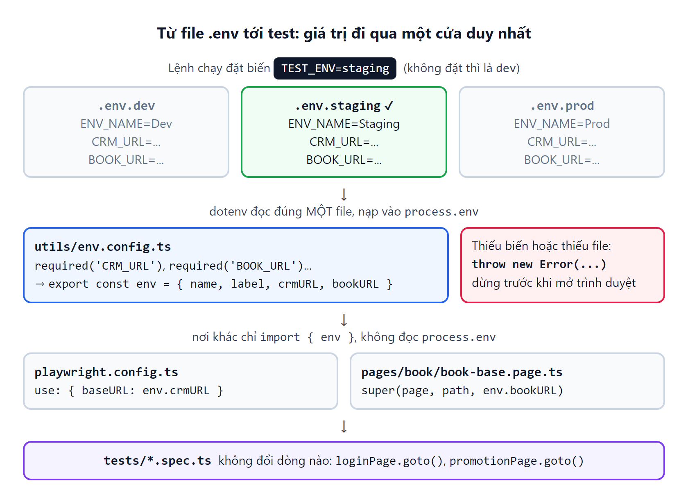
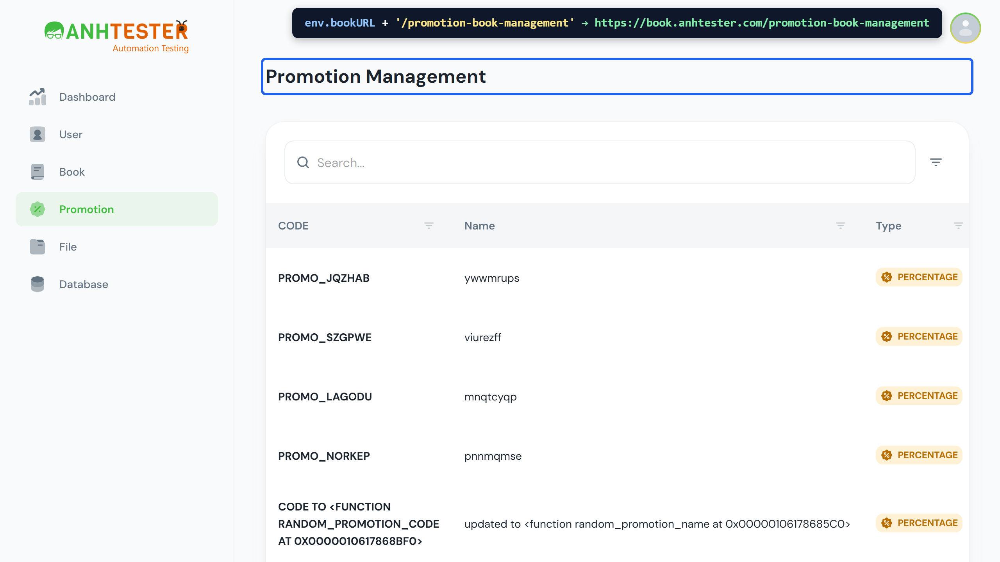
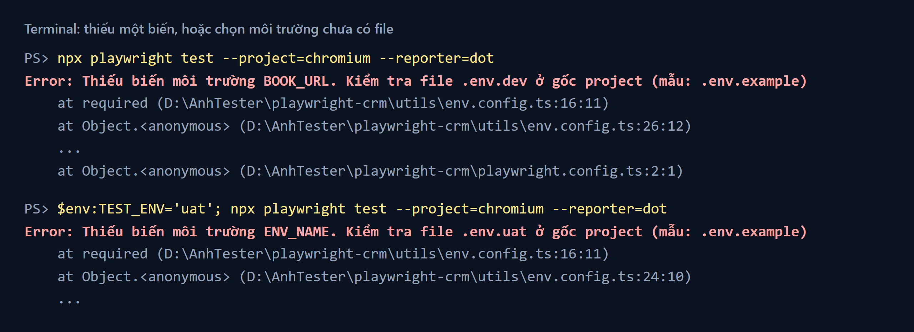
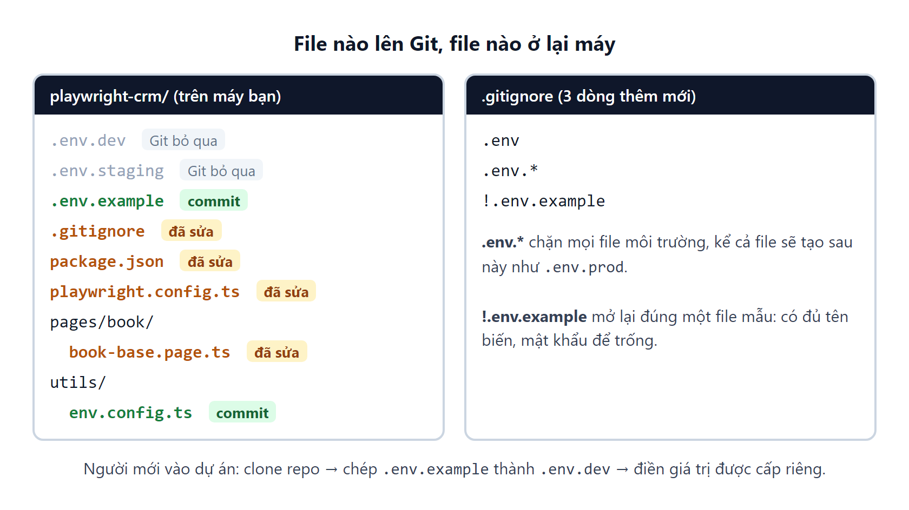

# Bài 30 - [Playwright Typescript] Đọc config đa môi trường từ file .env

Chương: 5. File Config + Truyền Data Test (Data Driven) + Parallel Execution

Nguồn: [https://anhtester.com/learn/website-and-api-testing-automation-with-playwright-javascript-typescript-day-code-js-ts-tu-dau/387](https://anhtester.com/learn/website-and-api-testing-automation-with-playwright-javascript-typescript-day-code-js-ts-tu-dau/387)

✅ Vì sao tách URL, tài khoản ra khỏi code  
✅ Tạo file .env và đọc giá trị bằng dotenv  
✅ Chạy test trên nhiều môi trường dev, staging, prod  
✅ Giữ bí mật với .gitignore và file .env.example  
✅ Dùng Claude Code và bộ kit claude-testing-skills để dựng cấu hình đa môi trường

## ⭐ Mục tiêu bài học

Bài đầu chương chia `projects` để chạy nhiều trình duyệt và thêm lệnh `npm run test:chromium`. Bài trước (Cấu hình use) đưa địa chỉ CRM vào `baseURL`, nên Page Object và test chỉ còn viết đường dẫn tương đối, và bật ảnh, video, trace khi test lỗi.

Còn hai địa chỉ viết cứng: `baseURL: 'https://crm.anhtester.com'` trong file cấu hình và `BOOK_URL` trong `pages/book/book-base.page.ts`. Bài này đưa cả hai ra file `.env`. Học xong bạn sẽ:

- Hiểu biến môi trường là gì, vì sao địa chỉ và tài khoản không nằm trong code.
- Đọc file `.env` bằng `dotenv` qua một file `utils/env.config.ts`, thiếu biến là báo lỗi ngay.
- Chạy cùng bộ test trên `dev`, `staging` bằng biến `TEST_ENV`, trên cả Windows lẫn macOS.
- Giữ mật khẩu khỏi Git, và duyệt được cấu hình môi trường do AI viết.

> 📌 Bài làm tiếp trong project `D:\AnhTester\playwright-crm` (macOS: `~/AnhTester/playwright-crm`). Bài chưa đăng nhập CRM.

## ✅ Phần 1: Vì sao tách URL, tài khoản ra khỏi code

### 🔆 1. Một công thức, nhiều căn bếp

Công thức nấu phở ghi "đun sôi nước dùng", không ghi "vặn bếp nhà tôi lên nấc 7". Nhờ vậy nó dùng được ở mọi căn bếp.

Code test cũng là một tờ công thức. Dự án thật thường có vài bản cài của một hệ thống: **dev**, **staging**, **prod**, mỗi bản một địa chỉ và một bộ tài khoản. Nếu viết chúng thẳng trong code:

- Muốn chạy trên staging phải sửa code, quên sửa về là test chạy nhầm môi trường.
- Mật khẩu theo code lên Git. Git giữ lịch sử: xoá ở commit sau thì mật khẩu vẫn nằm trong các commit cũ.

### 🔆 2. Biến môi trường và process.env

**Biến môi trường** (environment variable) là các cặp tên - giá trị được trao cho chương trình từ bên ngoài, lúc nó khởi động. Trong Node.js bạn đọc chúng qua object `process.env`. Tạo file tạm `exp-env.js` ở gốc project:

```javascript
// exp-env.js - file tạm, xem xong thì xoá
console.log('OS       =', process.env.OS);
console.log('TEST_ENV =', process.env.TEST_ENV);
console.log('WORKERS  =', process.env.WORKERS, '| kiểu:', typeof process.env.WORKERS);

// Mọi giá trị đọc được đều là chuỗi: phải tự đổi kiểu trước khi dùng
console.log('Sai :', process.env.WORKERS + 1);
console.log('Đúng:', Number(process.env.WORKERS ?? 4) + 1);
console.log('HEADLESS là false?', process.env.HEADLESS === 'false');
```

Chạy hai lần trong PowerShell:

```bash
node exp-env.js
$env:WORKERS='4'; $env:HEADLESS='false'; node exp-env.js
```

```plaintext
OS       = Windows_NT
TEST_ENV = undefined
WORKERS  = undefined | kiểu: undefined
Sai : NaN
Đúng: 5
HEADLESS là false? false

OS       = Windows_NT
TEST_ENV = undefined
WORKERS  = 4 | kiểu: string
Sai : 41
Đúng: 5
HEADLESS là false? true
```

- Biến chưa ai đặt thì đọc ra `undefined`, **không báo lỗi**.
- Giá trị nào cũng là **chuỗi**: `'4' + 1` ra `'41'`. Cần số thì `Number(...)`, cần đúng/sai thì so với chuỗi (`=== 'false'`).
- Biến đặt bằng `$env:...` chỉ sống trong cửa sổ Terminal đó.

Xoá `exp-env.js`. `process.env.CI` ở bài đầu chương chính là một biến do máy CI tự đặt.

### 🔆 3. Áp vào automation

Thứ **đổi theo môi trường** (địa chỉ CRM, Book) và thứ **bí mật** (email, mật khẩu) ra khỏi code; đường dẫn, timeout, danh sách project ở lại. Để khỏi gõ `$env:...` trước mỗi lần chạy, người ta ghi các biến vào một file tên `.env` và để thư viện đọc hộ.

## ✅ Phần 2: Tạo file .env và đọc giá trị bằng dotenv

### 🔆 1. Cài dotenv và viết file .env đầu tiên

[dotenv](https://github.com/motdotla/dotenv) đọc file `.env` rồi nạp từng dòng vào `process.env`. Tài liệu Playwright dùng nó ở mục [.env files](https://playwright.dev/docs/test-parameterize). Cài vào `devDependencies`, vì cả project này chỉ phục vụ kiểm thử:

```bash
npm install -D dotenv
```

```plaintext
added 1 package, and audited 7 packages in 1s

1 package is looking for funding
  run `npm fund` for details

found 0 vulnerabilities
```

Bản cài lúc soạn bài: `dotenv 18.0.10`. Tạo file tên `.env` (dấu chấm ở đầu, không có đuôi) ở gốc project:

```plaintext
# Địa chỉ hai hệ thống demo
CRM_URL=https://crm.anhtester.com
BOOK_URL=https://book.anhtester.com
```

- Mỗi dòng một cặp `TÊN=giá trị`, tên viết HOA. Không thêm dấu `;` cuối dòng: nó bị tính vào giá trị.
- Dấu `#` mở đầu ghi chú, kể cả ở giữa dòng. Mật khẩu có ký tự `#` phải bọc trong nháy kép.

### 🔆 2. Đọc thử ngay trong playwright.config.ts

Thêm ba dòng vào đầu `playwright.config.ts` và đổi `baseURL`. Đây là bản **thử**:

```typescript
import { defineConfig, devices } from '@playwright/test';
import dotenv from 'dotenv';

dotenv.config(); // đọc file .env ở thư mục đang đứng, nạp vào process.env
console.log('CRM_URL =', process.env.CRM_URL);

export default defineConfig({
  // ... giữ nguyên
  use: {
    baseURL: process.env.CRM_URL,
    // ... giữ nguyên
  },
});
```

```bash
npx playwright test crm-login-pom --project=chromium --reporter=dot --workers=2
```

```plaintext
◇ injected env (2) from .env
CRM_URL = https://crm.anhtester.com

Running 13 tests using 2 workers
◇ injected env (0) from .env
CRM_URL = https://crm.anhtester.com
◇ injected env (0) from .env
CRM_URL = https://crm.anhtester.com
·············
  13 passed (6.7s)
```

Test xanh. `◇ injected env (2) from .env` là lời báo của dotenv: đã nạp 2 biến. Nó hiện ba lần vì file cấu hình chạy ở tiến trình chính **và ở từng worker**. Worker báo `(0)` vì đã thừa hưởng biến từ tiến trình chính, mà dotenv **không ghi đè** biến đã có. Vì vậy đừng đặt ở đầu file cấu hình việc tốn thời gian hay tạo dữ liệu.

Giờ đứng ở thư mục khác mà chạy (`-c ..`: file cấu hình ở thư mục cha, `-x`: dừng ở test lỗi đầu tiên):

```bash
cd tests
npx playwright test -c .. crm-login-pom --project=chromium --reporter=list --workers=1 -x
```

```plaintext
◇ injected env (0) from .env
CRM_URL = undefined

Running 13 tests using 1 worker
...
    Error: page.goto: Protocol error (Page.navigate): Cannot navigate to invalid URL
    Call log:
      - navigating to "/admin/authentication", waiting until "load"

       at ..\pages\base.page.ts:20
```

Bản thử có hai lỗ hổng:

- **`dotenv.config()` không có đường dẫn** thì tìm `.env` ở thư mục đang đứng. Không thấy file, dotenv cũng không báo lỗi.
- **Không ai kiểm giá trị.** `baseURL` nhận `undefined`, lỗi hiện muộn và không nhắc gì tới file `.env`.

Gõ `cd ..`, xoá file `.env` và ba dòng vừa thêm, trả `baseURL` về như cũ.

### 🔆 3. File utils/env.config.ts: một cửa đọc biến môi trường

Trước hết tạo file `.env.dev` ở gốc project:

```plaintext
# Môi trường dev. File này KHÔNG commit (đã có trong .gitignore).

# Tên hiển thị của môi trường, in ra đầu mỗi lần chạy
ENV_NAME=Dev

# Địa chỉ gốc của hai hệ thống, không có dấu / ở cuối
CRM_URL=https://crm.anhtester.com
BOOK_URL=https://book.anhtester.com

# Tài khoản CRM theo vai trò. Điền trên máy của bạn, không gửi cho ai
CRM_ADMIN_EMAIL=
CRM_ADMIN_PASSWORD=
CRM_PM_EMAIL=
CRM_PM_PASSWORD=
CRM_CUSTOMER_EMAIL=
CRM_CUSTOMER_PASSWORD=
```

Tên biến tài khoản có tiền tố hệ thống `CRM_`, giống file [.env.example](https://github.com/anhtester/playwright-typescript-framework-ai/blob/main/.env.example) của framework mẫu `playwright-typescript-framework-ai` mà Anh Tester dựng cho khoá học. Tạo tiếp file `utils/env.config.ts`:

```typescript
import path from 'node:path';
import dotenv from 'dotenv';

/** Môi trường đang chạy. Không đặt biến TEST_ENV thì mặc định là dev. trim() bỏ dấu cách thừa do gõ lệnh */
export const TEST_ENV = (process.env.TEST_ENV ?? 'dev').trim();
const envFile = `.env.${TEST_ENV}`;

// __dirname là thư mục utils, lùi một cấp là gốc project.
// Nhờ vậy đứng ở thư mục nào gõ lệnh cũng đọc đúng file
dotenv.config({ path: path.resolve(__dirname, '..', envFile), quiet: true });

/** Đọc một biến bắt buộc. Thiếu hoặc để trống thì dừng ngay, nói rõ thiếu biến nào */
function required(name: string): string {
  const value = process.env[name]?.trim(); // giá trị chỉ toàn dấu cách cũng coi là thiếu
  if (!value) {
    throw new Error(`Thiếu biến môi trường ${name}. Kiểm tra file ${envFile} ở gốc project (mẫu: .env.example)`);
  }
  return value;
}

/** Cấu hình của môi trường đang chạy. Cả project chỉ đọc biến môi trường qua object này */
export const env = {
  name: TEST_ENV,
  label: required('ENV_NAME'),
  crmURL: required('CRM_URL'),
  bookURL: required('BOOK_URL'),
} as const;

export type Role = 'ADMIN' | 'PM' | 'CUSTOMER';

/** Tài khoản CRM theo vai trò: account('ADMIN') đọc CRM_ADMIN_EMAIL và CRM_ADMIN_PASSWORD. Chỉ kiểm tra lúc được gọi, nên test không đăng nhập vẫn chạy khi chưa điền mật khẩu */
export function account(role: Role): { email: string; password: string } {
  return { email: required(`CRM_${role}_EMAIL`), password: required(`CRM_${role}_PASSWORD`) };
}

// Chỉ in ở tiến trình chính. Các worker cũng nạp file này nhưng có biến TEST_WORKER_INDEX
if (process.env.TEST_WORKER_INDEX === undefined) {
  console.log(`[env] ${env.name} (${env.label}) | CRM: ${env.crmURL} | Book: ${env.bookURL}`);
}
```

Ba chỗ đáng chú ý:

- `path.resolve(__dirname, ...)` tính đường dẫn từ vị trí **file code**, và `required()` `throw` ngay lúc nạp cấu hình: hai lỗ hổng ở mục 2 được vá. `?.trim()` khiến giá trị chỉ toàn dấu cách cũng bị coi là thiếu.
- `account(role)` đứng riêng: đưa mật khẩu vào `env` thì cả bộ test hôm nay dừng vì thiếu biến.
- `TEST_WORKER_INDEX` là biến Playwright đặt cho mỗi worker ([tài liệu](https://playwright.dev/docs/test-parallel)). Nhờ nó dòng `[env]` chỉ in một lần ở tiến trình chính.

### 🔆 4. Nối vào file cấu hình và BookBasePage

File `playwright.config.ts` đổi đúng hai chỗ:

```typescript
// TRƯỚC
import { defineConfig, devices } from '@playwright/test';
// ...
    baseURL: 'https://crm.anhtester.com',

// SAU
import { defineConfig, devices } from '@playwright/test';
import { env } from './utils/env.config';
// ...
    // Địa chỉ gốc lấy từ file .env.<TEST_ENV>: page.goto('/admin/authentication') tự ghép thành địa chỉ đầy đủ
    baseURL: env.crmURL,
```

File `pages/book/book-base.page.ts` bỏ hằng số `BOOK_URL`:

```typescript
// TRƯỚC
import { SideMenu } from '../../components/side-menu.component';

export const BOOK_URL = 'https://book.anhtester.com';
// ...
    super(page, path, BOOK_URL);

// SAU
import { SideMenu } from '../../components/side-menu.component';
import { env } from '../../utils/env.config';
// ...
    super(page, path, env.bookURL); // Book ở tên miền khác nên truyền địa chỉ gốc đầy đủ
```

Không file test nào phải sửa:

```bash
npx playwright test --project=chromium --reporter=dot --quiet
```

```plaintext
[env] dev (Dev) | CRM: https://crm.anhtester.com | Book: https://book.anhtester.com

Running 47 tests using 16 workers
···············································
  47 passed (10.3s)
```

[](https://anhtester.com/storage/photos/shares/lesson/js_ts_playwright/v2/bai_30_config_env/01_so_do_tu_file_env_toi_test.png)

*Đường đi của một giá trị: từ file .env theo môi trường, qua utils/env.config.ts, tới file cấu hình và Page Object*

[](https://anhtester.com/storage/photos/shares/lesson/js_ts_playwright/v2/bai_30_config_env/02_trang_promotion_book_mo_bang_env_bookurl.png)

*Trang Promotion của Book mở bằng địa chỉ ghép từ env.bookURL, khung xanh là locator heading của BookBasePage*

Thử lại hai lỗ hổng cũ. Đứng trong `tests` chạy `npx playwright test -c .. crm-login-pom --project=chromium --reporter=dot`: kết quả thật `13 passed`. Rồi thêm `#` trước dòng `BOOK_URL` trong `.env.dev` và chạy:

```plaintext
Error: Thiếu biến môi trường BOOK_URL. Kiểm tra file .env.dev ở gốc project (mẫu: .env.example)
    at required (D:\AnhTester\playwright-crm\utils\env.config.ts:16:11)
    at Object.<anonymous> (D:\AnhTester\playwright-crm\utils\env.config.ts:26:12)
    ...
    at Object.<anonymous> (D:\AnhTester\playwright-crm\playwright.config.ts:2:1)
```

Không trình duyệt nào mở, câu báo lỗi nói đúng tên biến, tên file. Bỏ dấu `#` đi. Gọi `account('ADMIN')` lúc này cũng nhận lỗi như vậy với `CRM_ADMIN_EMAIL`, vì file đang để trống.

## ✅ Phần 3: Chạy test trên nhiều môi trường dev, staging, prod

### 🔆 1. Mỗi môi trường một file

Chép `.env.dev` thành `.env.staging`, sửa `ENV_NAME=Staging`. Có prod thì thêm `.env.prod` cùng cách.

> ⚠️ **CRM demo và Book demo chỉ có một môi trường.** Trong bài, hai file cùng trỏ về địa chỉ demo, chỉ khác `ENV_NAME`. Ở dự án thật, mỗi file là một máy chủ riêng; cơ chế chọn file giống hệt.

### 🔆 2. Đặt TEST\_ENV theo từng loại Terminal

Mỗi loại Terminal đặt biến `TEST_ENV` một kiểu:

<table class="rt-table">
<thead>
<tr>
<th>Terminal</th>
<th>Lệnh</th>
<th>Biến sống tới khi</th>
</tr>
</thead>
<tbody>
<tr><td>PowerShell (Windows)</td><td><code><span>$env:TEST_ENV='staging';</span> <span>npx</span> <span>playwright</span> <span>test</span></code></td><td>Đóng cửa sổ Terminal</td></tr>
<tr><td>CMD (Windows)</td><td><code><span>set</span> <span>TEST_ENV=staging&amp;&amp;</span> <span>npx</span> <span>playwright</span> <span>test</span></code></td><td>Đóng cửa sổ</td></tr>
<tr><td>Git Bash, macOS, Linux</td><td><code><span>TEST_ENV=staging</span> <span>npx</span> <span>playwright</span> <span>test</span></code></td><td>Hết đúng lệnh đó</td></tr>
</tbody>
</table>

Chạy thật trên PowerShell, rồi gỡ biến bằng `Remove-Item` và kiểm lại:

```bash
$env:TEST_ENV='staging'; npx playwright test crm-client-pom --project=chromium --reporter=dot --quiet
Remove-Item Env:TEST_ENV
npx playwright test --list --project=mobile-chrome
```

```plaintext
[env] staging (Staging) | CRM: https://crm.anhtester.com | Book: https://book.anhtester.com

Running 11 tests using 11 workers
···········
  11 passed (3.7s)

[env] dev (Dev) | CRM: https://crm.anhtester.com | Book: https://book.anhtester.com
Listing tests:
  ...
Total: 5 tests in 1 file
```

Chữ `Staging` trong ngoặc là `ENV_NAME` đọc từ file: đúng file `.env.staging` đã được nạp.

> ⚠️ Trên CMD, viết `set TEST_ENV=staging && ...` (có dấu cách trước `&&`) là giá trị dính thêm một dấu cách ở cuối. Dòng `.trim()` trong `env.config.ts` sinh ra từ lỗi đó.

### 🔆 3. cross-env và npm scripts

Ba kiểu lệnh đó không ghi chung vào `package.json` được. Thử trên Windows hai script `"export TEST_ENV=staging && playwright test"` và `"TEST_ENV=staging playwright test"`, npm báo:

```plaintext
'export' is not recognized as an internal or external command,
operable program or batch file.

'TEST_ENV' is not recognized as an internal or external command,
operable program or batch file.
```

[cross-env](https://github.com/kentcdodds/cross-env) đặt biến môi trường theo cùng một cú pháp trên mọi hệ điều hành, rồi chạy lệnh đứng sau nó.

```bash
npm install -D cross-env
```

```plaintext
added 8 packages, and audited 15 packages in 2s

1 package is looking for funding
  run `npm fund` for details

found 0 vulnerabilities
```

Bản cài là `cross-env 10.1.0`. Thêm hai dòng vào mục `scripts` của `package.json`:

```json
  "scripts": {
    "test": "playwright test",
    "test:chromium": "playwright test --project=chromium",
    "test:dev": "cross-env TEST_ENV=dev playwright test",
    "test:staging": "cross-env TEST_ENV=staging playwright test",
    "report": "playwright show-report"
  },
```

[![Kết quả chạy thật npm run test:dev và npm run test:staging: dòng [env] cho biết file nào được nạp | Anh Tester](../../assets/8edb70f76623060cfebc.png)](https://anhtester.com/storage/photos/shares/lesson/js_ts_playwright/v2/bai_30_config_env/03_terminal_chay_test_dev_va_staging.png)

*Kết quả chạy thật npm run test:dev và npm run test:staging: dòng [env] cho biết file nào được nạp*

### 🔆 4. Chọn môi trường chưa có file, và thứ tự ưu tiên

Gõ `TEST_ENV=uat` khi chưa có `.env.uat`: dotenv không ném lỗi khi thiếu file, nhưng `required()` chặn lại ở biến đầu tiên:

[](https://anhtester.com/storage/photos/shares/lesson/js_ts_playwright/v2/bai_30_config_env/04_terminal_loi_thieu_bien_moi_truong.png)

*Hai lỗi thật của required(): thiếu biến BOOK\_URL trong .env.dev, và chọn môi trường uat chưa có file*

Code cố ý không `throw` khi thiếu file: biến có sẵn trong Terminal **thắng** giá trị trong file, và máy CI không có file `.env` nào mà nạp thẳng biến từ kho secrets (học ở bài tích hợp CI).

## ✅ Phần 4: Giữ bí mật với .gitignore và file .env.example

### 🔆 1. Chặn file .env khỏi Git

Mở `.gitignore` ở gốc project, thêm vào cuối:

```plaintext
# File môi trường: chỉ commit file mẫu .env.example
.env
.env.*
!.env.example
```

Dấu `!` nghĩa là "trừ file này ra". Kiểm bằng hai lệnh Git (sau khi đã tạo `.env.example` ở mục 2):

```bash
git status --short
git check-ignore -v .env.dev .env.staging .env.example
```

```plaintext
 M .claude/rules/project_config_rules.md
 M .gitignore
 M package-lock.json
 M package.json
 M pages/book/book-base.page.ts
 M playwright.config.ts
?? .env.example
?? utils/env.config.ts

.gitignore:12:.env.*    .env.dev
.gitignore:12:.env.*    .env.staging
.gitignore:13:!.env.example     .env.example
```

`git status` không nhắc tới `.env.dev`, `.env.staging`. `git check-ignore -v` chỉ ra dòng nào của `.gitignore` quyết định từng file.

[](https://anhtester.com/storage/photos/shares/lesson/js_ts_playwright/v2/bai_30_config_env/05_so_do_file_env_va_gitignore.png)

*File nào lên Git, file nào ở lại máy: .env.dev và .env.staging bị bỏ qua, .env.example được commit*

### 🔆 2. File .env.example cho người đến sau

File mẫu `.env.example` cho người clone repo biết phải khai những biến nào: đủ **tên** biến, mật khẩu để trống.

```plaintext
# Mẫu file môi trường. File này ĐƯỢC commit, nên không chứa mật khẩu.
# Cách dùng: chép thành .env.dev (hoặc .env.staging, .env.prod) rồi điền giá trị thật.

# Tên hiển thị của môi trường, in ra đầu mỗi lần chạy
ENV_NAME=Dev

# Địa chỉ gốc của hai hệ thống, không có dấu / ở cuối
CRM_URL=https://crm.anhtester.com
BOOK_URL=https://book.anhtester.com

# Tài khoản CRM theo vai trò. Để trống ở file mẫu
CRM_ADMIN_EMAIL=
CRM_ADMIN_PASSWORD=
CRM_PM_EMAIL=
CRM_PM_PASSWORD=
CRM_CUSTOMER_EMAIL=
CRM_CUSTOMER_PASSWORD=
```

Người mới chép file này thành `.env.dev` rồi điền giá trị được cấp qua kênh riêng, không qua chat nhóm.

> ⚠️ **Lỡ commit một file `.env` có mật khẩu thì sao?** `git rm --cached .env.dev` gỡ file khỏi Git mà vẫn giữ trên máy. Nhưng mật khẩu còn trong lịch sử, nên việc bắt buộc là **đổi mật khẩu đó**.

### 🔆 3. Node.js 24 tự đọc được file .env, vì sao vẫn dùng dotenv?

Node.js có sẵn `node --env-file=.env.dev file.js` và [`process.loadEnvFile()`](https://nodejs.org/api/process.html#processloadenvfilepath), cả hai chạy đúng trên Node 24.17. Khoá học vẫn dùng `dotenv`: lệnh chạy test là `playwright test` nên không gắn trực tiếp được `--env-file`, còn `process.loadEnvFile()` ném lỗi khi thiếu file, trái với cách CI nạp biến.

### 🔆 4. Project sau bài này

```plaintext
playwright-crm/
├── .claude/rules/
│   └── project_config_rules.md       ← thêm mục "Biến môi trường (.env)"
├── .env.dev                          ← (MỚI) không commit
├── .env.staging                      ← (MỚI) không commit
├── .env.example                      ← (MỚI) commit, mật khẩu để trống
├── .gitignore                        ← thêm .env, .env.*, !.env.example
├── pages/book/book-base.page.ts      ← BOOK_URL thay bằng env.bookURL
├── utils/
│   └── env.config.ts                 ← (MỚI) TEST_ENV, required(), env, account()
├── package.json                      ← dotenv, cross-env, test:dev, test:staging
└── playwright.config.ts              ← baseURL: env.crmURL
```

Chạy lại để chốt: `npx playwright test --project=chromium --project=webkit --project=mobile-chrome --reporter=dot --quiet` cho kết quả thật **99 passed**, bằng bài trước.

## ✅ Phần 5: Dùng Claude Code và bộ kit claude-testing-skills để dựng cấu hình đa môi trường

### 🔆 1. Mẫu của bộ kit và chỗ project khác

Lệnh [/generate-automation-framework](https://github.com/anhtester/claude-testing-skills/blob/main/.claude/commands/generate-automation-framework.md) của bộ kit sinh `src/utils/env.config.ts`, `.env.example` và `.gitignore` có `.env`. Code mẫu ở mục 1 của [CODE\_TEMPLATES.md](https://github.com/anhtester/claude-testing-skills/blob/main/.claude/skills/skills-framework-architect/references/CODE_TEMPLATES.md), cũng có hàm `required()` như bài này.

Đích đến của khoá học là framework mẫu [playwright-typescript-framework-ai](https://github.com/anhtester/playwright-typescript-framework-ai/blob/main/src/utils/env.config.ts). File `env.config.ts` của nó cùng kiểu với bài này: `required()`, `env.crmURL`, biến `CRM_ADMIN_EMAIL`. Ba chỗ project đang khác: framework đọc **một** file `.env` (bài này chọn `.env.<TEST_ENV>` để dạy đa môi trường, và có thêm `ENV_NAME`); tài khoản là getter đọc lười `env.crmAdmin` (ở đây là hàm `account(role)`); và nó có thêm các biến `WORKERS`, `BROWSERS`, `HEADLESS`, `TIMEOUT`, `VIEWPORT` mà bạn sẽ thêm dần.

Chỗ khác nhau thì quy tắc của project thắng. Thêm vào cuối `.claude/rules/project_config_rules.md`:

```markdown
## Biến môi trường (.env)
- Địa chỉ hệ thống và tài khoản KHÔNG viết trong code. Chúng nằm ở file `.env.<môi trường>` tại gốc project:
  `.env.dev`, `.env.staging`, `.env.prod`. Chọn file bằng biến `TEST_ENV` (mặc định `dev`).
- Chỉ `utils/env.config.ts` được đọc `process.env` (trừ `process.env.CI` trong file cấu hình).
  Nơi khác import `env` hoặc `account()` từ file đó. Biến bắt buộc đi qua `required()`,
  KHÔNG dùng `process.env.X!` và KHÔNG đặt giá trị dự phòng cho địa chỉ, mật khẩu.
- Thêm biến mới thì thêm ĐỦ 3 chỗ: `utils/env.config.ts`, `.env.example` (giá trị mẫu, mật khẩu để trống)
  và mọi file `.env.<môi trường>` đang có.
- `.gitignore` luôn có `.env`, `.env.*`, `!.env.example`. Chỉ commit `.env.example`.
- Script chạy theo môi trường viết bằng `cross-env` (`cross-env TEST_ENV=staging playwright test`),
  KHÔNG viết `export`, `set` hay `TEST_ENV=... lệnh` trong `package.json`.
- AI KHÔNG mở, không in, không chép giá trị trong các file `.env.*`. Cần biết có biến nào thì đọc `.env.example`.
```

### 🔆 2. Đừng để AI nhìn thấy mật khẩu

Code tự đọc `.env` lúc chạy, nên AI không cần mở file đó. Dòng quy tắc cuối ở trên là lời dặn. Muốn chặn hẳn, tài liệu Claude Code hướng dẫn thêm luật `deny` vào file cài đặt ([code.claude.com/docs/en/settings](https://code.claude.com/docs/en/settings)), ví dụ file dùng chung của nhóm `.claude/settings.json`:

```json
{
  "permissions": {
    "deny": [
      "Read(./.env)",
      "Read(./.env.*)"
    ]
  }
}
```

> 📌 Luật `Read(./.env.*)` chặn luôn `.env.example`: cần thì dán nội dung file mẫu vào prompt. Bài chưa tạo `settings.json` trong project, vì [CLAUDE.md của bộ kit](https://github.com/anhtester/claude-testing-skills/blob/main/CLAUDE.md) chọn cách khác: cho Claude đọc `.env` để dùng khi chạy test, không ghi lại, không hiển thị. Với ChatGPT, Gemini: **chỉ dán `.env.example`**, không dán `.env.dev`.

### 🔆 3. Prompt dùng được ở Claude, ChatGPT và Gemini

Claude Code là bản có phí dùng trong khoá. Với bản miễn phí của [ChatGPT](https://chatgpt.com/) hoặc [Gemini](https://gemini.google.com/), bạn dán nội dung file vào chỗ có ngoặc vuông và tự chạy lệnh.

**Thêm một biến môi trường mới cho đủ ba chỗ:**

```markdown
Thêm biến môi trường API_URL (địa chỉ gốc của API Book, bắt buộc) vào project Playwright TypeScript,
theo mục "Biến môi trường (.env)" của .claude/rules/project_config_rules.md.

[dán utils/env.config.ts, .env.example và mục quy tắc nếu không dùng Claude Code]

Yêu cầu:
1. Thêm `apiUrl: required('API_URL')` vào object env. Không đọc process.env ở file nào khác.
2. Thêm dòng API_URL kèm một dòng ghi chú vào .env.example.
3. KHÔNG mở, không sửa các file .env.dev, .env.staging. Thay vào đó, in ra dòng tôi cần tự thêm vào từng file.
4. Chạy `npx playwright test --list` và cho tôi xem lỗi của required() khi tôi chưa thêm biến.
```

**Tìm địa chỉ và mật khẩu còn viết cứng:**

```markdown
Rà toàn bộ thư mục pages/, tests/, fixtures/, utils/ và file playwright.config.ts.

[dán nội dung các file nếu không dùng Claude Code]

Lập bảng: file | số dòng | giá trị viết cứng | loại (địa chỉ gốc / tài khoản / mật khẩu / khác) | nên thay bằng gì.
- Đường dẫn tương đối như '/admin/authentication' KHÔNG tính là viết cứng.
- Chỗ đọc process.env nằm ngoài utils/env.config.ts cũng đưa vào bảng (trừ process.env.CI).
- CHƯA sửa gì. Chỉ lập bảng để tôi duyệt.
```

**Hỏi để hiểu sâu:**

```markdown
Tôi đang học cách đọc biến môi trường trong Playwright Test (TypeScript) bằng dotenv. Đây là file của tôi:

[dán utils/env.config.ts]

Hãy giải thích bằng ví dụ cụ thể với file này:
1. Nếu tôi vừa đặt CRM_URL trong Terminal vừa có CRM_URL trong .env.dev thì giá trị nào được dùng? Vì sao?
2. Option `override` của dotenv đổi điều đó thế nào, và khi nào KHÔNG nên bật?
3. Vì sao file này được chạy lại trong mỗi worker của Playwright?
Chỉ dựa trên tài liệu https://github.com/motdotla/dotenv và https://playwright.dev/docs/test-parallel .
Điều gì không chắc thì nói "cần chạy thử", không đoán.
```

Rà bằng lệnh của bộ kit:

```markdown
/review-automation-code REVIEW utils
Đối chiếu thêm mục "Biến môi trường (.env)" trong .claude/rules/project_config_rules.md. Không mở các file .env.*
```

## ✅ Phần 6: Kiểm tra code do AI sinh ra

Cấu hình do AI viết thường chạy được trên máy bạn. Lỗi lộ ra ở máy khác, môi trường khác, hoặc trên Git:

<table class="rt-table">
<thead>
<tr>
<th>Dấu hiệu trong code</th>
<th>Vì sao là vấn đề</th>
<th>Cách xử lý</th>
</tr>
</thead>
<tbody>
<tr><td><code>dotenv.config()</code> không có <code>path</code>, hoặc <code>path</code> tương đối</td><td>Đứng ở thư mục khác là không thấy file, không có lỗi nào báo</td><td><code>path.resolve(__dirname, ...)</code></td></tr>
<tr><td><code>process.env.CRM_URL!</code></td><td>Dấu <code>!</code> chỉ bảo TypeScript im lặng, giá trị vẫn là <code>undefined</code></td><td>Đi qua <code>required()</code></td></tr>
<tr><td><code><span>process.env.CRM_URL</span> <span>||</span> <span>'https://...'</span></code></td><td>Thiếu biến thì test lặng lẽ chạy vào địa chỉ dự phòng, nhầm môi trường</td><td>Không đặt giá trị dự phòng cho địa chỉ, mật khẩu</td></tr>
<tr><td><code>.gitignore</code> chỉ có <code>.env</code>, hoặc ghi <code>.env*</code></td><td><code>.env.staging</code> vẫn lên Git; hoặc chặn luôn <code>.env.example</code></td><td>Ba dòng như Phần 4</td></tr>
<tr><td>Mật khẩu thật trong <code>.env.example</code>; <code>console.log(env)</code> khi <code>env</code> có mật khẩu</td><td>File mẫu được commit; log của CI nhiều người xem được</td><td>File mẫu để trống, chỉ in tên môi trường và địa chỉ</td></tr>
<tr><td>Script <code>export X=...</code>, <code>set X=...</code>, <code>X=... lệnh</code></td><td>Mỗi kiểu chỉ chạy trên một hệ điều hành</td><td><code>cross-env X=... lệnh</code></td></tr>
<tr><td>Dùng <code>NODE_ENV</code> để chọn môi trường test</td><td>Nhiều công cụ Node.js đã dùng biến này với nghĩa riêng</td><td>Biến riêng: <code>TEST_ENV</code></td></tr>
</tbody>
</table>

## ✅ Phần 7: Bài tập thực hành

**Bài tập 1 - Môi trường prod có chốt an toàn.** Tạo `.env.prod` (`ENV_NAME=Prod`, vẫn dùng địa chỉ demo) và script `test:prod` chỉ chạy test `@smoke` bằng `--grep @smoke`. Chạy trên Chromium, ghi lại dòng `[env]` và số test. Vì sao trên prod không chạy cả bộ?

**Bài tập 2 - Biến kiểu số và kiểu đúng/sai.** Thêm vào `env` hai mục `headless` (đọc `HEADLESS`, chỉ chuỗi `'false'` mới tắt) và `workers` (đọc `WORKERS`, không đặt thì `undefined`), dùng trong `playwright.config.ts`. Viết một test không xin fixture `page`, in `testInfo.project.use.headless` và `testInfo.config.workers`, chạy khi không đặt biến và khi đặt `HEADLESS=false`, `WORKERS=2`. Cách viết tham khảo: [env.config.ts của framework mẫu](https://github.com/anhtester/playwright-typescript-framework-ai/blob/main/src/utils/env.config.ts).

**Bài tập 3 - Báo đủ biến thiếu một lần.** `required()` đang dừng ở biến thiếu đầu tiên. Sửa để gom tên mọi biến thiếu rồi báo một lần, ví dụ `Thiếu 3 biến môi trường: ENV_NAME, CRM_URL, BOOK_URL`. Chứng minh bằng `TEST_ENV=uat`.

**Bài tập 4 - Duyệt code AI.** Đoạn dưới gộp bốn file, có **9 chỗ cần sửa** (một dòng mắc hai lỗi). Tìm đủ, nêu lý do theo bảng ở Phần 6.

```typescript
// ----- utils/env.config.ts -----
import dotenv from 'dotenv';

dotenv.config({ path: `.env.${process.env.NODE_ENV}` });

export const env = {
  crmURL: process.env.CRM_URL!,
  bookURL: process.env.BOOK_URL || 'https://book.anhtester.com',
  adminPassword: process.env.CRM_ADMIN_PASSWORD || 'mat-khau-du-phong',
  retries: process.env.RETRIES || 0,
};

console.log('Cấu hình đang dùng:', env);

// ----- playwright.config.ts (trích) -----
//   retries: env.retries as number,
//   use: { baseURL: env.crmURL },

// ----- .gitignore (trích) -----
//   node_modules/
//   .env*

// ----- package.json (trích) -----
//   "test:staging": "NODE_ENV=staging playwright test"
```

## ✅ Phần 8: Ghi nhớ nhanh

- Biến môi trường đọc bằng `process.env`: luôn là chuỗi, chưa đặt thì `undefined` và không báo lỗi.
- Địa chỉ, tài khoản nằm ở `.env.<môi trường>`. Chọn file bằng `TEST_ENV`, đặt qua `cross-env` trong npm scripts.
- Cả project đọc biến qua một cửa `utils/env.config.ts`: đường dẫn tính từ `__dirname`, biến bắt buộc đi qua `required()`.
- `.gitignore` có `.env`, `.env.*`, `!.env.example`. Lỡ commit mật khẩu thì phải đổi mật khẩu.

✅ **Kết luận:** Địa chỉ CRM và Book đã rời khỏi code, bộ test đổi môi trường bằng một lệnh `npm run test:staging`. `.env.example` đã khai `CRM_ADMIN_EMAIL`, `CRM_ADMIN_PASSWORD` và hàm `account()` đã chờ sẵn, nhưng chưa test nào đăng nhập. Bài kế tiếp dùng chúng để đăng nhập **một lần** rồi dùng lại phiên đó cho cả bộ test: **Lưu trạng thái đăng nhập với Storage State và test nhiều tài khoản**.

---

## Bài tập riêng — Bài tập - Cấu hình đa môi trường với file .env, TEST_ENV và duyệt code AI

Nguồn bài tập: [https://anhtester.com/student-assignments?course=website-and-api-testing-automation-with-playwright-javascript-typescript-day-code-js-ts-tu-dau#assignment-120](https://anhtester.com/student-assignments?course=website-and-api-testing-automation-with-playwright-javascript-typescript-day-code-js-ts-tu-dau#assignment-120)

**Mục tiêu:** đưa địa chỉ và tài khoản ra khỏi code bằng file `.env`, chạy cùng một bộ test trên nhiều môi trường bằng biến `TEST_ENV`, đổi kiểu giá trị đọc từ biến môi trường, và nhận ra lỗi trong phần cấu hình môi trường do AI sinh ra kể cả khi test vẫn xanh trên máy mình.

**Thư mục làm bài:** `D:\AnhTester\playwright-crm` (macOS: `~/AnhTester/playwright-crm`), dùng tiếp các file của bài học: `utils/env.config.ts`, `.env.example`, `.env.dev`, `.env.staging`, `.gitignore`, `package.json`, `playwright.config.ts`. CRM demo và Book demo chỉ có một môi trường, nên mọi file `.env.*` trong bài tập vẫn dùng `https://crm.anhtester.com` và `https://book.anhtester.com`. Bài tập **không đăng nhập**, không bấm Login, Submit, Save, Delete. **Không commit** bất kỳ file `.env.*` nào ngoài `.env.example`, không ghi mật khẩu vào code hay vào bài nộp.

### 📝 Đề bài

#### Bài tập 1 - Môi trường prod có chốt an toàn

1. Tạo `.env.prod` bằng cách chép `.env.example`, đặt `ENV_NAME=Prod`, giữ hai địa chỉ demo, để trống các biến tài khoản.
2. Thêm vào `package.json` script `test:prod`: đặt `TEST_ENV=prod` bằng `cross-env` và chỉ chạy test gắn tag `@smoke` (`--grep @smoke`).
3. Chạy `npm run test:prod -- --project=chromium --reporter=dot --quiet`, rồi `git status --short` và `git check-ignore -v .env.prod`.

Trả lời: (a) dòng `[env]` in ra gì và có bao nhiêu test chạy? (b) Vì sao trên prod chỉ chạy `@smoke` mà không chạy cả bộ? (c) Dòng nào của `.gitignore` giữ `.env.prod` khỏi Git?

#### Bài tập 2 - Biến kiểu số và kiểu đúng/sai

1. Thêm vào object `env` của `utils/env.config.ts` hai mục: `headless` đọc biến `HEADLESS` (mặc định `true`, chỉ khi giá trị là chuỗi `'false'` mới thành `false`) và `workers` đọc biến `WORKERS` (có đặt thì đổi sang số, không đặt thì `undefined`).
2. Trong `playwright.config.ts` dùng `headless: env.headless` và `workers: process.env.CI ? 1 : env.workers`. Thêm hai biến (kèm ghi chú) vào `.env.example`. Cách viết tham khảo: [env.config.ts của framework mẫu](https://github.com/anhtester/playwright-typescript-framework-ai/blob/main/src/utils/env.config.ts) (`headless`, `workers`).
3. Viết `tests/bt2-env.spec.ts` gồm một test **không xin fixture `page`** (để không mở trình duyệt), in ra `testInfo.project.use.headless` và `testInfo.config.workers`.
4. Chạy `npx playwright test bt2-env --project=chromium --reporter=line` hai lần: không đặt biến nào, và đặt `HEADLESS=false`, `WORKERS=2` theo cách của Terminal bạn đang dùng.

Trả lời: nếu viết `headless: process.env.HEADLESS || true` thì chuyện gì xảy ra khi đặt `HEADLESS=false` và chạy một test có mở trang? Vì sao?

#### Bài tập 3 - Báo đủ biến thiếu trong một lần

Hiện `required()` dừng ở biến thiếu đầu tiên: sửa xong một biến, chạy lại mới thấy biến thứ hai. Sửa `utils/env.config.ts` để gom tên mọi biến bắt buộc còn thiếu của object `env` rồi báo **một lần**, câu báo có số lượng, tên từng biến và tên file môi trường. Chứng minh bằng cách chạy `npx playwright test --list` với `TEST_ENV=uat` (không tạo file `.env.uat`). Sau khi sửa, chạy lại cả bộ test trên Chromium với môi trường `dev` để chắc không làm hỏng gì.

#### Bài tập 4 - Duyệt code AI

Phần cấu hình môi trường dưới đây do AI viết, gộp bốn file vào một chỗ cho dễ đọc. Nó có **9 chỗ cần sửa** (có một dòng mắc hai lỗi). Tìm đủ, nêu lý do, rồi viết lại cho đúng quy tắc mục "Biến môi trường (.env)" của `.claude/rules/project_config_rules.md`.

```typescript
// ----- utils/env.config.ts -----
import dotenv from 'dotenv';

dotenv.config({ path: `.env.${process.env.NODE_ENV}` });

export const env = {
  crmURL: process.env.CRM_URL!,
  bookURL: process.env.BOOK_URL || 'https://book.anhtester.com',
  adminPassword: process.env.CRM_ADMIN_PASSWORD || 'mat-khau-du-phong',
  retries: process.env.RETRIES || 0,
};

console.log('Cấu hình đang dùng:', env);

// ----- playwright.config.ts (trích) -----
//   retries: env.retries as number,
//   use: { baseURL: env.crmURL },

// ----- .gitignore (trích) -----
//   node_modules/
//   .env*

// ----- package.json (trích) -----
//   "test:staging": "NODE_ENV=staging playwright test"
```

### 📦 Cách nộp bài

1. Làm bài trong project `playwright-crm`, commit và push lên nhánh `main` của repo GitHub `playwright-crm` của bạn. Trước khi push, chạy `git status --short` và kiểm chắc danh sách **không có** `.env.dev`, `.env.staging`, `.env.prod`.
2. Dán link repo vào ô **Link GitHub**, dạng `https://github.com/<ten-ban>/playwright-crm`. Repo Private thì vào **Settings → Collaborators** thêm tài khoản GitHub của giảng viên, nếu không giảng viên không mở được.
3. Trong ô **Nội dung bài làm (Editor)**, dán **kết quả chạy thật** trên Terminal của từng lệnh (mỗi lệnh một **Đoạn code mẫu** chọn Text / Log) và phần trả lời các câu hỏi.
4. Với bài **Duyệt code AI**: liệt kê từng chỗ sai theo mẫu *Dòng – Lỗi – Lý do – Cách sửa*, rồi dán bản đã viết lại.
5. Dán thêm kết quả `npm run test:staging -- --project=chromium --reporter=dot --quiet` của project sau khi làm xong cả bốn bài.
6. Vì các file `.env.*` không lên Git, dán nội dung `.env.prod` của bạn vào bài làm **sau khi đã chắc các biến mật khẩu đang để trống**.

### ✅ Tiêu chí Đạt

- Bài tập 1: script đúng dạng `"test:prod": "cross-env TEST_ENV=prod playwright test --grep @smoke"`. Dòng đầu của kết quả là `[env] prod (Prod) | CRM: https://crm.anhtester.com | Book: https://book.anhtester.com`; số test trên Chromium bằng số test gắn `@smoke` của project (với project đúng như bài học là **11**; học viên đã thêm bớt test thì con số khác, chấp nhận nếu khớp với `npx playwright test --grep @smoke --project=chromium --list`). Trả lời đúng ý: prod là nơi khách hàng dùng thật, chỉ chạy nhóm test ngắn, chỉ đọc, không tạo hay sửa dữ liệu; chạy cả bộ có thể làm bẩn dữ liệu thật và gây tải. `git status --short` không có `.env.prod`; `git check-ignore -v .env.prod` chỉ vào dòng `.env.*` của `.gitignore`.
- Bài tập 2: giá trị đổi kiểu trong `utils/env.config.ts`, không đọc `process.env` ở file khác (trừ `process.env.CI`). Chấp nhận: `headless: process.env.HEADLESS !== 'false'` (hoặc kiểu framework mẫu: hàm `optional()` rồi `.toLowerCase() !== 'false'`, hàm `positiveInt()` cho `workers`), `workers: process.env.WORKERS ? Number(process.env.WORKERS) : undefined`. Hai lần chạy in ra `headless = true` kèm số worker mặc định của máy, rồi `headless = false | workers = 2`. `.env.example` có đủ hai biến mới. Trả lời đúng: `process.env.HEADLESS || true` cho ra **chuỗi** `'false'` chứ không phải giá trị `false`; test có mở trang dừng ngay với lỗi `browserType.launch: headless: expected boolean, got string` (kết quả chạy thật trên Playwright 1.65.1). Biến môi trường luôn là chuỗi, phải so sánh với chuỗi để ra kiểu đúng/sai.
- Bài tập 3: với `TEST_ENV=uat`, một lần chạy báo đủ cả ba biến, ví dụ `Error: Thiếu 3 biến môi trường: ENV_NAME, CRM_URL, BOOK_URL. Kiểm tra file .env.uat ở gốc project (mẫu: .env.example)`, và không test nào được liệt kê. Cách làm chấp nhận: `required()` ghi tên biến thiếu vào một mảng và trả về chuỗi rỗng, sau khi tạo xong object `env` thì kiểm mảng và `throw` một lần; `account(role)` vẫn báo lỗi khi được gọi mà thiếu biến. Không chấp nhận: bỏ hẳn việc kiểm tra, hoặc đặt giá trị dự phòng cho địa chỉ. Chạy lại cả bộ trên Chromium với `dev` vẫn đạt đủ số test như trước.
- Bài tập 4: tìm được ít nhất **7 trong 9** lỗi, kèm lý do đúng. **Đáp án cho người chấm**: (1) `path` là đường dẫn tương đối `.env.…`: dotenv tìm theo thư mục đang đứng khi gõ lệnh, đứng ở thư mục khác là không thấy file và không có lỗi nào báo; phải `path.resolve(__dirname, '..', …)`; (2) cùng dòng đó: dùng `NODE_ENV` (biến nhiều công cụ Node.js đã dùng với nghĩa riêng) thay cho biến riêng `TEST_ENV`, lại không có giá trị mặc định nên khi chưa đặt biến chương trình đi đọc file `.env.undefined` (kết quả chạy thật: `◇ injected env (0) from .env.undefined`); (3) `process.env.CRM_URL!`: dấu `!` chỉ tắt cảnh báo của TypeScript, thiếu biến thì `crmURL` là `undefined` và lỗi hiện muộn (`Cannot navigate to invalid URL`); phải qua `required()`; (4) `BOOK_URL || 'https://book.anhtester.com'`: giá trị dự phòng cho địa chỉ, file môi trường thiếu biến thì test lặng lẽ chạy vào địa chỉ khác; (5) `CRM_ADMIN_PASSWORD || '…'`: mật khẩu viết trong code và sẽ lên Git; tài khoản chỉ đọc qua `account(role)`, không có giá trị dự phòng; (6) `retries: process.env.RETRIES || 0` cùng `as number` ở file cấu hình: biến môi trường là chuỗi, đặt `RETRIES=2` thì Playwright báo `config.retries must be a non-negative number` (kết quả chạy thật); phải `Number(process.env.RETRIES ?? 0)`, và `as number` chỉ che lỗi kiểu; (7) `console.log('Cấu hình đang dùng:', env)` in cả `adminPassword` ra Terminal và log của CI, lại in lặp ở từng worker; chỉ in tên môi trường và địa chỉ, ở tiến trình chính; (8) `.gitignore` ghi `.env*` mà không có `!.env.example`: file mẫu cũng bị bỏ qua (`git check-ignore -v .env.example` chỉ vào dòng `.env*`), người mới không biết cần khai biến nào; (9) script `"NODE_ENV=staging playwright test"` không chạy được trên Windows (`'NODE_ENV' is not recognized as an internal or external command`); phải `cross-env TEST_ENV=staging playwright test`. Nêu thêm việc object `env` thiếu `as const`, hoặc không có file `.env.example`, là điểm cộng. Bản viết lại chấp nhận: file `utils/env.config.ts` của bài học, thêm `retries: Number(process.env.RETRIES ?? 0)` nếu muốn giữ biến `RETRIES`; `.gitignore` có ba dòng `.env`, `.env.*`, `!.env.example`; script dùng `cross-env`.
- Chung: repo không chứa file `.env.dev`, `.env.staging`, `.env.prod` (xem cả lịch sử commit của bài nộp); không có mật khẩu trong code, trong `.env.example` hay trong bài làm; không còn địa chỉ gốc nào viết cứng trong `pages/`, `tests/`, `playwright.config.ts`; kết quả `npm run test:staging` có dòng `[env] staging (Staging) ...` và không có test lỗi do cấu hình.

### 🤖 Dùng AI thế nào cho đúng

- Được dùng Claude, ChatGPT, Gemini để sinh bản nháp. Luôn dán kèm `utils/env.config.ts`, `.env.example` và mục "Biến môi trường (.env)" của `.claude/rules/project_config_rules.md`.
- **Không** dán nội dung `.env.dev`, `.env.staging`, `.env.prod` vào khung chat, và không nhờ AI mở các file đó. AI chỉ cần biết **tên** biến, đã có trong `.env.example`.
- Chạy bản nháp trước khi nộp, ở ít nhất hai tình huống: đủ biến, và thiếu một biến. Thiếu biến mà test vẫn chạy thì bản nháp đang có giá trị dự phòng hoặc dấu `!`.
- Bài tập 4 tự làm trước, sau đó mới nhờ AI soát lại xem còn sót lỗi nào.