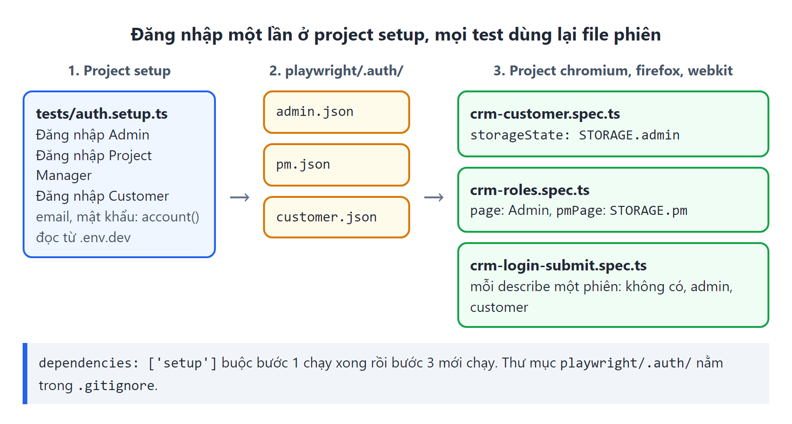
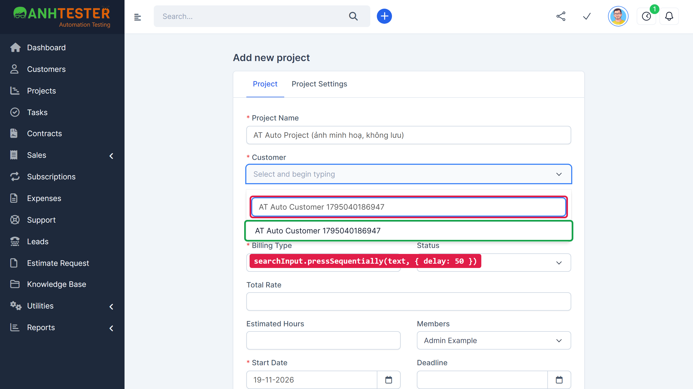
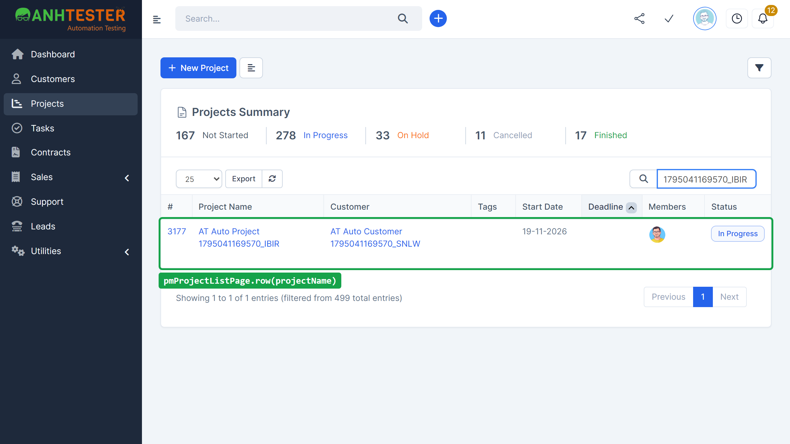

# Bài 31 - [Playwright Typescript] Lưu trạng thái đăng nhập với Storage State và test nhiều tài khoản

Chương: 5. File Config + Truyền Data Test (Data Driven) + Parallel Execution

Nguồn: [https://anhtester.com/learn/website-and-api-testing-automation-with-playwright-javascript-typescript-day-code-js-ts-tu-dau/388](https://anhtester.com/learn/website-and-api-testing-automation-with-playwright-javascript-typescript-day-code-js-ts-tu-dau/388)

✅ Đăng nhập một lần bằng project setup  
✅ Dùng phiên Admin để thêm Customer  
✅ Test nhiều tài khoản  
✅ Một phiên dùng chung cho nhiều worker  
✅ Dùng Claude Code và bộ kit claude-testing-skills để dựng phần đăng nhập

## ⭐ Mục tiêu bài học

Bài trước (Đọc config đa môi trường từ file .env) để sẵn hàm `account()`, nhưng chưa test nào đăng nhập. Bài này đăng nhập CRM **một lần**, lưu phiên ra file cho cả bộ test dùng lại. Học xong bạn sẽ:

- Dựng được project `setup` đăng nhập cho 3 vai trò Admin, Project Manager, Customer.
- Viết test vào thẳng khu Admin: thêm Customer, thêm Project, không test nào điền mật khẩu.
- Dùng nhiều tài khoản: mỗi `describe` một phiên, hoặc hai tài khoản trong một test.
- Duyệt được code đăng nhập do AI viết.

> 📌 Bài làm tiếp trong project `D:\AnhTester\playwright-crm` (macOS: `~/AnhTester/playwright-crm`). Trước khi bắt đầu, điền email và mật khẩu của 3 tài khoản CRM demo vào `.env.dev` trên máy bạn.

## ✅ Phần 1: Vì sao không đăng nhập lại ở mọi test

### 🔆 1. Thẻ ra vào toà nhà

Sáng đi làm, bạn trình giấy tờ ở quầy lễ tân một lần và nhận thẻ ra vào. Cả ngày bạn quẹt thẻ qua mọi cửa.

Website cũng vậy. Bạn đăng nhập đúng, máy chủ tạo một **phiên** (session) và gửi về trình duyệt một cookie chứa mã phiên. Cookie chính là tấm thẻ.

### 🔆 2. Storage State: chụp lại tấm thẻ ra file

**Storage State** là file JSON Playwright ghi lại cookie và `localStorage` của trình duyệt ([browserContext.storageState()](https://playwright.dev/docs/api/class-browsercontext#browser-context-storage-state)). Với CRM demo, file có dạng sau (giá trị đã thay bằng dấu ba chấm):

```json
{
  "cookies": [
    { "name": "sp_session", "value": "...", "domain": "crm.anhtester.com", "path": "/", "expires": ..., "httpOnly": true },
    { "name": "csrf_cookie_name", "value": "...", "domain": "crm.anhtester.com", "path": "/", "expires": ... }
  ],
  "origins": [ ... ]
}
```

Trình duyệt mới nạp file này vào là có sẵn cookie `sp_session`, tức là **đã đăng nhập**.

> ⚠️ Ai cầm file này là vào được tài khoản mà không cần mật khẩu: không commit, không gửi cho ai, kể cả AI.

Test nào cũng tự đăng nhập thì chậm (mỗi lần khoảng 1 giây trên CRM demo), và trang Login chậm một nhịp là cả bộ đỏ oan. Cách trang [Authentication](https://playwright.dev/docs/auth) của Playwright khuyên: đăng nhập một lần ở một bước riêng, lưu Storage State, các test còn lại chỉ nạp file.

## ✅ Phần 2: Đăng nhập một lần bằng project setup

### 🔆 1. Nơi lưu file phiên: utils/auth.ts

Tạo file `utils/auth.ts`, đường dẫn tính từ `__dirname` như ở `env.config.ts`:

```typescript
import path from 'node:path';

/** Thư mục chứa file trạng thái đăng nhập. Đã có trong .gitignore (/playwright/.auth/), KHÔNG commit */
const AUTH_DIR = path.resolve(__dirname, '..', 'playwright', '.auth');

/** Mỗi vai trò một file Storage State, do tests/auth.setup.ts tạo ra */
export const STORAGE = {
  admin: path.join(AUTH_DIR, 'admin.json'),
  pm: path.join(AUTH_DIR, 'pm.json'),
  customer: path.join(AUTH_DIR, 'customer.json'),
} as const;
```

Thêm dòng `/playwright/.auth/` vào `.gitignore`, ngay dưới `/playwright/.cache/`.

### 🔆 2. File tests/auth.setup.ts

Thêm hàm `login()` vào `pages/client/client-login.page.ts`, như hàm đã có ở `LoginPage`:

```typescript
  /** Điền rồi bấm Login. Email và mật khẩu lấy từ account('CUSTOMER') trong .env */
  async login(email: string, password: string): Promise<void> {
    await this.fillCredentials(email, password);
    await this.loginButton.click();
  }
```

Rồi tạo `tests/auth.setup.ts`. Đây là nơi **duy nhất** trong project gọi `account()`:

```typescript
import { test as setup, expect } from '../fixtures';
import { account } from '../utils/env.config';
import { STORAGE } from '../utils/auth';

/**
 * Đăng nhập MỘT lần cho mỗi vai trò rồi lưu trạng thái ra file.
 * Các test sau đọc lại file này, không phải điền email, mật khẩu nữa.
 */
setup('Đăng nhập Admin và lưu Storage State', async ({ page, loginPage }) => {
  const { email, password } = account('ADMIN');
  await loginPage.goto();
  await loginPage.login(email, password);

  // Đăng nhập đúng thì CRM chuyển tới Dashboard. Chưa tới thì KHÔNG lưu file, setup đỏ ngay tại đây
  await expect(page).toHaveURL('/admin/');
  await expect(page).toHaveTitle(/Dashboard/);
  await page.context().storageState({ path: STORAGE.admin });
});

setup('Đăng nhập Project Manager và lưu Storage State', async ({ page, loginPage }) => {
  const { email, password } = account('PM');
  await loginPage.goto();
  await loginPage.login(email, password);

  await expect(page).toHaveURL('/admin/');
  await expect(page).toHaveTitle(/Dashboard/);
  await page.context().storageState({ path: STORAGE.pm });
});

setup('Đăng nhập Customer và lưu Storage State', async ({ page, clientLoginPage }) => {
  const { email, password } = account('CUSTOMER');
  await clientLoginPage.goto();
  await clientLoginPage.login(email, password);

  await expect(page).not.toHaveURL(/authentication/);
  await page.context().storageState({ path: STORAGE.customer });
});
```

- `test as setup` chỉ là đổi tên khi import, nên vẫn dùng được fixture `loginPage`.
- `expect` phải đứng **trước** `storageState()`. Thiếu nó, file có thể được ghi khi chưa đăng nhập xong: setup xanh, còn mọi test phía sau bị đẩy về trang Login.

### 🔆 3. Khai báo project setup và dependencies

Sửa mục `projects` của `playwright.config.ts`:

```typescript
  projects: [
    {
      // Đăng nhập một lần cho 3 vai trò, lưu ra playwright/.auth/*.json
      name: 'setup',
      testMatch: /.*\.setup\.ts/,
    },
    {
      name: 'chromium',
      use: { ...devices['Desktop Chrome'] },
      dependencies: ['setup'],
    },
    {
      name: 'firefox',
      use: { ...devices['Desktop Firefox'] },
      dependencies: ['setup'],
    },
    {
      name: 'webkit',
      use: { ...devices['Desktop Safari'] },
      dependencies: ['setup'],
    },
    // mobile-chrome giữ nguyên: test @smoke của khu khách hàng không cần phiên
  ],
```

`dependencies: ['setup']`: project `setup` chạy xong và xanh thì project này mới chạy. Thêm script chạy riêng bước đăng nhập vào `package.json`:

```json
    "test:setup": "playwright test --project=setup",
```

[](https://anhtester.com/storage/photos/shares/lesson/js_ts_playwright/v2/bai_31_storage_state/01_so_do_setup_project_va_storage_state.png)

*Project setup đăng nhập 3 vai trò, lưu 3 file trong playwright/.auth, các file test nạp lại bằng storageState*

Chạy `npm run test:setup`: 3 lần đăng nhập, mỗi lần chưa tới 2 giây. Output thật của cả lượt (setup rồi tới test) ở Phần 3.

> ⚠️ Đừng gửi cho ai trang chi tiết hay file trace của một test setup: các bước ở đó ghi lại cả giá trị đã điền vào ô Password.

## ✅ Phần 3: Dùng phiên Admin để thêm Customer

### 🔆 1. Page Object cho khu Admin

Bài thêm các file sau:

```plaintext
playwright-crm/
├── components/bootstrap-select.component.ts   ← (MỚI) ô chọn Country, Customer
├── fixtures/
│   ├── pages.fixture.ts                       ← thêm customerListPage, customerFormPage, projectFormPage, projectListPage
│   ├── roles.fixture.ts                       ← (MỚI) pmPage, pmProjectListPage
│   └── index.ts                               ← mergeTests thêm rolesTest
├── pages/admin/
│   ├── admin-list.page.ts                     ← (MỚI) lớp cha của trang danh sách
│   ├── customer-list.page.ts, customer-form.page.ts
│   └── project-list.page.ts, project-form.page.ts
├── tests/
│   ├── auth.setup.ts                          ← (MỚI)
│   ├── crm-customer.spec.ts                   ← (MỚI) 5 test
│   ├── crm-roles.spec.ts                      ← (MỚI) 1 test, 2 tài khoản
│   └── crm-login-submit.spec.ts               ← (MỚI) 8 test
└── utils/auth.ts, utils/crm-data.ts           ← (MỚI) STORAGE; kiểu CustomerData, ProjectData
```

File `pages/admin/customer-form.page.ts`:

```typescript
import { type Page, type Locator } from '@playwright/test';
import { BasePage } from '../base.page';
import { BootstrapSelect } from '../../components/bootstrap-select.component';
import { type CustomerData } from '../../utils/crm-data';

/** Form Add new customer của khu Admin: Customers > New Customer */
export class CustomerFormPage extends BasePage {
  readonly companyInput: Locator;
  readonly vatInput: Locator;
  readonly phoneInput: Locator;
  readonly websiteInput: Locator;
  readonly addressInput: Locator;
  readonly cityInput: Locator;
  readonly country: BootstrapSelect;
  readonly saveButton: Locator;

  constructor(page: Page) {
    super(page, '/admin/clients/client');
    // getByRole chỉ khớp ô đang hiển thị. getByLabel('City') khớp 3 ô vì tab Billing & Shipping (đang ẩn) cũng có City
    this.companyInput = page.getByRole('textbox', { name: 'Company' });
    this.vatInput = page.getByRole('textbox', { name: 'VAT Number' });
    this.phoneInput = page.getByRole('textbox', { name: 'Phone' });
    this.websiteInput = page.getByRole('textbox', { name: 'Website' });
    this.addressInput = page.getByRole('textbox', { name: 'Address' });
    this.cityInput = page.getByRole('textbox', { name: 'City' });
    this.country = new BootstrapSelect(page.locator('//button[@data-id="country"]/parent::div'));
    // exact: true để không khớp nút "Save and create contact"
    this.saveButton = page.getByRole('button', { name: 'Save', exact: true });
  }

  /** Điền các ô có trong dữ liệu, ô nào không truyền thì bỏ qua */
  async fill(customer: CustomerData): Promise<void> {
    await this.companyInput.fill(customer.company);
    if (customer.vat) await this.vatInput.fill(customer.vat);
    if (customer.phone) await this.phoneInput.fill(customer.phone);
    if (customer.website) await this.websiteInput.fill(customer.website);
    if (customer.address) await this.addressInput.fill(customer.address);
    if (customer.city) await this.cityInput.fill(customer.city);
    if (customer.country) await this.country.choose(customer.country);
  }

  /** Bấm Save. Lưu xong CRM mở lại chính form này ở chế độ sửa: /admin/clients/client/<id> */
  async save(): Promise<void> {
    await this.saveButton.click();
  }
}
```

File `components/bootstrap-select.component.ts`, dùng cho ô Country và ô Customer của form Project:

```typescript
import { type Locator } from '@playwright/test';

/**
 * Ô chọn kiểu bootstrap-select của CRM (Country, Customer, Currency...).
 * Thẻ <select> gốc bị ẩn, người dùng bấm vào một nút giả rồi gõ vào ô Search để lọc.
 * root = thẻ div bọc ngoài: page.locator('//button[@data-id="country"]/parent::div')
 */
export class BootstrapSelect {
  readonly root: Locator;
  readonly toggle: Locator;
  readonly searchInput: Locator;
  readonly list: Locator;

  constructor(root: Locator) {
    this.root = root;
    // Nút giả có role="combobox", chữ trên nút đổi theo giá trị đang chọn nên không tìm theo tên được
    this.toggle = root.locator('//button[@data-id]');
    this.searchInput = root.getByRole('combobox', { name: 'Search' });
    this.list = root.getByRole('listbox');
  }

  /**
   * Mở danh sách, gõ từng ký tự rồi bấm đúng lựa chọn.
   * Ô Customer chỉ gọi máy chủ tìm kiếm khi thấy người gõ phím: fill() hoặc gõ không nghỉ
   * (delay 0) thì CRM không gửi yêu cầu nào. Nghỉ 50ms giữa các phím là đủ.
   */
  async choose(text: string): Promise<void> {
    await this.toggle.click();
    await this.searchInput.pressSequentially(text, { delay: 50 });
    await this.list.getByRole('option', { name: text, exact: true }).click();
  }
}
```

File `pages/admin/admin-list.page.ts`:

```typescript
import { type Page, type Locator } from '@playwright/test';
import { BasePage } from '../base.page';

export class AdminListPage extends BasePage {
  readonly searchInput: Locator;
  readonly table: Locator;
  readonly rows: Locator;

  constructor(page: Page, path: string, tableId: string) {
    super(page, path);
    // Trang có 2 ô searchbox (tìm toàn hệ thống ở thanh trên và ô lọc của bảng): lấy ô nằm trong vùng lọc của bảng
    this.searchInput = page.locator(`//div[@id="${tableId}_filter"]`).getByRole('searchbox');
    this.table = page.locator(`//table[@id="${tableId}"]`);
    // Bảng CRM có role="grid" nên ô dữ liệu là gridcell, KHÔNG phải cell như bảng Book
    this.rows = this.table.getByRole('row').filter({ has: page.getByRole('gridcell') });
  }

  /** Gõ vào ô lọc của bảng, bảng tự tải lại theo từ khoá */
  async search(text: string): Promise<void> {
    await this.searchInput.fill(text);
  }

  /** Dòng của bảng có chứa đoạn chữ cho trước */
  row(text: string): Locator {
    return this.rows.filter({ hasText: text });
  }
}
```

`CustomerListPage` kế thừa lớp này với `super(page, '/admin/clients', 'clients')`, thêm `newCustomerLink` và `openNewCustomer()`. `ProjectListPage` gọi `super(page, '/admin/projects', 'projects')`. `ProjectFormPage` viết như `CustomerFormPage`. Ba cái bẫy của trang thật:

<table class="rt-table">
<thead>
<tr>
<th>Viết theo thói quen</th>
<th>Kết quả thật trên CRM</th>
<th>Cách viết của bài</th>
</tr>
</thead>
<tbody>
<tr><td><code>getByLabel('City')</code></td><td>Lỗi strict mode: khớp 3 ô, hai ô nằm ở tab đang ẩn</td><td><code><span>getByRole('textbox',</span> <span>{</span> <span>name:</span> <span>'City'</span> <span>})</span></code>: tìm theo role bỏ qua phần tử ẩn</td></tr>
<tr><td><code>searchInput.fill(text)</code> ở ô Customer</td><td>CRM gửi 0 yêu cầu tìm kiếm, 0 lựa chọn</td><td><code><span>pressSequentially(text,</span> <span>{</span> <span>delay:</span> <span>50</span> <span>})</span></code>: 1 yêu cầu</td></tr>
<tr><td><code>table.getByRole('cell')</code></td><td>Đếm ra 0: bảng có <code>role="grid"</code></td><td><code>getByRole('gridcell')</code></td></tr>
</tbody>
</table>

[](https://anhtester.com/storage/photos/shares/lesson/js_ts_playwright/v2/bai_31_storage_state/02_form_add_project_o_customer_tim_tren_may_chu.png)

*Form Add new project mở bằng phiên Admin: gõ từng phím vào ô Search (khung đỏ) thì lựa chọn Customer mới hiện ra (khung xanh)*

### 🔆 2. File tests/crm-customer.spec.ts

Một dòng `test.use({ storageState })` ở đầu file là cả 5 test vào thẳng khu Admin:

```typescript
import { test, expect } from '../fixtures';
import { STORAGE } from '../utils/auth';
import { uniqueName } from '../utils/data';
// Cả file dùng phiên Admin do tests/auth.setup.ts lưu sẵn: không test nào phải đăng nhập lại
test.use({ storageState: STORAGE.admin });

test.describe('CRM Admin - Customers', () => {
  // CRM_CUSTOMER_TC_001: mở thẳng /admin/clients, không bị đưa về trang Login

  test('CRM_CUSTOMER_TC_002 - Thêm Customer đủ thông tin thì lưu thành công và mở trang Customer vừa tạo',
    { tag: ['@smoke', '@ui'] }, async ({ page, customerListPage }) => {
      const company = uniqueName('AT Auto Customer');

      await customerListPage.goto();
      const customerFormPage = await customerListPage.openNewCustomer();
      await customerFormPage.fill({
        company,
        vat: '10',
        phone: '0123456789',
        website: 'https://anhtester.com',
        address: '123 Test Street',
        city: 'Ho Chi Minh',
        country: 'Vietnam',
      });
      await customerFormPage.save();

      // Kiểm kết quả lưu bền (URL có id, tiêu đề), KHÔNG kiểm thông báo "Customer added successfully.":
      // thông báo nằm trong phiên đăng nhập, các worker dùng chung phiên có thể làm nó biến mất
      await expect(page).toHaveURL(/\/admin\/clients\/client\/\d+$/);
      await expect(page.getByRole('heading', { name: company })).toBeVisible();
      await expect(customerFormPage.phoneInput).toHaveValue('0123456789');
      await expect(customerFormPage.country.toggle).toHaveText('Vietnam');
    });

  // CRM_CUSTOMER_TC_003: chỉ điền Company vẫn lưu được

  test('CRM_CUSTOMER_TC_004 - Bỏ trống Company thì báo lỗi bắt buộc và không lưu',
    { tag: ['@regression', '@validation'] }, async ({ page, customerFormPage }) => {
      await customerFormPage.goto();
      await customerFormPage.save();

      // Câu lỗi nằm ở thẻ p#company-error, ô Company trỏ tới nó qua aria-describedby
      await expect(customerFormPage.companyInput).toHaveAccessibleDescription('This field is required.');
      await expect(page).toHaveURL(customerFormPage.url); // vẫn ở form thêm mới, chưa có id
    });

  // CRM_CUSTOMER_TC_005: Customer vừa tạo tìm thấy trong danh sách (customerListPage.search + row)
});
```

Tên công ty đi qua `uniqueName()` trong `utils/data.ts`: thời điểm chạy cộng 4 ký tự ngẫu nhiên. Chỉ dùng `Date.now()` là chưa đủ: khi chạy song song, hai test từng ra cùng một mili giây, hai Customer trùng tên và TC\_005 đếm được 2 dòng thay vì 1.

```typescript
/**
 * Tên không trùng kể cả khi nhiều test chạy song song trong cùng một mili giây:
 * "AT Auto Customer 1763456789012_K3F9". Chỉ Date.now() là chưa đủ (đã gặp 2 test ra cùng một tên)
 */
export function uniqueName(prefix: string): string {
  const random = Math.random().toString(36).slice(2, 6).toUpperCase();
  return `${prefix} ${Date.now()}_${random}`;
}
```

Chạy lần đầu:

```bash
npx playwright test tests/crm-customer.spec.ts --project=chromium --reporter=list
```

```plaintext
[env] dev (Dev) | CRM: https://crm.anhtester.com | Book: https://book.anhtester.com

Running 8 tests using 5 workers

  ✓  1 [setup] › tests\auth.setup.ts:30:1 › Đăng nhập Customer và lưu Storage State (1.5s)
  ✓  2 [setup] › tests\auth.setup.ts:9:1 › Đăng nhập Admin và lưu Storage State (1.8s)
  ✓  3 [setup] › tests\auth.setup.ts:20:1 › Đăng nhập Project Manager và lưu Storage State (1.9s)
  ✓  5 [chromium] › tests\crm-customer.spec.ts:8:3 › CRM Admin - Customers › CRM_CUSTOMER_TC_001 - Có phiên Admin thì mở thẳng danh sách Customers, không qua trang Login @smoke @ui (1.1s)
  ✓  8 [chromium] › tests\crm-customer.spec.ts:53:3 › CRM Admin - Customers › CRM_CUSTOMER_TC_004 - Bỏ trống Company thì báo lỗi bắt buộc và không lưu @regression @validation (1.1s)
  ✓  7 [chromium] › tests\crm-customer.spec.ts:41:3 › CRM Admin - Customers › CRM_CUSTOMER_TC_003 - Chỉ điền ô bắt buộc Company thì vẫn lưu được @regression @ui (1.4s)
  ✓  6 [chromium] › tests\crm-customer.spec.ts:63:3 › CRM Admin - Customers › CRM_CUSTOMER_TC_005 - Customer vừa tạo tìm thấy trong danh sách Customers @regression @ui (1.7s)
  ✓  4 [chromium] › tests\crm-customer.spec.ts:16:3 › CRM Admin - Customers › CRM_CUSTOMER_TC_002 - Thêm Customer đủ thông tin thì lưu thành công và mở trang Customer vừa tạo @smoke @ui (2.3s)

  8 passed (5.4s)
```

Playwright tự chạy `setup` trước. File phiên còn hạn thì thêm `--no-deps` để bỏ qua project phụ thuộc:

```bash
npx playwright test tests/crm-customer.spec.ts --project=chromium --no-deps --reporter=list
```

```plaintext
[env] dev (Dev) | CRM: https://crm.anhtester.com | Book: https://book.anhtester.com

Running 5 tests using 5 workers

  ok 5 [chromium] › tests\crm-customer.spec.ts:41:3 › CRM Admin - Customers › CRM_CUSTOMER_TC_003 - Chỉ điền ô bắt buộc Company thì vẫn lưu được @regression @ui (5.1s)
  ok 3 [chromium] › tests\crm-customer.spec.ts:8:3 › CRM Admin - Customers › CRM_CUSTOMER_TC_001 - Có phiên Admin thì mở thẳng danh sách Customers, không qua trang Login @smoke @ui (6.4s)
  ok 4 [chromium] › tests\crm-customer.spec.ts:63:3 › CRM Admin - Customers › CRM_CUSTOMER_TC_005 - Customer vừa tạo tìm thấy trong danh sách Customers @regression @ui (6.5s)
  ok 2 [chromium] › tests\crm-customer.spec.ts:53:3 › CRM Admin - Customers › CRM_CUSTOMER_TC_004 - Bỏ trống Company thì báo lỗi bắt buộc và không lưu @regression @validation (6.6s)
  ok 1 [chromium] › tests\crm-customer.spec.ts:16:3 › CRM Admin - Customers › CRM_CUSTOMER_TC_002 - Thêm Customer đủ thông tin thì lưu thành công và mở trang Customer vừa tạo @smoke @ui (6.7s)

  5 passed (7.4s)
```

Phiên của CRM demo sống khoảng 8 giờ. Test bị đưa về `/admin/authentication` là phiên đã hết hạn: chạy lại `npm run test:setup`.

## ✅ Phần 4: Test nhiều tài khoản

### 🔆 1. Mỗi describe một phiên

`test.use()` đặt trong `describe` nào thì chỉ có hiệu lực ở đó. File `tests/crm-login-submit.spec.ts` có nhóm đầu không phiên (bấm Login với dữ liệu giả), và hai nhóm sau:

```typescript
test.describe('CRM - Trang đăng nhập khi đã có phiên', () => {
  test.use({ storageState: STORAGE.admin });

  test('CRM_LOGIN_TC_023 - Đang có phiên Admin thì mở trang đăng nhập bị đưa về Dashboard',
    { tag: ['@regression', '@ui'] }, async ({ page, loginPage }) => {
      await loginPage.goto();

      await expect(page).toHaveURL('/admin/');
      await expect(page).toHaveTitle(/Dashboard/);
    });
});

test.describe('CRM - Phiên của Customer ở khu Admin', () => {
  test.use({ storageState: STORAGE.customer });

  test('CRM_LOGIN_TC_020 - Đang có phiên Customer vẫn không mở được khu Admin',
    { tag: ['@regression', '@permission'] }, async ({ page }) => {
      await page.goto('/');
      await expect(page.getByRole('heading', { name: 'Projects Summary' })).toBeVisible();

      await page.goto('/admin/');
      await expect(page).toHaveURL(/\/admin\/authentication/);
    });
});
```

### 🔆 2. Hai tài khoản trong cùng một test

Admin tạo dữ liệu, Project Manager nhìn thấy nó: mỗi người cần một **context** riêng. Fixture `page` là Admin, Project Manager đi qua fixture mới ở `fixtures/roles.fixture.ts`:

```typescript
import { test as base, type Page } from '@playwright/test';
import { ProjectListPage } from '../pages/admin/project-list.page';
import { STORAGE } from '../utils/auth';

export type RoleFixtures = {
  pmPage: Page;
  pmProjectListPage: ProjectListPage;
};

export const test = base.extend<RoleFixtures>({
  /**
   * Một trình duyệt riêng đã đăng nhập bằng tài khoản Project Manager, chạy cùng lúc với page (Admin).
   * browser.newContext() trong test nhận lại MỌI mục của khối use (baseURL, locale... và cả storageState
   * của file test). Không truyền storageState thì tab này vẫn là Admin, nên phải ghi rõ STORAGE.pm.
   */
  pmPage: async ({ browser }, use) => {
    const context = await browser.newContext({ storageState: STORAGE.pm });
    const pmPage = await context.newPage();
    await use(pmPage);
    await context.close();
  },

  /** Fixture Chaining: trang danh sách Projects nhìn bằng mắt Project Manager */
  pmProjectListPage: async ({ pmPage }, use) => {
    await use(new ProjectListPage(pmPage));
  },
});

export { expect } from '@playwright/test';
```

> ⚠️ Kết quả thử thật: `browser.newContext()` không truyền gì thì trang mới vẫn mở `/admin/projects` với quyền **Admin**. Test xanh mà không kiểm gì về Project Manager.

Thêm `rolesTest` vào `mergeTests(...)` trong `fixtures/index.ts`, rồi viết `tests/crm-roles.spec.ts`:

```typescript
import { test, expect } from '../fixtures';
import { STORAGE } from '../utils/auth';
import { uniqueName } from '../utils/data';

test.describe('CRM - Nhiều vai trò trong một test', () => {
  // Trình duyệt chính (page) là Admin. Project Manager đi qua fixture pmPage, có trình duyệt riêng
  test.use({ storageState: STORAGE.admin });

  test('CRM_ROLE_TC_001 - Admin tạo Customer rồi tạo Project, Project Manager thấy Project đó',
    { tag: ['@regression', '@permission'] }, async ({ page, customerFormPage, projectFormPage, pmProjectListPage }) => {
      const company = uniqueName('AT Auto Customer');
      const projectName = uniqueName('AT Auto Project');
      let customerUrl = '';

      await test.step('Admin tạo Customer', async () => {
        await customerFormPage.goto();
        await customerFormPage.fill({ company, country: 'Vietnam' });
        await customerFormPage.save();
        await expect(page).toHaveURL(/\/admin\/clients\/client\/\d+$/);
        customerUrl = page.url(); // địa chỉ trang Customer vừa tạo, có id ở cuối
      });

      await test.step('Admin tạo Project gắn với Customer vừa tạo', async () => {
        await projectFormPage.goto();
        await projectFormPage.fill({ name: projectName, customer: company, estimatedHours: '40' });
        await projectFormPage.save();

        await expect(page).toHaveURL(/\/admin\/projects\/view\/\d+$/);
        await expect(page).toHaveTitle(projectName);
        // Mục Customer ở phần Overview trỏ đúng về Customer vừa tạo
        await expect(page.getByRole('link', { name: company })).toHaveAttribute('href', customerUrl);
      });

      await test.step('Project Manager mở danh sách Projects và thấy Project mới', async () => {
        await pmProjectListPage.goto();
        await pmProjectListPage.search(projectName);
        await expect(pmProjectListPage.row(projectName)).toHaveCount(1);
        await expect(pmProjectListPage.row(projectName)).toContainText(company);
      });
    });
});
```

```bash
npx playwright test tests/crm-roles.spec.ts tests/crm-login-submit.spec.ts --project=chromium --no-deps --reporter=list
```

```plaintext
Running 9 tests using 9 workers

  ...
  ok 3 [chromium] › tests\crm-login-submit.spec.ts:86:3 › CRM - Phiên của Customer ở khu Admin › CRM_LOGIN_TC_020 - Đang có phiên Customer vẫn không mở được khu Admin @regression @permission (1.3s)
  ok 8 [chromium] › tests\crm-login-submit.spec.ts:74:3 › CRM - Trang đăng nhập khi đã có phiên › CRM_LOGIN_TC_023 - Đang có phiên Admin thì mở trang đăng nhập bị đưa về Dashboard @regression @ui (1.8s)
  x  7 [chromium] › tests\crm-login-submit.spec.ts:51:8 › CRM - Gửi biểu mẫu đăng nhập Admin › CRM_LOGIN_TC_016 - Đăng nhập thất bại thì ô Email vẫn giữ email vừa nhập @regression @ui (6.0s)
  ok 6 [chromium] › tests\crm-roles.spec.ts:8:3 › CRM - Nhiều vai trò trong một test › CRM_ROLE_TC_001 - Admin tạo Customer rồi tạo Project, Project Manager thấy Project đó @regression @permission (7.0s)

  9 passed (8.0s)
```

Dấu `x` là test khai báo `test.fail()` cho một lỗi đã biết của CRM, vẫn tính là đạt. Cả bộ trên Chromium (`npx playwright test --project=chromium --no-deps`): **61 passed (18.2s)**.

[](https://anhtester.com/storage/photos/shares/lesson/js_ts_playwright/v2/bai_31_storage_state/03_project_manager_thay_project_admin_vua_tao.png)

*Danh sách Projects mở bằng phiên Project Manager, lọc theo tên Project mà Admin vừa tạo: đúng 1 dòng*

## ✅ Phần 5: Một phiên dùng chung cho nhiều worker

Mọi worker nạp cùng file `admin.json`, tức là cùng **một** phiên. Thử thêm vào `CRM_CUSTOMER_TC_003`, ngay sau `save()`, một dòng kiểm thông báo:

```typescript
      await expect(page.getByText('Customer added successfully.')).toBeVisible();
```

```bash
npx playwright test tests/crm-customer.spec.ts tests/crm-roles.spec.ts --project=chromium --no-deps --reporter=list
```

```plaintext
Running 6 tests using 6 workers
  ...
  x  5 [chromium] › tests\crm-customer.spec.ts:41:3 › CRM Admin - Customers › CRM_CUSTOMER_TC_003 - Chỉ điền ô bắt buộc Company thì vẫn lưu được @regression @ui (6.7s)

    Error: expect(locator).toBeVisible() failed

    Locator: getByText('Customer added successfully.')
    Expected: visible
    Timeout: 5000ms
    Error: element(s) not found

    > 48 |       await expect(page.getByText('Customer added successfully.')).toBeVisible();
         |                                                                    ^
        at D:\AnhTester\playwright-crm\tests\crm-customer.spec.ts:48:68

  1 failed
  5 passed (7.8s)
```

Lần chạy đầu xanh, lần thứ hai đỏ như trên; với `--workers=1` thì `6 passed (13.8s)`. Customer vẫn được tạo, chỉ thông báo biến mất: CRM cất câu thông báo trong phiên, trang của worker khác tải trước là "tiêu" mất nó.

Cách sửa: kiểm **kết quả lưu bền** (URL có id, tiêu đề, dòng trong bảng). Bỏ dòng vừa thêm, chạy song song ba lần liên tiếp: `6 passed` cả ba.

> ⚠️ **Không viết test đăng xuất** bằng Storage State dùng chung: máy chủ huỷ phiên, mọi test đang dùng file đó đỏ theo. Bài Chạy test song song với Parallel Execution nói tiếp chuyện này.

## ✅ Phần 6: Dùng Claude Code và bộ kit claude-testing-skills để dựng phần đăng nhập

### 🔆 1. Quy tắc của project

Framework mẫu [playwright-typescript-framework-ai](https://github.com/anhtester/playwright-typescript-framework-ai) đăng nhập trong `src/setup/global-setup.ts`. Bài dùng project `setup` vì theo [tài liệu Playwright](https://playwright.dev/docs/test-global-setup-teardown), bước đăng nhập khi đó hiện trong HTML Report, có trace và dùng được fixture. Thêm vào cuối `.claude/rules/project_config_rules.md`:

```markdown
## Đăng nhập và Storage State
- Đăng nhập DUY NHẤT ở `tests/auth.setup.ts` (project `setup`), mỗi vai trò một file
  `playwright/.auth/<vai-trò>.json`. Đường dẫn lấy từ `STORAGE` trong `utils/auth.ts`, không viết cứng.
- Test cần phiên thì khai báo `test.use({ storageState: STORAGE.admin })` ở đầu file hoặc trong `describe`.
  KHÔNG gọi `loginPage.login()` với tài khoản thật trong file test.
- Project trình duyệt máy tính có `dependencies: ['setup']`. Không xoá dòng này để "chạy cho nhanh".
- Cần vai trò thứ hai trong cùng một test thì dùng fixture ở `fixtures/roles.fixture.ts` (`pmPage`...).
  `browser.newContext()` kế thừa mọi mục của `use`, kể cả `storageState` của file: luôn truyền rõ
  `storageState` của vai trò cần dùng.
- `playwright/.auth/` nằm trong `.gitignore`. KHÔNG commit, không in nội dung file này ra log hay report.
- Mọi worker dùng chung MỘT phiên trên máy chủ:
  - KHÔNG viết test đăng xuất bằng Storage State dùng chung (làm hỏng phiên của các test khác).
  - KHÔNG kiểm thông báo thoáng qua lưu trong phiên ("... added successfully."). Kiểm kết quả lưu bền:
    URL có id, tiêu đề, dòng trong bảng.
```

### 🔆 2. Prompt dùng được ở Claude, ChatGPT và Gemini

Với [ChatGPT](https://chatgpt.com/) hoặc [Gemini](https://gemini.google.com/), dán nội dung file vào chỗ có ngoặc vuông. Ở cả ba: **không dán `.env.dev` và file trong `playwright/.auth/`**.

AI không vào được trang cần phiên, nên bạn gửi cho nó cấu trúc trang, lấy bằng một test tạm có `test.use({ storageState: STORAGE.admin })` và dòng `console.log(await page.locator('//form').first().ariaSnapshot())`:

```markdown
Viết Page Object cho form "Add new task" của CRM (/admin/tasks/task), theo .claude/rules/project_pom_rules.md
và project_locator_rules.md (getBy... trước, XPath sau, không CSS).

[dán pages/admin/customer-form.page.ts làm mẫu, và kết quả ariaSnapshot() của form]

Yêu cầu:
1. Kế thừa BasePage, locator khởi tạo trong constructor, có hàm fill(data) và save().
2. Ô chọn kiểu bootstrap-select thì dùng components/bootstrap-select.component.ts, không viết lại.
3. Với mỗi locator, ghi chú nó khớp dòng nào trong ariaSnapshot. Ô nào không có tên trong snapshot thì nói rõ,
   KHÔNG đoán.
4. Không viết bước đăng nhập. Test sẽ dùng test.use({ storageState: STORAGE.admin }).
```

**Thêm một vai trò vào project setup:**

```markdown
Thêm vai trò SALE vào phần đăng nhập của project, theo mục "Đăng nhập và Storage State"
và mục "Biến môi trường (.env)" của .claude/rules/project_config_rules.md.

[dán utils/auth.ts, tests/auth.setup.ts, utils/env.config.ts, .env.example]

Liệt kê từng file phải sửa và phần sửa. KHÔNG mở .env.dev: in ra hai dòng biến tôi cần tự thêm.
Trước khi lưu Storage State phải có expect chứng minh đã đăng nhập xong.
```

Rà bằng lệnh [/review-automation-code](https://github.com/anhtester/claude-testing-skills/blob/main/.claude/commands/review-automation-code.md) của bộ kit: `/review-automation-code REVIEW tests`.

## ✅ Phần 7: Kiểm tra code do AI sinh ra

<table class="rt-table">
<thead>
<tr>
<th>Dấu hiệu trong code</th>
<th>Vì sao là vấn đề</th>
<th>Cách xử lý</th>
</tr>
</thead>
<tbody>
<tr><td>Đăng nhập trong <code>beforeEach</code> của từng file</td><td>Chậm; trang Login chậm là đỏ cả bộ</td><td>Project <code>setup</code> và <code>storageState</code></td></tr>
<tr><td><code><span>storageState({</span> <span>path:</span> <span>'auth.json'</span> <span>})</span></code>, <code>.gitignore</code> không có dòng nào</td><td>File phiên lên Git</td><td><code>STORAGE</code>, thư mục <code>playwright/.auth/</code></td></tr>
<tr><td>Lưu Storage State ngay sau <code>click()</code> nút Login</td><td>Ghi file khi chưa đăng nhập xong, setup vẫn xanh</td><td><code>expect</code> trước khi lưu</td></tr>
<tr><td><code>globalSetup</code> tự gọi <code>chromium.launch()</code></td><td>Không nhận <code>baseURL</code> của khối <code>use</code>, không có trace</td><td>Project <code>setup</code> có <code>dependencies</code></td></tr>
<tr><td><code>browser.newContext()</code> không truyền gì cho người dùng thứ hai</td><td>Vẫn là người thứ nhất</td><td>Truyền rõ <code>storageState</code></td></tr>
<tr><td>Kiểm câu "... added successfully."; test Logout bằng phiên chung</td><td>Đỏ ngẫu nhiên khi chạy song song; huỷ phiên của test khác</td><td>Kiểm URL có id, tiêu đề, dòng trong bảng</td></tr>
</tbody>
</table>

## ✅ Phần 8: Bài tập thực hành

**Bài tập 1 - Thêm test dùng phiên Admin.** Thêm `CRM_CUSTOMER_TC_006` vào `tests/crm-customer.spec.ts`: tạo Customer có Website, kiểm ô Website giữ đúng giá trị sau khi lưu, rồi tìm Customer đó trong danh sách.

**Bài tập 2 - Thêm vai trò Customer vào fixture.** Thêm fixture `customerPage` (phiên Customer) vào `fixtures/roles.fixture.ts`. Viết `CRM_ROLE_TC_002`: Admin tạo một Project, Project Manager thấy nó, còn Customer mở `/admin/` thì bị đưa về trang đăng nhập.

**Bài tập 3 - Duyệt code AI.** Đoạn dưới gộp ba file, có **8 chỗ cần sửa**. Tìm đủ và nêu lý do.

```typescript
// ----- tests/auth.setup.ts -----
import { test as setup } from '../fixtures';

setup('login admin', async ({ page, loginPage }) => {
  await loginPage.goto();
  await loginPage.login('admin@example.com', 'mat-khau-viet-cung');
  await page.context().storageState({ path: 'auth/admin.json' });
});

// ----- playwright.config.ts (trích) -----
//   { name: 'setup', testMatch: /.*\.setup\.ts/ },
//   { name: 'chromium', use: { ...devices['Desktop Chrome'] } },

// ----- tests/crm-customer-ai.spec.ts -----
import { test, expect } from '../fixtures';

test.use({ storageState: 'auth/admin.json' });

test('Admin thêm Customer, Project Manager xem danh sách Projects', async ({ page, browser, customerFormPage }) => {
  await customerFormPage.goto();
  await customerFormPage.companyInput.fill(`AT Auto Customer ${Date.now()}`);
  await page.getByLabel('City').fill('Da Nang');
  await customerFormPage.save();
  await expect(page.getByText('Customer added successfully.')).toBeVisible();

  const pmContext = await browser.newContext();
  const pmPage = await pmContext.newPage();
  await pmPage.goto('/admin/projects');
  await expect(pmPage).toHaveTitle(/Projects/);

  await page.getByRole('link', { name: 'Logout' }).click();
});
```

## ✅ Phần 9: Ghi nhớ nhanh

- Storage State là file JSON chứa cookie của phiên đăng nhập. Giữ nó như giữ mật khẩu.
- Đăng nhập một lần ở project `setup`, có `expect` trước khi lưu. Project trình duyệt khai `dependencies: ['setup']`.
- Test chọn phiên bằng `test.use({ storageState })`. Context thứ hai phải truyền rõ `storageState`.
- Phiên dùng chung: kiểm kết quả lưu bền, không test Logout.

✅ **Kết luận:** Bộ test đã vào được khu Admin mà không test nào điền mật khẩu. Nhưng dữ liệu như `vat: '10'`, `city: 'Ho Chi Minh'` vẫn viết cứng trong file test. Bài kế tiếp đưa chúng ra file riêng: **Đọc data test từ file JSON, CSV và Excel**.

---

## Bài tập riêng — Bài tập - Storage State, project setup, test nhiều tài khoản và duyệt code AI

Nguồn bài tập: [https://anhtester.com/student-assignments?course=website-and-api-testing-automation-with-playwright-javascript-typescript-day-code-js-ts-tu-dau#assignment-121](https://anhtester.com/student-assignments?course=website-and-api-testing-automation-with-playwright-javascript-typescript-day-code-js-ts-tu-dau#assignment-121)

**Mục tiêu:** đăng nhập một lần bằng project `setup` rồi dùng lại phiên qua Storage State, viết test vào thẳng khu Admin của CRM, dùng nhiều tài khoản trong một bộ test, và nhận ra lỗi trong code đăng nhập do AI sinh ra kể cả khi test đang xanh.

**Thư mục làm bài:** `D:\AnhTester\playwright-crm` (macOS: `~/AnhTester/playwright-crm`), dùng tiếp các file của bài học: `utils/auth.ts`, `tests/auth.setup.ts`, `fixtures/roles.fixture.ts`, các Page Object trong `pages/admin/`, `tests/crm-customer.spec.ts`, `tests/crm-roles.spec.ts`. Bạn đăng nhập bằng 3 tài khoản CRM demo của khoá học, điền trong `.env.dev` trên máy mình. Bài tập được tạo Customer và Project trên CRM demo, tên luôn bắt đầu bằng `AT Auto` và gắn `Date.now()`; **không xoá, không sửa** dữ liệu của người khác, **không viết test đăng xuất**. **Không commit** file `.env.*` (trừ `.env.example`) và thư mục `playwright/.auth/`, không ghi mật khẩu vào code hay vào bài nộp.

### 📝 Đề bài

#### Bài tập 1 - Thêm test dùng phiên Admin

1. Thêm vào `tests/crm-customer.spec.ts` test `CRM_CUSTOMER_TC_006 - Customer có Website lưu đúng và tìm thấy trong danh sách`, tag `@regression`.
2. Trong test: mở form bằng `customerFormPage`, điền `company` (có `Date.now()`), `website`, `phone` rồi lưu. Kiểm URL có id và ô Website giữ đúng giá trị. Sau đó mở danh sách bằng `customerListPage`, tìm theo tên và kiểm có đúng 1 dòng, dòng đó chứa số điện thoại.
3. Chạy `npx playwright test tests/crm-customer.spec.ts --project=chromium --no-deps --reporter=list` ba lần liên tiếp.

Trả lời: (a) vì sao test không cần bước đăng nhập? (b) vì sao không kiểm câu `Customer added successfully.`?

#### Bài tập 2 - Thêm vai trò Customer vào fixture

1. Thêm vào `fixtures/roles.fixture.ts` fixture `customerPage`: một context riêng nạp `STORAGE.customer`, đóng context sau khi test xong.
2. Thêm vào `tests/crm-roles.spec.ts` test `CRM_ROLE_TC_002` trong `describe` đang có (phiên chính là Admin), chia bằng `test.step`: Admin tạo Customer rồi tạo Project gắn với Customer đó; Project Manager (`pmProjectListPage`) tìm thấy Project; Customer (`customerPage`) mở `/` thấy tiêu đề `Projects Summary`, mở `/admin/` thì bị đưa về địa chỉ có `/admin/authentication`.
3. Chạy `npx playwright test tests/crm-roles.spec.ts --project=chromium --no-deps --reporter=list`.

Trả lời: nếu viết `browser.newContext()` mà không truyền `storageState` thì `customerPage` đang là tài khoản nào? Vì sao?

#### Bài tập 3 - Duyệt code AI

Phần code dưới đây do AI viết, gộp ba file vào một chỗ cho dễ đọc. Nó có **8 chỗ cần sửa**. Tìm đủ, nêu lý do, rồi viết lại cho đúng mục "Đăng nhập và Storage State" của `.claude/rules/project_config_rules.md`.

```typescript
// ----- tests/auth.setup.ts -----
import { test as setup } from '../fixtures';

setup('login admin', async ({ page, loginPage }) => {
  await loginPage.goto();
  await loginPage.login('admin@example.com', 'mat-khau-viet-cung');
  await page.context().storageState({ path: 'auth/admin.json' });
});

// ----- playwright.config.ts (trích) -----
//   { name: 'setup', testMatch: /.*\.setup\.ts/ },
//   { name: 'chromium', use: { ...devices['Desktop Chrome'] } },

// ----- tests/crm-customer-ai.spec.ts -----
import { test, expect } from '../fixtures';

test.use({ storageState: 'auth/admin.json' });

test('Admin thêm Customer, Project Manager xem danh sách Projects', async ({ page, browser, customerFormPage }) => {
  await customerFormPage.goto();
  await customerFormPage.companyInput.fill(`AT Auto Customer ${Date.now()}`);
  await page.getByLabel('City').fill('Da Nang');
  await customerFormPage.save();
  await expect(page.getByText('Customer added successfully.')).toBeVisible();

  const pmContext = await browser.newContext();
  const pmPage = await pmContext.newPage();
  await pmPage.goto('/admin/projects');
  await expect(pmPage).toHaveTitle(/Projects/);

  await page.getByRole('link', { name: 'Logout' }).click();
});
```

### 📦 Cách nộp bài

1. Làm bài trong project `playwright-crm`, commit và push lên nhánh `main` của repo GitHub `playwright-crm` của bạn. Trước khi push, chạy `git status --short` và `git check-ignore -v playwright/.auth/admin.json .env.dev`: cả hai file phải đang bị Git bỏ qua.
2. Dán link repo vào ô **Link GitHub**, dạng `https://github.com/<ten-ban>/playwright-crm`. Repo Private thì vào **Settings → Collaborators** thêm tài khoản GitHub của giảng viên.
3. Trong ô **Nội dung bài làm (Editor)**, dán **kết quả chạy thật** trên Terminal của từng lệnh (mỗi lệnh một **Đoạn code mẫu** chọn Text / Log) và phần trả lời các câu hỏi.
4. Với bài **Duyệt code AI**: liệt kê từng chỗ sai theo mẫu *Dòng – Lỗi – Lý do – Cách sửa*.
5. **Không** dán nội dung file trong `playwright/.auth/`, không dán `.env.dev`, không gửi trang chi tiết hay file trace của test `setup` (trong đó có giá trị đã điền vào ô Password).

### ✅ Tiêu chí Đạt

- Bài tập 1: test dùng fixture `customerFormPage`, `customerListPage`, không có locator viết thẳng trong test (trừ assertion theo tiêu đề), không gọi `login()`. Assertion chấp nhận: `toHaveURL(/\/admin\/clients\/client\/\d+$/)`, `expect(customerFormPage.websiteInput).toHaveValue(...)`, `expect(customerListPage.row(company)).toHaveCount(1)` và `toContainText(phone)`. Ba lần chạy đều `6 passed` (5 test của bài học + 1 test mới). Trả lời đúng ý: (a) dòng `test.use({ storageState: STORAGE.admin })` ở đầu file nạp cookie phiên do `tests/auth.setup.ts` lưu; (b) thông báo nằm trong phiên trên máy chủ, các worker dùng chung phiên nên trang của worker khác có thể làm thông báo biến mất, test đỏ ngẫu nhiên khi chạy song song.
- Bài tập 2: `customerPage` viết đúng dạng `browser.newContext({ storageState: STORAGE.customer })`, có `await context.close()` sau `use`, khai trong kiểu `RoleFixtures`. Test có ít nhất 3 `test.step`, kiểm Project bằng kết quả lưu bền (URL `/admin/projects/view/<id>`, dòng trong bảng của Project Manager), kiểm Customer bằng `getByRole('heading', { name: 'Projects Summary' })` và `toHaveURL(/\/admin\/authentication/)`. Kết quả chạy: `2 passed`. Trả lời đúng: vẫn là **Admin**, vì `browser.newContext()` trong test kế thừa mọi mục của khối `use`, kể cả `storageState` đặt bằng `test.use()` của `describe` (kết quả chạy thật trên Playwright 1.65.1: context không truyền gì vẫn mở được `/admin/projects`).
- Bài tập 3: tìm được ít nhất **6 trong 8** lỗi, kèm lý do đúng. **Đáp án cho người chấm**: (1) email và mật khẩu viết cứng trong `login(...)`: tài khoản phải đọc bằng `account('ADMIN')` từ file `.env.<môi trường>`, viết trong code là lên Git; (2) gọi `storageState()` ngay sau khi bấm Login, không có `expect` nào chứng minh đã vào Dashboard: file có thể được ghi khi chưa đăng nhập xong hoặc khi đăng nhập sai, setup vẫn xanh còn mọi test sau bị đưa về trang Login; phải có `await expect(page).toHaveURL('/admin/')` (và tiêu đề Dashboard) trước khi lưu, kéo theo việc import thêm `expect`; (3) đường dẫn `'auth/admin.json'` viết cứng ở hai nơi, là đường dẫn tương đối theo thư mục đang đứng và thư mục `auth/` không có trong `.gitignore` nên file phiên sẽ bị commit; phải dùng `STORAGE.admin` của `utils/auth.ts` (thư mục `playwright/.auth/`); (4) project `chromium` thiếu `dependencies: ['setup']`: chạy `--project=chromium` thì setup không chạy, chưa có file thì test lỗi `Error reading storage state from auth/admin.json: ENOENT: no such file or directory` (kết quả chạy thật), có file cũ hết hạn thì test bị đưa về trang Login; (5) `page.getByLabel('City')`: lỗi `strict mode violation: getByLabel('City') resolved to 3 elements` (kết quả chạy thật: `city`, `billing_city`, `shipping_city`); dùng `customerFormPage.cityInput` (`getByRole('textbox', { name: 'City' })`), và locator không viết thẳng trong test; (6) kiểm thông báo `Customer added successfully.`: thông báo nằm trong phiên dùng chung, chạy song song thì đỏ ngẫu nhiên (kết quả chạy thật: 6 worker, lần chạy thứ hai `1 failed`, `--workers=1` thì đạt); kiểm URL có id và tiêu đề; (7) `browser.newContext()` không truyền `storageState`: context kế thừa phiên Admin của file, nên phần "Project Manager xem danh sách" thực ra vẫn là Admin; dùng fixture `pmPage` / `pmProjectListPage` hoặc truyền `{ storageState: STORAGE.pm }`; (8) bấm `Logout` bằng phiên dùng chung: máy chủ huỷ phiên, mọi test khác đang dùng file đó bị đưa về trang Login cho tới khi chạy lại setup. Nêu thêm việc `pmContext` không được đóng, tên test setup không nói rõ vai trò, hoặc nên dùng `customerFormPage.fill({...})` thay cho điền từng ô là điểm cộng.
- Chung: repo không chứa `playwright/.auth/` và các file `.env.dev`, `.env.staging` (xem cả lịch sử commit của bài nộp); không có mật khẩu trong code hay bài làm; không file test nào gọi `loginPage.login()` với tài khoản thật ngoài `tests/auth.setup.ts`; không có test đăng xuất; dữ liệu tạo trên CRM có tiền tố `AT Auto`.

### 🤖 Dùng AI thế nào cho đúng

- Được dùng Claude, ChatGPT, Gemini để sinh bản nháp. Luôn dán kèm mục "Đăng nhập và Storage State" của `.claude/rules/project_config_rules.md` và một Page Object mẫu (`pages/admin/customer-form.page.ts`).
- **Không** dán `.env.dev` hay file trong `playwright/.auth/` vào khung chat, và không nhờ AI mở các file đó: file phiên có giá trị như mật khẩu.
- AI không vào được trang sau đăng nhập. Muốn nó viết locator đúng, gửi kết quả `ariaSnapshot()` của trang, rồi tự kiểm `count()` của từng locator bằng phiên của bạn.
- Chạy bản nháp ít nhất ba lần liên tiếp ở chế độ song song trước khi nộp: test dùng chung phiên hay đỏ ngẫu nhiên ở lần chạy thứ hai, thứ ba.
- Bài tập 3 tự làm trước, sau đó mới nhờ AI soát lại xem còn sót lỗi nào.