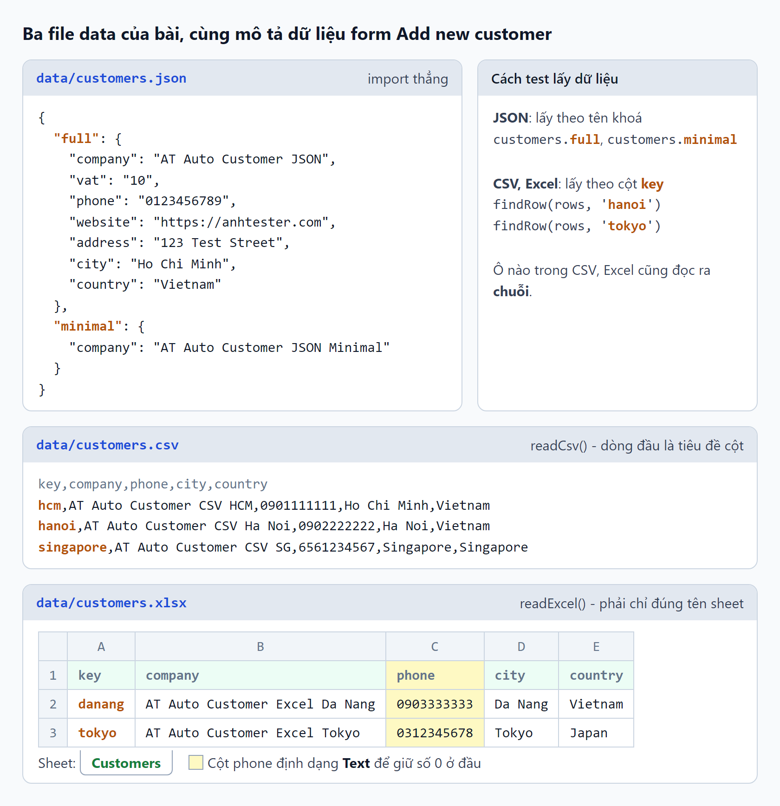
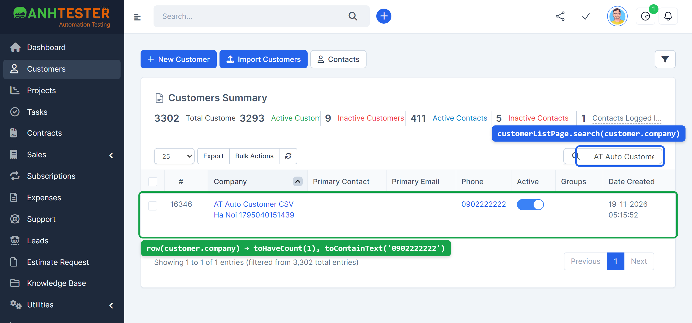
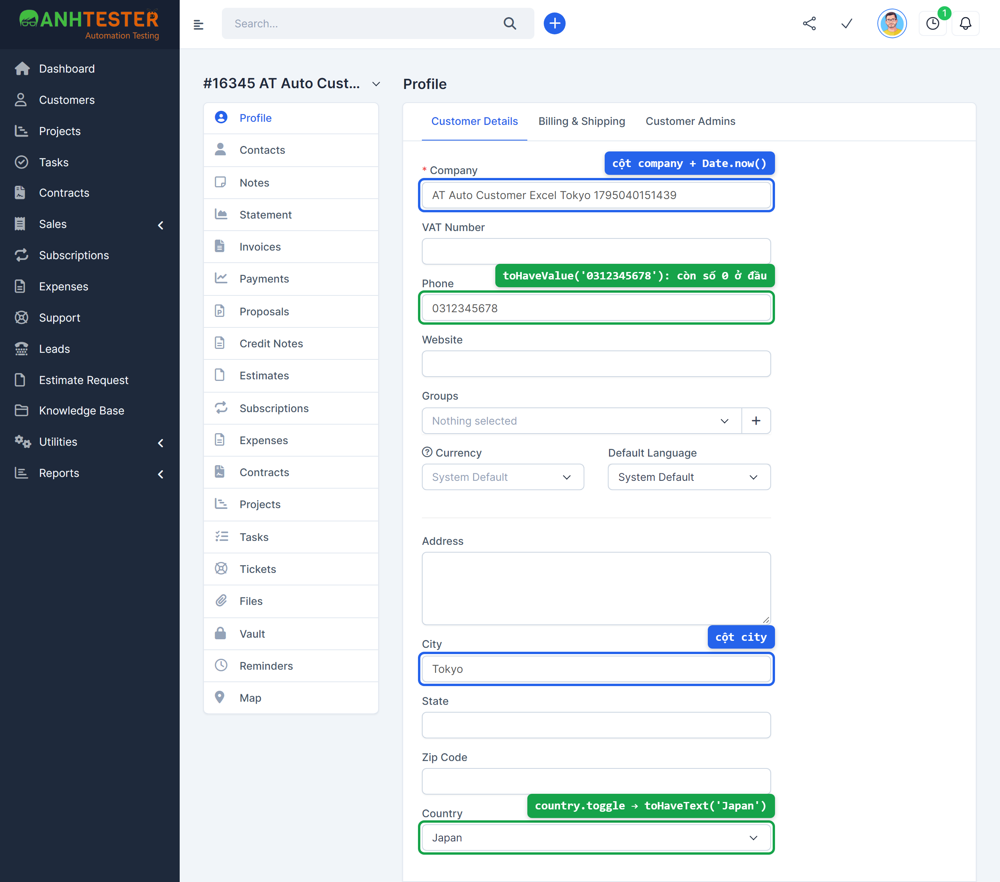
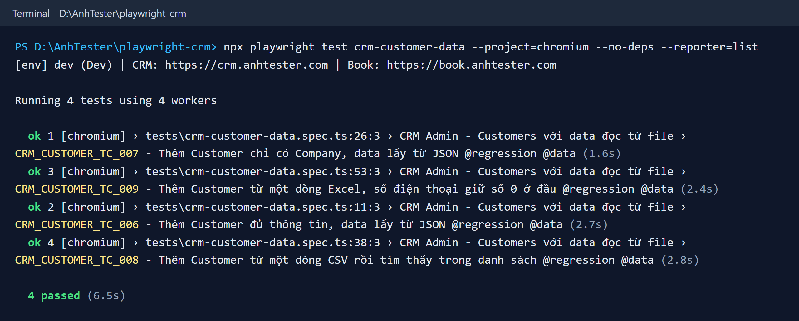

# Bài 32 - [Playwright Typescript] Đọc data test từ file JSON, CSV và Excel

Chương: 5. File Config + Truyền Data Test (Data Driven) + Parallel Execution

Nguồn: [https://anhtester.com/learn/website-and-api-testing-automation-with-playwright-javascript-typescript-day-code-js-ts-tu-dau/389](https://anhtester.com/learn/website-and-api-testing-automation-with-playwright-javascript-typescript-day-code-js-ts-tu-dau/389)

✅ Vì sao tách data test ra file  
✅ Đọc data từ file JSON  
✅ Đọc data từ file CSV  
✅ Đọc data từ file Excel  
✅ Dùng Claude Code và bộ kit claude-testing-skills để sinh data test

## ⭐ Mục tiêu bài học

Bài trước (Storage State) lưu phiên đăng nhập một lần, nên test mở thẳng form **Add new customer** của CRM mà không qua trang Login. Nhưng dữ liệu điền vào form vẫn viết cứng trong test: `vat: '10'`, `city: 'Ho Chi Minh'`...

Bài này đưa dữ liệu đó ra file. Học xong bạn:

- Biết khi nào dùng JSON, CSV, Excel và đọc được cả ba qua `utils/data-reader.ts`.
- Tránh được bẫy Excel làm mất số 0 ở đầu số điện thoại.
- Duyệt được code đọc file do AI viết.

> 📌 Bài làm tiếp trong project `D:\AnhTester\playwright-crm` (macOS: `~/AnhTester/playwright-crm`). Các test dùng phiên Admin đã lưu và **có tạo Customer mới** trên CRM demo.

## ✅ Phần 1: Vì sao tách data test ra file

### 🔆 1. Mẫu hợp đồng và danh sách khách

Cửa hàng in sẵn một mẫu hợp đồng, chừa trống tên, số điện thoại, địa chỉ. Thông tin từng khách nằm ở danh sách riêng: có khách mới thì thêm một dòng, không ai in lại mẫu.

Trong lập trình, mẫu hợp đồng là **code**, danh sách khách là **dữ liệu**. Với automation: kịch bản "thêm Customer rồi kiểm tra" là code; tên công ty, số điện thoại là data. Tách data ra file thì:

- Tester, BA sửa hoặc thêm data mà không đụng tới code.
- Một kịch bản chạy được với nhiều bộ data (bài kế tiếp).

### 🔆 2. Chọn JSON, CSV hay Excel

<table class="rt-table">
<thead>
<tr>
<th>Định dạng</th>
<th>Ai sửa thuận tay</th>
<th>Kiểu dữ liệu đọc ra</th>
<th>Dùng khi</th>
</tr>
</thead>
<tbody>
<tr><td><strong>JSON</strong></td><td>Người viết code</td><td>Giữ kiểu: chuỗi, số, object lồng nhau</td><td>Vài bộ data có tên</td></tr>
<tr><td><strong>CSV</strong></td><td>Ai cũng sửa được</td><td>Mọi ô là chuỗi</td><td>Data dạng bảng, nhiều dòng</td></tr>
<tr><td><strong>Excel</strong></td><td>BA, khách hàng, tester manual</td><td>Tuỳ định dạng ô (xem Phần 4)</td><td>Nhóm đã quản lý data bằng Excel</td></tr>
</tbody>
</table>

Git không cho xem dòng nào đổi trong file Excel, nên được chọn thì ưu tiên JSON và CSV. Bài này làm cả ba:

[](https://anhtester.com/storage/photos/shares/lesson/js_ts_playwright/v2/bai_32_doc_data_file/01_so_do_ba_file_data_json_csv_excel.png)

*Ba file data của bài: customers.json lấy theo tên khoá, customers.csv và customers.xlsx lấy theo cột key*

## ✅ Phần 2: Đọc data từ file JSON

### 🔆 1. File data/customers.json

Tạo thư mục `data` ở gốc project và file `data/customers.json`. Mỗi bộ dữ liệu là một khoá có tên; số điện thoại, VAT để trong ngoặc kép vì chúng là chuỗi để điền vào ô:

```json
{
  "full": {
    "company": "AT Auto Customer JSON",
    "vat": "10",
    "phone": "0123456789",
    "website": "https://anhtester.com",
    "address": "123 Test Street",
    "city": "Ho Chi Minh",
    "country": "Vietnam"
  },
  "minimal": {
    "company": "AT Auto Customer JSON Minimal"
  }
}
```

### 🔆 2. Tên công ty không được trùng

Test nào cũng tạo Customer thật. Dùng đúng tên trong file thì lần chạy sau trùng tên, bước tìm trong danh sách ra nhiều dòng. Không sửa file data mỗi lần chạy: thêm vào cuối `utils/crm-data.ts` một hàm dùng lại `uniqueName()` của bài Storage State (thời điểm chạy cộng 4 ký tự ngẫu nhiên), và thêm dòng `import { uniqueName } from './data';` ở đầu file:

```typescript
/** Thêm thời điểm chạy vào tên công ty: dữ liệu trong file giữ nguyên, mỗi lần chạy vẫn ra tên không trùng */
export function withUniqueCompany(customer: CustomerData): CustomerData {
  return { ...customer, company: uniqueName(customer.company) };
}
```

### 🔆 3. Import file JSON vào test

Tạo `tests/crm-customer-data.spec.ts`. File JSON import được như một module:

```typescript
import { test, expect } from '../fixtures';
import { STORAGE } from '../utils/auth';
import { readCsv, readExcel, findRow } from '../utils/data-reader';
import { toCustomer, withUniqueCompany } from '../utils/crm-data';
// File JSON import thẳng được: Playwright tự đọc và TypeScript tự biết kiểu của từng thuộc tính
import customers from '../data/customers.json';

test.use({ storageState: STORAGE.admin });

test.describe('CRM Admin - Customers với data đọc từ file', () => {
  test('CRM_CUSTOMER_TC_006 - Thêm Customer đủ thông tin, data lấy từ JSON',
    { tag: ['@regression', '@data'] }, async ({ page, customerFormPage }) => {
      const customer = withUniqueCompany(customers.full);

      await customerFormPage.goto();
      await customerFormPage.fill(customer);
      await customerFormPage.save();

      await expect(page).toHaveURL(/\/admin\/clients\/client\/\d+$/);
      await expect(page.getByRole('heading', { name: customer.company })).toBeVisible();
      await expect(customerFormPage.phoneInput).toHaveValue(customers.full.phone);
      await expect(customerFormPage.cityInput).toHaveValue(customers.full.city);
      await expect(customerFormPage.country.toggle).toHaveText(customers.full.country);
    });
  // ... các test tiếp theo viết ở Phần 3 và Phần 4
});
```

Giá trị mong đợi cũng lấy từ file (`customers.full.phone`): sửa data một chỗ, bước điền và bước kiểm tra cùng đổi. Test `CRM_CUSTOMER_TC_007` viết tương tự với `customers.minimal`, kiểm ô Phone rỗng bằng `toHaveValue('')`.

## ✅ Phần 3: Đọc data từ file CSV

### 🔆 1. File data/customers.csv và thư viện csv-parse

CSV là file chữ thuần: mỗi dòng một bản ghi, các ô cách nhau bằng dấu phẩy. Tạo `data/customers.csv`:

```plaintext
key,company,phone,city,country
hcm,AT Auto Customer CSV HCM,0901111111,Ho Chi Minh,Vietnam
hanoi,AT Auto Customer CSV Ha Noi,0902222222,Ha Noi,Vietnam
singapore,AT Auto Customer CSV SG,6561234567,Singapore,Singapore
```

Cột `key` là tên riêng của từng dòng. Cài hai thư viện đọc file:

```bash
npm install -D csv-parse exceljs
```

Bài dùng [csv-parse](https://csv.js.org/parse/) 7.0.3 và [exceljs](https://github.com/exceljs/exceljs) 4.4.0. Không dùng gói `xlsx`: bản trên [npm](https://www.npmjs.com/package/xlsx) dừng ở 0.18.5, các bản mới tác giả phát hành ở nơi khác.

### 🔆 2. File utils/data-reader.ts: một cửa đọc file data

Tạo `utils/data-reader.ts`. Phần đọc Excel giải thích ở Phần 4:

```typescript
import fs from 'node:fs';
import path from 'node:path';
import { parse } from 'csv-parse/sync';
import ExcelJS from 'exceljs';

/** Đường dẫn tính từ gốc project, nên đứng ở thư mục nào gõ lệnh cũng đọc đúng file */
function fromRoot(relativePath: string): string {
  return path.resolve(__dirname, '..', relativePath);
}

/** Đọc file JSON thành object kiểu T */
export function readJson<T>(relativePath: string): T {
  const text = fs.readFileSync(fromRoot(relativePath), 'utf8');
  return JSON.parse(text) as T;
}

/** Đọc file CSV có dòng tiêu đề: mỗi dòng thành một object, tên thuộc tính lấy từ tiêu đề cột */
export function readCsv(relativePath: string): Record<string, string>[] {
  const text = fs.readFileSync(fromRoot(relativePath), 'utf8');
  return parse(text, {
    columns: true, // dòng đầu là tiêu đề cột
    skip_empty_lines: true, // bỏ dòng trống, hay gặp ở cuối file
    trim: true, // bỏ dấu cách thừa quanh mỗi ô
    bom: true, // file lưu từ Excel thường có ký tự BOM ở đầu, làm tên cột đầu tiên bị lệch
  });
}

/** Đọc một sheet Excel có dòng tiêu đề. Mọi ô đọc thành chuỗi đúng như đang hiển thị trong Excel */
export async function readExcel(relativePath: string, sheetName: string): Promise<Record<string, string>[]> {
  const workbook = new ExcelJS.Workbook();
  await workbook.xlsx.readFile(fromRoot(relativePath));
  const sheet = workbook.getWorksheet(sheetName);
  if (!sheet) {
    throw new Error(`Không có sheet "${sheetName}" trong file ${relativePath}`);
  }

  const headers: string[] = [];
  sheet.getRow(1).eachCell((cell, col) => {
    headers[col] = cell.text.trim();
  });

  const rows: Record<string, string>[] = [];
  sheet.eachRow((row, rowNumber) => {
    if (rowNumber === 1) return; // bỏ dòng tiêu đề
    const item: Record<string, string> = {};
    headers.forEach((header, col) => {
      if (header) item[header] = row.getCell(col).text.trim();
    });
    rows.push(item);
  });
  return rows;
}

/** Lấy đúng một dòng theo giá trị của cột key. Không thấy thì báo rõ các key đang có */
export function findRow(rows: Record<string, string>[], key: string): Record<string, string> {
  const row = rows.find((item) => item.key === key);
  if (!row) {
    throw new Error(`Không có dòng key="${key}". Các key đang có: ${rows.map((item) => item.key).join(', ')}`);
  }
  return row;
}
```

`fromRoot()` dùng `__dirname` như `utils/env.config.ts` ở bài .env. Viết thẳng `fs.readFileSync('data/customers.csv')` thì đứng trong `tests` chạy lệnh là nhận `ENOENT: no such file or directory` (kết quả chạy thật).

Bốn option của `parse()`, mỗi cái chặn một lỗi đã thử thật:

<table class="rt-table">
<thead>
<tr>
<th>Option</th>
<th>Không bật thì</th>
</tr>
</thead>
<tbody>
<tr><td><code>columns: true</code></td><td>Mỗi dòng là một mảng, phải nhớ phone là cột số mấy</td></tr>
<tr><td><code>skip_empty_lines</code></td><td>Một dòng trống giữa file là lỗi <code>Invalid Record Length</code>, không đọc được dòng nào</td></tr>
<tr><td><code>trim: true</code></td><td>Tiêu đề <code>key, phone</code> cho tên cột <code>' phone'</code>: <code>row.phone</code> là <code>undefined</code></td></tr>
<tr><td><code>bom: true</code></td><td>Tên cột đầu dính ký tự BOM không nhìn thấy: <code>row.key</code> là <code>undefined</code></td></tr>
</tbody>
</table>

Vì sao không tự cắt bằng `split(',')`? Thử với một tên công ty có dấu phẩy:

```plaintext
Dòng CSV : hcm,"AT Auto Customer, Ltd",0901111111
split(','): [ 'hcm', '"AT Auto Customer', ' Ltd"', '0901111111' ]
csv-parse : [ 'hcm', 'AT Auto Customer, Ltd', '0901111111' ]
```

### 🔆 3. Từ một dòng CSV tới form Customer

`readCsv()` trả về `Record<string, string>` (object có tên thuộc tính bất kỳ, giá trị là chuỗi), còn Page Object cần `CustomerData`. Thêm vào `utils/crm-data.ts` hàm đổi kiểu, để tên cột của file chỉ xuất hiện ở một chỗ:

```typescript
/** Một dòng đọc từ CSV hoặc Excel (mọi ô là chuỗi) thành dữ liệu của form Customer */
export function toCustomer(row: Record<string, string>): CustomerData {
  return {
    company: row.company,
    phone: row.phone,
    city: row.city,
    country: row.country,
  };
}
```

Thêm test vào `tests/crm-customer-data.spec.ts`:

```typescript
  test('CRM_CUSTOMER_TC_008 - Thêm Customer từ một dòng CSV rồi tìm thấy trong danh sách',
    { tag: ['@regression', '@data'] }, async ({ customerFormPage, customerListPage }) => {
      const row = findRow(readCsv('data/customers.csv'), 'hanoi');
      const customer = withUniqueCompany(toCustomer(row));

      await customerFormPage.goto();
      await customerFormPage.fill(customer);
      await customerFormPage.save();

      await customerListPage.goto();
      await customerListPage.search(customer.company);
      await expect(customerListPage.row(customer.company)).toHaveCount(1);
      await expect(customerListPage.row(customer.company)).toContainText(row.phone);
    });
```

Lấy dòng theo `'hanoi'`, không theo số thứ tự: chèn thêm dòng vào file thì test vẫn lấy đúng. Gọi key không có, `findRow()` báo: `Không có dòng key="danang". Các key đang có: hcm, hanoi, singapore`.

[](https://anhtester.com/storage/photos/shares/lesson/js_ts_playwright/v2/bai_32_doc_data_file/03_danh_sach_customers_loc_theo_cong_ty_tu_csv.png)

*Danh sách Customers lọc theo tên công ty của dòng hanoi trong file CSV: đúng một dòng*

## ✅ Phần 4: Đọc data từ file Excel

### 🔆 1. File data/customers.xlsx

Mở Excel, tạo file `data/customers.xlsx`, đổi tên sheet thành `Customers`. **Trước khi gõ dữ liệu**, chọn cả cột C (phone) và đổi định dạng sang **Text**, rồi nhập hai dòng `danang`, `tokyo` như hình ở Phần 1.

### 🔆 2. Bẫy mất số 0 ở đầu

Gõ `0903333333` vào ô định dạng thường, Excel hiểu là **số** và lưu `903333333`. Thử thật với hai dòng, dòng `so` ô kiểu số, dòng `chu` ô kiểu Text, đọc bằng `readExcel()`:

```plaintext
[
  { key: 'so', phone: '903333333' },
  { key: 'chu', phone: '0903333333' }
]
```

Số 0 mất từ lúc lưu file, code không cứu lại được: cột số điện thoại, mã số, mã bưu chính luôn để Text. `readExcel()` đọc bằng `cell.text` (chuỗi đang hiển thị trong ô); `cell.value` thì tuỳ ô mà ra số, ngày hoặc object.

### 🔆 3. readExcel() là hàm async

exceljs đọc file theo kiểu bất đồng bộ, nên `readExcel()` trả về `Promise` và phải có `await`:

```typescript
  test('CRM_CUSTOMER_TC_009 - Thêm Customer từ một dòng Excel, số điện thoại giữ số 0 ở đầu',
    { tag: ['@regression', '@data'] }, async ({ page, customerFormPage }) => {
      const row = findRow(await readExcel('data/customers.xlsx', 'Customers'), 'tokyo');
      const customer = withUniqueCompany(toCustomer(row));

      await customerFormPage.goto();
      await customerFormPage.fill(customer);
      await customerFormPage.save();

      await expect(page.getByRole('heading', { name: customer.company })).toBeVisible();
      await expect(customerFormPage.phoneInput).toHaveValue('0312345678');
      await expect(customerFormPage.country.toggle).toHaveText('Japan');
    });
```

Hai lỗi hay gặp (kết quả chạy thật):

- Quên `await`: `TypeError: rows.find is not a function`, vì `findRow()` nhận một `Promise`.
- Sai tên sheet: `Không có sheet "Sheet1" trong file data/customers.xlsx`.

[](https://anhtester.com/storage/photos/shares/lesson/js_ts_playwright/v2/bai_32_doc_data_file/02_customer_tao_tu_dong_tokyo_cua_file_excel.png)

*Customer tạo từ dòng tokyo của file Excel: ô Phone còn nguyên số 0 ở đầu, Country là Japan*

## ✅ Phần 5: Chạy bốn test và nhìn lại project

`--no-deps` để không chạy lại project `setup` khi phiên đã lưu còn hạn:

```bash
npx playwright test crm-customer-data --project=chromium --no-deps --reporter=list
```

[](https://anhtester.com/storage/photos/shares/lesson/js_ts_playwright/v2/bai_32_doc_data_file/04_terminal_bon_test_doc_data_tu_file.png)

*Kết quả chạy thật: bốn test đọc data từ JSON, CSV, Excel đều đạt sau 6,5 giây*

Cả bộ test trên Chromium giờ là **65 test trong 10 file** (đếm bằng `--list`). Phần thêm mới của bài:

```plaintext
playwright-crm/
├── .claude/rules/
│   └── project_data_rules.md         ← (MỚI) quy tắc data test, xem Phần 6
├── data/
│   ├── customers.json                ← (MỚI) khoá full, minimal
│   ├── customers.csv                 ← (MỚI) dòng hcm, hanoi, singapore
│   └── customers.xlsx                ← (MỚI) sheet Customers: danang, tokyo
├── tests/
│   └── crm-customer-data.spec.ts     ← (MỚI) CRM_CUSTOMER_TC_006 đến TC_009
├── utils/
│   ├── crm-data.ts                   ← thêm toCustomer(), withUniqueCompany()
│   └── data-reader.ts                ← (MỚI) readJson, readCsv, readExcel, findRow
└── package.json                      ← csv-parse, exceljs
```

## ✅ Phần 6: Dùng Claude Code và bộ kit claude-testing-skills để sinh data test

### 🔆 1. Lệnh /generate-test-data và quy tắc riêng của project

Bộ kit có lệnh [/generate-test-data](https://github.com/anhtester/claude-testing-skills/blob/main/.claude/commands/generate-test-data.md): nhận tên chức năng và định dạng `json`, `csv`, `markdown` hoặc `code`. Lệnh lập bảng field cho bạn duyệt rồi sinh data hợp lệ, không hợp lệ, giá trị biên, kèm kết quả mong đợi. Quy tắc Unique của skill [skills-test-data-generator](https://github.com/anhtester/claude-testing-skills/blob/main/.claude/skills/skills-test-data-generator/SKILL.md) là lý do có `withUniqueCompany()`.

Mẫu của bộ kit và [framework mẫu](https://github.com/anhtester/playwright-typescript-framework-ai) đặt data ở `test-data/`, project này dùng `data/`. Chỗ khác nhau thì quy tắc của project thắng. Tạo `.claude/rules/project_data_rules.md`:

```markdown
# Quy tắc data test riêng của project (Playwright TypeScript)

> Chỗ nào khác với `skills-test-data-generator` của bộ kit (vị trí thư mục, định dạng file)
> thì LÀM THEO FILE NÀY. Các quy tắc còn lại của bộ kit giữ nguyên.

## Vị trí và định dạng
- File data nằm ở `data/` tại gốc project (KHÔNG phải `test-data/`): `.json`, `.csv`, `.xlsx`.
- JSON: `import x from '../data/<ten>.json'`, mỗi bộ dữ liệu một khoá có tên (`full`, `minimal`...).
- CSV và Excel: dòng đầu là tiêu đề cột, cột đầu tiên là `key` (không trùng) để test lấy đúng một dòng.
- Đọc CSV, Excel CHỈ qua `utils/data-reader.ts` (`readCsv`, `readExcel`, `findRow`). Không đọc file ở nơi khác.
- Excel: cột số điện thoại, mã số, mã bưu chính định dạng **Text**, nếu không Excel bỏ số 0 ở đầu.
- Dòng CSV/Excel đổi thành kiểu của form qua hàm trong `utils/crm-data.ts` (`toCustomer`). Không truyền
  thẳng `Record<string, string>` vào Page Object.

## Giá trị
- Dữ liệu phải không trùng giữa các lần chạy: tên công ty đi qua `withUniqueCompany()`.
  KHÔNG sửa file data để "đổi tên cho khỏi trùng".
- KHÔNG ghi email, mật khẩu của tài khoản thật vào file data. Tài khoản lấy từ `.env` qua `account()`.
- Data sai (email sai định dạng, ô trống...) cũng đặt trong file data, kèm kết quả mong đợi của từng dòng.
```

### 🔆 2. Prompt dùng được ở Claude, ChatGPT và Gemini

Form Add new customer nằm sau trang đăng nhập, AI không tự mở được: bạn mô tả các ô cho nó. Với [ChatGPT](https://chatgpt.com/) hoặc [Gemini](https://gemini.google.com/), dán nội dung file vào chỗ có ngoặc vuông.

**Sinh file CSV cho form Customer:**

```markdown
/generate-test-data "Form Add new customer của CRM" csv

Các ô của form: Company (bắt buộc), VAT Number, Phone, Website, Address, City, Country (chọn từ danh sách tên nước tiếng Anh).
Làm theo .claude/rules/project_data_rules.md:
[dán nội dung file quy tắc nếu không dùng Claude Code]

Yêu cầu:
1. Một file data/customers-more.csv, dòng đầu là tiêu đề cột, cột đầu là key không trùng.
2. Thêm cột expected ghi kết quả mong đợi của từng dòng (lưu được / báo lỗi ở ô nào).
3. Giá trị nào có dấu phẩy thì đặt trong ngoặc kép. Không dùng tên người, email, số điện thoại thật.
4. Tên công ty KHÔNG kèm thời gian: code sẽ nối thêm qua withUniqueCompany().
```

**Soát hàm đọc file:**

```markdown
Đây là utils/data-reader.ts của project Playwright TypeScript:

[dán utils/data-reader.ts]

Hãy liệt kê các tình huống file data làm hàm readCsv, readExcel trả về kết quả sai mà KHÔNG báo lỗi
(ví dụ: hai dòng trùng key, thiếu cột, ô ngày tháng, ô có công thức, sheet có dòng trống ở giữa).
Mỗi tình huống: file mẫu 2-3 dòng, kết quả hiện tại, và có nên sửa hàm hay sửa quy tắc viết file.
CHƯA sửa code. Điều gì không chắc thì ghi "cần chạy thử".
```

## ✅ Phần 7: Kiểm tra code do AI sinh ra

Code đọc file do AI viết thường chạy được ở lần đầu. Lỗi lộ ra khi file đổi, hoặc ở lần chạy thứ hai:

<table class="rt-table">
<thead>
<tr>
<th>Dấu hiệu trong code</th>
<th>Vì sao là vấn đề</th>
<th>Cách xử lý</th>
</tr>
</thead>
<tbody>
<tr><td><code>fs.readFileSync('data/x.csv')</code> ngay trong test</td><td>Đổi thư mục đứng gõ lệnh là <code>ENOENT</code></td><td>Đọc qua <code>utils/data-reader.ts</code></td></tr>
<tr><td><code>split('\n')</code>, <code>split(',')</code> để tách CSV</td><td>Vỡ khi ô có dấu phẩy trong ngoặc kép</td><td><code>readCsv()</code> (csv-parse)</td></tr>
<tr><td><code>rows[1]</code>, <code>lines[2]</code></td><td>Chèn thêm dòng là test lặng lẽ dùng data khác</td><td><code>findRow(rows, 'key')</code></td></tr>
<tr><td><code>cell.value</code>, hoặc số điện thoại không có ngoặc kép trong JSON</td><td>Ra kiểu số, mất số 0 ở đầu</td><td><code>cell.text</code>, cột Text, chuỗi trong JSON</td></tr>
<tr><td>Tên công ty dùng thẳng từ file</td><td>Trùng tên. Chạy thật: mong 1 dòng, nhận 10, lần sau 11</td><td><code>withUniqueCompany()</code></td></tr>
</tbody>
</table>

## ✅ Phần 8: Bài tập thực hành

**Bài tập 1 - Thêm một bộ data JSON.** Thêm khoá `hanoi` vào `data/customers.json`, viết test tạo Customer từ khoá đó và kiểm Phone, City, Country bằng giá trị lấy từ file.

**Bài tập 2 - Tên công ty có dấu phẩy.** Thêm vào `data/customers.csv` dòng `danang` có company là `AT Auto Customer CSV, Da Nang`. Viết test tạo Customer từ dòng đó rồi tìm thấy đúng một dòng trong danh sách. Tách dòng này bằng `split(',')` thì được mấy phần?

**Bài tập 3 - Thêm cột cho Excel.** Thêm cột `website` vào sheet `Customers`, sửa `toCustomer()` để đọc cột đó, viết test kiểm ô Website. Rồi đổi ô phone của dòng `tokyo` sang Number, gõ lại số, chạy `CRM_CUSTOMER_TC_009` và ghi lại lỗi.

**Bài tập 4 - Duyệt code AI.** Đoạn dưới có **7 chỗ cần sửa** (có dòng mắc hai lỗi). Tìm đủ, nêu lý do.

```typescript
import fs from 'node:fs';
import { test, expect } from '../fixtures';
import { STORAGE } from '../utils/auth';
import { readExcel, findRow } from '../utils/data-reader';

test.use({ storageState: STORAGE.admin });

test('Thêm Customer từ CSV', async ({ customerFormPage, customerListPage }) => {
  const lines = fs.readFileSync('data/customers.csv', 'utf8').split('\n');
  const cells = lines[2].split(',');
  const customer = { company: cells[1], phone: cells[2], city: cells[3], country: cells[4] };

  await customerFormPage.goto();
  await customerFormPage.fill(customer);
  await customerFormPage.save();

  await customerListPage.goto();
  await customerListPage.search(customer.company);
  await expect(customerListPage.row(customer.company)).toHaveCount(1);
});

test('Thêm Customer từ Excel', async ({ page, customerFormPage }) => {
  const row = findRow(readExcel('data/customers.xlsx', 'Sheet1'), 'tokyo');

  await customerFormPage.goto();
  await customerFormPage.fill(row);
  await customerFormPage.save();

  await expect(page.getByRole('heading', { name: row.company })).toBeVisible();
});
```

## ✅ Phần 9: Ghi nhớ nhanh

- Data nằm ở `data/`: JSON cho vài bộ có tên, CSV cho bảng nhiều dòng, Excel khi nhóm đã dùng Excel.
- JSON thì `import`; CSV, Excel đọc qua `utils/data-reader.ts`, lấy dòng bằng `findRow()`, đổi kiểu bằng `toCustomer()`.
- Cột số điện thoại trong Excel để Text, đọc bằng `cell.text`; `readExcel()` phải có `await`.
- File data giữ nguyên; tên không trùng là việc của `withUniqueCompany()`.

✅ **Kết luận:** Dữ liệu của form Customer đã rời khỏi code. Nhưng mỗi test mới lấy **một** dòng: file CSV có ba dòng thì hai dòng chưa chạy, và data vẫn phải nghĩ bằng tay. Bài kế tiếp cho một kịch bản chạy hết mọi dòng và để máy tự sinh dữ liệu: **Data-driven test và tạo data test với Faker**.

---

## Bài tập riêng — Bài tập - Đọc data test từ file JSON, CSV, Excel và duyệt code AI

Nguồn bài tập: [https://anhtester.com/student-assignments?course=website-and-api-testing-automation-with-playwright-javascript-typescript-day-code-js-ts-tu-dau#assignment-122](https://anhtester.com/student-assignments?course=website-and-api-testing-automation-with-playwright-javascript-typescript-day-code-js-ts-tu-dau#assignment-122)

**Mục tiêu:** đưa dữ liệu của form ra khỏi code test, đọc được data từ file JSON, CSV, Excel qua một cửa `utils/data-reader.ts`, tránh bẫy Excel làm mất số 0 ở đầu, và nhận ra lỗi trong code đọc file do AI sinh ra kể cả khi lần chạy đầu vẫn xanh.

**Thư mục làm bài:** `D:\AnhTester\playwright-crm` (macOS: `~/AnhTester/playwright-crm`), dùng tiếp các file của bài học: `data/customers.json`, `data/customers.csv`, `data/customers.xlsx`, `utils/data-reader.ts`, `utils/crm-data.ts`, `tests/crm-customer-data.spec.ts`. Các bài tập **có tạo Customer mới** trên CRM demo `https://crm.anhtester.com` bằng phiên Admin bạn đã lưu ở bài Storage State; tên công ty luôn đi qua `withUniqueCompany()`. **Không xoá, không sửa** Customer của người khác. **Không commit** `.env.*` (trừ `.env.example`) và thư mục `playwright/.auth/`; không ghi email, mật khẩu đăng nhập vào file data hay bài nộp. Lệnh chạy thêm `--no-deps` khi phiên đã lưu còn hạn; hết hạn thì chạy lại `npm run test:setup`.

### 📝 Đề bài

#### Bài tập 1 - Thêm một bộ data JSON

1. Thêm vào `data/customers.json` khoá `hanoi` gồm `company` (`AT Auto Customer JSON Ha Noi`), `phone` (bắt đầu bằng số 0), `city` (`Ha Noi`), `country` (`Vietnam`).
2. Tạo `tests/bt-data.spec.ts` (dùng `test.use({ storageState: STORAGE.admin })`), viết test `CRM_CUSTOMER_BT_001`: tạo Customer từ `customers.hanoi`, kiểm URL có id, tiêu đề chứa tên công ty, và ô Phone, City, Country đúng bằng **giá trị lấy từ file** (không viết lại giá trị trong test).
3. Chạy `npx playwright test bt-data --project=chromium --no-deps --reporter=list`.

Trả lời: vì sao số điện thoại trong file JSON phải đặt trong ngoặc kép?

#### Bài tập 2 - Tên công ty có dấu phẩy

1. Thêm vào cuối `data/customers.csv` dòng có key `danang`, company là `AT Auto Customer CSV, Da Nang` (có dấu phẩy), phone `0904444444`, city `Da Nang`, country `Vietnam`.
2. Viết test `CRM_CUSTOMER_BT_002` trong `tests/bt-data.spec.ts`: đọc dòng `danang` bằng `findRow(readCsv(...), 'danang')`, tạo Customer, mở danh sách Customers, lọc theo tên công ty và kiểm có đúng một dòng chứa số điện thoại của file.
3. Chạy lại cả `tests/crm-customer-data.spec.ts` để chắc dòng mới không làm hỏng test cũ.

Trả lời: (a) bạn viết dòng `danang` trong file CSV thế nào? (b) Nếu tách dòng đó bằng `split(',')` thì được mấy phần, và phần nào bị sai?

#### Bài tập 3 - Thêm cột cho Excel và thử bẫy số 0

1. Thêm cột `website` vào sheet `Customers` của `data/customers.xlsx`, điền `https://anhtester.com` cho cả hai dòng.
2. Sửa `toCustomer()` trong `utils/crm-data.ts` để đọc thêm cột `website`. Viết test `CRM_CUSTOMER_BT_003`: tạo Customer từ dòng `danang` của Excel, kiểm ô Website và ô Phone sau khi lưu.
3. Thử bẫy: chép `customers.xlsx` thành `data/customers-number.xlsx`, trong file chép đổi ô phone của dòng `tokyo` sang định dạng **Number** rồi gõ lại `0312345678`. Tạm sửa test `CRM_CUSTOMER_TC_009` để đọc file chép, chạy và ghi lại thông báo lỗi. Sau đó trả test về như cũ và xoá file chép.

Trả lời: số 0 mất ở bước nào (lúc gõ vào Excel, lúc đọc file hay lúc điền vào form)? Vì sao sửa code đọc không cứu được?

#### Bài tập 4 - Duyệt code AI

File test dưới đây do AI viết cho project của bài học. Nó có **7 chỗ cần sửa** (có dòng mắc hai lỗi). Tìm đủ, nêu lý do, rồi viết lại cho đúng `.claude/rules/project_data_rules.md`.

```typescript
import fs from 'node:fs';
import { test, expect } from '../fixtures';
import { STORAGE } from '../utils/auth';
import { readExcel, findRow } from '../utils/data-reader';

test.use({ storageState: STORAGE.admin });

test('Thêm Customer từ CSV', async ({ customerFormPage, customerListPage }) => {
  const lines = fs.readFileSync('data/customers.csv', 'utf8').split('\n');
  const cells = lines[2].split(',');
  const customer = { company: cells[1], phone: cells[2], city: cells[3], country: cells[4] };

  await customerFormPage.goto();
  await customerFormPage.fill(customer);
  await customerFormPage.save();

  await customerListPage.goto();
  await customerListPage.search(customer.company);
  await expect(customerListPage.row(customer.company)).toHaveCount(1);
});

test('Thêm Customer từ Excel', async ({ page, customerFormPage }) => {
  const row = findRow(readExcel('data/customers.xlsx', 'Sheet1'), 'tokyo');

  await customerFormPage.goto();
  await customerFormPage.fill(row);
  await customerFormPage.save();

  await expect(page.getByRole('heading', { name: row.company })).toBeVisible();
});
```

### 📦 Cách nộp bài

1. Làm bài trong project `playwright-crm`, commit và push lên nhánh `main` của repo GitHub `playwright-crm` của bạn. Trước khi push, chạy `git status --short` và kiểm chắc danh sách **không có** `.env.dev`, `.env.staging` và `playwright/.auth/`.
2. Dán link repo vào ô **Link GitHub**, dạng `https://github.com/<ten-ban>/playwright-crm`. Repo Private thì vào **Settings → Collaborators** thêm tài khoản GitHub của giảng viên.
3. Trong ô **Nội dung bài làm (Editor)**, dán **kết quả chạy thật** trên Terminal của từng lệnh (mỗi lệnh một **Đoạn code mẫu** chọn Text / Log) và phần trả lời các câu hỏi.
4. Với bài **Duyệt code AI**: liệt kê từng chỗ sai theo mẫu *Dòng – Lỗi – Lý do – Cách sửa*, rồi dán bản đã viết lại.
5. Dán thêm kết quả `npx playwright test crm-customer-data bt-data --project=chromium --no-deps --reporter=list` của project sau khi làm xong.

### ✅ Tiêu chí Đạt

- Bài tập 1: `customers.json` vẫn là JSON hợp lệ, có đủ ba khoá `full`, `minimal`, `hanoi`; phone là chuỗi. Test dùng `import customers from '../data/customers.json'` và `withUniqueCompany(customers.hanoi)`; các assertion so với `customers.hanoi.phone`, `customers.hanoi.city`, `customers.hanoi.country`, không viết cứng giá trị. Kết quả chạy có `1 passed`. Trả lời đúng ý: số điện thoại là chuỗi để điền vào ô chứ không để tính; bỏ ngoặc kép thì JSON coi là số, số có số 0 ở đầu là JSON không hợp lệ (hoặc mất số 0 nếu viết thành số thường).
- Bài tập 2: dòng CSV đặt tên công ty trong ngoặc kép: `danang,"AT Auto Customer CSV, Da Nang",0904444444,Da Nang,Vietnam`. Test đọc qua `readCsv` + `findRow` + `toCustomer` + `withUniqueCompany`, không đọc file bằng `fs` trong test; kiểm `toHaveCount(1)` và `toContainText(row.phone)` trên `customerListPage.row(customer.company)`. Kết quả chạy thật của giảng viên: test đạt, `row.company` đọc ra `AT Auto Customer CSV, Da Nang`. Trả lời: `split(',')` cho **6 phần** thay vì 5; tên công ty bị cắt làm hai (`"AT Auto Customer CSV` và  `Da Nang"`, còn dính cả dấu ngoặc kép), các cột sau lệch đi một vị trí. Bốn test của `crm-customer-data.spec.ts` vẫn đạt.
- Bài tập 3: `toCustomer()` có thêm `website: row.website`; test kiểm `customerFormPage.websiteInput` bằng `toHaveValue(row.website)` và Phone bằng `toHaveValue('0903333333')` (hoặc `row.phone`). Phần thử bẫy: bài làm có thông báo lỗi của `toHaveValue` với giá trị mong đợi `0312345678` và giá trị nhận được `312345678` (kết quả đọc thật của giảng viên với ô kiểu số: `{ key: 'so', phone: '903333333' }`). Trả lời đúng: số 0 mất ngay lúc gõ vào ô kiểu số, Excel lưu giá trị số `312345678` vào file; code đọc chỉ thấy số đó nên không biết ban đầu có mấy số 0. Cách phòng: định dạng cột là Text trước khi gõ. Repo nộp không còn `customers-number.xlsx`, test `CRM_CUSTOMER_TC_009` đã trả về như bài học.
- Bài tập 4: tìm được ít nhất **5 trong 7** lỗi, kèm lý do đúng. **Đáp án cho người chấm**: (1) `fs.readFileSync('data/customers.csv')` đọc file ngay trong test với đường dẫn tương đối: Node.js tìm theo thư mục đang đứng khi gõ lệnh, đứng trong `tests` là `ENOENT: no such file or directory` (kết quả chạy thật); quy tắc project chỉ cho đọc qua `utils/data-reader.ts`; (2) cùng dòng đó và dòng dưới: tự tách bằng `split('\n')`, `split(',')`: ô có dấu phẩy trong ngoặc kép bị cắt đôi (chạy thật: `[ 'hcm', '"AT Auto Customer', ' Ltd"', '0901111111' ]`), file lưu trên Windows còn dính `\r` ở cột cuối; phải dùng `readCsv()`; (3) `lines[2]` lấy dòng theo số thứ tự: chèn hoặc sắp xếp lại dòng là test lặng lẽ dùng data khác; phải `findRow(rows, 'hanoi')`; (4) tên công ty dùng thẳng từ file, không qua `withUniqueCompany()`: mỗi lần chạy tạo thêm một Customer trùng tên nên `toHaveCount(1)` hỏng (chạy thật trên CRM demo: `Expected: 1, Received: 10`, lần chạy kế tiếp `Received: 11`); (5) `findRow(readExcel(...), 'tokyo')` thiếu `await`: `readExcel()` trả về Promise nên báo `TypeError: rows.find is not a function` (chạy thật); (6) cùng dòng đó: tên sheet `Sheet1` không có trong file, sheet của project là `Customers`: `Không có sheet "Sheet1" trong file data/customers.xlsx` (chạy thật); (7) `customerFormPage.fill(row)` truyền thẳng `Record<string, string>` vào Page Object: không qua `toCustomer()` nên tên cột của file rải khắp nơi, gõ sai tiêu đề cột thì ô bị bỏ qua mà không báo, và cũng không qua `withUniqueCompany()` (ý trùng tên ở test thứ hai tính chung vào lỗi 4 hoặc lỗi 7, không tính thành lỗi thứ 8). Nêu thêm việc hai test không có mã TC và tag, hoặc test Excel không kiểm số điện thoại, là điểm cộng. Bản viết lại chấp nhận: hai test `CRM_CUSTOMER_TC_008` và `CRM_CUSTOMER_TC_009` của bài học, hoặc bản tương đương dùng `readCsv`, `await readExcel(..., 'Customers')`, `findRow`, `toCustomer`, `withUniqueCompany` và không còn `import fs`.
- Chung: file data nằm trong `data/`; không có email, mật khẩu đăng nhập trong file data, trong code hay trong bài làm; repo không chứa `.env.dev`, `.env.staging`, `playwright/.auth/`; locator chỉ dùng `getBy...` và XPath; kết quả chạy cuối không có test lỗi do đọc data.

### 🤖 Dùng AI thế nào cho đúng

- Được dùng Claude, ChatGPT, Gemini để sinh bản nháp file data và test. Luôn dán kèm `utils/data-reader.ts`, `utils/crm-data.ts` và `.claude/rules/project_data_rules.md`.
- **Không** dán nội dung `.env.dev` hay file trong `playwright/.auth/` vào khung chat, và không nhờ AI mở các file đó.
- Chạy bản nháp **hai lần liên tiếp** trước khi nộp: lần hai mới lộ lỗi trùng tên công ty.
- File Excel tự mở ra kiểm định dạng cột phone, không tin vào mô tả của AI.
- Bài tập 4 tự làm trước, sau đó mới nhờ AI soát lại xem còn sót lỗi nào.