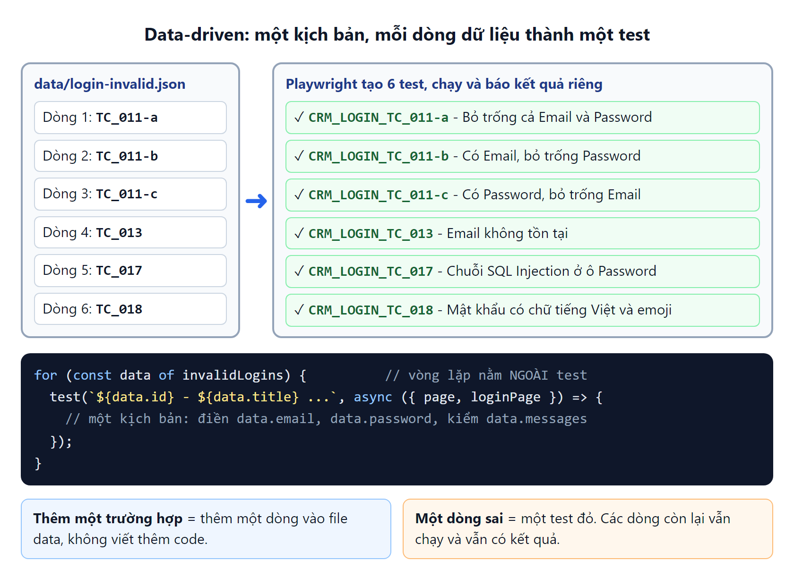
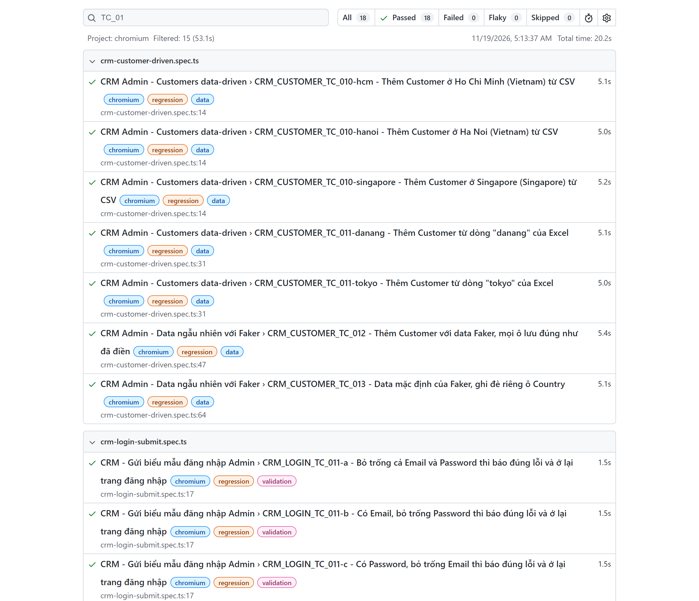
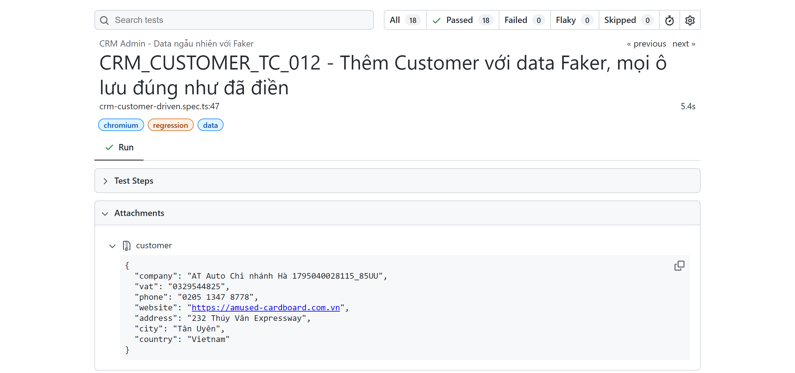
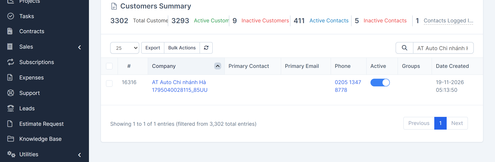

# Bài 33 - [Playwright Typescript] Data-driven test và tạo data test với Faker

Chương: 5. File Config + Truyền Data Test (Data Driven) + Parallel Execution

Nguồn: [https://anhtester.com/learn/website-and-api-testing-automation-with-playwright-javascript-typescript-day-code-js-ts-tu-dau/390](https://anhtester.com/learn/website-and-api-testing-automation-with-playwright-javascript-typescript-day-code-js-ts-tu-dau/390)

✅ Data-driven test là gì  
✅ Ba lỗi hay gặp khi lặp test  
✅ Data-driven với CSV và Excel cho Customer  
✅ Tạo data ngẫu nhiên với Faker  
✅ Chuỗi dài Customer rồi Project với data Faker

## ⭐ Mục tiêu bài học

Bài trước (Đọc data test từ file JSON, CSV và Excel) đưa dữ liệu ra thư mục `data/`, nhưng mỗi test mới lấy **một** dòng bằng `findRow()`. File có 5 dòng thì vẫn phải viết 5 test giống nhau. Học xong bài này bạn sẽ:

- Viết một kịch bản chạy với nhiều dòng dữ liệu, mỗi dòng là một test có tên riêng.
- Tránh được ba lỗi hay gặp khi lặp test.
- Sinh Customer, Project ngẫu nhiên bằng Faker mà vẫn không trùng, vẫn truy được.

> 📌 Bài làm tiếp trong project `D:\AnhTester\playwright-crm` (macOS: `~/AnhTester/playwright-crm`). Lệnh trong bài có `--no-deps` để dùng phiên đã lưu ở bài Storage State; phiên hết hạn thì chạy `npm run test:setup` trước.

## ✅ Phần 1: Data-driven test là gì

### 🔆 1. Một tờ đề, cả lớp cùng làm

Giáo viên soạn **một** tờ đề, một đáp án, rồi chấm cho 40 học sinh. Lớp thêm một bạn thì thêm một dòng trong sổ điểm, không soạn đề mới.

Trong lập trình, đó là một hàm chạy lần lượt với từng phần tử của một mảng. Trong automation, hàm là kịch bản test, mảng là file data: **data-driven test**.

### 🔆 2. Gộp bốn test đăng nhập sai thành một vòng lặp

File `tests/crm-login-submit.spec.ts` đang có bốn test cùng khuôn: điền, bấm Login, kiểm câu báo lỗi.

**TRƯỚC** (trích):

```typescript
test('CRM_LOGIN_TC_011-a - Bỏ trống cả Email và Password thì báo cả hai ô là bắt buộc',
  { tag: ['@regression', '@validation'] }, async ({ page, loginPage }) => {
    await loginPage.loginButton.click();

    await expect(page.getByText('The Email Address field is required.')).toBeVisible();
    await expect(page.getByText('The Password field is required.')).toBeVisible();
    await expect(page).toHaveURL(loginPage.url);
  });

test('CRM_LOGIN_TC_013 - Email không tồn tại thì báo lỗi chung, không nói rõ sai ô nào',
  { tag: ['@smoke', '@security'] }, async ({ page, loginPage, testEmail }) => {
    await loginPage.login(testEmail, 'Abc12345');

    await expect(page.getByText('Invalid email or password')).toBeVisible();
    await expect(page).toHaveURL(loginPage.url);
  });

// CRM_LOGIN_TC_011-b và CRM_LOGIN_TC_017: cùng khuôn, chỉ khác dữ liệu điền và câu báo lỗi
```

Phần khác nhau giữa các test đưa vào file `data/login-invalid.json`. Mỗi dòng có đủ **dữ liệu điền** và **kết quả mong đợi** (`messages`). Thêm luôn hai trường hợp mới: `011-c` và `018`.

```json
[
  {
    "id": "CRM_LOGIN_TC_011-a",
    "title": "Bỏ trống cả Email và Password",
    "email": "",
    "password": "",
    "messages": ["The Email Address field is required.", "The Password field is required."]
  },
  {
    "id": "CRM_LOGIN_TC_011-b",
    "title": "Có Email, bỏ trống Password",
    "email": "notexist_login@example.com",
    "password": "",
    "messages": ["The Password field is required."]
  },
  {
    "id": "CRM_LOGIN_TC_011-c",
    "title": "Có Password, bỏ trống Email",
    "email": "",
    "password": "Abc12345",
    "messages": ["The Email Address field is required."]
  },
  {
    "id": "CRM_LOGIN_TC_013",
    "title": "Email không tồn tại",
    "email": "notexist_login@example.com",
    "password": "Abc12345",
    "messages": ["Invalid email or password"]
  },
  {
    "id": "CRM_LOGIN_TC_017",
    "title": "Chuỗi SQL Injection ở ô Password",
    "email": "notexist_login@example.com",
    "password": "' OR '1'='1",
    "messages": ["Invalid email or password"]
  },
  {
    "id": "CRM_LOGIN_TC_018",
    "title": "Mật khẩu có chữ tiếng Việt và emoji",
    "email": "notexist_login@example.com",
    "password": "MậtKhẩu😀123",
    "messages": ["Invalid email or password"]
  }
]
```

**SAU**: bốn test trên được thay bằng một vòng `for` bao quanh `test()`. Thêm dòng `import invalidLogins from '../data/login-invalid.json';` ở đầu file.

```typescript
  // Data-driven: MỘT kịch bản, mỗi dòng của data/login-invalid.json sinh ra MỘT test riêng
  for (const data of invalidLogins) {
    test(`${data.id} - ${data.title} thì báo đúng lỗi và ở lại trang đăng nhập`,
      { tag: ['@regression', '@validation'] }, async ({ page, loginPage }) => {
        await loginPage.login(data.email, data.password);

        for (const message of data.messages) {
          await expect(page.getByText(message)).toBeVisible();
        }
        await expect(page).toHaveURL(loginPage.url);
      });
  }
```

Khi Playwright nạp file, vòng `for` gọi `test()` sáu lần, nên có sáu test:

```bash
npx playwright test crm-login-submit --project=chromium --no-deps --list
```

```plaintext
  [chromium] › crm-login-submit.spec.ts:17:5 › CRM - Gửi biểu mẫu đăng nhập Admin › CRM_LOGIN_TC_011-a - Bỏ trống cả Email và Password thì báo đúng lỗi và ở lại trang đăng nhập
  [chromium] › crm-login-submit.spec.ts:17:5 › CRM - Gửi biểu mẫu đăng nhập Admin › CRM_LOGIN_TC_011-b - Có Email, bỏ trống Password thì báo đúng lỗi và ở lại trang đăng nhập
  [chromium] › crm-login-submit.spec.ts:17:5 › CRM - Gửi biểu mẫu đăng nhập Admin › CRM_LOGIN_TC_011-c - Có Password, bỏ trống Email thì báo đúng lỗi và ở lại trang đăng nhập
  [chromium] › crm-login-submit.spec.ts:17:5 › CRM - Gửi biểu mẫu đăng nhập Admin › CRM_LOGIN_TC_013 - Email không tồn tại thì báo đúng lỗi và ở lại trang đăng nhập
  [chromium] › crm-login-submit.spec.ts:17:5 › CRM - Gửi biểu mẫu đăng nhập Admin › CRM_LOGIN_TC_017 - Chuỗi SQL Injection ở ô Password thì báo đúng lỗi và ở lại trang đăng nhập
  [chromium] › crm-login-submit.spec.ts:17:5 › CRM - Gửi biểu mẫu đăng nhập Admin › CRM_LOGIN_TC_018 - Mật khẩu có chữ tiếng Việt và emoji thì báo đúng lỗi và ở lại trang đăng nhập
  ...
Total: 10 tests in 1 file
```

Sáu test cùng nằm ở dòng `17:5`, chỉ khác tên.

[](https://anhtester.com/storage/photos/shares/lesson/js_ts_playwright/v2/bai_33_data_driven_faker/01_so_do_data_driven_mot_kich_ban_nhieu_dong.png)

*Một kịch bản, mỗi dòng của file data thành một test riêng*

> ⚠️ Chỉ gộp những trường hợp **kiểm cùng một kiểu**. `TC_012` (trình duyệt chặn email sai định dạng) kiểm `validity.typeMismatch` nên vẫn là test riêng, không nhét vào vòng lặp bằng `if (data.id === ...)`.

## ✅ Phần 2: Ba lỗi hay gặp khi lặp test

### 🔆 1. Đặt vòng lặp bên trong một test

Viết ngược lại, `test()` bao quanh `for`, code vẫn chạy. Thử cố tình viết sai mong đợi ở dòng thứ 2:

```typescript
test('SAI: vòng lặp đặt BÊN TRONG một test', async ({ page, loginPage }) => {
  for (const data of invalidLogins) {
    await loginPage.goto();
    await loginPage.login(data.email, data.password);
    // Cố tình viết sai mong đợi ở dòng thứ 2 để xem điều gì xảy ra
    const message = data.id === 'CRM_LOGIN_TC_011-b' ? 'Sai mong đợi' : data.messages[0];
    await expect(page.getByText(message)).toBeVisible();
  }
});
```

```plaintext
Running 1 test using 1 worker

  x  1 [chromium] › tests\exp-loop.spec.ts:4:1 › SAI: vòng lặp đặt BÊN TRONG một test (11.6s)

    Error: expect(locator).toBeVisible() failed

    Locator: getByText('Sai mong đợi')
    Expected: visible

  1 failed
```

Test dừng ở dòng 2, bốn dòng sau **không được chạy**, report chỉ ghi "1 failed".

### 🔆 2. Các test trùng tên

Quên ghép `data.id` vào tên thì Playwright từ chối ngay khi nạp file:

```plaintext
Error: duplicate test title "Đăng nhập sai thì báo lỗi", first declared in exp-dup.spec.ts:5

  4 | for (const data of invalidLogins) {
> 5 |   test('Đăng nhập sai thì báo lỗi', async () => {});
    |   ^
```

Vì vậy file data nào cũng cần một cột không trùng (`id`, `key`) để ghép vào tên test.

### 🔆 3. Viết await ở ngoài cùng file test

JSON và CSV đọc đồng bộ nên có dữ liệu ngay lúc nạp file. `readExcel()` cần `await`, mà file test không cho `await` ở ngoài cùng:

```plaintext
ReferenceError: await is not defined

> 4 | const rows = await readExcel('data/customers.xlsx', 'Customers');
    |              ^
Error: No tests found.
```

Cách xử lý: lặp theo **danh sách key** viết trong code, đọc file Excel bên trong từng test (Phần 3).

## ✅ Phần 3: Data-driven với CSV và Excel cho Customer

Tạo file `tests/crm-customer-driven.spec.ts`, dùng lại hai file data và các hàm đọc file của bài trước:

```typescript
import { test, expect } from '../fixtures';
import { STORAGE } from '../utils/auth';
import { readCsv, readExcel, findRow } from '../utils/data-reader';
import { toCustomer, withUniqueCompany } from '../utils/crm-data';
import { buildCustomer, buildProject } from '../utils/factories';

test.use({ storageState: STORAGE.admin });

// CSV đọc đồng bộ (readFileSync) nên đọc được ngay lúc Playwright nạp file, trước khi tạo test
const csvRows = readCsv('data/customers.csv');

test.describe('CRM Admin - Customers data-driven', () => {
  for (const row of csvRows) {
    test(`CRM_CUSTOMER_TC_010-${row.key} - Thêm Customer ở ${row.city} (${row.country}) từ CSV`,
      { tag: ['@regression', '@data'] }, async ({ page, customerFormPage }) => {
        const customer = withUniqueCompany(toCustomer(row));

        await customerFormPage.goto();
        await customerFormPage.fill(customer);
        await customerFormPage.save();

        await expect(page.getByRole('heading', { name: customer.company })).toBeVisible();
        await expect(customerFormPage.phoneInput).toHaveValue(row.phone);
        await expect(customerFormPage.country.toggle).toHaveText(row.country);
      });
  }

  // Excel chỉ đọc được bằng await. File test không cho await ở ngoài cùng,
  // nên lặp theo danh sách key, còn việc đọc file làm BÊN TRONG từng test
  for (const key of ['danang', 'tokyo']) {
    test(`CRM_CUSTOMER_TC_011-${key} - Thêm Customer từ dòng "${key}" của Excel`,
      { tag: ['@regression', '@data'] }, async ({ page, customerFormPage }) => {
        const row = findRow(await readExcel('data/customers.xlsx', 'Customers'), key);
        const customer = withUniqueCompany(toCustomer(row));

        await customerFormPage.goto();
        await customerFormPage.fill(customer);
        await customerFormPage.save();

        await expect(page.getByRole('heading', { name: customer.company })).toBeVisible();
        await expect(customerFormPage.cityInput).toHaveValue(row.city);
      });
  }
});
```

Ba dòng CSV thành ba test, hai key Excel thành hai test. Thêm một dòng vào CSV là có thêm một test.

[](https://anhtester.com/storage/photos/shares/lesson/js_ts_playwright/v2/bai_33_data_driven_faker/02_html_report_ten_test_sinh_tu_data.png)

*HTML Report: tên test sinh ra từ cột key của CSV, danh sách key của Excel và cột id của JSON*

## ✅ Phần 4: Tạo data ngẫu nhiên với Faker

### 🔆 1. Faker sinh ra gì

Phần lớn test chỉ cần "một giá trị trông hợp lý" cho các ô VAT, Phone, Website, Address, City của form Customer. [Faker](https://fakerjs.dev/guide/) là thư viện sinh những giá trị đó.

```bash
npm install -D @faker-js/faker
```

Bài dùng bản 10.6.0. `fakerVI` là bộ tiếng Việt ([danh sách ngôn ngữ](https://fakerjs.dev/guide/localization)). Tạo tạm file `thu-faker.js` ở gốc project để xem nó sinh gì, xem xong thì xoá:

```javascript
const { fakerVI: faker } = require('@faker-js/faker');

for (let i = 1; i <= 5; i++) {
  console.log(faker.company.name(), '|', faker.phone.number(), '|', faker.location.city(), '|',
    faker.location.streetAddress(), '|', faker.internet.url(), '|', faker.commerce.productName());
}
const names = Array.from({ length: 200 }, () => faker.company.name());
console.log('200 tên, khác nhau:', new Set(names).size);
```

```bash
node thu-faker.js
```

```plaintext
Công ty Trịnh | 0235 0606 7470 | Huế | 23670 Trần Ramp | https://subtle-rim.net | Small Bamboo Mouse
Cty Trương | 021 5571 5469 | Nha Trang | 7277 Hoàng Center | https://cruel-alligator.info/ | Electronic Wooden Bacon
Chi nhánh Trương | 0272 1941 6105 | Vũng Tàu | 983 Vũ Station | https://snappy-interviewer.info/ | Fresh Bamboo Towels
Cửa hàng Phùng | 0261 6154 8319 | Haiphong | 8124 Nguyễn Forest | https://whimsical-soliloquy.info | Fantastic Gold Car
Cửa hàng Lý | 0253 1441 0703 | Thủ Đức | 303 Đặng Burg | https://slushy-quit.vn/ | Practical Concrete Bike
200 tên, khác nhau: 114
```

Mỗi lần chạy ra giá trị khác. Hai điều thấy ngay:

- Bộ tiếng Việt chưa đủ: địa chỉ lẫn chữ tiếng Anh (`Trần Ramp`), tên sản phẩm hoàn toàn tiếng Anh.
- Tên công ty rất ngắn: 200 lần gọi chỉ có 114 tên khác nhau. **Faker sinh ngẫu nhiên, không bảo đảm không trùng.**

### 🔆 2. File utils/factories.ts: một cửa sinh data

Test không gọi Faker trực tiếp. Mọi data ngẫu nhiên đi qua các hàm trong `utils/factories.ts`:

```typescript
import { fakerVI as faker } from '@faker-js/faker';
import { type CustomerData, type ProjectData } from './crm-data';

/**
 * Phần đuôi không trùng theo quy ước của bộ kit: <thời điểm>_<4 ký tự ngẫu nhiên>.
 * Faker tự nó KHÔNG bảo đảm không trùng (tên công ty tiếng Việt rất ngắn, hay lặp).
 */
export function uniqueSuffix(): string {
  return `${Date.now()}_${faker.string.alphanumeric(4).toUpperCase()}`;
}

/** Customer ngẫu nhiên, đủ các ô. Truyền overrides để cố định ô mà test cần kiểm */
export function buildCustomer(overrides: Partial<CustomerData> = {}): CustomerData {
  return {
    company: `AT Auto ${faker.company.name()} ${uniqueSuffix()}`,
    vat: faker.string.numeric(10),
    phone: faker.phone.number(),
    website: faker.internet.url(),
    address: faker.location.streetAddress(),
    city: faker.location.city(),
    country: 'Vietnam',
    ...overrides,
  };
}

/** Project ngẫu nhiên gắn với một Customer đã có */
export function buildProject(customer: string, overrides: Partial<ProjectData> = {}): ProjectData {
  return {
    name: `AT Auto Dự án ${faker.commerce.productName()} ${uniqueSuffix()}`,
    customer,
    estimatedHours: String(faker.number.int({ min: 8, max: 200 })),
    ...overrides,
  };
}
```

- Tiền tố `AT Auto`: nhìn trên CRM biết dòng nào do automation tạo. CRM demo dùng chung, bạn nên đổi thành tiền tố của riêng mình.
- `uniqueSuffix()`: thời điểm chạy cộng 4 ký tự ngẫu nhiên, hai test chạy cùng lúc vẫn khác tên.
- `country: 'Vietnam'`: ô Country chỉ nhận giá trị có sẵn trong danh sách nên không để Faker bịa.
- `...overrides` đặt cuối: giá trị test truyền vào đè giá trị mặc định.

### 🔆 3. Dùng trong test: mặc định, ghi đè, và đính data vào report

Thêm vào cuối `tests/crm-customer-driven.spec.ts`:

```typescript
test.describe('CRM Admin - Data ngẫu nhiên với Faker', () => {
  test('CRM_CUSTOMER_TC_012 - Thêm Customer với data Faker, mọi ô lưu đúng như đã điền',
    { tag: ['@regression', '@data'] }, async ({ page, customerFormPage }) => {
      const customer = buildCustomer();
      // Đính data vào report: test đỏ thì biết ngay đã điền gì
      await test.info().attach('customer', { body: JSON.stringify(customer, null, 2), contentType: 'application/json' });

      await customerFormPage.goto();
      await customerFormPage.fill(customer);
      await customerFormPage.save();

      await expect(page.getByRole('heading', { name: customer.company })).toBeVisible();
      await expect(customerFormPage.vatInput).toHaveValue(customer.vat!);
      await expect(customerFormPage.phoneInput).toHaveValue(customer.phone!);
      await expect(customerFormPage.websiteInput).toHaveValue(customer.website!);
      await expect(customerFormPage.cityInput).toHaveValue(customer.city!);
    });

  test('CRM_CUSTOMER_TC_013 - Data mặc định của Faker, ghi đè riêng ô Country',
    { tag: ['@regression', '@data'] }, async ({ page, customerFormPage }) => {
      const customer = buildCustomer({ country: 'Japan' }); // chỉ cố định ô test cần kiểm

      await customerFormPage.goto();
      await customerFormPage.fill(customer);
      await customerFormPage.save();

      await expect(page.getByRole('heading', { name: customer.company })).toBeVisible();
      await expect(customerFormPage.country.toggle).toHaveText('Japan');
    });
  // CRM_PROJECT_TC_001 ở Phần 5 đặt tiếp tại đây
});
```

- **So với biến, không so với giá trị viết cứng:** `toHaveValue(customer.phone!)`. Dấu `!` dùng được vì `buildCustomer()` luôn điền đủ các ô.
- **Data ngẫu nhiên phải để lại dấu vết:** `test.info().attach()` đính object vào report, test đỏ còn biết đã điền gì.

[](https://anhtester.com/storage/photos/shares/lesson/js_ts_playwright/v2/bai_33_data_driven_faker/03_html_report_data_faker_dinh_kem.png)

*HTML Report của CRM\_CUSTOMER\_TC\_012: mục Attachments giữ bộ data Faker đã điền*

### 🔆 4. seed: khi cần ngẫu nhiên lặp lại được

Cùng một `faker.seed(số)` thì ra cùng chuỗi giá trị ([tài liệu Faker](https://fakerjs.dev/guide/usage#reproducible-results)). Gọi `faker.seed(2026)` hai lần rồi bỏ seed:

```plaintext
Lần 1: Cty Hoàng | 029 1957 3328
Lần 2: Cty Hoàng | 029 1957 3328
Không seed: Cty Đào | 024 4114 3998
```

> ⚠️ Seed hợp để tái hiện một lần chạy lỗi. **Không đặt seed cố định cho cả bộ test**: mọi lần chạy sẽ gửi lên CRM đúng những giá trị cũ.

## ✅ Phần 5: Chuỗi dài Customer rồi Project với data Faker

Project trên CRM phải thuộc một Customer. Test dưới đây tạo cả hai bằng data Faker rồi tìm lại Project trong danh sách:

```typescript
  test('CRM_PROJECT_TC_001 - Customer và Project đều sinh bằng Faker, Project nằm trong danh sách',
    { tag: ['@smoke', '@data'] }, async ({ page, customerFormPage, projectFormPage, projectListPage }) => {
      const customer = buildCustomer();
      const project = buildProject(customer.company);

      await test.step('Tạo Customer', async () => {
        await customerFormPage.goto();
        await customerFormPage.fill(customer);
        await customerFormPage.save();
        await expect(page.getByRole('heading', { name: customer.company })).toBeVisible();
      });

      await test.step('Tạo Project cho Customer vừa tạo', async () => {
        await projectFormPage.goto();
        await projectFormPage.fill(project);
        await projectFormPage.save();
        await expect(page).toHaveURL(/\/admin\/projects\/view\/\d+$/);
        await expect(page).toHaveTitle(project.name);
      });

      await test.step('Project có trong danh sách, đúng Customer', async () => {
        await projectListPage.goto();
        await projectListPage.search(project.name);
        await expect(projectListPage.row(project.name)).toHaveCount(1);
        await expect(projectListPage.row(project.name)).toContainText(customer.company);
      });
    });
```

`buildProject(customer.company)` nối hai bộ data. Nhờ phần đuôi không trùng, `toHaveCount(1)` đúng cả khi nhiều người cùng chạy. Chạy file:

```bash
npx playwright test crm-customer-driven --project=chromium --no-deps --reporter=list
```

```plaintext
Running 8 tests using 8 workers

  ok 2 [chromium] › tests\crm-customer-driven.spec.ts:14:5 › CRM Admin - Customers data-driven › CRM_CUSTOMER_TC_010-hcm - Thêm Customer ở Ho Chi Minh (Vietnam) từ CSV @regression @data (2.6s)
  ok 4 [chromium] › tests\crm-customer-driven.spec.ts:14:5 › CRM Admin - Customers data-driven › CRM_CUSTOMER_TC_010-hanoi - Thêm Customer ở Ha Noi (Vietnam) từ CSV @regression @data (2.7s)
  ok 7 [chromium] › tests\crm-customer-driven.spec.ts:31:5 › CRM Admin - Customers data-driven › CRM_CUSTOMER_TC_011-tokyo - Thêm Customer từ dòng "tokyo" của Excel @regression @data (2.8s)
  ok 5 [chromium] › tests\crm-customer-driven.spec.ts:64:3 › CRM Admin - Data ngẫu nhiên với Faker › CRM_CUSTOMER_TC_013 - Data mặc định của Faker, ghi đè riêng ô Country @regression @data (2.9s)
  ok 1 [chromium] › tests\crm-customer-driven.spec.ts:14:5 › CRM Admin - Customers data-driven › CRM_CUSTOMER_TC_010-singapore - Thêm Customer ở Singapore (Singapore) từ CSV @regression @data (3.0s)
  ok 6 [chromium] › tests\crm-customer-driven.spec.ts:31:5 › CRM Admin - Customers data-driven › CRM_CUSTOMER_TC_011-danang - Thêm Customer từ dòng "danang" của Excel @regression @data (3.1s)
  ok 3 [chromium] › tests\crm-customer-driven.spec.ts:47:3 › CRM Admin - Data ngẫu nhiên với Faker › CRM_CUSTOMER_TC_012 - Thêm Customer với data Faker, mọi ô lưu đúng như đã điền @regression @data (3.2s)
  ok 8 [chromium] › tests\crm-customer-driven.spec.ts:76:3 › CRM Admin - Data ngẫu nhiên với Faker › CRM_PROJECT_TC_001 - Customer và Project đều sinh bằng Faker, Project nằm trong danh sách @smoke @data (7.4s)

  8 passed (12.1s)
```

[](https://anhtester.com/storage/photos/shares/lesson/js_ts_playwright/v2/bai_33_data_driven_faker/04_crm_customers_loc_theo_cong_ty_faker.png)

*Danh sách Customers lọc theo công ty Faker vừa tạo: bảng còn đúng một dòng*

Cả bộ test lúc này (`npx playwright test --project=chromium --no-deps`): **75 test trong 11 file, 75 passed**, 16 worker, khoảng 19 giây. Ba dòng `x` là bug đã biết khai bằng `test.fail`.

> 📌 Data sai, giá trị biên, giá trị có kết quả mong đợi riêng thì để trong file data. Ô phải điền nhưng test không kiểm giá trị cụ thể thì dùng Faker.

## ✅ Phần 6: Dùng Claude Code và bộ kit claude-testing-skills để sinh data test

### 🔆 1. Lệnh của bộ kit và quy tắc của project

[/generate-test-data](https://github.com/anhtester/claude-testing-skills/blob/main/.claude/commands/generate-test-data.md) phân tích các ô của một form hoặc API rồi sinh data hợp lệ, data sai, giá trị biên. [/generate-combinatorial-test-data](https://github.com/anhtester/claude-testing-skills/blob/main/.claude/commands/generate-combinatorial-test-data.md) sinh data cho ma trận kết hợp nhiều module.

Cả hai theo skill [skills-test-data-generator](https://github.com/anhtester/claude-testing-skills/blob/main/.claude/skills/skills-test-data-generator/SKILL.md): data phải **Unique** (không trùng), **Deterministic** (cùng seed ra cùng data, khi cần), **Traceable** (biết test nào tạo). Mẫu tên `[prefix]_[testName]_[timestamp]_[random]` trong [automation\_rules.md](https://github.com/anhtester/claude-testing-skills/blob/main/.claude/rules/automation_rules.md) chính là `AT Auto` cộng `uniqueSuffix()`.

Framework mẫu [playwright-typescript-framework-ai](https://github.com/anhtester/playwright-typescript-framework-ai) đặt data ở `test-data/`, project của khoá giữ `data/` ở gốc. Thêm vào cuối `.claude/rules/project_data_rules.md`:

```markdown
## Data-driven
- Một kịch bản chạy với nhiều bộ dữ liệu: vòng `for (const data of ...)` bao quanh `test(...)`,
  KHÔNG đặt vòng lặp bên trong một test (một dòng lỗi làm dừng cả các dòng sau, report chỉ có 1 test).
- Tên test phải khác nhau giữa các dòng: ghép mã TC + `key`/`id` của dòng (`CRM_CUSTOMER_TC_010-${row.key}`).
- JSON, CSV đọc đồng bộ nên lặp thẳng được. Excel đọc bằng `await`: lặp theo danh sách key,
  đọc file BÊN TRONG test. KHÔNG viết `await` ở ngoài cùng file test (lỗi `await is not defined`).

## Faker
- Data ngẫu nhiên chỉ sinh qua hàm trong `utils/factories.ts` (`buildCustomer`, `buildProject`),
  dùng `fakerVI`. Test không import `@faker-js/faker` trực tiếp.
- Giá trị không trùng theo mẫu của bộ kit: tiền tố `AT Auto` + `uniqueSuffix()` (thời điểm + 4 ký tự).
  Faker không tự bảo đảm không trùng.
- Ô mà test kiểm kết quả thì cố định bằng `overrides` (`buildCustomer({ country: 'Japan' })`).
- Data ngẫu nhiên phải đính vào report bằng `test.info().attach(...)` để test đỏ còn biết đã điền gì.
```

### 🔆 2. Prompt dùng được ở Claude, ChatGPT và Gemini

Với bản miễn phí của [ChatGPT](https://chatgpt.com/) hoặc [Gemini](https://gemini.google.com/), dán nội dung file vào chỗ có ngoặc vuông.

**Biến bảng Test Case thành file data có cột kết quả mong đợi:**

```markdown
Đây là các Test Case đăng nhập sai của trang https://crm.anhtester.com/admin/authentication:

[dán bảng Test Case: mã, mô tả, dữ liệu nhập, kết quả mong đợi]

Hãy tạo file data/login-invalid.json cho data-driven test Playwright, theo mẫu:
{ "id": "CRM_LOGIN_TC_011-a", "title": "...", "email": "", "password": "", "messages": ["..."] }
Yêu cầu:
1. Mỗi Test Case một dòng, `id` không trùng, `title` ngắn vì sẽ ghép vào tên test.
2. `messages` chép NGUYÊN VĂN câu báo lỗi trong Test Case. Test Case không ghi câu báo lỗi thì để
   mảng rỗng và liệt kê riêng cho tôi kiểm tay, KHÔNG tự đoán.
3. Chỉ dùng email giả @example.com. Không dùng tài khoản thật.
4. Trường hợp cần kiểu kiểm tra khác (không phải "thấy câu báo lỗi") thì KHÔNG đưa vào file, liệt kê riêng.
```

**Viết hàm xưởng cho một form mới:**

```markdown
Thêm hàm buildContact() vào utils/factories.ts của project Playwright TypeScript,
theo mục "Faker" trong .claude/rules/project_data_rules.md.

[dán utils/factories.ts, utils/crm-data.ts và mục quy tắc nếu không dùng Claude Code]

Yêu cầu:
1. Khai kiểu ContactData trong utils/crm-data.ts (firstName, lastName, email, phone).
2. Dùng fakerVI đã import sẵn. Email phải không trùng: ghép uniqueSuffix(), tên miền example.com.
3. Có tham số overrides: Partial<ContactData>, đặt `...overrides` ở cuối object.
4. KHÔNG gọi faker.seed(). KHÔNG sinh mật khẩu.
5. In ra 3 object mẫu bằng một file tạm rồi xoá file đó.
```

**Rà code data-driven bằng lệnh của bộ kit:**

```markdown
/review-automation-code REVIEW tests/crm-customer-driven.spec.ts
Đối chiếu thêm mục "Data-driven" và "Faker" trong .claude/rules/project_data_rules.md.
Với mỗi vòng lặp: nó nằm ngoài hay trong test()? Tên test có khác nhau giữa các dòng không?
```

## ✅ Phần 7: Kiểm tra code do AI sinh ra

Code do AI viết thường xanh ở lần chạy đầu. Lỗi lộ ra khi một dòng data sai hoặc khi chạy lần thứ hai:

<table class="rt-table">
<thead>
<tr>
<th>Dấu hiệu trong code</th>
<th>Vì sao là vấn đề</th>
<th>Cách xử lý</th>
</tr>
</thead>
<tbody>
<tr><td><code>for</code> nằm trong <code>test()</code></td><td>Dòng đầu tiên sai làm các dòng sau không chạy, report chỉ có 1 test</td><td>Đưa <code>for</code> ra ngoài, bao quanh <code>test()</code></td></tr>
<tr><td>Tên test trong vòng lặp không có <code>id</code>, <code>key</code></td><td>Lỗi <code>duplicate test title</code>, không test nào chạy</td><td>Ghép mã TC với cột không trùng của dòng</td></tr>
<tr><td>File data không có cột kết quả mong đợi, code đầy <code>if (data.id === ...)</code></td><td>Thêm dòng data là phải sửa code</td><td>Thêm cột mong đợi; kiểu kiểm khác thì viết test riêng</td></tr>
<tr><td><code>faker.company.name()</code> dùng thẳng làm tên</td><td>Faker không bảo đảm không trùng, và không biết test nào tạo</td><td>Tiền tố cộng <code>uniqueSuffix()</code></td></tr>
<tr><td><code>faker.seed(123)</code> ở đầu file hoặc trong file cấu hình</td><td>Mọi lần chạy gửi lên máy chủ cùng một bộ giá trị</td><td>Bỏ seed; chỉ đặt khi cần tái hiện một lần chạy</td></tr>
<tr><td>File test nào cũng <code>import { faker }</code></td><td>Mỗi file sinh data một kiểu, không theo quy ước chung</td><td>Chỉ gọi hàm trong <code>utils/factories.ts</code></td></tr>
</tbody>
</table>

## ✅ Phần 8: Bài tập thực hành

**Bài tập 1 - Thêm trường hợp mà không viết thêm code.** Thêm vào `data/login-invalid.json` hai dòng: `CRM_LOGIN_TC_019-a` (mật khẩu dài 200 ký tự) và `CRM_LOGIN_TC_019-b` (mật khẩu là chuỗi `<script>alert(1)</script>`), email giả `@example.com`. Thử bằng tay để biết câu báo lỗi thật rồi mới điền `messages`. Chạy `--list`, ghi lại tổng số test của file.

**Bài tập 2 - Data-driven cho Project.** Tạo `data/projects.csv` gồm cột `key`, `name`, `estimatedHours` với 3 dòng. Viết `tests/crm-project-driven.spec.ts`: mỗi dòng một test `CRM_PROJECT_TC_002-<key>`, Customer sinh bằng `buildCustomer({ country: 'Singapore' })` và đính vào report, tên Project lấy từ CSV ghép `uniqueSuffix()`, kiểm Project có trong danh sách đúng Customer.

**Bài tập 3 - Duyệt code AI.** Đoạn dưới có **8 chỗ cần sửa**. Tìm đủ và nêu lý do.

```typescript
// tests/crm-customer-ai.spec.ts
import { test, expect } from '../fixtures';
import { faker } from '@faker-js/faker';
import { STORAGE } from '../utils/auth';
import { readExcel } from '../utils/data-reader';

test.use({ storageState: STORAGE.admin });
faker.seed(2026);

const rows = await readExcel('data/customers.xlsx', 'Customers');

test('Thêm Customer từ Excel', async ({ page, customerFormPage }) => {
  for (const row of rows) {
    await customerFormPage.goto();
    await customerFormPage.fill({ company: row.company, phone: row.phone });
    await customerFormPage.save();
    await expect(page.getByText('Customer added successfully.')).toBeVisible();
  }
});

for (const country of ['Vietnam', 'Japan']) {
  test('Thêm Customer với Faker', async ({ page, customerFormPage }) => {
    const customer = { company: faker.company.name(), country };
    await customerFormPage.goto();
    await customerFormPage.fill(customer);
    await customerFormPage.save();
    await expect(page.getByRole('heading', { name: customer.company })).toBeVisible();
  });
}
```

## ✅ Phần 9: Ghi nhớ nhanh

- Data-driven: vòng `for` bao quanh `test()`, mỗi dòng data một test, tên test ghép `id` hoặc `key` của dòng.
- Faker chỉ gọi trong `utils/factories.ts`. Không trùng là nhờ tiền tố cộng `uniqueSuffix()`, không phải nhờ Faker.
- Ô test cần kiểm thì cố định bằng `overrides`; data ngẫu nhiên đính vào report.

✅ **Kết luận:** Thêm một trường hợp test giờ chỉ là thêm một dòng data, và mỗi lần chạy tạo ra Customer, Project mới không trùng ai. Bộ test đã có 75 test, chạy bằng 16 worker trong khoảng 19 giây, và bài Storage State đã cho thấy một lần test đỏ vì nhiều worker dùng chung một phiên. Khi nào chạy song song an toàn là nội dung bài kế tiếp: **Chạy test song song với Parallel Execution**.

---

## Bài tập riêng — Bài tập - Data-driven test với JSON, CSV, tạo data bằng Faker và duyệt code AI

Nguồn bài tập: [https://anhtester.com/student-assignments?course=website-and-api-testing-automation-with-playwright-javascript-typescript-day-code-js-ts-tu-dau#assignment-123](https://anhtester.com/student-assignments?course=website-and-api-testing-automation-with-playwright-javascript-typescript-day-code-js-ts-tu-dau#assignment-123)

**Mục tiêu:** viết được data-driven test (một kịch bản, mỗi dòng dữ liệu là một test có tên riêng) với file JSON và CSV, sinh data ngẫu nhiên không trùng bằng Faker qua `utils/factories.ts`, và nhận ra lỗi trong code data-driven do AI sinh ra kể cả khi nó xanh ở lần chạy đầu.

**Thư mục làm bài:** `D:\AnhTester\playwright-crm` (macOS: `~/AnhTester/playwright-crm`), dùng tiếp các file của bài học: `data/login-invalid.json`, `tests/crm-login-submit.spec.ts`, `tests/crm-customer-driven.spec.ts`, `utils/factories.ts`, `utils/data-reader.ts`. Bài tập 2 tạo Customer và Project trên CRM demo `https://crm.anhtester.com` bằng **phiên đăng nhập của chính bạn** (đã lưu ở bài Storage State). CRM demo dùng chung: **không xoá, không sửa** dữ liệu của người khác, mọi bản ghi bạn tạo phải có tiền tố riêng. **Không commit** file `.env.*` (trừ `.env.example`) và thư mục `playwright/.auth/`, không ghi mật khẩu vào code, file data hay bài nộp.

### 📝 Đề bài

#### Bài tập 1 - Thêm trường hợp mà không viết thêm code

1. Thêm vào `data/login-invalid.json` hai dòng: `CRM_LOGIN_TC_019-a` (mật khẩu dài 200 ký tự) và `CRM_LOGIN_TC_019-b` (mật khẩu là chuỗi `<script>alert(1)</script>`). Email dùng địa chỉ giả `@example.com`, không dùng tài khoản thật.
2. Trước khi điền `messages`, tự thử bằng tay trên trang đăng nhập Admin để biết câu báo lỗi thật.
3. **Không sửa** file `tests/crm-login-submit.spec.ts`. Chạy `npx playwright test crm-login-submit --project=chromium --no-deps --list`, rồi chạy lại lệnh đó không có `--list`.

Trả lời: (a) file có bao nhiêu test trước và sau khi thêm? (b) Vì sao `CRM_LOGIN_TC_012` (email sai định dạng) không được đưa vào file data này?

#### Bài tập 2 - Data-driven cho Project

1. Tạo `data/projects.csv` có dòng tiêu đề `key,name,estimatedHours` và 3 dòng dữ liệu, cột `key` không trùng.
2. Viết `tests/crm-project-driven.spec.ts`: đọc CSV bằng `readCsv()` ở đầu file, vòng `for` bao quanh `test()`, mỗi dòng một test tên `CRM_PROJECT_TC_002-<key> - ...`.
3. Trong mỗi test: Customer sinh bằng `buildCustomer({ country: 'Singapore' })`; Project sinh bằng `buildProject()` với `overrides` là tên lấy từ CSV ghép `uniqueSuffix()` và `estimatedHours` của dòng; đính cả hai object vào report bằng `test.info().attach()`.
4. Kiểm: sau khi lưu Project, địa chỉ có dạng `/admin/projects/view/<id>`; lọc danh sách Projects theo tên thì còn đúng 1 dòng và dòng đó có tên Customer.
5. Chạy `npx playwright test crm-project-driven --project=chromium --no-deps --reporter=list` **hai lần liên tiếp**.

Trả lời: vì sao chạy lần thứ hai vẫn xanh dù file CSV không đổi? Nếu bỏ `uniqueSuffix()` thì phép kiểm nào sẽ đỏ ở lần chạy thứ hai?

#### Bài tập 3 - Duyệt code AI

File test dưới đây do AI viết. Nó có **8 chỗ cần sửa**. Tìm đủ, nêu lý do, rồi viết lại cho đúng mục "Data-driven" và "Faker" của `.claude/rules/project_data_rules.md`.

```typescript
// tests/crm-customer-ai.spec.ts
import { test, expect } from '../fixtures';
import { faker } from '@faker-js/faker';
import { STORAGE } from '../utils/auth';
import { readExcel } from '../utils/data-reader';

test.use({ storageState: STORAGE.admin });
faker.seed(2026);

const rows = await readExcel('data/customers.xlsx', 'Customers');

test('Thêm Customer từ Excel', async ({ page, customerFormPage }) => {
  for (const row of rows) {
    await customerFormPage.goto();
    await customerFormPage.fill({ company: row.company, phone: row.phone });
    await customerFormPage.save();
    await expect(page.getByText('Customer added successfully.')).toBeVisible();
  }
});

for (const country of ['Vietnam', 'Japan']) {
  test('Thêm Customer với Faker', async ({ page, customerFormPage }) => {
    const customer = { company: faker.company.name(), country };
    await customerFormPage.goto();
    await customerFormPage.fill(customer);
    await customerFormPage.save();
    await expect(page.getByRole('heading', { name: customer.company })).toBeVisible();
  });
}
```

### 📦 Cách nộp bài

1. Làm bài trong project `playwright-crm`, commit và push lên nhánh `main` của repo GitHub `playwright-crm` của bạn. Trước khi push, chạy `git status --short` và kiểm chắc danh sách **không có** `.env.dev`, `.env.staging` và thư mục `playwright/.auth/`.
2. Dán link repo vào ô **Link GitHub**, dạng `https://github.com/<ten-ban>/playwright-crm`. Repo Private thì vào **Settings → Collaborators** thêm tài khoản GitHub của giảng viên.
3. Trong ô **Nội dung bài làm (Editor)**, dán **kết quả chạy thật** trên Terminal của từng lệnh (mỗi lệnh một **Đoạn code mẫu** chọn Text / Log) và phần trả lời các câu hỏi.
4. Với bài **Duyệt code AI**: liệt kê từng chỗ sai theo mẫu *Dòng – Lỗi – Lý do – Cách sửa*, rồi dán bản đã viết lại.
5. Dán thêm một ảnh chụp mục **Attachments** của một test Bài tập 2 trong HTML Report (`npm run report`).

### ✅ Tiêu chí Đạt

- Bài tập 1: chỉ file `data/login-invalid.json` thay đổi, file test giữ nguyên. Với project đúng như bài học, `--list` báo `Total: 10 tests in 1 file` trước khi thêm và **`Total: 12 tests in 1 file`** sau khi thêm; tên hai test mới bắt đầu bằng `CRM_LOGIN_TC_019-a`, `CRM_LOGIN_TC_019-b`. Cả hai dòng có `"messages": ["Invalid email or password"]` (kết quả chạy thật ngày soạn bài với email không tồn tại; nếu CRM đổi câu báo lỗi thì chấp nhận câu học viên chép từ lần thử tay, miễn test xanh). Lần chạy thật: 12 passed, trong đó `CRM_LOGIN_TC_016` hiện dấu `x` vì là bug đã biết khai bằng `test.fail`. Trả lời (b) đúng ý: `TC_012` kiểm kiểu khác (trình duyệt chặn, kiểm `validity.typeMismatch`, không có câu báo lỗi của CRM), đưa vào thì phải thêm `if` theo từng dòng và kịch bản không còn là một.
- Bài tập 2: vòng `for` nằm **ngoài** `test()`; `--list` hoặc kết quả chạy có đúng 3 test, tên khác nhau nhờ `key`. File test không import `@faker-js/faker`, chỉ dùng `buildCustomer`, `buildProject`, `uniqueSuffix` từ `utils/factories.ts`; đọc CSV qua `readCsv()`. Có `test.use({ storageState: STORAGE.admin })`, không có bước đăng nhập trong test. Hai lần chạy liên tiếp đều `3 passed`. Phép kiểm dựa trên kết quả bền (địa chỉ có id, dòng trong danh sách), không dựa vào thông báo thoáng qua. Trả lời đúng: tên Project và tên Customer có phần đuôi theo thời điểm chạy nên mỗi lần là bản ghi mới; bỏ phần đuôi thì lần chạy thứ hai danh sách lọc theo tên có 2 dòng, `toHaveCount(1)` đỏ. Bản tham khảo đã chạy thật: `` buildProject(customer.company, { name: `AT Auto ${row.name} ${uniqueSuffix()}`, estimatedHours: row.estimatedHours }) ``, 3 passed trong khoảng 10 giây.
- Bài tập 3: tìm được ít nhất **6 trong 8** lỗi, kèm lý do đúng. **Đáp án cho người chấm**: (1) `import { faker } from '@faker-js/faker'` trong file test: quy tắc project chỉ cho sinh data qua `utils/factories.ts`, và `faker` mặc định là bộ tiếng Anh chứ không phải `fakerVI`; (2) `faker.seed(2026)` cố định ở đầu file: lần chạy nào cũng sinh đúng một chuỗi giá trị (kết quả thật: hai lần đều ra `Cty Hoàng | 029 1957 3328` với `fakerVI`), tên công ty lặp lại trên CRM; seed chỉ đặt khi cần tái hiện một lần chạy; (3) `const rows = await readExcel(...)` ở ngoài cùng file test: lỗi `ReferenceError: await is not defined` kèm `Error: No tests found.`, không test nào chạy; phải lặp theo danh sách key và đọc file bên trong test; (4) vòng `for (const row of rows)` nằm **bên trong** một test: dòng đầu tiên sai làm các dòng sau không chạy, report chỉ có 1 test; phải đưa vòng lặp ra ngoài, mỗi dòng một test có `key` trong tên; (5) `fill({ company: row.company, phone: row.phone })`: tên công ty lấy thẳng từ file nên lần chạy nào cũng trùng, và dòng Excel không đi qua `toCustomer()`; phải `withUniqueCompany(toCustomer(row))`; (6) kiểm `getByText('Customer added successfully.')`: thông báo thoáng qua nằm trong phiên trên máy chủ, nhiều worker dùng chung phiên Admin thì worker khác có thể lấy mất (đã gặp ở bài Storage State); phải kiểm kết quả bền như tiêu đề `heading` có tên công ty hoặc địa chỉ có id; (7) hai test trong vòng `for (const country of ...)` cùng tên `'Thêm Customer với Faker'`: lỗi `duplicate test title`; phải ghép `country` hoặc mã TC vào tên; (8) `company: faker.company.name()` không có tiền tố và phần đuôi: Faker không bảo đảm không trùng (kết quả thật với bộ tiếng Việt: 200 lần gọi chỉ ra 114 tên khác nhau) và nhìn trên CRM không biết test nào tạo; phải dùng `buildCustomer({ country })`. Nêu thêm việc data ngẫu nhiên không được đính vào report bằng `test.info().attach()`, hoặc vòng lặp thứ hai không kiểm ô Country dù lặp theo country, là điểm cộng. Bản viết lại chấp nhận: cấu trúc như `tests/crm-customer-driven.spec.ts` của bài học (vòng lặp key Excel của `CRM_CUSTOMER_TC_011`, và một vòng `for (const country of ['Vietnam', 'Japan'])` gọi `buildCustomer({ country })` với tên test có `${country}`, kiểm `customerFormPage.country.toggle`).
- Chung: repo không chứa `.env.dev`, `.env.staging`, `playwright/.auth/` (xem cả lịch sử commit của bài nộp); không có mật khẩu hay email tài khoản thật trong code, file data, bài làm; không còn file thử tạm (`thu-faker.js`...) trong repo; bản ghi tạo trên CRM đều có tiền tố nhận diện.

### 🤖 Dùng AI thế nào cho đúng

- Được dùng Claude, ChatGPT, Gemini để sinh bản nháp. Luôn dán kèm `utils/factories.ts`, `utils/crm-data.ts` và hai mục "Data-driven", "Faker" của `.claude/rules/project_data_rules.md`.
- **Không** dán nội dung `.env.*` hay file trong `playwright/.auth/` vào khung chat: file phiên đăng nhập có giá trị như mật khẩu.
- Câu báo lỗi trong file data phải là câu bạn **nhìn thấy thật** trên CRM. AI đoán câu báo lỗi thì test đỏ, hoặc tệ hơn là xanh nhầm.
- Chạy bản nháp **hai lần liên tiếp** trước khi nộp: lỗi trùng dữ liệu chỉ lộ ra ở lần chạy thứ hai.
- Bài tập 3 tự làm trước, sau đó mới nhờ AI soát lại xem còn sót lỗi nào.