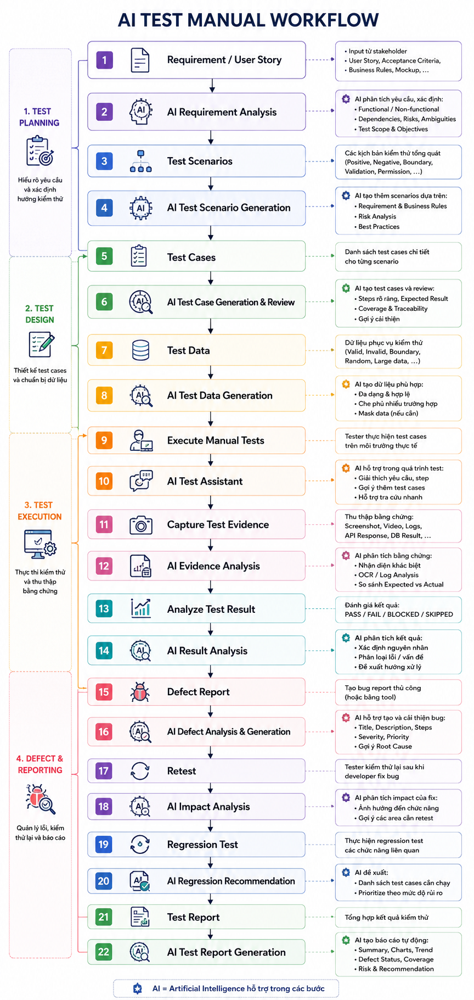

# Bài 1 - Giới thiệu về con đường ứng dụng AI trong Test Manual hiện nay

Chương: 1. NỘI DUNG KHOÁ HỌC

Nguồn: [https://anhtester.com/learn/khoa-hoc-su-dung-ai-trong-test-manual/328](https://anhtester.com/learn/khoa-hoc-su-dung-ai-trong-test-manual/328)

✅ Hiểu AI đang thay đổi công việc **Manual Testing** như thế nào.  
✅ Xác định được những công việc Testing cụ thể có thể ứng dụng AI.  
✅ Phân biệt **AI hỗ trợ Tester** và **AI Agent thực hiện Testing**.  
✅ Hiểu các loại AI có thể ứng dụng trong Manual Testing.  
✅ Biết con đường kết hợp **Tester + AI** để tăng hiệu quả trong quá trình Testing.  
✅ Hiểu quá trình hướng phát triển từ **Traditional Manual Testing → AI-Assisted Testing → AI Agent Testing**.  
✅ Có định hướng về con đường ứng dụng AI vào công việc Test Manual thực tế.

## 1. Bối cảnh của Manual Testing hiện nay

Trong mô hình Manual Testing truyền thống, Tester thường thực hiện quy trình:

**Requirement → Test Analysis → Test Design → Test Case → Test Execution → Bug Report → Retest → Regression**

Trong mỗi giai đoạn, Tester phải thực hiện rất nhiều công việc:

- Đọc và phân tích Requirement.
- Xác định Test Scenario.
- Viết Test Case.
- Xác định Positive / Negative Test.
- Chuẩn bị Test Data.
- Execute Test.
- Ghi nhận Expected / Actual Result.
- Chụp Screenshot hoặc quay Video.
- Tạo Bug Report.
- Retest Bug.
- Regression Test.
- Viết Test Summary Report.

Khi hệ thống ngày càng lớn, số lượng Requirement và Test Case tăng lên, Tester phải dành rất nhiều thời gian cho những công việc mang tính lặp lại.

Đây chính là một trong những khu vực AI có thể hỗ trợ mạnh mẽ.

---

## 2. AI đang thay đổi Manual Testing như thế nào?

Có thể hình dung quá trình phát triển thành 4 giai đoạn.

### 2.1. Traditional Manual Testing

Tester tự thực hiện toàn bộ quy trình:

**Tester → Analyze → Design Test → Execute → Analyze Result → Report**

AI chưa tham gia vào quy trình.

Tester phải tự:

- Đọc Requirement.
- Viết Test Case.
- Chuẩn bị Test Data.
- Execute Test.
- Phân tích Result.
- Report Bug.

---

### 2.2. AI-Assisted Manual Testing

Ở giai đoạn này, Tester sử dụng AI như **sự hỗ trợ một phần và rời rạc**.

**Tester → AI Assistant → Analyze / Generate / Review → Tester Validation → Execute Test**

Ví dụ Tester cung cấp Requirement:

> User có thể reset Password bằng Email.

AI có thể hỗ trợ đề xuất:

- Test Scenario.
- Positive Test.
- Negative Test.
- Boundary Test.
- Validation.
- Test Data.
- Risk.

Tester review và quyết định Test Case nào thực sự cần thiết.

Điểm quan trọng:

> **AI hỗ trợ Tester, nhưng Tester vẫn là người quyết định và chịu trách nhiệm về chất lượng Testing.**

AI đóng vai trò:

- Generate.
- Analyze.
- Suggest.
- Summarize.
- Detect Pattern.

---

### 2.3. AI Agent Testing

Đây là bước phát triển cao hơn, AI hiểu hệ thống hơn, AI tự động hoá hơn, AI hỗ trợ triệt để và chuẩn xác hơn.

Thay vì yêu cầu AI:

> "Hãy tạo Test Case cho chức năng Login."

Tester có thể giao Goal:

> **"Hãy kiểm thử chức năng Login của Application này."**

AI Agent có thể được thiết kế để:

**Understand Requirement → Explore Application → Identify Test Scenarios → Prepare Test Data → Execute Test → Observe Result → Identify Issue → Generate Bug Report → Summarize Result**

Điểm khác biệt:

**AI Assistant (Chat AI)**

Hỗ trợ Tester thực hiện từng Task. Tester còn làm thủ công cũng nhiều.

**AI Agent**

Nhận yêu cầu và có thể thực hiện nhiều bước thông qua Tools để hoàn tất yeu cầu cụ thể tự động.

### 2.4. Agentic AI Testing (tương lai cần xây dựng được)

Nhiều AI Agent phối hợp, tự lập kế hoạch → thực thi → quan sát → phân tích → điều chỉnh → báo cáo.

**Agentic AI Testing** thì ở cấp độ hệ thống:

```yaml
                Requirement
                     ↓
             Test Planning Agent
                     ↓
          ┌──────────┼──────────┐
          ↓          ↓          ↓
    Test Design   Data Agent   Risk Agent
       Agent
          ↓          ↓          ↓
          └──────────┼──────────┘
                     ↓
              Execution Agent
                     ↓
              Browser / API
                     ↓
              Observation Agent
                     ↓
             Analysis Agent
                ↙       ↘
          PASS            FAIL
                           ↓
                    Debug Agent
                           ↓
                    Fix / Retry
                           ↓
                   Evidence Agent
                           ↓
                  Reporting Agent
```

<table class="rt-table">
<thead>
<tr>
<th>Level</th>
<th>Mô hình</th>
<th>AI làm gì?</th>
<th>Con người</th>
</tr>
</thead>
<tbody>
<tr>
<td>1</td>
<td><strong>Traditional Manual Testing</strong></td>
<td>Không có AI</td>
<td>Thực hiện gần như toàn bộ</td>
</tr>
<tr>
<td>2</td>
<td><strong>AI-Assisted Manual Testing</strong></td>
<td>Hỗ trợ viết Test Case, phân tích Requirement, tạo Test Data, tổng hợp kết quả</td>
<td>Vẫn điều khiển và thực thi chính</td>
</tr>
<tr>
<td>3</td>
<td><strong>AI Agent Manual Testing</strong></td>
<td>Agent có thể tự khám phá UI, thực hiện test, thu thập evidence, phân tích kết quả</td>
<td>Ra mục tiêu + giám sát</td>
</tr>
<tr>
<td>4</td>
<td><strong>Agentic AI Testing</strong></td>
<td><strong>Nhiều Agent phối hợp, tự lập kế hoạch → thực thi → quan sát → phân tích → điều chỉnh → báo cáo</strong></td>
<td>Định hướng, phê duyệt và kiểm soát</td>
</tr>
</tbody>
</table>

---

## 3. AI được ứng dụng cụ thể ở đâu trong Manual Testing?

Đây là phần trọng tâm của Lesson.

AI có thể tham gia vào nhiều hoạt động của Testing Lifecycle:

**Requirement → Test Analysis → Test Design → Test Case → Test Data → Test Execution → Defect Reporting → Retest → Regression → Test Reporting**

**[](https://anhtester.com/storage/photos/shares/lesson/ai_test_manual/Workflow_AI_Test_Manual.png)**

---

### 3.1. AI hỗ trợ Requirement Analysis

Đây là một trong những bước đầu tiên Tester có thể ứng dụng AI.

Tester có thể cung cấp:

- User Story.
- Requirement.
- Acceptance Criteria.
- Specification.
- Business Rules.
- Product Documentation.

AI có thể hỗ trợ phân tích:

- Functional Requirement.
- Business Rule.
- Missing Requirement.
- Ambiguous Requirement.
- Dependency.
- Risk.
- Edge Case.

Ví dụ:

**Requirement:**

> User có thể đăng nhập bằng Email và Password.

AI có thể hỗ trợ xác định:

**Positive**

- Email hợp lệ + Password đúng.

**Negative**

- Email không tồn tại.
- Password sai.
- Email để trống.
- Password để trống.
- Email sai format.

**Security**

- Account locked.
- Multiple failed login.
- Session timeout.

Tester sau đó review và xác nhận.

Điểm quan trọng:

> **AI giúp Tester mở rộng phạm vi suy nghĩ, nhưng không thay thế việc hiểu Business Domain.**

---

### 3.2. AI hỗ trợ Test Scenario

Từ Requirement, AI có thể đề xuất Test Scenario.

Ví dụ:

**Requirement:**

> User có thể đăng ký Account.

AI có thể đề xuất:

- Register with valid information.
- Register with existing email.
- Register with invalid email.
- Register with missing required fields.
- Register with password not meeting policy.
- Register with mismatched confirmation password.

Tester có thể sử dụng AI để:

- Brainstorm Test Scenario.
- Tìm Missing Scenario.
- Tìm Negative Scenario.
- Tìm Boundary Scenario.
- Tìm Edge Case.

---

### 3.3. AI hỗ trợ tạo Test Case

Đây là ứng dụng rất phổ biến trong Manual Testing.

AI có thể Generate:

- Test Case Title.
- Preconditions.
- Test Steps.
- Test Data.
- Expected Result.
- Priority.
- Test Type.

Ví dụ:

**Test Case: Login with valid credentials**

**Precondition:**

User has a valid account.

**Steps:**

1. Open Login page.
2. Enter valid Email.
3. Enter valid Password.
4. Click Login.

**Expected Result:**

User is successfully logged in.

Tester không nên sử dụng Test Case do AI tạo ra một cách máy móc.

Cần review:

- Business Logic.
- Expected Result.
- Test Coverage.
- Duplicate Scenario.
- Missing Scenario.

---

### 3.4. AI hỗ trợ Test Data

Manual Tester thường phải chuẩn bị rất nhiều Test Data:

- Email.
- Username.
- Phone.
- Date.
- Address.
- Product.
- Account.
- Transaction.
- Boundary Value.
- Invalid Value.

AI có thể hỗ trợ tạo Test Data theo từng mục đích:

- Valid Data.
- Invalid Data.
- Boundary Data.
- Empty Data.
- Large Data.
- Special Characters.
- Duplicate Data.
- Expired Data.

Ví dụ Requirement:

> Password phải từ 8 đến 20 ký tự.

AI có thể đề xuất:

- 7 characters → Invalid.
- 8 characters → Valid.
- 9 characters → Valid.
- 20 characters → Valid.
- 21 characters → Invalid.
- Empty → Invalid.
- Special characters → Validate.

AI đặc biệt hữu ích khi Tester cần nhanh chóng xây dựng **Boundary Value** và **Negative Test Data**.

---

### 3.5. AI hỗ trợ Test Execution

Trong Manual Testing, AI có thể hỗ trợ Tester trong quá trình Execute Test.

AI có thể hỗ trợ:

- Đọc Test Case.
- Nhắc Test Step.
- Phân tích Expected Result.
- Phân tích Actual Result.
- So sánh Expected vs Actual.
- Phân tích Screenshot.
- Hỗ trợ xác định UI bất thường.
- Ghi nhận Test Evidence.

Workflow:

**Test Case → Tester Execute → AI hỗ trợ Observation → Expected vs Actual → Test Result**

Điểm quan trọng:

> **AI hỗ trợ Manual Test Execution không đồng nghĩa với việc AI thay thế hoàn toàn Tester.**

Tester vẫn cần trực tiếp đánh giá:

- Business Behavior.
- User Experience.
- Usability.
- Exploratory Testing.
- Risk.

---

### 3.6. AI hỗ trợ Exploratory Testing

Exploratory Testing là khu vực rất phù hợp để kết hợp AI và Tester.

Tester có thể yêu cầu:

> "Hãy đề xuất các hướng Exploratory Testing cho màn hình Payment."

AI có thể đề xuất:

- Functional.
- Validation.
- Boundary.
- Negative.
- Error Handling.
- Concurrency.
- Security.
- Usability.

Ví dụ:

- Refresh trong khi Payment đang xử lý.
- Double Click Payment.
- Back Browser.
- Network mất kết nối.
- Session hết hạn.
- Payment Timeout.
- Nhập Amount cực lớn.
- Nhập Special Characters.

AI giúp Tester mở rộng Testing Heuristic.

---

### 3.7. AI hỗ trợ Defect / Bug Reporting

Sau khi phát hiện Bug, Tester phải tạo Bug Report.

Thông thường Bug Report gồm:

- Title.
- Environment.
- Preconditions.
- Steps to Reproduce.
- Actual Result.
- Expected Result.
- Test Data.
- Evidence.
- Severity.
- Priority.

AI có thể hỗ trợ chuyển thông tin thô thành Bug Report có cấu trúc.

Ví dụ Tester cung cấp:

> Login button doesn't work.  
> I entered valid email/password.  
> Clicked Login.  
> Nothing happened.

AI có thể hỗ trợ chuyển thành:

**Title:**

Login button does not submit valid credentials.

**Steps:**

1. Open Login page.
2. Enter valid email.
3. Enter valid password.
4. Click Login.

**Expected:**

User should be logged in.

**Actual:**

Nothing happens after clicking Login.

Tester vẫn phải kiểm tra nội dung trước khi tạo Bug.

---

### 3.8. AI hỗ trợ Screenshot và Visual Analysis

AI hiện đại có khả năng phân tích hình ảnh.

Tester có thể cung cấp Screenshot:

**Screenshot → Multimodal AI → Visual Analysis**

AI có thể hỗ trợ phát hiện:

- UI Element bị thiếu.
- Text sai.
- Layout bất thường.
- Alignment Issue.
- Overlapping Element.
- Broken Image.
- Unexpected UI State.
- Error Message.

Ví dụ:

> "Phân tích Screenshot này và xác định các UI issue có thể nhìn thấy."

AI có thể đưa ra danh sách các vấn đề để Tester kiểm tra.

Tuy nhiên:

> **Visual Analysis của AI nên được xem là tín hiệu hỗ trợ, không phải bằng chứng tuyệt đối của Visual Defect.**

---

### 3.9. AI hỗ trợ Regression Testing

Regression Testing có thể trở thành công việc rất tốn thời gian khi hệ thống lớn.

Ví dụ:

**1,000 Test Cases → 100 Test Cases liên quan Change → Regression Testing**

AI có thể hỗ trợ:

- Phân tích Change.
- Xác định khu vực bị ảnh hưởng.
- Đề xuất Regression Scope.
- Ưu tiên Test Case.
- Tìm Test Case liên quan.
- Phân tích Regression Result.

Workflow:

**Feature Change → AI Analysis → Impact Area → Regression Scope → Test Execution → Result Analysis**

Tester vẫn cần quyết định Regression Scope cuối cùng dựa trên Risk và Business Impact.

---

### 3.10. AI hỗ trợ Test Result Analysis

Sau khi hoàn thành Testing, Tester thường phải tổng hợp:

- Total Test Case.
- Passed.
- Failed.
- Blocked.
- Not Run.
- Defect.
- Risk.

AI có thể hỗ trợ:

**Test Results → AI Analysis → Summary → Risk → Recommendation**

Ví dụ:

**Total:** 500

**Passed:** 450

**Failed:** 30

**Blocked:** 20

**Major Risk:**

Payment functionality has 8 failed scenarios.

**Recommendation:**

Do not proceed to Production until Payment issues are resolved.

---

### 3.11. AI hỗ trợ Test Documentation

Tester phải tạo rất nhiều tài liệu:

- Test Plan.
- Test Strategy.
- Test Scenario.
- Test Case.
- Test Summary.
- Bug Report.
- Release Validation.
- Regression Report.

AI có thể hỗ trợ:

- Generate Documentation.
- Summarize Documentation.
- Rewrite Documentation.
- Translate Documentation.
- Standardize Format.
- Tóm tắt nội dung dài.

Điều này giúp giảm thời gian dành cho các công việc Documentation lặp lại.

---

## 4. Các loại AI cần biết khi làm Manual Testing

### 4.1. Generative AI

Generative AI có khả năng tạo nội dung mới dựa trên Input.

Trong Manual Testing có thể sử dụng để:

- Generate Test Scenario.
- Generate Test Case.
- Generate Test Data.
- Generate Bug Report.
- Generate Test Summary.
- Generate Documentation.
- Generate Testing Checklist.

Đây thường là bước đầu tiên khi Tester bắt đầu ứng dụng AI.

---

### 4.2. LLM — Large Language Model

LLM là nền tảng của nhiều hệ thống AI hiện đại.

LLM có thể hỗ trợ Tester:

- Phân tích Requirement.
- Generate Test Case.
- Analyze Test Result.
- Analyze Bug.
- Generate Test Data.
- Explain Business Logic.
- Summarize Documentation.
- Brainstorm Test Scenario.

Một số hệ sinh thái Model phổ biến:

- GPT.
- Claude.
- Gemini.

Khi lựa chọn Model cần xem xét:

- Reasoning.
- Context Window.
- Speed.
- Cost.
- Khả năng xử lý tài liệu.
- Khả năng phân tích và suy luận.

---

### 4.3. Multimodal AI

Manual Testing thường xuyên làm việc với:

- Screenshot.
- Video.
- PDF.
- Diagram.
- UI.
- Chart.
- Document.

Multimodal AI có thể kết hợp nhiều loại dữ liệu:

**Text + Image + Document + Screenshot + Video → AI → Analysis**

Ví dụ:

Tester cung cấp:

- Requirement.
- Screenshot.
- Expected UI.

AI có thể hỗ trợ phân tích:

**Requirement + Screenshot → Multimodal AI → Visual / Functional Analysis**

Đây là một trong những điểm khác biệt quan trọng giữa AI hiện đại và các hệ thống AI chỉ xử lý Text.

---

### 4.4. AI Assistant

AI Assistant đóng vai trò như một người hỗ trợ Tester.

Ví dụ:

Tester:

> "Hãy phân tích Requirement này và đề xuất Test Scenario."

AI:

> Generate Scenario.

Tester:

> "Hãy tìm thêm Negative Scenario."

AI:

> Generate Negative Scenario.

Tester:

> "Hãy Review Test Case này."

AI:

> Analyze và đưa Recommendation.

Mô hình:

**Tester → AI Assistant → Generate / Analyze / Review → Tester Decision**

Tester vẫn kiểm soát toàn bộ quá trình.

---

### 4.5. AI Agent

AI Agent có khả năng thực hiện Workflow nhiều bước.

Ví dụ:

> **"Hãy kiểm thử chức năng Registration."**

Agent có thể được thiết kế để:

**Understand Goal → Explore Application → Identify Scenarios → Prepare Data → Execute Test → Observe Result → Identify Issue → Generate Bug → Generate Summary**

Đây là sự khác biệt lớn giữa:

**AI Assistant**

> "Hãy tạo Test Case."

và:

**AI Agent**

> "Hãy thực hiện Testing cho chức năng này."

---

### 4.6. Computer Use / Browser Agent

Khi AI có khả năng tương tác với Browser hoặc Computer, AI có thể thực hiện các hành động giống User:

**Open Browser → Navigate → Click → Type → Read → Verify**

Điều này mở ra hướng:

> **AI Agent có thể trực tiếp tương tác với Application để thực hiện Testing.**

Tuy nhiên, Manual Tester vẫn giữ vai trò quan trọng trong:

- Test Strategy.
- Exploratory Testing.
- Business Validation.
- Usability.
- Risk Assessment.
- Human Judgment.

---

## 5. Tester sẽ làm gì trong thời đại AI?

AI phát triển không có nghĩa Manual Tester chỉ còn nhiệm vụ "review kết quả AI".

Vai trò của Tester sẽ dịch chuyển.

### Trước đây

**Tester → Read Requirement → Write Test Case → Execute Test → Report Bug**

### Khi ứng dụng AI

**Tester → Testing Strategy → AI → Generate / Analyze → Tester Review → AI-assisted Execution → AI Analysis → Tester Decision**

Tester sẽ tập trung nhiều hơn vào:

- Critical Thinking.
- Test Strategy.
- Risk-Based Testing.
- Exploratory Testing.
- Business Understanding.
- Domain Knowledge.
- User Experience.
- AI Validation.
- Decision Making.

AI sẽ hỗ trợ nhiều hơn ở:

- Generation.
- Analysis.
- Data Preparation.
- Documentation.
- Summarization.
- Pattern Detection.

---

## Tổng kết

Sau Lesson này, học viên cần ghi nhớ:

🎯 **AI có thể tham gia vào rất nhiều công việc của Manual Testing.**

Từ:

**Requirement Analysis → Test Scenario → Test Case → Test Data → Test Execution → Bug Reporting → Regression → Test Result → Documentation**

🎯 **AI không chỉ dùng để Generate Test Case.**

AI còn có thể hỗ trợ:

- Phân tích Requirement.
- Exploratory Testing.
- Test Data.
- Test Execution.
- Visual Analysis.
- Bug Reporting.
- Regression Analysis.
- Test Result Analysis.
- Documentation.

🎯 **AI Assistant và AI Agent là hai cấp độ khác nhau.**

**AI Assistant:**

> Hỗ trợ Tester thực hiện Task tuần tự.

**AI Agent:**

> **Nhận mục tiêu và có khả năng thực hiện nhiều bước thông qua các công cụ.**

🎯 **Manual Tester vẫn đóng vai trò quan trọng.**

AI không thay thế những năng lực quan trọng của Tester:

- Tư duy phản biện
- Hiểu biết về nghiệp vụ
- Kiến thức về lĩnh vực
- Kiểm thử thăm dò
- Đánh giá rủi ro
- Trải nghiệm người dùng
- Khả năng phán đoán của con người

🎯 **Con đường phát triển:**

**Traditional Manual Tester → AI-Assisted Tester → AI-Augmented Tester → AI Agent Tester**

> **Mục tiêu không phải là để AI thay Tester, mà là để Tester sử dụng AI nhằm mở rộng khả năng suy nghĩ, tăng tốc độ Testing và xử lý được phạm vi Testing lớn hơn.**