# Bài 2 - Cài đặt và sử dụng công cụ Claude Code + Codex

Chương: 1. NỘI DUNG KHOÁ HỌC

Nguồn: [https://anhtester.com/learn/khoa-hoc-su-dung-ai-trong-test-manual/329](https://anhtester.com/learn/khoa-hoc-su-dung-ai-trong-test-manual/329)

✅ Hiểu rõ Claude Code và Codex là gì, khác nhau ra sao, khi nào dùng cái nào.  
✅ Cài đặt thành công **Claude Code Desktop** trên máy cá nhân và chạy được prompt đầu tiên.  
✅ Cài đặt thành công **Codex** (CLI hoặc IDE Extension) và chạy được prompt đầu tiên.  
✅ Đăng ký gói Claude Pro  
✅ Đăng ký gói GPT Plus  
✅ Biết cấu hình quyền (permission / approval mode) để làm việc **an toàn** với source code của dự án.  
✅ Áp dụng ngay vào một tình huống thật: đọc tài liệu yêu cầu → sinh Test Case.

## 1. Manual Tester có cần AI Coding Agent không?

Đây là một câu hỏi rất phổ biến.

Nếu nhìn vào tên gọi:

> AI Coding Agent

chúng ta dễ nghĩ rằng Claude Code và Codex chỉ dành cho Developer hoặc Automation Tester.

Nhưng thực tế, Manual Tester cũng có rất nhiều công việc liên quan đến:

- File.
- Requirement.
- Documentation.
- Log.
- Data.
- Repository.
- Test artifacts.

AI Agent có thể hỗ trợ những công việc này.

Điểm quan trọng là:

> **Manual Tester không nhất thiết phải biết lập trình mới có thể sử dụng AI Agent.**

Chúng ta sử dụng AI để hỗ trợ **Testing Thinking**, chứ không phải biến Manual Tester thành Developer.

## 2. Tổng quan hai công cụ

### 2.1. Claude Code là gì?

**Claude Code** là công cụ AI Agent của Anthropic, chạy trực tiếp trên máy tính của bạn và có khả năng **đọc – hiểu – chỉnh sửa file** trong thư mục dự án. Khác với việc chat trên web rồi copy/paste thủ công, Claude Code làm việc trực tiếp trên thư mục làm việc của bạn.

Claude Code hiện có nhiều phiên bản:

- **Claude Code Desktop** – ứng dụng có giao diện đồ họa cho Windows/macOS. *Đây là bản chúng ta dùng trong khóa học vì thân thiện nhất với Manual Tester.*
- **Claude Code CLI** – chạy trong Terminal, dành cho người quen dòng lệnh.
- **Claude Code Web** – chạy trên trình duyệt tại `claude.ai/code`.
- **IDE Extension** – tích hợp vào VS Code / JetBrains.

### 2.2. Codex là gì?

**Codex** là AI Coding Agent của OpenAI, chạy bằng model dòng GPT-5 Codex. Codex có 4 hình thức sử dụng:

- **Codex CLI** – chạy trong Terminal trên máy cá nhân.
- **Codex Desktop** – ứng dụng có giao diện đồ họa, tương tự Claude Code Desktop.
- **Codex IDE Extension** – tích hợp vào VS Code / Cursor / Windsurf.
- **Codex Web (Cloud)** – chạy trên đám mây tại `chatgpt.com/codex`, giao task xong có thể đóng máy, kết quả trả về sau.

### 2.3. So sánh nhanh dành cho Tester

<table class="rt-table">
<thead>
<tr>
<th>Tiêu chí</th>
<th>Claude Code Desktop</th>
<th>Codex</th>
</tr>
</thead>
<tbody>
<tr>
<td>Nhà phát triển</td>
<td>Anthropic</td>
<td>OpenAI</td>
</tr>
<tr>
<td>Giao diện</td>
<td>App desktop có UI trực quan</td>
<td>App desktop có UI trực quan</td>
</tr>
<tr>
<td>Độ thân thiện với Manual Tester</td>
<td>Rất cao – tương tác hỏi đáp, thực hiện chạy và phản hồi kết quả trực quan</td>
<td>Rất cao – tương tác hỏi đáp, thực hiện chạy và phản hồi kết quả trực quan</td>
</tr>
<tr>
<td>Thế mạnh</td>
<td>Đọc hiểu tài liệu dài, viết Test Case, phân tích luồng nghiệp vụ, đặc biệt chuyên Code.</td>
<td>Xử lý task lập trình độc lập, chạy song song nhiều task trên cloud, cũng Đọc hiểu tài liệu dài, viết Test Case, phân tích luồng nghiệp vụ nhưng thua Claude một chút sau trải nghiệm của Anh Tester.</td>
</tr>
<tr>
<td>Tài khoản cần có</td>
<td>Claude Pro / Max hoặc API Key</td>
<td>ChatGPT Plus / Pro / Business hoặc API Key</td>
</tr>
</tbody>
</table>

> **Lời khuyên:** theo mình thì chỉ chọn một thôi. Mặc dù trong thực tế Tester có thể cài **cả hai** và dùng song song – giống như bạn có 2 đồng nghiệp với thế mạnh khác nhau. Claude Code và Codex đều mạnh về phân tích tài liệu, viết test case, xử lý code và chạy task nền.

## Claude Code và Codex trong Manual Testing

Claude Code và Codex có thể đóng vai trò như **AI Agent làm việc cùng Manual Tester**. Thay vì Tester phải tự thực hiện từng công việc, Tester giao **mục tiêu**, Agent tự phân tích, sử dụng tool, thực hiện các bước cần thiết và trả về kết quả.

### Từ AI Assistant → AI Agent

Sự khác biệt nằm ở mức độ **chủ động và khả năng hành động**:

```none
AI Assistant

Tester
  ↓
"Generate test cases"
  ↓
AI
  ↓
Test Cases
```

Trong mô hình này, AI chủ yếu **trả lời yêu cầu**.

Trong khi đó:

```none
AI Agent

Tester
  ↓
"Test chức năng Login"
  ↓
AI Agent
  ├── Analyze requirement
  ├── Inspect application
  ├── Explore UI
  ├── Create test scenarios
  ├── Execute test
  ├── Capture evidence
  ├── Analyze result
  ├── Investigate failure
  └── Generate test report
```

Agent không chỉ **nói cho Tester biết phải làm gì**, mà có khả năng **thực hiện công việc thông qua các tools được cấp quyền**.

### Claude Code / Codex trong vai trò AI Agent

Có thể hình dung:

```none
                    Manual Tester
                         │
                         │ Goal
                         ↓
                ┌──────────────────┐
                │   AI Agent       │
                │ Claude Code      │
                │       /          │
                │ Codex            │
                └────────┬─────────┘
                         │
              ┌──────────┼──────────┐
              ↓          ↓          ↓
           Browser       API        Files
              ↓          ↓          ↓
          Application   Backend    Test Data
              │          │          │
              └──────────┼──────────┘
                         ↓
                   Test Execution
                         ↓
                   Evidence
                         ↓
                  Result Analysis
                         ↓
                    Test Report
```

Điểm quan trọng là **Agent cần Tools/MCP/Environment để hành động**.

Ví dụ:

```none
Claude Code / Codex
        │
        ├── File System
        ├── Terminal
        ├── Git
        ├── Browser
        ├── Playwright MCP
        ├── API
        ├── Database
        └── Jira / GitHub
```

Khi đó Manual Tester có thể giao một task ở mức **business goal** thay vì hướng dẫn từng bước kỹ thuật.

### Ví dụ

Thay vì:

> "Mở trang Login, nhập username, nhập password, click Login và kiểm tra message."

Có thể giao:

> **"Hãy kiểm thử chức năng Login của application, tập trung vào authentication, validation và các trường hợp negative."**

AI Agent có thể tự phân rã:

```none
Task
 ↓
Analyze Login
 ↓
Identify Test Scenarios
 ├── Valid Login
 ├── Invalid Password
 ├── Invalid Username
 ├── Empty Username
 ├── Empty Password
 ├── Both Empty
 ├── Locked Account
 └── Boundary / Security Cases
 ↓
Explore Application
 ↓
Execute Tests
 ↓
Collect Evidence
 ↓
Analyze
 ↓
Report
```

## 3. Cài đặt và sử dụng Claude Code Desktop

### 3.1. Chuẩn bị trước khi cài

- **Hệ điều hành:** Windows 10/11 (64-bit) hoặc macOS 12 trở lên.
- **RAM:** tối thiểu 8GB, khuyến nghị 16GB.
- **Kết nối Internet:** ổn định (công cụ gọi model trên cloud).
- **Tài khoản:** đăng ký tại `claude.ai`. Gói **Pro** là đủ dùng cho Tester; gói **Max** nếu bạn dùng với cường độ cao.
- **Một thư mục dự án** để thực hành. Nếu chưa có, hãy tạo thư mục trống, ví dụ: `D:\AI_Testing\Lesson02`.

### 3.2. Bước 1 – Tải và cài đặt

1. Truy cập trang chủ: [`https://claude.com/product/claude-code`](https://claude.com/product/claude-code) hoặc [`https://claude.ai/download`](https://claude.ai/download).
2. Chọn đúng bản cho hệ điều hành của bạn (Windows `.exe` hoặc macOS `.dmg`).
3. **Windows:** chạy file `.exe` vừa tải → nhấn *Next* → *Install* → *Finish*.
4. **macOS:** mở file `.dmg` → kéo icon Claude vào thư mục *Applications*.
5. Mở ứng dụng lần đầu. Nếu Windows Defender hoặc macOS Gatekeeper cảnh báo, chọn *Run anyway* / *Open*.

### 3.3. Bước 2 – Đăng nhập tài khoản

1. Ở màn hình chào, nhấn **Sign in**.
2. Trình duyệt sẽ mở ra trang đăng nhập của Anthropic. Đăng nhập bằng email/Google mà bạn đã đăng ký gói Claude.
3. Nhấn **Authorize** để cấp quyền cho ứng dụng desktop.
4. Quay lại app, bạn sẽ thấy tên tài khoản và gói đang dùng.

> **Lưu ý bảo mật:** Không bao giờ chia sẻ API Key hoặc token đăng nhập lên chat nhóm, Jira ticket hay tài liệu dùng chung. Đây là thông tin nhạy cảm ngang với mật khẩu.

### 3.4. Bước 3 – Mở thư mục làm việc

Claude Code luôn làm việc trong phạm vi **một thư mục** (gọi là *working directory*). Nó chỉ đọc và sửa file trong thư mục đó – đây chính là hàng rào an toàn đầu tiên.

1. Nhấn nút **Open Folder** (hoặc **New Session**) trên thanh công cụ.
2. Trỏ tới thư mục dự án của bạn, ví dụ `D:\AI_Testing\Lesson02`.
3. Nhấn **Select Folder**. Tên thư mục sẽ hiện ở đầu phiên làm việc.

[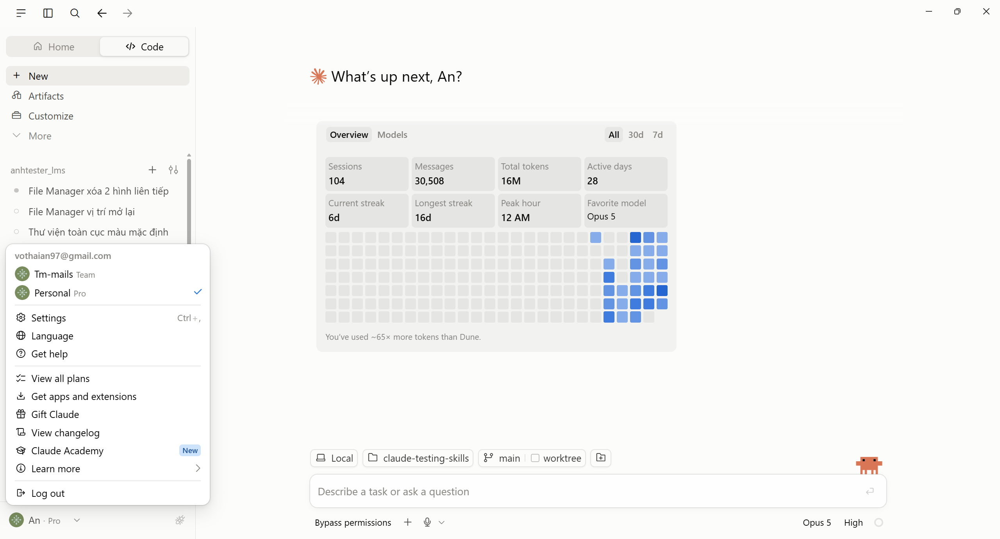](https://anhtester.com/storage/photos/shares/lesson/ai_test_manual/Claude_app.png)

### 3.5. Bước 4 – Làm quen giao diện

<table class="rt-table">
<thead>
<tr>
<th>Khu vực</th>
<th>Công dụng</th>
</tr>
</thead>
<tbody>
<tr>
<td>Khung chat (giữa)</td>
<td>Nơi bạn gõ prompt và xem Claude phản hồi từng bước.</td>
</tr>
<tr>
<td>Danh sách phiên (bên trái)</td>
<td>Lịch sử các session. Có thể mở lại để tiếp tục công việc cũ.</td>
</tr>
<tr>
<td>Khung xem file / thay đổi</td>
<td>Hiển thị nội dung file được tạo hoặc chỉnh sửa. <strong>Tester phải luôn đọc kỹ khu vực này.</strong></td>
</tr>
<tr>
<td>Hộp thoại xin quyền</td>
<td>Hiện lên trước khi công cụ ghi file hoặc chạy lệnh.</td>
</tr>
<tr>
<td>Ô nhập prompt (dưới cùng)</td>
<td>Gõ yêu cầu. Gõ dấu <code>/</code> để mở danh sách lệnh nhanh.</td>
</tr>
</tbody>
</table>

### 3.6. Bước 5 – Prompt đầu tiên dành cho Tester

Hãy thử ngay một prompt sát với công việc thật. Tạo file `SRS.txt` trong thư mục dự án với nội dung mô tả chức năng Đăng nhập, sau đó gõ prompt sau:

```none
Bạn là một Senior Manual Tester.
Hãy đọc file SRS.txt trong thư mục này và thực hiện:
1. Tóm tắt các yêu cầu chức năng chính.
2. Liệt kê các điểm mơ hồ / thiếu thông tin cần hỏi lại BA.
3. Sinh bộ Test Case cho chức năng Đăng nhập, gồm cả Positive và Negative case.
4. Lưu kết quả vào file TestCase_Login.md với các cột:
   ID | Mục tiêu | Tiền điều kiện | Các bước thực hiện | Dữ liệu test | Kết quả mong đợi | Độ ưu tiên
Viết toàn bộ bằng tiếng Việt.
```

Claude sẽ: đọc file → phân tích → xin phép tạo file → bạn nhấn **Allow** → file `TestCase_Login.md` xuất hiện trong thư mục.

### 3.7. Các lệnh slash cơ bản và ý nghĩa

<table class="rt-table">
<thead>
<tr>
<th>Lệnh</th>
<th>Ý nghĩa</th>
</tr>
</thead>
<tbody>
<tr>
<td><code>/init</code></td>
<td>Quét dự án và sinh file <code>CLAUDE.md</code> mô tả ngữ cảnh.</td>
</tr>
<tr>
<td><code>/clear</code></td>
<td>Bắt đầu phiên mới với ngữ cảnh trống. Phiên cũ vẫn lưu trên đĩa, mở lại bằng <code>/resume</code>.</td>
</tr>
<tr>
<td><code>/compact</code></td>
<td>Nén hội thoại lại thành bản tóm tắt để giải phóng ngữ cảnh mà <em>không mất</em> mạch việc đang làm.</td>
</tr>
<tr>
<td><code>/context</code></td>
<td>Xem lượng ngữ cảnh đang dùng dưới dạng lưới màu trực quan.</td>
</tr>
<tr>
<td><code>/model</code></td>
<td>Chọn model (Opus mạnh nhất, Sonnet cân bằng, Haiku nhanh và tiết kiệm).</td>
</tr>
<tr>
<td><code>/effort</code></td>
<td>Đặt mức độ suy luận (effort). Task phân tích tài liệu phức tạp nên để mức cao.</td>
</tr>
<tr>
<td><code>/plan</code></td>
<td>Bật Plan Mode – chỉ đọc và lập kế hoạch, hoặc xem lại kế hoạch của phiên hiện tại.</td>
</tr>
<tr>
<td><code>/rewind</code></td>
<td>Quay ngược file và/hoặc hội thoại về một thời điểm trước đó. <strong>Cực kỳ hữu ích khi AI sửa sai file.</strong></td>
</tr>
<tr>
<td><code>/diff</code></td>
<td>Xem các thay đổi chưa commit và diff theo từng lượt.</td>
</tr>
<tr>
<td><code>/resume</code></td>
<td>Mở lại một phiên làm việc trước đó.</td>
</tr>
<tr>
<td><code>/add-dir</code></td>
<td>Thêm một thư mục làm việc nữa vào phiên (ví dụ thêm thư mục chứa tài liệu SRS).</td>
</tr>
<tr>
<td><code>/export</code></td>
<td>Xuất toàn bộ hội thoại ra file hoặc clipboard – tiện để lưu vào tài liệu bàn giao.</td>
</tr>
<tr>
<td><code>/copy</code></td>
<td>Copy câu trả lời gần nhất của Claude vào clipboard.</td>
</tr>
<tr>
<td><code>/usage</code></td>
<td>Xem mức sử dụng và giới hạn của gói bạn đang dùng.</td>
</tr>
<tr>
<td><code>/status</code></td>
<td>Xem phiên bản, model, tài khoản, kết nối API và trạng thái các tool.</td>
</tr>
<tr>
<td><code>@tên-file</code></td>
<td>Không phải lệnh slash, nhưng rất hay dùng: chèn nhanh một file cụ thể vào prompt.</td>
</tr>
</tbody>
</table>

**Một số lệnh nâng cao khác**: `/memory` (mở file ghi nhớ), `/mcp` (quản lý MCP server), `/btw` (hỏi nhanh câu phụ mà không cắt mạch việc chính), `/branch` – `/fork` – `/subtask` (tách nhánh hội thoại hoặc giao việc cho agent nền), `/login` – `/logout`.

#### Quan trọng: không phải lệnh nào cũng chạy ở mọi bản

Đây là điểm khiến rất nhiều người mới bị hụt hẫng: **Claude Code Desktop và Claude Code CLI không có cùng một bộ lệnh.** Bạn đọc được tên lệnh ở đâu đó, gõ vào Desktop, và nhận về thông báo kiểu:

```none
/skills isn't available in this environment.
```

Không phải bạn gõ sai. Đơn giản là lệnh đó chỉ tồn tại ở bản khác. Có hai nhóm hay bị vướng:

- **Nhóm mở bảng cấu hình dạng terminal** – `/config`, `/permissions`, `/doctor`, `/hooks`: cần giao diện Terminal nên chỉ chạy trên bản CLI.
- **Nhóm liệt kê thông tin** – ví dụ `/help`, `/skills`: trên bản Desktop có thể không được cung cấp, vì Desktop đã có sẵn UI thay thế.

> **Cách làm đúng và luôn chính xác:** đừng học thuộc danh sách lệnh từ tài liệu (kể cả bài viết này – các công cụ AI cập nhật hằng tuần). Hãy **gõ dấu `/` ngay trong ô nhập của ứng dụng bạn đang dùng**. Trình đơn hiện ra chính là danh sách *thật* mà phiên bản của bạn hỗ trợ – vừa để tra cứu, vừa để chọn luôn. Danh sách trong bài chỉ nên xem là bảng tham khảo ý nghĩa từng lệnh.

### 3.8. File CLAUDE.md – "bản mô tả dự án" dành cho AI

`CLAUDE.md` là file text đặt ở thư mục gốc dự án, được Claude tự động đọc mỗi phiên. Với Tester, đây là nơi bạn "huấn luyện" AI viết theo đúng chuẩn của công ty mình.

```none
# Ngữ cảnh dự án
Dự án: Hệ thống LMS Anh Tester
Vai trò của bạn: Senior Manual Tester

# Quy tắc viết Test Case
- Toàn bộ viết bằng tiếng Việt.
- Mã Test Case theo định dạng: TC_<MODULE>_<số thứ tự 3 chữ số>. Ví dụ: TC_LOGIN_001.
- Mỗi Test Case bắt buộc có: Tiền điều kiện, Các bước, Dữ liệu test, Kết quả mong đợi, Độ ưu tiên.
- Độ ưu tiên chỉ dùng: High / Medium / Low.
- Luôn có tối thiểu 30% Negative case và các case biên (boundary).

# Quy tắc báo cáo Bug
- Tiêu đề dạng: [Module] Mô tả ngắn gọn lỗi.
- Bắt buộc có Steps to Reproduce đánh số, Actual Result, Expected Result, Severity.
```

Sau khi có file này, mọi prompt của bạn đều được áp dụng quy tắc trên – không cần nhắc lại mỗi lần.

### 3.9. Chế độ quyền (Permission Mode)

<table class="rt-table">
<thead>
<tr>
<th>Chế độ</th>
<th>Hành vi</th>
<th>Khuyến nghị cho Tester</th>
</tr>
</thead>
<tbody>
<tr>
<td><strong>Default</strong></td>
<td>Hỏi ý kiến trước khi ghi file hoặc chạy lệnh.</td>
<td>Nên dùng khi mới học và khi làm trên dự án thật.</td>
</tr>
<tr>
<td><strong>Plan Mode</strong></td>
<td>Chỉ đọc và lập kế hoạch, không sửa gì cả.</td>
<td>Rất tốt để phân tích tài liệu, review luồng nghiệp vụ.</td>
</tr>
<tr>
<td><strong>Accept Edits</strong></td>
<td>Tự động chấp nhận thay đổi file.</td>
<td>Chỉ dùng trên thư mục thực hành cá nhân.</td>
</tr>
<tr>
<td><strong>Bypass Permissions</strong></td>
<td>Bỏ qua mọi xác nhận.</td>
<td>Không dùng trên máy có source code dự án thật.</td>
</tr>
</tbody>
</table>

### 3.10. Skill – những "lệnh chuyên dụng" cực hữu ích cho Tester

Ngoài các lệnh hệ thống ở mục 2.7, Claude Code còn có **Skill** – là những quy trình làm việc được đóng gói sẵn, gọi ra bằng dấu `/` giống slash command. Đây chính là phần nhiều Tester bỏ lỡ nhất, dù giá trị mang lại rất lớn.

**Cách xem mình đang có những skill nào:** gõ dấu `/` trong ô nhập prompt, trình đơn hiện ra sẽ liệt kê cả lệnh hệ thống lẫn skill. Gõ thêm vài ký tự để lọc, ví dụ gõ `/rev` sẽ ra `/code-review` và `/security-review`. Nếu không chắc, bạn có thể hỏi thẳng bằng tiếng Việt: *"Liệt kê các skill tôi đang có và mô tả ngắn gọn công dụng từng cái"*.

#### Nhóm skill có sẵn (không cần cài thêm)

<table class="rt-table">
<thead>
<tr>
<th>Skill</th>
<th>Công dụng</th>
<th>Giá trị với Tester</th>
</tr>
</thead>
<tbody>
<tr>
<td><code>/code-review</code></td>
<td>Rà soát phần code đang thay đổi (hoặc một PR, một nhánh, một thư mục) để tìm lỗi logic và các điểm cần dọn dẹp.</td>
<td><strong>Quan trọng nhất.</strong> Giúp Tester phát hiện bug ngay từ giai đoạn code, trước khi build lên môi trường test.</td>
</tr>
<tr>
<td><code>/security-review</code></td>
<td>Rà soát bảo mật toàn bộ thay đổi trên nhánh hiện tại.</td>
<td>Bổ sung góc nhìn Security Testing mà Manual Tester thường thiếu công cụ hỗ trợ.</td>
</tr>
<tr>
<td><code>/run</code></td>
<td>Khởi chạy ứng dụng của dự án lên để xem thay đổi chạy thật.</td>
<td>Dựng nhanh môi trường để test thủ công, không cần nhờ Dev.</td>
</tr>
<tr>
<td><code>/dataviz</code></td>
<td>Vẽ biểu đồ, dashboard từ dữ liệu.</td>
<td>Dựng biểu đồ Test Metrics: tỉ lệ Pass/Fail, phân bố Bug theo Severity, tiến độ theo Sprint.</td>
</tr>
<tr>
<td><code>/loop</code></td>
<td>Chạy lặp lại một prompt hoặc lệnh theo chu kỳ.</td>
<td>Theo dõi kết quả CI, canh một job build cho tới khi xong rồi báo lại.</td>
</tr>
<tr>
<td><code>/schedule</code></td>
<td>Hẹn giờ chạy agent định kỳ theo lịch.</td>
<td>Tự động chạy kiểm tra hằng ngày, ví dụ mỗi sáng rà soát PR mới và tóm tắt vùng ảnh hưởng cần regression.</td>
</tr>
<tr>
<td><code>/simplify</code></td>
<td>Dọn dẹp code cho gọn và dễ đọc hơn. <em>Chỉ về chất lượng, không tìm bug.</em></td>
<td>Dùng khi bạn viết script test và muốn code sạch hơn.</td>
</tr>
<tr>
<td><code>/init</code></td>
<td>Sinh file <code>CLAUDE.md</code> từ nội dung dự án.</td>
<td>Bước khởi tạo bắt buộc khi bắt đầu làm việc trên một dự án mới.</td>
</tr>
</tbody>
</table>

Lưu ý bộ skill khả dụng khác nhau giữa bản Desktop, CLI và giữa các phiên bản. Hãy gõ `/` để đối chiếu với máy bạn trước khi làm theo.

## 

## 4. Cài đặt và sử dụng Codex Desktop

### 4.1. Chuẩn bị trước khi cài

- **Tài khoản:** ChatGPT **Plus / Pro / Business** (đã bao gồm quyền dùng Codex), hoặc OpenAI API Key trả theo lượng dùng.
- **Node.js phiên bản 18 trở lên** (bắt buộc nếu cài bằng npm). Tải tại `https://nodejs.org`, chọn bản **LTS**.
- Kiểm tra Node đã cài thành công bằng cách mở PowerShell / Terminal và chạy:

```none
node -v
npm -v
```

Nếu hiện ra số phiên bản (ví dụ `v24.19.0`) là máy bạn đã sẵn sàng.

### 4.2. Bước 1 – Tải và cài đặt

### Cài đặt Codex Desktop trên Window/macOS

**Bước 1:** Tải ứng dụng Codex Desktop từ trang chính thức của OpenAI.

[Tải Codex Desktop chính thức](https://chatgpt.com/vi-VN/codex/)

**Bước 2:** Cài đặt ứng dụng như ứng dụng thông thường.

**Bước 3:** Mở **Codex Desktop**.

**Bước 4:** Đăng nhập bằng tài khoản ChatGPT.

### 4.3. Bước 2 – Đăng nhập tài khoản

Lần đầu chạy, Codex sẽ hỏi cách xác thực:

1. Chọn **Sign in with ChatGPT** (khuyến nghị nếu bạn có gói Plus/Pro).
2. Trình duyệt tự mở → đăng nhập → nhấn **Authorize**.
3. Quay lại app desktop thấy thành công là xong.

[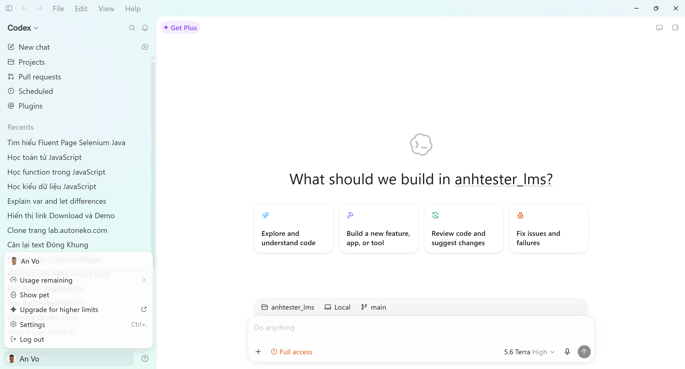](https://anhtester.com/storage/photos/shares/lesson/ai_test_manual/Codex_app.png)

### 4.4. Chế độ phê duyệt (Approval Mode)

Ba chế độ là mức độ bạn cho phép ChatGPT/Codex tự thao tác:

- **Ask for approval**: luôn hỏi trước khi sửa file ngoài workspace hoặc dùng Internet. An toàn nhất, nhưng sẽ bị ngắt quãng nhiều.
- **Approve for me**: tự làm các thao tác thông thường, chỉ hỏi khi hành động bị đánh giá có rủi ro (ví dụ xoá/sửa dữ liệu quan trọng, gửi dữ liệu ra ngoài). Đây là lựa chọn cân bằng, nên dùng hằng ngày.
- **Full access**: không cần hỏi, có thể dùng Internet và truy cập/sửa file trên máy. Chỉ nên bật khi bạn tin tưởng hoàn toàn tác vụ và môi trường; không phù hợp khi chạy code lạ hoặc làm việc với dữ liệu nhạy cảm.

Thiết lập này chủ yếu quyết định **khi nào phải hỏi bạn**, không tự cấp thêm quyền cho các dịch vụ/kết nối; một số thao tác rất rủi ro vẫn có thể bị chặn.

### 4.5. File AGENTS.md – tương đương CLAUDE.md

Codex đọc file `AGENTS.md` ở thư mục gốc dự án để hiểu ngữ cảnh và quy tắc. Nội dung có thể viết tương tự file `CLAUDE.md` ở trên:

```none
# AGENTS.md

## Bối cảnh
Dự án kiểm thử hệ thống LMS. Người dùng là Manual Tester.

## Yêu cầu đầu ra
- Trả lời và viết tài liệu bằng tiếng Việt.
- Test Case xuất ra định dạng bảng Markdown để dán vào Excel / TestRail.
- Mã Test Case: TC_<MODULE>_<số>.

## Điều KHÔNG được làm
- Không tự ý xóa file trong thư mục /docs.
- Không đưa dữ liệu thật của khách hàng vào Test Data, chỉ dùng dữ liệu giả lập.
```

### 4.6. Lệnh gọi trên Codex

Bạn chỉ cần dùng dấu / là nó hiện lên các tên đầy đủ để select chọn luôn khỏi nhớ 😄

Kể cả gọi Skills cũng dùng dấu /

[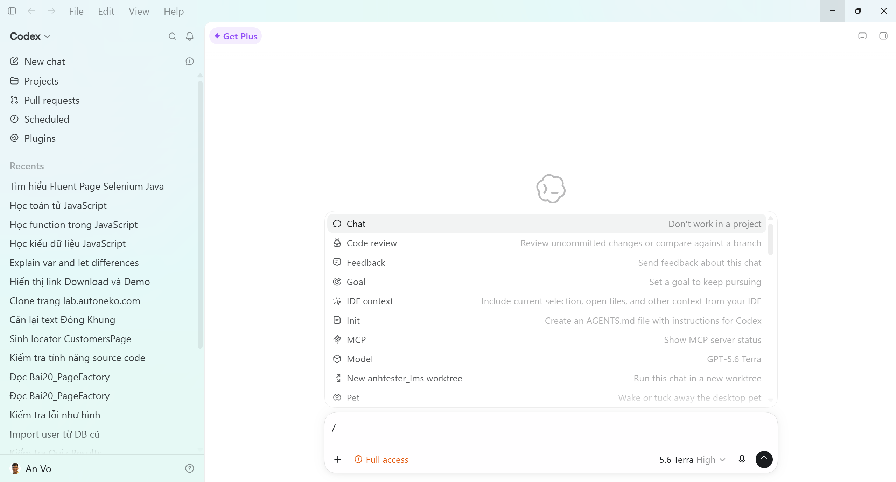](https://anhtester.com/storage/photos/shares/lesson/ai_test_manual/2026-08-21_11-19-33.png)

### 4.7. Ví dụ thực tế: dùng Codex để rà soát bộ Test Case

```none
Đọc file TestCase_Login.md.
Với vai trò Test Lead, hãy rà soát và chỉ ra:
1. Các trường hợp kiểm thử còn thiếu (đặc biệt là case biên và case bảo mật).
2. Các Test Case bị trùng lặp hoặc mô tả không rõ ràng.
3. Đề xuất bổ sung, ghi vào file Review_TestCase_Login.md bằng tiếng Việt.
```

> **Mẹo phối hợp 2 công cụ:** Dùng **Claude Code** để *viết* bộ Test Case, rồi dùng **Codex** để *review chéo* bộ Test Case đó. Hai model khác nhau sẽ nhìn ra những thiếu sót khác nhau – giống như có hai Test Lead cùng review vậy.
>
> Nhưng mà sau khi có bộ Skills chuẩn của Anh Tester cung cấp thì chỉ cần dùng 1 trong 2 là đủ rồi. Tuỳ sở thích các bạn nữa 😁

## 5. Đăng ký tài khoản Claude Pro và ChatGPT Plus

### 5.1. Đăng ký tài khoản Claude Pro trên mobile app

Tải app Claude trên App Store (iPhone)

[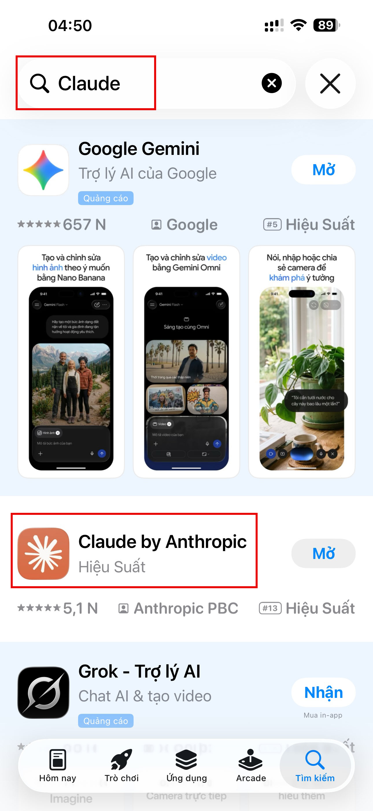](https://anhtester.com/storage/photos/shares/lesson/ai_test_manual/account_claude_pro_gpt_plus/1787262995835_2011380643477868092_5075844802271054756_53329a5588e20f6115cde08b94ee9279.jpg)[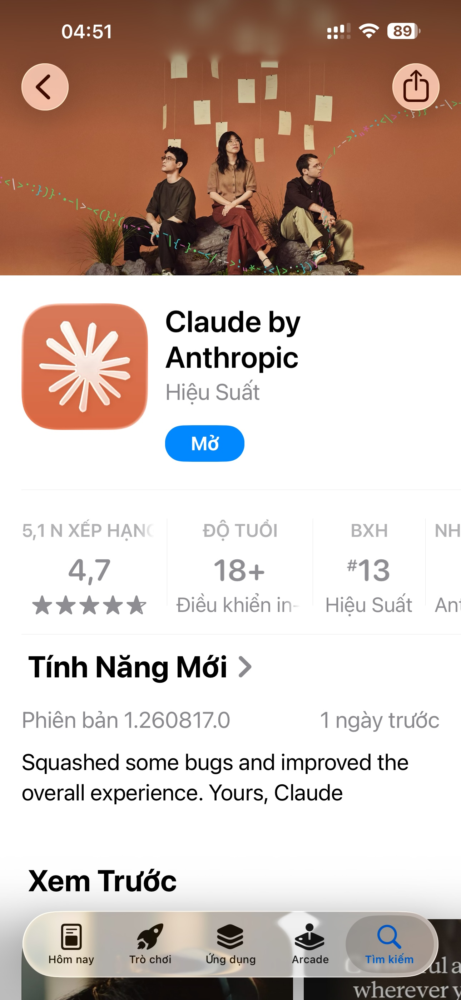](https://anhtester.com/storage/photos/shares/lesson/ai_test_manual/account_claude_pro_gpt_plus/1787262995858_2011380643477868092_5075844802271054756_f3276da59d7f8f23b28bea71fbea7e62.jpg)[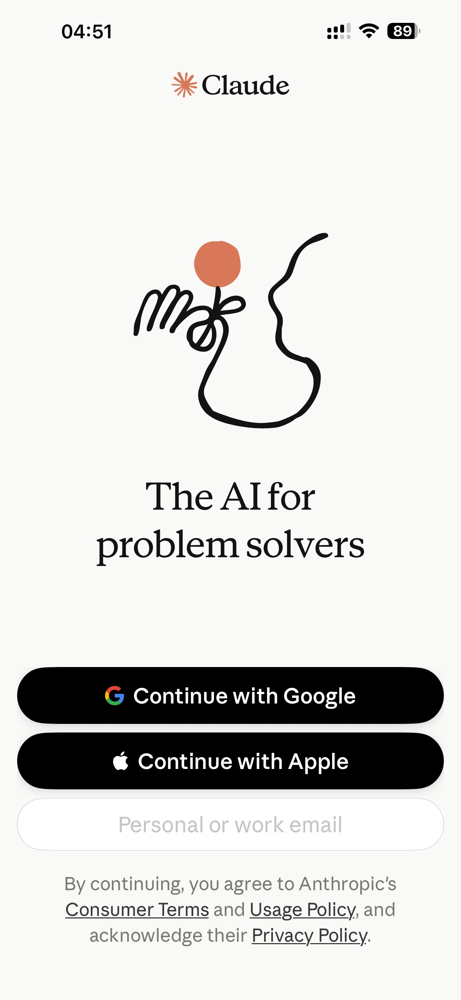](https://anhtester.com/storage/photos/shares/lesson/ai_test_manual/account_claude_pro_gpt_plus/1787262995872_2011380643477868092_5075844802271054756_24f911a0e1c7ef4072ffd151c669eec7.jpg)

[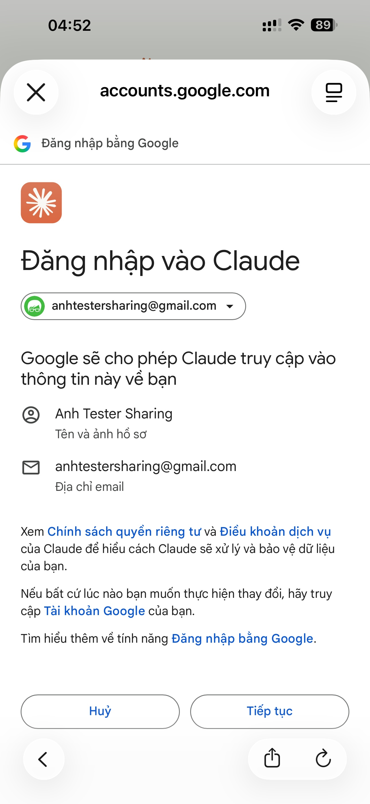](https://anhtester.com/storage/photos/shares/lesson/ai_test_manual/account_claude_pro_gpt_plus/1787262995883_2011380643477868092_5075844802271054756_88e413c2ad1e0330735ec686eb2ea4b4.jpg)[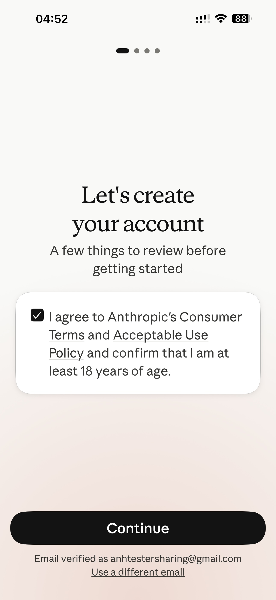](https://anhtester.com/storage/photos/shares/lesson/ai_test_manual/account_claude_pro_gpt_plus/1787262995893_2011380643477868092_5075844802271054756_756aa9daaee035acc631ef52c022a72a.jpg)[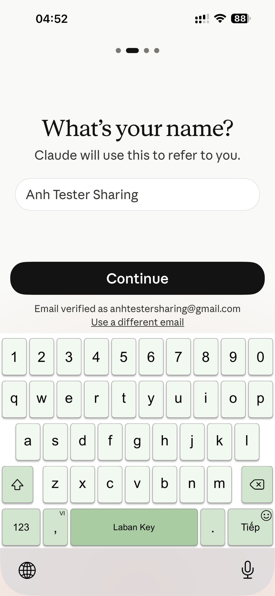](https://anhtester.com/storage/photos/shares/lesson/ai_test_manual/account_claude_pro_gpt_plus/1787262995902_2011380643477868092_5075844802271054756_44ee096beb43d805e38b581ea9ce6e53.jpg)

[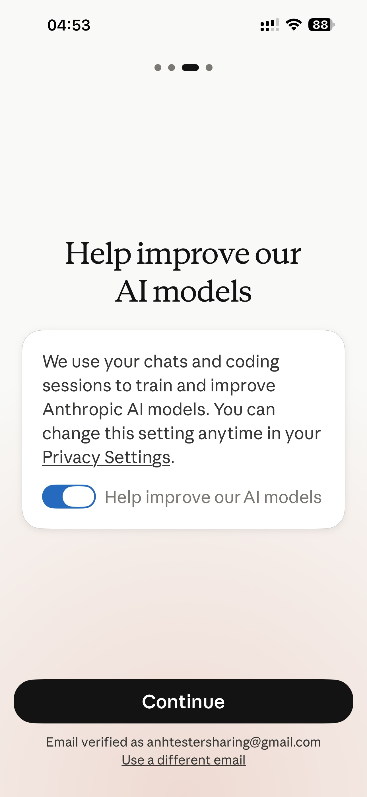](https://anhtester.com/storage/photos/shares/lesson/ai_test_manual/account_claude_pro_gpt_plus/1787262995910_2011380643477868092_5075844802271054756_371245cef8d9ae38fa93f0fd9fdbaa05.jpg)[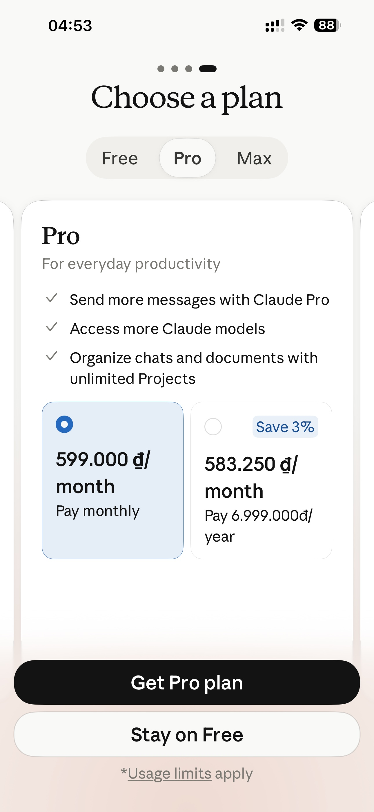](https://anhtester.com/storage/photos/shares/lesson/ai_test_manual/account_claude_pro_gpt_plus/1787262995918_2011380643477868092_5075844802271054756_f28544a10466235ea910352f82028bfb.jpg)

Các bạn dùng app MoMo/ZaloPay để thanh toán cho Apple Pay hoặc Google Pay.

[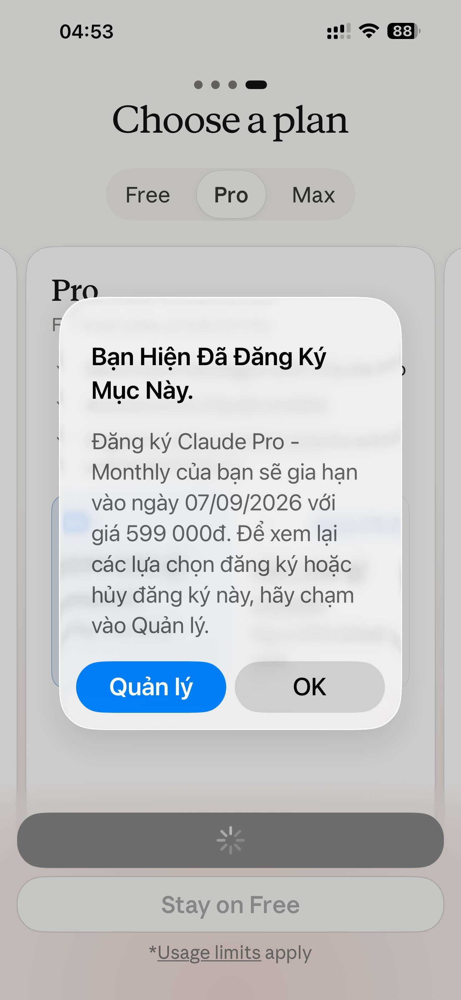](https://anhtester.com/storage/photos/shares/lesson/ai_test_manual/account_claude_pro_gpt_plus/1787262995925_2011380643477868092_5075844802271054756_fdd666193db75aa2c66da2036151c87f.jpg)[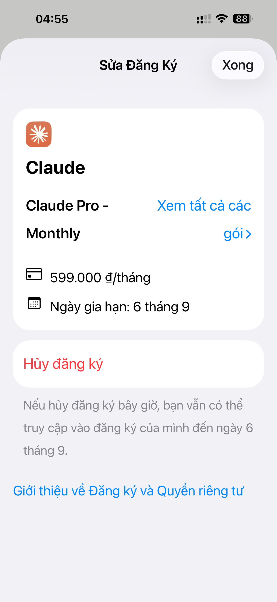](https://anhtester.com/storage/photos/shares/lesson/ai_test_manual/account_claude_pro_gpt_plus/1787262995933_2011380643477868092_5075844802271054756_8a778ab99e46d5f1a8264ce330f8765c.jpg)

Nếu gói X5 X20 thì giá hơi chát 😝

[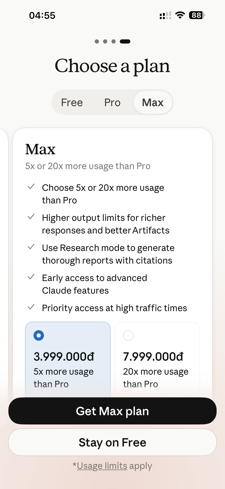](https://anhtester.com/storage/photos/shares/lesson/ai_test_manual/account_claude_pro_gpt_plus/1787262995940_2011380643477868092_5075844802271054756_836af45f64293b23b56f0bfaf75801fb.jpg)[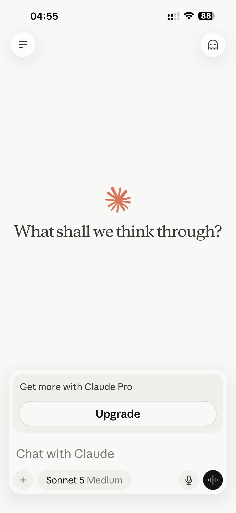](https://anhtester.com/storage/photos/shares/lesson/ai_test_manual/account_claude_pro_gpt_plus/1787262995946_2011380643477868092_5075844802271054756_50c37ea6859aa81041ca3ae2499042d8.jpg)

Liên kết MoMo với Apple Pay/Google Pay

[](https://anhtester.com/storage/photos/shares/lesson/ai_test_manual/account_claude_pro_gpt_plus/1787263129389_2011380643477868092_5075844802271054756_4093bb9915953adea9c4be97854c2d04.jpg)[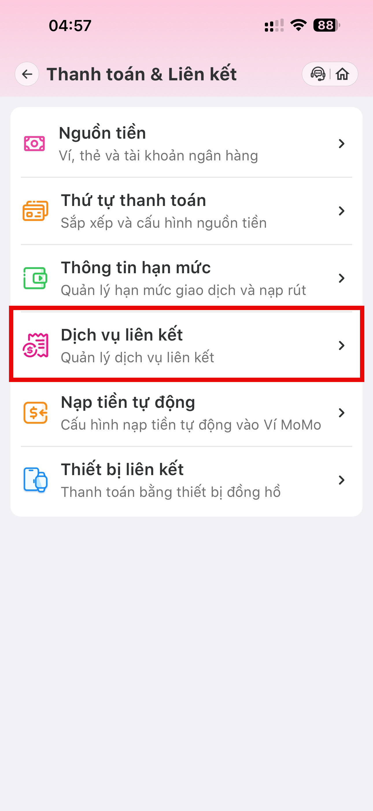](https://anhtester.com/storage/photos/shares/lesson/ai_test_manual/account_claude_pro_gpt_plus/1787263129411_2011380643477868092_5075844802271054756_76b16d62a08f0ae89a0e1d42d5392f71.jpg)[](https://anhtester.com/storage/photos/shares/lesson/ai_test_manual/account_claude_pro_gpt_plus/1787263129424_2011380643477868092_5075844802271054756_9904bd993a5a36536c10228ab63c4613.jpg)

Xong rồi lấy account này login trên Desktop App là xong.

### 5.2. Đăng ký tài khoản ChatGPT Plus trên mobile app

Tải app ChatGPT trên App Store (iPhone)

[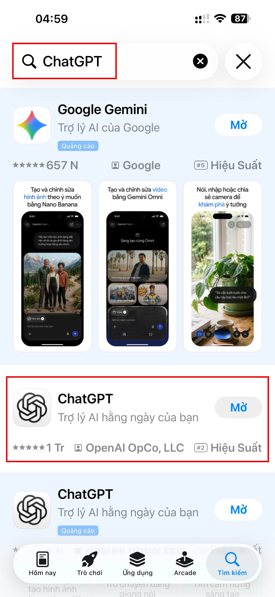](https://anhtester.com/storage/photos/shares/lesson/ai_test_manual/account_claude_pro_gpt_plus/1787263291237_2011380643477868092_5075844802271054756_9dcdc76eb3633152af0a48853cb7e517.jpg)[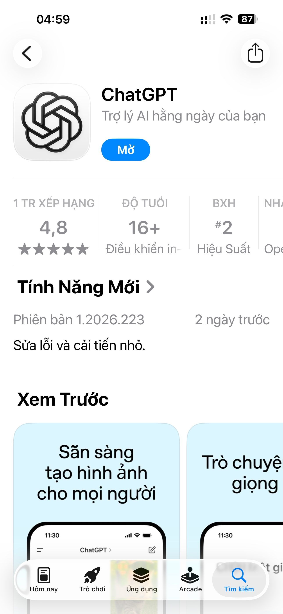](https://anhtester.com/storage/photos/shares/lesson/ai_test_manual/account_claude_pro_gpt_plus/1787263291259_2011380643477868092_5075844802271054756_a02cee6f2b1f211c9118afa0037883d5.jpg)[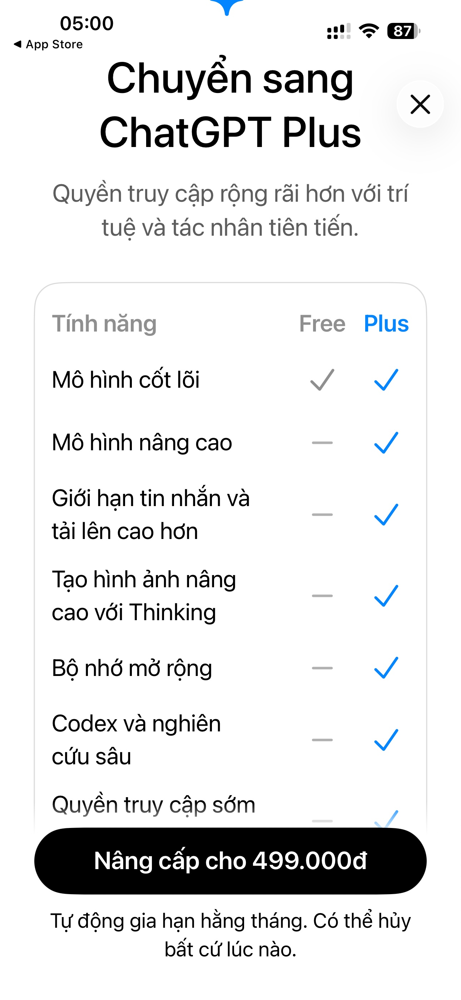](https://anhtester.com/storage/photos/shares/lesson/ai_test_manual/account_claude_pro_gpt_plus/1787263291284_2011380643477868092_5075844802271054756_c74ca650e8a9138a8b020ecb42591ec3.jpg)

[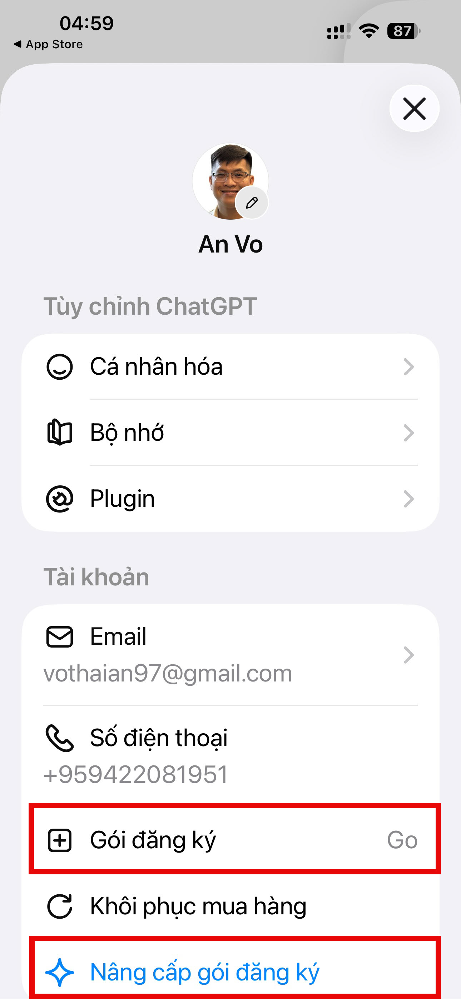](https://anhtester.com/storage/photos/shares/lesson/ai_test_manual/account_claude_pro_gpt_plus/1787263291273_2011380643477868092_5075844802271054756_abbd0cf7f9d2e407b3680c446f1ec107.jpg)

🔥Lưu ý: các bạn dùng 1 trong 2 tài khoản là được rồi nhen, không bắt buộc cả 2 loại.

## 6. Những điều Manual Tester không nên giao hoàn toàn cho AI

Không nên mặc định để AI quyết định:

- Business Risk.
- Final Severity.
- Final Priority.
- Release Decision.
- Production Risk Acceptance.
- Business Requirement interpretation khi requirement chưa rõ.
- Pass/Fail cuối cùng của một release.

AI có thể **recommend**.

QA phải **validate và decide**.

### Lưu ý an toàn dành riêng cho Tester

- **Không đưa dữ liệu thật của khách hàng** (số CCCD, số thẻ, email thật, hồ sơ cá nhân…) vào prompt. Luôn dùng dữ liệu giả lập.
- **Kiểm tra kỹ trước khi cho phép ghi đè file.** Luôn đọc phần thay đổi trước khi nhấn Allow.
- **AI có thể sai.** Bộ Test Case do AI sinh ra là *bản nháp chất lượng cao*, không phải sản phẩm cuối. Tester vẫn là người chịu trách nhiệm kiểm duyệt.
- **Tuân thủ chính sách công ty.** Trước khi cài lên máy công ty, hãy xác nhận với quản lý hoặc bộ phận IT / Security.

## 7. Bài tập thực hành Test Manual

### Bài tập 1 - Requirement Analysis

Chọn một User Story thực tế.

Yêu cầu AI:

```text
Hãy phân tích User Story này dưới góc độ Senior QA.

Xác định:

- Functional Requirements
- Business Rules
- Positive Scenarios
- Negative Scenarios
- Boundary Conditions
- Validation
- Security Risks
- Potential Risks
- Các điểm chưa rõ
- Các câu hỏi cần hỏi BA/PO

Chưa tạo Test Case.
```

Sau đó Tester tự review kết quả.

### Bài tập 2 - Generate Test Scenario

Dựa trên Requirement:

```text
Hãy tạo Test Scenario đầy đủ cho Requirement này.

Phân loại:

- Positive
- Negative
- Boundary
- Validation
- Security
- Integration
- Usability

Không tạo Test Case chi tiết.
```

### Bài tập 3 - Generate Test Case

Dựa trên Test Scenario:

```text
Hãy tạo Test Case chi tiết.

Mỗi Test Case bao gồm:

- Test Case ID
- Test Title
- Preconditions
- Test Data
- Test Steps
- Expected Result
- Priority
- Test Type

Đảm bảo Test Case có thể thực thi
bởi Manual Tester.
```

### Bài tập 4 - Review Test Case

Lấy một bộ Test Case hiện tại:

```text
Hãy review bộ Test Case này
dưới góc độ Senior QA.

Tìm:

- Missing Scenario
- Duplicate
- Missing Negative Case
- Missing Boundary Case
- Missing Validation
- Missing Security Case
- Expected Result chưa chính xác
- Test Step chưa rõ

Không sửa trực tiếp.

Hãy đưa ra Review Report trước.
```

### Bài tập 5 - Phân tích Bug

Chọn một Bug thực tế:

```text
Hãy phân tích Bug Report này.

Xác định:

- Actual Result
- Expected Result
- Severity
- Priority
- Impact
- Possible Root Cause
- Related Test Case
- Regression Scope
- Information cần bổ sung

Nếu chưa đủ thông tin,
hãy chỉ rõ thông tin còn thiếu.
```

### Bài tập 6 - Regression Impact Analysis

Chọn một Feature vừa thay đổi:

```text
Hãy phân tích Regression Impact
của Feature này.

Xác định:

- High Risk Areas
- Medium Risk Areas
- Low Risk Areas
- Smoke Tests
- Functional Tests
- Regression Tests
- Integration Tests
- Security Tests

Giải thích lý do lựa chọn.
```

## 8. Tổng kết

Trong bài học này, chúng ta đã tiếp cận Claude Code và Codex từ góc nhìn của **Manual Tester**.

Điều quan trọng cần nhớ là:

> **AI không chỉ dành cho việc viết code.**

Trong Software Testing, AI có thể hỗ trợ rất nhiều hoạt động:

```text
Requirement
     ↓
Analysis
     ↓
Risk
     ↓
Scenario
     ↓
Test Case
     ↓
Test Data
     ↓
Execution
     ↓
Bug
     ↓
Impact
     ↓
Regression
```

AI giúp Tester:

- Phân tích nhanh hơn.
- Tìm thêm scenario.
- Review Test Case.
- Phân tích Bug.
- Chuẩn bị Regression Scope.
- Giảm các công việc lặp lại.

Nhưng AI không thay thế tư duy QA.

Một Manual Tester sử dụng AI hiệu quả không phải là người:

> "Cho AI làm hết."

Mà là người biết:

> **Giao đúng task → cung cấp đúng context → kiểm soát output → xác minh bằng evidence → đưa ra quyết định QA.**

Đây chính là tư duy quan trọng khi chuyển từ **Manual Testing** sang **AI-Assisted Testing**.

Ở những bài tiếp theo, chúng ta sẽ tìm hiểu **cách viết Prompt cho AI hiệu quả và tối ưu tài nguyên**, giúp Tester có thể giao task cho AI Agent một cách rõ ràng, có cấu trúc và kiểm soát được kết quả.

*– Anh Tester –*